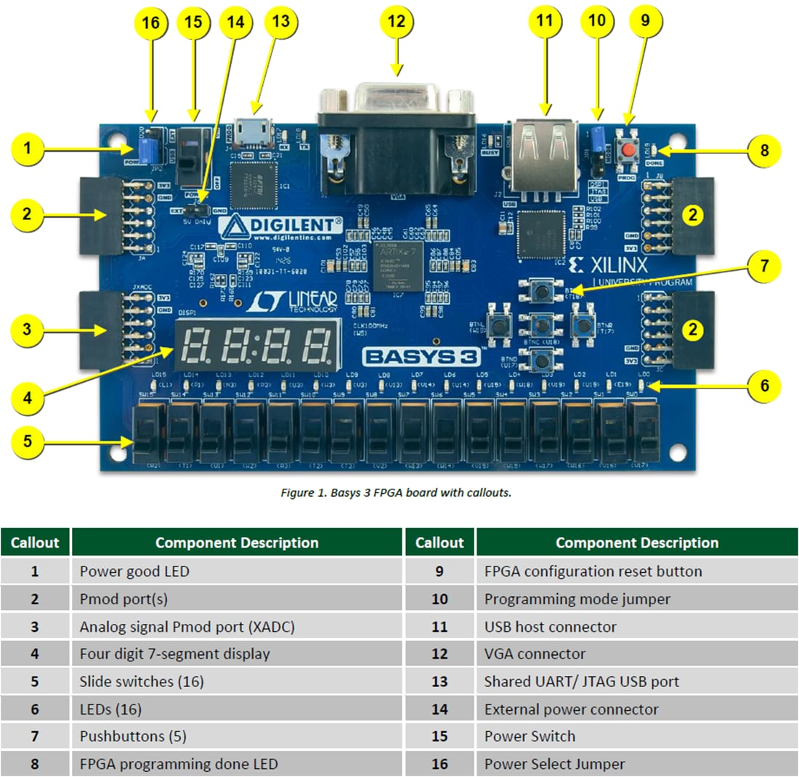
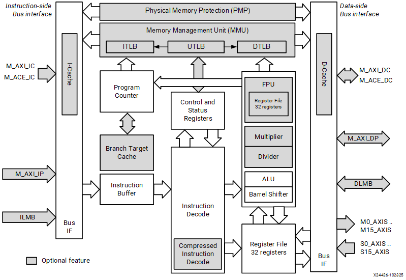

# MicroBlaze V + BRAM 최소 SoC


## 전체 학습 위치


## 최소 SoC 구성 범위

SoC 01은 이후 모든 확장의 기준이 되는 최소 실행 하드웨어를 구성한다. GPIO·UART·Timer·Interrupt·Custom AXI IP·NPU는 포함하지 않는다.

MicroBlaze V를 FPGA 내부에 구성한다.

명령과 데이터를 저장할 BRAM을 붙인다.

Basys3 100 MHz와 Processor System Reset을 연결한다.

Validate → Wrapper → Synthesis/Implementation을 통과한다.


## Basys3 하드웨어 기준

Basys3는 Artix-7 XC7A35T-1CPG236C를 사용하며, 보드에는 100 MHz 단일 Oscillator가 있다. Digilent Reference Manual은 이 Clock이 FPGA의 W5 핀에 연결되어 있음을 명시한다.


[](../images/common/basys3_board_callout.jpg)

Basys 3 보드 콜아웃. FPGA, 공유 UART/JTAG USB, Push Button, 100 MHz Clock 위치를 확인한다.
원문 기준: Digilent Basys 3 Reference Manual · Figure 1


| 항목 | Basys3 기준 | SoC 01에서의 사용 |
| --- | --- | --- |
| FPGA | XC7A35T-1CPG236C | MicroBlaze V·BRAM·Clock/Reset IP가 모두 이 FPGA 내부에 구현된다. |
| 기준 Clock | 100 MHz | Clocking Wizard 입력 |
| Clock Pin | W5 | Top/BD 외부 Clock 포트와 XDC 연결 |
| Reset 입력 | Center Button BTNC, pin U18 | 실습용 외부 Reset으로 사용 |
| BRAM 자원 | 1,800 Kbits | 초기 Local Memory 16 KB 구성에 충분한 온칩 자원 |


## MicroBlaze V 내부 구조

MicroBlaze V는 AMD FPGA에 구현하도록 설계된 RISC Soft Processor이다. 내부에는 Program Counter, Instruction Decode, Register File, ALU 등이 있고 양쪽에 Instruction-side/Data-side bus interface가 있다.


[](../images/common/v_core.png)

AMD UG1711 2026.1 · MicroBlaze V Processor Block Diagram. 이번 실습은 32비트 구성을 사용한다.


```text
PC → Instruction-side Bus → ILMB → BRAM → Instruction Fetch
Load/Store → Data-side Bus → DLMB → BRAM → Data Read/Write
```

핵심은 “CPU가 BRAM 하나를 쓴다”에서 끝내지 않고, 명령어 Fetch 경로와 Data Load/Store 경로가 논리적으로 분리되어 있다는 것을 Block Design에서 확인하는 것이다.


## ILMB · DLMB · BRAM 관계

LMB(Local Memory Bus)는 FPGA 내부 Block RAM에 빠르게 접근하기 위한 간결한 Local Bus이다. AMD UG1711는 Instruction LMB와 Data LMB가 각각 LMB BRAM Interface Controller를 통해 공통 Block RAM에 연결되는 구성을 일반적인 MicroBlaze V Local Memory 구조로 설명한다.


| 경로 | 버스와 컨트롤러 | 도착점 |
| --- | --- | --- |
| microblaze_riscv_0 / ILMB | ilmb_v10 → lmb_bram_if_cntlr | 공통 Block Memory Generator |
| microblaze_riscv_0 / DLMB | dlmb_v10 → lmb_bram_if_cntlr | 공통 Block Memory Generator |


| 인터페이스 | 주 역할 | 실행 관점 |
| --- | --- | --- |
| ILMB | Instruction Local Memory Bus | PC가 가리키는 명령어 Fetch |
| DLMB | Data Local Memory Bus | 변수·Stack·Data Load/Store |
| BRAM | Program + Data Local Memory | 초기 Bare-metal 실행 저장공간 |


## Vivado 프로젝트 생성

- Create ProjectVivado에서 Create Project를 선택하고 새 RTL Project를 만든다.
- Project TypeRTL Project를 선택한다. 지금 단계에서는 Verilog 기능 모듈을 추가하지 않아도 된다.
- Target Device재현성을 위해 Part 기준으로 xc7a35tcpg236-1을 선택한다. Digilent Board File이 설치되어 있다면 Board 탭의 Basys3를 선택해도 된다.
- 프로젝트 이름예: soc01_microblaze_bram. 경로에는 한글·공백·특수문자를 가급적 사용하지 않는다.

## IP Integrator에서 Block Design 생성

- Flow Navigator → IP IntegratorCreate Block Design을 선택한다.
- Design Namesoc01_mb_bram으로 지정한다. 이후 HDL Wrapper 이름과 연결되므로 의미 있는 이름을 사용한다.
- 빈 Diagram 확인Diagram Canvas가 열리면 아직 아무 IP도 없는 상태가 정상이다.

## MicroBlaze V IP 추가

- Add IPDiagram의 + 또는 우클릭 → Add IP를 선택한다.
- MicroBlaze V 검색MicroBlaze V를 검색하여 추가한다. CPU 인스턴스는 microblaze_riscv_0로 확인한다.
- 단독 CPU 상태 확인Canvas에 microblaze_riscv_0가 추가되고 ILMB, DLMB, Clock, Reset, Debug/AXI 관련 인터페이스가 보이는지 확인한다.
CPU 설정은 32비트 주소·RV32IM, Area 최적화, 캐시·FPU·Atomic·Compressed·RV32E·MMU 없음으로 맞춘다. Debug는 활성화하고 MDM V를 연결한다.


## Run Block Automation — 최소 시스템 자동 구성

MicroBlaze V를 추가하면 Designer Assistance가 활성화된다. Run Block Automation을 실행한다.


[](../images/common/v_automation.png)

AMD UG1711 2026.1 · MicroBlaze V Run Block Automation. 본문 설정표에 맞춰 구성한다.


### SoC 01 권장 설정


| 항목 | 설정 | 이유 |
| --- | --- | --- |
| Preset | None | 자동 고성능 구성이 아니라 최소 구조를 직접 확인한다. |
| Local Memory | 16 KB | 초기 Bare-metal 실습에 충분하며 구조 확인이 쉽다. |
| Local Memory ECC | None | 첫 단계에서 ECC 복잡도를 제외한다. |
| Cache Configuration | None | Local BRAM 동작을 먼저 이해한다. |
| Debug Module | Debug Enabled | 후속 Vitis/JTAG Debug를 위해 MDM V을 유지한다. |
| Peripheral AXI Port | Enabled | SoC 06 이후 AXI Peripheral 확장을 위해 유지하며, SoC 01에서는 연결하지 않는다. |
| Interrupt Controller | Off | Interrupt는 후속 장에서 별도로 추가한다. |
| Clock Connection | New Clocking Wizard | Basys3 100 MHz 기준 Clock을 시스템 Clock으로 만든다. |


## Block Automation 이후 구조


[](../images/common/v_system.png)

AMD UG1711 2026.1 · Block Automation으로 생성한 MicroBlaze V 시스템.

그림을 “블록이 많이 생겼다”로 끝내지 말고 아래 순서로 추적한다.


| 구성 | 연결 |
| --- | --- |
| clk_wiz_* / Clocking Wizard | clk_out1 → 시스템 클록 |
| microblaze_riscv_0 + Local Memory | ILMB → Local Memory / DLMB → Local Memory |
| proc_sys_reset / Processor System Reset | mb_reset → MicroBlaze V / bus_struct_reset → Bus |
| AXI 리셋 | peripheral_aresetn / interconnect_aresetn → AXI 계층 |
| mdm_* / MicroBlaze Debug Module V | DEBUG 인터페이스 |


### Local Memory Hierarchy를 펼쳐서 확인

microblaze_riscv_0_local_memory와 같은 Hierarchical Block을 열어 ILMB Controller, DLMB Controller, Block Memory Generator가 실제로 존재하는지 확인한다.


## Clock · Reset 연결

Block Automation이 내부 연결을 만들어도 외부 Basys3 Clock/Reset과 연결되지 않은 포트가 남을 수 있다. Designer Assistance의 Run Connection Automation을 확인한다.


### Clock


### Reset


### 반드시 확인할 연결

- Clocking Wizard locked → Processor System Reset dcm_locked
- Clocking Wizard clk_out1 → MicroBlaze V Clock 및 Local Memory Clock
- 외부 Reset → ext_reset_in
- MicroBlaze V Reset ← mb_reset
MDM V/Debug_SYS_Rst → Processor System Reset/mb_debug_sys_rst를 연결한다. 미사용 aux_reset_in은 Active-High 설정에서 0으로 고정한다.


## Basys3 XDC — 필요한 줄만 원본에서 활성화

Digilent Basys-3-Master.xdc에서 Clock과 Center Button Reset 관련 줄을 활성화한다. Block Design의 외부 포트 이름은 clk, btnC와 일치시킨다.


```text
## Clock signal
set_property -dict { PACKAGE_PIN W5 IOSTANDARD LVCMOS33 } [get_ports clk]
create_clock -add -name sys_clk_pin -period 10.00 -waveform {0 5} [get_ports clk]

## Center Button : Reset
set_property -dict { PACKAGE_PIN U18 IOSTANDARD LVCMOS33 } [get_ports btnC]
```


| XDC | 의미 | 검증 |
| --- | --- | --- |
| PACKAGE_PIN W5 | Basys3 100 MHz oscillator | Reference Manual의 Oscillators/Clocks 절과 일치 |
| period 10.00 | 100 MHz의 1주기 = 10 ns | Timing Engine에 Primary Clock 정의 |
| PACKAGE_PIN U18 | Center Push Button | Digilent Master XDC의 btnC |


## Validate Design — 첫 번째 Stage Gate

- Diagram 저장Ctrl+S로 Block Design을 먼저 저장한다.
- Validate DesignDiagram Toolbar의 Validate 또는 우클릭 → Validate Design을 실행한다.
- Error와 Critical Warning 확인단순히 “Validation successful” 창만 보는 것이 아니라 Messages 창에서 Clock/Reset/Unconnected Interface 관련 메시지를 확인한다.

## Generate Output Products · HDL Wrapper

- Generate Output ProductsSources에서 soc01_mb_bram.bd를 우클릭하고 Generate Output Products를 실행한다.
- Create HDL WrapperBlock Design을 우클릭 → Create HDL Wrapper.
- Vivado 관리 방식 선택Let Vivado tools manage wrapper and auto-update를 권장한다. Top은 Block Design을 감싸는 Shell/Wrapper로 유지한다.
- Top 확인생성된 soc01_mb_bram_wrapper가 Top으로 지정되었는지 Sources에서 확인한다.

## Synthesis · Implementation

- Run SynthesisSynthesis가 완료되면 Critical Warning과 unconstrained clock/I/O 관련 메시지를 확인한다.
- Open Synthesized DesignClock 포트와 Reset 포트가 예상한 Pin/IOSTANDARD 제약을 받았는지 확인한다.
- Run ImplementationImplementation을 실행해 Placement/Routing 단계까지 통과시킨다.
- Timing Summary100 MHz Primary Clock가 인식되는지, WNS/TNS가 비정상적으로 보고되지 않는지 확인한다. 상세 Timing Closure는 후속 장에서 확장한다.

## 오류 점검


| 증상 | 우선 의심 | 확인 방법 |
| --- | --- | --- |
| Run Block Automation이 안 보임 | MicroBlaze V가 제대로 추가되지 않았거나 Designer Assistance 조건 미충족 | IP 종류가 MicroBlaze V인지, BD가 활성 Diagram인지 확인 |
| Local Memory가 없음 | Block Automation에서 Local Memory 미구성 | microblaze_*_local_memory hierarchy 존재 확인 |
| Validate에서 Reset 오류 | dcm_locked, ext_reset_in, Clock 누락 | Clocking Wizard ↔ Processor System Reset 연결 추적 |
| XDC가 적용되지 않음 | 외부 포트명 불일치 | get_ports clk, get_ports btnC와 실제 BD external port 이름 비교 |
| Clock가 unconstrained | create_clock 누락/포트명 오류 | Timing Constraints/Report Clocks에서 100 MHz 확인 |
| CPU가 계속 Reset 상태 | Clock Wizard lock 또는 Reset polarity 문제 | locked → dcm_locked, BTNC active level 확인 |
| 보드에서 눈에 보이는 변화가 없음 | 정상일 수 있음 | SoC 01에는 LED/UART Peripheral이 없음 |


## SoC 01 완료 체크리스트

- [ ] Target이 Basys3의 XC7A35T-1CPG236C이다.
- [ ] soc01_mb_bram.bd가 생성되었다.
- [ ] MicroBlaze V와 MDM V가 존재한다.
- [ ] Local Memory 16 KB, ECC None, Cache None이다.
- [ ] ILMB와 DLMB가 Local BRAM으로 연결된다.
- [ ] MDM V Debug Module이 연결된다.
- [ ] Basys3 100 MHz Clock이 Clocking Wizard로 들어간다.
- [ ] clk_wiz/locked → proc_sys_reset/dcm_locked가 연결된다.
- [ ] btnC가 외부 Reset으로 연결된다.
- [ ] XDC의 W5 / U18 / 10 ns Clock Constraint가 실제 포트명과 일치한다.
- [ ] Validate Design이 통과한다.
- [ ] HDL Wrapper를 Vivado 관리 방식으로 생성했다.
- [ ] Synthesis가 통과한다.
- [ ] Implementation이 통과한다.
- [ ] 아직 GPIO/UART/Timer/Interrupt/NPU를 추가하지 않았다.

## 공식 매뉴얼 및 원본 근거


| 문서 | 확인 항목 |
| --- | --- |
| AMD UG1711 · MicroBlaze V Processor Embedded Design User Guide · 2026.1 | MicroBlaze V 기본 구조, Local Memory Bus, Block Automation 설정, Clock/Reset 연결 흐름 |
| AMD UG994 · Designing IP Subsystems Using IP Integrator · 2026.1 | IP Integrator, Designer Assistance, Run Block Automation, Validate Design, HDL Wrapper |
| AMD UG1629 · MicroBlaze V Processor Reference Guide · 2026.1 | MicroBlaze V Processor Architecture와 Register/Address 구조의 심화 기준 |
| AMD PG164 · Processor System Reset | External/Aux Reset polarity, Reset synchronization과 sequencing |
| Digilent Basys 3 Reference Manual | Artix-7 device, 100 MHz oscillator, W5 Clock pin, 보드 I/O |
| Digilent Basys-3-Master.xdc | W5 Clock, 10 ns constraint, U18 Center Button pin 기준 |

