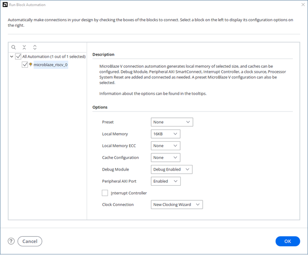
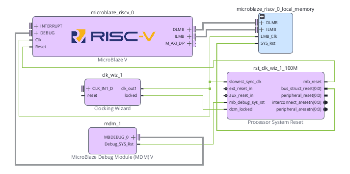
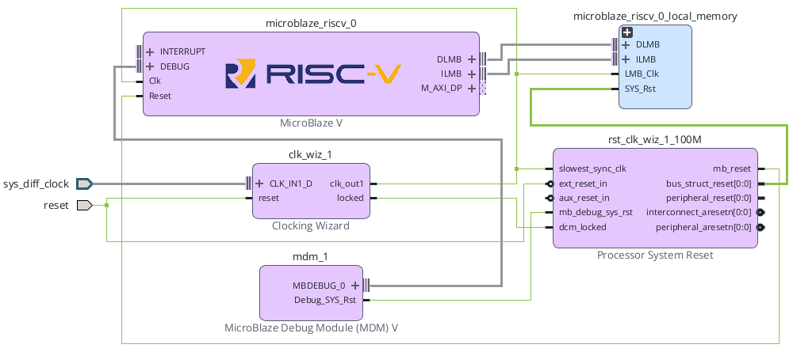

# Clock / Reset 구조와 Processor System Reset


## 전체 학습 위치


## Clock과 Reset의 역할

MicroBlaze V, BRAM Controller, AXI Interconnect, Peripheral은 모두 Clock을 기준으로 상태가 변한다. Reset은 이 회로들을 알려진 초기 상태로 만들고, Clock이 안정된 뒤 정해진 순서로 동작을 시작하게 한다.

FPGA 내부 모든 동기 회로의 시간 기준을 만든다.

Clocking Wizard가 안정화되었는지 locked로 알린다.

Processor System Reset이 용도별 Reset을 생성한다.

Bus → Peripheral → CPU 순으로 Reset을 해제한다.


## Basys3 100 MHz Clock

Basys3 Reference Manual은 보드에 단일 100 MHz oscillator가 있고 FPGA의 W5 핀으로 들어간다고 설명한다. W5는 Bank 34의 MRCC(Multi-Region Clock Capable, 여러 Clock 영역으로 전달 가능한 Clock 입력)이다.


| 항목 | Basys3 기준 | SoC 02에서의 역할 |
| --- | --- | --- |
| Oscillator | 100 MHz | Clocking Wizard의 입력 Clock |
| FPGA Pin | W5 | XDC의 Primary Clock 입력 |
| Clock Period | 10 ns | Vivado Timing 기준 |
| IOSTANDARD | LVCMOS33 | Basys3 Clock 입력 전기 규격 |


```text
f = 100 MHz
T = 1 / f
T = 10 ns
```

따라서 XDC에서 create_clock의 period는 10.00 ns로 지정한다.


## Clocking Wizard

Clocking Wizard는 FPGA 내부 MMCM/PLL 자원을 이용해 입력 Clock으로부터 필요한 주파수와 위상의 Clock을 만든다. SoC 02에서는 입력과 출력 모두 100 MHz를 사용하더라도, 시스템 Clock 생성과 locked 상태 관리를 위해 Clocking Wizard를 그대로 유지한다.


| 신호 | 방향 | 의미 |
| --- | --- | --- |
| clk_in1 | 입력 | Basys3 100 MHz 기준 Clock |
| clk_out1 | 출력 | MicroBlaze V SoC 내부 System Clock |
| reset | 입력 | Clocking Wizard 자체 Reset |
| locked | 출력 | Clock 회로가 안정되어 출력 Clock을 사용할 수 있음을 알리는 상태 |


## Processor System Reset

Processor System Reset은 외부 Reset, Debug Reset, Clock lock 상태를 받아 MicroBlaze V·Bus·AXI Peripheral에 필요한 여러 종류의 Reset을 만든다. 하나의 버튼 Reset을 모든 블록에 직접 연결하는 대신 각 회로의 극성과 해제 순서를 맞추는 역할을 담당한다.


| 방향 | 신호 |
| --- | --- |
| 입력 | slowest_sync_clk / ext_reset_in / aux_reset_in / mb_debug_sys_rst / dcm_locked |
| 출력 | mb_reset / bus_struct_reset / peripheral_reset / interconnect_aresetn / peripheral_aresetn |

AMD PG164는 이 IP를 Processor/Bus/Peripheral이 한 Clock 체계 안에서 안전하게 Reset되도록 하는 전용 Reset 모듈로 설명한다.


## Reset 입력과 출력


| Signal | 방향 | 극성 | 역할 |
| --- | --- | --- | --- |
| slowest_sync_clk | Input | Clock | Reset 동기화와 해제 순서의 기준 Clock |
| ext_reset_in | Input | 설정 가능 | 보드의 외부 Reset 입력 |
| aux_reset_in | Input | 설정 가능 | 시스템 내부의 보조 Reset 입력 |
| mb_debug_sys_rst | Input | Active-High | MDM V(MicroBlaze Debug Module V)의 Debug Reset |
| dcm_locked | Input | 상태 | Clock 생성 회로가 안정되었는지 확인 |
| mb_reset | Output | Active-High | MicroBlaze V Core Reset |
| bus_struct_reset | Output | Active-High | Bus 구조용 Reset |
| peripheral_reset | Output | Active-High | Active-High Peripheral용 Reset |
| interconnect_aresetn | Output | Active-Low | AXI Interconnect 계층 Reset |
| peripheral_aresetn | Output | Active-Low | AXI Peripheral 계층 Reset |


## Active-High · Active-Low


| 표기 | Reset이 걸린 상태 | Reset이 풀린 상태 |
| --- | --- | --- |
| mb_reset | 1 | 0 |
| bus_struct_reset | 1 | 0 |
| peripheral_reset | 1 | 0 |
| interconnect_aresetn | 0 | 1 |
| peripheral_aresetn | 0 | 1 |


```text
reset      : 1 → RESET
aresetn    : 0 → RESET

suffix "_n" 또는 "aresetn"
→ 보통 Low일 때 Reset이 활성화됨
```

AXI 계열 IP는 aresetn이라는 Active-Low Reset을 많이 사용한다. 따라서 peripheral_aresetn을 AXI Peripheral의 s_axi_aresetn 등에 연결할 때 별도의 반전기를 임의로 넣지 않는다.


## locked → dcm_locked

AMD UG1711는 Board Flow를 사용하지 않는 경우에도 Clocking Wizard의 locked 출력을 Processor System Reset의 dcm_locked 입력에 연결해야 한다고 명시한다.

PG164에 따르면 dcm_locked가 동작 중 Low로 내려가면 Processor System Reset은 모든 Reset 출력을 다시 활성화한다. 따라서 Clock이 불안정한 동안 CPU와 Bus가 동작을 계속하지 않도록 막는다.


## slowest_sync_clk

slowest_sync_clk는 Processor System Reset 내부의 동기화 및 Reset 해제 시퀀스가 기준으로 삼는 Clock이다. PG164는 시스템에서 사용하는 동기 Clock 중 가장 느린 Clock에 연결하도록 설명하며, 일반적으로 AXI4-Lite Clock을 예로 든다.

SoC 02는 하나의 100 MHz Clock Domain만 사용하므로 다음과 같이 연결한다.


## Reset 해제 순서

PG164는 Reset이 활성화될 때는 출력들이 함께 활성화되지만, Reset 해제는 순서를 두어 진행한다고 설명한다.


| 순서 | 해제되는 Reset | 100 MHz 기준 | 의미 |
| --- | --- | --- | --- |
| 1 | bus_struct_reset, interconnect_aresetn | 기준 시점 | Bus/Interconnect를 먼저 준비 |
| 2 | peripheral_reset, peripheral_aresetn | 16 clocks 후 ≈ 160 ns | Peripheral 동작 허용 |
| 3 | mb_reset | 추가 16 clocks 후 ≈ 320 ns | CPU가 마지막에 실행 시작 |


```text
Clock Stable
    ↓
Bus / Interconnect Reset 해제
    ↓ 16 clocks
Peripheral Reset 해제
    ↓ 16 clocks
MicroBlaze V Reset 해제
    ↓
CPU 실행 시작
```

이 160 ns, 320 ns 값은 Reset 해제 시퀀스 구간만 100 MHz로 환산한 값이다. 외부 Reset 입력 검출, Clock lock 획득 시간까지 포함한 전체 Reset 시간은 이 값보다 길 수 있다.


## Block Automation 설정 확인


[](../images/common/v_automation.png)

AMD UG1711 2026.1 · MicroBlaze V Run Block Automation. 본문 설정표에 맞춰 구성한다.


| 항목 | SoC 02 확인값 |
| --- | --- |
| Local Memory | SoC 01과 동일 |
| Cache | None |
| Debug | Debug Enabled |
| Peripheral AXI Port | Enabled |
| Interrupt Controller | Off |
| Clock Connection | New Clocking Wizard (100 MHz) |


## 자동 생성 구조 확인


[](../images/common/v_clock_before.png)

AMD UG1711 2026.1 · MicroBlaze V와 Clocking Wizard / Processor System Reset.


| 출발 신호 | 도착 신호 |
| --- | --- |
| clk_wiz_1/clk_out1 | microblaze_riscv_0/Clk |
| clk_wiz_1/clk_out1 | local_memory/LMB_Clk |
| clk_wiz_1/clk_out1 | proc_sys_reset/slowest_sync_clk |
| clk_wiz_1/locked | proc_sys_reset/dcm_locked |
| proc_sys_reset/mb_reset | microblaze_riscv_0/Reset |


## 외부 Clock · Reset 연결

Clocking Wizard와 Processor System Reset이 내부에 생성되었으면 Basys3의 외부 Clock과 Reset을 Block Design 외부 포트로 연결한다.


[](../images/common/v_clock_after.png)

AMD UG1711 2026.1 · MicroBlaze V clock/reset 연결 예. Basys3 입력은 단일 100 MHz로 맞춘다.


| 출발 신호 | 도착 신호 |
| --- | --- |
| Basys3 W5 · 100 MHz | clk_wiz_1/clk_in1 |
| Basys3 BTNC · U18 | clk_wiz_1/reset |
| Basys3 BTNC · U18 | proc_sys_reset/ext_reset_in |
| clk_wiz_1/locked | proc_sys_reset/dcm_locked |
| clk_wiz_1/clk_out1 | proc_sys_reset/slowest_sync_clk |


## Basys3 XDC

Digilent Master XDC의 Clock과 Center Button 줄만 활성화하고, Block Design에서 만든 외부 포트 이름과 일치시킨다.


```text
## Clock signal
set_property -dict { PACKAGE_PIN W5 IOSTANDARD LVCMOS33 } [get_ports clk]
create_clock -add -name sys_clk_pin -period 10.00 -waveform {0 5} [get_ports clk]

## Center Button : Reset
set_property -dict { PACKAGE_PIN U18 IOSTANDARD LVCMOS33 } [get_ports btnC]
```


| 포트 | 핀 | 기능 |
| --- | --- | --- |
| clk | W5 | 100 MHz Primary Clock |
| btnC | U18 | Active-High 외부 Reset 입력 |


## Processor System Reset 설정

Basys3 Center Button은 누르면 High가 되는 입력으로 사용하므로 ext_reset_in도 Active-High로 맞추는 것이 직관적이다.


| 항목 | SoC 02 기준 | 이유 |
| --- | --- | --- |
| External Reset Logic Level | Active-High | BTNC 누름 = High |
| Auxiliary Reset | 미사용 | 현재 내부 보조 Reset 없음 |
| MicroBlaze Debug Reset | MDM V 연결 | Debug Reset 경로 유지 |
| dcm_locked | clk_wiz_1/locked | Clock 안정 상태 반영 |
| slowest_sync_clk | 100 MHz System Clock | 현재 단일 Clock Domain |

외부 Push Button은 FPGA Clock과 비동기이며 기계적 바운스가 발생할 수 있다. Processor System Reset은 Reset 입력 검출과 동기화 기능을 제공하지만, 이를 일반적인 Push Button Debouncer로 간주하지 않는다.

MDM V의 Debug_SYS_Rst는 mb_debug_sys_rst로 연결한다. aux_reset_in을 사용하지 않으면 Active-High 설정에서 0으로 고정한다.


## 신호 경로 추적

Block Design에서 아래 다섯 경로를 실제 Wire를 따라가며 확인한다.

- Primary Clockclk → clk_wiz_1/clk_in1
- Generated Clockclk_wiz_1/clk_out1 → microblaze_riscv_0/Clk
- Lockclk_wiz_1/locked → proc_sys_reset/dcm_locked
- External ResetbtnC → proc_sys_reset/ext_reset_in
- CPU Resetproc_sys_reset/mb_reset → microblaze_riscv_0/Reset

## Validate · Timing 확인

- Validate DesignBlock Design을 저장한 뒤 Validate Design을 실행한다.
- Clock AssociationMicroBlaze V, Local Memory, Processor System Reset이 동일한 100 MHz Clock에 연결되었는지 확인한다.
- Reset AssociationAXI 계층이 아직 최소 구성이라도 interconnect_aresetn, peripheral_aresetn이 올바른 극성으로 생성되는지 확인한다.
- Report ClocksSynthesis 이후 100 MHz Primary Clock이 10 ns Period로 인식되는지 확인한다.

## 오류 점검


| 증상 | 원인 후보 | 확인 위치 |
| --- | --- | --- |
| CPU가 실행되지 않음 | mb_reset이 계속 High | locked → dcm_locked, 외부 Reset 상태 확인 |
| Reset이 반대로 동작 | ext_reset_in polarity 불일치 | Processor System Reset 설정과 BTNC 논리 확인 |
| Clock 관련 Critical Warning | XDC create_clock 누락 또는 포트명 불일치 | W5, get_ports clk, Report Clocks 확인 |
| AXI IP가 Reset에서 안 풀림 | Active-Low Reset을 잘못 반전 | peripheral_aresetn, interconnect_aresetn 확인 |
| Reset 해제 직후 불안정 | Clock lock 전에 Reset 해제 | locked → dcm_locked 연결 확인 |
| 다른 Clock Domain 추가 후 오동작 | Reset을 모든 Domain에 공통 사용 | Clock Domain별 Reset 동기화 구조 재설계 |


## SoC 02 완료 체크리스트

- [ ] Basys3 100 MHz Clock가 W5로 정의되어 있다.
- [ ] XDC의 Clock Period가 10.00 ns이다.
- [ ] Clocking Wizard 입력과 출력 Clock을 구분할 수 있다.
- [ ] clk_wiz_1/locked → proc_sys_reset/dcm_locked가 연결되어 있다.
- [ ] clk_wiz_1/clk_out1 → proc_sys_reset/slowest_sync_clk가 연결되어 있다.
- [ ] btnC(U18) → ext_reset_in이 연결되어 있다.
- [ ] mb_reset이 Active-High임을 이해한다.
- [ ] interconnect_aresetn, peripheral_aresetn이 Active-Low임을 이해한다.
- [ ] Reset 해제 순서가 Bus/Interconnect → Peripheral → MicroBlaze V임을 이해한다.
- [ ] 100 MHz에서 16 clocks가 약 160 ns임을 계산할 수 있다.
- [ ] Block Design에서 다섯 핵심 Signal Path를 실제로 추적했다.
- [ ] Validate Design에서 Clock/Reset 관련 오류가 없다.

## 공식 매뉴얼 및 원본 근거


| 문서 | 확인 항목 |
| --- | --- |
| AMD UG1711 · MicroBlaze V Processor Embedded Design User Guide · 2026.1 | Clocking Wizard 생성, Processor System Reset 자동 연결, locked → dcm_locked, Connection Automation |
| AMD UG994 · Designing IP Subsystems Using IP Integrator · 2026.1 | Designer Assistance, Block Automation, Connection Automation, 외부 Clock/Reset 연결 흐름 |
| AMD PG164 · Processor System Reset Module v5.0 | Reset 입출력, active polarity, dcm_locked, slowest_sync_clk, Reset 해제 순서 |
| Digilent Basys 3 Reference Manual | 100 MHz Oscillator, W5 Clock Pin, Clocking Resources |
| Digilent Basys-3-Master.xdc | W5, 10 ns Clock Constraint, U18 Center Button |

