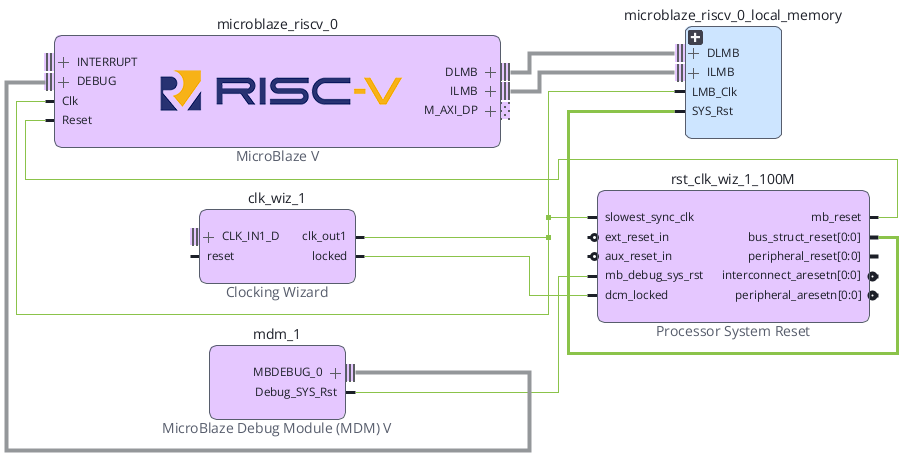
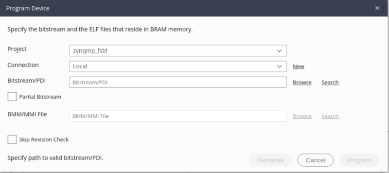
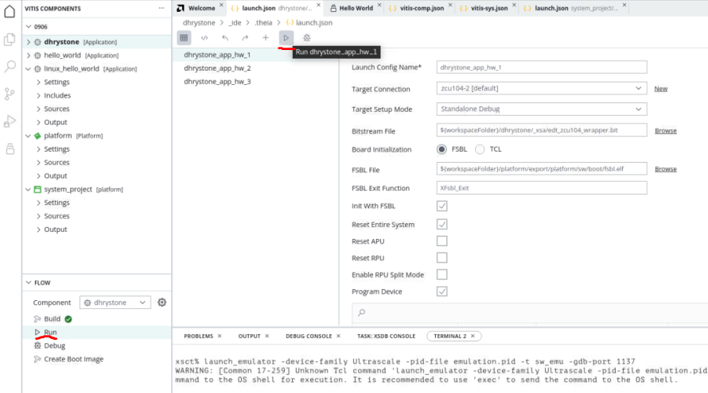

# MicroBlaze V 실행 구조와 BRAM 프로그램 실행


## 전체 학습 위치


## Reset 이후 프로그램 실행

SoC 02에서 mb_reset이 해제되면 MicroBlaze V는 프로그램 실행을 시작한다. CPU는 임의의 C 함수부터 실행하는 것이 아니라 먼저 Reset Vector 주소에서 명령어 Fetch를 시작한다.


```text
Processor System Reset
        │
        │ mb_reset 해제
        ▼
    MicroBlaze V
        │
        │ PC = Reset Vector
        ▼
      ILMB
        │
        ▼
      BRAM
        │
        │ Reset Vector Instruction
        ▼
    Decode / Execute
```


## Reset Vector와 PC

MicroBlaze V는 Reset 또는 Debug Reset이 발생하면 Pipeline을 비우고 C_BASE_VECTORS + 0x0에서 즉시 명령어 Fetch를 시작한다. 기본 C_BASE_VECTORS 값은 0x00000000이다.


| 항목 | 기본 기준 | 의미 |
| --- | --- | --- |
| C_BASE_VECTORS | 0x00000000 | Reset 기준 주소 |
| Reset Vector | C_BASE_VECTORS + 0x0 | Reset 해제 후 첫 Fetch 위치 |
| PC | Reset Vector를 가리킴 | 다음 실행 명령어의 주소 |


```text
Reset 해제 직후

PC
│
└──▶ 0x00000000
        │
        └──▶ .text.init
               │
               └──▶ Startup Code
                        │
                        └──▶ main()
```


## ILMB · DLMB · BRAM


[](../images/common/v_system.png)

AMD UG1711 2026.1 · MicroBlaze V의 ILMB/DLMB와 공유 Local Memory 연결.


| 경로 | 주요 역할 | 대표 접근 |
| --- | --- | --- |
| ILMB | Instruction Local Memory Bus | Reset Vector, Startup Code, .text 명령어 Fetch |
| DLMB | Data Local Memory Bus | .data, .bss, Stack, Heap, 변수 Load/Store |
| Dual-Port BRAM | 공통 Local Memory | Instruction과 Data 접근을 서로 다른 Port로 처리 |

UG1711도 ILMB를 빠른 Instruction Local Memory용, DLMB를 Data와 Vector용 Local Memory 경로로 설명한다.


## BRAM 주소 범위

SoC 01에서 Local Memory를 16 KB로 설정하고 Base Address가 0x00000000이라면 교육용 기준 주소 범위는 다음과 같이 계산할 수 있다.


```text
16 KB = 16 × 1024 Byte
      = 16384 Byte
      = 0x4000 Byte

Base Address = 0x00000000
High Address = 0x00000000 + 0x4000 - 1
             = 0x00003FFF
```


| 항목 | 교육용 기준값 |
| --- | --- |
| Local Memory Size | 16 KB |
| Base Address | 0x00000000 |
| High Address | 0x00003FFF |


## ELF 프로그램 구조

Vitis에서 C 소스를 Build하면 MicroBlaze V용 ELF(Executable and Linkable Format, 실행·링크 정보를 포함하는 실행 파일)가 생성된다. ELF에는 명령어뿐 아니라 초기값이 있는 변수, 초기화되지 않은 변수, Vector, Stack·Heap 배치 정보가 함께 반영된다.


| 단계 | 결과 |
| --- | --- |
| main.c | C 소스 |
| RISC-V GCC · Vitis 도구 체인 | Compile → Assemble → Link |
| Application.elf | .text.init / .text / .rodata / .data / .bss / .heap / .stack |


## Linker Script와 Memory Section

MicroBlaze V의 시작 코드는 생성된 RISC-V BSP와 Linker Script를 사용한다. .text.init의 _boot에서 트랩 벡터·레지스터·스택을 준비한 뒤 C 런타임과 main()으로 연결된다. 설치된 BSP의 실제 시작 심볼과 섹션 배치를 확인한다.


| 영역 | 내용 | 확인 |
| --- | --- | --- |
| .text.init / .text | 시작 코드와 프로그램 명령어 | Reset 주소에서 실행 가능한 코드 배치 |
| .rodata / .srodata | 읽기 전용 상수 | 실제 Linker Map의 섹션 |
| .data / .sdata | 초기값을 갖는 전역·정적 변수 | 초기화 이미지·실행 주소 |
| .bss / .sbss | 초기화되지 않은 전역·정적 변수 | C 시작 과정의 0 초기화 |
| Stack / Heap | 함수 호출·동적 메모리 | 16 KiB BRAM 범위·영역 중복 없음 |

큰 라이브러리 호출을 추가하기 전에 코드·데이터·스택·힙의 전체 크기를 확인한다. 이 예제는 UART 출력 없이 메모리 변수로 실행을 확인한다.


## Vivado에서 Hardware 완성

- Block Design 확인SoC 01·02의 MicroBlaze V, Local BRAM, Clocking Wizard, Processor System Reset 구조가 유지되는지 확인한다.
- Validate DesignClock, Reset, LMB 연결 오류가 없는지 확인한다.
- Create HDL WrapperBlock Design을 Top-Level HDL Wrapper로 연결한다.
- Generate BitstreamSynthesis → Implementation → Bitstream Generation을 완료한다.

## XSA Hardware Export

Vitis는 Vivado에서 만든 Hardware 구성을 직접 추측하지 않는다. Vivado Hardware Design을 XSA(Xilinx Support Archive, 하드웨어 플랫폼 정보 파일)로 Export하고 이를 Vitis가 읽는다.


```text
Vivado
  │
  ├─ MicroBlaze V Configuration
  ├─ BRAM / Memory Map
  ├─ Clock / Reset
  └─ Bitstream
  │
  ▼
Export Hardware
  │
  ▼
design_1_wrapper.xsa
  │
  ▼
Vitis Platform
```

Vivado에서 File → Export → Export Hardware 흐름으로 Hardware를 Export한다. Vitis 2026.1 문서의 일반 흐름도 Vivado Project → Block Design → Image/Bitstream → XSA Export 순서이다.


## Vitis Platform 생성

- Vitis Unified IDE 실행새 Workspace를 연다.
- Platform Component 생성Vivado에서 Export한 XSA를 Hardware Design으로 선택한다.
- Processor 확인Target Processor가 microblaze_riscv_0인지 확인한다.
- Hardware Memory 확인Platform이 Local BRAM의 Address Range를 인식하는지 확인한다.
새 XSA로 MicroBlaze V용 Platform과 standalone Domain을 생성한다. Processor 종류는 microblaze_riscv, 인스턴스는 microblaze_riscv_0로 확인한다.


## Standalone Domain

SoC 03은 Operating System 없이 MicroBlaze V가 C 프로그램을 직접 실행하는 Bare-Metal 구조를 사용한다. 따라서 Platform 안에 Standalone Domain을 구성한다.


| 항목 | SoC 03 기준 |
| --- | --- |
| Processor | microblaze_riscv_0 |
| Operating System | standalone |
| Architecture | Vivado MicroBlaze V Hardware 설정과 일치 |
| Memory | Local BRAM |


## Application Component

- Application Component 생성앞에서 만든 Platform과 Standalone Domain을 선택한다.
- Application 이름 지정예: soc03_bram_run
- Source 추가main.c를 Application Source로 추가한다.
- Linker Memory 확인Program Section이 Local BRAM에 배치되는지 확인한다.

## BRAM Read / Write 검증 프로그램

실습 소스: [main.c](../code/soc03/main.c). 이 파일 하나를 Application의 main 소스로 사용한다.

UART나 GPIO 없이 같은 BRAM 변수에 값을 쓰고, 다시 읽고, 값을 변경해서 다시 쓰고, 변경된 값을 다시 읽는 과정을 Debugger에서 직접 확인한다. 이 코드는 SoC 03의 메모리 동작 확인을 위해 작성한 교육용 예제이다.


```c
#include <stdint.h>

volatile uint32_t memory_data  = 0;
volatile uint32_t read_value_1 = 0;
volatile uint32_t read_value_2 = 0;
volatile uint32_t read_value_3 = 0;
volatile uint32_t stage        = 0;

int main(void)
{
    // 1단계: 첫 번째 값을 BRAM에 쓴다.
    memory_data = 0x11111111U;
    stage = 1;

    // 2단계: 방금 쓴 값을 다시 읽는다.
    read_value_1 = memory_data;
    stage = 2;

    // 3단계: 같은 BRAM 변수에 다른 값을 다시 쓴다.
    memory_data = 0x22222222U;
    stage = 3;

    // 4단계: 변경된 값을 다시 읽는다.
    read_value_2 = memory_data;
    stage = 4;

    // 5단계: 두 읽기 값을 더한 결과를 다시 쓴다.
    memory_data = read_value_1 + read_value_2;
    stage = 5;

    // 6단계: 최종 값을 다시 읽는다.
    read_value_3 = memory_data;
    stage = 6;

    while (1) {
        // Debugger에서 값을 확인하기 위한 정지 상태
    }

    return 0;
}
```


| 단계 | 동작 | memory_data | 읽기 결과 |
| --- | --- | --- | --- |
| 초기 | 초기화 | 0x00000000 | - |
| 1 | 첫 번째 Write | 0x11111111 | - |
| 2 | 첫 번째 Read | 0x11111111 | read_value_1 = 0x11111111 |
| 3 | 같은 위치에 다시 Write | 0x22222222 | - |
| 4 | 변경값 Read | 0x22222222 | read_value_2 = 0x22222222 |
| 5 | 읽은 두 값의 합을 Write | 0x33333333 | - |
| 6 | 최종값 Read | 0x33333333 | read_value_3 = 0x33333333 |


```text
① WRITE
CPU ──DLMB──▶ BRAM
memory_data ← 0x11111111

② READ
CPU ◀─DLMB── BRAM
read_value_1 ← memory_data
             = 0x11111111

③ RE-WRITE
CPU ──DLMB──▶ BRAM
memory_data ← 0x22222222

④ RE-READ
CPU ◀─DLMB── BRAM
read_value_2 ← memory_data
             = 0x22222222

⑤ CALCULATE + WRITE
0x11111111 + 0x22222222
        ↓
   0x33333333
        ↓
CPU ──DLMB──▶ BRAM
memory_data ← 0x33333333

⑥ FINAL READ
CPU ◀─DLMB── BRAM
read_value_3 ← 0x33333333
```


## Build와 ELF 생성

Application을 Build하면 MicroBlaze V GNU Toolchain이 C Source를 Compile·Assemble·Link하고 ELF 실행 파일을 만든다.


| 확인 파일 | 의미 |
| --- | --- |
| *.elf | MicroBlaze V 실행 파일 |
| Linker Script | Section → Memory 배치 규칙 |
| Build Log | Compiler/Linker Error, Memory Overflow 확인 |

MicroBlaze V용 RISC-V 컴파일러와 생성 BSP를 사용한다. ELF의 Machine은 RISC-V, ABI는 ILP32이며 ISA 옵션은 CPU에서 활성화한 명령어 확장과 맞아야 한다. 이 교재의 기본 구성은 RV32IM / ILP32이다. 캐시는 ISA 옵션과 별도로 하드웨어 설정에서 확인한다. Build Log의 실제 컴파일러 경로·옵션과 Linker Map을 확인한다.


## BRAM 배치 확인

Vitis의 Linker Script 또는 Memory Layout에서 Vector, Code, Data, Stack, Heap이 Local BRAM Memory Region에 배치되는지 확인한다.


| 배치 순서 | 영역 |
| --- | --- |
| 시작 · 0x00000000 | .text.init / Other Vector Sections |
| 명령어·상수 | .text / .rodata |
| 변수 | .data / .sdata / .bss / .sbss |
| 동적 메모리 | Heap |
| 상단 · 0x00003FFF | Stack |
| 범위 | 16 KB 기준 예시 |

각 Section의 정확한 시작 주소와 크기는 Build 결과와 Linker Script에 따라 달라질 수 있으므로 위 그림의 세로 배치는 개념적 구조로 사용한다.


## Target 연결

- Basys3 USB 연결JTAG USB Cable을 PC와 연결한다.
- Hardware Target 확인Vitis 또는 Hardware Server에서 Basys3 FPGA Target을 확인한다.
- MicroBlaze V Target 확인FPGA Bitstream이 Program된 뒤 Debug Target에 microblaze_riscv_0이 표시되는지 확인한다.
JTAG 대상은 MDM V에 연결된 MicroBlaze V hart(하트, 실행 하드웨어 단위)를 선택한다. 하드웨어 설정 후 Reset/Halt → ELF 다운로드 → main() 중단점 → Run 순서로 확인한다.


## FPGA Program Device


[](../images/common/original_08.png)

Vitis 2026.1 Program Device 화면. MicroBlaze V 설계에서는 Bitstream과 함께 BRAM 위치 정보를 나타내는 BMM/MMI 항목을 사용할 수 있으며, ELF와 Bitstream을 결합한 결과를 생성할 수 있다.
출처: AMD UG1400 · Program Device · 2026.1

- Connection 선택Local Hardware Target 또는 설정한 Hardware Server를 선택한다.
- Bitstream 확인SoC 01~02에서 생성한 Hardware Bitstream을 선택한다.
- ProgramFPGA를 Configuration하여 MicroBlaze V Hardware를 실제 FPGA 내부에 구성한다.

## Application Run


[](../images/common/original_09.png)

Vitis Unified IDE의 Application Run 흐름. Application을 선택하고 Launch Configuration과 Target Connection을 확인한 뒤 Run을 실행한다.
출처: AMD UG1400 · Running the Application Component · 2026.1

이번 프로그램은 UART 출력이 없으므로 Run 화면에 문자열이 출력되는 것을 성공 기준으로 삼지 않는다.


## Debugger로 Read / Write 확인

줄 단위 관찰은 디버그 정보가 포함된 최적화 없음 빌드(`-g -O0`)로 진행한다. `while (1)`은 CPU가 반복 명령을 실행하는 대기 루프이며 디버거의 정지 상태가 아니다. 최종값은 **Suspend / Halt**로 CPU를 멈춘 뒤 Watch에서 확인한다. 각 `stage` 대입문까지 실행한 다음 표와 비교한다. [UG1400 · Debug / Optimization 설정](https://docs.amd.com/r/en-US/ug1400-vitis-embedded/Specifying-Debug-and-Optimization-Compiler-Flags).

Vitis Debugger의 Watch 창에는 memory_data, read_value_1, read_value_2, read_value_3, stage를 등록한다. 각 대입문에 Breakpoint를 걸거나 Step Over로 한 줄씩 실행하면 값의 변화를 직접 확인할 수 있다.


| stage | memory_data | read_value_1 | read_value_2 | read_value_3 |
| --- | --- | --- | --- | --- |
| 0 | 00000000 | 00000000 | 00000000 | 00000000 |
| 1 | 11111111 | 00000000 | 00000000 | 00000000 |
| 2 | 11111111 | 11111111 | 00000000 | 00000000 |
| 3 | 22222222 | 11111111 | 00000000 | 00000000 |
| 4 | 22222222 | 11111111 | 22222222 | 00000000 |
| 5 | 33333333 | 11111111 | 22222222 | 00000000 |
| 6 | 33333333 | 11111111 | 22222222 | 33333333 |

- main() Breakpointmain() 첫 줄에서 멈춘 뒤 Watch 창에 다섯 변수를 등록한다.
- 첫 번째 Writememory_data = 0x11111111U; 실행 후 memory_data가 바뀌는지 확인한다.
- 첫 번째 Readread_value_1 = memory_data; 실행 후 두 값이 모두 0x11111111인지 확인한다.
- 덮어쓰기memory_data = 0x22222222U; 실행 후 같은 변수 값이 변경되는지 확인한다.
- 변경값 Readread_value_2가 0x22222222가 되는지 확인한다.
- 계산 후 다시 Writeread_value_1 + read_value_2의 결과인 0x33333333이 memory_data에 저장되는지 확인한다.
- 최종 Readread_value_3가 0x33333333인지 확인한다.

## 실행 흐름 전체 추적


```text
[1] FPGA Configuration
          ↓
[2] Clocking Wizard Lock
          ↓
[3] Processor System Reset 해제
          ↓
[4] PC ← Reset Vector
          ↓
[5] ILMB → BRAM → .text.init
          ↓
[6] Startup Code → main()
          ↓
[7] memory_data ← 0x11111111
          │
          └── DLMB Write
          ↓
[8] read_value_1 ← memory_data
          │
          └── DLMB Read
          ↓
[9] memory_data ← 0x22222222
          │
          └── 같은 BRAM 변수에 Re-Write
          ↓
[10] read_value_2 ← memory_data
          │
          └── 변경값 Re-Read
          ↓
[11] ALU : 0x11111111 + 0x22222222
          ↓
[12] memory_data ← 0x33333333
          │
          └── 계산 결과 Write
          ↓
[13] read_value_3 ← memory_data
          │
          └── 최종 Read
          ↓
[14] stage = 6
          ↓
[15] while(1)
```

이 실습에서는 명령어는 ILMB를 통해 Fetch되고, 전역 변수에 대한 Read/Write는 DLMB를 통해 Local BRAM으로 전달된다. SoC 04부터는 여기에 AXI를 이용한 Memory-Mapped I/O가 추가된다.


## 오류 점검


| 증상 | 주요 원인 | 확인 위치 |
| --- | --- | --- |
| main()에 도달하지 않음 | Reset 해제 문제, Vector/BRAM Mapping 오류 | mb_reset, Reset Vector, Linker Script |
| ELF Download 실패 | XSA/Platform 불일치, Target 연결 문제 | Platform Hardware Spec, JTAG Target |
| Build에서 Memory Overflow | 16 KB보다 Program Section이 큼 | Linker Map, .text, Library 사용량 |
| counter가 변하지 않음 | CPU 미실행, 최적화/관찰 위치 문제 | Breakpoint, PC, Watch |
| 주소가 예상과 다름 | Vivado Address Editor 또는 Linker Script 배치가 다름 | 실제 Address Range 확인 |
| Vitis에 Processor가 안 보임 | 잘못된 XSA, Platform 갱신 누락 | XSA와 Platform Processor 목록 |
| Program 후 CPU가 Reset 상태 | Clock/Reset 연결 문제 | SoC 02의 locked → dcm_locked 재확인 |


## SoC 03 완료 체크리스트

- [ ] Reset 해제 후 MicroBlaze V가 Reset Vector에서 Fetch를 시작한다는 것을 설명할 수 있다.
- [ ] 기본 C_BASE_VECTORS가 0x00000000임을 확인했다.
- [ ] ILMB는 Instruction, DLMB는 Data 접근 경로라는 것을 구분한다.
- [ ] ILMB/DLMB가 Dual-Port BRAM으로 연결되는 실제 구조를 이해한다.
- [ ] 16 KB가 0x4000 Byte임을 계산할 수 있다.
- [ ] ELF의 .text.init, .text, .data, .bss, Heap, Stack 역할을 구분한다.
- [ ] Vivado에서 Bitstream을 생성했다.
- [ ] XSA를 Export하고 Vitis Platform에 연결했다.
- [ ] Standalone Domain과 MicroBlaze V Application을 생성했다.
- [ ] main.c를 Build하여 ELF를 생성했다.
- [ ] Program Section이 Local BRAM에 배치되는지 확인했다.
- [ ] Basys3 Target과 microblaze_riscv_0 Debug Target을 확인했다.
- [ ] Debugger에서 main()까지 실행되는지 확인했다.
- [ ] Debugger에서 Write → Read → Re-Write → Re-Read 순서를 확인했다.
- [ ] 최종값 stage = 6, memory_data = 0x33333333, read_value_3 = 0x33333333을 확인했다.

## 공식 매뉴얼 및 원본 근거


| 문서 | 확인 항목 |
| --- | --- |
| AMD UG1629 · MicroBlaze V Processor Reference Guide · Reset · 2026.1 | Reset 시 Pipeline Flush, C_BASE_VECTORS + 0x0에서 Instruction Fetch 시작 |
| AMD UG1711 · Local Memory Bus Interfaces · 2026.1 | ILMB Instruction Local Memory, DLMB Data/Vector Local Memory |
| AMD PG112 · LMB Block RAM Interface Controller | ILMB/DLMB → LMB Controller → Dual-Port BRAM 구조 |
| AMD UG1400 · Linker Scripts · 2026.1 | Vector, Text, Data, BSS, Heap, Stack Section |
| AMD UG1400 · User and Program Memory · 2026.1 | Instruction, Read-only, Read-write, Stack, Heap의 Program Memory 구성 |
| AMD UG1400 · Creating a Hardware Design (XSA File) · 2026.1 | Vivado Hardware → Bitstream → XSA Export |
| AMD UG1400 · Program Device · 2026.1 | Bitstream/PDI, BMM/MMI, ELF 결합과 Device Program |
| AMD UG1400 · Running the Application Component · 2026.1 | Launch Configuration, Target Connection, Application Run |
| AMD Standalone RISC-V · boot.S | _boot와 .text.init의 실제 시작 코드 |

