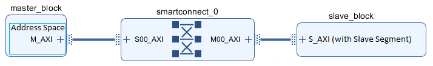
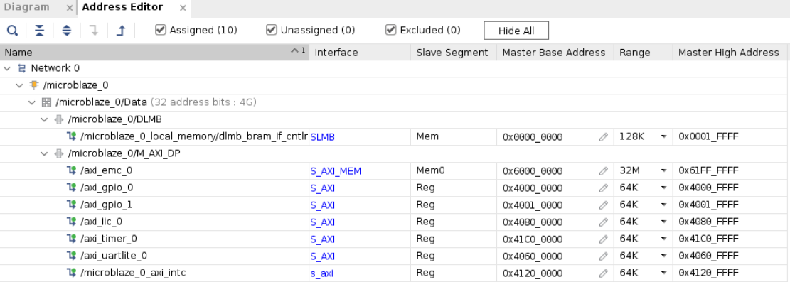
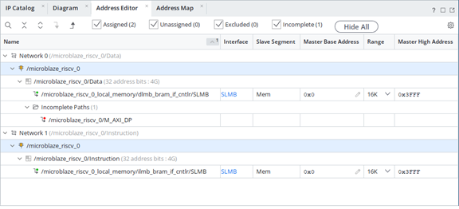

# Memory Map과 Memory-Mapped I/O


## 전체 학습 위치


## Memory Map이 필요한 이유

CPU가 BRAM, UART, GPIO, Timer 같은 여러 자원 중 하나를 선택하려면 각 자원에 서로 다른 주소 범위를 부여해야 한다.


```text
CPU Address
   ├─ Local BRAM
   ├─ AXI GPIO
   ├─ AXI UART Lite
   └─ AXI Timer
```

시스템의 Memory와 Peripheral을 주소별로 배치한 표가 Memory Map이다.


## MicroBlaze V 주소 공간

32비트 MicroBlaze V의 기본적인 32비트 주소 공간은 0x00000000 ~ 0xFFFFFFFF, 즉 4 GB이다.


```text
2^32 Byte = 4 GB
0x00000000 ─────────────── 0xFFFFFFFF
```

이 실습은 32비트 Machine mode와 MMU 비활성 구성을 사용한다. 주소 변환 없이 연결된 메모리와 주변장치에 접근하며, 32비트 주소 범위는 4 GiB이다.


## Memory와 I/O를 같은 주소로 접근


| 대상 | CPU가 보는 것 | 동작 |
| --- | --- | --- |
| BRAM | Memory Address | Load / Store |
| GPIO Register | Peripheral Address | Load / Store |
| UART Register | Peripheral Address | Load / Store |
| Timer Register | Peripheral Address | Load / Store |


## Address Space · Segment · Path


| 용어 | 의미 |
| --- | --- |
| Address Space | Master가 생성할 수 있는 전체 주소 공간 |
| Slave Segment | Memory 또는 Peripheral이 제공하는 주소 가능한 영역 |
| Address Path | Master Interface에서 Slave Interface까지의 주소 전달 경로 |
| Master Segment | Master Address Space 안에 Slave Segment를 Base/Range로 배치한 결과 |


## Address Path 구조


[](../images/common/original_10.png)

Master Address Space가 SmartConnect를 거쳐 Slave Segment에 연결되는 구조.
출처: AMD UG994 · Addressing Structure · 2026.1


```text
MicroBlaze V Address Space → M_AXI → SmartConnect → S_AXI → Slave Segment
```


## Vivado Address Editor


[](../images/common/original_11.png)

MicroBlaze V Data Address Space 아래에 Local Memory와 AXI Peripheral이 서로 다른 Base Address와 Range로 배치된 예.
출처: AMD UG994 · Using the Address Editor · 2026.1

그림의 주소값은 AMD 매뉴얼 예제이며 현재 SoC 04 프로젝트의 실제 주소값이 아니다.


## SoC 03 Local BRAM 주소


```text
Base  = 0x00000000
Range = 16 KB = 0x00004000
High  = Base + Range - 1
      = 0x00003FFF
```

실제 프로젝트에서는 Vivado Address Editor와 Vitis Linker Script의 주소를 기준으로 확인한다.


## Base · Range · High Address


| 항목 | 의미 |
| --- | --- |
| Base Address | 해당 영역의 첫 주소 |
| Range | 해당 영역의 주소 크기 |
| High Address | Base + Range - 1 |


```text
예: Base = 0x40000000
Range = 64 KB = 0x00010000
High = 0x4000FFFF
```


## 프로그램 영역과 데이터 주소

ELF의 .text, .data, .bss, Stack, Heap이 모두 Local BRAM에 배치될 수 있으므로 임의의 BRAM 절대주소를 테스트용으로 바로 사용하면 프로그램 영역과 충돌할 수 있다.

따라서 Linker가 배치한 bram_word[] 배열의 실제 주소를 Debugger에서 확인한다.


## BRAM 주소 실습 코드

다음 코드는 SoC 04의 주소 확인을 위해 작성한 교육용 예제이다.


```c
#include <stdint.h>
#include <stddef.h>

/*
 * SoC 04 교육용 Memory Map / BRAM 주소 확인 코드
 * 특정 BRAM 절대주소를 임의로 고정하지 않는다.
 */

volatile uint32_t bram_word[4] = {0, 0, 0, 0};

volatile uintptr_t addr_0 = 0;
volatile uintptr_t addr_1 = 0;
volatile uintptr_t addr_2 = 0;
volatile uintptr_t addr_3 = 0;

volatile uint32_t read_0 = 0;
volatile uint32_t read_1 = 0;
volatile uint32_t read_2 = 0;
volatile uint32_t read_3 = 0;

volatile uint32_t stage = 0;

int main(void)
{
    addr_0 = (uintptr_t)&bram_word[0];
    addr_1 = (uintptr_t)&bram_word[1];
    addr_2 = (uintptr_t)&bram_word[2];
    addr_3 = (uintptr_t)&bram_word[3];
    stage = 1;

    bram_word[0] = 0x11111111U;
    bram_word[1] = 0x22222222U;
    bram_word[2] = 0x33333333U;
    bram_word[3] = 0x44444444U;
    stage = 2;

    read_0 = bram_word[0];
    read_1 = bram_word[1];
    read_2 = bram_word[2];
    read_3 = bram_word[3];
    stage = 3;

    bram_word[1] = 0xA5A5A5A5U;
    stage = 4;

    read_1 = bram_word[1];
    stage = 5;

    while (1) {
    }

    return 0;
}
```


## Write → Read → Re-Write → Re-Read


| 단계 | 동작 | 확인값 |
| --- | --- | --- |
| 1 | 실제 주소 저장 | addr_0 ~ addr_3 |
| 2 | 4개 위치에 Write | 11111111, 22222222, 33333333, 44444444 |
| 3 | 같은 주소에서 Read | read_0 ~ read_3 |
| 4 | bram_word[1] Re-Write | 0xA5A5A5A5 |
| 5 | 같은 주소 Re-Read | read_1 = 0xA5A5A5A5 |


```text
같은 Address
addr_1 = &bram_word[1]

Data
0x22222222
     ↓ Re-Write
0xA5A5A5A5
```


## Debugger에서 실제 주소 확인

Watch 창에 addr_0 ~ addr_3, bram_word[0] ~ [3], read_0 ~ read_3, stage를 등록한다.


```text
uint32_t 배열이므로
addr_0 = X
addr_1 = X + 4
addr_2 = X + 8
addr_3 = X + 12

X는 실제 Linker 결과에서 확인
```


## 주소와 데이터의 차이


| 구분 | 예 | 의미 |
| --- | --- | --- |
| Address | addr_1 | 어느 위치를 선택할지 결정 |
| Data | 0xA5A5A5A5 | 선택된 위치에 저장되는 값 |


## Memory-Mapped I/O의 의미


```text
CPU Store
   ├─ BRAM Address → Memory Cell 변경
   └─ Peripheral Address → Hardware Register 변경 → Hardware 동작
```

AMD UG1629에 따르면 MicroBlaze V의 Data Peripheral Interface는 AXI4-Lite를 기본으로 사용해 Peripheral에 단일 Read/Write 접근을 수행할 수 있다.


## Peripheral 주소 구조 예고


```text
MicroBlaze V Data Address Space
├─ Local BRAM
├─ AXI GPIO Register Area
├─ AXI UART Lite Register Area
└─ AXI Timer Register Area
```


## Address Editor 사용 절차


[](../images/common/v_address.png)

AMD UG1711 2026.1 · Memory-Mapping in the Address Editor. 실제 인스턴스의 주소를 확인한다.

- Address Editor 열기Block Design 상단의 Address Editor를 연다.
- Master Address Space 확인microblaze_riscv_0의 Instruction/Data Address Space를 확인한다.
- Assigned / Unassigned 확인주소가 없는 Slave Segment가 있는지 확인한다.
- Assign All 또는 수동 배치자동 배치 후 Base Address와 Range를 확인하거나 직접 조정한다.
- 중복 확인각 Address Range가 서로 겹치지 않는지 확인한다.

## 주소 중복과 정렬


| 문제 | 결과 |
| --- | --- |
| Address Range 중복 | Slave 선택 충돌 또는 Address Assignment 오류 |
| Range 부족 | 전체 Register 영역 접근 불가 |
| 잘못된 Alignment | Vivado 주소 배치 오류 또는 불필요한 복잡성 |
| Hardware 주소와 Software Macro 불일치 | CPU가 잘못된 Hardware에 접근 |


## volatile 포인터 접근


```text
volatile uint32_t *reg =
    (volatile uint32_t *)PERIPHERAL_ADDRESS;

*reg = write_data;     // Write
read_data = *reg;      // Read
```

volatile은 Hardware 주소 접근을 Compiler가 임의로 제거하거나 일반 Register 값으로만 대체하지 않도록 하는 데 중요하다.


## SoC 04 전체 흐름


```text
MicroBlaze V Address 생성
      ↓
Address Space에서 대상 결정
      ↓
Local BRAM 선택
      ↓
bram_word[] 실제 주소 확인
      ↓
Write → Read
      ↓
같은 주소 Re-Write → Re-Read
      ↓
Address와 Data 구분
      ↓
이후 AXI Peripheral Register 주소 접근으로 확장
```


## 오류 점검


| 증상 | 원인 후보 | 확인 위치 |
| --- | --- | --- |
| 주소가 예상과 다름 | Linker 배치 결과 차이 | addr_0 ~ addr_3, Linker Map |
| Read 값이 Write 값과 다름 | 실행 순서 또는 Breakpoint 위치 | stage |
| Memory Overflow | Program/Data가 Local BRAM보다 큼 | Linker Map |
| Address Editor에 Peripheral이 없음 | 아직 AXI Slave를 추가하지 않음 | SoC 04에서는 정상 |
| 임의 주소 접근 후 오류 | 해당 주소에 실제 Slave가 없음 | Assigned Segment 확인 |


## SoC 04 완료 체크리스트

- [ ] Memory Map이 주소별 Hardware 배치표라는 것을 설명할 수 있다.
- [ ] 32비트 주소 공간 0x00000000 ~ 0xFFFFFFFF을 이해한다.
- [ ] Address Space, Slave Segment, Address Path, Master Segment를 구분한다.
- [ ] Base, Range, High Address 관계를 계산할 수 있다.
- [ ] 16 KB Local BRAM 예가 0x00000000 ~ 0x00003FFF임을 이해한다.
- [ ] bram_word[0] ~ [3]의 실제 주소를 Debugger에서 확인했다.
- [ ] 같은 주소에 Write → Read → Re-Write → Re-Read했다.
- [ ] bram_word[1]의 최종값이 0xA5A5A5A5임을 확인했다.
- [ ] 실제 Peripheral 주소는 Address Editor에서 확정해야 함을 이해한다.

## 공식 매뉴얼 및 원본 근거


| 문서 | 확인 항목 |
| --- | --- |
| AMD UG994 · Addressing Structure · 2026.1 | Address Space, Segment, Path 구조 |
| AMD UG994 · Using the Address Editor · 2026.1 | Address Editor 구조 |
| AMD UG994 · Editing Addresses · 2026.1 | Assign All, Base/Range 편집 |
| AMD UG1711 · Memory-Mapping in the Address Editor · 2026.1 | MicroBlaze V Peripheral Memory Mapping 절차 |
| AMD UG1629 · Memory Architecture · 2026.1 | 32비트 Effective/Physical Address 관계 |
| AMD UG1629 · Memory-Mapped Interfaces · 2026.1 | AXI Peripheral Interface Read/Write |

