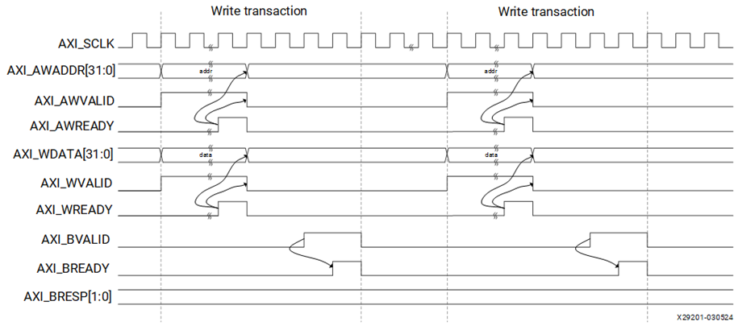
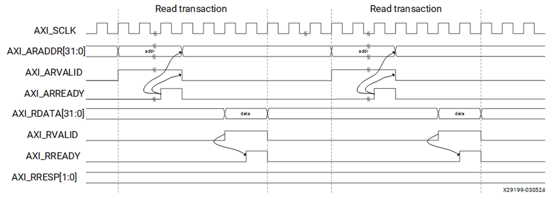
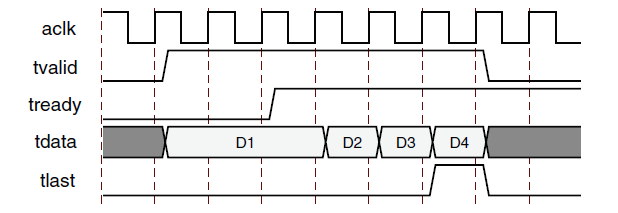

# AXI4 / AXI4-Lite / AXI4-Stream 구조


## 전체 학습 위치


## AXI가 필요한 이유

MicroBlaze V가 GPIO, UART, Timer, Custom IP 같은 여러 Hardware Block에 접근하려면 CPU와 각 IP 사이에 공통 통신 규칙이 필요하다. AXI(Advanced eXtensible Interface, 고급 확장 인터페이스)는 주소·데이터·응답·Handshake 방식을 표준화한다.


```text
MicroBlaze V
    │
    │ AXI Master
    ▼
SmartConnect
    │
    ├─ AXI GPIO
    ├─ AXI UART Lite
    ├─ AXI Timer
    └─ Custom AXI IP
```

SoC 04의 Memory Map이 어느 주소가 어느 Hardware인가를 정했다면, AXI는 그 주소와 데이터를 어떤 신호 절차로 전달할 것인가를 정한다.


## AXI4 계열 3가지


| 인터페이스 | 주소 | Burst | 주요 용도 |
| --- | --- | --- | --- |
| AXI4 | 있음 | 지원 | DDR, 대용량 Memory, 고대역폭 Data Transfer |
| AXI4-Lite | 있음 | 지원하지 않음 | Control/Status Register, GPIO, UART, Timer |
| AXI4-Stream | 없음 | Memory Burst 개념 없음 | Video, DSP, FFT, NPU Data Stream |


## Memory-Mapped와 Stream

Address가 존재한다. 특정 주소를 지정하여 Read/Write한다.

Address가 없다. Source에서 Destination으로 순차 Data를 전달한다.


```text
AXI4 / AXI4-Lite
Address + Data
      ↓
특정 Memory / Register 선택

AXI4-Stream
TDATA + TVALID / TREADY
      ↓
다음 처리 Block으로 Data 전달
```


## Master · Slave

Memory-Mapped AXI에서는 Transaction을 시작하는 쪽이 Master이고 주소를 받아 응답하는 쪽이 Slave이다.


| 구분 | SoC 예 | 역할 |
| --- | --- | --- |
| AXI Master | MicroBlaze V | 주소와 Read/Write 요청 생성 |
| AXI Slave | AXI GPIO | Register Address를 Decode하고 Data 응답 |
| AXI Interconnect | SmartConnect | Master 요청을 대상 Slave로 전달 |


## Clock · Reset

AXI Interface는 Clock Edge를 기준으로 Handshake를 판단한다. AXI4-Lite IP에서 흔히 사용하는 이름은 s_axi_aclk와 s_axi_aresetn이다.


| 신호 | 의미 |
| --- | --- |
| ACLK | AXI Interface Clock |
| ARESETN | Active-Low AXI Reset |


## VALID / READY Handshake

AXI에서 가장 중요한 기본 규칙은 VALID와 READY가 같은 Rising Edge에서 모두 High일 때 전송이 성립한다는 것이다.


```text
VALID = 0, READY = 0 → 전송 없음
VALID = 1, READY = 0 → 전송 대기
VALID = 0, READY = 1 → 전송 대기
VALID = 1, READY = 1 → Clock Rising Edge에서 전송
```


## AXI4-Lite 5개 채널


| Channel | 대표 신호 | 방향 | 역할 |
| --- | --- | --- | --- |
| AW · Write Address | AWADDR, AWVALID, AWREADY | Master → Slave | Write 대상 주소 전달 |
| W · Write Data | WDATA, WSTRB, WVALID, WREADY | Master → Slave | Write Data 전달 |
| B · Write Response | BRESP, BVALID, BREADY | Slave → Master | Write 결과 응답 |
| AR · Read Address | ARADDR, ARVALID, ARREADY | Master → Slave | Read 대상 주소 전달 |
| R · Read Data | RDATA, RRESP, RVALID, RREADY | Slave → Master | Read Data와 결과 응답 |


```text
WRITE : AW + W → B
READ  : AR → R
```


## Write Transaction


| 채널 | Master → Slave | Slave → Master |
| --- | --- | --- |
| Write Address | AWADDR + AWVALID | AWREADY |
| Write Data | WDATA + WSTRB + WVALID | WREADY |
| Write Response | BREADY | BRESP + BVALID |

Write Address Channel과 Write Data Channel은 서로 독립된 채널이다. 두 Handshake가 완료된 뒤 Slave가 Register Write를 처리하고 B Channel로 결과를 반환한다.


## AXI4-Lite Write 파형


[](../images/common/original_13.png)

AXI4-Lite Write Transaction의 공식 AMD 예. AW Channel, W Channel, B Channel이 각각 VALID/READY Handshake로 진행된다.출처: AMD PG203 · AXI4-Lite Write/Read Transactions


## Read Transaction


| 채널 | Master → Slave | Slave → Master |
| --- | --- | --- |
| Read Address | ARADDR + ARVALID | ARREADY |
| Read Data | RREADY | RDATA + RRESP + RVALID |

Read는 AR Address Channel과 R Data Channel로 구성된다.


## AXI4-Lite Read 파형


[](../images/common/original_14.png)

AXI4-Lite Read Transaction의 공식 AMD 예. AR Address Handshake 후 Slave가 RDATA와 RVALID를 반환한다.출처: AMD PG203 · AXI4-Lite Write/Read Transactions


## BRESP · RRESP


| Response | 2-bit 값 | 의미 |
| --- | --- | --- |
| OKAY | 00 | 정상 접근 |
| EXOKAY | 01 | Exclusive Access 관련 응답 |
| SLVERR | 10 | Slave Error |
| DECERR | 11 | Decode Error |


## WSTRB

WSTRB는 WDATA의 어떤 Byte Lane이 유효한지를 나타낸다. 32비트 Data Bus라면 보통 WSTRB[3:0]를 사용한다.


| WSTRB | 유효 Byte |
| --- | --- |
| 4'b0001 | Byte 0 |
| 4'b0011 | Byte 0~1 |
| 4'b1111 | 32비트 전체 |


## AXI4와 Burst

AXI4는 하나의 Address Transaction 이후 여러 Data Beat를 연속 전송하는 Burst를 지원한다. AXI4-Lite는 Burst를 지원하지 않는다.


```text
AXI4 Burst
Address 1회
   ↓
Data Beat 0
Data Beat 1
Data Beat 2
...
Data Beat N
```

AXI4 Burst가 AXI4-Lite Slave로 연결되면 SmartConnect 또는 Protocol Converter가 여러 Single-Beat Transaction으로 변환할 수 있다.


## AXI4-Lite가 Peripheral에 적합한 이유

GPIO Direction Register, UART Status Register, Timer Control Register처럼 CPU가 Register 하나를 읽고 쓰는 용도에는 Burst와 복잡한 ID 관리가 필요하지 않다.


## AXI4-Stream 구조

AXI4-Stream은 Address Channel이 없다. Source가 TDATA와 TVALID를 내보내고 Destination이 TREADY를 High로 만들면 Data가 전송된다.


| 신호 | 역할 |
| --- | --- |
| TDATA | 전송 Data |
| TVALID | Data 유효 표시 |
| TREADY | 수신 가능 표시 |
| TLAST | Packet/Frame 마지막 Beat |
| TUSER | 응용별 Sideband 정보 |


## AXI4-Stream Handshake 파형


[](../images/common/original_15.png)

AXI4-Stream의 공식 AMD Handshake 예. TVALID과 TREADY가 동시에 High인 Cycle에서 TDATA가 전송된다.출처: AMD PG256 · AXI4-Stream Interface

TREADY가 Low이면 Source는 전송을 완료할 수 없으므로 Backpressure가 발생할 수 있다.


## MicroBlaze V와 SmartConnect

Vivado IP Integrator에서 MicroBlaze V의 Memory-Mapped AXI Master와 여러 AXI Slave를 연결할 때 SmartConnect를 사용할 수 있다.


```text
MicroBlaze V M_AXI
       │
       ▼
SmartConnect
  ┌────┼──────────┐
  ▼    ▼          ▼
GPIO  UART      Timer
S_AXI S_AXI     S_AXI
```


## SoC 04와 연결


```text
volatile uint32_t *reg =
    (volatile uint32_t *)PERIPHERAL_ADDRESS;

*reg = 0x12345678U;
```


```text
C Store
  ↓
MicroBlaze V Load/Store
  ↓
AWADDR + WDATA
  ↓
SmartConnect Address Decode
  ↓
AXI Slave Register
```


## 신호명 읽는 법


| 예 | 의미 |
| --- | --- |
| s_axi_awaddr | Slave AXI Write Address |
| s_axi_wdata | Slave AXI Write Data |
| s_axi_bvalid | Slave Write Response Valid |
| s_axi_araddr | Slave AXI Read Address |
| s_axi_rdata | Slave Read Data |
| m_axi_awaddr | Master AXI Write Address |


## 전체 Transaction 추적


```text
[WRITE]
C Store
 → MicroBlaze V
 → AW Address Handshake
 → W Data Handshake
 → SmartConnect
 → AXI Slave Register Write
 → B Response

[READ]
C Load
 → MicroBlaze V
 → AR Address Handshake
 → SmartConnect
 → AXI Slave Register Read
 → R Data + Response
```

다음 SoC 06에서는 이 흐름을 AXI GPIO의 실제 Register와 Basys3 LED에 연결한다.


## 오류 점검


| 오해 / 문제 | 확인 내용 |
| --- | --- |
| VALID만 High이면 전송 | VALID && READY가 같은 Clock Edge에 필요 |
| AW와 W가 하나의 채널 | Write Address와 Write Data는 독립 채널 |
| Read에 B Channel 존재 | Read는 AR + R |
| AXI4-Lite Burst 사용 | AXI4-Lite는 Single-Beat |
| AXI4-Stream Address 사용 | Stream에는 Address Channel 없음 |
| aresetn 반대 연결 | Active-Low Reset |
| Memory Map과 AXI 동일시 | Memory Map은 주소 배치, AXI는 전송 Protocol |


## SoC 05 완료 체크리스트

- [ ] AXI4, AXI4-Lite, AXI4-Stream의 용도를 구분할 수 있다.
- [ ] AXI4/AXI4-Lite는 Memory-Mapped이고 AXI4-Stream은 Address가 없음을 이해한다.
- [ ] AXI4-Lite의 AW, W, B, AR, R 5개 채널을 설명할 수 있다.
- [ ] VALID && READY Handshake 조건을 이해한다.
- [ ] Write는 AW + W → B, Read는 AR → R 관계임을 이해한다.
- [ ] WSTRB와 BRESP/RRESP 역할을 이해한다.
- [ ] AXI4는 Burst를 지원하고 AXI4-Lite는 지원하지 않음을 이해한다.
- [ ] AXI4-Stream의 TDATA/TVALID/TREADY를 설명할 수 있다.
- [ ] SmartConnect의 역할을 이해한다.
- [ ] SoC 04의 C Pointer Write가 AXI Write Transaction으로 이어지는 흐름을 설명할 수 있다.

## 공식 매뉴얼 및 원본 근거


| 문서 | 확인 항목 |
| --- | --- |
| AMD UG1483 · AXI Interface · 2025.2 | AXI4 / AXI4-Lite / AXI4-Stream 구분 |
| AMD PG292 · AXI4-Lite Interface Ports · 2026 | AW/W/B/AR/R, WSTRB, Response |
| AMD PG203 · AXI4-Lite Write/Read Transactions | Write / Read 공식 Timing Diagram |
| AMD PG256 · AXI4-Stream Interface | TVALID / TREADY / TDATA / TLAST |
| AMD PG453 · Burst Conversion · 2026.1 | AXI4-Lite Burst 미지원 |
| AMD PG247 · Conversion to AXI4-Lite · 2026.1 | AXI4 Burst의 AXI4-Lite Single-Beat 변환 |
| AMD UG994 · SmartConnect · 2026.1 | AXI4-Lite Endpoint 연결 |

