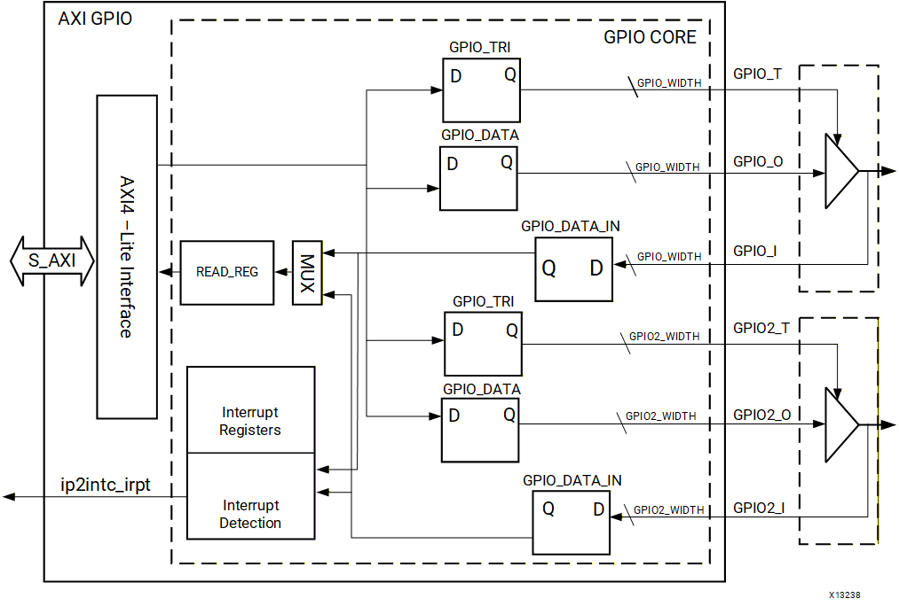
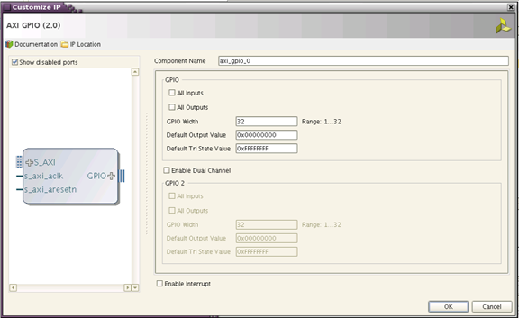

# AXI GPIO - Switch 입력을 LED 출력으로


## AXI GPIO 실습 목표

SoC 05까지는 AXI Transaction을 구조와 파형으로 이해했다. 이번 장에서는 실제 Peripheral인 AXI GPIO를 연결하여 CPU가 Hardware Register를 읽고 쓰는 결과를 Basys3 보드에서 직접 확인한다.

SW0을 올리면 LED0, SW7을 올리면 LED7, SW15를 올리면 LED15가 켜지는 1:1 대응 구조를 만든다.


## SECTION 02 · 01장 프로젝트 복제와 Design Sources 변경

**출발점은 04장이 아니라 01장에서 검증한 Vivado 프로젝트이다.** 04장에서는 01장 하드웨어를 활용했고, 05장은 AXI 구조 이론을 공부했다. 06장부터는 01장 성공 회로를 별도 프로젝트로 복제해 AXI GPIO를 추가한다.

| 항목 | 01장 원본 (보존) | 06장 복제본 (수정 대상) |
| --- | --- | --- |
| Vivado Project | `/home/jung/soc/hw/soc01_microblaze_bram/soc01_microblaze_bram.xpr` | `/home/jung/soc/hw/soc06_axi_gpio/soc06_axi_gpio.xpr` |
| Block Design | `soc01_mb_bram.bd` | `soc06_axi_gpio.bd` |
| HDL Wrapper / Top | `soc01_mb_bram_wrapper` | `soc06_axi_gpio_wrapper` |
| Constraints | 01장 Clock/Reset XDC는 보존 | 06장 프로젝트에서 독립 XDC 사용, GPIO `basys3_axi_gpio.xdc` |
| Vitis Workspace | `/home/jung/soc/sw` | 같은 Workspace, 별도 `soc06_axi_gpio_platform` / `soc06_axi_gpio` Application |

### 실제 GUI 작업 순서

1. **01장 성공 프로젝트 열기:** Vivado 2024.2에서 `soc01_microblaze_bram.xpr`을 연다. `microblaze_riscv_0`, 16 KiB Local BRAM, MDM, Clocking Wizard, Reset과 `ILMB/DLMB` 연결을 확인한다. 이 시점에 `M_AXI_DP`는 주변장치에 미연결이다.
2. **프로젝트 복제:** **File → Project → Save As**에서 `soc06_axi_gpio`로 저장한다. 새 `.xpr`은 `/home/jung/soc/hw/soc06_axi_gpio/`에 생성한다. **01장 프로젝트는 변경하지 않는다.**
3. **Block Design 이름 변경:** 복제된 프로젝트에서 기존 `soc01_mb_bram`을 연 뒤 **File → Save Block Design As**로 `soc06_axi_gpio`를 만든다. 당시 확인된 설정은 **Local to Project**, **Add to Design Sources**, **Include Comments** 선택, **Freeze boundary** 해제이다.
4. **06장 Wrapper 생성:** **Sources → Design Sources**의 `soc06_axi_gpio.bd`에서 우클릭 → **Create HDL Wrapper** → **Let Vivado manage wrapper and auto-update**. 새 `soc06_axi_gpio_wrapper`를 **Set as Top**으로 지정한다.
5. **옛 Wrapper 정리:** `soc01_mb_bram_wrapper`를 프로젝트 목록에서 **Remove File from Project**만 수행한다. **Delete files from disk는 절대 선택하지 않는다.** 원래 `soc01_mb_bram.bd`와 01장 프로젝트도 삭제하지 않는다.
6. **IP 상태 검증:** **Tools → Report → Report IP Status**에서 기존 **9개 IP가 모두 Up-to-date / No changes required**로 확인된 다음 06장 설계에 AXI GPIO를 추가한다.
7. **Constraints(제약파일) 분리:** Clock/Reset 설정을 유지하고 06장 프로젝트의 GPIO XDC를 별도로 관리한다. FPGA 외부 포트를 만든 다음 `led_tri_o[15:0]` / `sw_tri_i[15:0]`로 확인하여 XDC를 적용한다. 01장 XDC 소스를 직접 수정하지 않는다.

**확인 기준:** Design Sources의 BD는 `soc06_axi_gpio.bd`, Top은 `soc06_axi_gpio_wrapper`이다. 01장 소스를 참조하는 공유 경로는 없는지 확인한다. 기존 IP가 정상이면 **그때부터** AXI GPIO를 추가한다.

## 전체 Hardware 구조


```text
Basys3 SW[15:0]
        │
        ▼
AXI GPIO Channel 2
    GPIO2_DATA
        │ AXI4-Lite Read
        ▼
   SmartConnect
        │
        ▼
    MicroBlaze V
        │ AXI4-Lite Write
        ▼
   SmartConnect
        │
        ▼
AXI GPIO Channel 1
     GPIO_DATA
        │
        ▼
Basys3 LED[15:0]
```

AXI GPIO 하나를 Dual Channel로 사용하므로 하나의 AXI Base Address 안에서 입력과 출력을 함께 다룬다.


## AXI GPIO 내부 구조


[](../images/common/original_16.png)

AXI4-Lite Interface, GPIO_DATA, GPIO_TRI, 입력 Data Register, 두 GPIO Channel의 내부 연결 구조.
출처: AMD PG144 · Functional Description · 2026-01-30

AXI GPIO는 AXI4-Lite Slave Interface와 GPIO Core를 연결한다. CPU가 Register를 쓰면 GPIO_DATA 또는 GPIO_TRI Register가 변경되고 실제 GPIO Pin에 반영된다.

MicroBlaze V의 Peripheral AXI 경로를 활성화하여 IP를 연결한다. 하드웨어 변경 후 XSA와 V용 Platform/BSP를 갱신하고 생성된 xparameters.h의 심볼을 사용한다.


## Channel 구성


| Channel | 폭 | 방향 | Basys3 연결 |
| --- | --- | --- | --- |
| Channel 1 | 16 bit | All Outputs | LED[15:0] |
| Channel 2 | 16 bit | All Inputs | SW[15:0] |

Interrupt는 아직 사용하지 않는다. 이번 장에서는 Polling 방식으로 Switch 값을 계속 읽는다.


## AXI GPIO 추가

- **Design Sources 확인:** `soc06_axi_gpio.bd`를 열고 기존 CPU·BRAM·Clock·Reset을 유지한다. 01장 프로젝트가 아니라 **06장 복제본에서만** 작업한다.
- **Add IP:** Block Design 빈 공간 우클릭 → **Add IP** → `AXI GPIO` 검색 → `axi_gpio_0` 추가.
- **AXI 연결은 다음 단계:** 기존 `microblaze_riscv_0/M_AXI_DP`와 `axi_smc`를 활용한다. AXI GPIO 추가 전에는 CPU의 해당 Master 경로가 미연결이었음을 구분한다.

## IP 설정


[](../images/common/original_17.png)

PG144의 AXI GPIO Customize IP 화면. 실제 Vivado 버전에 따라 배치는 달라질 수 있지만 GPIO Width, All Inputs/Outputs, Dual Channel 설정 항목은 동일한 개념이다.
출처: AMD PG144 · Customizing and Generating the Core · 2026-01-30


| 항목 | SoC 06 설정 |
| --- | --- |
| GPIO Width | 16 |
| GPIO All Outputs | Enabled |
| Enable Dual Channel | Enabled |
| GPIO2 Width | 16 |
| GPIO2 All Inputs | Enabled |
| Enable Interrupt | Disabled |


## Connection Automation

- Run Connection Automationaxi_gpio_0/S_AXI 연결을 선택한다.
- AXI 연결 확인MicroBlaze V Master → SmartConnect → AXI GPIO Slave 경로가 생성되는지 확인한다.
- Clocks_axi_aclk가 시스템 100 MHz Clock에 연결되는지 확인한다.
- Resets_axi_aresetn이 Processor System Reset의 Active-Low Peripheral Reset에 연결되는지 확인한다.

## 외부 GPIO Port와 HDL Wrapper 갱신

Channel 1·Channel 2를 외부 인터페이스로 만들고 각각 `led`, `sw`로 이름을 설정한다. 실제 HDL Wrapper의 Verilog 포트 이름은 아래와 같이 자동 확장된다.

| AXI GPIO 외부 인터페이스 | 06장 최상위 Wrapper 포트 | 방향 |
| --- | --- | --- |
| `led` | `led_tri_o[15:0]` | Output |
| `sw` | `sw_tri_i[15:0]` | Input |

SECTION 02에서 생성한 `soc06_axi_gpio_wrapper`를 **Let Vivado manage wrapper and auto-update** 방식으로 갱신한다. 필요 시 `soc06_axi_gpio.bd`에서 **Create HDL Wrapper**를 다시 실행하고, Top이 `soc06_axi_gpio_wrapper`로 유지되는지 확인한다. 새 Wrapper의 실제 포트 이름을 확인한 후 XDC를 작성한다.

## Address Editor

AXI GPIO가 MicroBlaze V에 연결되면 Address Editor에 axi_gpio_0/S_AXI Segment가 나타난다. Assign All 또는 수동 배치로 Base Address를 할당한다.


```text
MicroBlaze V Data Address Space
        │
        └─ axi_gpio_0/S_AXI
              Base Address = Vivado에서 실제 확인
              Register Offset = PG144 기준 사용
```


## Register Map


| Offset | Register | Access | SoC 06 역할 |
| --- | --- | --- | --- |
| +0x00 | GPIO_DATA | R/W | Channel 1 LED Data |
| +0x04 | GPIO_TRI | R/W | Channel 1 Direction |
| +0x08 | GPIO2_DATA | R/W | Channel 2 Switch Data |
| +0x0C | GPIO2_TRI | R/W | Channel 2 Direction |

PG144 2026-01-30 Register Space 기준이다. Dual Channel이므로 Channel 2 Register도 존재한다.


## GPIO_DATA

Channel 1을 Output으로 설정한 경우 GPIO_DATA에 Write한 값이 실제 Output Pin으로 전달된다.


```text
GPIO_DATA bit 0  → LED0
GPIO_DATA bit 1  → LED1
...
GPIO_DATA bit 15 → LED15
```

Basys3 User LED는 Logic High에서 켜지는 Active-High 구조이므로 GPIO_DATA[n] = 1이면 해당 LED가 켜진다.


## GPIO_TRI

PG144의 3-State Control Register는 각 Bit의 방향을 제어하며 0 = Output, 1 = Input이다.


| GPIO_TRI bit | 방향 |
| --- | --- |
| 0 | Output |
| 1 | Input |

이번 설계는 Vivado 설정에서 Channel 1을 All Outputs, Channel 2를 All Inputs로 고정하므로 Software에서 방향을 반복 설정할 필요가 없다.


## Basys3 Switch · LED 연결

Basys3에는 16개의 Slide Switch와 16개의 User LED가 있으며 Reference Manual Figure 16에서 FPGA Pin과 함께 확인할 수 있다. LED는 FPGA I/O가 High일 때 켜진다.


```text
SW0  ─────────────▶ LED0
SW1  ─────────────▶ LED1
SW2  ─────────────▶ LED2
...
SW15 ─────────────▶ LED15

실제 경로:
Switch → FPGA Input → AXI GPIO Ch2
       → MicroBlaze V
       → AXI GPIO Ch1 → FPGA Output → LED
```


## XDC 작성

Digilent Basys-3-Master.xdc의 핀 번호를 사용한다. **Vivado 06장 실제 Top인 `soc06_axi_gpio_wrapper`의 포트명 `sw_tri_i[15:0]`, `led_tri_o[15:0]`을 XDC에 사용**하며, Block Design 내부 외부 인터페이스명 `sw`, `led`를 그대로 쓰지 않는다. 기존 Clock / Reset 제약은 유지한다.


```text
## Basys3 Slide Switches
set_property -dict { PACKAGE_PIN V17 IOSTANDARD LVCMOS33 } [get_ports {sw_tri_i[0]}]
set_property -dict { PACKAGE_PIN V16 IOSTANDARD LVCMOS33 } [get_ports {sw_tri_i[1]}]
set_property -dict { PACKAGE_PIN W16 IOSTANDARD LVCMOS33 } [get_ports {sw_tri_i[2]}]
set_property -dict { PACKAGE_PIN W17 IOSTANDARD LVCMOS33 } [get_ports {sw_tri_i[3]}]
set_property -dict { PACKAGE_PIN W15 IOSTANDARD LVCMOS33 } [get_ports {sw_tri_i[4]}]
set_property -dict { PACKAGE_PIN V15 IOSTANDARD LVCMOS33 } [get_ports {sw_tri_i[5]}]
set_property -dict { PACKAGE_PIN W14 IOSTANDARD LVCMOS33 } [get_ports {sw_tri_i[6]}]
set_property -dict { PACKAGE_PIN W13 IOSTANDARD LVCMOS33 } [get_ports {sw_tri_i[7]}]
set_property -dict { PACKAGE_PIN V2  IOSTANDARD LVCMOS33 } [get_ports {sw_tri_i[8]}]
set_property -dict { PACKAGE_PIN T3  IOSTANDARD LVCMOS33 } [get_ports {sw_tri_i[9]}]
set_property -dict { PACKAGE_PIN T2  IOSTANDARD LVCMOS33 } [get_ports {sw_tri_i[10]}]
set_property -dict { PACKAGE_PIN R3  IOSTANDARD LVCMOS33 } [get_ports {sw_tri_i[11]}]
set_property -dict { PACKAGE_PIN W2  IOSTANDARD LVCMOS33 } [get_ports {sw_tri_i[12]}]
set_property -dict { PACKAGE_PIN U1  IOSTANDARD LVCMOS33 } [get_ports {sw_tri_i[13]}]
set_property -dict { PACKAGE_PIN T1  IOSTANDARD LVCMOS33 } [get_ports {sw_tri_i[14]}]
set_property -dict { PACKAGE_PIN R2  IOSTANDARD LVCMOS33 } [get_ports {sw_tri_i[15]}]

## Basys3 LEDs
set_property -dict { PACKAGE_PIN U16 IOSTANDARD LVCMOS33 } [get_ports {led_tri_o[0]}]
set_property -dict { PACKAGE_PIN E19 IOSTANDARD LVCMOS33 } [get_ports {led_tri_o[1]}]
set_property -dict { PACKAGE_PIN U19 IOSTANDARD LVCMOS33 } [get_ports {led_tri_o[2]}]
set_property -dict { PACKAGE_PIN V19 IOSTANDARD LVCMOS33 } [get_ports {led_tri_o[3]}]
set_property -dict { PACKAGE_PIN W18 IOSTANDARD LVCMOS33 } [get_ports {led_tri_o[4]}]
set_property -dict { PACKAGE_PIN U15 IOSTANDARD LVCMOS33 } [get_ports {led_tri_o[5]}]
set_property -dict { PACKAGE_PIN U14 IOSTANDARD LVCMOS33 } [get_ports {led_tri_o[6]}]
set_property -dict { PACKAGE_PIN V14 IOSTANDARD LVCMOS33 } [get_ports {led_tri_o[7]}]
set_property -dict { PACKAGE_PIN V13 IOSTANDARD LVCMOS33 } [get_ports {led_tri_o[8]}]
set_property -dict { PACKAGE_PIN V3  IOSTANDARD LVCMOS33 } [get_ports {led_tri_o[9]}]
set_property -dict { PACKAGE_PIN W3  IOSTANDARD LVCMOS33 } [get_ports {led_tri_o[10]}]
set_property -dict { PACKAGE_PIN U3  IOSTANDARD LVCMOS33 } [get_ports {led_tri_o[11]}]
set_property -dict { PACKAGE_PIN P3  IOSTANDARD LVCMOS33 } [get_ports {led_tri_o[12]}]
set_property -dict { PACKAGE_PIN N3  IOSTANDARD LVCMOS33 } [get_ports {led_tri_o[13]}]
set_property -dict { PACKAGE_PIN P1  IOSTANDARD LVCMOS33 } [get_ports {led_tri_o[14]}]
set_property -dict { PACKAGE_PIN L1  IOSTANDARD LVCMOS33 } [get_ports {led_tri_o[15]}]
```


## Validate · Bitstream

- Validate DesignAXI, Clock, Reset, GPIO 외부 Port 연결 오류를 확인한다.
- Generate Output Products필요한 IP Output Product를 생성한다.
- Generate BitstreamSynthesis → Implementation → Bitstream을 진행한다.
- I/O 확인Implementation 후 sw[15:0], led[15:0]가 의도한 PACKAGE_PIN에 연결되는지 확인한다.

## XSA · Vitis 갱신

AXI GPIO와 Address Map이 추가되었으므로 기존 SoC 03/04의 XSA를 그대로 사용하면 안 된다.

Vitis의 xparameters.h에서 GPIO Instance 관련 Macro가 생성되었는지 확인한다.


## XGpio Driver

AMD Standalone GPIO Driver는 AXI GPIO를 직접 제어하는 API를 제공한다.


| API | 역할 |
| --- | --- |
| XGpio_Initialize() | GPIO Driver Instance 초기화 |
| XGpio_DiscreteRead() | 지정 Channel의 GPIO Data 읽기 |
| XGpio_DiscreteWrite() | 지정 Channel에 GPIO Data 쓰기 |
| XGpio_SetDataDirection() | Runtime Direction 설정이 필요한 경우 GPIO_TRI 설정 |

이번 설계는 Hardware에서 방향을 고정하므로 Read와 Write API만 사용한다.


## Switch → LED 프로그램

다음 코드는 이번 실습을 위해 작성한 교육용 예제이며, 초기화 방식은 AMD 공식 XGpio Example의 Classic/SDT 분기를 따른다.


```c
#include "xparameters.h"
#include "xgpio.h"
#include "xstatus.h"
#include "xil_types.h"

/*
 * SoC 06 - AXI GPIO
 *
 * Channel 1 : Basys3 LED[15:0]  (Output)
 * Channel 2 : Basys3 SW[15:0]   (Input)
 *
 * SW0 ~ SW15 상태를 읽어서 LED0 ~ LED15에 그대로 출력한다.
 */

#define LED_CHANNEL  1U
#define SW_CHANNEL   2U
#define GPIO_MASK    0x0000FFFFU

#ifndef SDT
#define GPIO_DEVICE_ID   XPAR_GPIO_0_DEVICE_ID
#else
#define GPIO_BASEADDR    XPAR_XGPIO_0_BASEADDR
#endif

static XGpio Gpio;

/* Debugger에서 관찰하기 위한 변수 */
volatile u32 switch_value = 0U;
volatile u32 led_value    = 0U;

int main(void)
{
    int status;

#ifndef SDT
    status = XGpio_Initialize(&Gpio, GPIO_DEVICE_ID);
#else
    status = XGpio_Initialize(&Gpio, GPIO_BASEADDR);
#endif

    if (status != XST_SUCCESS) {
        return XST_FAILURE;
    }

    /*
     * Vivado에서 Channel 1은 All Outputs,
     * Channel 2는 All Inputs로 고정한다.
     *
     * 따라서 이 예제에서는 Software에서 GPIO_TRI를 다시 설정하지 않는다.
     */

    while (1) {
        /* Channel 2: Basys3 Slide Switch 읽기 */
        switch_value = XGpio_DiscreteRead(&Gpio, SW_CHANNEL) & GPIO_MASK;

        /* 읽은 16비트 값을 그대로 LED 출력으로 전달 */
        led_value = switch_value;
        XGpio_DiscreteWrite(&Gpio, LED_CHANNEL, led_value);
    }

    return XST_SUCCESS;
}
```


## Driver와 Register 연결


| C API | Hardware Register |
| --- | --- |
| XGpio_DiscreteWrite(&Gpio, 1, value) | Base + 0x00 · GPIO_DATA |
| XGpio_DiscreteRead(&Gpio, 2) | Base + 0x08 · GPIO2_DATA |


```text
XGpio_DiscreteRead(Channel 2)
        ↓
Base + 0x08
        ↓
GPIO2_DATA
        ↓
SW[15:0]

XGpio_DiscreteWrite(Channel 1)
        ↓
Base + 0x00
        ↓
GPIO_DATA
        ↓
LED[15:0]
```


## 실행 순서

- FPGA ProgramSoC 06 Bitstream으로 Basys3를 Program한다.
- Application DownloadVitis에서 MicroBlaze V Application ELF를 다운로드한다.
- Run프로그램을 실행한다.
- Switch 조작SW0~SW15를 하나씩 올리고 대응 LED를 확인한다.
- 복수 Bit 확인예: SW0, SW3, SW7을 동시에 올리면 LED0, LED3, LED7이 동시에 켜지는지 확인한다.

## 눈으로 확인하는 결과


| Switch 값 | CPU가 읽는 16비트 값 | LED 결과 |
| --- | --- | --- |
| 모두 OFF | 0x0000 | 모두 OFF |
| SW0 ON | 0x0001 | LED0 ON |
| SW3 ON | 0x0008 | LED3 ON |
| SW0 + SW3 ON | 0x0009 | LED0 + LED3 ON |
| SW15 ON | 0x8000 | LED15 ON |
| 모두 ON | 0xFFFF | LED 16개 모두 ON |


## Debugger 확인

Vitis Watch 창에 switch_value와 led_value를 등록한다.


```text
SW0 ON
switch_value = 0x00000001
led_value    = 0x00000001

SW15 ON
switch_value = 0x00008000
led_value    = 0x00008000

ALL ON
switch_value = 0x0000FFFF
led_value    = 0x0000FFFF
```

보드 LED 변화와 Software 변수 변화가 동시에 일치해야 한다.


## AXI Transaction 추적


```text
[INPUT READ]

SW[15:0]
   ↓
GPIO2_DATA
   ↓
AXI Read
ARADDR = GPIO Base + 0x08
   ↓
RDATA = Switch Value
   ↓
MicroBlaze V

[OUTPUT WRITE]

MicroBlaze V
   ↓
AXI Write
AWADDR = GPIO Base + 0x00
WDATA  = Switch Value
   ↓
GPIO_DATA
   ↓
LED[15:0]
```

SoC 04의 Memory Map과 SoC 05의 AXI Read/Write가 이번 장에서 실제 보드 I/O 동작으로 연결된다.


## 오류 점검


| 증상 | 원인 후보 | 확인 위치 |
| --- | --- | --- |
| LED가 전혀 켜지지 않음 | AXI GPIO Channel 1 설정 또는 XDC 오류 | All Outputs, led[] Port, LED Pin |
| Switch 값이 항상 0 | Channel 2 Input 설정 또는 XDC 오류 | All Inputs, sw[] Port, Switch Pin |
| Channel 2 API에서 Assertion | Dual Channel 미설정 | Enable Dual Channel 확인 |
| Software Build에서 Macro 없음 | XSA/Platform 미갱신 또는 Instance 이름 차이 | xparameters.h |
| CPU가 잘못된 주소 접근 | Vivado Address Editor와 Platform 불일치 | GPIO Base Address 비교 |
| LED Bit 순서가 다름 | 외부 Port/XDC Index 불일치 | led[0]~led[15] Mapping |
| SW0인데 LED15가 켜짐 | Bit Index 역순 연결 | Switch/LED Vector 연결 확인 |
| LED가 반대로 동작한다고 생각함 | Board LED Polarity 오해 | Basys3 LED는 Logic High에서 ON |


## SoC 06 실습 확인 항목

- AXI GPIO를 MicroBlaze V AXI Master에 연결했다.
- Dual Channel을 활성화했다.
- Channel 1을 16-bit All Outputs로 설정했다.
- Channel 2를 16-bit All Inputs로 설정했다.
- Interrupt는 아직 사용하지 않는다.
- Address Editor에서 AXI GPIO Base Address를 실제로 확인했다.
- GPIO_DATA +0x00, GPIO_TRI +0x04, GPIO2_DATA +0x08, GPIO2_TRI +0x0C를 구분한다.
- Basys3 Switch와 LED XDC Pin을 확인했다.
- XSA를 다시 Export하고 Vitis Platform을 갱신했다.
- Switch 값을 Channel 2에서 읽었다.
- 읽은 값을 Channel 1에 썼다.
- SW0~SW15와 LED0~LED15가 1:1로 대응한다.
- switch_value와 led_value가 일치함을 Debugger에서 확인했다.
- SoC 04 Memory Map → SoC 05 AXI → SoC 06 실제 GPIO 동작의 연결을 설명할 수 있다.

## 공식 매뉴얼 및 원본 근거


| 문서 | 확인 항목 |
| --- | --- |
| AMD PG144 · AXI GPIO v2.0 · 2026-01-30 | AXI GPIO 전체 구조와 공식 Register 정의 |
| AMD PG144 · Functional Description | AXI4-Lite, Single/Dual Channel, GPIO Block Diagram |
| AMD PG144 · Register Space | GPIO_DATA 0x00, GPIO_TRI 0x04, GPIO2_DATA 0x08, GPIO2_TRI 0x0C |
| AMD PG144 · Programming Sequence | Input/Output Direction과 Data Read/Write 순서 |
| AMD/Xilinx GPIO Driver API | XGpio_Initialize, DiscreteRead, DiscreteWrite |
| AMD embeddedsw · xgpio_example.c | 공식 XGpio 초기화와 LED Output 예제 구조 |
| Digilent Basys 3 Reference Manual | Figure 16 · 16 Switch / 16 LED 연결과 LED Active-High 구조 |
| Digilent Basys-3-Master.xdc | SW0~SW15, LED0~LED15 FPGA Pin |

