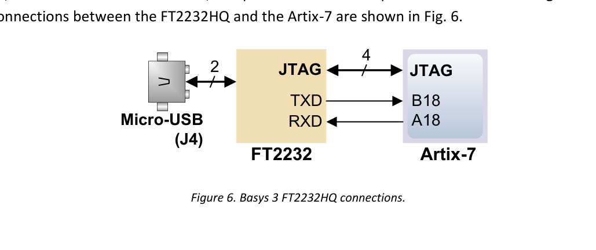
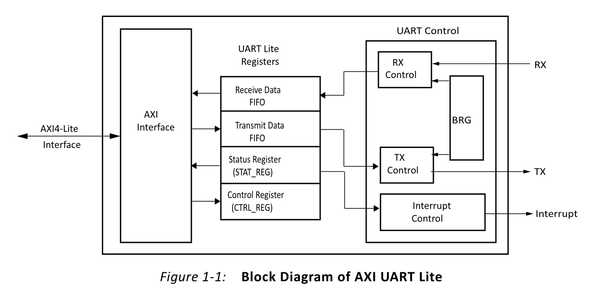
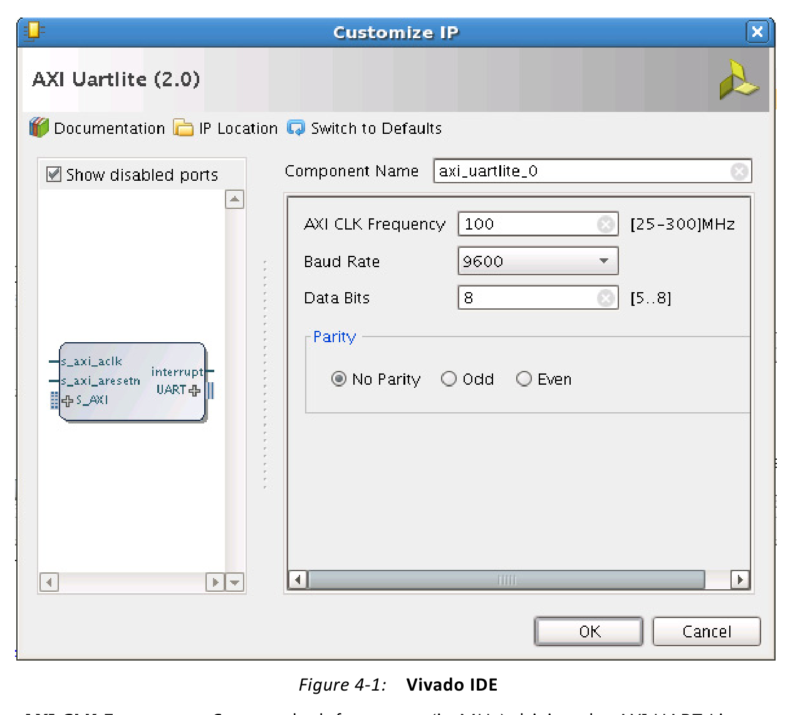
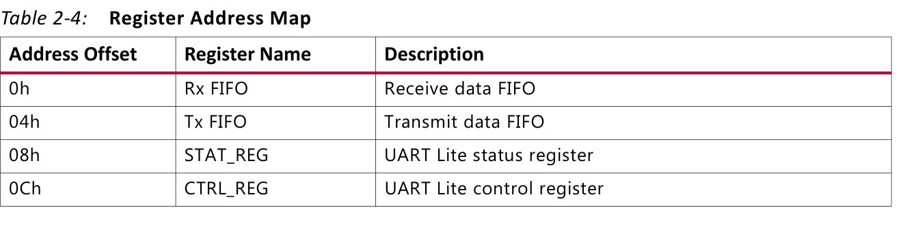
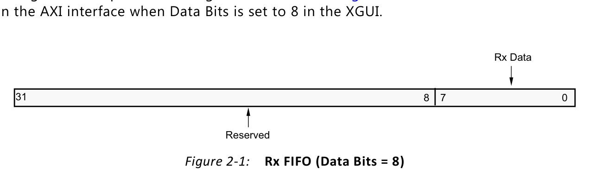
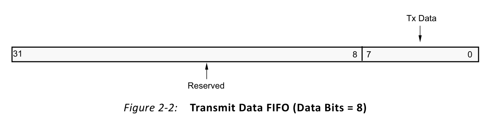
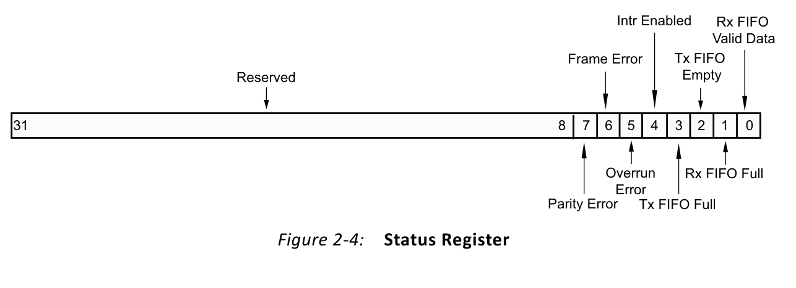
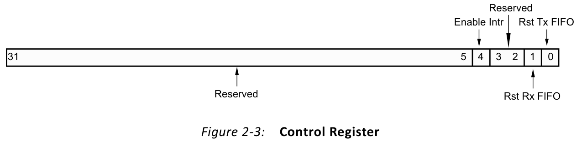
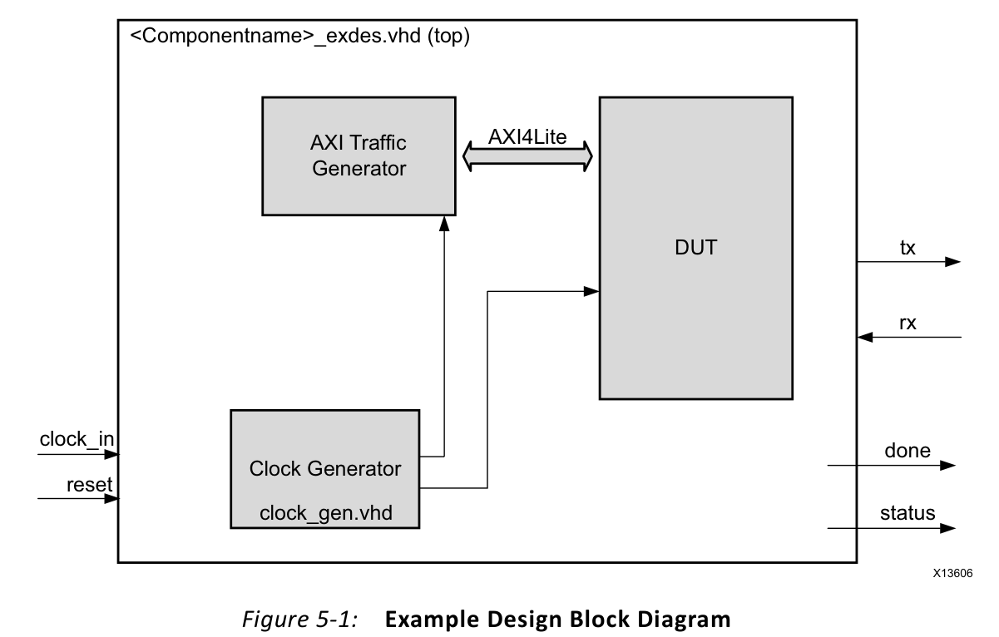
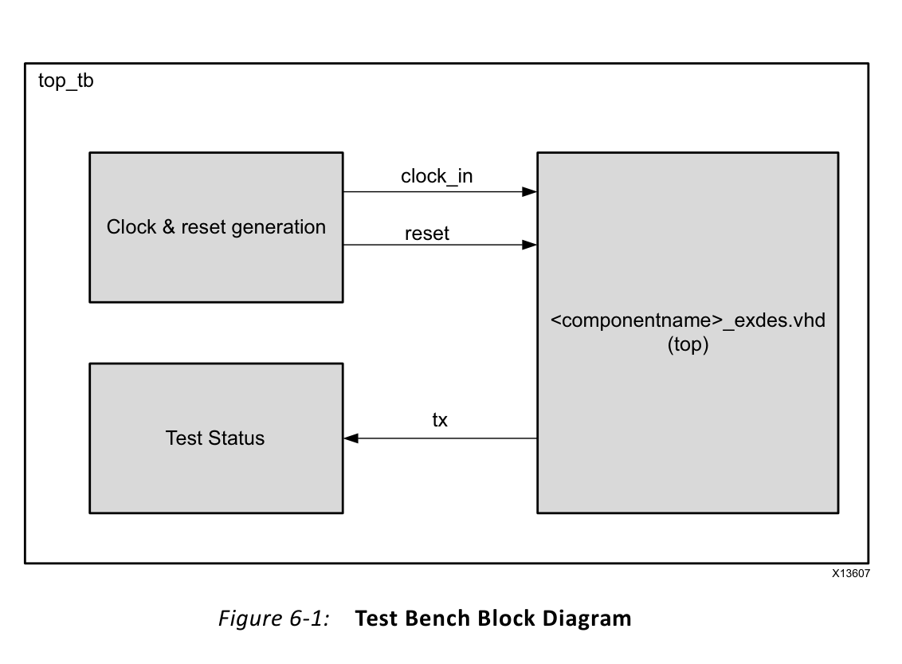

# AXI UART Lite - PC 터미널 Echo 통신


## 전체 학습 위치


## 실습 목표

터미널에 A를 입력하면 FPGA가 A를 수신하고 MicroBlaze V가 같은 Byte를 다시 송신한다. Terminal Local Echo는 끄고 실제 FPGA Echo만 보이도록 한다.


## 전체 통신 경로


```text
PC Terminal
   │ USB
   ▼
FT2232HQ
   │ UART RX/TX
   ▼
AXI UART Lite
   │ AXI4-Lite
   ▼
SmartConnect
   │
   ▼
MicroBlaze V
   │
   └─ 받은 Byte를 다시 AXI UART Lite에 Write
```


## Basys3 USB-UART

[](../images/soc07/vendor/digilent_fig06_basys3_uart.png)

원문: [Digilent Figure 6](https://digilent.com/reference/_media/reference/programmable-logic/basys-3/basys3_rm.pdf#page=7)


FT2232HQ가 J4 Micro-USB와 FPGA UART 핀 사이를 연결한다. 공식 원본 그림을 직접 열람하며 B18(RX)과 A18(TX)를 확인한다.


| 기능 | FPGA Pin | Top Port |
| --- | --- | --- |
| PC → FPGA Receive | B18 | RsRx |
| FPGA → PC Transmit | A18 | RsTx |

J4 하나로 FPGA Programming/JTAG와 USB-UART를 함께 사용할 수 있으며 두 기능은 독립적으로 동작한다.

06장에 구성된 microblaze_riscv_0/M_AXI_DP → SmartConnect를 그대로 유지하고 UART Lite를 연결한다. 하드웨어 변경 후 XSA와 V용 Platform/BSP를 갱신하고 생성된 xparameters.h의 심볼을 사용한다.


## AXI UART Lite 내부 구조

[](../images/soc07/vendor/pg142_fig01_01_axi_uartlite.png)

원문: [PG142 Figure 1-1](https://docs.amd.com/api/khub/documents/dB1MAeh~uLG7FE62a5_QbA/content#page=5)


AXI4-Lite Interface, RX/TX FIFO, Status/Control Register, Baud Rate Generator가 핵심이다.

RX FIFO와 TX FIFO는 각각 16-character 깊이를 가지며 AXI4-Lite Register 접근으로 CPU가 데이터를 읽고 쓴다.


## UART Frame · 8N1


```text
Idle  Start  D0 D1 D2 D3 D4 D5 D6 D7  Stop  Idle
  1     0    ─────── 8 Data Bits ───────   1     1
```


| 항목 | SoC 07 설정 |
| --- | --- |
| Baud Rate | 115200 bit/s |
| Data Bits | 8 |
| Parity | None |
| Stop Bit | 1 |
| Flow Control | None |

115200 8N1은 PC 터미널과 AXI UART Lite 양쪽 설정이 반드시 동일해야 한다.


## IP 추가

- Add IPBlock Design에서 AXI Uartlite를 검색하여 axi_uartlite_0을 추가한다.
- 기존 AXI 구조 유지MicroBlaze V → SmartConnect 구조를 그대로 사용한다.
- Interrupt이번 장에서는 Polling만 사용하므로 Interrupt 연결은 보류한다.

## IP 설정

[](../images/soc07/vendor/pg142_fig04_01_vivado_gui.png)

원문: [PG142 Figure 4-1](https://docs.amd.com/api/khub/documents/dB1MAeh~uLG7FE62a5_QbA/content#page=15)


| 항목 | 설정 |
| --- | --- |
| AXI CLK Frequency | IP Integrator 연결값 · 현재 System Clock 100 MHz |
| Baud Rate | 115200 |
| Data Bits | 8 |
| Parity | No Parity |

Baud Rate, Data Bits, Parity는 Hardware Build 시 고정되는 설정이며 일반적인 Software API로 Runtime 변경하는 구조가 아니다. PG142 Figure 4-1 화면의 Baud 9600은 구버전 원문 예시이며, 본 실습은 115200으로 설정한다.


## AXI 연결


```text
MicroBlaze V M_AXI_DP
      │
      ▼
SmartConnect
      │
      ▼
axi_uartlite_0/S_AXI

clk_wiz/clk_out1 ───────▶ s_axi_aclk
proc_sys_reset/peripheral_aresetn ─▶ s_axi_aresetn
```

s_axi_aresetn은 Active-Low Reset이다.


## 외부 UART Port


| AXI UART Lite | 외부 Port | 방향 |
| --- | --- | --- |
| rx | RsRx | Input |
| tx | RsTx | Output |


## XDC


```text
## Basys3 USB-RS232 Interface
## Digilent Basys-3-Master.xdc 원본 핀 기준
set_property -dict { PACKAGE_PIN B18 IOSTANDARD LVCMOS33 } [get_ports RsRx]
set_property -dict { PACKAGE_PIN A18 IOSTANDARD LVCMOS33 } [get_ports RsTx]
```

기존 Clock/Reset XDC는 그대로 유지하고 UART 핀 두 줄만 추가한다.


## Address Editor

axi_uartlite_0/S_AXI에 실제 Base Address를 할당한다. 문서에서는 임의 Base Address를 고정하지 않는다.

Classic Flow는 일반적으로 XPAR_UARTLITE_0_BASEADDR, SDT Flow는 XPAR_XUARTLITE_0_BASEADDR 형태의 Base Address Macro를 사용한다.


## Register Map

[](../images/soc07/vendor/pg142_table02_04_registers.png)

원문: [PG142 Table 2-4](https://docs.amd.com/api/khub/documents/dB1MAeh~uLG7FE62a5_QbA/content#page=9)


| Offset | Register | Access | 역할 |
| --- | --- | --- | --- |
| +0x00 | RX FIFO | Read | 수신 Byte 읽기 |
| +0x04 | TX FIFO | Write | 송신 Byte 쓰기 |
| +0x08 | STAT_REG | Read | FIFO·Error 상태 |
| +0x0C | CTRL_REG | Write | FIFO Reset·Interrupt Enable |


## RX FIFO

[](../images/soc07/vendor/pg142_fig02_01_rx_fifo.png)

원문: [PG142 Figure 2-1](https://docs.amd.com/api/khub/documents/dB1MAeh~uLG7FE62a5_QbA/content#page=9)


RX FIFO는 16-entry이며 수신된 Character를 저장한다. 8-bit 설정에서는 유효 Data가 bit [7:0]에 들어온다.


## TX FIFO

[](../images/soc07/vendor/pg142_fig02_02_tx_fifo.png)

원문: [PG142 Figure 2-2](https://docs.amd.com/api/khub/documents/dB1MAeh~uLG7FE62a5_QbA/content#page=10)


TX FIFO도 16-entry이며 CPU가 전송할 Byte를 쓴다.


## Status Register

[](../images/soc07/vendor/pg142_fig02_04_status.png)

원문: [PG142 Figure 2-4](https://docs.amd.com/api/khub/documents/dB1MAeh~uLG7FE62a5_QbA/content#page=11)


| Bit | 이름 | 의미 |
| --- | --- | --- |
| 7 | Parity Error | Parity 오류 |
| 6 | Frame Error | Stop Bit 오류 |
| 5 | Overrun Error | RX FIFO Full 상태에서 새 Character 수신 |
| 4 | Interrupt Enabled | Interrupt Enable 상태 |
| 3 | TX FIFO Full | 송신 FIFO 가득 참 |
| 2 | TX FIFO Empty | 송신 FIFO 비어 있음 |
| 1 | RX FIFO Full | 수신 FIFO 가득 참 |
| 0 | RX FIFO Valid Data | 수신할 Data가 존재 |


## Control Register

[](../images/soc07/vendor/pg142_fig02_03_control.png)

원문: [PG142 Figure 2-3](https://docs.amd.com/api/khub/documents/dB1MAeh~uLG7FE62a5_QbA/content#page=10)


| Bit | 기능 |
| --- | --- |
| 4 | Interrupt Enable |
| 1 | RX FIFO Reset/Clear |
| 0 | TX FIFO Reset/Clear |

이번 코드에서는 시작할 때 0x03을 써서 RX/TX FIFO를 비우고 bit4는 0으로 유지하여 Interrupt를 사용하지 않는다.


## Polling 방식


```text
while (1)
   │
   ├─ RX FIFO Empty ? ── Yes ──▶ 계속 기다림
   │
   └─ No
       ↓
     1 Byte Read
       ↓
     1 Byte Write
       ↓
      Echo
```

Interrupt Controller가 아직 없어도 동작하며 통신 경로를 확인하기 쉽다.


## Vitis 갱신

새 XSA를 적용한 뒤 xparameters.h에서 UART Lite Base Address Macro가 생성되었는지 확인한다.


## Echo 프로그램

아래 코드는 이번 실습을 위해 작성한 교육용 Polling Echo 코드이며, Base Address Macro의 Classic/SDT 구분은 AMD 공식 low-level example과 동일한 방식이다.


```c
#include "xparameters.h"
#include "xuartlite_l.h"
#include "xil_types.h"

/*
 * SoC 07 - AXI UART Lite Polling Echo
 *
 * Hardware setting:
 *   Baud Rate : 115200
 *   Data Bits : 8
 *   Parity    : None
 *   Stop Bit  : 1
 *
 * PC terminal:
 *   115200 8N1
 *   Flow control : None
 *   Local echo   : Off
 */

#ifndef SDT
#define UARTLITE_BASEADDR XPAR_UARTLITE_0_BASEADDR
#else
#define UARTLITE_BASEADDR XPAR_XUARTLITE_0_BASEADDR
#endif

volatile u8  last_rx  = 0U;
volatile u32 rx_count = 0U;
volatile u32 tx_count = 0U;

static void uart_puts(const char *text)
{
    while (*text != '\0') {
        XUartLite_SendByte(UARTLITE_BASEADDR, (u8)*text);
        tx_count++;
        text++;
    }
}

int main(void)
{
    /*
     * CTRL_REG bit1 = RX FIFO reset
     * CTRL_REG bit0 = TX FIFO reset
     * 0x03 : 두 FIFO를 모두 비운다.
     * Interrupt bit4는 0이므로 Polling 방식이다.
     */
    XUartLite_WriteReg(
        UARTLITE_BASEADDR,
        XUL_CONTROL_REG_OFFSET,
        0x03U
    );

    uart_puts("\r\nAXI UART Lite Echo Ready\r\n");
    uart_puts("Type characters. Received data will be echoed.\r\n> ");

    while (1) {
        /* RX FIFO에 문자가 들어올 때까지 Blocking 대기 */
        last_rx = XUartLite_RecvByte(UARTLITE_BASEADDR);
        rx_count++;

        /* 받은 1 Byte를 그대로 PC로 다시 전송 */
        XUartLite_SendByte(UARTLITE_BASEADDR, last_rx);
        tx_count++;
    }

    return 0;
}
```


## Driver와 Register 연결


| Software | Hardware 동작 |
| --- | --- |
| XUartLite_RecvByte(Base) | STATUS bit0 확인 → Base+0x00 RX FIFO Read |
| XUartLite_SendByte(Base, ch) | STATUS bit3 확인 → Base+0x04 TX FIFO Write |
| XUartLite_WriteReg(...CTRL..., 0x03) | Base+0x0C에 Write → RX/TX FIFO Clear |


## Ubuntu 터미널

기존 터미널 도구를 사용한다. 장치명은 PC 환경마다 달라질 수 있으므로 먼저 확인한다.


```text
## 1. UART 장치 확인
ls -l /dev/serial/by-id/

## 2. minicom 설치
sudo apt install minicom

## 3. 예시 실행
## 실제 장치명은 /dev/serial/by-id/ 결과에 맞춘다.
minicom -D /dev/ttyUSB1 -b 115200
```


| Terminal 설정 | 값 |
| --- | --- |
| Baud | 115200 |
| Data | 8 bit |
| Parity | None |
| Stop | 1 |
| Hardware Flow Control | Off |
| Software Flow Control | Off |
| Local Echo | Off |

ls -l /dev/serial/by-id/는 연결된 Serial 장치를 사람이 읽기 쉬운 이름으로 확인하는 명령이다. minicom은 해당 Serial Port를 115200 bit/s로 열어 문자 송수신을 확인한다.


## 실행 결과

FPGA Program → Terminal 연결 → ELF Run 순서로 진행한다. 정상이라면 시작 문자열이 나타난다.


```text
AXI UART Lite Echo Ready
Type characters. Received data will be echoed.
>
```

이후 키보드에서 A, B, 1을 입력하면 같은 Character가 FPGA를 거쳐 되돌아온다.


## Debugger 확인


| 변수 | 확인 내용 |
| --- | --- |
| last_rx | 마지막으로 수신한 ASCII Byte |
| rx_count | 수신 Byte 수 |
| tx_count | 송신 Byte 수 · 시작 안내 문자열도 포함 |

예를 들어 A 수신 후 last_rx = 0x41인지 확인할 수 있다.


## AXI Transaction 추적


```text
[RECEIVE]
PC → B18(RsRx) → Serial RX
   → RX FIFO
   → AXI Read : Base + 0x00
   → MicroBlaze V last_rx

[ECHO TRANSMIT]
MicroBlaze V last_rx
   → AXI Write : Base + 0x04
   → TX FIFO
   → Serial TX → A18(RsTx)
   → PC Terminal
```

SoC 05의 AR/R Read와 AW/W/B Write가 UART FIFO 접근으로 실제 적용된다.


## 오류 점검


| 증상 | 원인 후보 | 확인 |
| --- | --- | --- |
| 아무 글자도 안 보임 | TX Pin·Baud·XSA 문제 | A18, 115200, 최신 Platform |
| 입력해도 Echo 없음 | RX Pin 또는 Terminal 장치 오류 | B18, 실제 /dev/tty* |
| 문자가 깨짐 | Baud / Data / Parity 불일치 | 115200 8N1 양쪽 동일 |
| 문자가 두 번 보임 | Terminal Local Echo On | Local Echo Off |
| Build Macro 없음 | XSA/Platform 미갱신 또는 Instance 명칭 차이 | xparameters.h |
| 수신 첫 글자가 이상함 | 기존 FIFO Data | 시작 시 FIFO Clear 확인 |
| RX/TX가 서로 바뀜 | 방향 관점 혼동 | B18=FPGA RX, A18=FPGA TX |


## AMD 공식 Example Design · 예제 설계

[](../images/soc07/vendor/pg142_fig05_01_example_design.png)

원문: [PG142 Figure 5-1](https://docs.amd.com/api/khub/documents/dB1MAeh~uLG7FE62a5_QbA/content#page=18)


- Vivado **Open IP Example Design**은 공식 AXI UART Lite IP 예제 프로젝트를 새로 생성한다.
- **Clock Generator**는 예제 내부 AXI 클록 100 MHz를 생성한다.
- **AXI Traffic Generator(ATG)**는 TX FIFO에 `0x41`을 Write하고 UART TX로 문자 `A`를 송신한다.
- 공식 설명은 **KC705 보드**를 전제로 한다. Basys3 + MicroBlaze V 프로젝트와 동일한 설계가 아니므로 두 환경을 구분한다.
- 공식 제공 파일: `<component_name>_exdes.vhd`, `clock_gen.vhd`, `atg_*.coe` 등.

## AMD 공식 Test Bench · 시뮬레이션

[](../images/soc07/vendor/pg142_fig06_01_testbench.png)

원문: [PG142 Figure 6-1](https://docs.amd.com/api/khub/documents/dB1MAeh~uLG7FE62a5_QbA/content#page=21)


- 제공 소스: 공식 Example Design의 Simulation Sources 안에 있는 `<component_name>_exdes_tb.vhd`(VHDL).
- **Test Bench**는 입력 클록 200 MHz와 초기 Reset을 만들고, 예제 설계의 직렬 TX 출력을 검사한다.
- 예제 내부 Clock Generator는 IP용 100 MHz AXI 클록을 생성한다.
- UART 송신 데이터를 직렬·병렬 변환해 ASCII 문자 `A`(`0x41`)와 일치하는지 판정한다.
- 실행 절차: 공식 Example Design 별도 생성 → Simulation Sources 확인 → **Run Behavioral Simulation** → TX 파형 및 결과 메시지 확인.
- 기대 성공 메시지: `Test Completed Successfully`. **실제 Vivado 2024.2 시뮬레이션 성공은 아직 검증되지 않았다.**
- 이 공식 시험은 AXI UART Lite의 송신 경로를 확인하는 것이며, 현재 07장의 Basys3 + MicroBlaze V 양방향 Echo 검증을 대신하지 않는다.

### Verilog 테스트벤치 적용

[Verilog 전체 소스 보기: `tb_soc07_axi_uartlite.v`](../code/soc07/tb_soc07_axi_uartlite.v)

- 공식 `*_exdes_tb.vhd`의 동작 목표를 참고하여 **독립 Verilog 테스트벤치**를 작성했다. 원본 VHDL의 문장별 직접 변환이 아닌 **검증 기능 재구현**이다.
- 독립 Vivado 시뮬레이션 프로젝트에서 `axi_uartlite_0` IP를 100 MHz, 115200, 8N1로 생성하고 Output Products를 만든다.
- Simulation Sources에 `tb_soc07_axi_uartlite.v`를 추가하고 Top을 `tb_soc07_axi_uartlite`로 지정한 뒤 Run Behavioral Simulation을 실행한다.
- 자동 검사: TX 'A'(0x41), RX 'B'(0x42), RX FIFO AXI Read, TX Echo 'B'(0x42).
- 기대 완료 문자열: `SOC07 VERILOG UARTLITE SELF-CHECK PASS`.
- **Vivado 2024.2 IP 시뮬레이션, Basys3 실제 보드 검증은 아직 실행되지 않았다.**


## SoC 07 실습 확인 항목

- AXI UART Lite를 MicroBlaze V AXI Master에 연결했다.
- Baud 115200, Data 8, Parity None으로 설정했다.
- UART RX를 B18, TX를 A18에 연결했다.
- Address Editor에서 실제 UART Lite Base Address를 확인했다.
- RX FIFO +0x00, TX FIFO +0x04, STATUS +0x08, CONTROL +0x0C를 구분한다.
- RX/TX FIFO가 각각 16-character 깊이임을 이해한다.
- Status bit0과 bit3의 의미를 이해한다.
- FIFO Clear를 위해 Control bit1/bit0을 사용했다.
- XSA와 Vitis Platform을 갱신했다.
- Terminal을 115200 8N1, Flow Control Off, Local Echo Off로 설정했다.
- PC 입력 Byte를 RX FIFO에서 읽고 TX FIFO로 다시 썼다.
- 실제 보드 실행에서 Echo 결과를 확인했다.

## 공식 매뉴얼 및 원본 근거


| 문서 | 확인 항목 |
| --- | --- |
| AMD PG142 · AXI UART Lite v2.0 | Block Diagram, FIFO, Register Map, Status/Control, Baud/Data/Parity |
| AMD/Xilinx UART Lite Driver | 16-byte FIFO, Hardware 고정 Baud/Parity/Data Bits, Polling/Interrupt Driver |
| XUartLite Low-Level API | RecvByte, SendByte, Status 검사 |
| AMD embeddedsw · Low-Level Example | Classic/SDT Base Address Macro와 Polling 구조 |
| Digilent Basys 3 Reference Manual | FT2232HQ USB-UART, J4, B18/A18, LD17/LD18 |
| Digilent Basys-3-Master.xdc | B18 RsRx, A18 RsTx |

