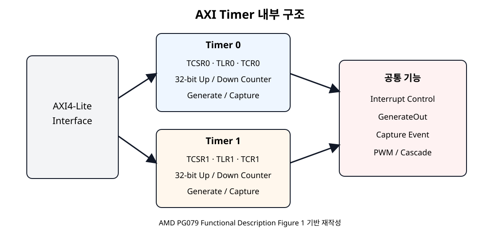
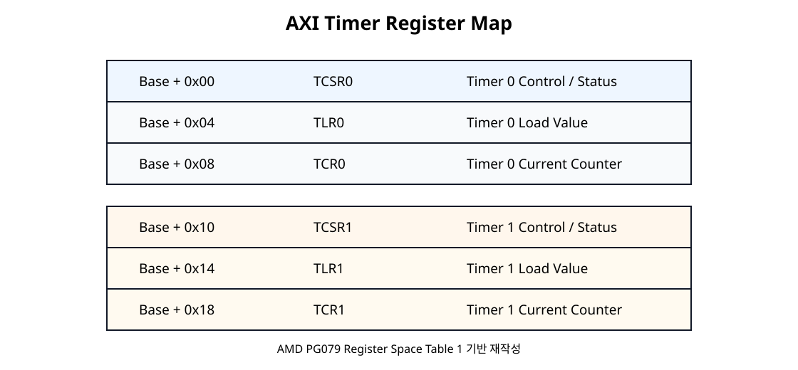
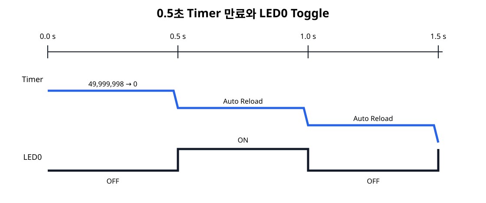

# AXI Timer - 0.5초 Polling과 LED Blink


## 전체 학습 위치


## 실습 목표

LED0는 0.5초마다 상태가 바뀐다. 따라서 OFF 0.5초 → ON 0.5초 → OFF 0.5초로 반복되며 한 번의 완전한 ON/OFF Cycle은 약 1초이다.


## 기존 SoC에 Timer 추가

SoC 06의 AXI GPIO와 SoC 07의 AXI UART Lite는 그대로 유지하고 axi_timer_0만 추가한다.


```text
MicroBlaze V
   │
   ▼
SmartConnect
   ├─ AXI GPIO ──────▶ LED[15:0]
   ├─ AXI UART Lite ─▶ PC Terminal
   └─ AXI Timer
          │
          └─ Polling으로 만료 상태 확인
```

Timer에는 별도의 외부 FPGA Pin이 필요하지 않는다.


## AXI Timer 내부 구조


[](../images/soc08/pg079_axi_timer_block.svg)

AMD PG079 Functional Description의 Block Diagram을 기준으로 재작성한 구조도.
원문: AMD PG079 · Functional Description

AXI Timer는 AXI4-Lite Slave Interface와 두 개의 Timer/Counter Module을 가진다. 각 Timer는 Load Register, Counter Register, Control/Status Register를 갖는다.

MicroBlaze V의 Peripheral AXI 경로를 활성화하여 IP를 연결한다. 하드웨어 변경 후 XSA와 V용 Platform/BSP를 갱신하고 생성된 xparameters.h의 심볼을 사용한다.


## 두 개의 32-bit Timer


| 구분 | Timer 0 | Timer 1 |
| --- | --- | --- |
| Control/Status | TCSR0 | TCSR1 |
| Load | TLR0 | TLR1 |
| Counter | TCR0 | TCR1 |
| SoC 08 | 사용 | 미사용 |

두 Counter를 Cascade하면 64-bit Counter로 사용할 수 있지만 이번 장에서는 Timer 0 하나만 사용한다.


## Clock와 Prescaler

PG079는 Timer Module의 Clock Rate가 s_axi_aclk이며 별도의 Prescaling을 하지 않는다고 설명한다. 현재 시스템 Clock은 100 MHz이므로 Timer도 100 MHz를 직접 센다.


```text
100 MHz
→ 1 Clock = 10 ns
→ 100,000,000 Clocks = 1 s
→ 50,000,000 Clocks  = 0.5 s
```


## Timer Mode


| Mode | 기능 | SoC 08 |
| --- | --- | --- |
| Generate | 설정한 시간 간격 만료 생성 | 사용 |
| Capture | 외부 Event 시 Counter 값 저장 | 미사용 |
| PWM | Timer 0/1을 이용한 PWM 생성 | 미사용 |
| Cascade | 두 Counter를 64-bit로 결합 | 미사용 |

이번 장은 Generate + Down Count + Auto Reload로 구성한다.


## IP 추가

- Add IPVivado Block Design에서 AXI Timer를 추가한다.
- Instance기본 이름 axi_timer_0을 사용한다.
- Timer Width32-bit 기본 Counter를 사용한다.
- InterruptIP의 Interrupt Port는 생성될 수 있지만 SoC 08에서는 CPU Interrupt 경로에 연결하지 않는다.

## AXI 연결


```text
MicroBlaze V M_AXI
      │
      ▼
SmartConnect
      │
      ▼
axi_timer_0/S_AXI

clk_wiz/clk_out1 ─────────────▶ s_axi_aclk
proc_sys_reset/peripheral_aresetn ─▶ s_axi_aresetn
```

Timer는 AXI4-Lite Slave이므로 SoC 05에서 배운 Memory-Mapped Read/Write 방식으로 Register를 제어한다.


## Address Editor

axi_timer_0/S_AXI에 실제 Base Address를 할당한다. 문서나 C 코드에 임의 주소를 고정하지 않고, Vivado가 생성한 XSA와 xparameters.h의 Macro를 사용한다.


## Register Map


[](../images/soc08/pg079_timer_register_map.svg)

AMD PG079 Register Space Table 1 기준 재작성.
원문: AMD PG079 · Register Space


| Offset | Register | 역할 |
| --- | --- | --- |
| +0x00 | TCSR0 | Timer 0 Control / Status |
| +0x04 | TLR0 | Timer 0 Load Value |
| +0x08 | TCR0 | Timer 0 현재 Counter |
| +0x10 | TCSR1 | Timer 1 Control / Status |
| +0x14 | TLR1 | Timer 1 Load Value |
| +0x18 | TCR1 | Timer 1 현재 Counter |


## TCSR0 핵심 비트


| Bit | 이름 | SoC 08 |
| --- | --- | --- |
| 8 | T0INT | Timer 만료 Event Flag · Write 1 to Clear |
| 7 | ENT0 | Timer Enable |
| 6 | ENIT0 | Interrupt Output Enable · 0 |
| 5 | LOAD0 | TLR0 값을 TCR0에 Load |
| 4 | ARHT0 | Auto Reload |
| 1 | UDT0 | 1 = Down Count |
| 0 | MDT0 | 0 = Generate Mode |


## TLR0 · TCR0


```text
TLR0
 │  시작값 저장
 ▼
LOAD
 │
 ▼
TCR0
49,999,998
49,999,997
49,999,996
...
2
1
0
 │
 ▼
Timer Expired
 │
 └─ Auto Reload → 다시 TLR0 값부터 Down Count
```


## 0.5초 계산

PG079의 32-bit Down-count Generate Mode 식을 그대로 사용한다.


```text
TIMING_INTERVAL = (TLR0 + 2) × AXI_CLOCK_PERIOD

AXI_CLOCK_PERIOD = 10 ns
목표 시간 = 0.5 s = 500,000,000 ns

500,000,000 ns
= (TLR0 + 2) × 10 ns

TLR0 + 2 = 50,000,000

TLR0 = 49,999,998
     = 0x02FAF07E
```

따라서 코드의 TIMER_RESET_VALUE는 49,999,998이다.


## Auto Reload


[](../images/soc08/timer_500ms_led_toggle.svg)

0.5초 만료 때마다 Auto Reload되고 LED0를 반전하는 실습 흐름.

XTC_AUTO_RELOAD_OPTION을 사용하면 Counter가 만료된 뒤 Load Value를 다시 불러와 반복 Count한다.


## Polling 만료 확인


```text
if (XTmrCtr_IsExpired(&Timer, TIMER0)) {
    clear_timer_expired();

    expire_count++;

    led_state ^= LED0_MASK;
    XGpio_DiscreteWrite(&Gpio, LED_CHANNEL, led_state);
}
```

XTmrCtr_IsExpired()는 TCSR0의 만료 Event Flag를 Polling한다. Interrupt 출력은 활성화하지 않는다.


## LED Toggle 구조


```text
LED0 OFF : led_state = 0x00000000
          ↓ 0.5 s
LED0 ON  : led_state = 0x00000001
          ↓ 0.5 s
LED0 OFF : led_state = 0x00000000
          ↓
         반복
```

비트 XOR 연산 led_state ^= 0x1로 LED0만 반전한다.


## XDC 유지

AXI Timer 자체는 외부 Pin이 없다. LED 출력은 기존 SoC 06 AXI GPIO를 그대로 사용하므로 기존 Basys3 Switch/LED XDC를 유지한다.


## XSA · Vitis 갱신

Vitis의 xparameters.h에서 Timer Instance Macro가 생성되었는지 확인한다. Classic Flow는 XPAR_TMRCTR_0_DEVICE_ID, SDT Flow는 XPAR_XTMRCTR_0_BASEADDR 형태를 사용한다.


## Timer + GPIO 프로그램

아래 코드는 SoC 08 실습을 위해 작성한 교육용 코드이며 Timer Driver API는 AMD embeddedsw의 Polling Example과 현재 Driver 정의를 기준으로 사용한다.


```c
#include "xparameters.h"
#include "xtmrctr.h"
#include "xgpio.h"
#include "xstatus.h"
#include "xil_types.h"

/*
 * SoC 08 - AXI Timer Polling + AXI GPIO LED Blink
 *
 * Timer clock : 100 MHz
 * Clock period: 10 ns
 *
 * Down-count Generate Mode:
 *   interval = (TLR0 + 2) * 10 ns
 *
 * 0.5 s:
 *   50,000,000 clocks
 *   TLR0 = 50,000,000 - 2
 *        = 49,999,998
 *        = 0x02FAF07E
 *
 * Timer expires every 0.5 s.
 * LED0 toggles at every expiration.
 * Therefore LED0 ON/OFF full cycle is about 1 s.
 */

#define TIMER0                  0U
#define LED_CHANNEL             1U
#define LED0_MASK               0x00000001U

#define TIMER_CLOCK_HZ          100000000U
#define TIMER_INTERVAL_MS       500U
#define TIMER_TICKS_500MS       50000000U
#define TIMER_RESET_VALUE       (TIMER_TICKS_500MS - 2U)

#ifndef SDT
#define TIMER_DEVICE_ID         XPAR_TMRCTR_0_DEVICE_ID
#define GPIO_DEVICE_ID          XPAR_GPIO_0_DEVICE_ID
#else
#define TIMER_BASEADDR          XPAR_XTMRCTR_0_BASEADDR
#define GPIO_BASEADDR           XPAR_XGPIO_0_BASEADDR
#endif

static XTmrCtr Timer;
static XGpio Gpio;

volatile u32 led_state    = 0U;
volatile u32 expire_count = 0U;
volatile u32 timer_value  = 0U;

static int init_gpio(void)
{
#ifndef SDT
    return XGpio_Initialize(&Gpio, GPIO_DEVICE_ID);
#else
    return XGpio_Initialize(&Gpio, GPIO_BASEADDR);
#endif
}

static int init_timer(void)
{
    int status;

#ifndef SDT
    status = XTmrCtr_Initialize(&Timer, TIMER_DEVICE_ID);
#else
    status = XTmrCtr_Initialize(&Timer, TIMER_BASEADDR);
#endif

    if (status != XST_SUCCESS) {
        return status;
    }

    status = XTmrCtr_SelfTest(&Timer, TIMER0);
    if (status != XST_SUCCESS) {
        return status;
    }

    /*
     * Polling Generate Mode:
     * - Down Count
     * - Auto Reload
     * - Interrupt output is NOT enabled
     */
    XTmrCtr_SetOptions(
        &Timer,
        TIMER0,
        XTC_DOWN_COUNT_OPTION | XTC_AUTO_RELOAD_OPTION
    );

    XTmrCtr_SetResetValue(&Timer, TIMER0, TIMER_RESET_VALUE);
    XTmrCtr_Start(&Timer, TIMER0);

    return XST_SUCCESS;
}

static void clear_timer_expired(void)
{
    u32 csr;

    /*
     * T0INT is Write-1-to-Clear.
     * Keep the current control bits and write 1 only to the event flag.
     */
    csr = XTmrCtr_GetControlStatusReg(Timer.BaseAddress, TIMER0);

    XTmrCtr_SetControlStatusReg(
        Timer.BaseAddress,
        TIMER0,
        csr | XTC_CSR_INT_OCCURED_MASK
    );
}

int main(void)
{
    int status;

    status = init_gpio();
    if (status != XST_SUCCESS) {
        return XST_FAILURE;
    }

    status = init_timer();
    if (status != XST_SUCCESS) {
        return XST_FAILURE;
    }

    /* LED0 initially OFF */
    XGpio_DiscreteWrite(&Gpio, LED_CHANNEL, led_state);

    while (1) {
        /* Debugger에서 현재 down-counter 값을 관찰할 수 있다. */
        timer_value = XTmrCtr_GetValue(&Timer, TIMER0);

        if (XTmrCtr_IsExpired(&Timer, TIMER0)) {
            clear_timer_expired();

            expire_count++;

            /* LED0 toggle */
            led_state ^= LED0_MASK;
            XGpio_DiscreteWrite(&Gpio, LED_CHANNEL, led_state);
        }
    }

    return XST_SUCCESS;
}
```


## Driver API와 Register


| API | Hardware 동작 |
| --- | --- |
| XTmrCtr_SetResetValue() | TLR0에 시작값 설정 |
| XTmrCtr_SetOptions() | TCSR0의 Down Count / Auto Reload 등 설정 |
| XTmrCtr_Start() | Timer Enable 후 Count 시작 |
| XTmrCtr_GetValue() | TCR0 현재값 Read |
| XTmrCtr_IsExpired() | TCSR0의 Event Flag 확인 |
| XTmrCtr_SetControlStatusReg() | T0INT에 1을 써서 만료 Flag Clear |


## 실행 순서

- VivadoAXI Timer를 추가하고 Address Editor에서 주소를 할당한다.
- BitstreamValidate → Synthesis → Implementation → Bitstream을 생성한다.
- Vitis새 XSA로 Platform을 갱신하고 Application을 Build한다.
- Program / RunBasys3를 Program하고 ELF를 실행한다.
- LED0LED0가 약 0.5초 간격으로 ON/OFF 되는지 관찰한다.

## 눈으로 확인하는 결과


| 경과 시간 | expire_count | LED0 |
| --- | --- | --- |
| 시작 | 0 | OFF |
| 약 0.5 s | 1 | ON |
| 약 1.0 s | 2 | OFF |
| 약 1.5 s | 3 | ON |
| 약 2.0 s | 4 | OFF |


## Debugger 확인


| 변수 | 확인 내용 |
| --- | --- |
| timer_value | 현재 Down Counter 값 |
| expire_count | 0.5초 만료 횟수 |
| led_state | 0 / 1 Toggle 상태 |

timer_value는 매우 빠르게 감소하므로 Breakpoint에서 매번 정확히 같은 값으로 보이지 않는 것이 정상이다.


## AXI Transaction 추적


```text
[초기 설정]
MicroBlaze V
  → AXI Write → TLR0 = 49,999,998
  → AXI Write → TCSR0 : Down + Auto Reload + Enable

[반복 확인]
MicroBlaze V
  → AXI Read → TCR0 / TCSR0
  → 만료 확인
  → AXI Write → TCSR0 Event Flag Clear
  → AXI Write → GPIO_DATA LED0 Toggle
```

Timer는 Clock을 Hardware에서 독립적으로 세지만, Polling에서는 CPU가 AXI Read를 반복하여 Event Flag를 확인한다.


## 오류 점검


| 증상 | 원인 후보 | 확인 |
| --- | --- | --- |
| LED가 너무 빠르게 깜빡임 | Clock/Load 계산 오류 | 100 MHz, 49,999,998 확인 |
| LED가 한 번만 변함 | Auto Reload 미설정 | XTC_AUTO_RELOAD_OPTION |
| LED가 계속 빠르게 반전 | 만료 Flag를 Clear하지 않음 | T0INT Write-1-to-Clear 확인 |
| Timer가 움직이지 않음 | Enable/Clock/Reset 문제 | XTmrCtr_Start, s_axi_aclk |
| Build Macro 없음 | XSA/Platform 미갱신 | xparameters.h |
| GPIO LED가 안 켜짐 | 기존 SoC 06 AXI GPIO/XDC 문제 | Channel 1 Output, LED XDC 확인 |
| Interrupt가 발생하지 않음 | 정상 | SoC 08은 Polling, Interrupt는 SoC 09 |


## SoC 08 완료 체크리스트

- [ ] 기존 AXI GPIO와 AXI UART Lite를 유지한 상태에서 AXI Timer를 추가했다.
- [ ] AXI Timer가 AXI4-Lite Slave임을 이해한다.
- [ ] Timer 0의 TCSR0, TLR0, TCR0 역할을 구분한다.
- [ ] Timer Clock이 100 MHz이고 별도 Prescaler가 없음을 이해한다.
- [ ] Generate Mode + Down Count + Auto Reload를 사용했다.
- [ ] 0.5초에 필요한 TLR0가 49,999,998 = 0x02FAF07E임을 계산할 수 있다.
- [ ] Interrupt Output을 사용하지 않고 Polling으로 만료를 확인했다.
- [ ] T0INT가 Write-1-to-Clear임을 이해한다.
- [ ] 0.5초마다 LED0를 Toggle한다.
- [ ] LED의 전체 ON/OFF Cycle이 약 1초임을 이해한다.
- [ ] Debugger에서 timer_value, expire_count, led_state를 확인했다.
- [ ] 다음 장에서 Polling을 AXI Interrupt Controller 기반 Interrupt 구조로 변경할 준비가 되었다.

## 공식 매뉴얼 및 원본 근거


| 문서 | 확인 항목 |
| --- | --- |
| AMD PG079 · AXI Timer v2.0 · 2025-08-15 | AXI4-Lite Timer 구조, Timer Mode, Register, Counter |
| PG079 · Functional Description | 두 32-bit Timer, s_axi_aclk, Prescaling 없음 |
| PG079 · Register Space | TCSR/TLR/TCR Offset |
| PG079 · TCSR0 | T0INT, ENT0, LOAD0, ARHT0, UDT0, MDT0 |
| PG079 · Generate Mode | Down Count 식, Auto Reload Programming Sequence |
| AMD/Xilinx Timer Counter Driver API | XTmrCtr API |
| AMD embeddedsw · xtmrctr_polled_example.c | Polling Example, Classic/SDT 초기화 |

