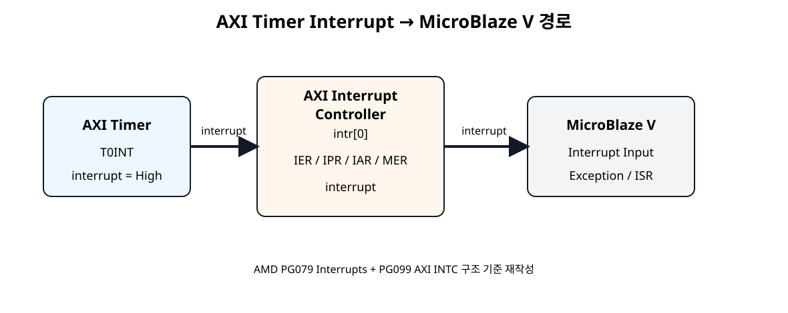
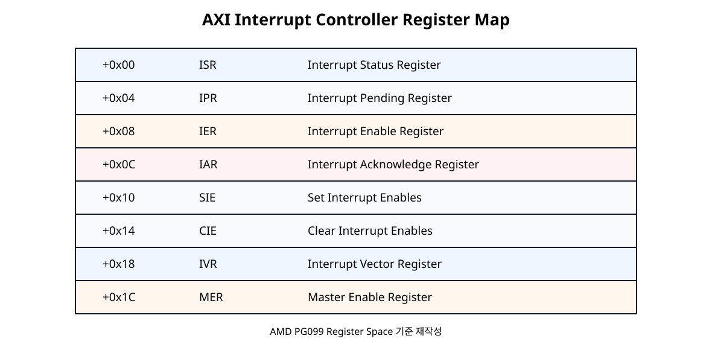
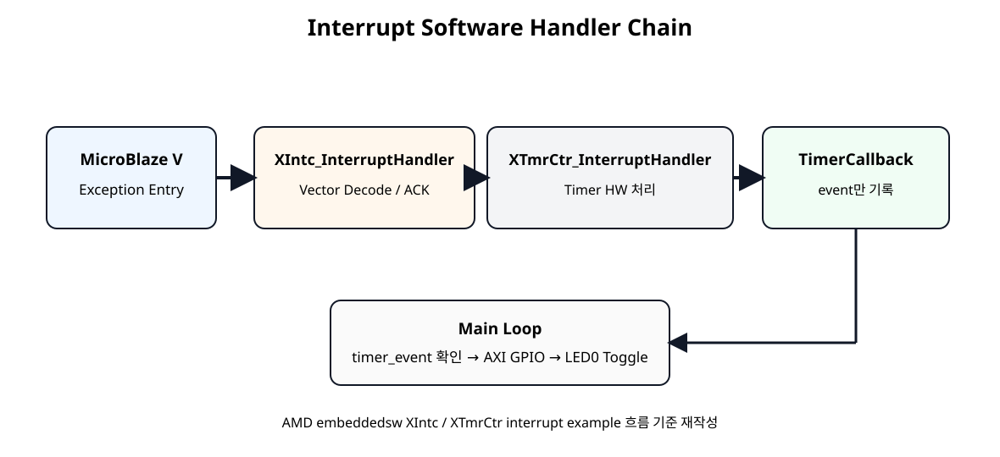

# AXI Interrupt Controller - Timer Interrupt와 ISR


## 전체 학습 위치


## Polling에서 Interrupt로


| SoC 08 Polling | SoC 09 Interrupt |
| --- | --- |
| CPU가 Timer 상태를 계속 읽음 | Timer가 CPU에 Event를 알림 |
| XTmrCtr_IsExpired() 반복 | ISR이 Event 발생 시 호출됨 |
| CPU 시간이 Polling에 사용됨 | 평소에는 Main Code 실행 가능 |


## 전체 Hardware 경로


[](../images/soc09/timer_intc_microblaze_path.svg)

AXI Timer interrupt가 AXI INTC를 거쳐 MicroBlaze V Interrupt 입력으로 전달되는 구조.근거: AMD PG079 · AMD PG099


## AXI INTC 역할

AXI Interrupt Controller는 여러 Peripheral Interrupt 입력을 받아 하나의 irq 출력으로 Processor에 전달한다.


```text
Peripheral interrupts → AXI INTC → irq → MicroBlaze V
```


## Timer Interrupt 특성

Timer interrupt 조건이 발생하고 ENIT0가 활성화되어 있으면 interrupt 출력이 High가 된다. T0INT는 1을 써서 Clear할 때까지 유지된다.


## Interrupt Type 설정


| 항목 | 설정 |
| --- | --- |
| Peripheral Interrupt Type | Level |
| Level Polarity | High |
| Processor IRQ | Level-High |

PG099에서 C_KIND_OF_INTR=0은 Level, C_KIND_OF_LVL=1은 Active-High를 의미한다.


## AXI INTC 추가

- Add IPAXI Interrupt Controller를 추가한다.
- Fast Interrupt이번 장에서는 사용하지 않는다.
- Interrupt Input현재 Timer 하나이므로 입력 1개를 사용한다.

## Timer → INTC 연결


```text
axi_timer_0/interrupt → axi_intc_0/intr[0]
```

SoC 10에서 여러 Interrupt Source를 합칠 때는 xlconcat 등으로 확장한다.


## INTC → MicroBlaze V 연결


```text
axi_intc_0/irq → microblaze_riscv_0/Interrupt
```

CPU는 표준 외부 인터럽트 모드로 설정한다. AXI INTC의 irq를 microblaze_riscv_0/Interrupt에 연결하고 입력은 Level-High로 맞춘다. MicroBlaze V의 mtvec 진입과 mepc 저장·MRET 복귀는 생성 BSP가 처리한다. Xil_ExceptionEnable()은 외부 인터럽트 허용과 전역 허용을 설정하며, ISR은 주변장치의 원인을 해제한다.


## AXI 연결


```text
MicroBlaze V M_AXI → SmartConnect → axi_intc_0/S_AXIclk_out1 → s_axi_aclkperipheral_aresetn → s_axi_aresetn
```


## Address Editor

axi_intc_0/S_AXI에 Base Address를 할당한다. 실제 주소는 Vivado Address Editor와 생성된 XSA를 기준으로 한다.


## INTC Register Map


[](../images/soc09/pg099_intc_register_map.svg)

AMD PG099 Register Address Mapping 기준 재작성.


## IER · IPR · IAR · MER


| Register | 역할 |
| --- | --- |
| IER | Interrupt Source Enable/Mask |
| IPR | Pending Interrupt 확인 |
| IAR | 처리한 Interrupt Acknowledge |
| IVR | 현재 Interrupt Vector 확인 |
| MER | Master IRQ / Hardware Interrupt Enable |


## Interrupt ID


```text
#define TIMER_INTERRUPT_ID     XPAR_INTC_0_TMRCTR_0_VEC_ID
```

실제 Macro는 Instance 이름에 따라 달라질 수 있으므로 xparameters.h에서 확인한다.


## Software Handler Chain


[](../images/soc09/interrupt_software_chain.svg)

MicroBlaze V Exception → AXI INTC Driver → Timer Driver ISR → 사용자 Callback → Main Loop.


## ISR는 짧게


```text
static void TimerCallback(void *CallBackRef, u8 TmrCtrNumber)
{
    (void)CallBackRef;
    (void)TmrCtrNumber;

    interrupt_count++;
    timer_event = 1U;
}
```

Callback은 Interrupt Context에서 실행되므로 event만 기록하고 LED AXI Write는 Main Loop에서 수행한다.


## Classic Flow


```text
XIntc_Initialize → XIntc_Connect → XIntc_Start(XIN_REAL_MODE) → XIntc_Enable → Xil_ExceptionRegisterHandler → Xil_ExceptionEnable
```


## SDT Flow


```text
status = XSetupInterruptSystem(
    &Timer,
    (XInterruptHandler)XTmrCtr_InterruptHandler,
    Timer.Config.IntrId,
    Timer.Config.IntrParent,
    XINTERRUPT_DEFAULT_PRIORITY
);
```

SDT Flow에서는 Timer Config의 IntrId와 IntrParent를 사용한다.


## Timer 설정 변경


```text
XTmrCtr_SetOptions(
    &Timer,
    TIMER0,
    XTC_DOWN_COUNT_OPTION |
    XTC_AUTO_RELOAD_OPTION |
    XTC_INT_MODE_OPTION
);
```


## Interrupt 프로그램

다음 코드는 AMD의 현재 XIntc/XTmrCtr/SDT Interrupt 흐름을 기준으로 작성한 교육용 예제이다.


```c
#include "xparameters.h"
#include "xtmrctr.h"
#include "xgpio.h"
#include "xstatus.h"
#include "xil_types.h"
#include "xil_exception.h"

#ifdef SDT
#include "xinterrupt_wrap.h"
#else
#include "xintc.h"
#endif

/*
 * SoC 09 - AXI Interrupt Controller + AXI Timer
 *
 * Hardware path:
 *   axi_timer_0/interrupt
 *      -> axi_intc_0/intr[0]
 *      -> axi_intc_0/irq
 *      -> microblaze_riscv_0/Interrupt
 *
 * Timer:
 *   100 MHz
 *   0.5 s interval
 *   Down Count + Auto Reload + Interrupt
 *
 * User callback:
 *   - interrupt_count++
 *   - timer_event = 1
 *
 * Main loop:
 *   - timer_event 확인
 *   - AXI GPIO LED0 toggle
 */

#define TIMER0                  0U
#define LED_CHANNEL             1U
#define LED0_MASK               0x00000001U

#define TIMER_TICKS_500MS       50000000U
#define TIMER_RESET_VALUE       (TIMER_TICKS_500MS - 2U)

#ifndef SDT
#define TIMER_DEVICE_ID         XPAR_TMRCTR_0_DEVICE_ID
#define GPIO_DEVICE_ID          XPAR_GPIO_0_DEVICE_ID
#define INTC_DEVICE_ID          XPAR_INTC_0_DEVICE_ID
#define TIMER_INTERRUPT_ID      XPAR_INTC_0_TMRCTR_0_VEC_ID
#else
#define TIMER_BASEADDR          XPAR_XTMRCTR_0_BASEADDR
#define GPIO_BASEADDR           XPAR_XGPIO_0_BASEADDR
#endif

static XTmrCtr Timer;
static XGpio Gpio;

#ifndef SDT
static XIntc Intc;
#endif

volatile u32 interrupt_count = 0U;
volatile u32 timer_event     = 0U;
volatile u32 led_state       = 0U;

/*
 * XTmrCtr_InterruptHandler()가 Timer HW interrupt를 처리한 뒤
 * 이 callback을 Interrupt Context에서 호출한다.
 *
 * ISR/Callback에서는 긴 처리나 출력 작업을 하지 않는다.
 */
static void TimerCallback(void *CallBackRef, u8 TmrCtrNumber)
{
    (void)CallBackRef;
    (void)TmrCtrNumber;

    interrupt_count++;
    timer_event = 1U;
}

static int InitGpio(void)
{
#ifndef SDT
    return XGpio_Initialize(&Gpio, GPIO_DEVICE_ID);
#else
    return XGpio_Initialize(&Gpio, GPIO_BASEADDR);
#endif
}

static int InitTimer(void)
{
    int status;

#ifndef SDT
    status = XTmrCtr_Initialize(&Timer, TIMER_DEVICE_ID);
#else
    status = XTmrCtr_Initialize(&Timer, TIMER_BASEADDR);
#endif

    if (status != XST_SUCCESS) {
        return XST_FAILURE;
    }

    status = XTmrCtr_SelfTest(&Timer, TIMER0);
    if (status != XST_SUCCESS) {
        return XST_FAILURE;
    }

    XTmrCtr_SetHandler(&Timer, TimerCallback, &Timer);

    XTmrCtr_SetOptions(
        &Timer,
        TIMER0,
        XTC_DOWN_COUNT_OPTION |
        XTC_AUTO_RELOAD_OPTION |
        XTC_INT_MODE_OPTION
    );

    XTmrCtr_SetResetValue(&Timer, TIMER0, TIMER_RESET_VALUE);

    return XST_SUCCESS;
}

static int SetupInterruptSystem(void)
{
    int status;

#ifndef SDT
    status = XIntc_Initialize(&Intc, INTC_DEVICE_ID);
    if (status != XST_SUCCESS) {
        return XST_FAILURE;
    }

    status = XIntc_Connect(
        &Intc,
        TIMER_INTERRUPT_ID,
        (XInterruptHandler)XTmrCtr_InterruptHandler,
        (void *)&Timer
    );
    if (status != XST_SUCCESS) {
        return XST_FAILURE;
    }

    status = XIntc_Start(&Intc, XIN_REAL_MODE);
    if (status != XST_SUCCESS) {
        return XST_FAILURE;
    }

    XIntc_Enable(&Intc, TIMER_INTERRUPT_ID);

    Xil_ExceptionInit();

    Xil_ExceptionRegisterHandler(
        XIL_EXCEPTION_ID_INT,
        (Xil_ExceptionHandler)XIntc_InterruptHandler,
        &Intc
    );

    Xil_ExceptionEnable();

#else
    status = XSetupInterruptSystem(
        &Timer,
        (XInterruptHandler)XTmrCtr_InterruptHandler,
        Timer.Config.IntrId,
        Timer.Config.IntrParent,
        XINTERRUPT_DEFAULT_PRIORITY
    );

    if (status != XST_SUCCESS) {
        return XST_FAILURE;
    }
#endif

    return XST_SUCCESS;
}

int main(void)
{
    int status;

    status = InitGpio();
    if (status != XST_SUCCESS) {
        return XST_FAILURE;
    }

    status = InitTimer();
    if (status != XST_SUCCESS) {
        return XST_FAILURE;
    }

    status = SetupInterruptSystem();
    if (status != XST_SUCCESS) {
        return XST_FAILURE;
    }

    XGpio_DiscreteWrite(&Gpio, LED_CHANNEL, led_state);

    /*
     * Interrupt path를 모두 준비한 뒤 Timer 시작
     */
    XTmrCtr_Start(&Timer, TIMER0);

    while (1) {
        /*
         * Callback은 event만 남긴다.
         * 실제 AXI GPIO Write는 Main Context에서 수행한다.
         */
        if (timer_event != 0U) {
            timer_event = 0U;

            led_state ^= LED0_MASK;
            XGpio_DiscreteWrite(&Gpio, LED_CHANNEL, led_state);
        }
    }

    return XST_SUCCESS;
}
```


## Polling과 비교


| 항목 | SoC 08 | SoC 09 |
| --- | --- | --- |
| Timer 확인 | Main Loop 반복 Read | Interrupt 발생 |
| CPU 진입 | 일반 흐름 | Exception/ISR |
| LED 처리 | Polling 직후 | Callback event → Main 처리 |


## 실행 순서

- HardwareTimer interrupt → AXI INTC → MicroBlaze V 연결.
- AddressAXI INTC Base Address 할당.
- BuildValidate → Bitstream → XSA → Vitis Platform Update.
- RunLED0가 0.5초 간격으로 토글되는지 확인.

## 눈으로 확인하는 결과


| 시간 | interrupt_count | LED0 |
| --- | --- | --- |
| 시작 | 0 | OFF |
| 약 0.5 s | 1 | ON |
| 약 1.0 s | 2 | OFF |
| 약 1.5 s | 3 | ON |


## Debugger 확인


| 변수 | 정상 동작 |
| --- | --- |
| interrupt_count | 약 0.5초마다 증가 |
| timer_event | ISR에서 1 → Main에서 0 |
| led_state | 0 ↔ 1 반복 |


## Interrupt 전체 추적


```text
TCR0 rollover → T0INT → Timer interrupt → AXI INTC intr[0] → irq → MicroBlaze V Exception → XIntc_InterruptHandler → XTmrCtr_InterruptHandler → TimerCallback → timer_event=1 → Main Loop → AXI GPIO → LED0
```


## 오류 점검


| 증상 | 확인 |
| --- | --- |
| LED가 안 깜빡임 | Timer→INTC→MicroBlaze V irq 경로 |
| interrupt_count=0 | XTC_INT_MODE_OPTION, Vector ID |
| 계속 재진입 | Level-High 설정, Timer Driver ISR 연결 |
| 한 번만 발생 | Auto Reload 설정 |
| Macro 없음 | 최신 XSA/Platform, xparameters.h |


## SoC 09 완료 체크리스트

- [ ] AXI Interrupt Controller를 추가했다.
- [ ] Timer interrupt를 intr[0]에 연결했다.
- [ ] irq를 MicroBlaze V Interrupt에 연결했다.
- [ ] Timer Interrupt 입력을 Level-High로 설정했다.
- [ ] ISR/IPR/IER/IAR/IVR/MER 역할을 구분한다.
- [ ] Classic XIntc 초기화 흐름을 이해한다.
- [ ] SDT에서 XSetupInterruptSystem()을 이해한다.
- [ ] XTC_INT_MODE_OPTION을 사용한다.
- [ ] Callback은 event만 기록한다.
- [ ] LED Write는 Main Context에서 수행한다.
- [ ] 약 0.5초마다 Interrupt와 LED Toggle을 확인한다.

## 공식 매뉴얼 및 원본 근거


| 문서 | 확인 항목 |
| --- | --- |
| AMD PG099 · AXI Interrupt Controller v4.1 | Interrupt input/output, Register Map, Level/Edge 설정 |
| AMD PG079 · AXI Timer Interrupts | Timer interrupt Active-High, T0INT |
| AMD embeddedsw · xtmrctr_intr_example.c | Classic XIntc + SDT interrupt flow |
| AMD XTmrCtr Driver API | SetHandler, InterruptHandler, XTC_INT_MODE_OPTION |
| AMD xinterrupt_wrap.c · 2026 | SDT interrupt wrapper |
| AMD Standalone RISC-V · xil_exception.h | RISC-V 외부 인터럽트 등록 API와 XIL_EXCEPTION_ID_INT |

