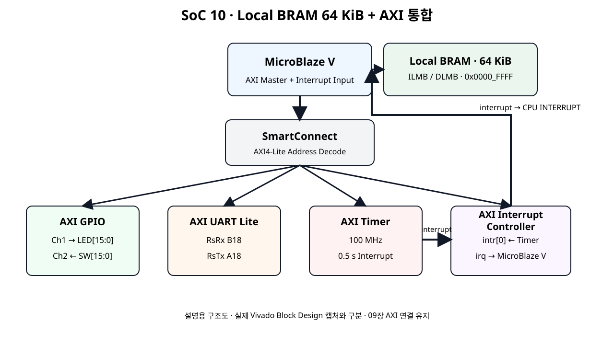
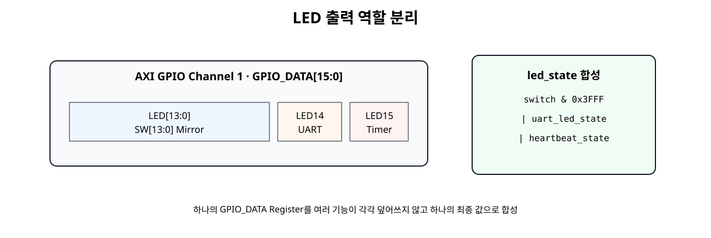
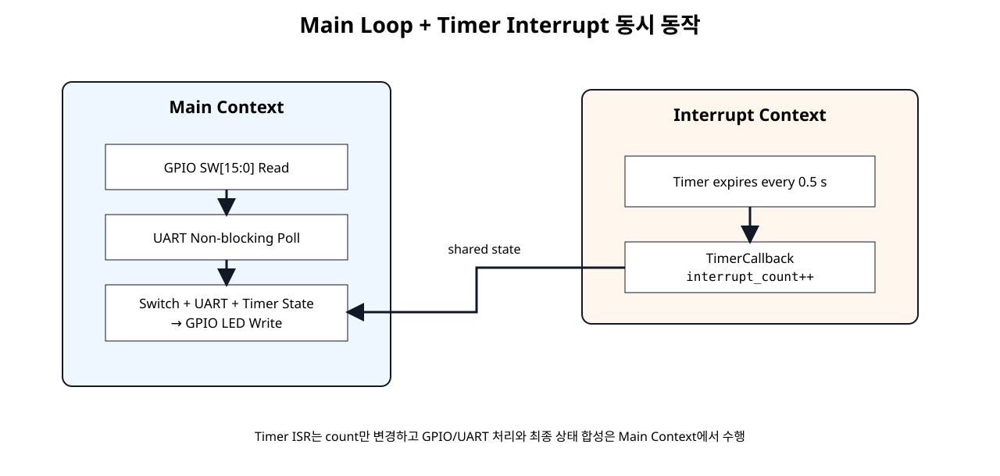

# MicroBlaze V + GPIO + UART + Timer 통합


## 전체 학습 위치


## 통합 실습 목표

이번 장은 새로운 Peripheral을 추가하는 단계가 아니라, 이미 개별적으로 동작을 확인한 네 IP가 하나의 SoC 안에서 동시에 동작하도록 만드는 단계이다.


## 최종 Hardware 구조


[](../images/soc10/soc10_integrated_hardware.svg)

AMD AXI GPIO, UART Lite, Timer, Interrupt Controller의 공식 구조와 SoC 06~09 연결을 합친 통합 구조도.

네 IP는 SmartConnect를 통해 MicroBlaze V의 Memory-Mapped AXI Master에 연결되고, Timer의 interrupt만 AXI INTC를 통해 MicroBlaze V Interrupt 입력으로 전달된다.


## 기존 IP 유지 기준


| IP | 기존 설정 | SoC 10 |
| --- | --- | --- |
| AXI GPIO | Dual 16-bit · Ch1 Output · Ch2 Input | 유지 |
| AXI UART Lite | 115200 · 8 bit · No Parity | 유지 |
| AXI Timer | 32-bit · 100 MHz · 0.5 s | Interrupt 사용 |
| AXI INTC | Timer Level-High 입력 | 유지 |


## 기능 역할 분리


| 입력 / Event | 처리 | 출력 |
| --- | --- | --- |
| SW[13:0] | Main Loop GPIO Read | LED[13:0] |
| UART 1 / 0 | Main Loop UART Polling | LED14 |
| Timer Interrupt | ISR에서 interrupt_count++ | LED15 Heartbeat |
| UART r | 현재 State 읽기 | Terminal Status |


## GPIO 동작

SW14와 SW15는 LED14·LED15의 별도 기능과 충돌하지 않도록 Mirror 대상에서 제외한다.


## UART 동작

UART는 Main Loop에서 비차단 Polling한다. XUartLite_IsReceiveEmpty()가 False일 때만 1 Byte를 읽으므로 사용자가 문자를 입력하지 않아도 Switch 처리와 Timer Heartbeat가 계속 동작한다.


## Timer Interrupt 동작

Callback에서는 GPIO Write나 UART 문자열 출력처럼 시간이 긴 작업을 하지 않는다.


## AXI INTC 동작

AXI INTC는 이번 장에서도 Timer interrupt 하나만 받는다. UART는 Polling이므로 Interrupt Source 수를 늘리지 않는다.


```text
axi_timer_0/interrupt
        ↓
axi_intc_0/intr[0]
        ↓
axi_intc_0/irq
        ↓
microblaze_riscv_0/Interrupt
```


## Clock · Reset

네 AXI Peripheral은 동일한 100 MHz Clock Domain을 사용한다.


```text
clk W5 100 MHz → Clocking Wizard → clk_out1
  ├─ MicroBlaze V
  ├─ SmartConnect
  ├─ AXI GPIO
  ├─ AXI UART Lite
  ├─ AXI Timer
  └─ AXI INTC

Processor System Reset
  └─ peripheral_aresetn → 모든 AXI Peripheral
```


## Address Map 통합

Address Editor에는 GPIO, UART Lite, Timer, INTC 네 AXI Slave Segment가 함께 나타난다. Base Address는 실제 Vivado 설계를 기준으로 사용하며 문서에 임의 값을 고정하지 않는다.


## Register Offset 통합표


| IP | Base + Offset | Register |
| --- | --- | --- |
| AXI GPIO | +0x00 | GPIO_DATA · LED |
| AXI GPIO | +0x08 | GPIO2_DATA · Switch |
| AXI UART Lite | +0x00 / +0x04 | RX FIFO / TX FIFO |
| AXI UART Lite | +0x08 / +0x0C | STATUS / CONTROL |
| AXI Timer | +0x00 / +0x04 / +0x08 | TCSR0 / TLR0 / TCR0 |
| AXI INTC | +0x00 ~ +0x1C | ISR ~ MER |


## Interrupt 경로


```text
Timer T0INT → Timer interrupt → INTC IER/IPR → INTC irq
→ MicroBlaze V Exception → XIntc_InterruptHandler
→ XTmrCtr_InterruptHandler → TimerCallback
```

CPU는 표준 외부 인터럽트 모드로 설정한다. AXI INTC의 irq를 microblaze_riscv_0/Interrupt에 연결하고 입력은 Level-High로 맞춘다. MicroBlaze V의 mtvec 진입과 mepc 저장·MRET 복귀는 생성 BSP가 처리한다. Xil_ExceptionEnable()은 외부 인터럽트 허용과 전역 허용을 설정하며, ISR은 주변장치의 원인을 해제한다.


## LED 출력 충돌 방지


[](../images/soc10/soc10_led_ownership.svg)

하나의 GPIO_DATA Register에 여러 기능이 각각 Write하지 않고 하나의 최종 led_state로 합성한다.


```text
new_led_state =
    (switch_value & SW_LED_MASK) |
    uart_led_state |
    heartbeat_state;
```

각 기능이 GPIO_DATA를 따로 Write하면 마지막 Write가 앞선 값을 덮어쓴다.


## Main과 ISR 역할


[](../images/soc10/soc10_main_interrupt_flow.svg)

Main Context와 Timer Interrupt Context를 분리한 Software 구조.


| Context | 수행 작업 |
| --- | --- |
| ISR Callback | interrupt_count++ |
| Main Loop | Switch Read, UART Command, LED State 합성·Write |


## Vivado 통합 순서

- SoC 09 구조 유지MicroBlaze V, BRAM, Clock/Reset, Timer, INTC를 유지한다.
- AXI GPIO 확인Dual Channel 16-bit와 led[] / sw[] 외부 Port를 확인한다.
- AXI UART Lite 확인115200 · 8 bit · No Parity와 RsRx / RsTx를 확인한다.
- SmartConnect 확인네 AXI Slave가 모두 MicroBlaze V Data Address Space에 연결되어 있는지 확인한다.
- Interrupt Path 확인Timer만 AXI INTC intr[0]에 연결되어 있는지 확인한다.

## 외부 Port


| Port | 방향 | 기능 |
| --- | --- | --- |
| clk | Input | 100 MHz |
| btnC | Input | System Reset |
| sw[15:0] | Input | AXI GPIO Channel 2 |
| led[15:0] | Output | AXI GPIO Channel 1 |
| RsRx | Input | PC → FPGA UART |
| RsTx | Output | FPGA → PC UART |


## 통합 XDC

Clock, Reset, Switch, LED, USB-UART 핀을 Digilent Basys-3-Master.xdc 기준으로 통합한다.


```text
## Clock signal
set_property -dict { PACKAGE_PIN W5 IOSTANDARD LVCMOS33 } [get_ports clk]
create_clock -add -name sys_clk_pin -period 10.00 -waveform {0 5} [get_ports clk]

## Center Button : Reset
set_property -dict { PACKAGE_PIN U18 IOSTANDARD LVCMOS33 } [get_ports btnC]

## Basys3 Slide Switches
set_property -dict { PACKAGE_PIN V17 IOSTANDARD LVCMOS33 } [get_ports {sw[0]}]
set_property -dict { PACKAGE_PIN V16 IOSTANDARD LVCMOS33 } [get_ports {sw[1]}]
set_property -dict { PACKAGE_PIN W16 IOSTANDARD LVCMOS33 } [get_ports {sw[2]}]
set_property -dict { PACKAGE_PIN W17 IOSTANDARD LVCMOS33 } [get_ports {sw[3]}]
set_property -dict { PACKAGE_PIN W15 IOSTANDARD LVCMOS33 } [get_ports {sw[4]}]
set_property -dict { PACKAGE_PIN V15 IOSTANDARD LVCMOS33 } [get_ports {sw[5]}]
set_property -dict { PACKAGE_PIN W14 IOSTANDARD LVCMOS33 } [get_ports {sw[6]}]
set_property -dict { PACKAGE_PIN W13 IOSTANDARD LVCMOS33 } [get_ports {sw[7]}]
set_property -dict { PACKAGE_PIN V2 IOSTANDARD LVCMOS33 } [get_ports {sw[8]}]
set_property -dict { PACKAGE_PIN T3 IOSTANDARD LVCMOS33 } [get_ports {sw[9]}]
set_property -dict { PACKAGE_PIN T2 IOSTANDARD LVCMOS33 } [get_ports {sw[10]}]
set_property -dict { PACKAGE_PIN R3 IOSTANDARD LVCMOS33 } [get_ports {sw[11]}]
set_property -dict { PACKAGE_PIN W2 IOSTANDARD LVCMOS33 } [get_ports {sw[12]}]
set_property -dict { PACKAGE_PIN U1 IOSTANDARD LVCMOS33 } [get_ports {sw[13]}]
set_property -dict { PACKAGE_PIN T1 IOSTANDARD LVCMOS33 } [get_ports {sw[14]}]
set_property -dict { PACKAGE_PIN R2 IOSTANDARD LVCMOS33 } [get_ports {sw[15]}]

## Basys3 LEDs
set_property -dict { PACKAGE_PIN U16 IOSTANDARD LVCMOS33 } [get_ports {led[0]}]
set_property -dict { PACKAGE_PIN E19 IOSTANDARD LVCMOS33 } [get_ports {led[1]}]
set_property -dict { PACKAGE_PIN U19 IOSTANDARD LVCMOS33 } [get_ports {led[2]}]
set_property -dict { PACKAGE_PIN V19 IOSTANDARD LVCMOS33 } [get_ports {led[3]}]
set_property -dict { PACKAGE_PIN W18 IOSTANDARD LVCMOS33 } [get_ports {led[4]}]
set_property -dict { PACKAGE_PIN U15 IOSTANDARD LVCMOS33 } [get_ports {led[5]}]
set_property -dict { PACKAGE_PIN U14 IOSTANDARD LVCMOS33 } [get_ports {led[6]}]
set_property -dict { PACKAGE_PIN V14 IOSTANDARD LVCMOS33 } [get_ports {led[7]}]
set_property -dict { PACKAGE_PIN V13 IOSTANDARD LVCMOS33 } [get_ports {led[8]}]
set_property -dict { PACKAGE_PIN V3 IOSTANDARD LVCMOS33 } [get_ports {led[9]}]
set_property -dict { PACKAGE_PIN W3 IOSTANDARD LVCMOS33 } [get_ports {led[10]}]
set_property -dict { PACKAGE_PIN U3 IOSTANDARD LVCMOS33 } [get_ports {led[11]}]
set_property -dict { PACKAGE_PIN P3 IOSTANDARD LVCMOS33 } [get_ports {led[12]}]
set_property -dict { PACKAGE_PIN N3 IOSTANDARD LVCMOS33 } [get_ports {led[13]}]
set_property -dict { PACKAGE_PIN P1 IOSTANDARD LVCMOS33 } [get_ports {led[14]}]
set_property -dict { PACKAGE_PIN L1 IOSTANDARD LVCMOS33 } [get_ports {led[15]}]

## Basys3 USB-RS232 Interface
set_property -dict { PACKAGE_PIN B18 IOSTANDARD LVCMOS33 } [get_ports RsRx]
set_property -dict { PACKAGE_PIN A18 IOSTANDARD LVCMOS33 } [get_ports RsTx]
```


## Validate · Bitstream

- Validate DesignAXI Address, Clock, Reset, Interrupt 연결 오류를 확인한다.
- Address EditorGPIO/UART/Timer/INTC가 모두 Assigned인지 확인한다.
- Synthesis / ImplementationUnconstrained Port와 Critical Warning을 확인한다.
- Bitstream통합 Hardware Bitstream을 생성한다.

## XSA · Vitis 갱신

xparameters.h에 GPIO, UART Lite, Timer, AXI INTC 관련 Macro가 모두 존재해야 한다.


## 통합 프로그램

아래 코드는 SoC 10 통합 실습을 위해 작성한 교육용 코드이다. GPIO Driver, UART Lite Low-Level API, Timer Interrupt Example의 현재 AMD API 구조를 조합했다.


```c
#include "xparameters.h"
#include "xgpio.h"
#include "xuartlite_l.h"
#include "xtmrctr.h"
#include "xstatus.h"
#include "xil_types.h"
#include "xil_exception.h"

#ifdef SDT
#include "xinterrupt_wrap.h"
#else
#include "xintc.h"
#endif

/*
 * SoC 10 - MicroBlaze V + GPIO + UART + Timer + AXI INTC Integration
 *
 * GPIO Channel 1 : LED[15:0] output
 * GPIO Channel 2 : SW[15:0] input
 *
 * LED ownership:
 *   LED[13:0] : SW[13:0] mirror
 *   LED14     : UART command control ('1' = ON, '0' = OFF)
 *   LED15     : Timer interrupt heartbeat
 *
 * UART : Polling, 115200 8N1
 * Timer: 100 MHz, 0.5 s interval, Down Count + Auto Reload + Interrupt
 * IRQ  : AXI Timer -> AXI INTC -> MicroBlaze V
 */

#define GPIO_LED_CHANNEL        1U
#define GPIO_SW_CHANNEL         2U

#define SW_LED_MASK             0x00003FFFU
#define UART_LED_MASK           0x00004000U
#define HEARTBEAT_LED_MASK      0x00008000U

#define TIMER0                  0U
#define TIMER_TICKS_500MS       50000000U
#define TIMER_RESET_VALUE       (TIMER_TICKS_500MS - 2U)

#ifndef SDT
#define GPIO_DEVICE_ID          XPAR_GPIO_0_DEVICE_ID
#define TIMER_DEVICE_ID         XPAR_TMRCTR_0_DEVICE_ID
#define INTC_DEVICE_ID          XPAR_INTC_0_DEVICE_ID
#define TIMER_INTERRUPT_ID      XPAR_INTC_0_TMRCTR_0_VEC_ID
#define UART_BASEADDR           XPAR_UARTLITE_0_BASEADDR
#else
#define GPIO_BASEADDR           XPAR_XGPIO_0_BASEADDR
#define TIMER_BASEADDR          XPAR_XTMRCTR_0_BASEADDR
#define UART_BASEADDR           XPAR_XUARTLITE_0_BASEADDR
#endif

static XGpio Gpio;
static XTmrCtr Timer;

#ifndef SDT
static XIntc Intc;
#endif

volatile u32 interrupt_count = 0U;
volatile u32 switch_value    = 0U;
volatile u32 led_state       = 0U;
volatile u8  last_uart_rx    = 0U;

static u32 uart_led_state = 0U;

static void UartPutChar(u8 ch)
{
    XUartLite_SendByte(UART_BASEADDR, ch);
}

static void UartPutString(const char *text)
{
    while (*text != '\0') {
        UartPutChar((u8)*text);
        text++;
    }
}

static void UartPutHexNibble(u8 value)
{
    value &= 0x0FU;

    if (value < 10U) {
        UartPutChar((u8)('0' + value));
    } else {
        UartPutChar((u8)('A' + (value - 10U)));
    }
}

static void UartPutHex16(u16 value)
{
    int shift;

    for (shift = 12; shift >= 0; shift -= 4) {
        UartPutHexNibble((u8)(value >> shift));
    }
}

static void UartPutHex32(u32 value)
{
    int shift;

    for (shift = 28; shift >= 0; shift -= 4) {
        UartPutHexNibble((u8)(value >> shift));
    }
}

static void PrintHelp(void)
{
    UartPutString("\r\nCommands\r\n");
    UartPutString("  1 : LED14 ON\r\n");
    UartPutString("  0 : LED14 OFF\r\n");
    UartPutString("  r : Read status\r\n");
    UartPutString("  h : Help\r\n");
}

static void PrintStatus(void)
{
    UartPutString("\r\nSW=0x");
    UartPutHex16((u16)switch_value);
    UartPutString(" LED=0x");
    UartPutHex16((u16)led_state);
    UartPutString(" IRQ=0x");
    UartPutHex32(interrupt_count);
    UartPutString("\r\n");
}

static void TimerCallback(void *CallBackRef, u8 TmrCtrNumber)
{
    (void)CallBackRef;
    (void)TmrCtrNumber;
    interrupt_count++;
}

static int InitGpio(void)
{
#ifndef SDT
    return XGpio_Initialize(&Gpio, GPIO_DEVICE_ID);
#else
    return XGpio_Initialize(&Gpio, GPIO_BASEADDR);
#endif
}

static int InitTimer(void)
{
    int status;

#ifndef SDT
    status = XTmrCtr_Initialize(&Timer, TIMER_DEVICE_ID);
#else
    status = XTmrCtr_Initialize(&Timer, TIMER_BASEADDR);
#endif

    if (status != XST_SUCCESS) {
        return XST_FAILURE;
    }

    status = XTmrCtr_SelfTest(&Timer, TIMER0);
    if (status != XST_SUCCESS) {
        return XST_FAILURE;
    }

    XTmrCtr_SetHandler(&Timer, TimerCallback, &Timer);
    XTmrCtr_SetOptions(
        &Timer,
        TIMER0,
        XTC_DOWN_COUNT_OPTION |
        XTC_AUTO_RELOAD_OPTION |
        XTC_INT_MODE_OPTION
    );
    XTmrCtr_SetResetValue(&Timer, TIMER0, TIMER_RESET_VALUE);

    return XST_SUCCESS;
}

static int SetupInterruptSystem(void)
{
    int status;

#ifndef SDT
    status = XIntc_Initialize(&Intc, INTC_DEVICE_ID);
    if (status != XST_SUCCESS) {
        return XST_FAILURE;
    }

    status = XIntc_Connect(
        &Intc,
        TIMER_INTERRUPT_ID,
        (XInterruptHandler)XTmrCtr_InterruptHandler,
        (void *)&Timer
    );
    if (status != XST_SUCCESS) {
        return XST_FAILURE;
    }

    status = XIntc_Start(&Intc, XIN_REAL_MODE);
    if (status != XST_SUCCESS) {
        return XST_FAILURE;
    }

    XIntc_Enable(&Intc, TIMER_INTERRUPT_ID);

    Xil_ExceptionInit();
    Xil_ExceptionRegisterHandler(
        XIL_EXCEPTION_ID_INT,
        (Xil_ExceptionHandler)XIntc_InterruptHandler,
        &Intc
    );
    Xil_ExceptionEnable();
#else
    status = XSetupInterruptSystem(
        &Timer,
        (XInterruptHandler)XTmrCtr_InterruptHandler,
        Timer.Config.IntrId,
        Timer.Config.IntrParent,
        XINTERRUPT_DEFAULT_PRIORITY
    );

    if (status != XST_SUCCESS) {
        return XST_FAILURE;
    }
#endif

    return XST_SUCCESS;
}

static void InitUart(void)
{
    /* RX/TX FIFO clear. UART interrupt remains disabled. */
    XUartLite_WriteReg(
        UART_BASEADDR,
        XUL_CONTROL_REG_OFFSET,
        0x03U
    );
}

static void HandleUartCommand(void)
{
    if (XUartLite_IsReceiveEmpty(UART_BASEADDR)) {
        return;
    }

    last_uart_rx = XUartLite_RecvByte(UART_BASEADDR);

    switch (last_uart_rx) {
    case '1':
        uart_led_state = UART_LED_MASK;
        UartPutString("\r\nLED14=ON\r\n");
        break;

    case '0':
        uart_led_state = 0U;
        UartPutString("\r\nLED14=OFF\r\n");
        break;

    case 'r':
    case 'R':
        PrintStatus();
        break;

    case 'h':
    case 'H':
        PrintHelp();
        break;

    case '\r':
    case '\n':
        break;

    default:
        UartPutString("\r\nUnknown command. Press h.\r\n");
        break;
    }
}

static void UpdateLedOutput(void)
{
    u32 new_led_state;
    u32 heartbeat_state;

    if ((interrupt_count & 1U) != 0U) {
        heartbeat_state = HEARTBEAT_LED_MASK;
    } else {
        heartbeat_state = 0U;
    }

    new_led_state =
        (switch_value & SW_LED_MASK) |
        uart_led_state |
        heartbeat_state;

    if (new_led_state != led_state) {
        led_state = new_led_state;
        XGpio_DiscreteWrite(
            &Gpio,
            GPIO_LED_CHANNEL,
            led_state
        );
    }
}

int main(void)
{
    int status;

    status = InitGpio();
    if (status != XST_SUCCESS) {
        return XST_FAILURE;
    }

    InitUart();

    status = InitTimer();
    if (status != XST_SUCCESS) {
        return XST_FAILURE;
    }

    status = SetupInterruptSystem();
    if (status != XST_SUCCESS) {
        return XST_FAILURE;
    }

    led_state = 0U;
    XGpio_DiscreteWrite(&Gpio, GPIO_LED_CHANNEL, led_state);

    UartPutString("\r\nSoC 10 Integrated System Ready\r\n");
    PrintHelp();

    XTmrCtr_Start(&Timer, TIMER0);

    while (1) {
        switch_value = XGpio_DiscreteRead(
            &Gpio,
            GPIO_SW_CHANNEL
        );

        HandleUartCommand();
        UpdateLedOutput();
    }

    return XST_SUCCESS;
}
```


## UART 명령


| 명령 | 동작 |
| --- | --- |
| 1 | LED14 ON |
| 0 | LED14 OFF |
| r | Switch, LED, Interrupt Count 출력 |
| h | 명령 목록 출력 |

Terminal은 SoC 07과 동일한 115200 8N1, Flow Control Off, Local Echo Off를 사용한다.


## Software 실행 흐름


```text
while (1)
  ├─ XGpio_DiscreteRead() → SW[15:0]
  ├─ XUartLite_IsReceiveEmpty() → 명령이 있으면 처리
  └─ UpdateLedOutput()
       ├─ SW[13:0]
       ├─ UART LED14
       └─ IRQ Count parity → LED15

동시에:
Timer Interrupt → TimerCallback → interrupt_count++
```


## 보드 확인 1 · Switch


| 조작 | 결과 |
| --- | --- |
| SW0 ON | LED0 ON |
| SW3 ON | LED3 ON |
| SW13 ON | LED13 ON |
| SW14 / SW15 | 이번 실습의 LED Mirror에서는 사용하지 않음 |


## 보드 확인 2 · UART

Terminal에서 1을 입력하면 LED14가 켜지고 0을 입력하면 꺼진다. r을 입력하면 다음 형태로 상태가 출력된다.


```text
SW=0x0009 LED=0xC009 IRQ=0x00000015
```


## 보드 확인 3 · Timer

UART 입력이나 Switch 조작 여부와 관계없이 LED15는 약 0.5초마다 토글된다.


## Debugger 확인


| 변수 | 확인 내용 |
| --- | --- |
| switch_value | 현재 16-bit Switch 값 |
| last_uart_rx | 마지막 UART 명령 Byte |
| interrupt_count | 0.5초 Timer Interrupt 누적 횟수 |
| led_state | 세 기능이 합성된 최종 16-bit LED 출력 |


## AXI Transaction 통합 추적


```text
[GPIO INPUT]
SW → GPIO2_DATA → AXI Read → MicroBlaze V

[UART INPUT]
PC → RX FIFO → AXI Read → MicroBlaze V

[TIMER]
100 MHz → TCR0 → interrupt → INTC → CPU Exception

[GPIO OUTPUT]
MicroBlaze V → led_state 합성 → AXI Write → GPIO_DATA → LED

[UART OUTPUT]
MicroBlaze V → AXI Write → TX FIFO → PC Terminal
```


## 오류 점검


| 증상 | 원인 후보 | 확인 |
| --- | --- | --- |
| Switch를 움직이면 LED14/15가 사라짐 | 각 기능이 GPIO_DATA를 따로 Write | 최종 led_state 합성 확인 |
| UART 입력 중 Heartbeat 정지 | Blocking UART Receive 사용 | XUartLite_IsReceiveEmpty() 확인 |
| LED15가 안 깜빡임 | Timer/INTC/Exception 오류 | SoC 09 Interrupt Path 확인 |
| LED14가 명령에 반응하지 않음 | UART 핀/115200/XSA 문제 | B18/A18, 115200 8N1, Base Macro |
| SW14/15가 LED14/15에 반영되지 않음 | 정상 | LED14=UART, LED15=Timer |
| Macro Build Error | 최신 XSA 미적용 또는 Instance 이름 차이 | xparameters.h |
| Address 충돌 | 네 Slave Segment 중복 | Address Editor |


## SoC 10 완료 체크리스트

- [ ] AXI GPIO, AXI UART Lite, AXI Timer, AXI INTC가 하나의 MicroBlaze V AXI System에 연결되어 있다.
- [ ] GPIO는 Dual 16-bit 구성을 유지한다.
- [ ] UART는 115200 8N1 Polling으로 동작한다.
- [ ] Timer만 AXI INTC를 통해 Interrupt 방식으로 동작한다.
- [ ] 네 AXI Slave의 Base Address가 서로 겹치지 않는다.
- [ ] SW[13:0]이 LED[13:0]에 대응한다.
- [ ] UART 1/0으로 LED14를 제어한다.
- [ ] LED15가 약 0.5초마다 Heartbeat로 토글된다.
- [ ] ISR Callback에서는 interrupt_count++만 수행한다.
- [ ] GPIO 출력은 Main Loop에서 하나의 led_state로 합성한다.
- [ ] UART Polling이 Blocking되지 않아 Timer/LED 동작이 계속된다.
- [ ] r 명령으로 Switch/LED/IRQ 상태를 확인한다.
- [ ] Clock, Reset, Switch, LED, UART가 통합 XDC와 일치한다.
- [ ] GPIO + UART + Timer + Interrupt가 동시에 동작함을 보드에서 확인했다.

## 공식 매뉴얼 및 원본 근거


| 문서 | 확인 항목 |
| --- | --- |
| AMD PG144 · AXI GPIO · 2026-01-30 | GPIO_DATA/GPIO2_DATA Register Offset와 Dual Channel |
| AMD XGpio Driver API | DiscreteRead, DiscreteWrite |
| AMD PG142 · AXI UART Lite | RX/TX FIFO, Status/Control, 16-entry FIFO |
| AMD UART Lite Low-Level API | IsReceiveEmpty, RecvByte, SendByte |
| AMD PG079 · AXI Timer · 2025-08-15 | TCSR0/TLR0/TCR0 Register 구조 |
| AMD embeddedsw · xtmrctr_intr_example.c · 2026 | XIntc/XTmrCtr Interrupt 연결과 Classic/SDT Flow |
| AMD PG099 · AXI Interrupt Controller | ISR/IPR/IER/IAR/SIE/CIE/IVR/MER |
| Digilent Basys 3 Reference Manual | 100 MHz Clock, Switch/LED, FT2232HQ USB-UART B18/A18 |
| Digilent Basys-3-Master.xdc | W5, U18, SW/LED, B18/A18 FPGA Pin |

