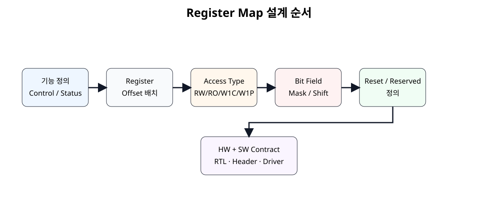
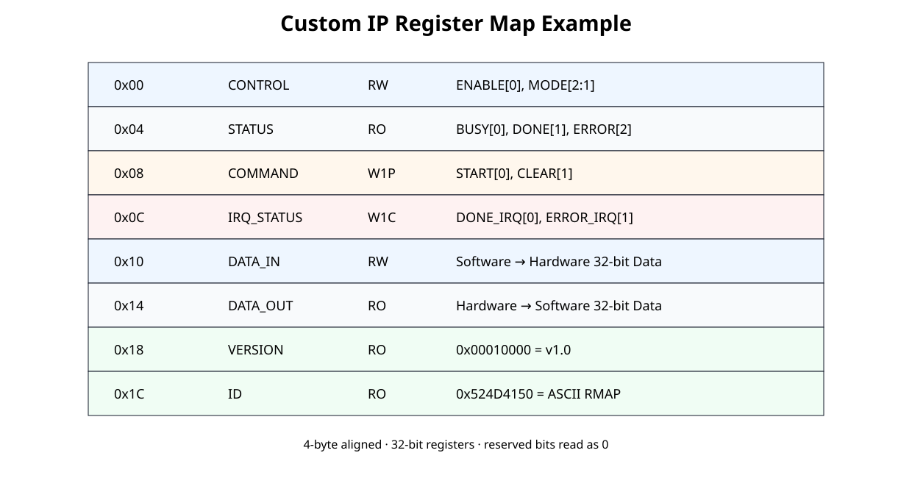
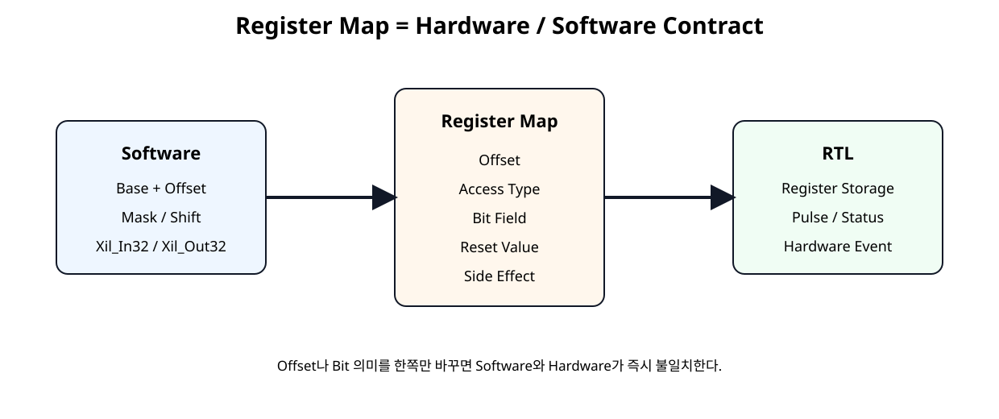

# Register Map 설계 원칙


## 전체 학습 위치


## Register Map이 필요한 이유

Custom IP에서 Software가 Hardware 기능을 제어하려면 CPU가 읽고 쓸 수 있는 주소와 각 Bit의 의미가 필요하다. Register Map은 이 관계를 하나의 계약으로 만든다.


## SoC 10에서 Custom IP로

SoC 10까지는 AMD가 Register Map을 이미 정의한 GPIO, UART, Timer, INTC를 사용했다. 앞으로는 사용자가 직접 Register를 정의한다.


```text
완성 IP 사용
PG144/PG142/PG079/PG099가 Register Map 제공
          ↓
Custom IP 설계
사용자가 Offset / Access / Bit 의미를 직접 정의
```


## 설계 순서


[](../images/soc11/soc11_register_design_flow.svg)

Register Map은 RTL부터 코딩하지 않고 기능과 Software 계약부터 확정한다.


## Register Map 예제


[](../images/soc11/soc11_register_map.svg)

이후 SoC 12~14에서 그대로 사용할 교육용 Custom Register Map.


## 4-byte 정렬

32-bit Register는 0x00, 0x04, 0x08, 0x0C...처럼 4 Byte 간격으로 배치한다.


```text
32 bit = 4 Byte
Reg0 : Base + 0x00
Reg1 : Base + 0x04
Reg2 : Base + 0x08
Reg3 : Base + 0x0C
```

AMD AXI GPIO도 32-bit Register를 0x00, 0x04, 0x08, 0x0C Offset으로 배치한다.


## Access Type


| 표기 | 의미 | 예제 |
| --- | --- | --- |
| RW | Software Read / Write | CONTROL, DATA_IN |
| RO | Software Read Only | STATUS, DATA_OUT, VERSION |
| WO | Software Write Only | Command 계열 |
| W1C | 1을 쓰면 해당 상태 Clear | IRQ_STATUS |
| W1P | 1을 쓰면 1 Clock Pulse 생성 | COMMAND |


## RW Register

CONTROL처럼 Software 설정값을 Hardware가 계속 유지해야 하는 Register에 사용한다.


## RO Register

STATUS는 Hardware 상태를 Software가 읽기만 한다. Software Write는 무시한다.


```text
busy_i ──▶ STATUS[0]
done_i ──▶ STATUS[1]
error_i ─▶ STATUS[2]

Software Read 가능
Software Write 효과 없음
```


## W1P Command

COMMAND.START에 1을 쓰면 Register에 1이 계속 저장되는 것이 아니라 start_pulse_o가 1 Clock 동안만 High가 된다.

Start, Clear, Trigger처럼 Event를 전달하는 Command에 적합하다.


## W1C Status

IRQ_STATUS는 Hardware Event가 발생하면 1로 Set되고 Software가 해당 Bit에 1을 쓰면 Clear된다.

AMD AXI Timer의 T0INT도 동일하게 1을 써야 Clear된다.


## Reserved Bit

사용하지 않는 Bit는 Reserved로 정의하고 Read 시 0을 반환하도록 한다. Software는 Reserved Bit에 의미 있는 값을 의존하지 않는다.


## Reset Value

모든 저장 Register는 Reset 직후 값을 문서에 명시한다.


| Register | Reset |
| --- | --- |
| CONTROL | 0x00000000 |
| IRQ_STATUS | 0x00000000 |
| DATA_IN | 0x00000000 |
| VERSION | 0x00010000 |
| ID | 0x524D4150 |


## Bit Field · Mask · Shift

CONTROL.MODE[2:1]처럼 여러 Bit를 하나의 Field로 사용할 때 Software에는 Mask와 Shift를 함께 정의한다.


```text
#define CUSTOM_CONTROL_MODE_MASK   0x00000006U
#define CUSTOM_CONTROL_MODE_SHIFT  1U
```


## CONTROL 설계


| Bit | Name | Access | Reset |
| --- | --- | --- | --- |
| 0 | ENABLE | RW | 0 |
| 2:1 | MODE | RW | 0 |
| 31:3 | Reserved | - | 0 |


## STATUS 설계


| Bit | Name | Access |
| --- | --- | --- |
| 0 | BUSY | RO |
| 1 | DONE | RO |
| 2 | ERROR | RO |

상태 Register를 Control 저장 Register와 분리하면 Hardware Source와 Software Write 경계가 명확해진다.


## COMMAND 설계


| Bit | Name | Access | 동작 |
| --- | --- | --- | --- |
| 0 | START | W1P | 1 Clock start pulse |
| 1 | CLEAR | W1P | 1 Clock clear pulse |


## IRQ_STATUS 설계

Hardware Event Set과 Software W1C가 같은 Clock에 발생하면 이번 예제는 Hardware Set 우선으로 정의한다. 새 Event가 Clear Write와 동시에 들어와도 Event를 잃지 않기 위한 정책이다.


## DATA_IN · DATA_OUT


| Register | 방향 | Access |
| --- | --- | --- |
| DATA_IN | Software → Hardware | RW |
| DATA_OUT | Hardware → Software | RO |


## VERSION · ID

VERSION과 ID Register를 두면 Software가 연결된 IP 종류와 Revision을 확인할 수 있다.


```text
VERSION = 0x00010000 → v1.0
ID = 0x524D4150 → ASCII "RMAP"
```


## WSTRB와 Byte Write

Register Bank는 AXI Slave와 독립적으로 wr_strb[3:0]를 입력받도록 한다. DATA_IN은 각 Byte Strobe가 1인 Byte만 갱신한다.


```text
wr_strb = 4'b0001 → bits [7:0]만 변경
wr_strb = 4'b0011 → bits [15:0] 변경
wr_strb = 4'b1111 → 32 bit 전체 변경
```


## Read-Modify-Write 주의

CONTROL처럼 순수 RW Register는 Read → Mask 변경 → Write가 자연스럽다. 반면 W1C 상태 Bit를 같은 Register에 섞으면 Read 값의 1을 다시 Write하면서 의도하지 않은 Clear가 발생할 수 있다.


## Hardware / Software Contract


[](../images/soc11/soc11_hw_sw_contract.svg)

Register Map은 Software Header와 RTL이 공유하는 단일 계약이다.


## C Header

AMD Driver가 사용하는 것처럼 BaseAddress + RegOffset 형태로 32-bit Register를 접근한다.


```c
#ifndef CUSTOM_REGMAP_H
#define CUSTOM_REGMAP_H

#include "xil_io.h"
#include "xil_types.h"

/*
 * SoC 11 - Custom Register Map example
 *
 * Base address is assigned by Vivado Address Editor.
 * This file defines only offsets, fields and access helpers.
 */

/* Register offsets */
#define CUSTOM_CONTROL_OFFSET        0x00U
#define CUSTOM_STATUS_OFFSET         0x04U
#define CUSTOM_COMMAND_OFFSET        0x08U
#define CUSTOM_IRQ_STATUS_OFFSET     0x0CU
#define CUSTOM_DATA_IN_OFFSET        0x10U
#define CUSTOM_DATA_OUT_OFFSET       0x14U
#define CUSTOM_VERSION_OFFSET        0x18U
#define CUSTOM_ID_OFFSET             0x1CU

/* CONTROL register fields: RW */
#define CUSTOM_CONTROL_ENABLE_MASK   0x00000001U
#define CUSTOM_CONTROL_MODE_MASK     0x00000006U
#define CUSTOM_CONTROL_MODE_SHIFT    1U

/* STATUS register fields: RO */
#define CUSTOM_STATUS_BUSY_MASK      0x00000001U
#define CUSTOM_STATUS_DONE_MASK      0x00000002U
#define CUSTOM_STATUS_ERROR_MASK     0x00000004U

/* COMMAND register fields: W1P */
#define CUSTOM_COMMAND_START_MASK    0x00000001U
#define CUSTOM_COMMAND_CLEAR_MASK    0x00000002U

/* IRQ_STATUS register fields: W1C */
#define CUSTOM_IRQ_DONE_MASK         0x00000001U
#define CUSTOM_IRQ_ERROR_MASK        0x00000002U

/* Fixed read-only values */
#define CUSTOM_VERSION_VALUE         0x00010000U  /* v1.0 */
#define CUSTOM_ID_VALUE              0x524D4150U  /* ASCII "RMAP" */

#define Custom_ReadReg(BaseAddress, RegOffset) \
    Xil_In32((BaseAddress) + (RegOffset))

#define Custom_WriteReg(BaseAddress, RegOffset, Data) \
    Xil_Out32((BaseAddress) + (RegOffset), (Data))

static inline void Custom_SetEnable(UINTPTR BaseAddress, u32 Enable)
{
    u32 value;

    value = Custom_ReadReg(BaseAddress, CUSTOM_CONTROL_OFFSET);

    if (Enable != 0U) {
        value |= CUSTOM_CONTROL_ENABLE_MASK;
    } else {
        value &= ~CUSTOM_CONTROL_ENABLE_MASK;
    }

    Custom_WriteReg(BaseAddress, CUSTOM_CONTROL_OFFSET, value);
}

static inline void Custom_SetMode(UINTPTR BaseAddress, u32 Mode)
{
    u32 value;

    value = Custom_ReadReg(BaseAddress, CUSTOM_CONTROL_OFFSET);
    value &= ~CUSTOM_CONTROL_MODE_MASK;
    value |= (Mode << CUSTOM_CONTROL_MODE_SHIFT) & CUSTOM_CONTROL_MODE_MASK;

    Custom_WriteReg(BaseAddress, CUSTOM_CONTROL_OFFSET, value);
}

static inline void Custom_Start(UINTPTR BaseAddress)
{
    /* W1P: write 1 to generate one-cycle start pulse */
    Custom_WriteReg(
        BaseAddress,
        CUSTOM_COMMAND_OFFSET,
        CUSTOM_COMMAND_START_MASK
    );
}

static inline void Custom_ClearDoneIrq(UINTPTR BaseAddress)
{
    /* W1C: writing 1 clears only DONE IRQ */
    Custom_WriteReg(
        BaseAddress,
        CUSTOM_IRQ_STATUS_OFFSET,
        CUSTOM_IRQ_DONE_MASK
    );
}

#endif
```


## RTL Register Bank

AXI 신호를 직접 넣지 않고 wr_en / wr_offset / wr_data / wr_strb / rd_offset / rd_data의 Bus-independent Interface로 작성한다.


```verilog
module custom_register_bank (
    input  wire        clk,
    input  wire        resetn,

    // Bus-independent register access interface.
    // SoC 12 will connect this interface to AXI4-Lite.
    input  wire        wr_en,
    input  wire [7:0]  wr_offset,
    input  wire [31:0] wr_data,
    input  wire [3:0]  wr_strb,

    input  wire [7:0]  rd_offset,
    output reg  [31:0] rd_data,

    // Hardware status / event inputs
    input  wire        busy_i,
    input  wire        done_i,
    input  wire        error_i,
    input  wire        irq_done_event_i,
    input  wire        irq_error_event_i,
    input  wire [31:0] data_out_i,

    // Control outputs
    output reg         enable_o,
    output reg  [1:0]  mode_o,
    output reg         start_pulse_o,
    output reg         clear_pulse_o,
    output reg  [31:0] data_in_o,
    output reg  [1:0]  irq_status_o
);

localparam [7:0] REG_CONTROL    = 8'h00;
localparam [7:0] REG_STATUS     = 8'h04;
localparam [7:0] REG_COMMAND    = 8'h08;
localparam [7:0] REG_IRQ_STATUS = 8'h0C;
localparam [7:0] REG_DATA_IN    = 8'h10;
localparam [7:0] REG_DATA_OUT   = 8'h14;
localparam [7:0] REG_VERSION    = 8'h18;
localparam [7:0] REG_ID         = 8'h1C;

localparam [31:0] VERSION_VALUE = 32'h0001_0000;
localparam [31:0] ID_VALUE      = 32'h524D_4150; // ASCII "RMAP"

integer byte_index;

always @(posedge clk) begin
    if (!resetn) begin
        enable_o      <= 1'b0;
        mode_o        <= 2'b00;
        start_pulse_o <= 1'b0;
        clear_pulse_o <= 1'b0;
        data_in_o     <= 32'h0000_0000;
        irq_status_o  <= 2'b00;
    end else begin
        // W1P pulses are one clock wide by default.
        start_pulse_o <= 1'b0;
        clear_pulse_o <= 1'b0;

        // Hardware events set IRQ status.
        // Event set has priority over software clear in the same cycle.
        if (irq_done_event_i) begin
            irq_status_o[0] <= 1'b1;
        end else if (
            wr_en &&
            (wr_offset == REG_IRQ_STATUS) &&
            wr_strb[0] &&
            wr_data[0]
        ) begin
            irq_status_o[0] <= 1'b0;
        end

        if (irq_error_event_i) begin
            irq_status_o[1] <= 1'b1;
        end else if (
            wr_en &&
            (wr_offset == REG_IRQ_STATUS) &&
            wr_strb[0] &&
            wr_data[1]
        ) begin
            irq_status_o[1] <= 1'b0;
        end

        if (wr_en) begin
            case (wr_offset)
                REG_CONTROL: begin
                    if (wr_strb[0]) begin
                        enable_o <= wr_data[0];
                        mode_o   <= wr_data[2:1];
                    end
                end

                REG_COMMAND: begin
                    if (wr_strb[0]) begin
                        start_pulse_o <= wr_data[0];
                        clear_pulse_o <= wr_data[1];
                    end
                end

                REG_DATA_IN: begin
                    // Byte-enable write using WSTRB-equivalent strobes.
                    for (byte_index = 0; byte_index < 4; byte_index = byte_index + 1) begin
                        if (wr_strb[byte_index]) begin
                            data_in_o[byte_index*8 +: 8] <=
                                wr_data[byte_index*8 +: 8];
                        end
                    end
                end

                default: begin
                    // RO / reserved / unmapped writes have no effect.
                end
            endcase
        end
    end
end

always @(*) begin
    case (rd_offset)
        REG_CONTROL: begin
            rd_data = {29'h0, mode_o, enable_o};
        end

        REG_STATUS: begin
            rd_data = {29'h0, error_i, done_i, busy_i};
        end

        REG_COMMAND: begin
            // W1P command register has no retained state.
            rd_data = 32'h0000_0000;
        end

        REG_IRQ_STATUS: begin
            rd_data = {30'h0, irq_status_o};
        end

        REG_DATA_IN: begin
            rd_data = data_in_o;
        end

        REG_DATA_OUT: begin
            rd_data = data_out_i;
        end

        REG_VERSION: begin
            rd_data = VERSION_VALUE;
        end

        REG_ID: begin
            rd_data = ID_VALUE;
        end

        default: begin
            rd_data = 32'h0000_0000;
        end
    endcase
end

endmodule
```


## AXI와 Register Bank 분리


```text
SoC 12 AXI4-Lite Slave
AW/W/B/AR/R
      ↓
Address Decode + Write/Read Event
      ↓
wr_en / wr_offset / wr_data / wr_strb
rd_offset / rd_data
      ↓
custom_register_bank
      ↓
Controller / Datapath
```

Register 기능을 AXI Protocol Logic과 분리하면 Register Bank를 다른 Bus나 Testbench에서도 재사용할 수 있다.


## 검증 포인트


| 항목 | 확인 |
| --- | --- |
| Reset | CONTROL/IRQ_STATUS/DATA_IN 초기값 |
| RW | CONTROL Write 후 Readback |
| RO | STATUS/DATA_OUT Write 무시 |
| W1P | START/CLEAR가 1 Clock만 High |
| W1C | 1인 Bit만 Clear |
| WSTRB | 선택된 Byte만 변경 |
| Reserved | Read 0 / Write 무시 |
| VERSION/ID | 상수 Readback |


## 확장 규칙

Motor, PWM, UART Controller, NPU 등으로 확장할 때도 기본 패턴을 유지한다.

새 Register를 추가할 때 기존 Offset 의미를 바꾸지 않고 뒤쪽에 확장하는 것이 Software 호환성에 유리하다.


## 오류 점검


| 문제 | 원인 |
| --- | --- |
| C Header와 RTL Offset 불일치 | Software가 다른 Register 접근 |
| RW와 W1C 혼합 | Read-Modify-Write Side Effect |
| Reserved Bit 값을 그대로 반환 | Revision 간 Software 호환성 저하 |
| W1P를 저장 Register로 구현 | Start 신호가 계속 High |
| W1C Event와 Clear 우선순위 미정 | 동시 Event 누락 가능 |
| WSTRB 무시 | Byte Write 동작 불일치 가능 |


## SoC 11 완료 체크리스트

- [ ] Register Map을 Hardware/Software Contract로 설명할 수 있다.
- [ ] 32-bit Register를 4-byte Offset으로 배치한다.
- [ ] RW, RO, W1C, W1P를 구분한다.
- [ ] Reserved Bit와 Reset Value를 명시한다.
- [ ] Field마다 Mask와 Shift를 정의한다.
- [ ] CONTROL과 W1C IRQ_STATUS를 분리한다.
- [ ] W1P COMMAND는 1 Clock Pulse로 구현한다.
- [ ] Hardware Event와 W1C가 동시에 발생할 때 Set 우선 정책을 정의했다.
- [ ] DATA_IN에 Byte Strobe를 반영한다.
- [ ] C Header와 RTL Offset이 동일하다.
- [ ] Register Bank를 AXI Protocol과 분리했다.
- [ ] 다음 SoC 12에서 이 Register Bank를 AXI4-Lite Slave에 연결할 준비가 되었다.

## 공식 매뉴얼 및 원본 근거


| 문서 | 확인 항목 |
| --- | --- |
| AMD PG144 · AXI GPIO · 2026-01-30 | Base-relative Offset, 32-bit Register 배치, Access Type |
| AMD PG079 · TCSR0 · 2025-08-15 | RW Bit와 Write-1-to-Clear T0INT 실제 사례 |
| AMD embeddedsw · xil_io.h | Xil_In32, Xil_Out32 32-bit MMIO 접근 |
| AMD embeddedsw Driver Register Access Pattern | ReadReg/WriteReg = BaseAddress + RegOffset 패턴 |

