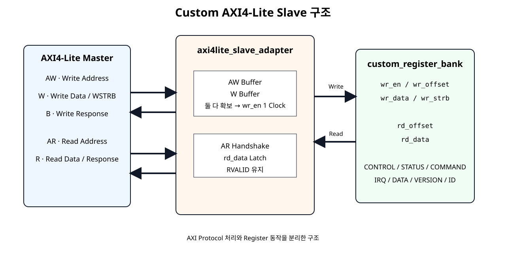
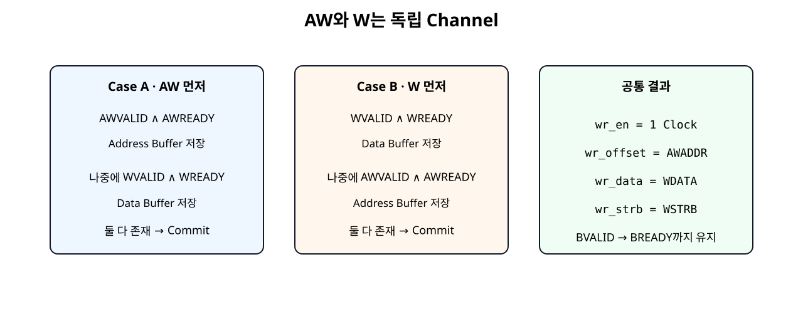
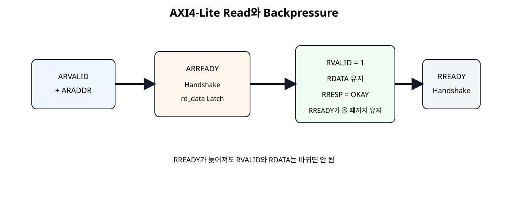

# Custom AXI4-Lite Slave 기초


## 전체 학습 위치


## 이번 장의 목표

이번 장은 Register 기능을 새로 만드는 장이 아니다. SoC 11의 custom_register_bank가 이미 CONTROL, STATUS, COMMAND, IRQ_STATUS, DATA Register를 처리한다. 여기에 AXI4-Lite Protocol을 해석하는 Adapter만 추가한다.


## SoC 11에서 이어지는 구조


[](../images/soc12/axi4lite_adapter_architecture.svg)

AXI Protocol 처리와 Register 동작을 분리한 SoC 12 구조.

Register Bank 인터페이스는 그대로 wr_en / wr_offset / wr_data / wr_strb / rd_offset / rd_data를 사용한다.


## AXI4-Lite 5개 Channel


| Channel | 주요 신호 | Slave 역할 |
| --- | --- | --- |
| AW | AWADDR, AWVALID, AWREADY | Write Address 수신 |
| W | WDATA, WSTRB, WVALID, WREADY | Write Data 수신 |
| B | BRESP, BVALID, BREADY | Write 결과 응답 |
| AR | ARADDR, ARVALID, ARREADY | Read Address 수신 |
| R | RDATA, RRESP, RVALID, RREADY | Read Data 응답 |

AMD의 현재 AXI4-Lite Interface 문서도 Write Address와 Write Data를 별도 Channel로 정의하고, WSTRB를 Byte Lane 유효 신호로 정의한다.


## Slave Adapter와 Register Bank 분리


| 모듈 | 책임 |
| --- | --- |
| axi4lite_slave_adapter | AXI Handshake, Channel Buffer, Response 유지 |
| custom_register_bank | Register Access Type, Bit Field, Reset, W1P/W1C, Hardware Event |
| custom_axi4lite_ip | 두 모듈 Port 연결만 수행 |


## Write Address Channel


```text
assign s_axi_awready =
    s_axi_aresetn && !aw_stored && !s_axi_bvalid;
```

Adapter에 아직 저장된 Write Address가 없고 이전 Write Response도 끝난 경우에만 새로운 Address를 받는다. Handshake 후 AWADDR를 awaddr_stored에 저장한다.


## Write Data Channel


```text
assign s_axi_wready =
    s_axi_aresetn && !w_stored && !s_axi_bvalid;
```

WDATA와 WSTRB도 AW Channel과 별도로 저장한다. 따라서 Write Address보다 Data가 먼저 도착해도 정상적으로 처리할 수 있다.


## AW와 W 독립성


[](../images/soc12/axi4lite_write_independent.svg)

AW와 W가 어느 순서로 들어와도 각각 Buffer한 뒤 두 정보가 모두 존재할 때 Write를 수행한다.


## Write Commit


```text
assign write_commit =
    aw_stored && w_stored && !s_axi_bvalid;

assign wr_en     = write_commit;
assign wr_offset = awaddr_stored[7:0];
assign wr_data   = wdata_stored;
assign wr_strb   = wstrb_stored;
```

wr_en은 Address와 Data가 모두 확보된 뒤 한 Clock 구간 동안 활성화된다. Register Bank는 이 신호를 기준으로 실제 Register를 갱신한다.


## Write Response Channel

Register Write가 Commit되면 BVALID=1, BRESP=OKAY(2'b00)를 만든다.


```text
Register Write 완료
        ↓
BVALID = 1
BRESP  = OKAY
        ↓
BREADY = 0 → BVALID 계속 유지
BREADY = 1 → 다음 Clock에서 Response 완료
```


## Read Address Channel


```text
assign s_axi_arready =
    s_axi_aresetn && !s_axi_rvalid;

assign rd_offset = s_axi_araddr[7:0];
```

이 기본 Slave는 이전 Read Response가 남아 있지 않을 때 Read Address 하나를 받는다. Register Bank의 Read Path가 Combinational이므로 AR Handshake 시 선택된 rd_data를 AXI R Channel Register에 저장한다.


## Read Data Channel


```text
if (s_axi_arready && s_axi_arvalid) begin
    s_axi_rdata  <= rd_data;
    s_axi_rresp  <= AXI_RESP_OKAY;
    s_axi_rvalid <= 1'b1;
end
```

Master가 바로 받을 준비가 되어 있지 않더라도 R Channel의 Data와 Response는 바뀌지 않아야 한다.


## Backpressure


[](../images/soc12/axi4lite_read_response.svg)

Master가 RREADY를 늦게 Assert해도 Slave는 RVALID/RDATA/RRESP를 유지한다.

같은 원칙으로 Write Response도 BREADY가 들어올 때까지 BVALID/BRESP를 유지한다. Testbench에서는 이 상황을 의도적으로 여러 Clock 지연시켜 확인한다.


## WSTRB 전달

WSTRB[3:0]를 Adapter에서 해석해 없애지 않고 Register Bank까지 그대로 전달한다.


```text
WSTRB[0] → WDATA[7:0]
WSTRB[1] → WDATA[15:8]
WSTRB[2] → WDATA[23:16]
WSTRB[3] → WDATA[31:24]
```

SoC 11의 DATA_IN Register는 이 Strobe를 사용하여 선택된 Byte만 갱신한다.


## Address Offset 처리

Vivado Address Editor는 Custom IP의 Base Address를 정하고, Adapter는 AXI Address의 하위 8 bit를 Register Offset으로 넘긴다.


```text
CPU Address = Custom IP Base + 0x10
                         ↓
AXI AWADDR
                         ↓
wr_offset = AWADDR[7:0]
                         ↓
REG_DATA_IN = 8'h10
```


## 정렬 기준

현재 Register Map은 32-bit Register를 4 Byte 간격으로 배치하므로 정상 Software Access는 0x00, 0x04, 0x08 ...처럼 하위 2 bit가 00인 Word-Aligned Address를 사용한다.


## Adapter 전체 코드


```verilog
module axi4lite_slave_adapter #(
    parameter integer C_S_AXI_ADDR_WIDTH = 32
)(
    input  wire                          s_axi_aclk,
    input  wire                          s_axi_aresetn,

    // AXI4-Lite Write Address Channel
    input  wire [C_S_AXI_ADDR_WIDTH-1:0] s_axi_awaddr,
    input  wire [2:0]                    s_axi_awprot,
    input  wire                          s_axi_awvalid,
    output wire                          s_axi_awready,

    // AXI4-Lite Write Data Channel
    input  wire [31:0]                   s_axi_wdata,
    input  wire [3:0]                    s_axi_wstrb,
    input  wire                          s_axi_wvalid,
    output wire                          s_axi_wready,

    // AXI4-Lite Write Response Channel
    output reg  [1:0]                    s_axi_bresp,
    output reg                           s_axi_bvalid,
    input  wire                          s_axi_bready,

    // AXI4-Lite Read Address Channel
    input  wire [C_S_AXI_ADDR_WIDTH-1:0] s_axi_araddr,
    input  wire [2:0]                    s_axi_arprot,
    input  wire                          s_axi_arvalid,
    output wire                          s_axi_arready,

    // AXI4-Lite Read Data Channel
    output reg  [31:0]                   s_axi_rdata,
    output reg  [1:0]                    s_axi_rresp,
    output reg                           s_axi_rvalid,
    input  wire                          s_axi_rready,

    // Bus-independent register access interface
    output wire                          wr_en,
    output wire [7:0]                    wr_offset,
    output wire [31:0]                   wr_data,
    output wire [3:0]                    wr_strb,

    output wire [7:0]                    rd_offset,
    input  wire [31:0]                   rd_data
);

// AXI response code used by this basic slave.
localparam [1:0] AXI_RESP_OKAY = 2'b00;

// Write Address and Write Data are independent AXI channels.
// Each channel is buffered separately until both are available.
reg                          aw_stored;
reg [C_S_AXI_ADDR_WIDTH-1:0] awaddr_stored;
reg                          w_stored;
reg [31:0]                   wdata_stored;
reg [3:0]                    wstrb_stored;

wire write_commit;

// Single-outstanding-write policy:
// Do not accept a new write while a response is pending.
assign s_axi_awready =
    s_axi_aresetn && !aw_stored && !s_axi_bvalid;

assign s_axi_wready =
    s_axi_aresetn && !w_stored && !s_axi_bvalid;

// Register-bank write occurs only after BOTH address and data
// channels have completed their independent handshakes.
assign write_commit =
    aw_stored && w_stored && !s_axi_bvalid;

assign wr_en     = write_commit;
assign wr_offset = awaddr_stored[7:0];
assign wr_data   = wdata_stored;
assign wr_strb   = wstrb_stored;

// Read side accepts one address only when no previous R response
// is waiting for the master.
assign s_axi_arready =
    s_axi_aresetn && !s_axi_rvalid;

// custom_register_bank read path is combinational.
// The address presented during AR handshake selects rd_data.
assign rd_offset = s_axi_araddr[7:0];

// AWPROT / ARPROT are not used by this educational register slave.
wire unused_prot;
assign unused_prot = ^{s_axi_awprot, s_axi_arprot};

always @(posedge s_axi_aclk) begin
    if (!s_axi_aresetn) begin
        aw_stored     <= 1'b0;
        awaddr_stored <= {C_S_AXI_ADDR_WIDTH{1'b0}};
        w_stored      <= 1'b0;
        wdata_stored  <= 32'h0000_0000;
        wstrb_stored  <= 4'b0000;
        s_axi_bresp   <= AXI_RESP_OKAY;
        s_axi_bvalid  <= 1'b0;
    end else begin
        // Capture Write Address independently.
        if (s_axi_awready && s_axi_awvalid) begin
            aw_stored     <= 1'b1;
            awaddr_stored <= s_axi_awaddr;
        end

        // Capture Write Data independently.
        if (s_axi_wready && s_axi_wvalid) begin
            w_stored     <= 1'b1;
            wdata_stored <= s_axi_wdata;
            wstrb_stored <= s_axi_wstrb;
        end

        // Once both parts exist, pulse wr_en through write_commit
        // and create the AXI B response.
        if (write_commit) begin
            aw_stored    <= 1'b0;
            w_stored     <= 1'b0;
            s_axi_bresp  <= AXI_RESP_OKAY;
            s_axi_bvalid <= 1'b1;
        end else if (s_axi_bvalid && s_axi_bready) begin
            s_axi_bvalid <= 1'b0;
        end
    end
end

always @(posedge s_axi_aclk) begin
    if (!s_axi_aresetn) begin
        s_axi_rdata  <= 32'h0000_0000;
        s_axi_rresp  <= AXI_RESP_OKAY;
        s_axi_rvalid <= 1'b0;
    end else begin
        // Capture the selected register value at AR handshake.
        if (s_axi_arready && s_axi_arvalid) begin
            s_axi_rdata  <= rd_data;
            s_axi_rresp  <= AXI_RESP_OKAY;
            s_axi_rvalid <= 1'b1;
        end else if (s_axi_rvalid && s_axi_rready) begin
            s_axi_rvalid <= 1'b0;
        end
    end
end

endmodule
```


## Register Bank 재사용

SoC 11의 Register Bank 코드는 변경하지 않았다. AXI를 몰라도 동작하는 내부 Interface를 유지한다.


```verilog
module custom_register_bank (
    input  wire        clk,
    input  wire        resetn,

    // Bus-independent register access interface.
    // SoC 12 will connect this interface to AXI4-Lite.
    input  wire        wr_en,
    input  wire [7:0]  wr_offset,
    input  wire [31:0] wr_data,
    input  wire [3:0]  wr_strb,

    input  wire [7:0]  rd_offset,
    output reg  [31:0] rd_data,

    // Hardware status / event inputs
    input  wire        busy_i,
    input  wire        done_i,
    input  wire        error_i,
    input  wire        irq_done_event_i,
    input  wire        irq_error_event_i,
    input  wire [31:0] data_out_i,

    // Control outputs
    output reg         enable_o,
    output reg  [1:0]  mode_o,
    output reg         start_pulse_o,
    output reg         clear_pulse_o,
    output reg  [31:0] data_in_o,
    output reg  [1:0]  irq_status_o
);

localparam [7:0] REG_CONTROL    = 8'h00;
localparam [7:0] REG_STATUS     = 8'h04;
localparam [7:0] REG_COMMAND    = 8'h08;
localparam [7:0] REG_IRQ_STATUS = 8'h0C;
localparam [7:0] REG_DATA_IN    = 8'h10;
localparam [7:0] REG_DATA_OUT   = 8'h14;
localparam [7:0] REG_VERSION    = 8'h18;
localparam [7:0] REG_ID         = 8'h1C;

localparam [31:0] VERSION_VALUE = 32'h0001_0000;
localparam [31:0] ID_VALUE      = 32'h524D_4150; // ASCII "RMAP"

integer byte_index;

always @(posedge clk) begin
    if (!resetn) begin
        enable_o      <= 1'b0;
        mode_o        <= 2'b00;
        start_pulse_o <= 1'b0;
        clear_pulse_o <= 1'b0;
        data_in_o     <= 32'h0000_0000;
        irq_status_o  <= 2'b00;
    end else begin
        // W1P pulses are one clock wide by default.
        start_pulse_o <= 1'b0;
        clear_pulse_o <= 1'b0;

        // Hardware events set IRQ status.
        // Event set has priority over software clear in the same cycle.
        if (irq_done_event_i) begin
            irq_status_o[0] <= 1'b1;
        end else if (
            wr_en &&
            (wr_offset == REG_IRQ_STATUS) &&
            wr_strb[0] &&
            wr_data[0]
        ) begin
            irq_status_o[0] <= 1'b0;
        end

        if (irq_error_event_i) begin
            irq_status_o[1] <= 1'b1;
        end else if (
            wr_en &&
            (wr_offset == REG_IRQ_STATUS) &&
            wr_strb[0] &&
            wr_data[1]
        ) begin
            irq_status_o[1] <= 1'b0;
        end

        if (wr_en) begin
            case (wr_offset)
                REG_CONTROL: begin
                    if (wr_strb[0]) begin
                        enable_o <= wr_data[0];
                        mode_o   <= wr_data[2:1];
                    end
                end

                REG_COMMAND: begin
                    if (wr_strb[0]) begin
                        start_pulse_o <= wr_data[0];
                        clear_pulse_o <= wr_data[1];
                    end
                end

                REG_DATA_IN: begin
                    // Byte-enable write using WSTRB-equivalent strobes.
                    for (byte_index = 0; byte_index < 4; byte_index = byte_index + 1) begin
                        if (wr_strb[byte_index]) begin
                            data_in_o[byte_index*8 +: 8] <=
                                wr_data[byte_index*8 +: 8];
                        end
                    end
                end

                default: begin
                    // RO / reserved / unmapped writes have no effect.
                end
            endcase
        end
    end
end

always @(*) begin
    case (rd_offset)
        REG_CONTROL: begin
            rd_data = {29'h0, mode_o, enable_o};
        end

        REG_STATUS: begin
            rd_data = {29'h0, error_i, done_i, busy_i};
        end

        REG_COMMAND: begin
            // W1P command register has no retained state.
            rd_data = 32'h0000_0000;
        end

        REG_IRQ_STATUS: begin
            rd_data = {30'h0, irq_status_o};
        end

        REG_DATA_IN: begin
            rd_data = data_in_o;
        end

        REG_DATA_OUT: begin
            rd_data = data_out_i;
        end

        REG_VERSION: begin
            rd_data = VERSION_VALUE;
        end

        REG_ID: begin
            rd_data = ID_VALUE;
        end

        default: begin
            rd_data = 32'h0000_0000;
        end
    endcase
end

endmodule
```


## Wrapper 구조


```text
custom_axi4lite_ip
│
├─ axi4lite_slave_adapter
│    ├─ AXI AW/W/B
│    ├─ AXI AR/R
│    └─ wr_* / rd_* 변환
│
└─ custom_register_bank
     ├─ CONTROL / STATUS
     ├─ COMMAND / IRQ_STATUS
     └─ DATA / VERSION / ID
```

Wrapper에는 always, 비교, 산술, Register 정책을 넣지 않는다.


## Wrapper 전체 코드


```verilog
module custom_axi4lite_ip #(
    parameter integer C_S_AXI_ADDR_WIDTH = 32
)(
    input  wire                          s_axi_aclk,
    input  wire                          s_axi_aresetn,

    input  wire [C_S_AXI_ADDR_WIDTH-1:0] s_axi_awaddr,
    input  wire [2:0]                    s_axi_awprot,
    input  wire                          s_axi_awvalid,
    output wire                          s_axi_awready,

    input  wire [31:0]                   s_axi_wdata,
    input  wire [3:0]                    s_axi_wstrb,
    input  wire                          s_axi_wvalid,
    output wire                          s_axi_wready,

    output wire [1:0]                    s_axi_bresp,
    output wire                          s_axi_bvalid,
    input  wire                          s_axi_bready,

    input  wire [C_S_AXI_ADDR_WIDTH-1:0] s_axi_araddr,
    input  wire [2:0]                    s_axi_arprot,
    input  wire                          s_axi_arvalid,
    output wire                          s_axi_arready,

    output wire [31:0]                   s_axi_rdata,
    output wire [1:0]                    s_axi_rresp,
    output wire                          s_axi_rvalid,
    input  wire                          s_axi_rready,

    // Hardware-side status / events
    input  wire                          busy_i,
    input  wire                          done_i,
    input  wire                          error_i,
    input  wire                          irq_done_event_i,
    input  wire                          irq_error_event_i,
    input  wire [31:0]                   data_out_i,

    // Hardware-side controls
    output wire                          enable_o,
    output wire [1:0]                    mode_o,
    output wire                          start_pulse_o,
    output wire                          clear_pulse_o,
    output wire [31:0]                   data_in_o,
    output wire [1:0]                    irq_status_o
);

// Wrapper principle:
// This module only connects the AXI adapter and the register bank.
// No functional policy, arithmetic or register behavior is added here.
wire        wr_en;
wire [7:0]  wr_offset;
wire [31:0] wr_data;
wire [3:0]  wr_strb;
wire [7:0]  rd_offset;
wire [31:0] rd_data;

axi4lite_slave_adapter #(
    .C_S_AXI_ADDR_WIDTH(C_S_AXI_ADDR_WIDTH)
) u_axi4lite_slave_adapter (
    .s_axi_aclk(s_axi_aclk),
    .s_axi_aresetn(s_axi_aresetn),

    .s_axi_awaddr(s_axi_awaddr),
    .s_axi_awprot(s_axi_awprot),
    .s_axi_awvalid(s_axi_awvalid),
    .s_axi_awready(s_axi_awready),

    .s_axi_wdata(s_axi_wdata),
    .s_axi_wstrb(s_axi_wstrb),
    .s_axi_wvalid(s_axi_wvalid),
    .s_axi_wready(s_axi_wready),

    .s_axi_bresp(s_axi_bresp),
    .s_axi_bvalid(s_axi_bvalid),
    .s_axi_bready(s_axi_bready),

    .s_axi_araddr(s_axi_araddr),
    .s_axi_arprot(s_axi_arprot),
    .s_axi_arvalid(s_axi_arvalid),
    .s_axi_arready(s_axi_arready),

    .s_axi_rdata(s_axi_rdata),
    .s_axi_rresp(s_axi_rresp),
    .s_axi_rvalid(s_axi_rvalid),
    .s_axi_rready(s_axi_rready),

    .wr_en(wr_en),
    .wr_offset(wr_offset),
    .wr_data(wr_data),
    .wr_strb(wr_strb),
    .rd_offset(rd_offset),
    .rd_data(rd_data)
);

custom_register_bank u_custom_register_bank (
    .clk(s_axi_aclk),
    .resetn(s_axi_aresetn),

    .wr_en(wr_en),
    .wr_offset(wr_offset),
    .wr_data(wr_data),
    .wr_strb(wr_strb),

    .rd_offset(rd_offset),
    .rd_data(rd_data),

    .busy_i(busy_i),
    .done_i(done_i),
    .error_i(error_i),
    .irq_done_event_i(irq_done_event_i),
    .irq_error_event_i(irq_error_event_i),
    .data_out_i(data_out_i),

    .enable_o(enable_o),
    .mode_o(mode_o),
    .start_pulse_o(start_pulse_o),
    .clear_pulse_o(clear_pulse_o),
    .data_in_o(data_in_o),
    .irq_status_o(irq_status_o)
);

endmodule
```


## Software Header 재사용

CPU Software가 보는 Register Map도 SoC 11과 동일하므로 custom_regmap.h를 그대로 사용한다.


```c
#ifndef CUSTOM_REGMAP_H
#define CUSTOM_REGMAP_H

#include "xil_io.h"
#include "xil_types.h"

/*
 * SoC 11 - Custom Register Map example
 *
 * Base address is assigned by Vivado Address Editor.
 * This file defines only offsets, fields and access helpers.
 */

/* Register offsets */
#define CUSTOM_CONTROL_OFFSET        0x00U
#define CUSTOM_STATUS_OFFSET         0x04U
#define CUSTOM_COMMAND_OFFSET        0x08U
#define CUSTOM_IRQ_STATUS_OFFSET     0x0CU
#define CUSTOM_DATA_IN_OFFSET        0x10U
#define CUSTOM_DATA_OUT_OFFSET       0x14U
#define CUSTOM_VERSION_OFFSET        0x18U
#define CUSTOM_ID_OFFSET             0x1CU

/* CONTROL register fields: RW */
#define CUSTOM_CONTROL_ENABLE_MASK   0x00000001U
#define CUSTOM_CONTROL_MODE_MASK     0x00000006U
#define CUSTOM_CONTROL_MODE_SHIFT    1U

/* STATUS register fields: RO */
#define CUSTOM_STATUS_BUSY_MASK      0x00000001U
#define CUSTOM_STATUS_DONE_MASK      0x00000002U
#define CUSTOM_STATUS_ERROR_MASK     0x00000004U

/* COMMAND register fields: W1P */
#define CUSTOM_COMMAND_START_MASK    0x00000001U
#define CUSTOM_COMMAND_CLEAR_MASK    0x00000002U

/* IRQ_STATUS register fields: W1C */
#define CUSTOM_IRQ_DONE_MASK         0x00000001U
#define CUSTOM_IRQ_ERROR_MASK        0x00000002U

/* Fixed read-only values */
#define CUSTOM_VERSION_VALUE         0x00010000U  /* v1.0 */
#define CUSTOM_ID_VALUE              0x524D4150U  /* ASCII "RMAP" */

#define Custom_ReadReg(BaseAddress, RegOffset) \
    Xil_In32((BaseAddress) + (RegOffset))

#define Custom_WriteReg(BaseAddress, RegOffset, Data) \
    Xil_Out32((BaseAddress) + (RegOffset), (Data))

static inline void Custom_SetEnable(UINTPTR BaseAddress, u32 Enable)
{
    u32 value;

    value = Custom_ReadReg(BaseAddress, CUSTOM_CONTROL_OFFSET);

    if (Enable != 0U) {
        value |= CUSTOM_CONTROL_ENABLE_MASK;
    } else {
        value &= ~CUSTOM_CONTROL_ENABLE_MASK;
    }

    Custom_WriteReg(BaseAddress, CUSTOM_CONTROL_OFFSET, value);
}

static inline void Custom_SetMode(UINTPTR BaseAddress, u32 Mode)
{
    u32 value;

    value = Custom_ReadReg(BaseAddress, CUSTOM_CONTROL_OFFSET);
    value &= ~CUSTOM_CONTROL_MODE_MASK;
    value |= (Mode << CUSTOM_CONTROL_MODE_SHIFT) & CUSTOM_CONTROL_MODE_MASK;

    Custom_WriteReg(BaseAddress, CUSTOM_CONTROL_OFFSET, value);
}

static inline void Custom_Start(UINTPTR BaseAddress)
{
    /* W1P: write 1 to generate one-cycle start pulse */
    Custom_WriteReg(
        BaseAddress,
        CUSTOM_COMMAND_OFFSET,
        CUSTOM_COMMAND_START_MASK
    );
}

static inline void Custom_ClearDoneIrq(UINTPTR BaseAddress)
{
    /* W1C: writing 1 clears only DONE IRQ */
    Custom_WriteReg(
        BaseAddress,
        CUSTOM_IRQ_STATUS_OFFSET,
        CUSTOM_IRQ_DONE_MASK
    );
}

#endif
```


## Read/Write 동작 예


| Software | AXI Transaction | Register Bank |
| --- | --- | --- |
| Custom_SetEnable() | AW + W → B | CONTROL RW |
| Custom_Start() | AW + W → B | COMMAND W1P |
| Custom_ReadReg(...STATUS...) | AR → R | STATUS RO |
| Custom_ClearDoneIrq() | AW + W → B | IRQ_STATUS W1C |


## Self-Checking Testbench

Testbench는 단순 Waveform 관찰용이 아니라 정상 여부를 직접 비교해 PASS/FAIL을 출력하도록 작성했다.


```verilog
`timescale 1ns / 1ps

module tb_custom_axi4lite_ip;

reg clk = 1'b0;
reg resetn = 1'b0;

reg  [31:0] s_axi_awaddr = 32'h0;
reg  [2:0]  s_axi_awprot = 3'b000;
reg         s_axi_awvalid = 1'b0;
wire        s_axi_awready;

reg  [31:0] s_axi_wdata = 32'h0;
reg  [3:0]  s_axi_wstrb = 4'b0000;
reg         s_axi_wvalid = 1'b0;
wire        s_axi_wready;

wire [1:0]  s_axi_bresp;
wire        s_axi_bvalid;
reg         s_axi_bready = 1'b0;

reg  [31:0] s_axi_araddr = 32'h0;
reg  [2:0]  s_axi_arprot = 3'b000;
reg         s_axi_arvalid = 1'b0;
wire        s_axi_arready;

wire [31:0] s_axi_rdata;
wire [1:0]  s_axi_rresp;
wire        s_axi_rvalid;
reg         s_axi_rready = 1'b0;

reg         busy_i = 1'b0;
reg         done_i = 1'b0;
reg         error_i = 1'b0;
reg         irq_done_event_i = 1'b0;
reg         irq_error_event_i = 1'b0;
reg  [31:0] data_out_i = 32'h1234_5678;

wire        enable_o;
wire [1:0]  mode_o;
wire        start_pulse_o;
wire        clear_pulse_o;
wire [31:0] data_in_o;
wire [1:0]  irq_status_o;

integer errors = 0;
integer start_pulse_count = 0;
reg [31:0] read_value;
reg [31:0] held_rdata;

custom_axi4lite_ip dut (
    .s_axi_aclk(clk),
    .s_axi_aresetn(resetn),

    .s_axi_awaddr(s_axi_awaddr),
    .s_axi_awprot(s_axi_awprot),
    .s_axi_awvalid(s_axi_awvalid),
    .s_axi_awready(s_axi_awready),

    .s_axi_wdata(s_axi_wdata),
    .s_axi_wstrb(s_axi_wstrb),
    .s_axi_wvalid(s_axi_wvalid),
    .s_axi_wready(s_axi_wready),

    .s_axi_bresp(s_axi_bresp),
    .s_axi_bvalid(s_axi_bvalid),
    .s_axi_bready(s_axi_bready),

    .s_axi_araddr(s_axi_araddr),
    .s_axi_arprot(s_axi_arprot),
    .s_axi_arvalid(s_axi_arvalid),
    .s_axi_arready(s_axi_arready),

    .s_axi_rdata(s_axi_rdata),
    .s_axi_rresp(s_axi_rresp),
    .s_axi_rvalid(s_axi_rvalid),
    .s_axi_rready(s_axi_rready),

    .busy_i(busy_i),
    .done_i(done_i),
    .error_i(error_i),
    .irq_done_event_i(irq_done_event_i),
    .irq_error_event_i(irq_error_event_i),
    .data_out_i(data_out_i),

    .enable_o(enable_o),
    .mode_o(mode_o),
    .start_pulse_o(start_pulse_o),
    .clear_pulse_o(clear_pulse_o),
    .data_in_o(data_in_o),
    .irq_status_o(irq_status_o)
);

always #5 clk = ~clk;

always @(posedge clk) begin
    if (start_pulse_o) begin
        start_pulse_count = start_pulse_count + 1;
    end
end

task check32;
    input [31:0] actual;
    input [31:0] expected;
    input [8*48-1:0] name;
    begin
        if (actual !== expected) begin
            $display("FAIL: %0s actual=%08X expected=%08X", name, actual, expected);
            errors = errors + 1;
        end else begin
            $display("PASS: %0s = %08X", name, actual);
        end
    end
endtask

task send_aw;
    input [31:0] addr;
    begin
        @(negedge clk);
        s_axi_awaddr  = addr;
        s_axi_awvalid = 1'b1;

        while (s_axi_awready !== 1'b1) begin
            @(negedge clk);
        end

        @(posedge clk);
        @(negedge clk);
        s_axi_awvalid = 1'b0;
    end
endtask

task send_w;
    input [31:0] data;
    input [3:0] strb;
    begin
        @(negedge clk);
        s_axi_wdata  = data;
        s_axi_wstrb  = strb;
        s_axi_wvalid = 1'b1;

        while (s_axi_wready !== 1'b1) begin
            @(negedge clk);
        end

        @(posedge clk);
        @(negedge clk);
        s_axi_wvalid = 1'b0;
        s_axi_wstrb  = 4'b0000;
    end
endtask

task wait_bresp;
    input integer hold_cycles;
    integer i;
    begin
        s_axi_bready = 1'b0;

        while (s_axi_bvalid !== 1'b1) begin
            @(negedge clk);
        end

        if (s_axi_bresp !== 2'b00) begin
            $display("FAIL: BRESP is not OKAY");
            errors = errors + 1;
        end

        // BVALID must remain asserted while BREADY is low.
        for (i = 0; i < hold_cycles; i = i + 1) begin
            @(negedge clk);
            if (s_axi_bvalid !== 1'b1) begin
                $display("FAIL: BVALID dropped before BREADY");
                errors = errors + 1;
            end
            if ((s_axi_awready !== 1'b0) || (s_axi_wready !== 1'b0)) begin
                $display("FAIL: New write accepted while B response pending");
                errors = errors + 1;
            end
        end

        s_axi_bready = 1'b1;
        @(posedge clk);
        @(negedge clk);
        s_axi_bready = 1'b0;

        if (s_axi_bvalid !== 1'b0) begin
            $display("FAIL: BVALID did not clear after handshake");
            errors = errors + 1;
        end
    end
endtask

task axi_write_aw_first;
    input [31:0] addr;
    input [31:0] data;
    input [3:0] strb;
    begin
        send_aw(addr);
        repeat (2) @(negedge clk);
        send_w(data, strb);
        wait_bresp(2);
    end
endtask

task axi_write_w_first;
    input [31:0] addr;
    input [31:0] data;
    input [3:0] strb;
    begin
        send_w(data, strb);
        repeat (2) @(negedge clk);
        send_aw(addr);
        wait_bresp(1);
    end
endtask

task axi_write_same_cycle;
    input [31:0] addr;
    input [31:0] data;
    input [3:0] strb;
    begin
        @(negedge clk);
        s_axi_awaddr  = addr;
        s_axi_awvalid = 1'b1;
        s_axi_wdata   = data;
        s_axi_wstrb   = strb;
        s_axi_wvalid  = 1'b1;

        while ((s_axi_awready !== 1'b1) || (s_axi_wready !== 1'b1)) begin
            @(negedge clk);
        end

        @(posedge clk);
        @(negedge clk);
        s_axi_awvalid = 1'b0;
        s_axi_wvalid  = 1'b0;
        s_axi_wstrb   = 4'b0000;

        wait_bresp(0);
    end
endtask

task axi_read;
    input [31:0] addr;
    input integer hold_cycles;
    output [31:0] data;
    integer i;
    begin
        @(negedge clk);
        s_axi_araddr  = addr;
        s_axi_arvalid = 1'b1;
        s_axi_rready  = 1'b0;

        while (s_axi_arready !== 1'b1) begin
            @(negedge clk);
        end

        @(posedge clk);
        @(negedge clk);
        s_axi_arvalid = 1'b0;

        while (s_axi_rvalid !== 1'b1) begin
            @(negedge clk);
        end

        held_rdata = s_axi_rdata;
        data = s_axi_rdata;

        if (s_axi_rresp !== 2'b00) begin
            $display("FAIL: RRESP is not OKAY");
            errors = errors + 1;
        end

        // RVALID and RDATA must remain stable while RREADY is low.
        for (i = 0; i < hold_cycles; i = i + 1) begin
            @(negedge clk);
            if (s_axi_rvalid !== 1'b1) begin
                $display("FAIL: RVALID dropped before RREADY");
                errors = errors + 1;
            end
            if (s_axi_rdata !== held_rdata) begin
                $display("FAIL: RDATA changed while waiting for RREADY");
                errors = errors + 1;
            end
            if (s_axi_arready !== 1'b0) begin
                $display("FAIL: New read accepted while R response pending");
                errors = errors + 1;
            end
        end

        s_axi_rready = 1'b1;
        @(posedge clk);
        @(negedge clk);
        s_axi_rready = 1'b0;

        if (s_axi_rvalid !== 1'b0) begin
            $display("FAIL: RVALID did not clear after handshake");
            errors = errors + 1;
        end
    end
endtask

initial begin
    $display("=== SoC 12 AXI4-Lite self-checking test start ===");

    repeat (3) @(negedge clk);
    resetn = 1'b1;
    repeat (2) @(negedge clk);

    // Reset / fixed-value reads.
    axi_read(32'h0000_0000, 2, read_value);
    check32(read_value, 32'h0000_0000, "CONTROL reset");

    axi_read(32'h0000_0018, 0, read_value);
    check32(read_value, 32'h0001_0000, "VERSION");

    axi_read(32'h0000_001C, 0, read_value);
    check32(read_value, 32'h524D_4150, "ID");

    // AW arrives first: CONTROL = enable 1, mode 2'b10 -> 0x5.
    axi_write_aw_first(32'h0000_0000, 32'h0000_0005, 4'b0001);
    axi_read(32'h0000_0000, 1, read_value);
    check32(read_value, 32'h0000_0005, "AW-first CONTROL write");

    // W arrives first: full DATA_IN write.
    axi_write_w_first(32'h0000_0010, 32'h1122_3344, 4'b1111);
    axi_read(32'h0000_0010, 0, read_value);
    check32(read_value, 32'h1122_3344, "W-first DATA_IN write");

    // Partial-byte write proves WSTRB reaches the existing register bank.
    axi_write_same_cycle(32'h0000_0010, 32'h0000_00AA, 4'b0001);
    axi_read(32'h0000_0010, 0, read_value);
    check32(read_value, 32'h1122_33AA, "WSTRB low-byte update");

    // W1P command: exactly one start pulse.
    start_pulse_count = 0;
    axi_write_same_cycle(32'h0000_0008, 32'h0000_0001, 4'b0001);
    repeat (3) @(negedge clk);
    check32(start_pulse_count, 32'h0000_0001, "COMMAND start pulse count");

    // Hardware status read.
    busy_i  = 1'b1;
    done_i  = 1'b0;
    error_i = 1'b1;
    axi_read(32'h0000_0004, 0, read_value);
    check32(read_value, 32'h0000_0005, "STATUS read");

    // Hardware event sets IRQ_STATUS bit0.
    @(negedge clk);
    irq_done_event_i = 1'b1;
    @(negedge clk);
    irq_done_event_i = 1'b0;
    axi_read(32'h0000_000C, 0, read_value);
    check32(read_value, 32'h0000_0001, "IRQ event set");

    // W1C clears IRQ_STATUS bit0.
    axi_write_same_cycle(32'h0000_000C, 32'h0000_0001, 4'b0001);
    axi_read(32'h0000_000C, 0, read_value);
    check32(read_value, 32'h0000_0000, "IRQ W1C clear");

    // Read-only hardware data.
    axi_read(32'h0000_0014, 2, read_value);
    check32(read_value, 32'h1234_5678, "DATA_OUT read");

    if (errors == 0) begin
        $display("=== PASS: SoC 12 AXI4-Lite self-checking test ===");
    end else begin
        $display("=== FAIL: %0d error(s) ===", errors);
    end

    $finish;
end

endmodule
```


## AW-first / W-first 검증


| 검증 | 목적 |
| --- | --- |
| AW 먼저 → 2 Clock 후 W | Address Buffer가 Data를 기다리는지 확인 |
| W 먼저 → 2 Clock 후 AW | Data Buffer가 Address를 기다리는지 확인 |
| AW/W 동시 | 일반적인 동일 Cycle 요청도 정상 처리 |


## BREADY / RREADY 지연 검증

Testbench에서 Master의 READY를 일부러 늦춘다.


```text
BVALID = 1, BREADY = 0
→ BVALID 유지
→ 새 Write Ready 차단

RVALID = 1, RREADY = 0
→ RVALID/RDATA 유지
→ 새 Read Address 차단
```


## W1P / W1C 검증


| Register | Test |
| --- | --- |
| COMMAND W1P | AXI Write 1회 → start_pulse_o가 정확히 1 Clock |
| IRQ_STATUS W1C | Hardware Event Set → Read 1 → AXI Write 1 → Read 0 |
| DATA_IN RW | Full Write 후 WSTRB=0001로 Low Byte만 변경 |


## Vivado 연결 방향


```text
MicroBlaze V M_AXI
      ↓
SmartConnect
      ↓
custom_axi4lite_ip/S_AXI
      ↓
axi4lite_slave_adapter
      ↓
custom_register_bank
      ↓
Controller / Datapath
```

이번 장은 RTL Interface 이해가 목적이므로 Vivado IP Packaging은 아직 수행하지 않는다. Packaging은 SoC 16에서 정식으로 다룬다.


## 현재 구현 범위와 제한


| 항목 | 현재 구현 |
| --- | --- |
| Data Width | 32 bit |
| Write Outstanding | 1개 |
| Read Outstanding | 1개 |
| Burst | AXI4-Lite이므로 없음 |
| WSTRB | 지원 |
| AW / W 순서 | 독립 수신 지원 |
| Backpressure | B/R Response 유지 지원 |
| PROT | 입력은 받지만 이번 Register IP에서 사용하지 않음 |
| Error Response | 현재 OKAY 고정 · 향후 강화 가능 |


## 오류 점검


| 문제 | 원인 | 확인 |
| --- | --- | --- |
| AW와 W가 따로 오면 Write가 안 됨 | 두 VALID 동시 조건으로 구현 | AW/W 별도 Buffer 확인 |
| CPU가 멈춤 | BVALID 또는 RVALID가 READY 전에 사라짐 | Response 유지 로직 |
| 부분 Write가 전체 Register를 덮음 | WSTRB 전달 누락 | wr_strb 연결 |
| Read 값이 바뀜 | RVALID 대기 중 RDATA를 계속 Combinational 출력 | AR Handshake 시 RDATA Latch |
| 다음 Write가 이전 응답과 겹침 | Outstanding 제어 없음 | BVALID 중 AWREADY/WREADY Low |
| Register Map 불일치 | Offset을 AXI Adapter와 Bank에서 중복 정의 | Adapter는 하위 Offset 전달만 수행 |


## SoC 12 완료 체크리스트

- [ ] AXI4-Lite의 AW/W/B/AR/R 5개 Channel을 구분한다.
- [ ] AW와 W가 독립 Channel이라는 것을 코드 구조로 설명할 수 있다.
- [ ] AW Address와 W Data를 각각 Buffer한다.
- [ ] 두 정보가 모두 존재할 때만 wr_en을 생성한다.
- [ ] WSTRB를 Register Bank까지 전달한다.
- [ ] BVALID는 BREADY까지 유지한다.
- [ ] AR Handshake에서 Read Data를 Latch한다.
- [ ] RVALID/RDATA는 RREADY까지 유지한다.
- [ ] SoC 11 Register Bank를 수정하지 않고 재사용했다.
- [ ] Wrapper는 연결만 담당한다.
- [ ] Testbench에 AW-first, W-first, 동시 Write가 포함되어 있다.
- [ ] Testbench에 B/R Backpressure 검증이 포함되어 있다.
- [ ] W1P, W1C, WSTRB를 AXI Transaction으로 검증한다.
- [ ] 현재 구조가 Single-Outstanding 기본 Slave임을 이해한다.

## 공식 문서 및 근거


| 문서 | 확인 항목 |
| --- | --- |
| AMD PG292 · AXI4-Lite Interface Ports · 2026-07-08 | AW/W/B/AR/R 신호, WSTRB, Response Code |
| AMD PG016 · AXI4-Lite Interface Signals | Write Address Channel과 Write Data Channel 신호 정의 |
| AMD UG1118 · Creating a New AXI4 Peripheral · 2026.1 | Vivado가 AXI4 Peripheral Template, Driver, Test Application, VIP 예제를 생성할 수 있음 |
| AMD UG892 · Packaging Custom IP · 2026.1 | Packaging 전 Simulation/Synthesis 검증 권장 |

