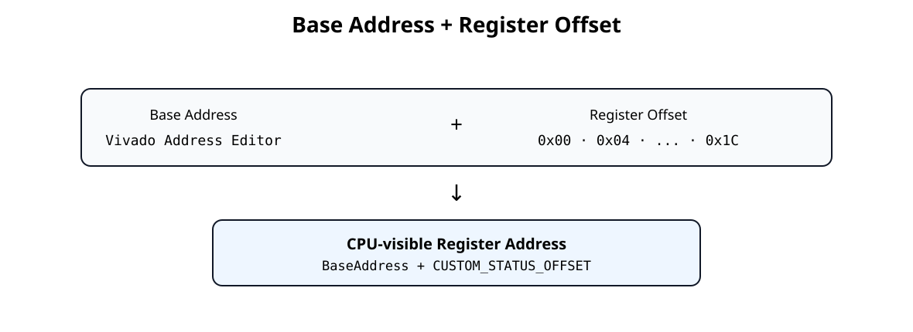
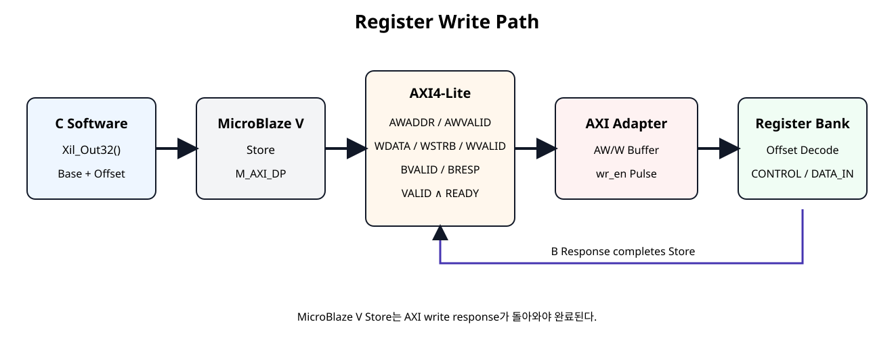
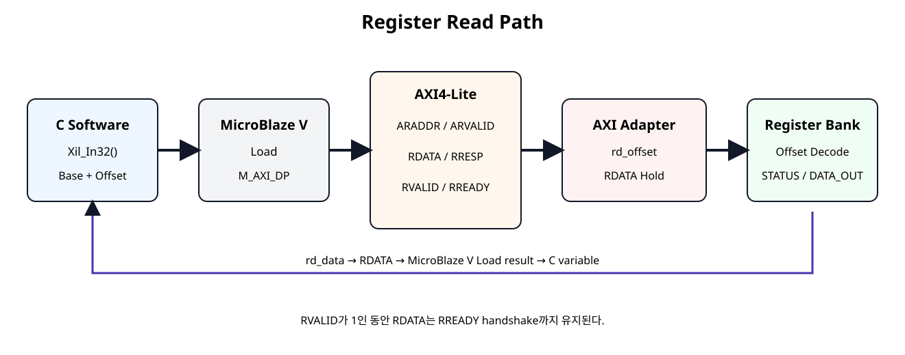

# AXI Register Read / Write 경로


## 전체 학습 위치


## 이번 장의 목표

SoC 12에서 AXI4-Lite Slave Adapter와 Register Bank를 연결했다. 이번 장에서는 새로운 RTL 기능을 추가하지 않고, 이미 만든 회로 안에서 하나의 Register Access가 어떤 순서로 이동하는지 추적한다.


## C 코드에서 Register까지


```text
Custom_WriteReg(Base, Offset, Data)
        ↓
Xil_Out32(Base + Offset, Data)
        ↓
MicroBlaze V Store
        ↓
AXI4-Lite AW / W
        ↓
axi4lite_slave_adapter
        ↓
wr_en / wr_offset / wr_data / wr_strb
        ↓
custom_register_bank
        ↓
enable_o / mode_o / data_in_o / pulse
```

Read는 반대 방향으로 Register Bank의 rd_data가 AXI R Channel을 타고 CPU Load 결과로 돌아온다.


## Base Address + Offset


[](../images/soc13/soc13_base_offset.svg)

Vivado가 배치한 Base Address와 IP 내부 Register Offset은 서로 다른 역할을 가진다.


| 구분 | 결정 위치 | 예 |
| --- | --- | --- |
| Base Address | Vivado Address Editor | 실제 Project에서 생성 |
| Register Offset | Custom IP 설계 | 0x00, 0x04, ... 0x1C |
| CPU-visible Address | 두 값의 합 | Base + CUSTOM_STATUS_OFFSET |


## Write Path 전체 흐름


[](../images/soc13/soc13_write_path.svg)

C Write가 Register Bank에 반영되고 B Response가 돌아올 때까지의 전체 경로.


## C Write 예제


```text
Custom_WriteReg(
    BaseAddress,
    CUSTOM_CONTROL_OFFSET,
    0x00000005U
);
```

Header Macro는 내부적으로 다음 구조를 사용한다.


```text
#define Custom_WriteReg(BaseAddress, RegOffset, Data) \
    Xil_Out32((BaseAddress) + (RegOffset), (Data))
```

Xil_Out32()는 지정 주소를 volatile u32 *로 접근해 32-bit Store를 수행한다.


## MicroBlaze V Store

MicroBlaze V Data Peripheral Interface는 기본적으로 AXI4-Lite 단일 접근을 사용한다. Software의 32-bit Store가 Peripheral Address를 대상으로 하면 AXI Write Transaction으로 전달된다.


```text
CPU Store Address = Base + 0x00
CPU Store Data    = 0x00000005
        ↓
M_AXI_DP
        ↓
AWADDR = Base + 0x00
WDATA  = 0x00000005
WSTRB  = 1111
```


## AW · W 독립 Handshake

Write Address Channel과 Write Data Channel은 서로 독립이다.


```text
AWVALID ∧ AWREADY → Address accepted
WVALID  ∧ WREADY  → Data accepted

두 조건은
같은 Clock에 발생할 수도 있고
서로 다른 Clock에 발생할 수도 있음
```

SoC 12 Adapter는 Address와 Data를 각각 별도 Buffer에 저장한다.


## Adapter의 Write Commit


```text
assign write_commit =
    aw_stored && w_stored && !s_axi_bvalid;

assign wr_en     = write_commit;
assign wr_offset = awaddr_stored[7:0];
assign wr_data   = wdata_stored;
assign wr_strb   = wstrb_stored;
```

Address와 Data가 모두 확보된 경우에만 내부 Register Write Pulse가 생성된다.


## Register Bank Write

wr_en=1이면 Register Bank가 wr_offset을 Decode한다.


```text
case (wr_offset)
    REG_CONTROL: begin
        if (wr_strb[0]) begin
            enable_o <= wr_data[0];
            mode_o   <= wr_data[2:1];
        end
    end

    REG_DATA_IN: begin
        ...
    end
endcase
```

CONTROL=0x00000005이면 enable_o=1, mode_o=2가 된다.


## B Response와 Store 완료


```text
if (write_commit) begin
    s_axi_bresp  <= AXI_RESP_OKAY;
    s_axi_bvalid <= 1'b1;
end

if (s_axi_bvalid && s_axi_bready) begin
    s_axi_bvalid <= 1'b0;
end
```

MicroBlaze V Data Peripheral Interface는 Write Response를 기다린다. 따라서 Register가 갱신된 뒤 B Channel Handshake까지 완료되어야 Software Store가 끝난 것으로 이해할 수 있다.


## Read Path 전체 흐름


[](../images/soc13/soc13_read_path.svg)

Register Offset Decode부터 RDATA가 C 변수에 저장될 때까지의 Read 경로.


## C Read 예제


```text
status = Custom_ReadReg(
    BaseAddress,
    CUSTOM_STATUS_OFFSET
);
```


```text
#define Custom_ReadReg(BaseAddress, RegOffset) \
    Xil_In32((BaseAddress) + (RegOffset))
```

Xil_In32()는 지정 주소를 volatile u32 *로 읽어 32-bit Load 결과를 반환한다.


## MicroBlaze V Load


```text
CPU Load Address = Base + 0x04
        ↓
ARADDR  = Base + 0x04
ARVALID = 1
        ↓
Slave ARREADY
        ↓
Read Address accepted
```

STATUS Register는 CPU 입장에서 일반 Memory-Mapped Address이며, 실제 내용은 Hardware Status Signal에서 만들어진다.


## AR Handshake


```text
assign s_axi_arready =
    s_axi_aresetn && !s_axi_rvalid;

assign rd_offset = s_axi_araddr[7:0];
```

이 기본 Slave는 이전 Read Response가 남아 있지 않을 때만 다음 Address를 받는 Single-Outstanding 구조이다.


## Register Decode와 rd_data


```text
REG_STATUS: begin
    rd_data = {29'h0, error_i, done_i, busy_i};
end
```

예를 들어 busy_i=1, done_i=1, error_i=0이면 STATUS Read 결과는 0x00000003이다.


## RDATA · RVALID 유지


```text
if (s_axi_arready && s_axi_arvalid) begin
    s_axi_rdata  <= rd_data;
    s_axi_rresp  <= AXI_RESP_OKAY;
    s_axi_rvalid <= 1'b1;
end else if (s_axi_rvalid && s_axi_rready) begin
    s_axi_rvalid <= 1'b0;
end
```

Master가 아직 RREADY=0이면 Slave는 이미 제시한 RDATA와 RVALID를 유지해야 한다.


## CONTROL Write/Read 추적


```text
Software
CONTROL ← 0x00000005
        ↓
AWADDR = Base + 0x00
WDATA  = 0x00000005
WSTRB  = 1111
        ↓
wr_offset = 0x00
        ↓
enable_o = 1
mode_o   = 2
        ↓
Read Base + 0x00
        ↓
RDATA = 0x00000005
```


## DATA_IN Write/Read 추적


```text
Write 0x12345678 to Base + 0x10
        ↓
wr_offset = 0x10
        ↓
data_in_o = 0x12345678
        ↓
Read Base + 0x10
        ↓
RDATA = 0x12345678
```

DATA_IN은 retained RW Register이므로 Software가 쓴 값이 Hardware 출력으로 유지되고 다시 Read할 수 있다.


## STATUS Read 추적


```text
busy_i  = 1
done_i  = 1
error_i = 0
      ↓
STATUS Register
      ↓
rd_data = 0x00000003
      ↓
RDATA = 0x00000003
      ↓
C variable status
```

STATUS는 RO이므로 Software Write는 상태를 바꾸지 않는다.


## COMMAND W1P 추적


```text
Software writes 0x00000001
to Base + 0x08
      ↓
wr_offset = COMMAND
      ↓
start_pulse_o = 1
      ↓ next clock
start_pulse_o = 0
```

COMMAND는 저장 Register가 아니라 Event Pulse Register이다. Read하면 항상 0을 반환한다.


## IRQ_STATUS W1C 추적


```text
Hardware done event
      ↓
irq_status_o[0] = 1
      ↓
Software reads Base + 0x0C
      ↓
RDATA bit0 = 1
      ↓
Software writes bit0 = 1
      ↓
irq_status_o[0] = 0
```

W1C는 0을 쓰는 것이 아니라 Clear하려는 Bit에 1을 쓰는 방식이다.


## WSTRB와 Byte Write

32-bit Write에서도 WSTRB[3:0]는 어떤 Byte Lane이 유효한지 나타낸다.


| WSTRB | 유효 Byte |
| --- | --- |
| 0001 | bits [7:0] |
| 0010 | bits [15:8] |
| 0100 | bits [23:16] |
| 1000 | bits [31:24] |
| 1111 | 32-bit 전체 |

DATA_IN은 Byte별로 wr_strb를 확인해 부분 Write를 지원한다.


## Software Demo

다음 예제는 Base Address를 함수 인자로 받아 Register Write/Read 순서를 보여준다. Vivado Address Editor의 실제 Base Address를 호출자가 전달한다.


```c
#include "custom_regmap.h"
#include "xil_types.h"

/*
 * SoC 13 - AXI Register Read / Write Path Demo
 *
 * BaseAddress is supplied by the caller.
 * This file does not hard-code a Vivado-assigned AXI base address.
 *
 * The purpose is to show:
 *   C helper -> Xil_In32 / Xil_Out32
 *   -> MicroBlaze V load/store
 *   -> AXI4-Lite transaction
 *   -> AXI adapter
 *   -> custom_register_bank
 */

typedef struct {
    u32 control_readback;
    u32 status;
    u32 data_in_readback;
    u32 data_out;
    u32 irq_status;
    u32 version;
    u32 id;
} CustomPathSnapshot;

void Custom_RegisterPathDemo(
    UINTPTR BaseAddress,
    CustomPathSnapshot *Snapshot
)
{
    u32 control_value;

    /*
     * WRITE #1
     * CONTROL[0]   = ENABLE
     * CONTROL[2:1] = MODE
     *
     * MODE = 2, ENABLE = 1
     * CONTROL data -> 0b101 -> 0x00000005
     */
    control_value =
        CUSTOM_CONTROL_ENABLE_MASK |
        (2U << CUSTOM_CONTROL_MODE_SHIFT);

    Custom_WriteReg(
        BaseAddress,
        CUSTOM_CONTROL_OFFSET,
        control_value
    );

    /*
     * READ #1
     * Read CONTROL back through the AXI read path.
     */
    Snapshot->control_readback =
        Custom_ReadReg(BaseAddress, CUSTOM_CONTROL_OFFSET);

    /*
     * WRITE #2
     * DATA_IN is a retained RW register.
     */
    Custom_WriteReg(
        BaseAddress,
        CUSTOM_DATA_IN_OFFSET,
        0x12345678U
    );

    Snapshot->data_in_readback =
        Custom_ReadReg(BaseAddress, CUSTOM_DATA_IN_OFFSET);

    /*
     * WRITE #3
     * COMMAND is W1P.
     * Writing bit0 = 1 generates start_pulse_o for one clock.
     * No retained command state remains afterward.
     */
    Custom_Start(BaseAddress);

    /*
     * READ hardware-driven registers.
     * STATUS / DATA_OUT values depend on the connected controller/datapath.
     */
    Snapshot->status =
        Custom_ReadReg(BaseAddress, CUSTOM_STATUS_OFFSET);

    Snapshot->data_out =
        Custom_ReadReg(BaseAddress, CUSTOM_DATA_OUT_OFFSET);

    Snapshot->irq_status =
        Custom_ReadReg(BaseAddress, CUSTOM_IRQ_STATUS_OFFSET);

    /*
     * If DONE IRQ is pending, clear only that W1C bit.
     */
    if ((Snapshot->irq_status & CUSTOM_IRQ_DONE_MASK) != 0U) {
        Custom_ClearDoneIrq(BaseAddress);
    }

    /*
     * Fixed RO identification registers.
     */
    Snapshot->version =
        Custom_ReadReg(BaseAddress, CUSTOM_VERSION_OFFSET);

    Snapshot->id =
        Custom_ReadReg(BaseAddress, CUSTOM_ID_OFFSET);
}
```


## Self-Checking Testbench

Transaction 추적용 Testbench는 다음 항목을 확인한다.

- CONTROL Write 후 Hardware 출력 확인
- CONTROL Readback
- DATA_IN Write/Readback
- STATUS Hardware Input → RDATA
- DATA_OUT Hardware Input → RDATA
- COMMAND W1P 1-Clock Pulse
- IRQ_STATUS W1C
- BREADY 지연 시 BVALID 유지
- RREADY 지연 시 RDATA 유지
- VERSION / ID 고정 RO 값

```verilog
`timescale 1ns / 1ps

module tb_axi_register_rw_path;

localparam integer ADDR_W = 32;

reg clk = 1'b0;
reg resetn = 1'b0;

always #5 clk = ~clk;

reg  [ADDR_W-1:0] awaddr;
reg  [2:0]        awprot;
reg               awvalid;
wire              awready;

reg  [31:0]       wdata;
reg  [3:0]        wstrb;
reg               wvalid;
wire              wready;

wire [1:0]        bresp;
wire              bvalid;
reg               bready;

reg  [ADDR_W-1:0] araddr;
reg  [2:0]        arprot;
reg               arvalid;
wire              arready;

wire [31:0]       rdata;
wire [1:0]        rresp;
wire              rvalid;
reg               rready;

reg               busy_i;
reg               done_i;
reg               error_i;
reg               irq_done_event_i;
reg               irq_error_event_i;
reg  [31:0]       data_out_i;

wire              enable_o;
wire [1:0]        mode_o;
wire              start_pulse_o;
wire              clear_pulse_o;
wire [31:0]       data_in_o;
wire [1:0]        irq_status_o;

integer error_count = 0;

custom_axi4lite_ip #(
    .C_S_AXI_ADDR_WIDTH(ADDR_W)
) dut (
    .s_axi_aclk(clk),
    .s_axi_aresetn(resetn),

    .s_axi_awaddr(awaddr),
    .s_axi_awprot(awprot),
    .s_axi_awvalid(awvalid),
    .s_axi_awready(awready),

    .s_axi_wdata(wdata),
    .s_axi_wstrb(wstrb),
    .s_axi_wvalid(wvalid),
    .s_axi_wready(wready),

    .s_axi_bresp(bresp),
    .s_axi_bvalid(bvalid),
    .s_axi_bready(bready),

    .s_axi_araddr(araddr),
    .s_axi_arprot(arprot),
    .s_axi_arvalid(arvalid),
    .s_axi_arready(arready),

    .s_axi_rdata(rdata),
    .s_axi_rresp(rresp),
    .s_axi_rvalid(rvalid),
    .s_axi_rready(rready),

    .busy_i(busy_i),
    .done_i(done_i),
    .error_i(error_i),
    .irq_done_event_i(irq_done_event_i),
    .irq_error_event_i(irq_error_event_i),
    .data_out_i(data_out_i),

    .enable_o(enable_o),
    .mode_o(mode_o),
    .start_pulse_o(start_pulse_o),
    .clear_pulse_o(clear_pulse_o),
    .data_in_o(data_in_o),
    .irq_status_o(irq_status_o)
);

task automatic expect32;
    input [31:0] actual;
    input [31:0] expected;
    input [8*48-1:0] label;
    begin
        if (actual !== expected) begin
            $display("FAIL: %0s actual=%08h expected=%08h",
                     label, actual, expected);
            error_count = error_count + 1;
        end else begin
            $display("PASS: %0s = %08h", label, actual);
        end
    end
endtask

task automatic axi_write;
    input [31:0] addr;
    input [31:0] data;
    input [3:0]  strb;
    begin
        @(negedge clk);
        awaddr  = addr;
        awvalid = 1'b1;

        wait (awready === 1'b1);
        @(negedge clk);
        awvalid = 1'b0;

        /* W channel intentionally arrives later than AW. */
        repeat (2) @(negedge clk);

        wdata  = data;
        wstrb  = strb;
        wvalid = 1'b1;

        wait (wready === 1'b1);
        @(negedge clk);
        wvalid = 1'b0;

        /* Hold BREADY low to prove BVALID remains asserted. */
        bready = 1'b0;
        wait (bvalid === 1'b1);
        repeat (2) @(posedge clk);

        if (bvalid !== 1'b1) begin
            $display("FAIL: BVALID did not hold during backpressure");
            error_count = error_count + 1;
        end

        @(negedge clk);
        bready = 1'b1;
        @(posedge clk);
        @(negedge clk);
        bready = 1'b0;
    end
endtask

task automatic axi_read;
    input  [31:0] addr;
    output [31:0] data;
    begin
        @(negedge clk);
        araddr  = addr;
        arvalid = 1'b1;

        wait (arready === 1'b1);
        @(negedge clk);
        arvalid = 1'b0;

        rready = 1'b0;
        wait (rvalid === 1'b1);

        /* RDATA must remain stable while RREADY is low. */
        data = rdata;
        repeat (2) @(posedge clk);

        if (rdata !== data) begin
            $display("FAIL: RDATA changed while RREADY=0");
            error_count = error_count + 1;
        end

        @(negedge clk);
        rready = 1'b1;
        @(posedge clk);
        @(negedge clk);
        rready = 1'b0;
    end
endtask

reg [31:0] rd;

initial begin
    awaddr = 0;
    awprot = 0;
    awvalid = 0;

    wdata = 0;
    wstrb = 0;
    wvalid = 0;

    bready = 0;

    araddr = 0;
    arprot = 0;
    arvalid = 0;
    rready = 0;

    busy_i = 0;
    done_i = 0;
    error_i = 0;
    irq_done_event_i = 0;
    irq_error_event_i = 0;
    data_out_i = 32'h00000000;

    repeat (4) @(posedge clk);
    resetn = 1'b1;
    repeat (2) @(posedge clk);

    $display("---- WRITE PATH: CONTROL ----");
    axi_write(32'h00000000, 32'h00000005, 4'b1111);
    expect32({29'h0, mode_o, enable_o}, 32'h00000005,
             "CONTROL hardware output");

    $display("---- READ PATH: CONTROL ----");
    axi_read(32'h00000000, rd);
    expect32(rd, 32'h00000005, "CONTROL readback");

    $display("---- WRITE/READ PATH: DATA_IN ----");
    axi_write(32'h00000010, 32'h12345678, 4'b1111);
    expect32(data_in_o, 32'h12345678, "DATA_IN hardware output");

    axi_read(32'h00000010, rd);
    expect32(rd, 32'h12345678, "DATA_IN readback");

    $display("---- READ PATH: STATUS ----");
    busy_i  = 1'b1;
    done_i  = 1'b1;
    error_i = 1'b0;

    axi_read(32'h00000004, rd);
    expect32(rd, 32'h00000003, "STATUS read");

    $display("---- READ PATH: DATA_OUT ----");
    data_out_i = 32'hCAFE1234;
    axi_read(32'h00000014, rd);
    expect32(rd, 32'hCAFE1234, "DATA_OUT read");

    $display("---- WRITE PATH: COMMAND W1P ----");
    fork
        begin
            axi_write(32'h00000008, 32'h00000001, 4'b0001);
        end
        begin
            wait (start_pulse_o === 1'b1);
            @(posedge clk);
            // (추가) 비차단 대입이 반영된 뒤 펄스 해제를 확인한다.
            #1;
            if (start_pulse_o !== 1'b0) begin
                $display("FAIL: start_pulse_o wider than one clock");
                error_count = error_count + 1;
            end else begin
                $display("PASS: start_pulse_o one clock");
            end
        end
    join

    $display("---- W1C PATH: IRQ_STATUS ----");
    @(negedge clk);
    irq_done_event_i = 1'b1;
    @(posedge clk);
    @(negedge clk);
    irq_done_event_i = 1'b0;

    axi_read(32'h0000000C, rd);
    expect32(rd, 32'h00000001, "IRQ_STATUS set");

    axi_write(32'h0000000C, 32'h00000001, 4'b0001);
    axi_read(32'h0000000C, rd);
    expect32(rd, 32'h00000000, "IRQ_STATUS cleared");

    $display("---- FIXED RO REGISTERS ----");
    axi_read(32'h00000018, rd);
    expect32(rd, 32'h00010000, "VERSION");

    axi_read(32'h0000001C, rd);
    expect32(rd, 32'h524D4150, "ID");

    if (error_count == 0) begin
        $display("SOC13 REGISTER R/W PATH TEST: PASS");
    end else begin
        $display("SOC13 REGISTER R/W PATH TEST: FAIL (%0d errors)",
                 error_count);
    end

    #50;
    $finish;
end

endmodule
```


## 파형에서 확인할 지점


| 순서 | 신호 | 확인 내용 |
| --- | --- | --- |
| 1 | AWVALID/AWREADY | Write Address accepted |
| 2 | WVALID/WREADY | Write Data accepted |
| 3 | wr_en | Address/Data 모두 확보 후 1-Clock Pulse |
| 4 | BVALID/BREADY | Write Response 완료 |
| 5 | ARVALID/ARREADY | Read Address accepted |
| 6 | rd_offset/rd_data | Register Decode 결과 |
| 7 | RVALID/RREADY | Read Data Transfer 완료 |


## 오류 점검


| 증상 | 원인 후보 | 확인 |
| --- | --- | --- |
| CONTROL Write가 가끔 누락 | AW/W 동시 도착 가정 | 별도 Buffer 구조 확인 |
| Partial Write가 전체 Register를 덮음 | WSTRB 무시 | wr_strb 전달 및 Byte Enable |
| Read Data가 바뀜 | RREADY 대기 중 RDATA 재계산 | AR handshake 때 RDATA Capture |
| Software 주소가 틀림 | Base/Offset 혼동 | Vivado Base + Header Offset |
| COMMAND가 계속 1 | W1P를 retained bit로 구현 | 다음 Clock 기본 0 처리 |
| IRQ Clear가 안 됨 | W1C 의미 오해 | Clear할 Bit에 1 Write |
| Store가 끝났다고 너무 일찍 판단 | B Response 무시 | BVALID/BREADY 완료 확인 |


## SoC 13 완료 체크리스트

- [ ] Base Address와 Register Offset을 구분한다.
- [ ] Xil_Out32()가 Memory-Mapped 32-bit Write임을 이해한다.
- [ ] Xil_In32()가 Memory-Mapped 32-bit Read임을 이해한다.
- [ ] Write Path를 C → Store → AW/W → Adapter → Register → B Response 순으로 설명할 수 있다.
- [ ] Read Path를 C → Load → AR → Register Decode → RDATA 순으로 설명할 수 있다.
- [ ] AW와 W가 독립 Channel임을 이해한다.
- [ ] wr_en이 Address/Data 모두 확보된 후 발생함을 이해한다.
- [ ] WSTRB가 Byte Lane Write Enable임을 이해한다.
- [ ] RVALID 동안 RDATA가 유지되어야 함을 이해한다.
- [ ] CONTROL, DATA_IN, STATUS, COMMAND, IRQ_STATUS의 서로 다른 Access 의미를 구분한다.
- [ ] W1P와 W1C 동작을 AXI Write 경로와 연결할 수 있다.
- [ ] SoC 12 RTL을 변경하지 않고 Transaction 경로를 추적했다.

## 공식 매뉴얼 및 원본 근거


| 문서 | 확인 항목 |
| --- | --- |
| AMD UG1629 · Memory Mapped Interfaces · 2026.1 | MicroBlaze V M_AXI_DP 단일 접근, AXI4-Lite 기본 사용, BVALID 완료 조건 |
| AMD PG292 · AXI4-Lite Interface Ports · 2026 | AW/W/B/AR/R 신호와 WSTRB 정의 |
| AMD PG138 · AXI4-Lite Interface · 2026-08-10 | Read Address/Read Data VALID/READY 동작 |
| AMD/Xilinx embeddedsw · xil_io.h | Xil_In32, Xil_Out32 volatile Memory Access |

