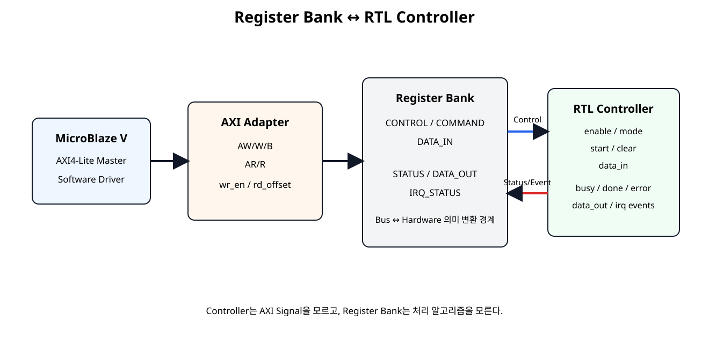
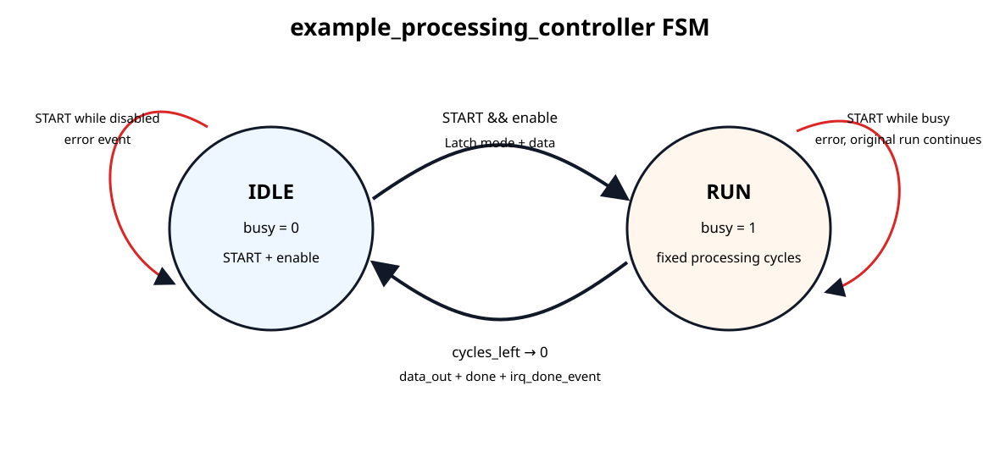
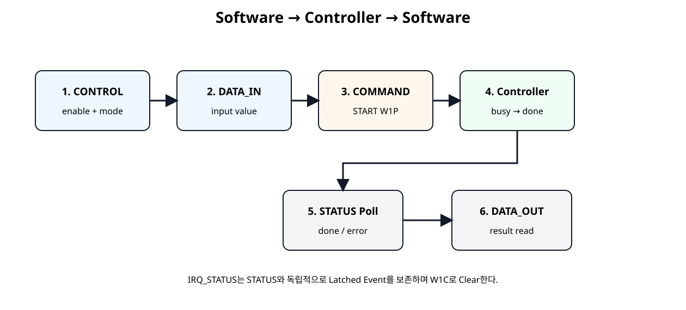

# Register Bank + RTL Controller 연결


## 전체 학습 위치


## 이번 장의 목표

이번 장에서 처음으로 Custom AXI IP의 Register가 실제 기능 RTL을 제어한다. AXI Protocol 자체나 Register Map은 바꾸지 않고, Hardware-side Interface에 Controller를 연결한다.


## 전체 구조


[](../images/soc14/soc14_register_controller_architecture.svg)

AXI Adapter, Register Bank, RTL Controller를 역할별로 분리한 구조.

Controller는 AXI의 AW/W/B/AR/R Signal을 전혀 알지 못하고, Register Bank가 제공하는 일반 Control/Status Signal만 사용한다.


## Register Bank의 경계 역할


| Software Register | Hardware Signal | 방향 |
| --- | --- | --- |
| CONTROL.ENABLE | enable_o | SW → HW |
| CONTROL.MODE | mode_o[1:0] | SW → HW |
| COMMAND.START | start_pulse_o | SW → HW |
| COMMAND.CLEAR | clear_pulse_o | SW → HW |
| DATA_IN | data_in_o[31:0] | SW → HW |
| STATUS.BUSY | busy_i | HW → SW |
| STATUS.DONE | done_i | HW → SW |
| STATUS.ERROR | error_i | HW → SW |
| DATA_OUT | data_out_i[31:0] | HW → SW |
| IRQ_STATUS | irq_*_event_i | HW Event → SW Latched |


## Controller 입출력


| 출발 신호 | 도착 신호 |
| --- | --- |
| Register Bank / enable_o | Controller / enable_i |
| Register Bank / mode_o[1:0] | Controller / mode_i[1:0] |
| Register Bank / start_pulse_o | Controller / start_pulse_i |
| Register Bank / clear_pulse_o | Controller / clear_pulse_i |
| Register Bank / data_in_o | Controller / data_in_i |
| Controller / busy_o | Register Bank / busy_i |
| Controller / done_o | Register Bank / done_i |
| Controller / error_o | Register Bank / error_i |
| Controller / data_out_o | Register Bank / data_out_i |
| Controller / irq_done_event_o | Register Bank / irq_done_event_i |
| Controller / irq_error_event_o | Register Bank / irq_error_event_i |


## 교육용 처리 Mode

example_processing_controller는 Register/Controller 연결을 눈으로 확인하기 위한 교육용 기능이다. 특정 응용에 종속되지 않는다.


| MODE | 처리 | 예 |
| --- | --- | --- |
| 00 | Pass-through | 0x1234 → 0x1234 |
| 01 | Input + 1 | 0x00000009 → 0x0000000A |
| 10 | Left Shift 1 | 0x00000003 → 0x00000006 |
| 11 | Bitwise NOT | 0xA5A55A5A → 0x5A5AA5A5 |


## Controller FSM


[](../images/soc14/soc14_controller_fsm.svg)

IDLE과 RUN 두 상태로 구성한 교육용 Controller FSM.

START를 받으면 MODE와 DATA_IN을 Capture하고 RUN으로 이동한다. 고정 처리 Cycle 후 결과를 DATA_OUT에 저장하고 DONE Event를 발생시킨다.


## START 시 Capture


```text
mode_latched <= mode_i;
data_latched <= data_in_i;

busy_o <= 1'b1;
state  <= STATE_RUN;
```

작업이 시작된 이후 Software가 CONTROL 또는 DATA_IN Register를 바꾸더라도 현재 작업은 START 시점에 Capture한 값으로 계속 진행한다.


## BUSY · DONE · ERROR


| Status | 의미 | 유지 방식 |
| --- | --- | --- |
| busy_o | 현재 처리 중 | RUN 동안 1 |
| done_o | 마지막 작업 완료 | 완료 후 1, CLEAR까지 유지 |
| error_o | 잘못된 START 발생 | Error 발생 후 1, CLEAR까지 유지 |


## Disabled START Error


```text
CONTROL.ENABLE = 0
        ↓
COMMAND.START = 1
        ↓
start_pulse_i = 1
        ↓
Controller does NOT enter RUN
        ↓
error_o = 1
irq_error_event_o = 1 clock
```

Software가 Controller를 Enable하지 않고 START를 실행한 경우를 잘못된 명령으로 처리한다.


## Busy 중 START Error


```text
Controller RUN / busy=1
        ↓
Second START pulse
        ↓
error_o = 1
irq_error_event_o = 1 clock
        ↓
Original operation continues
        ↓
Normal DONE may occur later
```

새 START가 기존 작업을 강제로 취소하지 않는다. Error는 기록하지만 원래 작업은 끝까지 수행한다.


## COMMAND.CLEAR

COMMAND[1]은 W1P(Write 1 to Pulse, 1을 쓰면 1 Clock Pulse)이며 Controller의 retained Status를 지운다.


```text
if (clear_pulse_i) begin
    done_o  <= 1'b0;
    error_o <= 1'b0;
end
```

CLEAR는 진행 중인 RUN을 Abort하지 않는다. BUSY 상태는 현재 작업이 끝날 때까지 유지된다.


## IRQ Event와 IRQ_STATUS


```text
Controller completion
      ↓
irq_done_event_o = 1 clock
      ↓
Register Bank irq_done_event_i
      ↓
IRQ_STATUS[0] = 1
      ↓
Software reads event history
      ↓
W1C bit0 = 1
      ↓
IRQ_STATUS[0] = 0
```

Controller의 Event는 1 Clock Pulse지만 Register Bank가 IRQ_STATUS에 저장하므로 Software가 나중에 읽어도 Event를 확인할 수 있다.


## STATUS와 IRQ_STATUS 차이


| 구분 | STATUS | IRQ_STATUS |
| --- | --- | --- |
| 의미 | Controller의 현재/최근 상태 | 발생한 Event 기록 |
| Source | busy/done/error Level | done/error Event Pulse |
| Clear | COMMAND.CLEAR | W1C Write |
| 목적 | 현재 작업 상태 확인 | Event 놓치지 않기 |


## DATA_IN → Controller


```text
Software
Custom_WriteReg(DATA_IN, 0x12345678)
        ↓
Register Bank
data_in_o = 0x12345678
        ↓
START
        ↓
Controller captures
data_latched = 0x12345678
```


## Controller → DATA_OUT


```text
Controller operation completes
        ↓
data_out_o = processed result
        ↓
Register Bank data_out_i
        ↓
DATA_OUT Register
        ↓
AXI Read
        ↓
Software result
```


## 최상위 Wrapper

custom_axi4lite_controller_ip.v는 AXI/Register Module과 Controller Module을 연결하는 최상위 Wrapper이다.


```verilog
module custom_axi4lite_controller_ip #(
    parameter integer C_S_AXI_ADDR_WIDTH = 32,
    parameter integer PROCESS_CYCLES     = 4
)(
    input  wire                          s_axi_aclk,
    input  wire                          s_axi_aresetn,

    input  wire [C_S_AXI_ADDR_WIDTH-1:0] s_axi_awaddr,
    input  wire [2:0]                    s_axi_awprot,
    input  wire                          s_axi_awvalid,
    output wire                          s_axi_awready,

    input  wire [31:0]                   s_axi_wdata,
    input  wire [3:0]                    s_axi_wstrb,
    input  wire                          s_axi_wvalid,
    output wire                          s_axi_wready,

    output wire [1:0]                    s_axi_bresp,
    output wire                          s_axi_bvalid,
    input  wire                          s_axi_bready,

    input  wire [C_S_AXI_ADDR_WIDTH-1:0] s_axi_araddr,
    input  wire [2:0]                    s_axi_arprot,
    input  wire                          s_axi_arvalid,
    output wire                          s_axi_arready,

    output wire [31:0]                   s_axi_rdata,
    output wire [1:0]                    s_axi_rresp,
    output wire                          s_axi_rvalid,
    input  wire                          s_axi_rready
);

// Shell / Wrapper principle:
// - AXI/Register behavior stays in custom_axi4lite_ip.
// - Functional processing stays in example_processing_controller.
// - This module contains only wires and module connections.

wire        enable;
wire [1:0]  mode;
wire        start_pulse;
wire        clear_pulse;
wire [31:0] data_in;
wire [1:0]  irq_status;

wire        busy;
wire        done;
wire        error;
wire        irq_done_event;
wire        irq_error_event;
wire [31:0] data_out;

custom_axi4lite_ip #(
    .C_S_AXI_ADDR_WIDTH(C_S_AXI_ADDR_WIDTH)
) u_custom_axi4lite_ip (
    .s_axi_aclk(s_axi_aclk),
    .s_axi_aresetn(s_axi_aresetn),

    .s_axi_awaddr(s_axi_awaddr),
    .s_axi_awprot(s_axi_awprot),
    .s_axi_awvalid(s_axi_awvalid),
    .s_axi_awready(s_axi_awready),

    .s_axi_wdata(s_axi_wdata),
    .s_axi_wstrb(s_axi_wstrb),
    .s_axi_wvalid(s_axi_wvalid),
    .s_axi_wready(s_axi_wready),

    .s_axi_bresp(s_axi_bresp),
    .s_axi_bvalid(s_axi_bvalid),
    .s_axi_bready(s_axi_bready),

    .s_axi_araddr(s_axi_araddr),
    .s_axi_arprot(s_axi_arprot),
    .s_axi_arvalid(s_axi_arvalid),
    .s_axi_arready(s_axi_arready),

    .s_axi_rdata(s_axi_rdata),
    .s_axi_rresp(s_axi_rresp),
    .s_axi_rvalid(s_axi_rvalid),
    .s_axi_rready(s_axi_rready),

    .busy_i(busy),
    .done_i(done),
    .error_i(error),
    .irq_done_event_i(irq_done_event),
    .irq_error_event_i(irq_error_event),
    .data_out_i(data_out),

    .enable_o(enable),
    .mode_o(mode),
    .start_pulse_o(start_pulse),
    .clear_pulse_o(clear_pulse),
    .data_in_o(data_in),
    .irq_status_o(irq_status)
);

example_processing_controller #(
    .PROCESS_CYCLES(PROCESS_CYCLES)
) u_example_processing_controller (
    .clk(s_axi_aclk),
    .resetn(s_axi_aresetn),

    .enable_i(enable),
    .mode_i(mode),
    .start_pulse_i(start_pulse),
    .clear_pulse_i(clear_pulse),
    .data_in_i(data_in),

    .busy_o(busy),
    .done_o(done),
    .error_o(error),
    .irq_done_event_o(irq_done_event),
    .irq_error_event_o(irq_error_event),
    .data_out_o(data_out)
);

endmodule
```


## Wrapper 순수 연결 원칙


| 허용 | 배치하지 않음 |
| --- | --- |
| Wire 선언 | always Block |
| Module Instance | FSM |
| Port Connection | 산술 연산 |
| Parameter 전달 | Register 정책 |

기능은 Controller, Bus/Register 동작은 기존 AXI/Register Module에 남긴다.


## Controller RTL

다음 Controller는 AXI Signal이나 Register Address를 전혀 사용하지 않는다.


```verilog
module example_processing_controller #(
    parameter integer PROCESS_CYCLES = 4
)(
    input  wire        clk,
    input  wire        resetn,

    // Register-bank control inputs
    input  wire        enable_i,
    input  wire [1:0]  mode_i,
    input  wire        start_pulse_i,
    input  wire        clear_pulse_i,
    input  wire [31:0] data_in_i,

    // Register-bank status / event outputs
    output reg         busy_o,
    output reg         done_o,
    output reg         error_o,
    output reg         irq_done_event_o,
    output reg         irq_error_event_o,
    output reg  [31:0] data_out_o
);

localparam STATE_IDLE = 1'b0;
localparam STATE_RUN  = 1'b1;

reg        state;
reg [7:0]  cycles_left;
reg [1:0]  mode_latched;
reg [31:0] data_latched;

function [31:0] process_value;
    input [31:0] value;
    input [1:0]  mode;
    begin
        case (mode)
            2'b00: process_value = value;          // Pass-through
            2'b01: process_value = value + 32'd1; // Add 1
            2'b10: process_value = value << 1;     // Shift left 1
            2'b11: process_value = ~value;         // Bitwise NOT
            default: process_value = value;
        endcase
    end
endfunction

always @(posedge clk) begin
    if (!resetn) begin
        state             <= STATE_IDLE;
        cycles_left       <= 8'd0;
        mode_latched      <= 2'b00;
        data_latched      <= 32'h0000_0000;

        busy_o            <= 1'b0;
        done_o            <= 1'b0;
        error_o           <= 1'b0;
        irq_done_event_o  <= 1'b0;
        irq_error_event_o <= 1'b0;
        data_out_o        <= 32'h0000_0000;
    end else begin
        // Event outputs are one-clock pulses by default.
        irq_done_event_o  <= 1'b0;
        irq_error_event_o <= 1'b0;

        // Software CLEAR removes retained status only.
        // A new hardware event later in this clock may set status again.
        if (clear_pulse_i) begin
            done_o  <= 1'b0;
            error_o <= 1'b0;
        end

        case (state)
            STATE_IDLE: begin
                busy_o <= 1'b0;

                if (start_pulse_i) begin
                    done_o <= 1'b0;

                    if (!enable_i) begin
                        // Start requested while the controller is disabled.
                        error_o           <= 1'b1;
                        irq_error_event_o <= 1'b1;
                    end else begin
                        // Capture software-controlled values only at START.
                        mode_latched <= mode_i;
                        data_latched <= data_in_i;

                        busy_o  <= 1'b1;
                        error_o <= 1'b0;

                        if (PROCESS_CYCLES <= 1) begin
                            cycles_left <= 8'd0;
                        end else begin
                            cycles_left <= PROCESS_CYCLES - 1;
                        end

                        state <= STATE_RUN;
                    end
                end
            end

            STATE_RUN: begin
                busy_o <= 1'b1;

                // A second START while busy is an error event.
                // The original operation continues.
                if (start_pulse_i) begin
                    error_o           <= 1'b1;
                    irq_error_event_o <= 1'b1;
                end

                if (cycles_left != 0) begin
                    cycles_left <= cycles_left - 1'b1;
                end else begin
                    data_out_o       <= process_value(data_latched, mode_latched);
                    busy_o           <= 1'b0;
                    done_o           <= 1'b1;
                    irq_done_event_o <= 1'b1;
                    state            <= STATE_IDLE;
                end
            end

            default: begin
                state  <= STATE_IDLE;
                busy_o <= 1'b0;
            end
        endcase
    end
end

endmodule
```


## Software 실행 순서


[](../images/soc14/soc14_software_hardware_flow.svg)

Software가 Register를 통해 Controller를 실행하고 결과를 다시 읽는 기본 순서.


## Software Demo

다음 함수는 실제 Base Address를 호출자가 전달받아 Controller를 실행한다. Base Address를 소스에 임의로 고정하지 않는다.


```c
#include "custom_regmap.h"
#include "xstatus.h"
#include "xil_types.h"

/*
 * SoC 14 - Register Bank + RTL Controller software demo
 *
 * Hardware operation modes:
 *   mode 0 : pass-through
 *   mode 1 : input + 1
 *   mode 2 : input << 1
 *   mode 3 : bitwise NOT
 *
 * BaseAddress is supplied by the caller.
 */

#define CUSTOM_POLL_LIMIT  1000000U

static void Custom_ClearStatusAndIrq(UINTPTR BaseAddress)
{
    /* COMMAND.CLEAR clears controller done/error status. */
    Custom_WriteReg(
        BaseAddress,
        CUSTOM_COMMAND_OFFSET,
        CUSTOM_COMMAND_CLEAR_MASK
    );

    /* IRQ_STATUS is independent and must be cleared by W1C. */
    Custom_WriteReg(
        BaseAddress,
        CUSTOM_IRQ_STATUS_OFFSET,
        CUSTOM_IRQ_DONE_MASK | CUSTOM_IRQ_ERROR_MASK
    );
}

int Custom_RunOperation(
    UINTPTR BaseAddress,
    u32 Mode,
    u32 InputValue,
    u32 *OutputValue
)
{
    u32 poll_count;
    u32 status;

    if (OutputValue == 0) {
        return XST_FAILURE;
    }

    Custom_ClearStatusAndIrq(BaseAddress);

    Custom_SetEnable(BaseAddress, 1U);
    Custom_SetMode(BaseAddress, Mode);

    Custom_WriteReg(
        BaseAddress,
        CUSTOM_DATA_IN_OFFSET,
        InputValue
    );

    Custom_Start(BaseAddress);

    for (poll_count = 0U;
         poll_count < CUSTOM_POLL_LIMIT;
         poll_count++) {

        status = Custom_ReadReg(
            BaseAddress,
            CUSTOM_STATUS_OFFSET
        );

        if ((status & CUSTOM_STATUS_ERROR_MASK) != 0U) {
            return XST_FAILURE;
        }

        if ((status & CUSTOM_STATUS_DONE_MASK) != 0U) {
            *OutputValue = Custom_ReadReg(
                BaseAddress,
                CUSTOM_DATA_OUT_OFFSET
            );

            /* Clear retained controller status and DONE IRQ. */
            Custom_WriteReg(
                BaseAddress,
                CUSTOM_COMMAND_OFFSET,
                CUSTOM_COMMAND_CLEAR_MASK
            );

            Custom_ClearDoneIrq(BaseAddress);

            return XST_SUCCESS;
        }
    }

    return XST_FAILURE;
}
```


## Mode 0 · Pass-through


```text
MODE = 00
DATA_IN = 0x12345678
START
   ↓
BUSY = 1
   ↓ fixed cycles
DONE = 1
DATA_OUT = 0x12345678
```


## Mode 1 · Add 1


```text
MODE = 01
DATA_IN = 0xFFFFFFFF
   ↓
32-bit + 1
   ↓
DATA_OUT = 0x00000000
```

32-bit 결과만 유지하므로 Overflow는 Wrap-around 된다.


## Mode 2 · Shift Left


```text
MODE = 10
DATA_IN = 0x80000001
   ↓
value << 1
   ↓
DATA_OUT = 0x00000002
```

왼쪽으로 밀려 나간 최상위 Bit는 저장하지 않는다.


## Mode 3 · Bitwise NOT


```text
MODE = 11
DATA_IN = 0xA5A55A5A
   ↓
bitwise NOT
   ↓
DATA_OUT = 0x5A5AA5A5
```


## Self-Checking Testbench

Testbench는 AXI Register Transaction을 통해 Controller를 구동한다. Controller Port를 Testbench에서 직접 찌르지 않는다.


```verilog
`timescale 1ns / 1ps

module tb_custom_axi4lite_controller_ip;

localparam integer ADDR_W = 32;
localparam integer PROCESS_CYCLES_TB = 12;

reg clk = 1'b0;
reg resetn = 1'b0;

always #5 clk = ~clk;

reg  [ADDR_W-1:0] awaddr;
reg  [2:0]        awprot;
reg               awvalid;
wire              awready;

reg  [31:0]       wdata;
reg  [3:0]        wstrb;
reg               wvalid;
wire              wready;

wire [1:0]        bresp;
wire              bvalid;
reg               bready;

reg  [ADDR_W-1:0] araddr;
reg  [2:0]        arprot;
reg               arvalid;
wire              arready;

wire [31:0]       rdata;
wire [1:0]        rresp;
wire              rvalid;
reg               rready;

integer error_count = 0;
reg [31:0] rd;

custom_axi4lite_controller_ip #(
    .C_S_AXI_ADDR_WIDTH(ADDR_W),
    .PROCESS_CYCLES(PROCESS_CYCLES_TB)
) dut (
    .s_axi_aclk(clk),
    .s_axi_aresetn(resetn),

    .s_axi_awaddr(awaddr),
    .s_axi_awprot(awprot),
    .s_axi_awvalid(awvalid),
    .s_axi_awready(awready),

    .s_axi_wdata(wdata),
    .s_axi_wstrb(wstrb),
    .s_axi_wvalid(wvalid),
    .s_axi_wready(wready),

    .s_axi_bresp(bresp),
    .s_axi_bvalid(bvalid),
    .s_axi_bready(bready),

    .s_axi_araddr(araddr),
    .s_axi_arprot(arprot),
    .s_axi_arvalid(arvalid),
    .s_axi_arready(arready),

    .s_axi_rdata(rdata),
    .s_axi_rresp(rresp),
    .s_axi_rvalid(rvalid),
    .s_axi_rready(rready)
);

task automatic expect32;
    input [31:0] actual;
    input [31:0] expected;
    input [8*48-1:0] label;
    begin
        if (actual !== expected) begin
            $display("FAIL: %0s actual=%08h expected=%08h",
                     label, actual, expected);
            error_count = error_count + 1;
        end else begin
            $display("PASS: %0s = %08h", label, actual);
        end
    end
endtask

task automatic axi_write;
    input [31:0] addr;
    input [31:0] data;
    input [3:0]  strb;
    begin
        @(negedge clk);
        awaddr  = addr;
        awvalid = 1'b1;

        wait (awready === 1'b1);
        @(negedge clk);
        awvalid = 1'b0;

        @(negedge clk);
        wdata  = data;
        wstrb  = strb;
        wvalid = 1'b1;

        wait (wready === 1'b1);
        @(negedge clk);
        wvalid = 1'b0;

        bready = 1'b1;
        wait (bvalid === 1'b1);
        @(posedge clk);
        @(negedge clk);
        bready = 1'b0;
    end
endtask

task automatic axi_read;
    input  [31:0] addr;
    output [31:0] data;
    begin
        @(negedge clk);
        araddr  = addr;
        arvalid = 1'b1;

        wait (arready === 1'b1);
        @(negedge clk);
        arvalid = 1'b0;

        rready = 1'b1;
        wait (rvalid === 1'b1);
        data = rdata;

        @(posedge clk);
        @(negedge clk);
        rready = 1'b0;
    end
endtask

task automatic clear_status_and_irq;
    begin
        axi_write(32'h00000008, 32'h00000002, 4'b0001);
        axi_write(32'h0000000C, 32'h00000003, 4'b0001);
    end
endtask

task automatic wait_done;
    output [31:0] status_value;
    integer k;
    reg found;
    begin
        status_value = 32'h0;
        found = 1'b0;

        for (k = 0; k < 100; k = k + 1) begin
            axi_read(32'h00000004, status_value);

            if (status_value[1]) begin
                found = 1'b1;
                k = 100;
            end
        end

        if (!found) begin
            $display("FAIL: timeout waiting for DONE");
            error_count = error_count + 1;
        end
    end
endtask

task automatic run_mode_test;
    input [1:0]  mode;
    input [31:0] input_value;
    input [31:0] expected_value;
    reg [31:0] status_value;
    reg [31:0] control_value;
    begin
        clear_status_and_irq();

        control_value = 32'h00000001 | ({30'h0, mode} << 1);
        axi_write(32'h00000000, control_value, 4'b1111);
        axi_write(32'h00000010, input_value, 4'b1111);
        axi_write(32'h00000008, 32'h00000001, 4'b0001);

        wait_done(status_value);

        if (!status_value[1] || status_value[0]) begin
            $display("FAIL: final STATUS expected DONE=1 BUSY=0");
            error_count = error_count + 1;
        end

        axi_read(32'h00000014, rd);
        expect32(rd, expected_value, "DATA_OUT result");

        axi_read(32'h0000000C, rd);
        if ((rd & 32'h00000001) == 0) begin
            $display("FAIL: DONE IRQ status not latched");
            error_count = error_count + 1;
        end else begin
            $display("PASS: DONE IRQ status latched");
        end
    end
endtask

initial begin
    awaddr = 0;
    awprot = 0;
    awvalid = 0;
    wdata = 0;
    wstrb = 0;
    wvalid = 0;
    bready = 0;

    araddr = 0;
    arprot = 0;
    arvalid = 0;
    rready = 0;

    repeat (5) @(posedge clk);
    resetn = 1'b1;
    repeat (3) @(posedge clk);

    $display("---- FIXED REGISTERS ----");
    axi_read(32'h00000018, rd);
    expect32(rd, 32'h00010000, "VERSION");

    axi_read(32'h0000001C, rd);
    expect32(rd, 32'h524D4150, "ID");

    $display("---- DISABLED START -> ERROR ----");
    axi_write(32'h00000008, 32'h00000001, 4'b0001);
    repeat (3) @(posedge clk);

    axi_read(32'h00000004, rd);
    if ((rd & 32'h00000004) == 0) begin
        $display("FAIL: STATUS.ERROR not set");
        error_count = error_count + 1;
    end else begin
        $display("PASS: STATUS.ERROR set");
    end

    axi_read(32'h0000000C, rd);
    if ((rd & 32'h00000002) == 0) begin
        $display("FAIL: IRQ_STATUS.ERROR not set");
        error_count = error_count + 1;
    end else begin
        $display("PASS: IRQ_STATUS.ERROR set");
    end

    $display("---- CLEAR STATUS ONLY ----");
    axi_write(32'h00000008, 32'h00000002, 4'b0001);
    axi_read(32'h00000004, rd);
    expect32(rd, 32'h00000000, "STATUS after COMMAND.CLEAR");

    axi_read(32'h0000000C, rd);
    expect32(rd, 32'h00000002, "IRQ_STATUS remains latched");

    axi_write(32'h0000000C, 32'h00000002, 4'b0001);
    axi_read(32'h0000000C, rd);
    expect32(rd, 32'h00000000, "IRQ_STATUS W1C clear");

    $display("---- MODE 0 PASS-THROUGH ----");
    run_mode_test(2'b00, 32'h12345678, 32'h12345678);

    $display("---- MODE 1 ADD 1 ----");
    run_mode_test(2'b01, 32'hFFFFFFFF, 32'h00000000);

    $display("---- MODE 2 SHIFT LEFT ----");
    run_mode_test(2'b10, 32'h80000001, 32'h00000002);

    $display("---- MODE 3 BITWISE NOT ----");
    run_mode_test(2'b11, 32'hA5A55A5A, 32'h5A5AA5A5);

    $display("---- START WHILE BUSY -> ERROR ----");
    clear_status_and_irq();

    // Enable, mode 0, data input.
    axi_write(32'h00000000, 32'h00000001, 4'b1111);
    axi_write(32'h00000010, 32'hCAFEBABE, 4'b1111);

    // First START launches the operation.
    axi_write(32'h00000008, 32'h00000001, 4'b0001);

    // Second START arrives before PROCESS_CYCLES_TB expires.
    axi_write(32'h00000008, 32'h00000001, 4'b0001);

    wait_done(rd);

    axi_read(32'h00000004, rd);
    if ((rd & 32'h00000004) == 0) begin
        $display("FAIL: busy restart ERROR not retained");
        error_count = error_count + 1;
    end else begin
        $display("PASS: busy restart ERROR retained");
    end

    axi_read(32'h00000014, rd);
    expect32(rd, 32'hCAFEBABE, "original operation still completed");

    axi_read(32'h0000000C, rd);
    if ((rd & 32'h00000003) != 32'h00000003) begin
        $display("FAIL: DONE+ERROR IRQ status expected");
        error_count = error_count + 1;
    end else begin
        $display("PASS: DONE+ERROR IRQ status latched");
    end

    if (error_count == 0) begin
        $display("SOC14 REGISTER BANK + CONTROLLER TEST: PASS");
    end else begin
        $display("SOC14 REGISTER BANK + CONTROLLER TEST: FAIL (%0d errors)",
                 error_count);
    end

    #50;
    $finish;
end

endmodule
```


## 검증 시나리오


| 시험 | 기대 결과 |
| --- | --- |
| VERSION / ID Read | 고정 RO 값 |
| Disabled START | STATUS.ERROR + IRQ_STATUS.ERROR |
| COMMAND.CLEAR | STATUS만 Clear |
| IRQ_STATUS W1C | Latched IRQ 별도 Clear |
| Mode 0 | Pass-through |
| Mode 1 | +1, 32-bit Wrap |
| Mode 2 | Left Shift 1 |
| Mode 3 | Bitwise NOT |
| Busy 중 START | Error 기록 + 원 작업 정상 완료 |
| DONE Event | IRQ_STATUS.DONE Latched |


## 파형에서 볼 신호


| 구간 | 신호 | 확인 |
| --- | --- | --- |
| 설정 | enable, mode, data_in | Register Write 값 유지 |
| 시작 | start_pulse | 정확히 1 Clock |
| 처리 | busy | RUN 동안 1 |
| 완료 | done | 완료 후 CLEAR까지 유지 |
| Event | irq_done_event | 완료 시 1 Clock |
| 결과 | data_out | MODE별 예상값 |
| 오류 | error | Disabled/Busy START에서 1 |


## 오류 점검


| 증상 | 원인 후보 | 확인 |
| --- | --- | --- |
| START 후 아무 변화 없음 | ENABLE=0 | CONTROL.ENABLE 확인 |
| START가 여러 Cycle 유지 | COMMAND를 일반 RW로 구현 | W1P Pulse 구조 확인 |
| DATA_IN 변경이 작업 중 결과를 바꿈 | START 시 Capture하지 않음 | data_latched 확인 |
| DONE이 즉시 사라짐 | Pulse로만 구현 | DONE은 CLEAR까지 retained |
| STATUS Clear 후 IRQ도 사라짐 | 상태와 Event History를 혼합 | IRQ_STATUS는 별도 W1C |
| Busy 중 두 번째 START가 원 작업을 취소 | 정책 오류 | Error만 기록, RUN 계속 |
| Wrapper에 FSM/연산이 있음 | 모듈 역할 혼합 | Wrapper는 Connection만 유지 |


## SoC 14 완료 체크리스트

- [ ] AXI Adapter, Register Bank, RTL Controller의 역할을 구분한다.
- [ ] Controller가 AXI Signal과 Register Address에 종속되지 않는다.
- [ ] CONTROL.ENABLE/MODE가 Controller 입력으로 연결된다.
- [ ] COMMAND.START/CLEAR가 1-Clock Pulse로 Controller에 전달된다.
- [ ] DATA_IN을 START 시점에 Capture한다.
- [ ] BUSY는 처리 중 Level로 유지된다.
- [ ] DONE/ERROR는 COMMAND.CLEAR까지 유지된다.
- [ ] DONE/ERROR Event는 1-Clock IRQ Event Pulse를 만든다.
- [ ] IRQ_STATUS는 STATUS와 별도로 W1C Clear한다.
- [ ] Mode 0~3 결과를 DATA_OUT에서 읽을 수 있다.
- [ ] Disabled START가 Error를 발생시킨다.
- [ ] Busy 중 재START가 Error를 기록하지만 원 작업은 계속된다.
- [ ] 최상위 Wrapper에는 기능 로직을 넣지 않았다.
- [ ] SoC 13 AXI/Register RTL을 수정하지 않고 그대로 재사용했다.

## 공식 매뉴얼 및 원본 근거


| 문서 | 확인 항목 |
| --- | --- |
| AMD UG1118 · Creating a New AXI4 Peripheral · 2026.1 | AXI4 Peripheral 생성 후 Custom Logic 추가와 Register Read/Write 검증 흐름 |
| AMD UG1118 · Supported IP Packager Inputs · 2026.1 | HDL Synthesis, Simulation, Testbench, Driver 등 Custom IP File Group 지원 |
| AMD/Xilinx embeddedsw · xil_io.h | Software Memory-Mapped Register Access 기반 |

