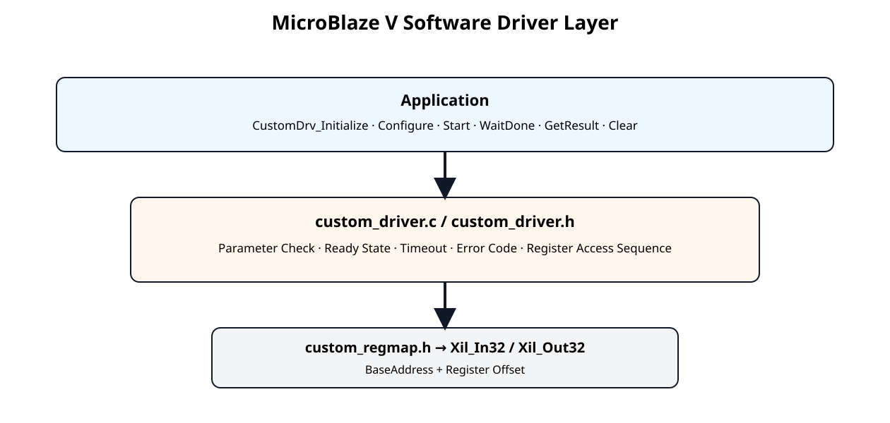
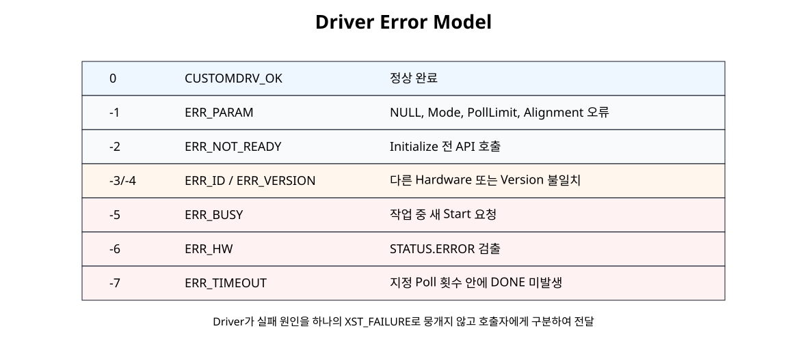
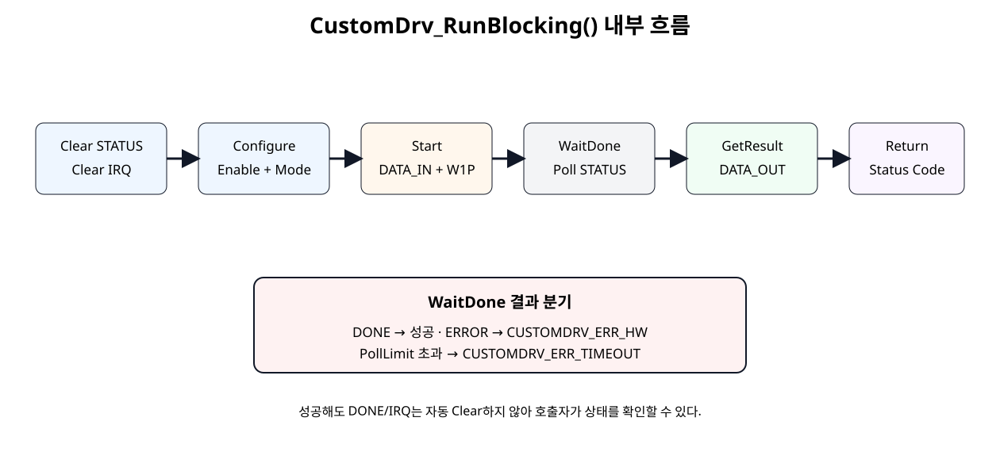

# MicroBlaze V Software Driver


## 전체 학습 위치


## 이번 장의 목표

Register Map 자체는 Hardware/Software 계약으로 유지하고, Application에서는 Register Offset과 Bit Mask를 직접 다루지 않도록 Driver 계층을 추가한다.


## Register 직접 접근의 한계


```text
Custom_SetEnable(BaseAddress, 1U);
Custom_SetMode(BaseAddress, 1U);
Custom_WriteReg(BaseAddress, CUSTOM_DATA_IN_OFFSET, value);
Custom_Start(BaseAddress);
```

동작은 가능하지만 Application이 Hardware Register의 세부 동작을 알아야 한다. Timeout, 초기화 여부, ID 확인, Error 구분도 각 Application에서 반복 구현하게 된다.


## Driver 계층 구조


[](../images/soc15/soc15_driver_layer.svg)

Application과 Register Map 사이에 Driver 계층을 추가한다.

custom_regmap.h는 Low-Level Hardware 정의, custom_driver.h/.c는 Software Policy와 Error 처리를 담당한다.


## CustomDrv Instance


```text
typedef struct {
    UINTPTR BaseAddress;
    u32     IsReady;
} CustomDrv;
```

Driver Instance는 Base Address와 초기화 상태만 저장한다. 특정 Global Instance나 고정 주소에 종속되지 않으므로 동일 IP가 여러 개 있어도 각각 별도 Instance로 사용할 수 있다.


## Initialize와 ID/VERSION


```text
CustomDrv_Initialize
      ↓
BaseAddress 4-byte Alignment 확인
      ↓
ID Register == 0x524D4150 ?
      ↓
VERSION == 0x00010000 ?
      ↓
IsReady = CUSTOMDRV_READY_MAGIC
```

잘못된 Base Address나 다른 IP를 Driver가 조용히 제어하지 않도록 ID와 VERSION을 초기화 단계에서 확인한다.


## Driver 반환값


[](../images/soc15/soc15_error_model.svg)

Application이 실패 원인을 구분할 수 있도록 Driver 전용 Error Code를 사용한다.


| 값 | 이름 | 의미 |
| --- | --- | --- |
| 0 | CUSTOMDRV_OK | 정상 |
| -1 | ERR_PARAM | 잘못된 인자/정렬/Mode |
| -2 | ERR_NOT_READY | Initialize 전 호출 |
| -3 | ERR_ID | ID 불일치 |
| -4 | ERR_VERSION | Version 불일치 |
| -5 | ERR_BUSY | Busy 중 Start |
| -6 | ERR_HW | Hardware ERROR 상태 |
| -7 | ERR_TIMEOUT | PollLimit 내 DONE 없음 |


## Configure API


```text
int CustomDrv_Configure(
    CustomDrv *InstancePtr,
    u32 Enable,
    CustomDrv_Mode Mode
);
```

Application은 CONTROL Register의 ENABLE/MODE Bit 위치를 알 필요 없이 의미 있는 Parameter만 전달한다.


## Start API


```text
int CustomDrv_Start(
    CustomDrv *InstancePtr,
    u32 InputValue
);
```

Driver는 Busy 상태에서 새로운 Start를 보내지 않고 CUSTOMDRV_ERR_BUSY를 즉시 반환한다.


## Status API


```text
typedef struct {
    u32 Raw;
    u32 Busy;
    u32 Done;
    u32 Error;
} CustomDrv_Status;
```

Raw Register 값을 보존하면서 자주 사용하는 BUSY/DONE/ERROR를 분리해 Application의 Bit Mask 코드를 제거한다.


## Result API


```text
int CustomDrv_GetResult(
    CustomDrv *InstancePtr,
    u32 *OutputValue
);
```

DATA_OUT Register 접근은 Driver 내부에 숨긴다. 호출자는 Output Pointer만 전달한다.


## IRQ Status API


```text
typedef struct {
    u32 Raw;
    u32 Done;
    u32 Error;
} CustomDrv_IrqStatus;
```

현재 Controller 상태인 STATUS와 Latched Event 기록인 IRQ_STATUS를 Software API에서도 분리한다.


## Clear API


| API | Hardware 의미 |
| --- | --- |
| CustomDrv_ClearStatus() | COMMAND.CLEAR W1P |
| CustomDrv_ClearIrq(mask) | IRQ_STATUS W1C |
| CustomDrv_ClearAllIrq() | DONE + ERROR Event Clear |

STATUS와 IRQ_STATUS의 독립 Clear 정책을 Driver에서도 유지한다.


## WaitDone와 Timeout


```text
for poll_count < PollLimit
    ↓
Read STATUS
    ├─ ERROR = 1 → ERR_HW
    ├─ DONE  = 1 → OK
    └─ else       → Poll 계속

PollLimit 초과 → ERR_TIMEOUT
```

무한 Polling을 피하기 위해 Driver 자체에 Timeout 기준을 둔다. 시간 단위가 아니라 Poll 횟수이므로 실제 시간은 CPU/Bus 조건에 따라 달라질 수 있다.


## RunBlocking 전체 흐름


[](../images/soc15/soc15_runblocking_flow.svg)

CustomDrv_RunBlocking()이 반복적인 Register Sequence를 하나의 API로 묶는다.


```text
result = CustomDrv_RunBlocking(
    &custom,
    CUSTOMDRV_MODE_ADD1,
    0x00000009U,
    1000000U,
    &result_value
);
```


## 성공 후 상태 유지 정책

RunBlocking()이 성공해도 DONE과 DONE IRQ를 자동으로 지우지 않는다.

Driver가 Hardware 상태를 몰래 지워버리지 않으므로 Debugger와 상위 Application에서 완료 원인을 확인하기 쉽다.


## Driver Header


```c
#ifndef CUSTOM_DRIVER_H
#define CUSTOM_DRIVER_H

#include "custom_regmap.h"
#include "xil_types.h"

#ifdef __cplusplus
extern "C" {
#endif

/*
 * SoC 15 - MicroBlaze V Software Driver
 *
 * The driver stores only the hardware BaseAddress and software state.
 * The actual BaseAddress is supplied by the application/platform.
 */

#define CUSTOMDRV_READY_MAGIC  0x43555354U  /* ASCII "CUST" */

typedef enum {
    CUSTOMDRV_OK              =  0,
    CUSTOMDRV_ERR_PARAM       = -1,
    CUSTOMDRV_ERR_NOT_READY   = -2,
    CUSTOMDRV_ERR_ID          = -3,
    CUSTOMDRV_ERR_VERSION     = -4,
    CUSTOMDRV_ERR_BUSY        = -5,
    CUSTOMDRV_ERR_HW          = -6,
    CUSTOMDRV_ERR_TIMEOUT     = -7
} CustomDrv_Result;

typedef enum {
    CUSTOMDRV_MODE_PASS       = 0U,
    CUSTOMDRV_MODE_ADD1       = 1U,
    CUSTOMDRV_MODE_SHIFT_LEFT = 2U,
    CUSTOMDRV_MODE_NOT        = 3U
} CustomDrv_Mode;

typedef struct {
    UINTPTR BaseAddress;
    u32     IsReady;
} CustomDrv;

typedef struct {
    u32 Raw;
    u32 Busy;
    u32 Done;
    u32 Error;
} CustomDrv_Status;

typedef struct {
    u32 Raw;
    u32 Done;
    u32 Error;
} CustomDrv_IrqStatus;

/* Initialization / identification */
int CustomDrv_Initialize(CustomDrv *InstancePtr, UINTPTR BaseAddress);
int CustomDrv_SelfTest(CustomDrv *InstancePtr);

/* Configuration */
int CustomDrv_SetEnable(CustomDrv *InstancePtr, u32 Enable);
int CustomDrv_SetMode(CustomDrv *InstancePtr, CustomDrv_Mode Mode);
int CustomDrv_Configure(
    CustomDrv *InstancePtr,
    u32 Enable,
    CustomDrv_Mode Mode
);

/* Operation */
int CustomDrv_Start(CustomDrv *InstancePtr, u32 InputValue);
int CustomDrv_WaitDone(
    CustomDrv *InstancePtr,
    u32 PollLimit
);
int CustomDrv_RunBlocking(
    CustomDrv *InstancePtr,
    CustomDrv_Mode Mode,
    u32 InputValue,
    u32 PollLimit,
    u32 *OutputValue
);

/* Status / result */
int CustomDrv_GetStatus(
    CustomDrv *InstancePtr,
    CustomDrv_Status *StatusPtr
);
int CustomDrv_GetIrqStatus(
    CustomDrv *InstancePtr,
    CustomDrv_IrqStatus *IrqStatusPtr
);
int CustomDrv_GetResult(
    CustomDrv *InstancePtr,
    u32 *OutputValue
);
int CustomDrv_IsBusy(CustomDrv *InstancePtr);
int CustomDrv_IsDone(CustomDrv *InstancePtr);
int CustomDrv_HasError(CustomDrv *InstancePtr);

/* Clear retained state */
int CustomDrv_ClearStatus(CustomDrv *InstancePtr);
int CustomDrv_ClearIrq(
    CustomDrv *InstancePtr,
    u32 IrqMask
);
int CustomDrv_ClearAllIrq(CustomDrv *InstancePtr);

#ifdef __cplusplus
}
#endif

#endif
```


## Driver Source


```c
#include "custom_driver.h"

static int CustomDrv_CheckReady(const CustomDrv *InstancePtr)
{
    if (InstancePtr == 0) {
        return CUSTOMDRV_ERR_PARAM;
    }

    if (InstancePtr->IsReady != CUSTOMDRV_READY_MAGIC) {
        return CUSTOMDRV_ERR_NOT_READY;
    }

    return CUSTOMDRV_OK;
}

static int CustomDrv_CheckMode(CustomDrv_Mode Mode)
{
    if ((u32)Mode > (u32)CUSTOMDRV_MODE_NOT) {
        return CUSTOMDRV_ERR_PARAM;
    }

    return CUSTOMDRV_OK;
}

int CustomDrv_Initialize(CustomDrv *InstancePtr, UINTPTR BaseAddress)
{
    u32 id_value;
    u32 version_value;

    if (InstancePtr == 0) {
        return CUSTOMDRV_ERR_PARAM;
    }

    if ((BaseAddress & 0x3U) != 0U) {
        return CUSTOMDRV_ERR_PARAM;
    }

    InstancePtr->BaseAddress = BaseAddress;
    InstancePtr->IsReady = 0U;

    id_value = Custom_ReadReg(
        BaseAddress,
        CUSTOM_ID_OFFSET
    );

    if (id_value != CUSTOM_ID_VALUE) {
        return CUSTOMDRV_ERR_ID;
    }

    version_value = Custom_ReadReg(
        BaseAddress,
        CUSTOM_VERSION_OFFSET
    );

    if (version_value != CUSTOM_VERSION_VALUE) {
        return CUSTOMDRV_ERR_VERSION;
    }

    InstancePtr->IsReady = CUSTOMDRV_READY_MAGIC;

    return CUSTOMDRV_OK;
}

int CustomDrv_SelfTest(CustomDrv *InstancePtr)
{
    int result;
    u32 id_value;
    u32 version_value;

    result = CustomDrv_CheckReady(InstancePtr);
    if (result != CUSTOMDRV_OK) {
        return result;
    }

    id_value = Custom_ReadReg(
        InstancePtr->BaseAddress,
        CUSTOM_ID_OFFSET
    );

    if (id_value != CUSTOM_ID_VALUE) {
        return CUSTOMDRV_ERR_ID;
    }

    version_value = Custom_ReadReg(
        InstancePtr->BaseAddress,
        CUSTOM_VERSION_OFFSET
    );

    if (version_value != CUSTOM_VERSION_VALUE) {
        return CUSTOMDRV_ERR_VERSION;
    }

    return CUSTOMDRV_OK;
}

int CustomDrv_SetEnable(CustomDrv *InstancePtr, u32 Enable)
{
    int result;

    result = CustomDrv_CheckReady(InstancePtr);
    if (result != CUSTOMDRV_OK) {
        return result;
    }

    Custom_SetEnable(
        InstancePtr->BaseAddress,
        Enable
    );

    return CUSTOMDRV_OK;
}

int CustomDrv_SetMode(CustomDrv *InstancePtr, CustomDrv_Mode Mode)
{
    int result;

    result = CustomDrv_CheckReady(InstancePtr);
    if (result != CUSTOMDRV_OK) {
        return result;
    }

    result = CustomDrv_CheckMode(Mode);
    if (result != CUSTOMDRV_OK) {
        return result;
    }

    Custom_SetMode(
        InstancePtr->BaseAddress,
        (u32)Mode
    );

    return CUSTOMDRV_OK;
}

int CustomDrv_Configure(
    CustomDrv *InstancePtr,
    u32 Enable,
    CustomDrv_Mode Mode
)
{
    int result;

    result = CustomDrv_SetMode(InstancePtr, Mode);
    if (result != CUSTOMDRV_OK) {
        return result;
    }

    return CustomDrv_SetEnable(InstancePtr, Enable);
}

int CustomDrv_GetStatus(
    CustomDrv *InstancePtr,
    CustomDrv_Status *StatusPtr
)
{
    int result;
    u32 raw;

    result = CustomDrv_CheckReady(InstancePtr);
    if (result != CUSTOMDRV_OK) {
        return result;
    }

    if (StatusPtr == 0) {
        return CUSTOMDRV_ERR_PARAM;
    }

    raw = Custom_ReadReg(
        InstancePtr->BaseAddress,
        CUSTOM_STATUS_OFFSET
    );

    StatusPtr->Raw = raw;
    StatusPtr->Busy =
        ((raw & CUSTOM_STATUS_BUSY_MASK) != 0U) ? 1U : 0U;
    StatusPtr->Done =
        ((raw & CUSTOM_STATUS_DONE_MASK) != 0U) ? 1U : 0U;
    StatusPtr->Error =
        ((raw & CUSTOM_STATUS_ERROR_MASK) != 0U) ? 1U : 0U;

    return CUSTOMDRV_OK;
}

int CustomDrv_GetIrqStatus(
    CustomDrv *InstancePtr,
    CustomDrv_IrqStatus *IrqStatusPtr
)
{
    int result;
    u32 raw;

    result = CustomDrv_CheckReady(InstancePtr);
    if (result != CUSTOMDRV_OK) {
        return result;
    }

    if (IrqStatusPtr == 0) {
        return CUSTOMDRV_ERR_PARAM;
    }

    raw = Custom_ReadReg(
        InstancePtr->BaseAddress,
        CUSTOM_IRQ_STATUS_OFFSET
    );

    IrqStatusPtr->Raw = raw;
    IrqStatusPtr->Done =
        ((raw & CUSTOM_IRQ_DONE_MASK) != 0U) ? 1U : 0U;
    IrqStatusPtr->Error =
        ((raw & CUSTOM_IRQ_ERROR_MASK) != 0U) ? 1U : 0U;

    return CUSTOMDRV_OK;
}

int CustomDrv_GetResult(
    CustomDrv *InstancePtr,
    u32 *OutputValue
)
{
    int result;

    result = CustomDrv_CheckReady(InstancePtr);
    if (result != CUSTOMDRV_OK) {
        return result;
    }

    if (OutputValue == 0) {
        return CUSTOMDRV_ERR_PARAM;
    }

    *OutputValue = Custom_ReadReg(
        InstancePtr->BaseAddress,
        CUSTOM_DATA_OUT_OFFSET
    );

    return CUSTOMDRV_OK;
}

int CustomDrv_IsBusy(CustomDrv *InstancePtr)
{
    int result;
    CustomDrv_Status status;

    result = CustomDrv_GetStatus(InstancePtr, &status);
    if (result != CUSTOMDRV_OK) {
        return result;
    }

    return (int)status.Busy;
}

int CustomDrv_IsDone(CustomDrv *InstancePtr)
{
    int result;
    CustomDrv_Status status;

    result = CustomDrv_GetStatus(InstancePtr, &status);
    if (result != CUSTOMDRV_OK) {
        return result;
    }

    return (int)status.Done;
}

int CustomDrv_HasError(CustomDrv *InstancePtr)
{
    int result;
    CustomDrv_Status status;

    result = CustomDrv_GetStatus(InstancePtr, &status);
    if (result != CUSTOMDRV_OK) {
        return result;
    }

    return (int)status.Error;
}

int CustomDrv_ClearStatus(CustomDrv *InstancePtr)
{
    int result;

    result = CustomDrv_CheckReady(InstancePtr);
    if (result != CUSTOMDRV_OK) {
        return result;
    }

    Custom_WriteReg(
        InstancePtr->BaseAddress,
        CUSTOM_COMMAND_OFFSET,
        CUSTOM_COMMAND_CLEAR_MASK
    );

    return CUSTOMDRV_OK;
}

int CustomDrv_ClearIrq(
    CustomDrv *InstancePtr,
    u32 IrqMask
)
{
    int result;
    u32 valid_mask;

    result = CustomDrv_CheckReady(InstancePtr);
    if (result != CUSTOMDRV_OK) {
        return result;
    }

    valid_mask =
        CUSTOM_IRQ_DONE_MASK |
        CUSTOM_IRQ_ERROR_MASK;

    Custom_WriteReg(
        InstancePtr->BaseAddress,
        CUSTOM_IRQ_STATUS_OFFSET,
        IrqMask & valid_mask
    );

    return CUSTOMDRV_OK;
}

int CustomDrv_ClearAllIrq(CustomDrv *InstancePtr)
{
    return CustomDrv_ClearIrq(
        InstancePtr,
        CUSTOM_IRQ_DONE_MASK |
        CUSTOM_IRQ_ERROR_MASK
    );
}

int CustomDrv_Start(CustomDrv *InstancePtr, u32 InputValue)
{
    int result;
    CustomDrv_Status status;

    result = CustomDrv_GetStatus(InstancePtr, &status);
    if (result != CUSTOMDRV_OK) {
        return result;
    }

    if (status.Busy != 0U) {
        return CUSTOMDRV_ERR_BUSY;
    }

    Custom_WriteReg(
        InstancePtr->BaseAddress,
        CUSTOM_DATA_IN_OFFSET,
        InputValue
    );

    Custom_Start(InstancePtr->BaseAddress);

    return CUSTOMDRV_OK;
}

int CustomDrv_WaitDone(
    CustomDrv *InstancePtr,
    u32 PollLimit
)
{
    u32 poll_count;
    int result;
    CustomDrv_Status status;

    if (PollLimit == 0U) {
        return CUSTOMDRV_ERR_PARAM;
    }

    for (poll_count = 0U;
         poll_count < PollLimit;
         poll_count++) {

        result = CustomDrv_GetStatus(
            InstancePtr,
            &status
        );

        if (result != CUSTOMDRV_OK) {
            return result;
        }

        if (status.Error != 0U) {
            return CUSTOMDRV_ERR_HW;
        }

        if (status.Done != 0U) {
            return CUSTOMDRV_OK;
        }
    }

    return CUSTOMDRV_ERR_TIMEOUT;
}

int CustomDrv_RunBlocking(
    CustomDrv *InstancePtr,
    CustomDrv_Mode Mode,
    u32 InputValue,
    u32 PollLimit,
    u32 *OutputValue
)
{
    int result;

    if (OutputValue == 0) {
        return CUSTOMDRV_ERR_PARAM;
    }

    result = CustomDrv_CheckMode(Mode);
    if (result != CUSTOMDRV_OK) {
        return result;
    }

    result = CustomDrv_ClearStatus(InstancePtr);
    if (result != CUSTOMDRV_OK) {
        return result;
    }

    result = CustomDrv_ClearAllIrq(InstancePtr);
    if (result != CUSTOMDRV_OK) {
        return result;
    }

    result = CustomDrv_Configure(
        InstancePtr,
        1U,
        Mode
    );
    if (result != CUSTOMDRV_OK) {
        return result;
    }

    result = CustomDrv_Start(
        InstancePtr,
        InputValue
    );
    if (result != CUSTOMDRV_OK) {
        return result;
    }

    result = CustomDrv_WaitDone(
        InstancePtr,
        PollLimit
    );
    if (result != CUSTOMDRV_OK) {
        return result;
    }

    return CustomDrv_GetResult(
        InstancePtr,
        OutputValue
    );
}
```


## Application Example

예제는 고정 Base Address를 사용하지 않고 호출자가 실제 Platform의 Base Address를 전달한다.


```c
#include "custom_driver.h"

/*
 * SoC 15 - Reusable driver example
 *
 * BaseAddress must come from the actual platform/xparameters.h
 * or from the caller that owns the hardware configuration.
 */

#define CUSTOM_EXAMPLE_POLL_LIMIT  1000000U

int CustomDrv_Example(UINTPTR BaseAddress)
{
    CustomDrv custom;
    CustomDrv_Status status;
    CustomDrv_IrqStatus irq_status;

    u32 result_value;
    int result;

    result = CustomDrv_Initialize(
        &custom,
        BaseAddress
    );
    if (result != CUSTOMDRV_OK) {
        return result;
    }

    result = CustomDrv_SelfTest(&custom);
    if (result != CUSTOMDRV_OK) {
        return result;
    }

    /*
     * Example:
     * mode = ADD1
     * input = 0x00000009
     * expected output = 0x0000000A
     */
    result = CustomDrv_RunBlocking(
        &custom,
        CUSTOMDRV_MODE_ADD1,
        0x00000009U,
        CUSTOM_EXAMPLE_POLL_LIMIT,
        &result_value
    );
    if (result != CUSTOMDRV_OK) {
        return result;
    }

    if (result_value != 0x0000000AU) {
        return CUSTOMDRV_ERR_HW;
    }

    /*
     * Successful RunBlocking() intentionally leaves DONE
     * and DONE IRQ latched so software can inspect them.
     */
    result = CustomDrv_GetStatus(
        &custom,
        &status
    );
    if (result != CUSTOMDRV_OK) {
        return result;
    }

    if ((status.Done == 0U) ||
        (status.Busy != 0U) ||
        (status.Error != 0U)) {
        return CUSTOMDRV_ERR_HW;
    }

    result = CustomDrv_GetIrqStatus(
        &custom,
        &irq_status
    );
    if (result != CUSTOMDRV_OK) {
        return result;
    }

    if (irq_status.Done == 0U) {
        return CUSTOMDRV_ERR_HW;
    }

    /*
     * Clear retained state explicitly after inspection.
     */
    result = CustomDrv_ClearStatus(&custom);
    if (result != CUSTOMDRV_OK) {
        return result;
    }

    result = CustomDrv_ClearAllIrq(&custom);
    if (result != CUSTOMDRV_OK) {
        return result;
    }

    return CUSTOMDRV_OK;
}
```


## Base Address 전달 기준


```text
Vivado Address Editor
        ↓
XSA / Platform
        ↓
실제 xparameters.h 또는 Platform 설정
        ↓
Application
        ↓
CustomDrv_Initialize(&custom, ActualBaseAddress)
```


## Classic / SDT와의 관계

현재 AMD embeddedsw Driver Example은 Classic Flow에서는 DeviceId로 Config를 찾고, SDT Flow에서는 BaseAddress로 Config를 찾는 구조를 사용한다.


| 단계 | SoC 15 | 향후 Packaging 후 |
| --- | --- | --- |
| Hardware 식별 | BaseAddress + ID/VERSION | Config Table / SDT Metadata 확장 가능 |
| Instance | CustomDrv | 동일 구조 유지 가능 |
| 초기화 | CustomDrv_Initialize(Base) | Lookup/CfgInitialize 형태 확장 가능 |

Register 접근에는 기존 Xil_Out32()·Xil_In32()를 유지한다. V용 BSP로 빌드하며, 디바이스 ID와 SDT의 BaseAddress 차이는 생성 드라이버의 초기화 원형에 맞춘다.


## Host Mock Test 구조

실제 FPGA가 없어도 Driver Software 로직 자체는 Mock MMIO로 검증할 수 있다.


```text
custom_driver.c
      ↓
custom_regmap.h
      ↓
Mock Xil_In32 / Xil_Out32
      ↓
가상 Register Array
      ↓
START Write 시 Controller 동작 모사
```


```c
#include <stdint.h>
#include <stdio.h>
#include <string.h>

typedef uint8_t  u8;
typedef uint16_t u16;
typedef uint32_t u32;
typedef uintptr_t UINTPTR;

#define MOCK_BASE  0x10000000U

static u32 mock_regs[8];
static u32 mock_force_timeout = 0U;

static u32 Mock_Process(u32 input, u32 mode)
{
    switch (mode & 0x3U) {
    case 0U:
        return input;
    case 1U:
        return input + 1U;
    case 2U:
        return input << 1;
    default:
        return ~input;
    }
}

u32 Xil_In32(UINTPTR Addr)
{
    u32 offset;
    u32 index;

    offset = (u32)(Addr - MOCK_BASE);
    index = offset >> 2;

    if (index < 8U) {
        return mock_regs[index];
    }

    return 0U;
}

void Xil_Out32(UINTPTR Addr, u32 Value)
{
    u32 offset;
    u32 index;
    u32 control;
    u32 mode;

    offset = (u32)(Addr - MOCK_BASE);
    index = offset >> 2;

    if (index >= 8U) {
        return;
    }

    switch (offset) {
    case 0x00U:
        mock_regs[index] = Value;
        break;

    case 0x08U:
        /* COMMAND.CLEAR */
        if ((Value & 0x2U) != 0U) {
            mock_regs[1] = 0U;
        }

        /* COMMAND.START */
        if ((Value & 0x1U) != 0U) {
            control = mock_regs[0];
            mode = (control >> 1) & 0x3U;

            if ((control & 0x1U) == 0U) {
                mock_regs[1] |= 0x4U;
                mock_regs[3] |= 0x2U;
            } else if (mock_force_timeout == 0U) {
                mock_regs[1] = 0x1U;
                mock_regs[5] = Mock_Process(mock_regs[4], mode);
                mock_regs[1] = 0x2U;
                mock_regs[3] |= 0x1U;
            }
        }
        break;

    case 0x0CU:
        /* W1C */
        mock_regs[3] &= ~Value;
        break;

    case 0x10U:
        mock_regs[index] = Value;
        break;

    default:
        mock_regs[index] = Value;
        break;
    }
}

#include "custom_driver.c"

static int check(int condition, const char *name)
{
    if (!condition) {
        printf("FAIL: %s\n", name);
        return 1;
    }

    printf("PASS: %s\n", name);
    return 0;
}

static void Mock_Reset(void)
{
    memset(mock_regs, 0, sizeof(mock_regs));
    mock_regs[6] = CUSTOM_VERSION_VALUE;
    mock_regs[7] = CUSTOM_ID_VALUE;
    mock_force_timeout = 0U;
}

int main(void)
{
    CustomDrv drv;
    CustomDrv_Status status;
    CustomDrv_IrqStatus irq;
    u32 out;
    int rc;
    int errors = 0;

    Mock_Reset();

    rc = CustomDrv_Initialize(&drv, MOCK_BASE);
    errors += check(rc == CUSTOMDRV_OK, "Initialize");

    rc = CustomDrv_SelfTest(&drv);
    errors += check(rc == CUSTOMDRV_OK, "SelfTest");

    rc = CustomDrv_RunBlocking(
        &drv,
        CUSTOMDRV_MODE_ADD1,
        9U,
        100U,
        &out
    );
    errors += check(rc == CUSTOMDRV_OK, "RunBlocking ADD1");
    errors += check(out == 10U, "ADD1 result");

    rc = CustomDrv_GetStatus(&drv, &status);
    errors += check(rc == CUSTOMDRV_OK, "GetStatus");
    errors += check(status.Done == 1U, "DONE retained");
    errors += check(status.Error == 0U, "No HW error");

    rc = CustomDrv_GetIrqStatus(&drv, &irq);
    errors += check(rc == CUSTOMDRV_OK, "GetIrqStatus");
    errors += check(irq.Done == 1U, "DONE IRQ retained");

    rc = CustomDrv_ClearStatus(&drv);
    errors += check(rc == CUSTOMDRV_OK, "ClearStatus");

    rc = CustomDrv_ClearAllIrq(&drv);
    errors += check(rc == CUSTOMDRV_OK, "ClearAllIrq");

    rc = CustomDrv_GetStatus(&drv, &status);
    errors += check(status.Raw == 0U, "STATUS cleared");

    rc = CustomDrv_GetIrqStatus(&drv, &irq);
    errors += check(irq.Raw == 0U, "IRQ_STATUS cleared");

    /* Invalid mode */
    rc = CustomDrv_SetMode(&drv, (CustomDrv_Mode)4U);
    errors += check(rc == CUSTOMDRV_ERR_PARAM, "Invalid mode");

    /* Alignment error */
    rc = CustomDrv_Initialize(&drv, MOCK_BASE + 1U);
    errors += check(rc == CUSTOMDRV_ERR_PARAM, "Unaligned BaseAddress");

    /* Wrong ID */
    Mock_Reset();
    mock_regs[7] = 0xDEADBEEFU;
    rc = CustomDrv_Initialize(&drv, MOCK_BASE);
    errors += check(rc == CUSTOMDRV_ERR_ID, "ID mismatch");


    /* Version mismatch */
    Mock_Reset();
    mock_regs[6] = 0x00020000U;
    rc = CustomDrv_Initialize(&drv, MOCK_BASE);
    errors += check(rc == CUSTOMDRV_ERR_VERSION, "VERSION mismatch");

    /* Busy start rejection */
    Mock_Reset();
    rc = CustomDrv_Initialize(&drv, MOCK_BASE);
    errors += check(rc == CUSTOMDRV_OK, "Initialize before busy test");
    mock_regs[1] = CUSTOM_STATUS_BUSY_MASK;
    rc = CustomDrv_Start(&drv, 0x55AA55AAU);
    errors += check(rc == CUSTOMDRV_ERR_BUSY, "Start while busy");

    /* Hardware error returned by WaitDone */
    Mock_Reset();
    rc = CustomDrv_Initialize(&drv, MOCK_BASE);
    errors += check(rc == CUSTOMDRV_OK, "Initialize before HW error");
    rc = CustomDrv_Configure(&drv, 0U, CUSTOMDRV_MODE_PASS);
    errors += check(rc == CUSTOMDRV_OK, "Configure disabled");
    rc = CustomDrv_Start(&drv, 0x12345678U);
    errors += check(rc == CUSTOMDRV_OK, "Start disabled reaches hardware");
    rc = CustomDrv_WaitDone(&drv, 4U);
    errors += check(rc == CUSTOMDRV_ERR_HW, "Hardware error");

    /* Timeout */
    Mock_Reset();
    rc = CustomDrv_Initialize(&drv, MOCK_BASE);
    errors += check(rc == CUSTOMDRV_OK, "Initialize before timeout");
    mock_force_timeout = 1U;

    rc = CustomDrv_RunBlocking(
        &drv,
        CUSTOMDRV_MODE_PASS,
        0x12345678U,
        4U,
        &out
    );
    errors += check(rc == CUSTOMDRV_ERR_TIMEOUT, "Timeout");

    if (errors == 0) {
        printf("SOC15 CUSTOM DRIVER MOCK TEST: PASS\n");
        return 0;
    }

    printf("SOC15 CUSTOM DRIVER MOCK TEST: FAIL (%d)\n", errors);
    return 1;
}
```


## 실제 Mock Test 결과

현재 제작 환경에서 GCC로 직접 Compile/Run한 결과이다.


```text
PASS: Initialize
PASS: SelfTest
PASS: RunBlocking ADD1
PASS: ADD1 result
PASS: GetStatus
PASS: DONE retained
PASS: No HW error
PASS: GetIrqStatus
PASS: DONE IRQ retained
PASS: ClearStatus
PASS: ClearAllIrq
PASS: STATUS cleared
PASS: IRQ_STATUS cleared
PASS: Invalid mode
PASS: Unaligned BaseAddress
PASS: ID mismatch
PASS: VERSION mismatch
PASS: Initialize before busy test
PASS: Start while busy
PASS: Initialize before HW error
PASS: Configure disabled
PASS: Start disabled reaches hardware
PASS: Hardware error
PASS: Initialize before timeout
PASS: Timeout
SOC15 CUSTOM DRIVER MOCK TEST: PASS
```


## Application에서 사용


```text
CustomDrv custom;

CustomDrv_Initialize(...)
      ↓
CustomDrv_SelfTest(...)
      ↓
CustomDrv_RunBlocking(...)
      ↓
CustomDrv_GetStatus(...)
CustomDrv_GetIrqStatus(...)
      ↓
CustomDrv_ClearStatus(...)
CustomDrv_ClearAllIrq(...)
```

상위 Application은 Register Offset과 W1P/W1C 규칙을 몰라도 된다.


## Polling과 Interrupt 확장

SoC 15의 WaitDone()은 Polling Driver이다. 이후 실제 Custom IP에 Interrupt Output을 추가하면 Driver의 Low-Level Register API와 Instance 구조는 유지하면서 비동기 Completion API를 추가할 수 있다.


## SoC 16 Packaging 연결

AMD Vivado 2026.1 IP Packager는 Software Drivers를 Custom IP의 File Group으로 포함할 수 있으며, Create New AXI4 Peripheral Wizard도 Driver와 Test Application Template 생성을 지원한다.


```text
SoC 15
RTL + Register Map + custom_driver
        ↓
SoC 16
Vivado IP Packager
        ↓
Packaged Custom AXI IP
        ├─ HDL Synthesis
        ├─ Simulation / Testbench
        └─ Software Driver
```


## 오류 점검


| 증상 | 원인 후보 | 확인 |
| --- | --- | --- |
| Initialize가 ID Error | Base Address가 다른 IP를 가리킴 | Address Editor / ID Register |
| VERSION Error | Driver와 Hardware Version 불일치 | VERSION Register / Driver Header |
| NOT_READY | Initialize 전 API 호출 | IsReady |
| BUSY Error | 동작 중 새 Start | STATUS.BUSY |
| HW Error | Controller가 STATUS.ERROR 설정 | STATUS / IRQ_STATUS |
| TIMEOUT | DONE 미발생 또는 PollLimit 부족 | Controller, Clock/Reset, PollLimit |
| 성공 직후 DONE이 남음 | 정상 정책 | Application이 상태 확인 후 Clear |
| Base Macro 이름이 문서와 다름 | 아직 Packaging 전 단계 | 실제 Platform의 생성 Macro 사용 |


## SoC 15 완료 체크리스트

- [ ] Application과 Register Map 사이에 Driver 계층을 추가했다.
- [ ] CustomDrv Instance가 BaseAddress와 Ready 상태를 관리한다.
- [ ] Initialize에서 ID와 VERSION을 확인한다.
- [ ] Configure/Start/Status/Result/IRQ/Clear API를 분리했다.
- [ ] Busy 중 Start를 Driver에서 차단한다.
- [ ] Polling에 PollLimit을 두어 무한 대기를 방지한다.
- [ ] Hardware ERROR와 TIMEOUT을 서로 다른 Error Code로 반환한다.
- [ ] RunBlocking 성공 후 DONE/IRQ를 자동으로 지우지 않는다.
- [ ] 실제 Base Address를 호출자가 전달하며 고정 주소를 만들지 않았다.
- [ ] SoC 14 Hardware RTL과 Register Map을 수정하지 않았다.
- [ ] Host Mock MMIO Test를 실제 Compile/Run하여 PASS했다.
- [ ] 다음 단계에서 Driver를 Vivado IP Package의 Software Driver File Group으로 확장할 준비가 되었다.

## 공식 매뉴얼 및 원본 근거


| 문서 | 확인 항목 |
| --- | --- |
| AMD UG1118 · Creating and Packaging Custom IP · 2026.1 | Custom IP Packaging 전체 구조 |
| AMD UG1118 · Create and Package New IP Wizard · 2026.1 | New AXI4 Peripheral 생성 시 HDL, Drivers, Test Application Template |
| AMD UG1118 · Supported IP Packager Inputs · 2026.1 | Drivers, Simulation, Testbench File Group 지원 |
| AMD embeddedsw · XIic SelfTest Example · current | Classic DeviceId / SDT BaseAddress Driver 초기화 패턴 |
| AMD embeddedsw · XUartPs SelfTest Example · current | LookupConfig + CfgInitialize + SelfTest Driver 구조 |

