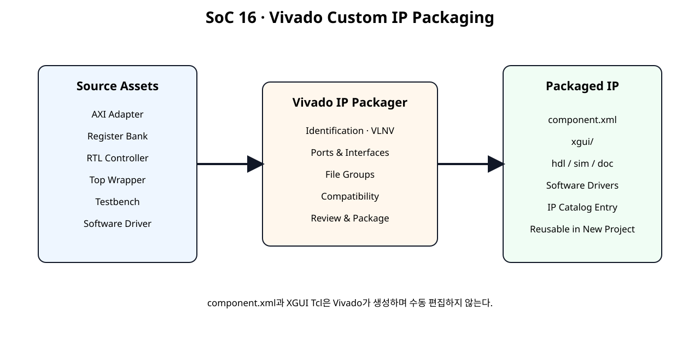
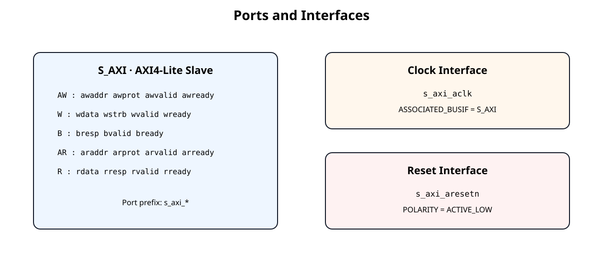
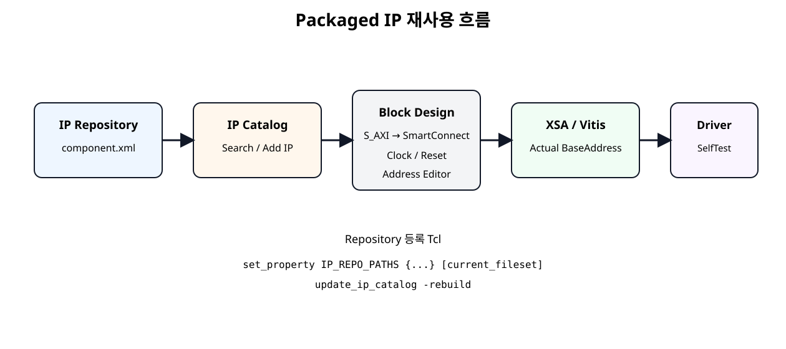

# Vivado IP Packaging과 재사용


## 전체 학습 위치


## 이번 장의 목표

이번 장은 RTL 기능을 변경하는 장이 아니다. 지금까지 검증한 Hardware/Software 자산에 재사용 가능한 IP 메타데이터와 배포 구조를 부여한다.


## 왜 Packaging 하는가


| RTL Source 직접 사용 | Packaged IP 사용 |
| --- | --- |
| Project마다 Source를 다시 추가 | IP Catalog에서 검색해 추가 |
| AXI Port 연결을 매번 확인 | Bus Interface로 표시 |
| File 용도 구분을 사용자가 관리 | Synthesis/Simulation/Driver File Group으로 관리 |
| Version 식별이 약함 | Vendor:Library:Name:Version으로 식별 |


## Packaging 대상


[](../images/soc16/soc16_packaging_flow.svg)

SoC 12~15 자산을 Vivado IP Packager를 통해 하나의 재사용 IP로 묶는다.


| 자산 | 역할 |
| --- | --- |
| AXI Adapter | AW/W/B/AR/R Protocol 처리 |
| Register Bank | Register Map과 W1P/W1C 정책 |
| RTL Controller | 실제 Hardware 기능 |
| Top Wrapper | AXI/Register/Controller 연결 |
| Testbench | Function 검증 |
| Software Driver | MicroBlaze V Application API |


## 새 AXI Peripheral 생성과 차이

Vivado의 Create a new AXI4 peripheral은 AXI Peripheral의 새 Template을 생성하는 기능이다. 현재 설계는 이미 SoC 12~15에서 AXI Slave와 Driver까지 만들었으므로 다시 Template을 생성하지 않는다.

이번 장에서는 Package a specified directory를 기본 흐름으로 사용하고, 기존 Vivado Project가 있는 경우 Package your current project를 대안으로 제시한다.


## 권장 Source Directory

UG1118의 Directory Inference 규칙에 맞춰 Synthesis, Testbench, Example, Documentation을 분리한다.


```text
custom_processing_ip_1_0/
├── hdl/
│   ├── axi4lite_slave_adapter.v
│   ├── custom_register_bank.v
│   ├── custom_axi4lite_ip.v
│   ├── example_processing_controller.v
│   └── custom_axi4lite_controller_ip.v
├── testbench/
│   └── tb_custom_axi4lite_controller_ip.v
├── drivers/
│   └── custom_processing_v1_0/
│       └── src/
│           ├── custom_driver.c
│           ├── custom_driver.h
│           └── custom_regmap.h
├── examples/
│   ├── custom_driver_example.c
│   └── test_custom_driver_mock.c
├── doc/
│   └── README_PACKAGE.md
└── tcl/
    ├── prepare_packaging_project.tcl
    └── add_ip_repo.tcl
```

drivers/는 Software Drivers File Group에 Package 화면에서 명시적으로 추가한다.


## Top Module

Packaging Top은 기존 custom_axi4lite_controller_ip이다.


```text
custom_axi4lite_controller_ip
   ├─ custom_axi4lite_ip
   │    ├─ axi4lite_slave_adapter
   │    └─ custom_register_bank
   └─ example_processing_controller
```

Top은 SoC 14에서 확정한 것처럼 Wire/Instance/Port Connection만 담당한다.


## AXI Interface 자동 추론

Vivado IP Packager는 <interface_name>_<AXI signal> 형식의 Port 이름을 이용해 AXI Bus Interface를 자동 추론할 수 있다.


[](../images/soc16/soc16_ports_interfaces.svg)

현재 Top Port는 s_axi_* 규칙으로 작성되어 AXI4-Lite Slave Interface 추론에 적합하다.

Package 화면에서 반드시 S_AXI 또는 동등한 AXI4-Lite Slave Interface로 올바르게 묶였는지 확인한다.


## Clock · Reset Interface


| Port | Interface | 확인값 |
| --- | --- | --- |
| s_axi_aclk | Clock | Associated Bus Interface → S_AXI |
| s_axi_aclk | Clock | Associated Reset → s_axi_aresetn |
| s_axi_aresetn | Reset | Polarity → Active-Low |

Clock와 AXI Bus의 Association이 빠지면 IP Integrator에서 Clock/Reset 검증 Warning의 원인이 될 수 있다.


## Identification · VLNV

교육용 기본값은 다음처럼 사용한다.


| 항목 | 값 |
| --- | --- |
| Vendor | user.org |
| Library | user |
| Name | custom_processing_ip |
| Version | 1.0 |
| Display Name | Custom Processing AXI4-Lite IP |
| Taxonomy | /UserIP |

실제 외부 배포 시 Vendor는 소유한 조직명/도메인 정책에 맞게 변경한다.


## Compatibility

현재 학습의 주 Target은 Basys3의 Artix-7이지만 IP 자체는 Board Pin을 포함하지 않는다. Package 화면에서 현재 Target Part가 Compatible인지 먼저 확인하고, 다른 Family까지 확장할 때 별도로 Compatibility를 검증한다.


## File Groups

UG1118은 HDL Synthesis, HDL Simulation, Documentation, Test Bench, Drivers 등 여러 File Group을 지원한다.


| File Group | SoC 16 |
| --- | --- |
| HDL Synthesis | hdl/*.v |
| Simulation / Test Bench | testbench/tb_custom_axi4lite_controller_ip.v |
| Software Drivers | drivers/custom_processing_v1_0/src/* |
| Examples | examples/* |
| Documentation | doc/README_PACKAGE.md |


## Synthesis File Group

다음 5개 RTL 파일이 Synthesis Source이다.


```text
axi4lite_slave_adapter.v
custom_register_bank.v
custom_axi4lite_ip.v
example_processing_controller.v
custom_axi4lite_controller_ip.v
```

Packaging 때문에 RTL을 하나의 거대한 파일로 합치지 않는다. 기존 재사용 모듈 구조를 그대로 유지한다.


## Simulation · Testbench

tb_custom_axi4lite_controller_ip.v를 Test Bench File Group에 포함한다.

현재 실행 환경에는 Vivado Simulator가 없으므로 이 장에서도 xsim 실행 결과를 실제 결과로 표시하지 않는다.


## Software Drivers

Driver 자산은 다음 세 파일이다.


```text
custom_driver.c
custom_driver.h
custom_regmap.h
```

IP Packager의 Software Drivers File Group에 이 파일들을 추가해 Hardware IP와 함께 배포할 수 있도록 한다.


## Driver 자동연동 범위

SoC 16에서는 Driver를 Package에 포함하여 함께 배포하는 것까지 완료한다. Driver Metadata, Config Table 자동 생성, BSP 자동연동은 이후 필요 시 별도 확장한다.


## Package a Specified Directory

- Vivado 열기아무 RTL Project를 열거나 Packaging 작업용 Project를 연다.
- ToolsCreate and Package New IP를 실행한다.
- 선택Package a specified directory를 선택한다.
- Directorycustom_processing_ip_1_0 폴더를 지정한다.
- Library CoreStandalone IP로 사용할 것이므로 Package as a library core는 선택하지 않는다.
- Edit IP ProjectWizard 완료 후 Package IP Window에서 세부 설정을 확인한다.

## Package Current Project 대안

이미 현재 RTL을 Source로 등록한 Vivado Project가 있다면 Package your current project도 사용할 수 있다.


```text
# SoC 16 - Create a Vivado project for reviewing/packaging the Custom IP
#
# This script prepares the RTL and simulation files.
# It does NOT hand-create component.xml.
# After it finishes:
#   Tools > Create and Package New IP
#   -> Package your current project
#
# Vivado 2026.1 target: Basys3 XC7A35T

set script_dir [file dirname [file normalize [info script]]]
set ip_root    [file normalize [file join $script_dir ".."]]
set work_dir   [file normalize [file join $ip_root "_vivado_packaging_work"]]

file delete -force $work_dir

create_project -force soc16_custom_ip_packaging \
    $work_dir \
    -part xc7a35tcpg236-1

set hdl_dir [file join $ip_root "hdl"]
set tb_dir  [file join $ip_root "testbench"]

add_files -norecurse [list \
    [file join $hdl_dir "axi4lite_slave_adapter.v"] \
    [file join $hdl_dir "custom_register_bank.v"] \
    [file join $hdl_dir "custom_axi4lite_ip.v"] \
    [file join $hdl_dir "example_processing_controller.v"] \
    [file join $hdl_dir "custom_axi4lite_controller_ip.v"] \
]

set_property top custom_axi4lite_controller_ip [current_fileset]
update_compile_order -fileset sources_1

add_files -fileset sim_1 -norecurse [list \
    [file join $tb_dir "tb_custom_axi4lite_controller_ip.v"] \
]

set_property top tb_custom_axi4lite_controller_ip [get_filesets sim_1]
update_compile_order -fileset sim_1

puts ""
puts "SoC 16 packaging review project created."
puts "Top: custom_axi4lite_controller_ip"
puts ""
puts "Next GUI step:"
puts "  Tools > Create and Package New IP"
puts "  Package your current project"
puts ""
puts "Do not manually create component.xml."
```

제공 Tcl은 Basys3 Part로 Packaging 검토 Project를 만드는 보조 스크립트이다. 실제 Package 단계는 GUI에서 수행한다.


## Ports and Interfaces 확인


| 확인 | 정상 기준 |
| --- | --- |
| AXI Bus | S_AXI AXI4-Lite Slave |
| Clock | s_axi_aclk |
| Reset | s_axi_aresetn Active-Low |
| Address Width | Top Parameter C_S_AXI_ADDR_WIDTH 연결 |
| Data Width | 32-bit |

자동 추론이 틀리면 Auto Infer Interface 또는 수동 Bus Interface Mapping으로 수정한다.


## Review and Package

- IdentificationVLNV와 Display Name 확인
- CompatibilityTarget Part/Family 확인
- File GroupsSynthesis, Testbench, Driver, Documentation 확인
- Ports and InterfacesS_AXI, Clock, Reset Association 확인
- ReviewCritical Warning과 Packager DRC 확인
- Package IP문제가 없을 때 최종 Packaging 실행

## component.xml · XGUI

Packaging이 완료되면 Vivado가 IP root에 IP-XACT 기반 component.xml을 생성하고 xgui/에 Customization GUI Tcl을 생성한다.


```text
custom_processing_ip_1_0/
   ├─ component.xml      ← Vivado 생성
   ├─ xgui/              ← Vivado 생성
   ├─ hdl / src / sim ...
   └─ driver / doc ...
```


## IP Repository 등록


[](../images/soc16/soc16_reuse_flow.svg)

Packaging된 IP를 Repository에 등록한 뒤 새 Project에서 재사용하는 흐름.

GUI에서는 Project Settings → IP → Repository → Add에서 Repository Parent Path를 추가한다.


```text
set_property IP_REPO_PATHS {/absolute/path/to/ip_repo} [current_fileset]
update_ip_catalog -rebuild
```


## IP Catalog 재사용

- Repository 추가component.xml이 있는 하위 폴더를 포함하는 Parent Repository를 등록한다.
- IP CatalogCustom Processing AXI4-Lite IP를 검색한다.
- Add IP새 Block Design에 추가한다.
- VersionVLNV가 의도한 1.0인지 확인한다.

## Block Design 연결


```text
MicroBlaze V M_AXI
      ↓
SmartConnect
      ↓
Custom Processing IP / S_AXI

System Clock ─────────────▶ s_axi_aclk
Peripheral ResetN ────────▶ s_axi_aresetn
```

Packaged IP가 정상이라면 개별 AW/W/B/AR/R Port가 아니라 하나의 AXI Bus Interface로 Block Design에 나타나는 것이 핵심이다.


## Address Editor · Vitis

Register Offset은 기존 SoC 11과 동일하고, Base Address만 새 Project의 Address Editor에서 결정된다.


## Driver 재사용


```text
새 Project의 실제 BaseAddress
      ↓
CustomDrv_Initialize(&custom, BaseAddress)
      ↓
CustomDrv_SelfTest()
      ↓
CustomDrv_RunBlocking()
```

SoC 15 Driver는 Base Address를 외부에서 받도록 설계했으므로 새 Project에 IP를 다시 배치해 Base Address가 바뀌어도 Driver Source를 고칠 필요가 없다.


## Tcl 보조 스크립트


### Packaging Project 준비


```text
# SoC 16 - Create a Vivado project for reviewing/packaging the Custom IP
#
# This script prepares the RTL and simulation files.
# It does NOT hand-create component.xml.
# After it finishes:
#   Tools > Create and Package New IP
#   -> Package your current project
#
# Vivado 2026.1 target: Basys3 XC7A35T

set script_dir [file dirname [file normalize [info script]]]
set ip_root    [file normalize [file join $script_dir ".."]]
set work_dir   [file normalize [file join $ip_root "_vivado_packaging_work"]]

file delete -force $work_dir

create_project -force soc16_custom_ip_packaging \
    $work_dir \
    -part xc7a35tcpg236-1

set hdl_dir [file join $ip_root "hdl"]
set tb_dir  [file join $ip_root "testbench"]

add_files -norecurse [list \
    [file join $hdl_dir "axi4lite_slave_adapter.v"] \
    [file join $hdl_dir "custom_register_bank.v"] \
    [file join $hdl_dir "custom_axi4lite_ip.v"] \
    [file join $hdl_dir "example_processing_controller.v"] \
    [file join $hdl_dir "custom_axi4lite_controller_ip.v"] \
]

set_property top custom_axi4lite_controller_ip [current_fileset]
update_compile_order -fileset sources_1

add_files -fileset sim_1 -norecurse [list \
    [file join $tb_dir "tb_custom_axi4lite_controller_ip.v"] \
]

set_property top tb_custom_axi4lite_controller_ip [get_filesets sim_1]
update_compile_order -fileset sim_1

puts ""
puts "SoC 16 packaging review project created."
puts "Top: custom_axi4lite_controller_ip"
puts ""
puts "Next GUI step:"
puts "  Tools > Create and Package New IP"
puts "  Package your current project"
puts ""
puts "Do not manually create component.xml."
```


### Packaged Repository 등록


```text
# SoC 16 - Add packaged IP repository to the current Vivado project
#
# Usage:
#   1. Edit repo_path if needed.
#   2. Source this file in the Vivado Tcl Console:
#        source add_ip_repo.tcl
#
# The path must point to the repository parent that contains
# packaged IP directories with component.xml files.

set script_dir [file dirname [file normalize [info script]]]
set repo_path [file normalize [file join $script_dir ".." ".."]]

puts "Adding IP repository:"
puts "  $repo_path"

set_property IP_REPO_PATHS $repo_path [current_fileset]
update_ip_catalog -rebuild

puts "IP catalog rebuild requested."
puts "Search the IP Catalog for: Custom Processing AXI4-Lite IP"
```

두 스크립트 모두 component.xml을 손으로 생성하지 않는다.


## 소스 패키지 구성

이번 장에서 제공하는 Source Package는 Packaging 전 원본 자산이다.


```text
custom_processing_ip_1_0/
├── hdl/
│   ├── axi4lite_slave_adapter.v
│   ├── custom_register_bank.v
│   ├── custom_axi4lite_ip.v
│   ├── example_processing_controller.v
│   └── custom_axi4lite_controller_ip.v
├── testbench/
│   └── tb_custom_axi4lite_controller_ip.v
├── drivers/
│   └── custom_processing_v1_0/
│       └── src/
│           ├── custom_driver.c
│           ├── custom_driver.h
│           └── custom_regmap.h
├── examples/
│   ├── custom_driver_example.c
│   └── test_custom_driver_mock.c
├── doc/
│   └── README_PACKAGE.md
└── tcl/
    ├── prepare_packaging_project.tcl
    └── add_ip_repo.tcl
```


## 재사용 검증 절차


| Gate | 확인 |
| --- | --- |
| 1 | Package IP DRC 통과 |
| 2 | 새 Project의 IP Catalog에서 검색 |
| 3 | Block Design에 S_AXI Interface로 추가 |
| 4 | Clock/Reset Connection 정상 |
| 5 | Address Editor Base 할당 |
| 6 | Validate Design |
| 7 | Synthesis / Implementation |
| 8 | Vitis에서 Driver SelfTest |
| 9 | RunBlocking 결과 확인 |


## 오류 점검


| 증상 | 원인 후보 | 확인 |
| --- | --- | --- |
| IP Catalog에 안 보임 | component.xml 미생성 / Repository 경로 오류 | Packaging 완료, IP_REPO_PATHS |
| AW/W/R Port가 개별 Pin으로 보임 | AXI Interface 추론 실패 | Ports and Interfaces에서 S_AXI Mapping |
| Clock Warning | ASSOCIATED_BUSIF 누락 | s_axi_aclk ↔ S_AXI |
| Reset Warning | Polarity/Association 오류 | s_axi_aresetn Active-Low |
| Driver 파일이 Package에 없음 | Software Drivers File Group 미등록 | File Groups |
| Vitis가 Driver를 자동 선택하지 않음 | Driver File 포함과 BSP 자동연동 혼동 | Metadata 통합은 별도 단계 |
| 새 Project에서 Register가 안 맞음 | Base Address를 고정값으로 사용 | 새 Address Editor 값 전달 |
| component.xml을 직접 수정함 | Packager 관리파일 수동 변경 | Package IP Window에서 수정 후 Repackage |


## SoC 16 완료 체크리스트

- [ ] SoC 12~15의 RTL/Driver 자산을 수정하지 않고 Packaging Source로 정리했다.
- [ ] Top Module은 custom_axi4lite_controller_ip이다.
- [ ] s_axi_* Port가 AXI4-Lite Slave Interface로 추론되는지 확인한다.
- [ ] s_axi_aclk가 S_AXI와 연관되어 있다.
- [ ] s_axi_aresetn이 Active-Low Reset으로 정의되어 있다.
- [ ] Identification/VLNV를 정의했다.
- [ ] HDL Synthesis, Testbench, Software Drivers, Documentation File Group을 확인했다.
- [ ] Create a new AXI4 Peripheral로 기존 RTL을 다시 생성하지 않는다.
- [ ] Package a specified directory 또는 Package current project를 사용한다.
- [ ] component.xml과 XGUI는 Vivado가 생성하게 한다.
- [ ] 새 Project에 IP Repository를 등록했다.
- [ ] IP Catalog에서 Custom IP를 검색해 Block Design에 추가한다.
- [ ] 새 Project의 Base Address를 Driver에 전달한다.
- [ ] Driver SelfTest로 Hardware ID/VERSION을 다시 확인한다.
- [ ] Driver File 포함과 Vitis BSP 자동연동을 구분한다.

## 공식 매뉴얼 및 원본 근거


| 문서 | 확인 항목 |
| --- | --- |
| AMD UG1118 · Creating and Packaging Custom IP · 2026.1 | Custom IP Packaging 전체 절차 |
| UG1118 · Supported IP Packager Inputs | HDL, Simulation, Testbench, Drivers, Documentation File Group |
| UG1118 · Create and Package New IP Wizard | Package Project / Directory / Create New AXI4 Peripheral 구분 |
| UG1118 · Interface Inference | <interface>_<AXI signal> Name Matching |
| UG1118 · Clock/Reset Interface Inference | Clock Association, Active-Low Reset 추론 |
| UG1118 · Outputs from IP Packager | component.xml, xgui Tcl 생성 |
| AMD UG896 · Managing IP Repositories · 2026.1 | Project Settings → IP → Repository |
| AMD UG835 · update_ip_catalog · 2026.1 | IP_REPO_PATHS와 IP Catalog rebuild Tcl |

