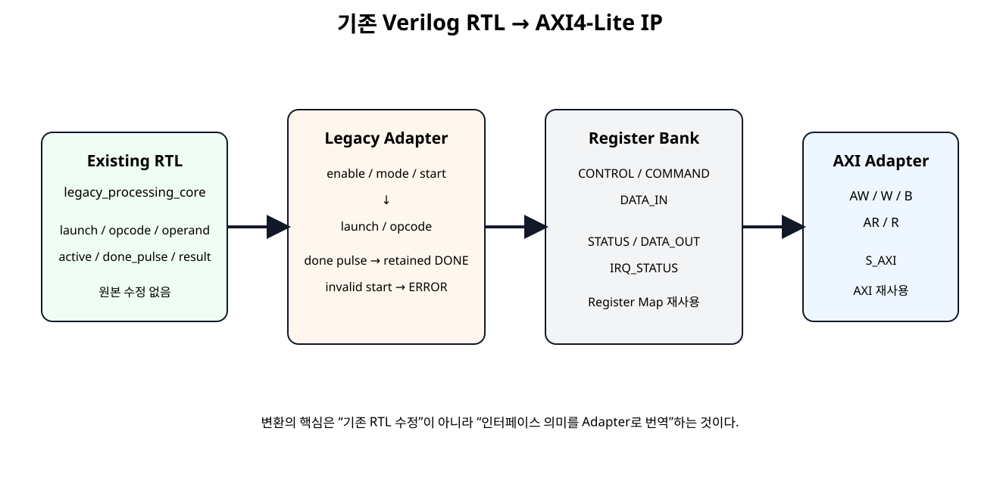
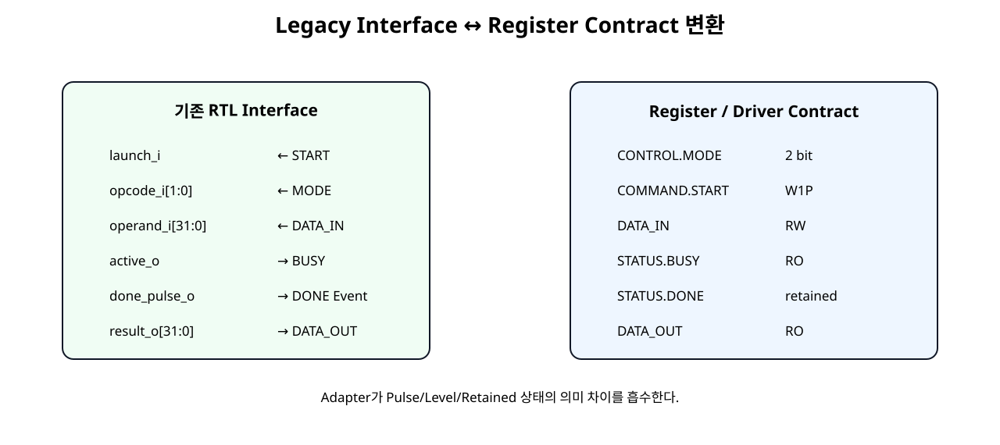
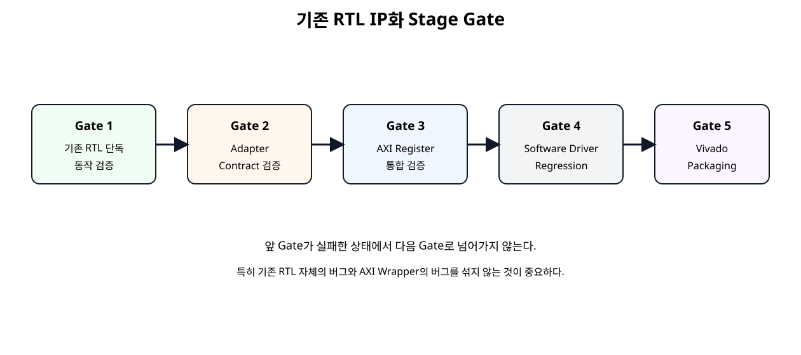

# 기존 Verilog RTL을 IP로 변환


## 전체 학습 위치


## 이번 장의 목표

IP화의 핵심을 “기존 RTL을 AXI 코드로 다시 작성하는 것”이 아니라 기존 기능 RTL과 Bus/Software Interface를 분리해 연결하는 것으로 이해한다.


## 기존 RTL을 바로 고치지 않는 이유


| 기존 RTL 내부에 AXI 추가 | Adapter 방식 |
| --- | --- |
| 기능과 Bus가 강하게 결합됨 | 기능 RTL 독립성 유지 |
| 원래 검증 결과를 다시 의심해야 함 | 원본 Regression 가능 |
| 다른 Bus로 재사용하기 어려움 | AXI 외 다른 Wrapper도 가능 |
| 기능 수정과 Interface 수정이 섞임 | 문제 위치를 분리하기 쉬움 |

기존 RTL에 실제 버그가 없는 한 AXI 때문에 내부 알고리즘을 다시 작성하지 않는다.


## 예제 Existing RTL

이번 장에서는 AXI를 전혀 모르는 legacy_processing_core를 기존 RTL 예제로 사용한다. 교육용 예제이지만 구조는 UART Core, PWM Core, DSP Core, Sensor Controller, NPU Datapath 등에도 그대로 적용할 수 있다.


| Port | 의미 |
| --- | --- |
| launch_i | 1 Clock 작업 시작 요청 |
| opcode_i[1:0] | 처리 Mode |
| operand_i[31:0] | 입력 Data |
| active_o | 처리 중 Level |
| done_pulse_o | 완료 1-Clock Pulse |
| result_o[31:0] | 결과 Data |


## 원본 RTL Interface


| 방향 | 신호 |
| --- | --- |
| legacy_processing_core 입력 | launch_i / opcode_i / operand_i |
| legacy_processing_core 출력 | active_o / done_pulse_o / result_o |

이 Core에는 AXI Address, Register Offset, Software Driver 개념이 없다. 이 상태를 유지하는 것이 재사용의 출발점이다.


## AXI IP화 전체 구조


[](../images/soc17/soc17_existing_rtl_to_axi_ip.svg)

기존 RTL은 그대로 유지하고 Adapter → Register Bank → AXI Adapter를 외부에 추가한다.


## Register Contract 재사용

SoC 11부터 사용한 Register Map을 그대로 유지한다.


| Offset | Register | 기존 RTL 연결 |
| --- | --- | --- |
| 0x00 | CONTROL | ENABLE / MODE |
| 0x04 | STATUS | BUSY / DONE / ERROR |
| 0x08 | COMMAND | START / CLEAR |
| 0x0C | IRQ_STATUS | DONE / ERROR Event |
| 0x10 | DATA_IN | operand_i |
| 0x14 | DATA_OUT | result_o |
| 0x18 / 0x1C | VERSION / ID | Driver Identification |


## Interface 의미 변환


[](../images/soc17/soc17_interface_contract.svg)

Pulse·Level·Retained Status의 의미 차이를 Adapter에서 변환한다.

단순 Wire 이름 변경이 아니라 Signal의 시간적 의미까지 변환하는 것이 Adapter의 핵심이다.


## Legacy Adapter 역할


| Register 쪽 | Adapter | Legacy Core 쪽 |
| --- | --- | --- |
| START W1P | Enable/Busy 검사 | launch_i 1 Clock |
| MODE | 직접 Mapping | opcode_i |
| DATA_IN | 직접 Mapping | operand_i |
| BUSY | 직접 Mapping | active_o |
| DONE | Pulse를 Latched Status로 변환 | done_pulse_o |
| ERROR | Wrapper 정책으로 추가 | Legacy Core에는 없음 |


## START 변환


```text
assign legacy_launch =
    start_pulse_i &&
    enable_i &&
    !legacy_busy;
```

Software START가 발생해도 Enable이 꺼져 있거나 Core가 Busy이면 Legacy Core에는 Launch를 전달하지 않는다.


## BUSY 변환


```text
assign busy_o = legacy_busy;
```

Legacy Core의 active_o는 Register Contract의 STATUS.BUSY와 의미가 동일하므로 추가 상태 저장 없이 직접 연결한다.


## DONE Pulse 변환


```text
Legacy done_pulse_o = 1 clock
        ↓
Adapter
        ├─ done_o = 1 retained
        └─ irq_done_event_o = 1 clock
        ↓
Register Bank
STATUS.DONE + IRQ_STATUS.DONE
```

Software Polling은 1 Clock Pulse를 놓칠 수 있으므로 Adapter가 DONE을 retained 상태로 바꾼다.


## ERROR 정책 추가

기존 Core가 Error Port를 갖고 있지 않아도 Software Contract에는 Error를 추가할 수 있다.


| 조건 | Adapter 동작 |
| --- | --- |
| ENABLE=0에서 START | ERROR + ERROR IRQ |
| BUSY=1에서 START | ERROR + ERROR IRQ, 기존 작업 유지 |
| 정상 START | Legacy Launch 전달 |

즉 Adapter는 기존 RTL의 기능 자체를 바꾸지 않으면서 Software 사용 규칙을 추가할 수 있다.


## DATA_IN · DATA_OUT


```text
DATA_IN Register ─────▶ operand_i
CONTROL.MODE ─────────▶ opcode_i

result_o ─────────────▶ DATA_OUT Register
```

기존 Core가 START 시 operand/opcode를 내부 Capture하므로 작업 중 Software가 DATA_IN을 바꿔도 진행 중 연산에는 영향을 주지 않는다.


## STATUS · IRQ_STATUS

STATUS와 IRQ_STATUS 분리 원칙도 그대로 유지한다.

COMMAND.CLEAR는 DONE/ERROR Status를 지우고, IRQ_STATUS는 별도 W1C로 지운다.


## Top Wrapper

최상위 custom_axi4lite_legacy_ip는 AXI/Register Module과 Legacy Adapter만 연결한다.


```verilog
module custom_axi4lite_legacy_ip #(
    parameter integer C_S_AXI_ADDR_WIDTH    = 32,
    parameter integer LEGACY_LATENCY_CYCLES = 4
)(
    input  wire                          s_axi_aclk,
    input  wire                          s_axi_aresetn,

    input  wire [C_S_AXI_ADDR_WIDTH-1:0] s_axi_awaddr,
    input  wire [2:0]                    s_axi_awprot,
    input  wire                          s_axi_awvalid,
    output wire                          s_axi_awready,

    input  wire [31:0]                   s_axi_wdata,
    input  wire [3:0]                    s_axi_wstrb,
    input  wire                          s_axi_wvalid,
    output wire                          s_axi_wready,

    output wire [1:0]                    s_axi_bresp,
    output wire                          s_axi_bvalid,
    input  wire                          s_axi_bready,

    input  wire [C_S_AXI_ADDR_WIDTH-1:0] s_axi_araddr,
    input  wire [2:0]                    s_axi_arprot,
    input  wire                          s_axi_arvalid,
    output wire                          s_axi_arready,

    output wire [31:0]                   s_axi_rdata,
    output wire [1:0]                    s_axi_rresp,
    output wire                          s_axi_rvalid,
    input  wire                          s_axi_rready
);

// Shell / Wrapper only:
// - no FSM
// - no arithmetic
// - no register policy
// - no legacy-core modifications

wire        enable;
wire [1:0]  mode;
wire        start_pulse;
wire        clear_pulse;
wire [31:0] data_in;
wire [1:0]  irq_status;

wire        busy;
wire        done;
wire        error;
wire        irq_done_event;
wire        irq_error_event;
wire [31:0] data_out;

custom_axi4lite_ip #(
    .C_S_AXI_ADDR_WIDTH(C_S_AXI_ADDR_WIDTH)
) u_custom_axi4lite_ip (
    .s_axi_aclk(s_axi_aclk),
    .s_axi_aresetn(s_axi_aresetn),

    .s_axi_awaddr(s_axi_awaddr),
    .s_axi_awprot(s_axi_awprot),
    .s_axi_awvalid(s_axi_awvalid),
    .s_axi_awready(s_axi_awready),

    .s_axi_wdata(s_axi_wdata),
    .s_axi_wstrb(s_axi_wstrb),
    .s_axi_wvalid(s_axi_wvalid),
    .s_axi_wready(s_axi_wready),

    .s_axi_bresp(s_axi_bresp),
    .s_axi_bvalid(s_axi_bvalid),
    .s_axi_bready(s_axi_bready),

    .s_axi_araddr(s_axi_araddr),
    .s_axi_arprot(s_axi_arprot),
    .s_axi_arvalid(s_axi_arvalid),
    .s_axi_arready(s_axi_arready),

    .s_axi_rdata(s_axi_rdata),
    .s_axi_rresp(s_axi_rresp),
    .s_axi_rvalid(s_axi_rvalid),
    .s_axi_rready(s_axi_rready),

    .busy_i(busy),
    .done_i(done),
    .error_i(error),
    .irq_done_event_i(irq_done_event),
    .irq_error_event_i(irq_error_event),
    .data_out_i(data_out),

    .enable_o(enable),
    .mode_o(mode),
    .start_pulse_o(start_pulse),
    .clear_pulse_o(clear_pulse),
    .data_in_o(data_in),
    .irq_status_o(irq_status)
);

legacy_core_controller_adapter #(
    .LEGACY_LATENCY_CYCLES(LEGACY_LATENCY_CYCLES)
) u_legacy_core_controller_adapter (
    .clk(s_axi_aclk),
    .resetn(s_axi_aresetn),

    .enable_i(enable),
    .mode_i(mode),
    .start_pulse_i(start_pulse),
    .clear_pulse_i(clear_pulse),
    .data_in_i(data_in),

    .busy_o(busy),
    .done_o(done),
    .error_o(error),
    .irq_done_event_o(irq_done_event),
    .irq_error_event_o(irq_error_event),
    .data_out_o(data_out)
);

endmodule
```


## Wrapper 순수 연결 원칙


| Top에 허용 | Top에 두지 않음 |
| --- | --- |
| Wire 선언 | 기능 FSM |
| Module Instance | Address Decode |
| Port Connection | Error 정책 |
| Parameter 전달 | 산술/논리 Processing |


## 기존 RTL 원본 코드

다음 RTL은 AXI/Register 변환 전 독립 Core이다. Packaging Source 안의 복사본과 바이트 단위로 동일하게 유지한다.


```verilog
module legacy_processing_core #(
    parameter integer LATENCY_CYCLES = 4
)(
    input  wire        clk,
    input  wire        rst_n,

    // Legacy functional interface
    input  wire        launch_i,
    input  wire [1:0]  opcode_i,
    input  wire [31:0] operand_i,

    output reg         active_o,
    output reg         done_pulse_o,
    output reg  [31:0] result_o
);

reg [1:0]  opcode_latched;
reg [31:0] operand_latched;
reg [7:0]  cycles_left;

function [31:0] calculate_result;
    input [31:0] value;
    input [1:0]  opcode;
    begin
        case (opcode)
            2'b00: calculate_result = value;
            2'b01: calculate_result = value + 32'd1;
            2'b10: calculate_result = value << 1;
            2'b11: calculate_result = ~value;
            default: calculate_result = value;
        endcase
    end
endfunction

always @(posedge clk) begin
    if (!rst_n) begin
        opcode_latched  <= 2'b00;
        operand_latched <= 32'h0000_0000;
        cycles_left     <= 8'd0;

        active_o        <= 1'b0;
        done_pulse_o    <= 1'b0;
        result_o        <= 32'h0000_0000;
    end else begin
        // Legacy core reports completion as a one-clock pulse.
        done_pulse_o <= 1'b0;

        if (!active_o) begin
            if (launch_i) begin
                opcode_latched  <= opcode_i;
                operand_latched <= operand_i;
                active_o        <= 1'b1;

                if (LATENCY_CYCLES <= 1) begin
                    cycles_left <= 8'd0;
                end else begin
                    cycles_left <= LATENCY_CYCLES - 1;
                end
            end
        end else begin
            if (cycles_left != 0) begin
                cycles_left <= cycles_left - 1'b1;
            end else begin
                result_o <= calculate_result(
                    operand_latched,
                    opcode_latched
                );

                active_o     <= 1'b0;
                done_pulse_o <= 1'b1;
            end
        end
    end
end

endmodule
```


## Adapter RTL


```verilog
module legacy_core_controller_adapter #(
    parameter integer LEGACY_LATENCY_CYCLES = 4
)(
    input  wire        clk,
    input  wire        resetn,

    // Register-bank control inputs
    input  wire        enable_i,
    input  wire [1:0]  mode_i,
    input  wire        start_pulse_i,
    input  wire        clear_pulse_i,
    input  wire [31:0] data_in_i,

    // Register-bank status / event outputs
    output wire        busy_o,
    output reg         done_o,
    output reg         error_o,
    output reg         irq_done_event_o,
    output reg         irq_error_event_o,
    output wire [31:0] data_out_o
);

wire        legacy_busy;
wire        legacy_done_pulse;
wire [31:0] legacy_result;
wire        legacy_launch;

/*
 * The existing RTL is not modified.
 * This adapter translates the register/controller contract into
 * the legacy core's launch/opcode/operand interface.
 */
assign legacy_launch =
    start_pulse_i &&
    enable_i &&
    !legacy_busy;

assign busy_o     = legacy_busy;
assign data_out_o = legacy_result;

legacy_processing_core #(
    .LATENCY_CYCLES(LEGACY_LATENCY_CYCLES)
) u_legacy_processing_core (
    .clk(clk),
    .rst_n(resetn),

    .launch_i(legacy_launch),
    .opcode_i(mode_i),
    .operand_i(data_in_i),

    .active_o(legacy_busy),
    .done_pulse_o(legacy_done_pulse),
    .result_o(legacy_result)
);

always @(posedge clk) begin
    if (!resetn) begin
        done_o              <= 1'b0;
        error_o             <= 1'b0;
        irq_done_event_o    <= 1'b0;
        irq_error_event_o   <= 1'b0;
    end else begin
        // Event outputs are one-clock pulses.
        irq_done_event_o  <= 1'b0;
        irq_error_event_o <= 1'b0;

        // Software CLEAR only clears retained software-visible status.
        if (clear_pulse_i) begin
            done_o  <= 1'b0;
            error_o <= 1'b0;
        end

        if (start_pulse_i) begin
            done_o <= 1'b0;

            if (!enable_i) begin
                error_o           <= 1'b1;
                irq_error_event_o <= 1'b1;
            end else if (legacy_busy) begin
                error_o           <= 1'b1;
                irq_error_event_o <= 1'b1;
            end else begin
                // Legal start. The legacy core receives legacy_launch.
                error_o <= 1'b0;
            end
        end

        if (legacy_done_pulse) begin
            done_o           <= 1'b1;
            irq_done_event_o <= 1'b1;
        end
    end
end

endmodule
```


## AXI Top RTL

AXI Protocol과 Register Map은 SoC 12~15의 검증된 모듈을 그대로 사용한다.


```text
S_AXI
  ↓
custom_axi4lite_ip
  ├─ axi4lite_slave_adapter
  └─ custom_register_bank
  ↓
legacy_core_controller_adapter
  ↓
legacy_processing_core
```


## Standalone Core 검증

IP화 전에 기존 RTL 자체의 기능을 독립 Testbench로 먼저 검증한다.


```verilog
`timescale 1ns / 1ps

module tb_legacy_processing_core;

reg clk = 1'b0;
reg rst_n = 1'b0;
reg launch_i = 1'b0;
reg [1:0] opcode_i = 2'b00;
reg [31:0] operand_i = 32'h0;

wire active_o;
wire done_pulse_o;
wire [31:0] result_o;

integer errors = 0;

always #5 clk = ~clk;

legacy_processing_core #(
    .LATENCY_CYCLES(4)
) dut (
    .clk(clk),
    .rst_n(rst_n),
    .launch_i(launch_i),
    .opcode_i(opcode_i),
    .operand_i(operand_i),
    .active_o(active_o),
    .done_pulse_o(done_pulse_o),
    .result_o(result_o)
);

task automatic run_case;
    input [1:0] op;
    input [31:0] value;
    input [31:0] expected;
    begin
        wait (!active_o);

        @(negedge clk);
        opcode_i = op;
        operand_i = value;
        launch_i = 1'b1;

        @(negedge clk);
        launch_i = 1'b0;

        wait (done_pulse_o === 1'b1);

        if (result_o !== expected) begin
            $display("FAIL: op=%0d in=%08h out=%08h expected=%08h",
                     op, value, result_o, expected);
            errors = errors + 1;
        end else begin
            $display("PASS: op=%0d in=%08h out=%08h",
                     op, value, result_o);
        end

        @(posedge clk);

        // (추가) 비차단 대입이 반영된 뒤 펄스 해제를 확인한다.

        #1;

        if (done_pulse_o !== 1'b0) begin
            $display("FAIL: done_pulse_o wider than one clock");
            errors = errors + 1;
        end
    end
endtask

initial begin
    repeat (4) @(posedge clk);
    rst_n = 1'b1;
    repeat (2) @(posedge clk);

    run_case(2'b00, 32'h12345678, 32'h12345678);
    run_case(2'b01, 32'hFFFFFFFF, 32'h00000000);
    run_case(2'b10, 32'h80000001, 32'h00000002);
    run_case(2'b11, 32'hA5A55A5A, 32'h5A5AA5A5);

    if (errors == 0) begin
        $display("LEGACY PROCESSING CORE TEST: PASS");
    end else begin
        $display("LEGACY PROCESSING CORE TEST: FAIL (%0d errors)", errors);
    end

    #30;
    $finish;
end

endmodule
```


## AXI 통합 Testbench

두 번째 Testbench는 Legacy Core Port를 직접 제어하지 않고 AXI Register Transaction만 사용한다.


```verilog
`timescale 1ns / 1ps

module tb_custom_axi4lite_legacy_ip;

localparam integer ADDR_W = 32;
localparam integer PROCESS_CYCLES_TB = 12;

reg clk = 1'b0;
reg resetn = 1'b0;

always #5 clk = ~clk;

reg  [ADDR_W-1:0] awaddr;
reg  [2:0]        awprot;
reg               awvalid;
wire              awready;

reg  [31:0]       wdata;
reg  [3:0]        wstrb;
reg               wvalid;
wire              wready;

wire [1:0]        bresp;
wire              bvalid;
reg               bready;

reg  [ADDR_W-1:0] araddr;
reg  [2:0]        arprot;
reg               arvalid;
wire              arready;

wire [31:0]       rdata;
wire [1:0]        rresp;
wire              rvalid;
reg               rready;

integer error_count = 0;
reg [31:0] rd;

custom_axi4lite_legacy_ip #(
    .C_S_AXI_ADDR_WIDTH(ADDR_W),
    .LEGACY_LATENCY_CYCLES(PROCESS_CYCLES_TB)
) dut (
    .s_axi_aclk(clk),
    .s_axi_aresetn(resetn),

    .s_axi_awaddr(awaddr),
    .s_axi_awprot(awprot),
    .s_axi_awvalid(awvalid),
    .s_axi_awready(awready),

    .s_axi_wdata(wdata),
    .s_axi_wstrb(wstrb),
    .s_axi_wvalid(wvalid),
    .s_axi_wready(wready),

    .s_axi_bresp(bresp),
    .s_axi_bvalid(bvalid),
    .s_axi_bready(bready),

    .s_axi_araddr(araddr),
    .s_axi_arprot(arprot),
    .s_axi_arvalid(arvalid),
    .s_axi_arready(arready),

    .s_axi_rdata(rdata),
    .s_axi_rresp(rresp),
    .s_axi_rvalid(rvalid),
    .s_axi_rready(rready)
);

task automatic expect32;
    input [31:0] actual;
    input [31:0] expected;
    input [8*48-1:0] label;
    begin
        if (actual !== expected) begin
            $display("FAIL: %0s actual=%08h expected=%08h",
                     label, actual, expected);
            error_count = error_count + 1;
        end else begin
            $display("PASS: %0s = %08h", label, actual);
        end
    end
endtask

task automatic axi_write;
    input [31:0] addr;
    input [31:0] data;
    input [3:0]  strb;
    begin
        @(negedge clk);
        awaddr  = addr;
        awvalid = 1'b1;

        wait (awready === 1'b1);
        @(negedge clk);
        awvalid = 1'b0;

        @(negedge clk);
        wdata  = data;
        wstrb  = strb;
        wvalid = 1'b1;

        wait (wready === 1'b1);
        @(negedge clk);
        wvalid = 1'b0;

        bready = 1'b1;
        wait (bvalid === 1'b1);
        @(posedge clk);
        @(negedge clk);
        bready = 1'b0;
    end
endtask

task automatic axi_read;
    input  [31:0] addr;
    output [31:0] data;
    begin
        @(negedge clk);
        araddr  = addr;
        arvalid = 1'b1;

        wait (arready === 1'b1);
        @(negedge clk);
        arvalid = 1'b0;

        rready = 1'b1;
        wait (rvalid === 1'b1);
        data = rdata;

        @(posedge clk);
        @(negedge clk);
        rready = 1'b0;
    end
endtask

task automatic clear_status_and_irq;
    begin
        axi_write(32'h00000008, 32'h00000002, 4'b0001);
        axi_write(32'h0000000C, 32'h00000003, 4'b0001);
    end
endtask

task automatic wait_done;
    output [31:0] status_value;
    integer k;
    reg found;
    begin
        status_value = 32'h0;
        found = 1'b0;

        for (k = 0; k < 100; k = k + 1) begin
            axi_read(32'h00000004, status_value);

            if (status_value[1]) begin
                found = 1'b1;
                k = 100;
            end
        end

        if (!found) begin
            $display("FAIL: timeout waiting for DONE");
            error_count = error_count + 1;
        end
    end
endtask

task automatic run_mode_test;
    input [1:0]  mode;
    input [31:0] input_value;
    input [31:0] expected_value;
    reg [31:0] status_value;
    reg [31:0] control_value;
    begin
        clear_status_and_irq();

        control_value = 32'h00000001 | ({30'h0, mode} << 1);
        axi_write(32'h00000000, control_value, 4'b1111);
        axi_write(32'h00000010, input_value, 4'b1111);
        axi_write(32'h00000008, 32'h00000001, 4'b0001);

        wait_done(status_value);

        if (!status_value[1] || status_value[0]) begin
            $display("FAIL: final STATUS expected DONE=1 BUSY=0");
            error_count = error_count + 1;
        end

        axi_read(32'h00000014, rd);
        expect32(rd, expected_value, "DATA_OUT result");

        axi_read(32'h0000000C, rd);
        if ((rd & 32'h00000001) == 0) begin
            $display("FAIL: DONE IRQ status not latched");
            error_count = error_count + 1;
        end else begin
            $display("PASS: DONE IRQ status latched");
        end
    end
endtask

initial begin
    awaddr = 0;
    awprot = 0;
    awvalid = 0;
    wdata = 0;
    wstrb = 0;
    wvalid = 0;
    bready = 0;

    araddr = 0;
    arprot = 0;
    arvalid = 0;
    rready = 0;

    repeat (5) @(posedge clk);
    resetn = 1'b1;
    repeat (3) @(posedge clk);

    $display("---- FIXED REGISTERS ----");
    axi_read(32'h00000018, rd);
    expect32(rd, 32'h00010000, "VERSION");

    axi_read(32'h0000001C, rd);
    expect32(rd, 32'h524D4150, "ID");

    $display("---- DISABLED START -> ERROR ----");
    axi_write(32'h00000008, 32'h00000001, 4'b0001);
    repeat (3) @(posedge clk);

    axi_read(32'h00000004, rd);
    if ((rd & 32'h00000004) == 0) begin
        $display("FAIL: STATUS.ERROR not set");
        error_count = error_count + 1;
    end else begin
        $display("PASS: STATUS.ERROR set");
    end

    axi_read(32'h0000000C, rd);
    if ((rd & 32'h00000002) == 0) begin
        $display("FAIL: IRQ_STATUS.ERROR not set");
        error_count = error_count + 1;
    end else begin
        $display("PASS: IRQ_STATUS.ERROR set");
    end

    $display("---- CLEAR STATUS ONLY ----");
    axi_write(32'h00000008, 32'h00000002, 4'b0001);
    axi_read(32'h00000004, rd);
    expect32(rd, 32'h00000000, "STATUS after COMMAND.CLEAR");

    axi_read(32'h0000000C, rd);
    expect32(rd, 32'h00000002, "IRQ_STATUS remains latched");

    axi_write(32'h0000000C, 32'h00000002, 4'b0001);
    axi_read(32'h0000000C, rd);
    expect32(rd, 32'h00000000, "IRQ_STATUS W1C clear");

    $display("---- MODE 0 PASS-THROUGH ----");
    run_mode_test(2'b00, 32'h12345678, 32'h12345678);

    $display("---- MODE 1 ADD 1 ----");
    run_mode_test(2'b01, 32'hFFFFFFFF, 32'h00000000);

    $display("---- MODE 2 SHIFT LEFT ----");
    run_mode_test(2'b10, 32'h80000001, 32'h00000002);

    $display("---- MODE 3 BITWISE NOT ----");
    run_mode_test(2'b11, 32'hA5A55A5A, 32'h5A5AA5A5);

    $display("---- START WHILE BUSY -> ERROR ----");
    clear_status_and_irq();

    // Enable, mode 0, data input.
    axi_write(32'h00000000, 32'h00000001, 4'b1111);
    axi_write(32'h00000010, 32'hCAFEBABE, 4'b1111);

    // First START launches the operation.
    axi_write(32'h00000008, 32'h00000001, 4'b0001);

    // Second START arrives before PROCESS_CYCLES_TB expires.
    axi_write(32'h00000008, 32'h00000001, 4'b0001);

    wait_done(rd);

    axi_read(32'h00000004, rd);
    if ((rd & 32'h00000004) == 0) begin
        $display("FAIL: busy restart ERROR not retained");
        error_count = error_count + 1;
    end else begin
        $display("PASS: busy restart ERROR retained");
    end

    axi_read(32'h00000014, rd);
    expect32(rd, 32'hCAFEBABE, "original operation still completed");

    axi_read(32'h0000000C, rd);
    if ((rd & 32'h00000003) != 32'h00000003) begin
        $display("FAIL: DONE+ERROR IRQ status expected");
        error_count = error_count + 1;
    end else begin
        $display("PASS: DONE+ERROR IRQ status latched");
    end

    if (error_count == 0) begin
        $display("SOC17 LEGACY RTL AXI IP TEST: PASS");
    end else begin
        $display("SOC17 LEGACY RTL AXI IP TEST: FAIL (%0d errors)",
                 error_count);
    end

    #50;
    $finish;
end

endmodule
```

Disabled START, STATUS/IRQ 독립 Clear, Mode 0~3, Busy 중 재START를 Software 관점에서 검증한다.


## Software Driver 재사용

Register Contract가 SoC 15와 동일하므로 Driver Source를 바꾸지 않는다.

기존 RTL 내부 Interface가 달라도 Register Contract가 같으면 상위 Software API를 재사용할 수 있다는 것이 핵심이다.


## Register Map 재사용

custom_regmap.h, custom_register_bank.v, axi4lite_slave_adapter.v는 SoC 15와 바이트 단위 동일하게 유지한다.


## Packaging Source 구조


```text
legacy_processing_ip_1_0/
├── hdl/
│   ├── legacy_processing_core.v
│   ├── legacy_core_controller_adapter.v
│   ├── axi4lite_slave_adapter.v
│   ├── custom_register_bank.v
│   ├── custom_axi4lite_ip.v
│   └── custom_axi4lite_legacy_ip.v
├── testbench/
│   ├── tb_legacy_processing_core.v
│   └── tb_custom_axi4lite_legacy_ip.v
├── drivers/
│   └── legacy_processing_v1_0/
│       └── src/
│           ├── custom_driver.c
│           ├── custom_driver.h
│           └── custom_regmap.h
├── examples/
│   ├── custom_driver_example.c
│   └── test_custom_driver_mock.c
├── doc/
│   └── README_PACKAGE.md
└── tcl/
    ├── prepare_legacy_ip_project.tcl
    └── add_ip_repo.tcl
```

legacy_processing_core.v는 기존 RTL, legacy_core_controller_adapter.v는 변환 계층, 나머지 AXI/Register/Driver는 이전 단계 재사용 자산이다.


## Vivado Packaging

SoC 16과 같은 IP Packager 절차를 사용하고 Packaging Top만 custom_axi4lite_legacy_ip로 변경한다.


```text
# SoC 17 - Prepare a Vivado project for packaging existing Verilog RTL as AXI IP
#
# The original legacy_processing_core.v is intentionally reused unchanged.
# Adapter and AXI/register wrappers are separate files.
#
# After this script:
#   Tools > Create and Package New IP
#   -> Package your current project
#
# Do not hand-create component.xml.

set script_dir [file dirname [file normalize [info script]]]
set ip_root    [file normalize [file join $script_dir ".."]]
set work_dir   [file normalize [file join $ip_root "_vivado_packaging_work"]]

file delete -force $work_dir

create_project -force soc17_legacy_rtl_ip \
    $work_dir \
    -part xc7a35tcpg236-1

set hdl_dir [file join $ip_root "hdl"]
set tb_dir  [file join $ip_root "testbench"]

add_files -norecurse [list \
    [file join $hdl_dir "legacy_processing_core.v"] \
    [file join $hdl_dir "axi4lite_slave_adapter.v"] \
    [file join $hdl_dir "custom_register_bank.v"] \
    [file join $hdl_dir "custom_axi4lite_ip.v"] \
    [file join $hdl_dir "legacy_core_controller_adapter.v"] \
    [file join $hdl_dir "custom_axi4lite_legacy_ip.v"] \
]

set_property top custom_axi4lite_legacy_ip [current_fileset]
update_compile_order -fileset sources_1

add_files -fileset sim_1 -norecurse [list \
    [file join $tb_dir "tb_legacy_processing_core.v"] \
    [file join $tb_dir "tb_custom_axi4lite_legacy_ip.v"] \
]

set_property top tb_custom_axi4lite_legacy_ip [get_filesets sim_1]
update_compile_order -fileset sim_1

puts ""
puts "SoC 17 project prepared."
puts "Packaging top: custom_axi4lite_legacy_ip"
puts "Original legacy RTL was not modified."
```

Vivado 2026.1은 Current Project 파일을 수집해 Custom IP로 Packaging할 수 있으며, Top HDL을 Parsing해 Port/Interface를 구성한다.


## IP Catalog 재사용


```text
Packaged legacy_processing_ip
        ↓
IP Repository
        ↓
IP Catalog
        ↓
Block Design
        ↓
S_AXI → SmartConnect → MicroBlaze V
```

Module Reference로 기존 RTL을 직접 BD에 넣을 수도 있지만 Project마다 원본 RTL 파일을 다시 제공해야 한다. 반복 배포가 목적이라면 Custom IP Packaging이 더 독립적인 자산이 된다.


## Stage Gate


[](../images/soc17/soc17_stage_gates.svg)

기존 RTL 문제와 AXI/Adapter 문제를 섞지 않기 위한 단계별 검증 순서.


## 실무 변환 체크포인트


| 질문 | 확인 |
| --- | --- |
| 기존 RTL Clock Domain은? | AXI Clock과 동일한가, CDC가 필요한가 |
| Start는 Pulse인가 Level인가? | W1P를 그대로 연결 가능한가 |
| Done은 Pulse인가 Level인가? | Software가 놓치지 않도록 Latched Status가 필요한가 |
| Input은 언제 Capture하는가? | START 전후 Software Write 영향 확인 |
| Output은 언제 Valid한가? | DONE과 DATA_OUT Timing 관계 |
| Error Port가 있는가? | 없다면 Adapter 정책으로 무엇을 추가할지 결정 |
| Reset Polarity는? | Wrapper에서 단순 연결 가능한가 |


## 언제 Adapter가 더 필요한가

다음과 같은 기존 RTL은 단순 Wire 연결보다 별도 Adapter가 중요하다.

- Start가 Level이고 Ack가 필요한 RTL
- Done이 1-Clock Pulse인 RTL
- Input/Output Data가 여러 Word인 RTL
- valid/ready Stream Interface를 가진 RTL
- AXI Clock과 다른 Clock Domain의 RTL
- Reset Polarity나 Reset Sequence가 다른 RTL
- Error/Overflow/Saturation 상태를 별도로 갖는 RTL
이 경우에도 기존 Core를 고치기보다 Adapter의 책임을 명확히 늘리는 방향을 우선한다.


## 오류 점검


| 증상 | 원인 후보 | 확인 |
| --- | --- | --- |
| 원본 RTL 단독 TB부터 실패 | AXI 문제가 아님 | Gate 1에서 기존 RTL 수정/검증 |
| Standalone은 정상, AXI에서 실패 | Adapter Contract 오류 | Pulse/Level/Timing 변환 확인 |
| DONE을 Software가 못 봄 | 1-Clock Pulse 직접 연결 | retained DONE / IRQ_STATUS |
| 작업 중 입력 변경이 결과에 영향 | 기존 Core Capture 시점 오해 | START 시점 Timing 확인 |
| Busy 중 START가 Core에 전달됨 | Adapter Guard 누락 | !legacy_busy |
| Driver 수정이 필요함 | Register Contract가 바뀜 | 가능하면 기존 Map 유지 |
| Top에 기능 로직이 증가함 | Adapter와 Wrapper 역할 혼합 | 기능 정책은 Adapter로 이동 |
| IP Catalog 재사용 때 Source 누락 | Module Reference 방식 혼동 | Packaged IP File Group 확인 |


## SoC 17 완료 체크리스트

- [ ] 기존 RTL은 AXI와 독립된 원본 상태로 보존했다.
- [ ] Packaging Source의 Legacy Core가 원본과 바이트 단위 동일하다.
- [ ] 기존 RTL의 Start/Busy/Done/Data Timing Contract를 먼저 분석했다.
- [ ] Pulse/Level/Retained 상태 차이를 Adapter가 처리한다.
- [ ] Register Map은 SoC 11의 구조를 그대로 재사용한다.
- [ ] AXI4-Lite Adapter는 SoC 12의 구조를 그대로 재사용한다.
- [ ] Driver는 SoC 15 API를 그대로 재사용한다.
- [ ] Disabled START와 Busy START Error를 Adapter에서 추가했다.
- [ ] Top Wrapper에는 기능 로직을 넣지 않았다.
- [ ] 기존 RTL 단독 Testbench와 AXI 통합 Testbench를 분리했다.
- [ ] Vivado Packaging Top을 custom_axi4lite_legacy_ip로 정의했다.
- [ ] 기존 RTL 수정 없이 IP Catalog 재사용 가능한 구조를 만들었다.

## 공식 매뉴얼 및 원본 근거


| 문서 | 확인 항목 |
| --- | --- |
| AMD UG1118 · Packaging Your Current Project · 2026.1 | 기존 Project Source를 Custom IP로 Packaging |
| AMD UG1118 · Ports and Interfaces · 2026.1 | Top HDL Parsing, Port/Interface 자동 추론 |
| AMD UG1118 · Importing Ports from Top-Level HDL · 2026.1 | Top HDL Port 변경 시 Re-import |
| AMD UG994 · Reusing a BD Containing Module Reference · 2026.1 | Module Reference 재사용 시 RTL Source 파일을 Project에 별도 추가해야 함 |
| AMD UG994 · Packaging a Block Design · 2026.1 | 검증된 Design을 재사용 IP로 Packaging |

