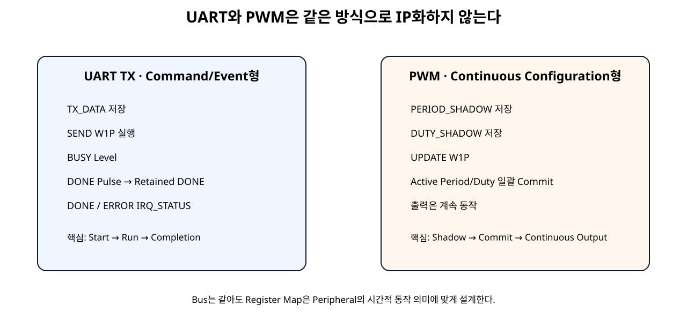
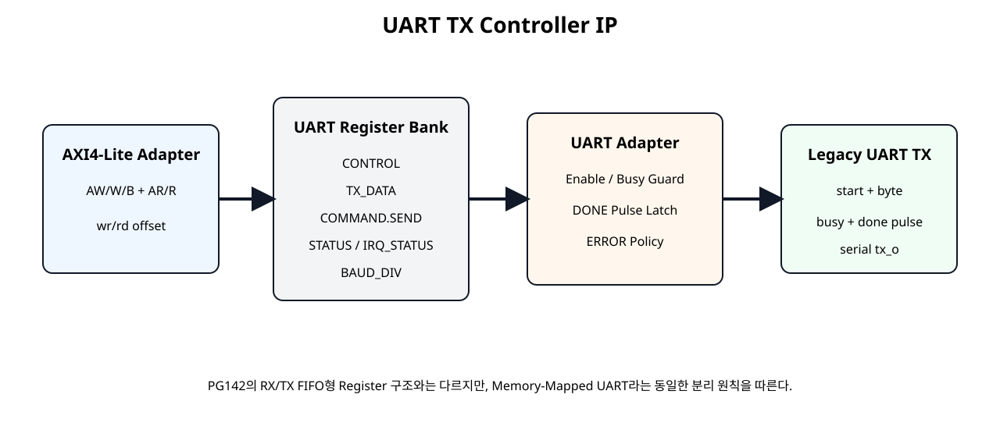
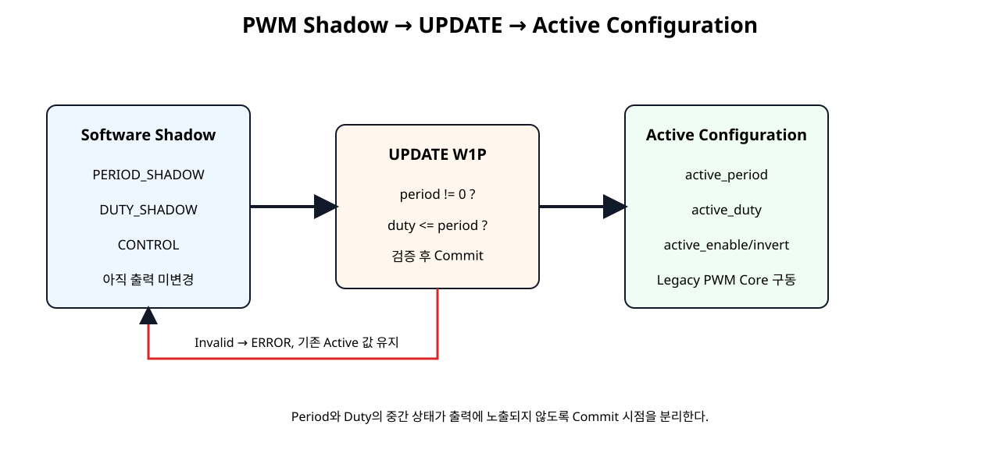

# UART / PWM Controller IP화


## 전체 학습 위치


## 이번 장의 목표

기존 RTL을 AXI에 연결할 때 가장 중요한 판단은 “모든 Core를 같은 Register Map에 넣는 것”이 아니라 Core의 동작 방식에 맞는 Software Contract를 설계하는 것이다.


## UART와 PWM을 비교해야 하는 이유


[](../images/soc18/soc18_uart_pwm_compare.svg)

같은 AXI4-Lite Peripheral이어도 내부 동작 시간축에 따라 Register Map은 달라진다.


## 공통 IP화 원칙

- 기존 기능 RTL은 AXI 때문에 다시 작성하지 않는다.
- AXI Protocol은 검증된 axi4lite_slave_adapter를 재사용한다.
- Peripheral 의미 변환은 Adapter에서 담당한다.
- Register Bank는 Software가 보는 Contract다.
- Top은 Wire/Instance/Port Connection 중심으로 유지한다.
- Driver는 Register Offset과 W1P/W1C 규칙을 Application에서 숨긴다.

## UART TX 기존 RTL

legacy_uart_tx_core는 AXI와 무관한 8N1 송신 Core이다. tx_start_i 1 Clock과 Byte를 받아 START → DATA 8bit → STOP 순서로 직렬 출력한다.


```verilog
module legacy_uart_tx_core #(
    parameter integer CLKS_PER_BIT = 868
)(
    input  wire       clk,
    input  wire       resetn,

    input  wire       tx_start_i,
    input  wire [7:0] tx_data_i,

    output reg        tx_o,
    output reg        busy_o,
    output reg        done_pulse_o
);

localparam [2:0] ST_IDLE  = 3'd0;
localparam [2:0] ST_START = 3'd1;
localparam [2:0] ST_DATA  = 3'd2;
localparam [2:0] ST_STOP  = 3'd3;

reg [2:0]  state;
reg [31:0] clk_count;
reg [2:0]  bit_index;
reg [7:0]  data_latched;

always @(posedge clk) begin
    if (!resetn) begin
        state        <= ST_IDLE;
        clk_count    <= 32'd0;
        bit_index    <= 3'd0;
        data_latched <= 8'h00;

        tx_o         <= 1'b1;
        busy_o       <= 1'b0;
        done_pulse_o <= 1'b0;
    end else begin
        done_pulse_o <= 1'b0;

        case (state)
            ST_IDLE: begin
                tx_o      <= 1'b1;
                busy_o    <= 1'b0;
                clk_count <= 32'd0;

                if (tx_start_i) begin
                    data_latched <= tx_data_i;
                    busy_o       <= 1'b1;
                    tx_o         <= 1'b0;
                    state        <= ST_START;
                end
            end

            ST_START: begin
                busy_o <= 1'b1;

                if (clk_count == CLKS_PER_BIT - 1) begin
                    clk_count <= 32'd0;
                    bit_index <= 3'd0;
                    tx_o      <= data_latched[0];
                    state     <= ST_DATA;
                end else begin
                    clk_count <= clk_count + 1'b1;
                end
            end

            ST_DATA: begin
                busy_o <= 1'b1;

                if (clk_count == CLKS_PER_BIT - 1) begin
                    clk_count <= 32'd0;

                    if (bit_index == 3'd7) begin
                        tx_o  <= 1'b1;
                        state <= ST_STOP;
                    end else begin
                        bit_index <= bit_index + 1'b1;
                        tx_o <= data_latched[bit_index + 1'b1];
                    end
                end else begin
                    clk_count <= clk_count + 1'b1;
                end
            end

            ST_STOP: begin
                busy_o <= 1'b1;
                tx_o   <= 1'b1;

                if (clk_count == CLKS_PER_BIT - 1) begin
                    clk_count    <= 32'd0;
                    busy_o       <= 1'b0;
                    done_pulse_o <= 1'b1;
                    state        <= ST_IDLE;
                end else begin
                    clk_count <= clk_count + 1'b1;
                end
            end

            default: begin
                state  <= ST_IDLE;
                tx_o   <= 1'b1;
                busy_o <= 1'b0;
            end
        endcase
    end
end

endmodule
```


## UART Register Map


| Offset | Register | Access | 의미 |
| --- | --- | --- | --- |
| 0x00 | CONTROL | RW | ENABLE |
| 0x04 | STATUS | RO | BUSY / DONE / ERROR |
| 0x08 | TX_DATA | RW | 전송할 8-bit Byte |
| 0x0C | COMMAND | W1P | SEND / CLEAR |
| 0x10 | IRQ_STATUS | W1C | DONE / ERROR Event |
| 0x14 | BAUD_DIV | RO | Clock per Bit Parameter |
| 0x18 | VERSION | RO | v1.0 |
| 0x1C | ID | RO | UTX1 |


## UART Adapter


[](../images/soc18/soc18_uart_architecture.svg)

UART Core의 Pulse/Level Interface를 Software Register 의미로 변환한다.


```verilog
module uart_tx_controller_adapter #(
    parameter integer CLKS_PER_BIT = 868
)(
    input  wire       clk,
    input  wire       resetn,

    input  wire       enable_i,
    input  wire       send_pulse_i,
    input  wire       clear_pulse_i,
    input  wire [7:0] tx_data_i,

    output wire       busy_o,
    output reg        done_o,
    output reg        error_o,
    output reg        irq_done_event_o,
    output reg        irq_error_event_o,

    output wire       uart_tx_o
);

wire legacy_busy;
wire legacy_done_pulse;
wire legacy_start;

assign legacy_start =
    send_pulse_i &&
    enable_i &&
    !legacy_busy;

assign busy_o = legacy_busy;

legacy_uart_tx_core #(
    .CLKS_PER_BIT(CLKS_PER_BIT)
) u_legacy_uart_tx_core (
    .clk(clk),
    .resetn(resetn),

    .tx_start_i(legacy_start),
    .tx_data_i(tx_data_i),

    .tx_o(uart_tx_o),
    .busy_o(legacy_busy),
    .done_pulse_o(legacy_done_pulse)
);

always @(posedge clk) begin
    if (!resetn) begin
        done_o              <= 1'b0;
        error_o             <= 1'b0;
        irq_done_event_o    <= 1'b0;
        irq_error_event_o   <= 1'b0;
    end else begin
        irq_done_event_o  <= 1'b0;
        irq_error_event_o <= 1'b0;

        if (clear_pulse_i) begin
            done_o  <= 1'b0;
            error_o <= 1'b0;
        end

        if (send_pulse_i) begin
            done_o <= 1'b0;

            if (!enable_i) begin
                error_o           <= 1'b1;
                irq_error_event_o <= 1'b1;
            end else if (legacy_busy) begin
                error_o           <= 1'b1;
                irq_error_event_o <= 1'b1;
            end else begin
                error_o <= 1'b0;
            end
        end

        if (legacy_done_pulse) begin
            done_o           <= 1'b1;
            irq_done_event_o <= 1'b1;
        end
    end
end

endmodule
```


## UART DONE/IRQ


```text
Legacy done_pulse = 1 clock
        ↓
Adapter
        ├─ STATUS.DONE = 1 retained
        └─ irq_done_event = 1 clock
        ↓
Register Bank
IRQ_STATUS.DONE = 1 latched
```

Software가 느린 Polling을 하더라도 1 Clock 완료 Pulse를 놓치지 않는다.


## UART AXI Top


```verilog
module uart_tx_axi4lite_ip #(
    parameter integer C_S_AXI_ADDR_WIDTH = 32,
    parameter integer CLKS_PER_BIT       = 868
)(
    input  wire                          s_axi_aclk,
    input  wire                          s_axi_aresetn,

    input  wire [C_S_AXI_ADDR_WIDTH-1:0] s_axi_awaddr,
    input  wire [2:0]                    s_axi_awprot,
    input  wire                          s_axi_awvalid,
    output wire                          s_axi_awready,

    input  wire [31:0]                   s_axi_wdata,
    input  wire [3:0]                    s_axi_wstrb,
    input  wire                          s_axi_wvalid,
    output wire                          s_axi_wready,

    output wire [1:0]                    s_axi_bresp,
    output wire                          s_axi_bvalid,
    input  wire                          s_axi_bready,

    input  wire [C_S_AXI_ADDR_WIDTH-1:0] s_axi_araddr,
    input  wire [2:0]                    s_axi_arprot,
    input  wire                          s_axi_arvalid,
    output wire                          s_axi_arready,

    output wire [31:0]                   s_axi_rdata,
    output wire [1:0]                    s_axi_rresp,
    output wire                          s_axi_rvalid,
    input  wire                          s_axi_rready,

    output wire                          uart_tx_o
);

wire        wr_en;
wire [7:0]  wr_offset;
wire [31:0] wr_data;
wire [3:0]  wr_strb;
// (삭제) 조합 읽기 어댑터에는 rd_en 포트가 없다.
wire [7:0]  rd_offset;
wire [31:0] rd_data;

wire        enable;
wire        send_pulse;
wire        clear_pulse;
wire [7:0]  tx_data;
wire [1:0]  irq_status;

wire        busy;
wire        done;
wire        error;
wire        irq_done_event;
wire        irq_error_event;

axi4lite_slave_adapter #(
    .C_S_AXI_ADDR_WIDTH(C_S_AXI_ADDR_WIDTH)
) u_axi4lite_slave_adapter (
    .s_axi_aclk(s_axi_aclk),
    .s_axi_aresetn(s_axi_aresetn),

    .s_axi_awaddr(s_axi_awaddr),
    .s_axi_awprot(s_axi_awprot),
    .s_axi_awvalid(s_axi_awvalid),
    .s_axi_awready(s_axi_awready),

    .s_axi_wdata(s_axi_wdata),
    .s_axi_wstrb(s_axi_wstrb),
    .s_axi_wvalid(s_axi_wvalid),
    .s_axi_wready(s_axi_wready),

    .s_axi_bresp(s_axi_bresp),
    .s_axi_bvalid(s_axi_bvalid),
    .s_axi_bready(s_axi_bready),

    .s_axi_araddr(s_axi_araddr),
    .s_axi_arprot(s_axi_arprot),
    .s_axi_arvalid(s_axi_arvalid),
    .s_axi_arready(s_axi_arready),

    .s_axi_rdata(s_axi_rdata),
    .s_axi_rresp(s_axi_rresp),
    .s_axi_rvalid(s_axi_rvalid),
    .s_axi_rready(s_axi_rready),

    .wr_en(wr_en),
    .wr_offset(wr_offset),
    .wr_data(wr_data),
    .wr_strb(wr_strb),

    // (삭제) rd_offset / rd_data만 사용하는 조합 읽기 연결.
    .rd_offset(rd_offset),
    .rd_data(rd_data)
);

uart_tx_register_bank #(
    .BAUD_DIV_VALUE(CLKS_PER_BIT)
) u_uart_tx_register_bank (
    .clk(s_axi_aclk),
    .resetn(s_axi_aresetn),

    .wr_en(wr_en),
    .wr_offset(wr_offset),
    .wr_data(wr_data),
    .wr_strb(wr_strb),

    .rd_offset(rd_offset),
    .rd_data(rd_data),

    .busy_i(busy),
    .done_i(done),
    .error_i(error),
    .irq_done_event_i(irq_done_event),
    .irq_error_event_i(irq_error_event),

    .enable_o(enable),
    .send_pulse_o(send_pulse),
    .clear_pulse_o(clear_pulse),
    .tx_data_o(tx_data),
    .irq_status_o(irq_status)
);

uart_tx_controller_adapter #(
    .CLKS_PER_BIT(CLKS_PER_BIT)
) u_uart_tx_controller_adapter (
    .clk(s_axi_aclk),
    .resetn(s_axi_aresetn),

    .enable_i(enable),
    .send_pulse_i(send_pulse),
    .clear_pulse_i(clear_pulse),
    .tx_data_i(tx_data),

    .busy_o(busy),
    .done_o(done),
    .error_o(error),
    .irq_done_event_o(irq_done_event),
    .irq_error_event_o(irq_error_event),

    .uart_tx_o(uart_tx_o)
);

endmodule
```

uart_tx_o만 외부 기능 Port로 노출하고 내부 제어는 AXI Register로 수행한다.


## UART Driver


```c
#include "uart_tx_driver.h"

static int UartTxDrv_CheckReady(const UartTxDrv *InstancePtr)
{
    if (InstancePtr == 0) {
        return UARTTXDRV_ERR_PARAM;
    }

    if (InstancePtr->IsReady != UARTTXDRV_READY_MAGIC) {
        return UARTTXDRV_ERR_NOT_READY;
    }

    return UARTTXDRV_OK;
}

int UartTxDrv_Initialize(UartTxDrv *InstancePtr, UINTPTR BaseAddress)
{
    if (InstancePtr == 0) {
        return UARTTXDRV_ERR_PARAM;
    }

    if ((BaseAddress & 0x3U) != 0U) {
        return UARTTXDRV_ERR_PARAM;
    }

    InstancePtr->BaseAddress = BaseAddress;
    InstancePtr->IsReady = 0U;

    if (UartTx_ReadReg(BaseAddress, UARTTX_ID_OFFSET) != UARTTX_ID_VALUE) {
        return UARTTXDRV_ERR_ID;
    }

    if (UartTx_ReadReg(BaseAddress, UARTTX_VERSION_OFFSET) != UARTTX_VERSION_VALUE) {
        return UARTTXDRV_ERR_ID;
    }

    InstancePtr->IsReady = UARTTXDRV_READY_MAGIC;
    return UARTTXDRV_OK;
}

int UartTxDrv_Enable(UartTxDrv *InstancePtr, u32 Enable)
{
    int rc;

    rc = UartTxDrv_CheckReady(InstancePtr);
    if (rc != UARTTXDRV_OK) {
        return rc;
    }

    UartTx_WriteReg(
        InstancePtr->BaseAddress,
        UARTTX_CONTROL_OFFSET,
        (Enable != 0U) ? UARTTX_CONTROL_ENABLE_MASK : 0U
    );

    return UARTTXDRV_OK;
}

int UartTxDrv_IsBusy(UartTxDrv *InstancePtr)
{
    int rc;
    u32 status;

    rc = UartTxDrv_CheckReady(InstancePtr);
    if (rc != UARTTXDRV_OK) {
        return rc;
    }

    status = UartTx_ReadReg(
        InstancePtr->BaseAddress,
        UARTTX_STATUS_OFFSET
    );

    return ((status & UARTTX_STATUS_BUSY_MASK) != 0U) ? 1 : 0;
}

int UartTxDrv_Clear(UartTxDrv *InstancePtr)
{
    int rc;

    rc = UartTxDrv_CheckReady(InstancePtr);
    if (rc != UARTTXDRV_OK) {
        return rc;
    }

    UartTx_WriteReg(
        InstancePtr->BaseAddress,
        UARTTX_COMMAND_OFFSET,
        UARTTX_COMMAND_CLEAR_MASK
    );

    UartTx_WriteReg(
        InstancePtr->BaseAddress,
        UARTTX_IRQ_STATUS_OFFSET,
        UARTTX_IRQ_DONE_MASK | UARTTX_IRQ_ERROR_MASK
    );

    return UARTTXDRV_OK;
}

int UartTxDrv_SendBlocking(
    UartTxDrv *InstancePtr,
    u8 Data,
    u32 PollLimit
)
{
    u32 k;
    u32 status;
    int rc;

    rc = UartTxDrv_CheckReady(InstancePtr);
    if (rc != UARTTXDRV_OK) {
        return rc;
    }

    if (PollLimit == 0U) {
        return UARTTXDRV_ERR_PARAM;
    }

    status = UartTx_ReadReg(
        InstancePtr->BaseAddress,
        UARTTX_STATUS_OFFSET
    );

    if ((status & UARTTX_STATUS_BUSY_MASK) != 0U) {
        return UARTTXDRV_ERR_BUSY;
    }

    rc = UartTxDrv_Clear(InstancePtr);
    if (rc != UARTTXDRV_OK) {
        return rc;
    }

    rc = UartTxDrv_Enable(InstancePtr, 1U);
    if (rc != UARTTXDRV_OK) {
        return rc;
    }

    UartTx_WriteReg(
        InstancePtr->BaseAddress,
        UARTTX_TX_DATA_OFFSET,
        (u32)Data
    );

    UartTx_WriteReg(
        InstancePtr->BaseAddress,
        UARTTX_COMMAND_OFFSET,
        UARTTX_COMMAND_SEND_MASK
    );

    for (k = 0U; k < PollLimit; k++) {
        status = UartTx_ReadReg(
            InstancePtr->BaseAddress,
            UARTTX_STATUS_OFFSET
        );

        if ((status & UARTTX_STATUS_ERROR_MASK) != 0U) {
            return UARTTXDRV_ERR_HW;
        }

        if ((status & UARTTX_STATUS_DONE_MASK) != 0U) {
            return UARTTXDRV_OK;
        }
    }

    return UARTTXDRV_ERR_TIMEOUT;
}
```


## UART 검증


| 검증 | 상태 |
| --- | --- |
| Host Driver Mock Compile/Run | 실행 검증 |
| Legacy UART Core Testbench | Vivado xsim 대상 |
| UART AXI IP Testbench | ID/BAUD/SEND/DONE/IRQ/Error Self-Checking |


```text
PASS: UART Initialize
PASS: UART SendBlocking
PASS: UART TX_DATA
PASS: UART Clear
PASS: UART STATUS clear
PASS: UART IRQ clear
PASS: UART Timeout
SOC18 UART DRIVER MOCK TEST: PASS
```


## PWM 기존 RTL

legacy_pwm_core는 Period, Duty, Enable, Invert를 받아 지속적으로 PWM을 생성한다. START/DONE 개념이 없는 설정형 Core이다.


```verilog
module legacy_pwm_core (
    input  wire        clk,
    input  wire        resetn,

    input  wire        enable_i,
    input  wire        invert_i,
    input  wire [31:0] period_i,
    input  wire [31:0] duty_i,

    output wire        pwm_o,
    output wire        active_o
);

reg [31:0] counter;

wire raw_pwm;

assign active_o = enable_i && (period_i != 0);

assign raw_pwm =
    active_o &&
    (counter < duty_i);

assign pwm_o =
    invert_i ? ~raw_pwm : raw_pwm;

always @(posedge clk) begin
    if (!resetn) begin
        counter <= 32'd0;
    end else if (!active_o) begin
        counter <= 32'd0;
    end else if (counter >= period_i - 1'b1) begin
        counter <= 32'd0;
    end else begin
        counter <= counter + 1'b1;
    end
end

endmodule
```


## PWM Register Map


| Offset | Register | Access | 의미 |
| --- | --- | --- | --- |
| 0x00 | CONTROL | RW | ENABLE / INVERT |
| 0x04 | PERIOD_SHADOW | RW | 다음 Period |
| 0x08 | DUTY_SHADOW | RW | 다음 Duty |
| 0x0C | COMMAND | W1P | UPDATE / CLEAR_ERROR |
| 0x10 | STATUS | RO | ACTIVE / ERROR |
| 0x14 | ACTIVE_PERIOD | RO | 현재 적용값 |
| 0x18 | ACTIVE_DUTY | RO | 현재 적용값 |
| 0x1C | ID | RO | PWM1 |
| 0x20 | VERSION | RO | v1.0 |


## 왜 Shadow Register인가

Software가 Period와 Duty를 두 번의 AXI Write로 변경하면 중간 순간에는 새 Period + 옛 Duty 또는 옛 Period + 새 Duty 조합이 존재한다. 이 값을 즉시 PWM Core에 연결하면 의도하지 않은 Pulse가 만들어질 수 있다.


## PWM UPDATE Commit


[](../images/soc18/soc18_pwm_shadow_update.svg)

Shadow 설정과 실제 출력 설정을 분리하여 UPDATE를 원자적 Commit 지점으로 사용한다.


```verilog
module pwm_controller_adapter (
    input  wire        clk,
    input  wire        resetn,

    input  wire        enable_i,
    input  wire        invert_i,
    input  wire [31:0] period_shadow_i,
    input  wire [31:0] duty_shadow_i,
    input  wire        update_pulse_i,
    input  wire        clear_error_pulse_i,

    output wire        active_o,
    output reg         error_o,
    output reg  [31:0] active_period_o,
    output reg  [31:0] active_duty_o,

    output wire        pwm_o
);

reg active_enable;
reg active_invert;

legacy_pwm_core u_legacy_pwm_core (
    .clk(clk),
    .resetn(resetn),

    .enable_i(active_enable),
    .invert_i(active_invert),
    .period_i(active_period_o),
    .duty_i(active_duty_o),

    .pwm_o(pwm_o),
    .active_o(active_o)
);

always @(posedge clk) begin
    if (!resetn) begin
        active_enable   <= 1'b0;
        active_invert   <= 1'b0;
        active_period_o <= 32'd1000;
        active_duty_o   <= 32'd500;
        error_o         <= 1'b0;
    end else begin
        if (clear_error_pulse_i) begin
            error_o <= 1'b0;
        end

        if (update_pulse_i) begin
            if (
                (period_shadow_i == 0) ||
                (duty_shadow_i > period_shadow_i)
            ) begin
                error_o <= 1'b1;
            end else begin
                active_enable   <= enable_i;
                active_invert   <= invert_i;
                active_period_o <= period_shadow_i;
                active_duty_o   <= duty_shadow_i;
                error_o         <= 1'b0;
            end
        end
    end
end

endmodule
```


## PWM Error 정책


| 조건 | 동작 |
| --- | --- |
| period == 0 | ERROR, Commit 거부 |
| duty > period | ERROR, Commit 거부 |
| 정상 값 | Active Period/Duty/Enable/Invert 동시 갱신 |
| 잘못된 UPDATE | 기존 Active 설정 유지 |


## PWM AXI Top


```verilog
module pwm_axi4lite_ip #(
    parameter integer C_S_AXI_ADDR_WIDTH = 32
)(
    input  wire                          s_axi_aclk,
    input  wire                          s_axi_aresetn,

    input  wire [C_S_AXI_ADDR_WIDTH-1:0] s_axi_awaddr,
    input  wire [2:0]                    s_axi_awprot,
    input  wire                          s_axi_awvalid,
    output wire                          s_axi_awready,

    input  wire [31:0]                   s_axi_wdata,
    input  wire [3:0]                    s_axi_wstrb,
    input  wire                          s_axi_wvalid,
    output wire                          s_axi_wready,

    output wire [1:0]                    s_axi_bresp,
    output wire                          s_axi_bvalid,
    input  wire                          s_axi_bready,

    input  wire [C_S_AXI_ADDR_WIDTH-1:0] s_axi_araddr,
    input  wire [2:0]                    s_axi_arprot,
    input  wire                          s_axi_arvalid,
    output wire                          s_axi_arready,

    output wire [31:0]                   s_axi_rdata,
    output wire [1:0]                    s_axi_rresp,
    output wire                          s_axi_rvalid,
    input  wire                          s_axi_rready,

    output wire                          pwm_o
);

wire        wr_en;
wire [7:0]  wr_offset;
wire [31:0] wr_data;
wire [3:0]  wr_strb;
// (삭제) 조합 읽기 어댑터에는 rd_en 포트가 없다.
wire [7:0]  rd_offset;
wire [31:0] rd_data;

wire        enable;
wire        invert;
wire [31:0] period_shadow;
wire [31:0] duty_shadow;
wire        update_pulse;
wire        clear_error_pulse;

wire        active;
wire        error;
wire [31:0] active_period;
wire [31:0] active_duty;

axi4lite_slave_adapter #(
    .C_S_AXI_ADDR_WIDTH(C_S_AXI_ADDR_WIDTH)
) u_axi4lite_slave_adapter (
    .s_axi_aclk(s_axi_aclk),
    .s_axi_aresetn(s_axi_aresetn),

    .s_axi_awaddr(s_axi_awaddr),
    .s_axi_awprot(s_axi_awprot),
    .s_axi_awvalid(s_axi_awvalid),
    .s_axi_awready(s_axi_awready),

    .s_axi_wdata(s_axi_wdata),
    .s_axi_wstrb(s_axi_wstrb),
    .s_axi_wvalid(s_axi_wvalid),
    .s_axi_wready(s_axi_wready),

    .s_axi_bresp(s_axi_bresp),
    .s_axi_bvalid(s_axi_bvalid),
    .s_axi_bready(s_axi_bready),

    .s_axi_araddr(s_axi_araddr),
    .s_axi_arprot(s_axi_arprot),
    .s_axi_arvalid(s_axi_arvalid),
    .s_axi_arready(s_axi_arready),

    .s_axi_rdata(s_axi_rdata),
    .s_axi_rresp(s_axi_rresp),
    .s_axi_rvalid(s_axi_rvalid),
    .s_axi_rready(s_axi_rready),

    .wr_en(wr_en),
    .wr_offset(wr_offset),
    .wr_data(wr_data),
    .wr_strb(wr_strb),

    // (삭제) rd_offset / rd_data만 사용하는 조합 읽기 연결.
    .rd_offset(rd_offset),
    .rd_data(rd_data)
);

pwm_register_bank u_pwm_register_bank (
    .clk(s_axi_aclk),
    .resetn(s_axi_aresetn),

    .wr_en(wr_en),
    .wr_offset(wr_offset),
    .wr_data(wr_data),
    .wr_strb(wr_strb),

    .rd_offset(rd_offset),
    .rd_data(rd_data),

    .active_i(active),
    .error_i(error),
    .active_period_i(active_period),
    .active_duty_i(active_duty),

    .enable_o(enable),
    .invert_o(invert),
    .period_shadow_o(period_shadow),
    .duty_shadow_o(duty_shadow),
    .update_pulse_o(update_pulse),
    .clear_error_pulse_o(clear_error_pulse)
);

pwm_controller_adapter u_pwm_controller_adapter (
    .clk(s_axi_aclk),
    .resetn(s_axi_aresetn),

    .enable_i(enable),
    .invert_i(invert),
    .period_shadow_i(period_shadow),
    .duty_shadow_i(duty_shadow),
    .update_pulse_i(update_pulse),
    .clear_error_pulse_i(clear_error_pulse),

    .active_o(active),
    .error_o(error),
    .active_period_o(active_period),
    .active_duty_o(active_duty),

    .pwm_o(pwm_o)
);

endmodule
```

Top은 공통 AXI Adapter, PWM Register Bank, PWM Adapter만 연결한다.


## PWM Driver


```c
#include "pwm_driver.h"

static int PwmDrv_CheckReady(const PwmDrv *InstancePtr)
{
    if (InstancePtr == 0) {
        return PWMDRV_ERR_PARAM;
    }

    if (InstancePtr->IsReady != PWMDRV_READY_MAGIC) {
        return PWMDRV_ERR_NOT_READY;
    }

    return PWMDRV_OK;
}

int PwmDrv_Initialize(PwmDrv *InstancePtr, UINTPTR BaseAddress)
{
    if (InstancePtr == 0) {
        return PWMDRV_ERR_PARAM;
    }

    if ((BaseAddress & 0x3U) != 0U) {
        return PWMDRV_ERR_PARAM;
    }

    InstancePtr->BaseAddress = BaseAddress;
    InstancePtr->IsReady = 0U;

    if (Pwm_ReadReg(BaseAddress, PWM_ID_OFFSET) != PWM_ID_VALUE) {
        return PWMDRV_ERR_ID;
    }

    if (Pwm_ReadReg(BaseAddress, PWM_VERSION_OFFSET) != PWM_VERSION_VALUE) {
        return PWMDRV_ERR_ID;
    }

    InstancePtr->IsReady = PWMDRV_READY_MAGIC;
    return PWMDRV_OK;
}

int PwmDrv_ClearError(PwmDrv *InstancePtr)
{
    int rc;

    rc = PwmDrv_CheckReady(InstancePtr);
    if (rc != PWMDRV_OK) {
        return rc;
    }

    Pwm_WriteReg(
        InstancePtr->BaseAddress,
        PWM_COMMAND_OFFSET,
        PWM_COMMAND_CLEAR_ERR_MASK
    );

    return PWMDRV_OK;
}

int PwmDrv_Configure(
    PwmDrv *InstancePtr,
    u32 PeriodClocks,
    u32 DutyClocks,
    u32 Enable,
    u32 Invert
)
{
    u32 control;
    u32 status;
    int rc;

    rc = PwmDrv_CheckReady(InstancePtr);
    if (rc != PWMDRV_OK) {
        return rc;
    }

    if ((PeriodClocks == 0U) || (DutyClocks > PeriodClocks)) {
        return PWMDRV_ERR_PARAM;
    }

    rc = PwmDrv_ClearError(InstancePtr);
    if (rc != PWMDRV_OK) {
        return rc;
    }

    control = 0U;

    if (Enable != 0U) {
        control |= PWM_CONTROL_ENABLE_MASK;
    }

    if (Invert != 0U) {
        control |= PWM_CONTROL_INVERT_MASK;
    }

    Pwm_WriteReg(
        InstancePtr->BaseAddress,
        PWM_CONTROL_OFFSET,
        control
    );

    Pwm_WriteReg(
        InstancePtr->BaseAddress,
        PWM_PERIOD_SHADOW_OFFSET,
        PeriodClocks
    );

    Pwm_WriteReg(
        InstancePtr->BaseAddress,
        PWM_DUTY_SHADOW_OFFSET,
        DutyClocks
    );

    Pwm_WriteReg(
        InstancePtr->BaseAddress,
        PWM_COMMAND_OFFSET,
        PWM_COMMAND_UPDATE_MASK
    );

    status = Pwm_ReadReg(
        InstancePtr->BaseAddress,
        PWM_STATUS_OFFSET
    );

    if ((status & PWM_STATUS_ERROR_MASK) != 0U) {
        return PWMDRV_ERR_HW;
    }

    return PWMDRV_OK;
}

int PwmDrv_Disable(PwmDrv *InstancePtr)
{
    u32 active_period;
    u32 active_duty;
    int rc;

    rc = PwmDrv_CheckReady(InstancePtr);
    if (rc != PWMDRV_OK) {
        return rc;
    }

    active_period = Pwm_ReadReg(
        InstancePtr->BaseAddress,
        PWM_ACTIVE_PERIOD_OFFSET
    );

    active_duty = Pwm_ReadReg(
        InstancePtr->BaseAddress,
        PWM_ACTIVE_DUTY_OFFSET
    );

    return PwmDrv_Configure(
        InstancePtr,
        active_period,
        active_duty,
        0U,
        0U
    );
}
```


## PWM 검증


```text
PASS: PWM Initialize
PASS: PWM Configure 25%
PASS: PWM active period
PASS: PWM active duty
PASS: PWM active
PASS: PWM invalid duty
PASS: PWM Disable
PASS: PWM inactive
SOC18 PWM DRIVER MOCK TEST: PASS
```

AXI Self-Checking Testbench는 Shadow만 썼을 때 Active 값이 바뀌지 않는지, UPDATE 후 일괄 반영되는지, 잘못된 UPDATE에서 기존 Active 값이 보존되는지를 확인한다.


## 두 IP의 공통 AXI Adapter

UART와 PWM 모두 SoC 12의 axi4lite_slave_adapter.v를 바이트 단위 동일하게 재사용한다.


## Register Map은 재사용보다 의미가 우선


| UART | PWM |
| --- | --- |
| SEND가 명확한 Event | 출력이 계속 동작 |
| BUSY/DONE가 중요 | Active Configuration이 중요 |
| TX_DATA 한 Byte | Period/Duty 두 값의 일관성이 중요 |
| DONE IRQ가 자연스러움 | Atomic UPDATE가 자연스러움 |

따라서 “이전 Register Map을 무조건 복사”하지 않고, Software가 Peripheral을 어떻게 사용해야 하는지부터 설계한다.


## Basys3 Board 연결

Block Design에서 두 IP 출력 Port를 External로 만들고 이름을 uart_tx_o, pwm_o로 지정하면 다음 XDC 예제를 사용할 수 있다.


```text
## SoC 18 Basys3 demo ports
## External port names in the Block Design wrapper must match these names.

## 100 MHz Clock
set_property -dict { PACKAGE_PIN W5 IOSTANDARD LVCMOS33 } [get_ports clk]
create_clock -add -name sys_clk_pin -period 10.00 -waveform {0 5} [get_ports clk]

## Center Button Reset
set_property -dict { PACKAGE_PIN U18 IOSTANDARD LVCMOS33 } [get_ports btnC]

## Custom UART TX -> Basys3 USB-UART RX path
set_property -dict { PACKAGE_PIN A18 IOSTANDARD LVCMOS33 } [get_ports uart_tx_o]

## Custom PWM -> LED15
set_property -dict { PACKAGE_PIN L1 IOSTANDARD LVCMOS33 } [get_ports pwm_o]
```

UART TX는 Basys3 USB-UART의 FPGA→PC 방향인 A18에, PWM은 LED15 L1에 연결하는 교육용 예이다.


## 100 MHz PWM 계산 예

100 MHz Clock에서 Period를 100,000 Clock으로 설정하면:

Duty를 25,000 Clock으로 설정하면 25,000 / 100,000 → 25%이다.


## Board Software Demo


```c
#include "uart_tx_driver.h"
#include "pwm_driver.h"

/*
 * SoC 18 board-level software example.
 *
 * UartBaseAddress and PwmBaseAddress come from the actual
 * Vivado/Vitis hardware platform. No fictional XPAR macro is used here.
 */

int Soc18_UartPwmDemo(
    UINTPTR UartBaseAddress,
    UINTPTR PwmBaseAddress
)
{
    UartTxDrv uart;
    PwmDrv pwm;
    int rc;

    rc = UartTxDrv_Initialize(
        &uart,
        UartBaseAddress
    );
    if (rc != UARTTXDRV_OK) {
        return rc;
    }

    rc = PwmDrv_Initialize(
        &pwm,
        PwmBaseAddress
    );
    if (rc != PWMDRV_OK) {
        return rc;
    }

    /*
     * 100 MHz clock example:
     * Period 100,000 clocks -> 1 kHz PWM
     * Duty   25,000 clocks -> 25 %
     */
    rc = PwmDrv_Configure(
        &pwm,
        100000U,
        25000U,
        1U,
        0U
    );
    if (rc != PWMDRV_OK) {
        return rc;
    }

    /* Send ASCII 'A' through the custom UART TX IP. */
    rc = UartTxDrv_SendBlocking(
        &uart,
        (u8)'A',
        2000000U
    );
    if (rc != UARTTXDRV_OK) {
        return rc;
    }

    return 0;
}
```

실제 Base Address는 새 Vivado Address Editor/XSA에서 생성된 값을 전달한다.


## Packaging Source · UART


```text
uart_tx_ip_1_0/
├── hdl/
│   ├── legacy_uart_tx_core.v
│   ├── uart_tx_controller_adapter.v
│   ├── uart_tx_register_bank.v
│   ├── axi4lite_slave_adapter.v
│   └── uart_tx_axi4lite_ip.v
├── testbench/
│   └── tb_legacy_uart_tx_core.v
├── drivers/uart_tx_v1_0/src/
│   ├── uart_tx_driver.c
│   ├── uart_tx_driver.h
│   └── uart_tx_regmap.h
├── examples/
│   └── test_uart_tx_driver_mock.c
├── doc/
└── tcl/
```


## Packaging Source · PWM


```text
pwm_controller_ip_1_0/
├── hdl/
│   ├── legacy_pwm_core.v
│   ├── pwm_controller_adapter.v
│   ├── pwm_register_bank.v
│   ├── axi4lite_slave_adapter.v
│   └── pwm_axi4lite_ip.v
├── testbench/
│   └── tb_legacy_pwm_core.v
├── drivers/pwm_controller_v1_0/src/
│   ├── pwm_driver.c
│   ├── pwm_driver.h
│   └── pwm_regmap.h
├── examples/
│   └── test_pwm_driver_mock.c
├── doc/
└── tcl/
```


## Vivado Packaging

SoC 16/17과 동일하게 기존 RTL을 다시 생성하지 않고 현재 Source를 Package한다. Vivado 2026.1의 IP Packager는 Top HDL을 Parsing하여 Ports/Interfaces를 구성한다.


| IP | Packaging Top | 권장 Name |
| --- | --- | --- |
| UART TX | uart_tx_axi4lite_ip | uart_tx_ip |
| PWM | pwm_axi4lite_ip | pwm_controller_ip |


## IP Catalog 통합


```text
MicroBlaze V
   ↓
SmartConnect
   ├─ UART TX IP / S_AXI → uart_tx_o
   └─ PWM IP / S_AXI     → pwm_o

Address Editor
   ├─ UART Base
   └─ PWM Base
```

두 IP는 각각 독립 Base Address를 갖고 Software Driver Instance도 각각 독립적으로 초기화한다.


## 실무 확장 · UART RX

이번 장은 TX 경로를 명확히 보기 위해 UART TX만 IP화했다. RX를 추가할 때는 단순 DATA Register보다 FIFO 또는 data/valid/ready Byte Stream Interface가 유리하다.

AMD AXI UART Lite도 RX/TX FIFO와 Status/Control Register를 분리하는 구조를 사용한다.


## 실무 확장 · PWM

AMD AXI Timer 역시 PWM Mode에서 두 Timer를 사용해 Period와 Output Width를 구성한다. Custom PWM에서도 핵심 설계축은 동일하게 Period와 Duty/Width의 일관된 설정이다.

- Period/Duty 범위 검증
- Shadow/Active Double Buffer
- Update 시점 정책
- Polarity
- Dead-time이 필요한 Motor PWM으로 확장
- Complementary Output으로 확장

## 오류 점검


| 증상 | 원인 후보 | 확인 |
| --- | --- | --- |
| UART가 SEND 직후 Error | ENABLE=0 또는 BUSY | CONTROL/STATUS |
| UART DONE을 못 봄 | Pulse를 직접 Software Status로 사용 | Adapter retained DONE |
| UART Baud가 이상함 | CLKS_PER_BIT와 System Clock 불일치 | BAUD_DIV, Clock |
| PWM Write 중 Pulse가 흔들림 | Shadow 없이 Live Register 직접 연결 | UPDATE Commit 구조 |
| PWM Duty가 Period보다 큼 | 설정 검증 누락 | Adapter Error Policy |
| 잘못된 UPDATE 후 출력도 바뀜 | 검증 전에 Active Register 변경 | Valid 후 Commit |
| 두 IP Driver가 같은 Base 사용 | Address Editor/Instance 혼동 | UART/PWM 독립 Base |
| Top에 기능 정책이 존재 | Wrapper와 Adapter 역할 혼합 | 정책은 Adapter/Register Bank |


## SoC 18 완료 체크리스트

- [ ] UART와 PWM의 동작 성격이 다름을 구분한다.
- [ ] UART는 START/BUSY/DONE Event형 Register Map으로 구성했다.
- [ ] UART DONE Pulse를 retained STATUS/IRQ로 변환했다.
- [ ] PWM은 START/DONE 구조를 억지로 사용하지 않았다.
- [ ] PWM Period/Duty를 Shadow Register에 저장한다.
- [ ] UPDATE W1P에서 Active 설정을 일괄 Commit한다.
- [ ] Invalid PWM 설정은 Commit하지 않고 기존 Active 값을 보존한다.
- [ ] 두 IP 모두 공통 AXI4-Lite Adapter를 재사용한다.
- [ ] UART/PWM Register Bank와 Driver는 각각 독립적이다.
- [ ] Driver Mock Test를 실제 GCC Compile/Run하여 PASS했다.
- [ ] Standalone RTL과 AXI IP Testbench를 분리했다.
- [ ] Basys3 A18 UART TX와 L1 PWM LED 예제 XDC를 구성했다.
- [ ] 두 IP를 독립 Packaging Source로 구성했다.

## 공식 매뉴얼 및 원본 근거


| 문서 | 확인 항목 |
| --- | --- |
| AMD UG1118 · Packaging Your Current Project · 2026.1 | 기존 RTL Project의 Custom IP Packaging |
| AMD UG1118 · Ports and Interfaces · 2026.1 | Top HDL Parsing과 Bus Interface 구성 |
| AMD PG142 · AXI UART Lite | RX/TX FIFO, Status/Control Register와 Memory-Mapped UART 구조 비교 |
| AMD PG079 · AXI Timer PWM Mode · 2025-08-15 | Period/Output Width를 이용한 PWM 구성 |
| AMD PG079 · Operation Overview | AXI4-Lite Register Block + Counter + PWM Block 분리 구조 |

