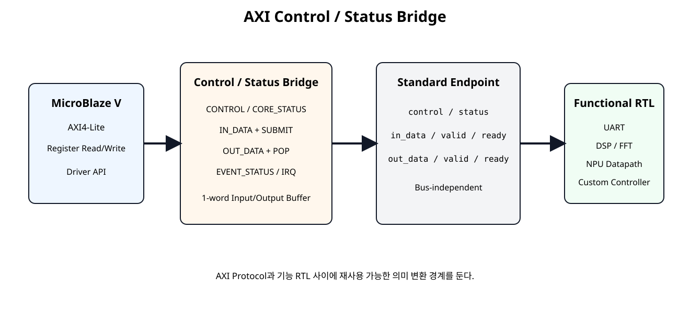
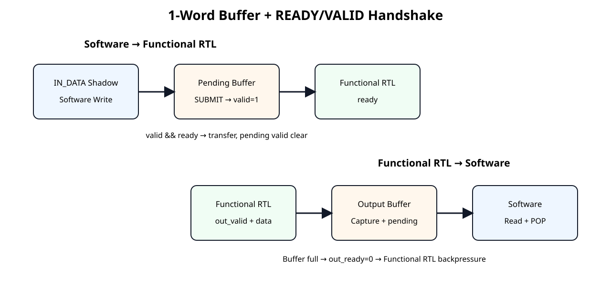
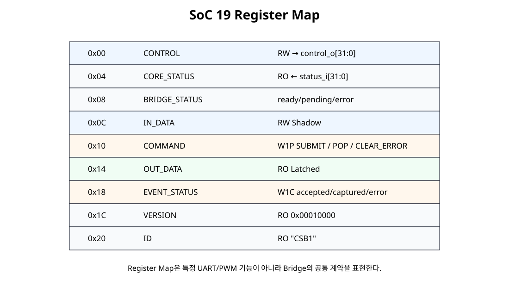

# AXI Control / Status Bridge


## 전체 학습 위치


## 이번 장의 목표

기능 RTL마다 AXI Register 코드를 반복하지 않고 공통 Bridge를 재사용할 수 있는 경계를 만든다.


## SoC 18에서 왜 Bridge로 넘어가는가

UART와 PWM처럼 Register 의미가 크게 다른 Peripheral에는 전용 Register Bank가 적절하다. 하지만 NPU, DSP, 간단한 Accelerator처럼 “설정값 + 입력 Word + 결과 Word” 구조가 반복되면 공통 Bridge가 효율적이다.


## 전체 구조


[](../images/soc19/soc19_bridge_architecture.svg)

AXI Protocol과 기능 RTL 사이를 공통 Control/Status/Data Contract로 분리한다.


## 표준 Endpoint Interface


```text
control_o[31:0]        // Software → RTL 지속 설정
status_i[31:0]         // RTL → Software 상태

in_data_o[31:0]
in_valid_o
in_ready_i

out_data_i[31:0]
out_valid_i
out_ready_o
```

이 인터페이스는 AXI4-Stream 전체 규격이 아니라 같은 READY/VALID Handshake 의미를 차용한 내부 표준이다.


## READY/VALID 핵심 규칙


[](../images/soc19/soc19_ready_valid_buffers.svg)

VALID와 READY가 동시에 1인 Clock에서만 Data가 실제 전달된다.

VALID가 1인데 READY가 0이면 Producer는 Data와 VALID를 유지해야 한다.


## Register Map


[](../images/soc19/soc19_register_map.svg)

기능별 Register가 아니라 Bridge 자체의 공통 Contract를 표현한다.


## CONTROL / CORE_STATUS

CONTROL은 32-bit RW Word를 그대로 control_o로 내보내고, CORE_STATUS는 기능 RTL의 status_i를 그대로 Software가 읽는다. Bit 의미는 연결되는 기능 RTL이 정의한다.


## IN_DATA Shadow

Software는 먼저 IN_DATA Shadow Register에 값을 쓴다. 이 Write만으로 Functional RTL에 Data를 보내지 않는다.


## SUBMIT와 Input Pending Buffer

SUBMIT 이후 Software가 IN_DATA Shadow를 바꾸어도 이미 Pending 중인 Data는 변하지 않는다.


## Input Handshake


```text
in_valid_o = 1
in_ready_i = 0  → Data 유지

in_valid_o = 1
in_ready_i = 1  → Clock edge에서 Transfer
                  → in_valid_o clear
                  → EVENT.IN_ACCEPTED set
```


## Output Capture Buffer

Bridge Output Buffer가 비어 있으면 out_ready_o=1이다. Functional RTL의 out_valid_i=1과 만나면 결과를 Capture하고 OUT_PENDING을 세운다.


## OUT_DATA와 POP

Read 자체가 결과를 자동 삭제하지 않는다. 명시적인 POP으로 Software의 Read와 Buffer 소비를 분리한다.


## Backpressure

Output Buffer가 차면 out_ready_o가 0이 되어 기능 RTL의 출력을 대기시킨다. Bridge 입력 버퍼에는 1개 요청만 대기할 수 있으며, IN_PENDING이 1인 동안 추가 SUBMIT은 거부한다. Core 내부 처리·출력 저장 공간은 Bridge 버퍼와 별도로 계산한다.out_ready_o=0이 되어 Functional RTL에 Backpressure를 건다. Input 쪽도 Pending Word가 존재하면 두 번째 Pending까지만 허용하고 추가 SUBMIT은 Error로 처리한다.


## EVENT_STATUS와 IRQ


| Bit | Event |
| --- | --- |
| 0 | IN_ACCEPTED |
| 1 | OUT_CAPTURED |
| 2 | ERROR |

EVENT_STATUS는 W1C이며 하나라도 남아 있으면 irq_o=1이다.


## Error 정책

- Input Pending 상태에서 다시 SUBMIT → ERROR
- Output Pending이 없는데 POP → ERROR
- CLEAR_ERROR는 Bridge Error Level만 지움
- EVENT_STATUS.ERROR는 별도 W1C

## Bridge Core RTL


```verilog
module control_status_bridge_core (
    input  wire        clk,
    input  wire        resetn,

    // Bus-independent register access
    input  wire        wr_en,
    input  wire [7:0]  wr_offset,
    input  wire [31:0] wr_data,
    input  wire [3:0]  wr_strb,

    input  wire [7:0]  rd_offset,
    output reg  [31:0] rd_data,

    // Generic control / status interface
    output reg  [31:0] control_o,
    input  wire [31:0] status_i,

    // Software -> functional RTL
    output reg  [31:0] in_data_o,
    output reg         in_valid_o,
    input  wire        in_ready_i,

    // Functional RTL -> software
    input  wire [31:0] out_data_i,
    input  wire        out_valid_i,
    output wire        out_ready_o,

    // Event/interrupt visibility
    output wire        irq_o
);

localparam [7:0] REG_CONTROL       = 8'h00;
localparam [7:0] REG_CORE_STATUS   = 8'h04;
localparam [7:0] REG_BRIDGE_STATUS = 8'h08;
localparam [7:0] REG_IN_DATA       = 8'h0C;
localparam [7:0] REG_COMMAND       = 8'h10;
localparam [7:0] REG_OUT_DATA      = 8'h14;
localparam [7:0] REG_EVENT_STATUS  = 8'h18;
localparam [7:0] REG_VERSION       = 8'h1C;
localparam [7:0] REG_ID            = 8'h20;

localparam [31:0] VERSION_VALUE = 32'h0001_0000;
localparam [31:0] ID_VALUE      = 32'h4353_4231; // ASCII "CSB1"

reg [31:0] in_data_shadow;
reg [31:0] out_data_latched;
reg        out_pending;
reg        error_status;
reg [2:0]  event_status;

integer byte_index;

wire command_write;
wire command_submit;
wire command_pop_out;
wire command_clear_error;

wire event_write;
wire event_clear_in_accepted;
wire event_clear_out_captured;
wire event_clear_error;

wire in_handshake;
wire out_handshake;

wire submit_error;
wire pop_error;
wire error_event;

assign command_write =
    wr_en &&
    (wr_offset == REG_COMMAND) &&
    wr_strb[0];

assign command_submit      = command_write && wr_data[0];
assign command_pop_out     = command_write && wr_data[1];
assign command_clear_error = command_write && wr_data[2];

assign event_write =
    wr_en &&
    (wr_offset == REG_EVENT_STATUS) &&
    wr_strb[0];

assign event_clear_in_accepted = event_write && wr_data[0];
assign event_clear_out_captured = event_write && wr_data[1];
assign event_clear_error = event_write && wr_data[2];

assign in_handshake  = in_valid_o && in_ready_i;
assign out_ready_o   = !out_pending;
assign out_handshake = out_valid_i && out_ready_o;

assign submit_error = command_submit && in_valid_o;
assign pop_error    = command_pop_out && !out_pending;
assign error_event  = submit_error || pop_error;

assign irq_o = |event_status;

always @(posedge clk) begin
    if (!resetn) begin
        control_o        <= 32'h0000_0000;
        in_data_shadow   <= 32'h0000_0000;
        in_data_o        <= 32'h0000_0000;
        in_valid_o       <= 1'b0;
        out_data_latched <= 32'h0000_0000;
        out_pending      <= 1'b0;
        error_status     <= 1'b0;
    end else begin
        // General RW control word.
        if (wr_en && (wr_offset == REG_CONTROL)) begin
            for (byte_index = 0; byte_index < 4; byte_index = byte_index + 1) begin
                if (wr_strb[byte_index]) begin
                    control_o[byte_index*8 +: 8] <=
                        wr_data[byte_index*8 +: 8];
                end
            end
        end

        // Software writes a shadow value first.
        // SUBMIT copies this stable value into the pending transfer register.
        if (wr_en && (wr_offset == REG_IN_DATA)) begin
            for (byte_index = 0; byte_index < 4; byte_index = byte_index + 1) begin
                if (wr_strb[byte_index]) begin
                    in_data_shadow[byte_index*8 +: 8] <=
                        wr_data[byte_index*8 +: 8];
                end
            end
        end

        // Existing pending input is released only after READY/VALID handshake.
        if (in_handshake) begin
            in_valid_o <= 1'b0;
        end

        // SUBMIT is rejected if one input word is already pending.
        if (command_submit && !in_valid_o) begin
            in_data_o  <= in_data_shadow;
            in_valid_o <= 1'b1;
        end

        // Software explicitly POPs an already captured output word.
        if (command_pop_out && out_pending) begin
            out_pending <= 1'b0;
        end

        // A new output transfer is captured whenever the bridge buffer is empty.
        // Hardware capture has priority over a same-cycle empty POP.
        if (out_handshake) begin
            out_data_latched <= out_data_i;
            out_pending      <= 1'b1;
        end

        // Software clear has lower priority than a new bridge error.
        if (command_clear_error) begin
            error_status <= 1'b0;
        end

        if (error_event) begin
            error_status <= 1'b1;
        end
    end
end

// Event status uses hardware-set priority over software W1C clear.
always @(posedge clk) begin
    if (!resetn) begin
        event_status <= 3'b000;
    end else begin
        if (in_handshake) begin
            event_status[0] <= 1'b1;
        end else if (event_clear_in_accepted) begin
            event_status[0] <= 1'b0;
        end

        if (out_handshake) begin
            event_status[1] <= 1'b1;
        end else if (event_clear_out_captured) begin
            event_status[1] <= 1'b0;
        end

        if (error_event) begin
            event_status[2] <= 1'b1;
        end else if (event_clear_error) begin
            event_status[2] <= 1'b0;
        end
    end
end

always @(*) begin
    case (rd_offset)
        REG_CONTROL:
            rd_data = control_o;

        REG_CORE_STATUS:
            rd_data = status_i;

        REG_BRIDGE_STATUS:
            rd_data = {
                27'h0,
                out_valid_i,
                error_status,
                out_pending,
                in_valid_o,
                in_ready_i
            };

        REG_IN_DATA:
            rd_data = in_data_shadow;

        REG_COMMAND:
            rd_data = 32'h0000_0000;

        REG_OUT_DATA:
            rd_data = out_data_latched;

        REG_EVENT_STATUS:
            rd_data = {29'h0, event_status};

        REG_VERSION:
            rd_data = VERSION_VALUE;

        REG_ID:
            rd_data = ID_VALUE;

        default:
            rd_data = 32'h0000_0000;
    endcase
end

endmodule
```


## AXI Bridge Top


```verilog
module axi_control_status_bridge_ip #(
    parameter integer C_S_AXI_ADDR_WIDTH = 32
)(
    input  wire                          s_axi_aclk,
    input  wire                          s_axi_aresetn,

    input  wire [C_S_AXI_ADDR_WIDTH-1:0] s_axi_awaddr,
    input  wire [2:0]                    s_axi_awprot,
    input  wire                          s_axi_awvalid,
    output wire                          s_axi_awready,

    input  wire [31:0]                   s_axi_wdata,
    input  wire [3:0]                    s_axi_wstrb,
    input  wire                          s_axi_wvalid,
    output wire                          s_axi_wready,

    output wire [1:0]                    s_axi_bresp,
    output wire                          s_axi_bvalid,
    input  wire                          s_axi_bready,

    input  wire [C_S_AXI_ADDR_WIDTH-1:0] s_axi_araddr,
    input  wire [2:0]                    s_axi_arprot,
    input  wire                          s_axi_arvalid,
    output wire                          s_axi_arready,

    output wire [31:0]                   s_axi_rdata,
    output wire [1:0]                    s_axi_rresp,
    output wire                          s_axi_rvalid,
    input  wire                          s_axi_rready,

    // Generic functional-RTL interface
    output wire [31:0]                   control_o,
    input  wire [31:0]                   status_i,

    output wire [31:0]                   in_data_o,
    output wire                          in_valid_o,
    input  wire                          in_ready_i,

    input  wire [31:0]                   out_data_i,
    input  wire                          out_valid_i,
    output wire                          out_ready_o,

    output wire                          irq_o
);

// Pure connection wrapper:
// AXI transport and bridge semantics stay in independent modules.

wire        wr_en;
wire [7:0]  wr_offset;
wire [31:0] wr_data;
wire [3:0]  wr_strb;
wire [7:0]  rd_offset;
wire [31:0] rd_data;

axi4lite_slave_adapter #(
    .C_S_AXI_ADDR_WIDTH(C_S_AXI_ADDR_WIDTH)
) u_axi4lite_slave_adapter (
    .s_axi_aclk(s_axi_aclk),
    .s_axi_aresetn(s_axi_aresetn),

    .s_axi_awaddr(s_axi_awaddr),
    .s_axi_awprot(s_axi_awprot),
    .s_axi_awvalid(s_axi_awvalid),
    .s_axi_awready(s_axi_awready),

    .s_axi_wdata(s_axi_wdata),
    .s_axi_wstrb(s_axi_wstrb),
    .s_axi_wvalid(s_axi_wvalid),
    .s_axi_wready(s_axi_wready),

    .s_axi_bresp(s_axi_bresp),
    .s_axi_bvalid(s_axi_bvalid),
    .s_axi_bready(s_axi_bready),

    .s_axi_araddr(s_axi_araddr),
    .s_axi_arprot(s_axi_arprot),
    .s_axi_arvalid(s_axi_arvalid),
    .s_axi_arready(s_axi_arready),

    .s_axi_rdata(s_axi_rdata),
    .s_axi_rresp(s_axi_rresp),
    .s_axi_rvalid(s_axi_rvalid),
    .s_axi_rready(s_axi_rready),

    .wr_en(wr_en),
    .wr_offset(wr_offset),
    .wr_data(wr_data),
    .wr_strb(wr_strb),

    .rd_offset(rd_offset),
    .rd_data(rd_data)
);

control_status_bridge_core u_control_status_bridge_core (
    .clk(s_axi_aclk),
    .resetn(s_axi_aresetn),

    .wr_en(wr_en),
    .wr_offset(wr_offset),
    .wr_data(wr_data),
    .wr_strb(wr_strb),

    .rd_offset(rd_offset),
    .rd_data(rd_data),

    .control_o(control_o),
    .status_i(status_i),

    .in_data_o(in_data_o),
    .in_valid_o(in_valid_o),
    .in_ready_i(in_ready_i),

    .out_data_i(out_data_i),
    .out_valid_i(out_valid_i),
    .out_ready_o(out_ready_o),

    .irq_o(irq_o)
);

endmodule
```

Top은 검증된 AXI4-Lite Adapter와 Bridge Core를 연결만 한다.


## Example READY/VALID Core


```verilog
module example_ready_valid_core #(
    parameter integer PROCESS_CYCLES = 4
)(
    input  wire        clk,
    input  wire        resetn,

    input  wire [31:0] control_i,
    output wire [31:0] status_o,

    input  wire [31:0] in_data_i,
    input  wire        in_valid_i,
    output wire        in_ready_o,

    output reg  [31:0] out_data_o,
    output reg         out_valid_o,
    input  wire        out_ready_i
);

localparam [1:0] ST_IDLE = 2'd0;
localparam [1:0] ST_RUN  = 2'd1;
localparam [1:0] ST_OUT  = 2'd2;

reg [1:0]  state;
reg [7:0]  cycles_left;
reg [31:0] data_latched;
reg [1:0]  mode_latched;

wire input_handshake;
wire output_handshake;

assign in_ready_o = (state == ST_IDLE);
assign input_handshake = in_valid_i && in_ready_o;
assign output_handshake = out_valid_o && out_ready_i;

assign status_o = {
    28'h0,
    out_valid_o,
    (state == ST_RUN),
    (state == ST_IDLE),
    in_ready_o
};

function [31:0] process_value;
    input [31:0] value;
    input [1:0] mode;
    begin
        case (mode)
            2'b00: process_value = value;
            2'b01: process_value = value + 32'd1;
            2'b10: process_value = value << 1;
            2'b11: process_value = ~value;
            default: process_value = value;
        endcase
    end
endfunction

always @(posedge clk) begin
    if (!resetn) begin
        state         <= ST_IDLE;
        cycles_left   <= 8'd0;
        data_latched  <= 32'h0000_0000;
        mode_latched  <= 2'b00;
        out_data_o    <= 32'h0000_0000;
        out_valid_o   <= 1'b0;
    end else begin
        case (state)
            ST_IDLE: begin
                out_valid_o <= 1'b0;

                if (input_handshake) begin
                    data_latched <= in_data_i;
                    mode_latched <= control_i[1:0];

                    if (PROCESS_CYCLES <= 1) begin
                        cycles_left <= 8'd0;
                    end else begin
                        cycles_left <= PROCESS_CYCLES - 1;
                    end

                    state <= ST_RUN;
                end
            end

            ST_RUN: begin
                if (cycles_left != 0) begin
                    cycles_left <= cycles_left - 1'b1;
                end else begin
                    out_data_o  <= process_value(data_latched, mode_latched);
                    out_valid_o <= 1'b1;
                    state       <= ST_OUT;
                end
            end

            ST_OUT: begin
                if (output_handshake) begin
                    out_valid_o <= 1'b0;
                    state       <= ST_IDLE;
                end
            end

            default: begin
                state       <= ST_IDLE;
                out_valid_o <= 1'b0;
            end
        endcase
    end
end

endmodule
```

Mode 0~3의 단순 연산을 수행하며 Output READY가 내려가면 결과 VALID/Data를 유지한다.


## Driver API


```c
#include "axi_control_status_bridge_driver.h"

static int CsbDrv_CheckReady(const CsbDrv *InstancePtr)
{
    if (InstancePtr == 0) {
        return CSBDRV_ERR_PARAM;
    }

    if (InstancePtr->IsReady != CSBDRV_READY_MAGIC) {
        return CSBDRV_ERR_NOT_READY;
    }

    return CSBDRV_OK;
}

int CsbDrv_Initialize(CsbDrv *InstancePtr, UINTPTR BaseAddress)
{
    if (InstancePtr == 0) {
        return CSBDRV_ERR_PARAM;
    }

    if ((BaseAddress & 0x3U) != 0U) {
        return CSBDRV_ERR_PARAM;
    }

    InstancePtr->BaseAddress = BaseAddress;
    InstancePtr->IsReady = 0U;

    if (Csb_ReadReg(BaseAddress, CSB_ID_OFFSET) != CSB_ID_VALUE) {
        return CSBDRV_ERR_ID;
    }

    if (Csb_ReadReg(BaseAddress, CSB_VERSION_OFFSET) != CSB_VERSION_VALUE) {
        return CSBDRV_ERR_ID;
    }

    InstancePtr->IsReady = CSBDRV_READY_MAGIC;
    return CSBDRV_OK;
}

int CsbDrv_SetControl(CsbDrv *InstancePtr, u32 ControlWord)
{
    int rc = CsbDrv_CheckReady(InstancePtr);

    if (rc != CSBDRV_OK) {
        return rc;
    }

    Csb_WriteReg(
        InstancePtr->BaseAddress,
        CSB_CONTROL_OFFSET,
        ControlWord
    );

    return CSBDRV_OK;
}

int CsbDrv_GetCoreStatus(CsbDrv *InstancePtr, u32 *StatusWord)
{
    int rc = CsbDrv_CheckReady(InstancePtr);

    if (rc != CSBDRV_OK) {
        return rc;
    }

    if (StatusWord == 0) {
        return CSBDRV_ERR_PARAM;
    }

    *StatusWord = Csb_ReadReg(
        InstancePtr->BaseAddress,
        CSB_CORE_STATUS_OFFSET
    );

    return CSBDRV_OK;
}

int CsbDrv_GetBridgeStatus(CsbDrv *InstancePtr, u32 *StatusWord)
{
    int rc = CsbDrv_CheckReady(InstancePtr);

    if (rc != CSBDRV_OK) {
        return rc;
    }

    if (StatusWord == 0) {
        return CSBDRV_ERR_PARAM;
    }

    *StatusWord = Csb_ReadReg(
        InstancePtr->BaseAddress,
        CSB_BRIDGE_STATUS_OFFSET
    );

    return CSBDRV_OK;
}

int CsbDrv_GetEvents(CsbDrv *InstancePtr, u32 *EventWord)
{
    int rc = CsbDrv_CheckReady(InstancePtr);

    if (rc != CSBDRV_OK) {
        return rc;
    }

    if (EventWord == 0) {
        return CSBDRV_ERR_PARAM;
    }

    *EventWord = Csb_ReadReg(
        InstancePtr->BaseAddress,
        CSB_EVENT_STATUS_OFFSET
    );

    return CSBDRV_OK;
}

int CsbDrv_ClearEvents(CsbDrv *InstancePtr, u32 EventMask)
{
    int rc = CsbDrv_CheckReady(InstancePtr);
    u32 valid_mask;

    if (rc != CSBDRV_OK) {
        return rc;
    }

    valid_mask =
        CSB_EVENT_IN_ACCEPTED_MASK |
        CSB_EVENT_OUT_CAPTURED_MASK |
        CSB_EVENT_ERROR_MASK;

    Csb_WriteReg(
        InstancePtr->BaseAddress,
        CSB_EVENT_STATUS_OFFSET,
        EventMask & valid_mask
    );

    return CSBDRV_OK;
}

int CsbDrv_ClearError(CsbDrv *InstancePtr)
{
    int rc = CsbDrv_CheckReady(InstancePtr);

    if (rc != CSBDRV_OK) {
        return rc;
    }

    Csb_WriteReg(
        InstancePtr->BaseAddress,
        CSB_COMMAND_OFFSET,
        CSB_COMMAND_CLEAR_ERROR_MASK
    );

    return CSBDRV_OK;
}

int CsbDrv_Submit(CsbDrv *InstancePtr, u32 InputWord)
{
    int rc;
    u32 status;

    rc = CsbDrv_GetBridgeStatus(InstancePtr, &status);
    if (rc != CSBDRV_OK) {
        return rc;
    }

    if ((status & CSB_BRIDGE_ERROR_MASK) != 0U) {
        return CSBDRV_ERR_HW;
    }

    if ((status & CSB_BRIDGE_IN_PENDING_MASK) != 0U) {
        return CSBDRV_ERR_BUSY;
    }

    Csb_WriteReg(
        InstancePtr->BaseAddress,
        CSB_IN_DATA_OFFSET,
        InputWord
    );

    Csb_WriteReg(
        InstancePtr->BaseAddress,
        CSB_COMMAND_OFFSET,
        CSB_COMMAND_SUBMIT_MASK
    );

    return CSBDRV_OK;
}

int CsbDrv_OutputAvailable(CsbDrv *InstancePtr)
{
    int rc;
    u32 status;

    rc = CsbDrv_GetBridgeStatus(InstancePtr, &status);
    if (rc != CSBDRV_OK) {
        return rc;
    }

    if ((status & CSB_BRIDGE_ERROR_MASK) != 0U) {
        return CSBDRV_ERR_HW;
    }

    return ((status & CSB_BRIDGE_OUT_PENDING_MASK) != 0U) ? 1 : 0;
}

int CsbDrv_GetOutput(CsbDrv *InstancePtr, u32 *OutputWord)
{
    int available;

    if (OutputWord == 0) {
        return CSBDRV_ERR_PARAM;
    }

    available = CsbDrv_OutputAvailable(InstancePtr);
    if (available < 0) {
        return available;
    }

    if (available == 0) {
        return CSBDRV_ERR_NO_OUTPUT;
    }

    *OutputWord = Csb_ReadReg(
        InstancePtr->BaseAddress,
        CSB_OUT_DATA_OFFSET
    );

    return CSBDRV_OK;
}

int CsbDrv_PopOutput(CsbDrv *InstancePtr)
{
    int available;

    available = CsbDrv_OutputAvailable(InstancePtr);
    if (available < 0) {
        return available;
    }

    if (available == 0) {
        return CSBDRV_ERR_NO_OUTPUT;
    }

    Csb_WriteReg(
        InstancePtr->BaseAddress,
        CSB_COMMAND_OFFSET,
        CSB_COMMAND_POP_OUT_MASK
    );

    return CSBDRV_OK;
}

int CsbDrv_RunBlocking(
    CsbDrv *InstancePtr,
    u32 ControlWord,
    u32 InputWord,
    u32 PollLimit,
    u32 *OutputWord
)
{
    u32 k;
    int rc;
    int available;

    if ((OutputWord == 0) || (PollLimit == 0U)) {
        return CSBDRV_ERR_PARAM;
    }

    rc = CsbDrv_ClearError(InstancePtr);
    if (rc != CSBDRV_OK) {
        return rc;
    }

    rc = CsbDrv_ClearEvents(
        InstancePtr,
        CSB_EVENT_IN_ACCEPTED_MASK |
        CSB_EVENT_OUT_CAPTURED_MASK |
        CSB_EVENT_ERROR_MASK
    );
    if (rc != CSBDRV_OK) {
        return rc;
    }

    rc = CsbDrv_SetControl(
        InstancePtr,
        ControlWord
    );
    if (rc != CSBDRV_OK) {
        return rc;
    }

    rc = CsbDrv_Submit(
        InstancePtr,
        InputWord
    );
    if (rc != CSBDRV_OK) {
        return rc;
    }

    for (k = 0U; k < PollLimit; k++) {
        available = CsbDrv_OutputAvailable(InstancePtr);

        if (available < 0) {
            return available;
        }

        if (available != 0) {
            rc = CsbDrv_GetOutput(
                InstancePtr,
                OutputWord
            );
            if (rc != CSBDRV_OK) {
                return rc;
            }

            return CsbDrv_PopOutput(InstancePtr);
        }
    }

    return CSBDRV_ERR_TIMEOUT;
}
```


## RunBlocking 흐름

Polling API이지만 Bridge Interface 자체는 READY/VALID이므로 이후 Interrupt 방식으로 확장해도 Functional RTL은 변경할 필요가 없다.


## 실제 Driver Mock Test


```text
PASS: CSB Initialize
PASS: CSB RunBlocking ADD1
PASS: CSB output 9 -> 10
PASS: CSB GetEvents
PASS: CSB input/output events
PASS: CSB output already popped by RunBlocking
PASS: CSB pending input BUSY
PASS: CSB hardware error
SOC19 BRIDGE DRIVER MOCK TEST: PASS
```


## Self-Checking AXI Testbench


```verilog
`timescale 1ns / 1ps

module tb_axi_control_status_bridge_demo_top;

localparam integer ADDR_W = 32;

reg clk = 1'b0;
reg resetn = 1'b0;
always #5 clk = ~clk;

reg  [ADDR_W-1:0] awaddr = 0;
reg  [2:0]        awprot = 0;
reg               awvalid = 0;
wire              awready;

reg  [31:0]       wdata = 0;
reg  [3:0]        wstrb = 0;
reg               wvalid = 0;
wire              wready;

wire [1:0]        bresp;
wire              bvalid;
reg               bready = 0;

reg  [ADDR_W-1:0] araddr = 0;
reg  [2:0]        arprot = 0;
reg               arvalid = 0;
wire              arready;

wire [31:0]       rdata;
wire [1:0]        rresp;
wire              rvalid;
reg               rready = 0;

wire irq_o;

integer errors = 0;
integer k;
reg [31:0] rd;

axi_control_status_bridge_demo_top #(
    .C_S_AXI_ADDR_WIDTH(ADDR_W),
    .PROCESS_CYCLES(6)
) dut (
    .s_axi_aclk(clk),
    .s_axi_aresetn(resetn),

    .s_axi_awaddr(awaddr),
    .s_axi_awprot(awprot),
    .s_axi_awvalid(awvalid),
    .s_axi_awready(awready),

    .s_axi_wdata(wdata),
    .s_axi_wstrb(wstrb),
    .s_axi_wvalid(wvalid),
    .s_axi_wready(wready),

    .s_axi_bresp(bresp),
    .s_axi_bvalid(bvalid),
    .s_axi_bready(bready),

    .s_axi_araddr(araddr),
    .s_axi_arprot(arprot),
    .s_axi_arvalid(arvalid),
    .s_axi_arready(arready),

    .s_axi_rdata(rdata),
    .s_axi_rresp(rresp),
    .s_axi_rvalid(rvalid),
    .s_axi_rready(rready),

    .irq_o(irq_o)
);

task automatic axi_write;
    input [31:0] addr;
    input [31:0] data;
    begin
        @(negedge clk);
        awaddr = addr;
        awvalid = 1'b1;

        wait (awready === 1'b1);
        @(negedge clk);
        awvalid = 1'b0;

        @(negedge clk);
        wdata = data;
        wstrb = 4'b1111;
        wvalid = 1'b1;

        wait (wready === 1'b1);
        @(negedge clk);
        wvalid = 1'b0;

        bready = 1'b1;
        wait (bvalid === 1'b1);
        @(posedge clk);
        @(negedge clk);
        bready = 1'b0;
    end
endtask

task automatic axi_read;
    input [31:0] addr;
    output [31:0] data;
    begin
        @(negedge clk);
        araddr = addr;
        arvalid = 1'b1;

        wait (arready === 1'b1);
        @(negedge clk);
        arvalid = 1'b0;

        rready = 1'b1;
        wait (rvalid === 1'b1);
        data = rdata;

        @(posedge clk);
        @(negedge clk);
        rready = 1'b0;
    end
endtask

task automatic expect32;
    input [31:0] actual;
    input [31:0] expected;
    input [8*64-1:0] label;
    begin
        if (actual !== expected) begin
            $display("FAIL: %0s actual=%08h expected=%08h",
                     label, actual, expected);
            errors = errors + 1;
        end else begin
            $display("PASS: %0s = %08h", label, actual);
        end
    end
endtask

task automatic wait_out_pending;
    begin
        rd = 0;

        for (k = 0; k < 100; k = k + 1) begin
            axi_read(32'h00000008, rd);

            if (rd[2]) begin
                k = 100;
            end
        end

        if (!rd[2]) begin
            $display("FAIL: timeout waiting for OUT_PENDING");
            errors = errors + 1;
        end
    end
endtask

initial begin
    repeat (5) @(posedge clk);
    resetn = 1'b1;
    repeat (3) @(posedge clk);

    // Identification
    axi_read(32'h00000020, rd);
    expect32(rd, 32'h43534231, "CSB ID");

    axi_read(32'h0000001C, rd);
    expect32(rd, 32'h00010000, "CSB VERSION");

    // Mode 1: add 1
    axi_write(32'h00000000, 32'h00000001);
    axi_write(32'h0000000C, 32'h00000009);
    axi_write(32'h00000010, 32'h00000001);

    wait_out_pending();

    axi_read(32'h00000014, rd);
    expect32(rd, 32'h0000000A, "First output");

    axi_read(32'h00000018, rd);
    if ((rd & 32'h00000003) != 32'h00000003) begin
        $display("FAIL: IN_ACCEPTED and OUT_CAPTURED events expected");
        errors = errors + 1;
    end else begin
        $display("PASS: input/output events latched");
    end

    if (!irq_o) begin
        $display("FAIL: irq_o should be high while events are pending");
        errors = errors + 1;
    end

    // Queue a second input while first output is still pending.
    axi_write(32'h0000000C, 32'h00000003);
    axi_write(32'h00000010, 32'h00000001);

    // (변경) Core가 두 번째 입력을 수락한 뒤 출력에서 정지할 때까지 기다린다.
    // 첫 결과는 Bridge 출력 버퍼, 두 번째 결과는 Core에 보관된다.
    repeat (12) @(negedge clk);

    // (추가) 세 번째 입력을 Bridge 입력 버퍼에 대기시킨다.
    axi_write(32'h0000000C, 32'h00000007);
    axi_write(32'h00000010, 32'h00000001);

    // (변경) 네 번째 SUBMIT은 이미 대기 중인 세 번째 입력 때문에 거부된다.
    axi_write(32'h0000000C, 32'h00000007);
    axi_write(32'h00000010, 32'h00000001);

    axi_read(32'h00000008, rd);
    if (!rd[3]) begin
        $display("FAIL: bridge error expected after submit while pending");
        errors = errors + 1;
    end else begin
        $display("PASS: submit while pending sets bridge error");
    end

    // Release first output.
    axi_write(32'h00000010, 32'h00000002);

    // Clear bridge error/event, then allow queued second request to complete.
    axi_write(32'h00000010, 32'h00000004);
    axi_write(32'h00000018, 32'h00000007);

    wait_out_pending();

    axi_read(32'h00000014, rd);
    expect32(rd, 32'h00000004, "Queued second output");

    // POP second result.
    axi_write(32'h00000010, 32'h00000002);
    // (추가) 세 번째 요청도 보관되므로 마지막 결과를 먼저 회수한다.
    wait_out_pending();
    axi_read(32'h00000014, rd);
    expect32(rd, 32'h00000008, "Queued third output");
    axi_write(32'h00000010, 32'h00000002);

    // (변경) 모든 수락된 결과를 POP한 뒤 Empty를 검사한다.
    axi_read(32'h00000008, rd);

    if (rd[2]) begin
        $display("FAIL: OUT_PENDING should clear after POP");
        errors = errors + 1;
    end else begin
        $display("PASS: OUT_PENDING cleared");
    end

    // POP on empty output buffer must set ERROR.
    axi_write(32'h00000010, 32'h00000002);
    axi_read(32'h00000008, rd);

    if (!rd[3]) begin
        $display("FAIL: POP on empty buffer should set ERROR");
        errors = errors + 1;
    end else begin
        $display("PASS: empty POP sets ERROR");
    end

    if (errors == 0) begin
        $display("SOC19 AXI CONTROL/STATUS BRIDGE TEST: PASS");
    end else begin
        $display("SOC19 AXI CONTROL/STATUS BRIDGE TEST: FAIL (%0d)",
                 errors);
    end

    #50;
    $finish;
end

endmodule
```

첫 결과를 POP하지 않은 상태에서 두 번째 입력을 Queue하고, 세 번째 SUBMIT으로 Pending Error를 발생시키는 Backpressure 시나리오까지 포함한다.


## UART 연결 예

UART TX처럼 Byte Command형 RTL은 전용 Register Bank가 더 직관적일 수 있다. Bridge를 사용하려면 in_data[7:0]를 TX Byte로, in_valid/ready를 SEND/BUSY 관계로 Adapter하면 된다.


## PWM 연결 시 주의

PWM은 지속 설정값과 Atomic Update가 핵심이므로 SoC 18의 전용 Shadow Register 구조가 더 적절하다. 범용 Bridge를 쓸 수 있다는 이유만으로 모든 Peripheral에 적용하지 않는다.


## NPU/FFT 연결 방향

한두 Word의 Command/Result는 SoC 19 Bridge로 충분하다. Tensor나 연속 Sample처럼 대량 Data가 필요하면 CONTROL/STATUS는 AXI4-Lite, Data Path는 AXI4-Stream으로 분리하는 구조가 자연스럽다.


## AXI4-Stream과의 차이


| SoC 19 내부 Interface | AXI4-Stream |
| --- | --- |
| data/valid/ready 핵심만 사용 | TDATA/TVALID/TREADY + optional TLAST/TKEEP/TUSER 등 |
| 1-Word Software Bridge | 연속 고속 Data 전송 |
| AXI4-Lite Register가 전면 | 주소 없는 Stream Channel |


## Packaging Source


```text
axi_control_status_bridge_1_0/
├── hdl/
│   ├── axi4lite_slave_adapter.v
│   ├── control_status_bridge_core.v
│   ├── axi_control_status_bridge_ip.v
│   ├── example_ready_valid_core.v
│   └── axi_control_status_bridge_demo_top.v
├── testbench/
│   └── tb_axi_control_status_bridge_demo_top.v
├── drivers/axi_control_status_bridge_v1_0/src/
│   ├── axi_control_status_bridge_regmap.h
│   ├── axi_control_status_bridge_driver.h
│   └── axi_control_status_bridge_driver.c
├── examples/
│   └── test_axi_control_status_bridge_driver_mock.c
├── doc/
│   └── README_PACKAGE.md
└── tcl/
    └── prepare_packaging_project.tcl
```


## Vivado Packaging

Packaging Top은 axi_control_status_bridge_ip이다. Demo Core는 검증용이며 Packaged Bridge의 필수 기능이 아니다. Vivado IP Packager가 Top HDL을 Parsing해 AXI Port/Interface를 구성한다.


## 오류 점검


| 증상 | 원인 | 확인 |
| --- | --- | --- |
| 입력 Data가 중간에 바뀜 | Shadow를 Pending에 Capture하지 않음 | SUBMIT 시 in_data_o Capture |
| Functional RTL이 결과를 덮어씀 | Backpressure 무시 | out_ready_o |
| 결과 Read 후 자동 소실 | Read와 Consume 혼합 | OUT_DATA + POP 분리 |
| 두 번째 SUBMIT이 첫 Pending을 덮음 | Pending Guard 누락 | IN_PENDING Error |
| IRQ가 계속 High | EVENT_STATUS W1C 미처리 | Event Clear |
| 고속 Tensor를 Bridge로 전송 | 용도 선택 오류 | AXI4-Stream 사용 검토 |


## SoC 19 완료 체크리스트

- [ ] AXI4-Lite와 기능 RTL 사이에 공통 Bridge를 분리했다.
- [ ] control/status와 input/output READY/VALID Interface를 정의했다.
- [ ] IN_DATA Shadow와 Pending Buffer를 분리했다.
- [ ] VALID는 READY Handshake까지 유지된다.
- [ ] Output을 1-Word Buffer에 Capture하고 Software POP까지 유지한다.
- [ ] Output Buffer가 차면 Backpressure를 건다.
- [ ] EVENT_STATUS를 W1C로 유지하고 irq_o를 생성한다.
- [ ] 잘못된 SUBMIT/POP을 Bridge Error로 처리한다.
- [ ] 기존 AXI4-Lite Adapter를 바이트 단위 재사용한다.
- [ ] Driver Mock Test를 실제 Compile/Run했다.
- [ ] Bridge를 AXI4-Stream 전체 규격과 혼동하지 않는다.
- [ ] 고속 Data Path는 향후 AXI4-Stream으로 분리한다.

## 공식 매뉴얼 및 원본 근거


| 문서 | 확인 항목 |
| --- | --- |
| AMD UG1118 · Ports and Interfaces · 2026.1 | Custom IP Top HDL Parsing과 Interface 추론 |
| AMD PG292 · AXI4-Lite Interface Ports · 2026 | AW/W/B/AR/R 및 WSTRB 정의 |
| AMD PG109 · Basic Handshake · 2026 | TVALID/TREADY 동시 High에서 전송 성립 |
| AMD UG1483 · AXI4-Stream Support · 2026.1 | TDATA/TVALID/TREADY 기본 신호와 방향 |
| AMD UG1399 · How AXI4-Stream Works · 2026.1 | 고속 Stream Data Path와 Handshake 개념 비교 |

