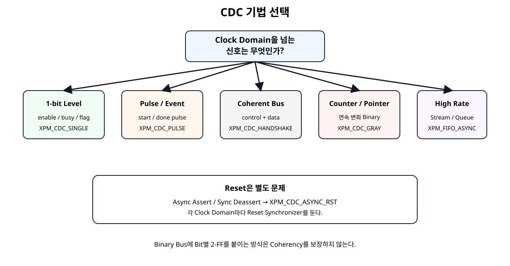
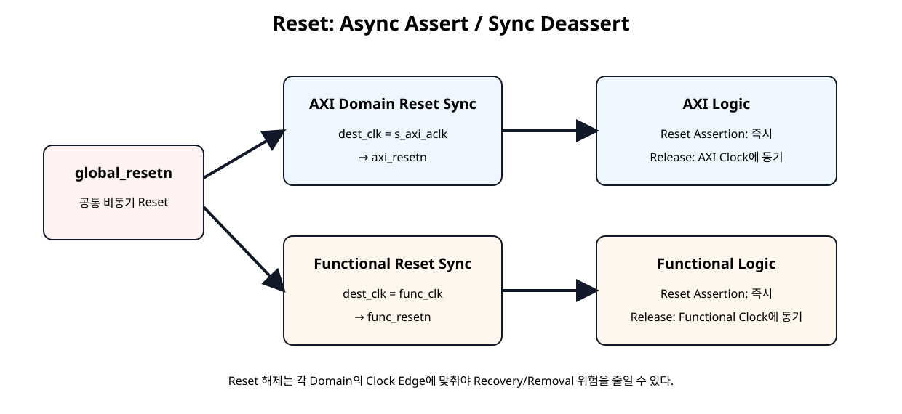
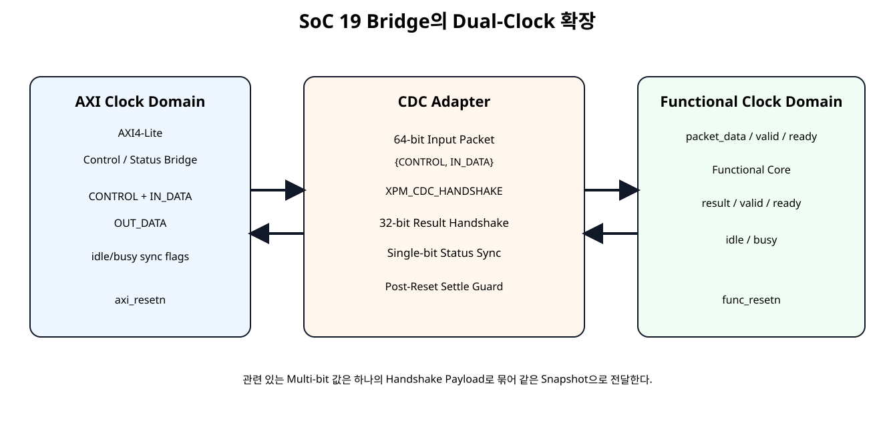
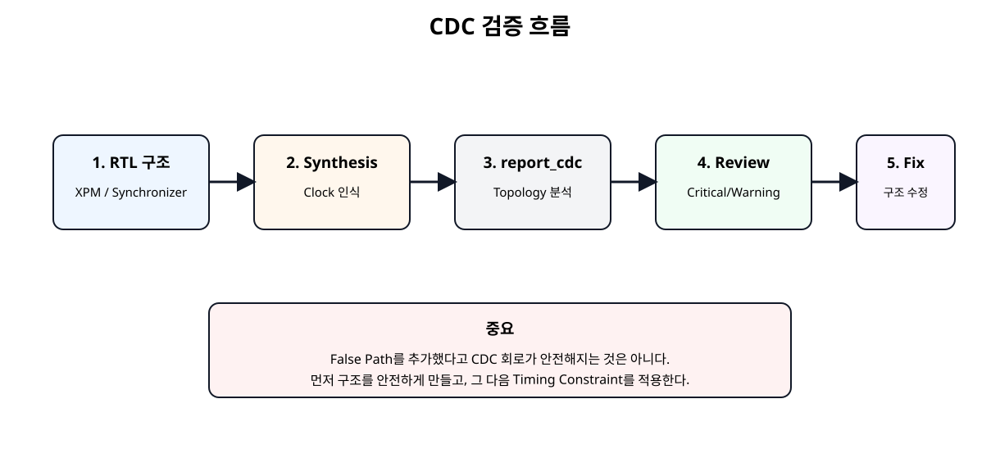

# CDC / Reset 안전 설계


## 전체 학습 위치


## 이번 장의 목표

CDC 문제를 “Timing Constraint 하나 추가”로 처리하지 않고, 먼저 Hardware 구조를 안전하게 만든 뒤 Vivado 구조 분석으로 확인한다.


## CDC가 필요한 경우와 필요하지 않은 경우


| 상황 | 판단 |
| --- | --- |
| 서로 무관한 두 Oscillator | Asynchronous CDC 필요 |
| 외부 Sensor/Recovered Clock | Asynchronous CDC 필요 |
| PLL/MMCM Generated Clock이며 관계를 Timing Engine이 정확히 앎 | 항상 CDC라고 단정하지 않고 Timing 관계를 먼저 확인 |
| 같은 Clock + Clock Enable | Clock Domain이 하나이므로 CDC 없음 |
| Logic으로 만든 분주 Clock | 새 Clock Domain과 Routing 문제를 만들 수 있어 지양 |


## Metastability

Asynchronous Signal이 Destination Flip-Flop의 Setup/Hold Window 근처에서 바뀌면 출력이 즉시 0 또는 1로 결정되지 않는 Metastability(메타안정성) 상태가 발생할 수 있다.

2-FF는 Metastability 자체를 없애는 것이 아니라 다음 Logic까지 전파될 확률을 매우 낮추는 구조다.


## CDC 기법 선택표


[](../images/soc20/soc20_cdc_selection.svg)

신호 폭이 아니라 신호의 의미와 변화 방식에 따라 CDC 구조를 선택한다.


## 1-bit Level · 2-FF

Enable, Busy, Alarm처럼 충분히 오래 유지되는 단일 Level Signal은 Destination Clock의 2단 이상 Synchronizer가 기본이다.


```verilog
module cdc_level_sync_educational #(
    parameter integer STAGES = 2
)(
    input  wire dest_clk,
    input  wire async_level_i,
    output wire sync_level_o
);

// Educational implementation of a single-bit level synchronizer.
// For AMD FPGA production designs, prefer XPM_CDC_SINGLE.
//
// Do not use this structure independently on each bit of a coherent bus.

(* ASYNC_REG = "TRUE" *)
(* SHREG_EXTRACT = "NO" *)
reg [STAGES-1:0] sync_ff = {STAGES{1'b0}};

integer i;

always @(posedge dest_clk) begin
    sync_ff[0] <= async_level_i;

    for (i = 1; i < STAGES; i = i + 1) begin
        sync_ff[i] <= sync_ff[i-1];
    end
end

assign sync_level_o = sync_ff[STAGES-1];

endmodule
```


## AMD XPM_CDC_SINGLE


```verilog
module xpm_single_bit_sync #(
    parameter integer DEST_SYNC_FF = 4
)(
    input  wire src_clk,
    input  wire src_level_i,

    input  wire dest_clk,
    output wire dest_level_o
);

// Use only for a single level signal or for independent status bits.
// Do not synchronize a coherent binary bus by instantiating one per bit.

xpm_cdc_single #(
    .DEST_SYNC_FF(DEST_SYNC_FF),
    .INIT_SYNC_FF(0),
    .SIM_ASSERT_CHK(1),
    .SRC_INPUT_REG(1)
) u_xpm_cdc_single (
    .src_clk(src_clk),
    .src_in(src_level_i),
    .dest_clk(dest_clk),
    .dest_out(dest_level_o)
);

endmodule
```

DEST_SYNC_FF는 2~10 Stage를 지원하며, Source Input Register와 Simulation Misuse Check를 설정할 수 있다.


## 왜 Multi-bit에 Bit별 2-FF가 안 되는가


```text
Source Binary = 0111
Next Binary   = 1000

각 Bit가 독립 Synchronizer를 통과
        ↓
Destination에서 순간적으로
0000 / 1111 / 0100 ... 같은
Source에 없던 조합을 볼 수 있음
```

따라서 서로 관계가 있는 Binary Bus는 Bit별 Synchronizer로 Coherency를 보장할 수 없다. 독립 Flag 배열만 예외다.


## Pulse CDC

Source Clock의 1-Clock Pulse는 Destination Clock이 느리면 아예 보지 못할 수 있다. 교육용 Toggle 방식은 Pulse를 상태 변화로 바꾸고 Destination에서 XOR로 다시 1-Clock Pulse를 만든다.


```verilog
module cdc_pulse_toggle_educational (
    input  wire src_clk,
    input  wire src_resetn,
    input  wire src_pulse_i,

    input  wire dest_clk,
    input  wire dest_resetn,
    output wire dest_pulse_o
);

// Educational pulse CDC using a toggle synchronizer.
// The source pulse rate must be slow enough that each toggle can be observed
// by the destination domain.
//
// For AMD FPGA production designs, prefer XPM_CDC_PULSE.

reg src_toggle;

(* ASYNC_REG = "TRUE" *)
(* SHREG_EXTRACT = "NO" *)
reg [1:0] dest_toggle_sync;

reg dest_toggle_d;

always @(posedge src_clk) begin
    if (!src_resetn) begin
        src_toggle <= 1'b0;
    end else if (src_pulse_i) begin
        src_toggle <= ~src_toggle;
    end
end

always @(posedge dest_clk) begin
    if (!dest_resetn) begin
        dest_toggle_sync <= 2'b00;
        dest_toggle_d    <= 1'b0;
    end else begin
        dest_toggle_sync[0] <= src_toggle;
        dest_toggle_sync[1] <= dest_toggle_sync[0];
        dest_toggle_d       <= dest_toggle_sync[1];
    end
end

assign dest_pulse_o =
    dest_toggle_sync[1] ^ dest_toggle_d;

endmodule
```


## XPM_CDC_PULSE의 간격 조건


```verilog
module xpm_pulse_sync (
    input  wire src_clk,
    input  wire src_reset,
    input  wire src_pulse_i,

    input  wire dest_clk,
    input  wire dest_reset,
    output wire dest_pulse_o
);

// XPM_CDC_PULSE converts a source-domain pulse to one destination-clock pulse.
// The source must obey AMD's minimum pulse-gap requirement.

xpm_cdc_pulse #(
    .DEST_SYNC_FF(4),
    .INIT_SYNC_FF(0),
    .REG_OUTPUT(1),
    .RST_USED(1),
    .SIM_ASSERT_CHK(1)
) u_xpm_cdc_pulse (
    .src_clk(src_clk),
    .src_pulse(src_pulse_i),
    .src_rst(src_reset),

    .dest_clk(dest_clk),
    .dest_pulse(dest_pulse_o),
    .dest_rst(dest_reset)
);

endmodule
```

AMD XPM_CDC_PULSE는 Destination에서 1 Clock Pulse를 생성하지만 Source Pulse 사이에는 최소 간격 조건이 있다. Event Rate가 그보다 빠르면 Pulse CDC가 아니라 Handshake/FIFO 구조를 사용한다.


## Coherent Multi-bit Bus

Control Word와 Data Word처럼 서로 같은 Transaction에 속하는 값은 하나의 Snapshot으로 전달해야 한다.


## XPM_CDC_HANDSHAKE

Full Handshake는 Source가 Data를 안정적으로 유지하고, Destination의 수신 확인이 Source로 돌아온 뒤 다음 Transfer를 허용한다.


```text
src_send ↑
   ↓
dest_req ↑ + dest_out valid
   ↓
Destination capture
   ↓
dest_ack ↑
   ↓
src_rcv ↑
   ↓
src_send ↓ → dest_req ↓ → dest_ack ↓ → src_rcv ↓
   ↓
다음 Transfer 허용
```


## READY/VALID CDC Wrapper


```verilog
module xpm_ready_valid_bus_bridge #(
    parameter integer WIDTH = 32,
    parameter integer SETTLE_CYCLES = 8
)(
    // Source clock domain
    input  wire                 src_clk,
    input  wire                 src_resetn,
    input  wire [WIDTH-1:0]     src_data_i,
    input  wire                 src_valid_i,
    output wire                 src_ready_o,

    // Destination clock domain
    input  wire                 dest_clk,
    input  wire                 dest_resetn,
    output wire [WIDTH-1:0]     dest_data_o,
    output wire                 dest_valid_o,
    input  wire                 dest_ready_i
);

// Ready/Valid wrapper around XPM_CDC_HANDSHAKE.
//
// One transfer can be outstanding.
// A new source word is accepted only after the full previous handshake
// returns to idle.

localparam [1:0] SRC_IDLE          = 2'd0;
localparam [1:0] SRC_WAIT_RCV_HIGH = 2'd1;
localparam [1:0] SRC_WAIT_RCV_LOW  = 2'd2;

reg [1:0] src_state;
reg [WIDTH-1:0] src_data_hold;
reg src_send;

wire src_rcv;
wire [WIDTH-1:0] dest_out;
wire dest_req;
reg  dest_ack;

// Post-reset guard lets the unreset XPM handshake synchronizers
// observe stable zero values before new traffic is accepted.
reg [7:0] src_settle_count;
reg [7:0] dest_settle_count;

wire src_active;
wire dest_active;

assign src_active =
    (src_settle_count >= SETTLE_CYCLES);

assign dest_active =
    (dest_settle_count >= SETTLE_CYCLES);

assign src_ready_o =
    src_active &&
    (src_state == SRC_IDLE);

assign dest_data_o  = dest_out;
assign dest_valid_o =
    dest_active &&
    dest_req &&
    !dest_ack;

always @(posedge src_clk) begin
    if (!src_resetn) begin
        src_state        <= SRC_IDLE;
        src_data_hold    <= {WIDTH{1'b0}};
        src_send         <= 1'b0;
        src_settle_count <= 8'd0;
    end else begin
        if (!src_active) begin
            src_settle_count <= src_settle_count + 1'b1;
        end

        case (src_state)
            SRC_IDLE: begin
                src_send <= 1'b0;

                if (src_active && src_valid_i) begin
                    src_data_hold <= src_data_i;
                    src_send      <= 1'b1;
                    src_state     <= SRC_WAIT_RCV_HIGH;
                end
            end

            SRC_WAIT_RCV_HIGH: begin
                if (src_rcv) begin
                    src_send  <= 1'b0;
                    src_state <= SRC_WAIT_RCV_LOW;
                end
            end

            SRC_WAIT_RCV_LOW: begin
                if (!src_rcv) begin
                    src_state <= SRC_IDLE;
                end
            end

            default: begin
                src_state <= SRC_IDLE;
                src_send  <= 1'b0;
            end
        endcase
    end
end

always @(posedge dest_clk) begin
    if (!dest_resetn) begin
        dest_ack          <= 1'b0;
        dest_settle_count <= 8'd0;
    end else begin
        if (!dest_active) begin
            dest_settle_count <= dest_settle_count + 1'b1;
            dest_ack <= 1'b0;
        end else if (!dest_ack && dest_req && dest_ready_i) begin
            dest_ack <= 1'b1;
        end else if (dest_ack && !dest_req) begin
            dest_ack <= 1'b0;
        end
    end
end

xpm_cdc_handshake #(
    .DEST_EXT_HSK(1),
    .DEST_SYNC_FF(4),
    .INIT_SYNC_FF(0),
    .SIM_ASSERT_CHK(1),
    .SRC_SYNC_FF(4),
    .WIDTH(WIDTH)
) u_xpm_cdc_handshake (
    .src_clk(src_clk),
    .src_in(src_data_hold),
    .src_send(src_send),
    .src_rcv(src_rcv),

    .dest_clk(dest_clk),
    .dest_out(dest_out),
    .dest_req(dest_req),
    .dest_ack(dest_ack)
);

endmodule
```

SoC 19의 READY/VALID Interface와 XPM_CDC_HANDSHAKE의 Full Handshake Sequence를 연결한다. 한 번에 한 Transfer만 Outstanding 상태로 유지한다.


## Continuous Data와 Async FIFO


| Data 특성 | 권장 |
| --- | --- |
| 간헐적 1 Word Command/Result | XPM_CDC_HANDSHAKE |
| 몇 Word를 낮은 빈도로 전송 | Handshake 또는 작은 Mailbox |
| 연속 Sample/Tensor/Packet | XPM_FIFO_ASYNC / XPM_FIFO_AXIS |
| FIFO Pointer | Gray Encoding |

NPU Tensor나 FFT Sample을 1 Word Handshake로 계속 보내는 것은 Throughput을 크게 떨어뜨린다.


## Reset도 CDC다

Reset의 Assertion은 즉시 필요할 수 있지만 Deassertion이 Clock Edge와 무관하게 발생하면 Recovery/Removal 문제를 만들 수 있다. 따라서 Clock Domain마다 Reset 해제를 Synchronize한다.


## Async Assert / Sync Deassert


[](../images/soc20/soc20_reset_domains.svg)

공통 비동기 Reset을 각 Clock Domain에서 별도로 동기 해제한다.


### 교육용 RTL


```verilog
module reset_sync_async_assert_educational #(
    parameter integer STAGES = 2
)(
    input  wire clk,
    input  wire arstn_i,
    output wire srstn_o
);

// Active-Low reset synchronizer.
// Assertion: asynchronous
// Deassertion: synchronous to clk
//
// For AMD FPGA production designs, prefer XPM_CDC_ASYNC_RST.

(* ASYNC_REG = "TRUE" *)
(* SHREG_EXTRACT = "NO" *)
reg [STAGES-1:0] reset_ff;

integer i;

always @(posedge clk or negedge arstn_i) begin
    if (!arstn_i) begin
        reset_ff <= {STAGES{1'b0}};
    end else begin
        reset_ff[0] <= 1'b1;

        for (i = 1; i < STAGES; i = i + 1) begin
            reset_ff[i] <= reset_ff[i-1];
        end
    end
end

assign srstn_o = reset_ff[STAGES-1];

endmodule
```


### AMD XPM


```verilog
module xpm_reset_sync_active_low #(
    parameter integer DEST_SYNC_FF = 4
)(
    input  wire dest_clk,
    input  wire global_resetn_i,
    output wire dest_resetn_o
);

// AMD XPM implementation.
// Active-Low reset asserts asynchronously and deasserts synchronously
// to the destination clock.

xpm_cdc_async_rst #(
    .DEST_SYNC_FF(DEST_SYNC_FF),
    .INIT_SYNC_FF(0),
    .RST_ACTIVE_HIGH(0)
) u_xpm_cdc_async_rst (
    .src_arst(global_resetn_i),
    .dest_clk(dest_clk),
    .dest_arst(dest_resetn_o)
);

endmodule
```


## Domain별 Reset 분리

AXI Logic과 Functional Logic이 같은 Global Reset Input을 받더라도 Reset Release Clock은 서로 다르다.


## Post-Reset Settle Guard

XPM_CDC_HANDSHAKE 내부 Synchronizer에는 별도의 Runtime Reset Port가 없으므로 Wrapper는 양 Domain Reset 해제 직후 즉시 Transfer를 받지 않고 SETTLE_CYCLES 동안 0 상태가 전파되도록 기다린다.


## SoC 19 Dual-Clock 확장


[](../images/soc20/soc20_dual_clock_architecture.svg)

SoC 19 Bridge를 AXI Domain에 유지하고 CDC Adapter를 통해 Functional Domain과 연결한다.


## CONTROL + DATA 64-bit Packet

CONTROL과 IN_DATA를 따로 Crossing하지 않는다.


```text
AXI Domain
CONTROL[31:0]
IN_DATA[31:0]
     ↓ Concatenate
Packet[63:0]
     ↓ XPM_CDC_HANDSHAKE
Functional Domain
CONTROL Snapshot + DATA Snapshot
```

이 구조로 같은 Transaction의 설정값과 Data가 서로 다른 시점으로 섞이는 것을 방지한다.


## Result 32-bit Return

Functional Core의 32-bit 결과도 READY/VALID → XPM Full Handshake → AXI Domain READY/VALID로 되돌린다. AXI Domain의 SoC 19 Output Buffer가 결과를 Capture한 뒤 Software POP까지 유지한다.


## Status Flag CDC

idle, busy처럼 각각 독립적인 1-bit Flag는 개별 XPM_CDC_SINGLE로 AXI Domain에 넘긴다.


## CDC Adapter Module


```verilog
module dual_clock_bridge_cdc_adapter (
    // AXI/register clock domain
    input  wire        axi_clk,
    input  wire        axi_resetn,

    input  wire [31:0] control_axi_i,
    input  wire [31:0] in_data_axi_i,
    input  wire        in_valid_axi_i,
    output wire        in_ready_axi_o,

    output wire [31:0] out_data_axi_o,
    output wire        out_valid_axi_o,
    input  wire        out_ready_axi_i,

    output wire [31:0] status_axi_o,

    // Functional clock domain
    input  wire        func_clk,
    input  wire        func_resetn,

    output wire [63:0] packet_func_o,
    output wire        packet_valid_func_o,
    input  wire        packet_ready_func_i,

    input  wire [31:0] result_func_i,
    input  wire        result_valid_func_i,
    output wire        result_ready_func_o,

    input  wire        func_idle_i,
    input  wire        func_busy_i
);

// This module owns all CDC policy between the AXI and functional domains.
// Related CONTROL + IN_DATA values are packed and transferred coherently.

wire [63:0] packet_axi;

assign packet_axi = {
    control_axi_i,
    in_data_axi_i
};

xpm_ready_valid_bus_bridge #(
    .WIDTH(64)
) u_input_packet_cdc (
    .src_clk(axi_clk),
    .src_resetn(axi_resetn),
    .src_data_i(packet_axi),
    .src_valid_i(in_valid_axi_i),
    .src_ready_o(in_ready_axi_o),

    .dest_clk(func_clk),
    .dest_resetn(func_resetn),
    .dest_data_o(packet_func_o),
    .dest_valid_o(packet_valid_func_o),
    .dest_ready_i(packet_ready_func_i)
);

xpm_ready_valid_bus_bridge #(
    .WIDTH(32)
) u_output_result_cdc (
    .src_clk(func_clk),
    .src_resetn(func_resetn),
    .src_data_i(result_func_i),
    .src_valid_i(result_valid_func_i),
    .src_ready_o(result_ready_func_o),

    .dest_clk(axi_clk),
    .dest_resetn(axi_resetn),
    .dest_data_o(out_data_axi_o),
    .dest_valid_o(out_valid_axi_o),
    .dest_ready_i(out_ready_axi_i)
);

// These are independent one-bit status flags.
// They are intentionally not treated as a coherent binary bus.
wire func_idle_axi;
wire func_busy_axi;

xpm_single_bit_sync u_idle_status_cdc (
    .src_clk(func_clk),
    .src_level_i(func_idle_i),
    .dest_clk(axi_clk),
    .dest_level_o(func_idle_axi)
);

xpm_single_bit_sync u_busy_status_cdc (
    .src_clk(func_clk),
    .src_level_i(func_busy_i),
    .dest_clk(axi_clk),
    .dest_level_o(func_busy_axi)
);

assign status_axi_o = {
    30'h0,
    func_busy_axi,
    func_idle_axi
};

endmodule
```

CDC Policy는 Top이 아니라 별도 Adapter Module에 집중시켰다.


## 순수 Top Wrapper


```verilog
module dual_clock_control_status_bridge_demo #(
    parameter integer C_S_AXI_ADDR_WIDTH = 32,
    parameter integer PROCESS_CYCLES     = 6
)(
    input  wire                          s_axi_aclk,
    input  wire                          func_clk,
    input  wire                          global_resetn,

    input  wire [C_S_AXI_ADDR_WIDTH-1:0] s_axi_awaddr,
    input  wire [2:0]                    s_axi_awprot,
    input  wire                          s_axi_awvalid,
    output wire                          s_axi_awready,

    input  wire [31:0]                   s_axi_wdata,
    input  wire [3:0]                    s_axi_wstrb,
    input  wire                          s_axi_wvalid,
    output wire                          s_axi_wready,

    output wire [1:0]                    s_axi_bresp,
    output wire                          s_axi_bvalid,
    input  wire                          s_axi_bready,

    input  wire [C_S_AXI_ADDR_WIDTH-1:0] s_axi_araddr,
    input  wire [2:0]                    s_axi_arprot,
    input  wire                          s_axi_arvalid,
    output wire                          s_axi_arready,

    output wire [31:0]                   s_axi_rdata,
    output wire [1:0]                    s_axi_rresp,
    output wire                          s_axi_rvalid,
    input  wire                          s_axi_rready,

    output wire                          irq_o
);

// Pure Shell / Wrapper:
// - reset synchronization is delegated
// - CDC policy is delegated
// - functional processing is delegated
// - AXI/Register behavior is delegated

wire axi_resetn;
wire func_resetn;

wire [31:0] control_axi;
wire [31:0] status_axi;

wire [31:0] in_data_axi;
wire        in_valid_axi;
wire        in_ready_axi;

wire [31:0] out_data_axi;
wire        out_valid_axi;
wire        out_ready_axi;

wire [63:0] packet_func;
wire        packet_valid_func;
wire        packet_ready_func;

wire [31:0] result_func;
wire        result_valid_func;
wire        result_ready_func;

wire func_idle;
wire func_busy;

xpm_reset_sync_active_low u_axi_reset_sync (
    .dest_clk(s_axi_aclk),
    .global_resetn_i(global_resetn),
    .dest_resetn_o(axi_resetn)
);

xpm_reset_sync_active_low u_func_reset_sync (
    .dest_clk(func_clk),
    .global_resetn_i(global_resetn),
    .dest_resetn_o(func_resetn)
);

axi_control_status_bridge_ip #(
    .C_S_AXI_ADDR_WIDTH(C_S_AXI_ADDR_WIDTH)
) u_axi_control_status_bridge_ip (
    .s_axi_aclk(s_axi_aclk),
    .s_axi_aresetn(axi_resetn),

    .s_axi_awaddr(s_axi_awaddr),
    .s_axi_awprot(s_axi_awprot),
    .s_axi_awvalid(s_axi_awvalid),
    .s_axi_awready(s_axi_awready),

    .s_axi_wdata(s_axi_wdata),
    .s_axi_wstrb(s_axi_wstrb),
    .s_axi_wvalid(s_axi_wvalid),
    .s_axi_wready(s_axi_wready),

    .s_axi_bresp(s_axi_bresp),
    .s_axi_bvalid(s_axi_bvalid),
    .s_axi_bready(s_axi_bready),

    .s_axi_araddr(s_axi_araddr),
    .s_axi_arprot(s_axi_arprot),
    .s_axi_arvalid(s_axi_arvalid),
    .s_axi_arready(s_axi_arready),

    .s_axi_rdata(s_axi_rdata),
    .s_axi_rresp(s_axi_rresp),
    .s_axi_rvalid(s_axi_rvalid),
    .s_axi_rready(s_axi_rready),

    .control_o(control_axi),
    .status_i(status_axi),

    .in_data_o(in_data_axi),
    .in_valid_o(in_valid_axi),
    .in_ready_i(in_ready_axi),

    .out_data_i(out_data_axi),
    .out_valid_i(out_valid_axi),
    .out_ready_o(out_ready_axi),

    .irq_o(irq_o)
);

dual_clock_bridge_cdc_adapter u_dual_clock_bridge_cdc_adapter (
    .axi_clk(s_axi_aclk),
    .axi_resetn(axi_resetn),

    .control_axi_i(control_axi),
    .in_data_axi_i(in_data_axi),
    .in_valid_axi_i(in_valid_axi),
    .in_ready_axi_o(in_ready_axi),

    .out_data_axi_o(out_data_axi),
    .out_valid_axi_o(out_valid_axi),
    .out_ready_axi_i(out_ready_axi),

    .status_axi_o(status_axi),

    .func_clk(func_clk),
    .func_resetn(func_resetn),

    .packet_func_o(packet_func),
    .packet_valid_func_o(packet_valid_func),
    .packet_ready_func_i(packet_ready_func),

    .result_func_i(result_func),
    .result_valid_func_i(result_valid_func),
    .result_ready_func_o(result_ready_func),

    .func_idle_i(func_idle),
    .func_busy_i(func_busy)
);

dual_clock_example_core #(
    .PROCESS_CYCLES(PROCESS_CYCLES)
) u_dual_clock_example_core (
    .clk(func_clk),
    .resetn(func_resetn),

    .packet_i(packet_func),
    .packet_valid_i(packet_valid_func),
    .packet_ready_o(packet_ready_func),

    .result_o(result_func),
    .result_valid_o(result_valid_func),
    .result_ready_i(result_ready_func),

    .idle_o(func_idle),
    .busy_o(func_busy)
);

endmodule
```

Top은 Reset Synchronizer, AXI Bridge, CDC Adapter, Functional Core를 연결할 뿐 CDC 정책이나 기능 연산을 직접 수행하지 않는다.


## Functional Core


```verilog
module dual_clock_example_core #(
    parameter integer PROCESS_CYCLES = 6
)(
    input  wire        clk,
    input  wire        resetn,

    // Coherent input packet: control + data
    input  wire [63:0] packet_i,
    input  wire        packet_valid_i,
    output wire        packet_ready_o,

    output reg  [31:0] result_o,
    output reg         result_valid_o,
    input  wire        result_ready_i,

    output wire        idle_o,
    output wire        busy_o
);

localparam [1:0] ST_IDLE = 2'd0;
localparam [1:0] ST_RUN  = 2'd1;
localparam [1:0] ST_OUT  = 2'd2;

reg [1:0] state;
reg [7:0] cycles_left;
reg [31:0] data_latched;
reg [1:0] mode_latched;

wire [31:0] control_word;
wire [31:0] input_word;

assign control_word = packet_i[63:32];
assign input_word   = packet_i[31:0];

assign packet_ready_o = (state == ST_IDLE);
assign idle_o = (state == ST_IDLE);
assign busy_o = (state == ST_RUN);

function [31:0] process_value;
    input [31:0] value;
    input [1:0] mode;
    begin
        case (mode)
            2'b00: process_value = value;
            2'b01: process_value = value + 32'd1;
            2'b10: process_value = value << 1;
            2'b11: process_value = ~value;
            default: process_value = value;
        endcase
    end
endfunction

always @(posedge clk) begin
    if (!resetn) begin
        state          <= ST_IDLE;
        cycles_left    <= 8'd0;
        data_latched   <= 32'h0000_0000;
        mode_latched   <= 2'b00;
        result_o       <= 32'h0000_0000;
        result_valid_o <= 1'b0;
    end else begin
        case (state)
            ST_IDLE: begin
                result_valid_o <= 1'b0;

                if (packet_valid_i && packet_ready_o) begin
                    data_latched <= input_word;
                    mode_latched <= control_word[1:0];

                    if (PROCESS_CYCLES <= 1) begin
                        cycles_left <= 8'd0;
                    end else begin
                        cycles_left <= PROCESS_CYCLES - 1;
                    end

                    state <= ST_RUN;
                end
            end

            ST_RUN: begin
                if (cycles_left != 0) begin
                    cycles_left <= cycles_left - 1'b1;
                end else begin
                    result_o <= process_value(
                        data_latched,
                        mode_latched
                    );
                    result_valid_o <= 1'b1;
                    state <= ST_OUT;
                end
            end

            ST_OUT: begin
                if (result_valid_o && result_ready_i) begin
                    result_valid_o <= 1'b0;
                    state <= ST_IDLE;
                end
            end

            default: begin
                state <= ST_IDLE;
                result_valid_o <= 1'b0;
            end
        endcase
    end
end

endmodule
```

Functional Core는 AXI를 모르며 64-bit Packet과 READY/VALID Result만 사용한다.


## Dual-Clock Testbench

AXI Clock은 100 MHz, Functional Clock은 약 71.4 MHz로 두어 서로 일정 배수 관계가 아닌 Clock을 사용한다.


```verilog
`timescale 1ns / 1ps

module tb_dual_clock_control_status_bridge_demo;

localparam integer ADDR_W = 32;

reg axi_clk = 1'b0;
reg func_clk = 1'b0;
reg global_resetn = 1'b0;

always #5 axi_clk = ~axi_clk;   // 100 MHz
always #7 func_clk = ~func_clk; // ~71.4 MHz

reg  [ADDR_W-1:0] awaddr = 0;
reg  [2:0]        awprot = 0;
reg               awvalid = 0;
wire              awready;

reg  [31:0]       wdata = 0;
reg  [3:0]        wstrb = 0;
reg               wvalid = 0;
wire              wready;

wire [1:0]        bresp;
wire              bvalid;
reg               bready = 0;

reg  [ADDR_W-1:0] araddr = 0;
reg  [2:0]        arprot = 0;
reg               arvalid = 0;
wire              arready;

wire [31:0]       rdata;
wire [1:0]        rresp;
wire              rvalid;
reg               rready = 0;

wire irq_o;

integer errors = 0;
integer k;
reg [31:0] rd;

dual_clock_control_status_bridge_demo #(
    .C_S_AXI_ADDR_WIDTH(ADDR_W),
    .PROCESS_CYCLES(6)
) dut (
    .s_axi_aclk(axi_clk),
    .func_clk(func_clk),
    .global_resetn(global_resetn),

    .s_axi_awaddr(awaddr),
    .s_axi_awprot(awprot),
    .s_axi_awvalid(awvalid),
    .s_axi_awready(awready),

    .s_axi_wdata(wdata),
    .s_axi_wstrb(wstrb),
    .s_axi_wvalid(wvalid),
    .s_axi_wready(wready),

    .s_axi_bresp(bresp),
    .s_axi_bvalid(bvalid),
    .s_axi_bready(bready),

    .s_axi_araddr(araddr),
    .s_axi_arprot(arprot),
    .s_axi_arvalid(arvalid),
    .s_axi_arready(arready),

    .s_axi_rdata(rdata),
    .s_axi_rresp(rresp),
    .s_axi_rvalid(rvalid),
    .s_axi_rready(rready),

    .irq_o(irq_o)
);

task automatic axi_write;
    input [31:0] addr;
    input [31:0] data;
    begin
        @(negedge axi_clk);
        awaddr = addr;
        awvalid = 1'b1;

        wait (awready === 1'b1);
        @(negedge axi_clk);
        awvalid = 1'b0;

        @(negedge axi_clk);
        wdata = data;
        wstrb = 4'b1111;
        wvalid = 1'b1;

        wait (wready === 1'b1);
        @(negedge axi_clk);
        wvalid = 1'b0;

        bready = 1'b1;
        wait (bvalid === 1'b1);
        @(posedge axi_clk);
        @(negedge axi_clk);
        bready = 1'b0;
    end
endtask

task automatic axi_read;
    input [31:0] addr;
    output [31:0] data;
    begin
        @(negedge axi_clk);
        araddr = addr;
        arvalid = 1'b1;

        wait (arready === 1'b1);
        @(negedge axi_clk);
        arvalid = 1'b0;

        rready = 1'b1;
        wait (rvalid === 1'b1);
        data = rdata;

        @(posedge axi_clk);
        @(negedge axi_clk);
        rready = 1'b0;
    end
endtask

task automatic wait_output;
    begin
        rd = 32'h0;

        for (k = 0; k < 200; k = k + 1) begin
            axi_read(32'h00000008, rd);

            if (rd[2]) begin
                k = 200;
            end
        end

        if (!rd[2]) begin
            $display("FAIL: timeout waiting for OUT_PENDING");
            errors = errors + 1;
        end
    end
endtask

initial begin
    #80;
    global_resetn = 1'b1;

    // Allow both domain reset synchronizers to release.
    repeat (12) @(posedge axi_clk);

    // Mode 1, input 9 => result 10.
    axi_write(32'h00000000, 32'h00000001);
    axi_write(32'h0000000C, 32'h00000009);
    axi_write(32'h00000010, 32'h00000001);

    wait_output();

    axi_read(32'h00000014, rd);

    if (rd !== 32'h0000000A) begin
        $display("FAIL: dual-clock result=%08h expected=0000000A", rd);
        errors = errors + 1;
    end else begin
        $display("PASS: dual-clock result 9 -> 10");
    end

    axi_write(32'h00000010, 32'h00000002);

    if (errors == 0) begin
        $display("SOC20 DUAL-CLOCK BRIDGE TEST: PASS");
    end else begin
        $display("SOC20 DUAL-CLOCK BRIDGE TEST: FAIL (%0d)", errors);
    end

    #100;
    $finish;
end

endmodule
```


## Vivado report_cdc


[](../images/soc20/soc20_report_cdc_flow.svg)

CDC는 Synthesis 이후 구조 분석까지 완료해야 한다.


```text
report_cdc -details -file soc20_report_cdc.rpt
report_clock_interaction -file soc20_clock_interaction.rpt
```


## CDC Report에서 볼 항목

- Single-bit Synchronizer가 올바른 Topology로 인식되는가
- Asynchronous Reset Synchronizer가 인식되는가
- Combinational Logic before Synchronizer가 없는가
- Multi-clock Fanin이 없는가
- Unknown/Unsafe CDC가 남아 있지 않은가
- XPM_CDC_HANDSHAKE 경로의 Warning 의미를 이해하고 검토했는가

## Constraint와 CDC 구조의 관계


## Clock Enable과 Divided Clock

단순히 Logic을 느리게 동작시키기 위해 Counter Bit를 새 Clock으로 사용하면 새 Clock Domain과 Clock Routing 문제를 만든다.

실제 독립 Clock Domain이 필요한 경우에는 Clocking Resource와 CDC 구조를 명확히 설계한다.


## NPU/FFT 확장


| 경로 | 권장 Interface |
| --- | --- |
| Mode / Start / Threshold | AXI4-Lite Control Register |
| Done / Error / Status | Single-bit CDC + Status Register 또는 Event |
| 짧은 Command / Result | Handshake CDC |
| ADC Sample / FFT Stream | Async FIFO / AXI4-Stream |
| NPU Tensor | AXI4-Stream + FIFO / DMA 방향 |


## 오류 점검


| 증상 | 원인 | 확인 |
| --- | --- | --- |
| 가끔 Flag가 이상함 | Single-bit CDC 누락 | XPM_CDC_SINGLE |
| Binary 값이 간헐적으로 깨짐 | Bit별 2-FF | Handshake/Gray/FIFO |
| 짧은 Pulse가 사라짐 | Level Synchronizer 사용 | XPM_CDC_PULSE |
| Reset 해제 후 이상 동작 | 비동기 Deassert | Domain별 Reset Sync |
| Runtime Reset 직후 Handshake 꼬임 | Protocol 정착시간 없음 | Post-Reset Guard |
| report_cdc Critical Warning | 구조적으로 Unsafe CDC | Constraint보다 RTL 구조 먼저 수정 |
| FFT/NPU 속도가 너무 느림 | Word Handshake 남용 | Async FIFO / AXI4-Stream |


## SoC 20 완료 체크리스트

- [ ] 1-bit Level, Pulse, Multi-bit Bus, Stream, Reset을 구분한다.
- [ ] 단일 Level에는 2-FF/XPM_CDC_SINGLE을 사용한다.
- [ ] Binary Multi-bit Bus에 Bit별 2-FF를 사용하지 않는다.
- [ ] Pulse에는 XPM_CDC_PULSE 또는 적절한 Event Handshake를 사용한다.
- [ ] 관련 Control/Data를 하나의 Handshake Packet으로 묶는다.
- [ ] 연속 고속 Data에는 Async FIFO/AXI4-Stream을 고려한다.
- [ ] Reset Assert와 Deassert 특성을 구분한다.
- [ ] 각 Clock Domain에 별도 Reset Synchronizer를 둔다.
- [ ] Runtime Reset 후 Protocol Settle Guard를 둔다.
- [ ] SoC 19 Bridge와 Functional Core 사이에 CDC Adapter를 분리했다.
- [ ] Top Wrapper에 기능/CDC 정책을 직접 넣지 않았다.
- [ ] 합성 후 report_cdc를 반드시 실행한다.
- [ ] False Path를 CDC 해결책으로 오해하지 않는다.

## 공식 매뉴얼 및 원본 근거


| 문서 | 확인 항목 |
| --- | --- |
| AMD UG953 · XPM_CDC_SINGLE · 2026.1 | 1-bit Synchronizer, DEST_SYNC_FF |
| AMD UG953 · XPM_CDC_ARRAY_SINGLE · 2026.1 | 서로 독립적인 Bit Array와 Coherent Bus의 차이 |
| AMD UG953 · XPM_CDC_PULSE · 2026.1 | Pulse Transfer와 Minimum Gap |
| AMD UG953 · XPM_CDC_ASYNC_RST · 2026.1 | Async Assert / Sync Deassert Reset |
| AMD UG949 · Clock Domain Crossing · 2026.1 | XPM 사용, ASYNC_REG, CDC Methodology |
| AMD UG906 · Report Clock Domain Crossings · 2026.1 | report_cdc 구조 분석 |
| AMD UG903 · CDC Analysis and Constraints · 2026.1 | CDC 구조 분석과 Timing Constraint 관계 |
| AMD UG953 · XPM_CDC_HANDSHAKE · 2022.2 | 다비트 데이터의 요청·응답 핸드셰이크 매크로 |

