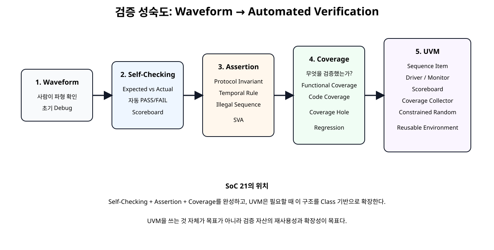
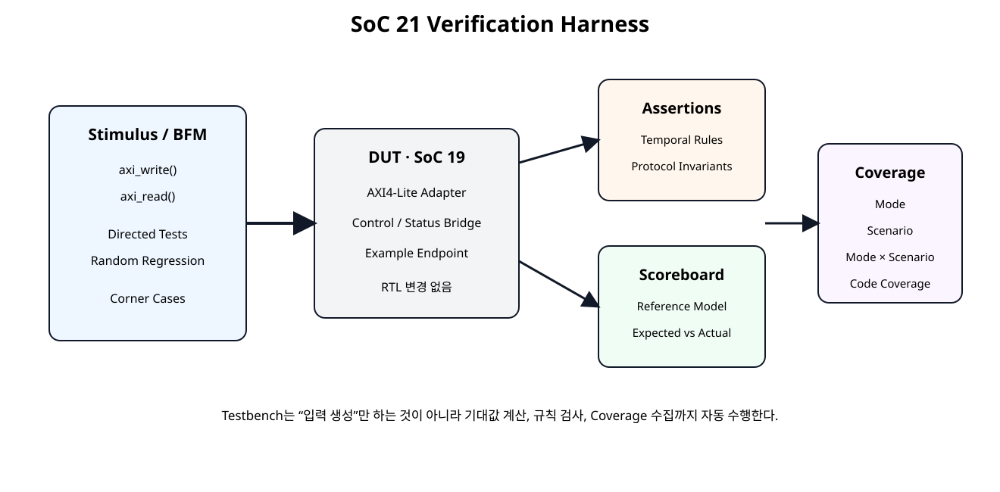
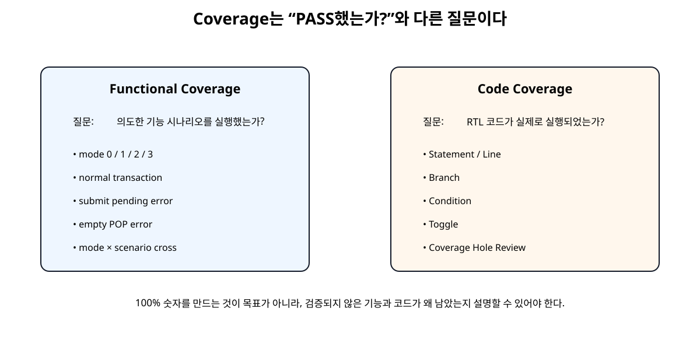

# Self-Checking Testbench / Assertion / Coverage


## 전체 학습 위치


## 이번 장의 목표


[](../images/soc21/soc21_verification_ladder.svg)

파형 중심 검증을 자동 판정·Assertion·Coverage 기반 검증으로 확장한다.


## Waveform 검증의 한계

- Test Case가 많아질수록 사람이 모든 파형을 확인하기 어렵다.
- 같은 Regression을 반복할 때 판정 기준이 흔들릴 수 있다.
- 짧은 Protocol 위반을 사람이 놓칠 수 있다.
- PASS한 Test가 실제 어떤 기능을 검증했는지 알기 어렵다.

## 검증 계층 전체 구조


[](../images/soc21/soc21_verification_architecture.svg)

DUT는 변경하지 않고 Testbench, Assertion, Scoreboard, Coverage를 외부에 추가한다.


## Self-Checking Testbench

Testbench가 입력만 넣는 것이 아니라 실제 출력과 기대값을 비교하고 Error Count를 관리한다.


## Reference Model


```text
function automatic logic [31:0] reference_model(
    input logic [1:0] mode,
    input logic [31:0] value
);
    case (mode)
        2'd0: reference_model = value;
        2'd1: reference_model = value + 32'd1;
        2'd2: reference_model = value << 1;
        2'd3: reference_model = ~value;
    endcase
endfunction
```

DUT와 같은 RTL 코드를 복사하는 것이 아니라 동일 기능의 기대값을 Testbench 관점에서 간단히 모델링한다.


## Scoreboard

check_eq32()가 Actual과 Expected를 비교하고 error_count를 누적한다.


## Directed Test


| Mode | 기능 | Expected |
| --- | --- | --- |
| 0 | Pass-through | out → in |
| 1 | Add 1 | out → in + 1 |
| 2 | Shift Left | out → in << 1 |
| 3 | Bitwise NOT | out → ~in |


## Corner Case

- Input Pending 상태에서 추가 SUBMIT
- Output Buffer가 비어 있는데 POP
- Error Clear
- EVENT_STATUS W1C
- IRQ Assert
정상 Data Path만 확인하지 않고 설계가 거부해야 하는 입력도 Test한다.


## Random Regression

Directed Test 후 Mode와 Data를 무작위로 생성하여 Reference Model과 반복 비교한다.


```text
mode  = $urandom_range(0, 3);
value = $urandom();

run_normal_case(mode, value);
```

이번 교육 Harness는 20회로 제한했지만 CI에서는 Seed와 반복 수를 늘릴 수 있다.


## Assertion이 필요한 이유

Scoreboard는 결과값이 맞는지 확인하는 데 강하지만 “READY가 0인데 VALID/Data가 중간에 바뀌었다” 같은 시간적 Protocol 위반은 Assertion이 더 직접적이다.


## READY/VALID Assertion


```text
in_valid_o && !in_ready_i
|=> in_valid_o && $stable(in_data_o);
```

Receiver가 READY를 주지 않은 동안 Producer가 VALID를 내리거나 Payload를 바꾸면 자동 Error가 발생한다.


## Error Sequence Assertion


```text
command_submit && in_valid_o
|=> error_status;

command_pop_out && !out_pending
|=> error_status;
```

잘못된 Command Sequence가 다음 Clock에서 반드시 ERROR로 반영되는지 검사한다.


## Assertion Coverage

Assertion은 Fail만 찾는 것이 아니라 특정 Sequence가 실제 Simulation 중 발생했는지도 Cover Property로 확인할 수 있다.


```text
cover property (
    command_submit && in_valid_o
    ##1 error_status
);
```


## Functional Coverage

Functional Coverage는 “RTL 코드 몇 줄이 실행됐는가”가 아니라 “설계자가 중요하다고 정의한 기능 시나리오를 실제로 실행했는가”를 측정한다.


## Mode Coverpoint


```text
cp_mode: coverpoint cov_mode {
    bins mode0 = {0};
    bins mode1 = {1};
    bins mode2 = {2};
    bins mode3 = {3};
}
```


## Scenario Coverpoint

정상 Transaction뿐 아니라 Illegal Sequence와 Clear Sequence도 Coverage 대상에 포함한다.


## Cross Coverage


```text
mode_x_scenario:
cross cp_mode, cp_scenario;
```

Mode만 모두 실행했다고 충분한 것은 아니다. Mode와 Scenario 조합을 Cross하면 어떤 조합이 빠졌는지 볼 수 있다.


## Code Coverage

Vivado Simulator 2026.1은 Statement/Line, Branch, Condition, Toggle Code Coverage를 지원한다.


```text
-cc_type sbct
```

Code Coverage는 Testbench가 RTL의 어떤 Branch와 Condition을 실제로 실행했는지 보여준다.


## Functional vs Code Coverage


[](../images/soc21/soc21_coverage_types.svg)

두 Coverage는 서로 대체 관계가 아니라 질문 자체가 다르다.


## Coverage 100%의 함정

Code Coverage 100%가 설계가 올바르다는 뜻은 아니다. 반대로 의도적으로 실행되지 않아야 하는 Defensive Branch가 남아 있으면 100%가 아니어도 정상일 수 있다.


## SystemVerilog Testbench


```verilog
`timescale 1ns / 1ps

module tb_soc21_csb_verification;

localparam int ADDR_W = 32;

localparam logic [31:0] REG_CONTROL       = 32'h0000_0000;
localparam logic [31:0] REG_CORE_STATUS   = 32'h0000_0004;
localparam logic [31:0] REG_BRIDGE_STATUS = 32'h0000_0008;
localparam logic [31:0] REG_IN_DATA       = 32'h0000_000C;
localparam logic [31:0] REG_COMMAND       = 32'h0000_0010;
localparam logic [31:0] REG_OUT_DATA      = 32'h0000_0014;
localparam logic [31:0] REG_EVENT_STATUS  = 32'h0000_0018;
localparam logic [31:0] REG_VERSION       = 32'h0000_001C;
localparam logic [31:0] REG_ID            = 32'h0000_0020;

localparam logic [31:0] CMD_SUBMIT      = 32'h0000_0001;
localparam logic [31:0] CMD_POP         = 32'h0000_0002;
localparam logic [31:0] CMD_CLEAR_ERROR = 32'h0000_0004;

localparam logic [31:0] EVENT_ALL = 32'h0000_0007;

logic clk = 1'b0;
logic resetn = 1'b0;

always #5 clk = ~clk;

logic [ADDR_W-1:0] awaddr = '0;
logic [2:0]        awprot = '0;
logic              awvalid = 1'b0;
wire               awready;

logic [31:0]       wdata = '0;
logic [3:0]        wstrb = '0;
logic              wvalid = 1'b0;
wire               wready;

wire [1:0]         bresp;
wire               bvalid;
logic              bready = 1'b0;

logic [ADDR_W-1:0] araddr = '0;
logic [2:0]        arprot = '0;
logic              arvalid = 1'b0;
wire               arready;

wire [31:0]        rdata;
wire [1:0]         rresp;
wire               rvalid;
logic              rready = 1'b0;

wire irq_o;

int error_count = 0;
int check_count = 0;

typedef enum int {
    SC_NORMAL        = 0,
    SC_SUBMIT_PENDING = 1,
    SC_EMPTY_POP     = 2,
    SC_CLEAR         = 3
} scenario_t;

logic [1:0] cov_mode;
scenario_t cov_scenario;

covergroup cg_transactions;
    option.per_instance = 1;

    cp_mode: coverpoint cov_mode {
        bins mode0 = {0};
        bins mode1 = {1};
        bins mode2 = {2};
        bins mode3 = {3};
    }

    cp_scenario: coverpoint cov_scenario {
        bins normal         = {SC_NORMAL};
        bins submit_pending = {SC_SUBMIT_PENDING};
        bins empty_pop      = {SC_EMPTY_POP};
        bins clear_case     = {SC_CLEAR};
    }

    mode_x_scenario: cross cp_mode, cp_scenario;
endgroup

cg_transactions coverage = new();

axi_control_status_bridge_demo_top #(
    .C_S_AXI_ADDR_WIDTH(ADDR_W),
    .PROCESS_CYCLES(6)
) dut (
    .s_axi_aclk(clk),
    .s_axi_aresetn(resetn),

    .s_axi_awaddr(awaddr),
    .s_axi_awprot(awprot),
    .s_axi_awvalid(awvalid),
    .s_axi_awready(awready),

    .s_axi_wdata(wdata),
    .s_axi_wstrb(wstrb),
    .s_axi_wvalid(wvalid),
    .s_axi_wready(wready),

    .s_axi_bresp(bresp),
    .s_axi_bvalid(bvalid),
    .s_axi_bready(bready),

    .s_axi_araddr(araddr),
    .s_axi_arprot(arprot),
    .s_axi_arvalid(arvalid),
    .s_axi_arready(arready),

    .s_axi_rdata(rdata),
    .s_axi_rresp(rresp),
    .s_axi_rvalid(rvalid),
    .s_axi_rready(rready),

    .irq_o(irq_o)
);

function automatic logic [31:0] reference_model(
    input logic [1:0] mode,
    input logic [31:0] value
);
    case (mode)
        2'd0: reference_model = value;
        2'd1: reference_model = value + 32'd1;
        2'd2: reference_model = value << 1;
        2'd3: reference_model = ~value;
        default: reference_model = value;
    endcase
endfunction

task automatic check_eq32(
    input string name,
    input logic [31:0] actual,
    input logic [31:0] expected
);
    check_count++;

    if (actual !== expected) begin
        error_count++;
        $error(
            "CHECK FAIL: %s actual=%08h expected=%08h",
            name,
            actual,
            expected
        );
    end else begin
        $display(
            "CHECK PASS: %s = %08h",
            name,
            actual
        );
    end
endtask

task automatic check_true(
    input string name,
    input bit condition
);
    check_count++;

    if (!condition) begin
        error_count++;
        $error("CHECK FAIL: %s", name);
    end else begin
        $display("CHECK PASS: %s", name);
    end
endtask

task automatic axi_write(
    input logic [31:0] addr,
    input logic [31:0] data
);
    @(negedge clk);
    awaddr  = addr;
    awvalid = 1'b1;

    wait (awready === 1'b1);
    @(negedge clk);
    awvalid = 1'b0;

    @(negedge clk);
    wdata  = data;
    wstrb  = 4'b1111;
    wvalid = 1'b1;

    wait (wready === 1'b1);
    @(negedge clk);
    wvalid = 1'b0;

    bready = 1'b1;
    wait (bvalid === 1'b1);
    @(posedge clk);
    @(negedge clk);
    bready = 1'b0;

    check_true("AXI BRESP OKAY", bresp == 2'b00);
endtask

task automatic axi_read(
    input  logic [31:0] addr,
    output logic [31:0] data
);
    @(negedge clk);
    araddr  = addr;
    arvalid = 1'b1;

    wait (arready === 1'b1);
    @(negedge clk);
    arvalid = 1'b0;

    rready = 1'b1;
    wait (rvalid === 1'b1);

    data = rdata;
    check_true("AXI RRESP OKAY", rresp == 2'b00);

    @(posedge clk);
    @(negedge clk);
    rready = 1'b0;
endtask

task automatic clear_bridge;
    begin
        axi_write(REG_COMMAND, CMD_CLEAR_ERROR);
        axi_write(REG_EVENT_STATUS, EVENT_ALL);
        cov_scenario = SC_CLEAR;
        coverage.sample();
    end
endtask

task automatic wait_output_pending(
    output logic [31:0] bridge_status
);
    int k;
    begin
        bridge_status = '0;

        for (k = 0; k < 200; k++) begin
            axi_read(REG_BRIDGE_STATUS, bridge_status);

            if (bridge_status[2]) begin
                return;
            end
        end

        error_count++;
        $error("TIMEOUT: OUT_PENDING did not assert");
    end
endtask

task automatic run_normal_case(
    input logic [1:0] mode,
    input logic [31:0] input_value
);
    logic [31:0] status;
    logic [31:0] result;
    logic [31:0] events;
    logic [31:0] expected;
    begin
        expected = reference_model(mode, input_value);

        clear_bridge();
        axi_write(REG_CONTROL, {30'h0, mode});
        axi_write(REG_IN_DATA, input_value);
        axi_write(REG_COMMAND, CMD_SUBMIT);

        wait_output_pending(status);

        axi_read(REG_OUT_DATA, result);
        check_eq32("scoreboard result", result, expected);

        axi_read(REG_EVENT_STATUS, events);
        check_true(
            "IN_ACCEPTED event",
            (events & 32'h1) != 0
        );
        check_true(
            "OUT_CAPTURED event",
            (events & 32'h2) != 0
        );
        check_true("IRQ asserted", irq_o == 1'b1);

        cov_mode = mode;
        cov_scenario = SC_NORMAL;
        coverage.sample();

        axi_write(REG_COMMAND, CMD_POP);
    end
endtask

task automatic run_submit_pending_error;
    logic [31:0] status;
    logic [31:0] result;
    begin
        clear_bridge();

        // Hold the functional result in the output buffer.
        axi_write(REG_CONTROL, 32'h1);
        axi_write(REG_IN_DATA, 32'h10);
        axi_write(REG_COMMAND, CMD_SUBMIT);
        wait_output_pending(status);

        // 두 번째 입력은 Core가 수락하고 첫 출력의 POP을 기다린다.
        axi_write(REG_IN_DATA, 32'h20);
        axi_write(REG_COMMAND, CMD_SUBMIT);

        // (변경) Core 출력과 Bridge 출력이 찬 뒤 세 번째 요청을 대기시킨다.
        repeat (12) @(negedge clk);
        axi_write(REG_IN_DATA, 32'h30);
        axi_write(REG_COMMAND, CMD_SUBMIT);

        // (추가) IN_PENDING이 실제로 1인 상태의 네 번째 요청을 거부한다.
        axi_write(REG_IN_DATA, 32'h40);
        axi_write(REG_COMMAND, CMD_SUBMIT);

        axi_read(REG_BRIDGE_STATUS, status);
        check_true(
            "submit while pending sets ERROR",
            status[3] == 1'b1
        );

        cov_mode = 2'd1;
        cov_scenario = SC_SUBMIT_PENDING;
        coverage.sample();

        // (변경) 수락된 결과 세 개를 모두 회수한 뒤 다음 Scenario로 넘어간다.
        axi_write(REG_COMMAND, CMD_POP);
        wait_output_pending(status);
        axi_read(REG_OUT_DATA, result);
        check_eq32("second queued output", result, 32'h21);
        axi_write(REG_COMMAND, CMD_POP);
        wait_output_pending(status);
        axi_read(REG_OUT_DATA, result);
        check_eq32("third queued output", result, 32'h31);
        axi_write(REG_COMMAND, CMD_POP);
        clear_bridge();
    end
endtask

task automatic run_empty_pop_error;
    logic [31:0] status;
    begin
        clear_bridge();

        axi_write(REG_COMMAND, CMD_POP);
        axi_read(REG_BRIDGE_STATUS, status);

        check_true(
            "empty POP sets ERROR",
            status[3] == 1'b1
        );

        cov_mode = 2'd0;
        cov_scenario = SC_EMPTY_POP;
        coverage.sample();

        clear_bridge();
    end
endtask

task automatic run_random_regression(
    input int count
);
    int i;
    logic [1:0] mode;
    logic [31:0] value;
    begin
        for (i = 0; i < count; i++) begin
            mode  = $urandom_range(0, 3);
            value = $urandom();

            run_normal_case(mode, value);
        end
    end
endtask

initial begin
    cov_mode = 2'd0;
    cov_scenario = SC_CLEAR;

    repeat (5) @(posedge clk);
    resetn = 1'b1;
    repeat (3) @(posedge clk);

    // Basic identification.
    begin
        logic [31:0] rd;

        axi_read(REG_ID, rd);
        check_eq32("ID", rd, 32'h43534231);

        axi_read(REG_VERSION, rd);
        check_eq32("VERSION", rd, 32'h00010000);
    end

    // Directed tests for all modes.
    run_normal_case(2'd0, 32'h12345678);
    run_normal_case(2'd1, 32'h00000009);
    run_normal_case(2'd2, 32'h80000001);
    run_normal_case(2'd3, 32'hA5A55A5A);

    // Corner cases.
    run_submit_pending_error();
    run_empty_pop_error();

    // Small randomized regression.
    run_random_regression(20);

    $display("");
    $display("SOC21 CHECK COUNT  : %0d", check_count);
    $display("SOC21 ERROR COUNT  : %0d", error_count);
    $display("SOC21 COVERAGE     : %0.2f %%", coverage.get_inst_coverage());

    if (error_count == 0) begin
        $display("SOC21 SELF-CHECKING VERIFICATION: PASS");
    end else begin
        $fatal(
            1,
            "SOC21 SELF-CHECKING VERIFICATION: FAIL (%0d errors)",
            error_count
        );
    end

    #50;
    $finish;
end

endmodule
```


## Assertion Module


```verilog
module csb_assertions (
    input wire        clk,
    input wire        resetn,

    input wire [31:0] in_data_o,
    input wire        in_valid_o,
    input wire        in_ready_i,

    input wire        out_pending,
    input wire        out_ready_o,

    input wire        command_submit,
    input wire        command_pop_out,
    input wire        error_status,

    input wire [2:0]  event_status,
    input wire        irq_o
);

default clocking cb @(posedge clk);
endclocking

default disable iff (!resetn);

// Input payload must remain stable while the receiver applies backpressure.
property p_input_stable_while_waiting;
    in_valid_o && !in_ready_i
    |=> in_valid_o && $stable(in_data_o);
endproperty

a_input_stable_while_waiting:
assert property (p_input_stable_while_waiting)
else $error("CSB ASSERT: input data/valid changed before READY");

// Output buffer full means the functional endpoint must see READY low.
a_output_pending_blocks_endpoint:
assert property (out_pending |-> !out_ready_o)
else $error("CSB ASSERT: out_ready_o high while output buffer is full");

// Output buffer empty means the endpoint may deliver a result.
a_output_empty_is_ready:
assert property (!out_pending |-> out_ready_o)
else $error("CSB ASSERT: out_ready_o low while output buffer is empty");

// IRQ is exactly the OR of all latched events.
a_irq_matches_event_status:
assert property (irq_o == (|event_status))
else $error("CSB ASSERT: irq_o does not match event_status");

// Illegal submit while an input word is already pending must become an error.
a_submit_while_pending_sets_error:
assert property (command_submit && in_valid_o |=> error_status)
else $error("CSB ASSERT: submit while pending did not set error");

// POP without a buffered result must become an error.
a_empty_pop_sets_error:
assert property (command_pop_out && !out_pending |=> error_status)
else $error("CSB ASSERT: empty POP did not set error");

// Useful assertion coverage: prove these cases actually occurred.
c_input_backpressure:
cover property (in_valid_o && !in_ready_i ##1 in_valid_o && in_ready_i);

c_submit_pending_error:
cover property (command_submit && in_valid_o ##1 error_status);

c_empty_pop_error:
cover property (command_pop_out && !out_pending ##1 error_status);

endmodule


// Bind assertions into every control_status_bridge_core instance.
// The referenced signal names are resolved inside the bound target scope.
bind control_status_bridge_core csb_assertions u_csb_assertions (
    .clk(clk),
    .resetn(resetn),

    .in_data_o(in_data_o),
    .in_valid_o(in_valid_o),
    .in_ready_i(in_ready_i),

    .out_pending(out_pending),
    .out_ready_o(out_ready_o),

    .command_submit(command_submit),
    .command_pop_out(command_pop_out),
    .error_status(error_status),

    .event_status(event_status),
    .irq_o(irq_o)
);
```

bind를 사용하므로 DUT RTL 자체에는 Assertion 코드를 삽입하지 않는다.


## Test Plan


```text
# SoC 21 Verification Test Plan

## DUT

`axi_control_status_bridge_demo_top`

## Verification Layers

1. Self-checking AXI4-Lite BFM tasks
2. Reference model / scoreboard
3. Directed corner cases
4. Randomized regression
5. SystemVerilog Assertions
6. Functional coverage
7. Code coverage
8. UVM migration mapping

## Directed Functional Tests

| ID | Scenario | Expected |
|---|---|---|
| T01 | ID read | `0x43534231` |
| T02 | VERSION read | `0x00010000` |
| T03 | mode0 pass-through | `out == in` |
| T04 | mode1 add1 | `out == in + 1` |
| T05 | mode2 shift-left | `out == in << 1` |
| T06 | mode3 invert | `out == ~in` |
| T07 | submit while pending | Bridge ERROR |
| T08 | POP with empty output | Bridge ERROR |
| T09 | clear error/event | Error/Event cleared |
| T10 | IRQ with event | IRQ asserted |

## Random Regression

20 randomized mode/data transactions are included in the chapter harness.
This is intentionally small for education; CI regression can increase the seed count.

## Assertions

- input data/valid stable while waiting for ready
- out_pending blocks out_ready
- empty output buffer asserts out_ready
- IRQ equals OR of EVENT_STATUS
- submit-while-pending produces error
- empty POP produces error

## Functional Coverage

- mode 0/1/2/3
- normal transaction
- submit-pending error
- empty-pop error
- clear sequence
- cross: mode x scenario

## Code Coverage

Vivado xsim 2026.1 supports:
- statement/line
- branch
- condition
- toggle

Use `-cc_type sbct`.

## Exit Criteria

Required:
- self-checking ERROR COUNT = 0
- all Assertions pass
- directed tests pass
- all four modes hit
- both illegal command corner cases hit

Educational target:
- functional coverage reviewed
- code coverage holes reviewed, not blindly forced to 100 %
```


## Vivado 2026.1 설정

Vivado Simulator는 Verilog, SystemVerilog와 Mixed-Language Simulation을 지원한다. 이번 Testbench와 Assertion 파일은 SystemVerilog로 등록한다.


```text
# SoC 21 - Prepare Self-Checking / Assertion / Coverage simulation project
set script_dir [file dirname [file normalize [info script]]]
set root_dir   [file normalize [file join $script_dir ".."]]
set work_dir   [file normalize [file join $root_dir "_vivado_soc21_work"]]

file delete -force $work_dir

create_project -force soc21_verification \
    $work_dir \
    -part xc7a35tcpg236-1

set rtl_dir   [file join $root_dir "rtl"]
set verif_dir [file join $root_dir "verification"]
set tb_dir    [file join $root_dir "testbench"]

add_files -norecurse [list \
    [file join $rtl_dir "axi4lite_slave_adapter.v"] \
    [file join $rtl_dir "control_status_bridge_core.v"] \
    [file join $rtl_dir "axi_control_status_bridge_ip.v"] \
    [file join $rtl_dir "example_ready_valid_core.v"] \
    [file join $rtl_dir "axi_control_status_bridge_demo_top.v"] \
]

add_files -fileset sim_1 -norecurse [list \
    [file join $verif_dir "csb_assertions.sv"] \
    [file join $tb_dir "tb_soc21_csb_verification.sv"] \
]

set_property file_type SystemVerilog \
    [get_files [file join $verif_dir "csb_assertions.sv"]]

set_property file_type SystemVerilog \
    [get_files [file join $tb_dir "tb_soc21_csb_verification.sv"]]

set_property top tb_soc21_csb_verification [get_filesets sim_1]
update_compile_order -fileset sim_1

# sbct = statement/branch/condition/toggle code coverage.
set_property -name {xsim.elaborate.xelab.more_options} \
    -value {-cc_type sbct -cov_db_dir ./coverage -cov_db_name soc21} \
    -objects [get_filesets sim_1]

puts ""
puts "SoC 21 verification project prepared."
puts "Simulation top: tb_soc21_csb_verification"
puts "SystemVerilog assertions: verification/csb_assertions.sv"
puts "Code coverage: sbct"
puts ""
puts "Next:"
puts "  source scripts/run_soc21_verification.tcl"
```


## Coverage Database 저장

Vivado 2026.1의 write_xsim_coverage는 실행 중인 Simulation의 Functional Coverage와 활성화된 Code Coverage를 Persistent Database로 저장한다.


```text
# SoC 21 - Run simulation and save coverage
#
# Run after prepare_soc21_project.tcl in Vivado.

launch_simulation

# Run until the testbench calls $finish.
run all

# Save functional + code coverage while simulation is still active.
write_xsim_coverage \
    -cov_db_dir ./coverage \
    -cov_db_name soc21

puts ""
puts "SoC 21 simulation finished."
puts "Coverage database: ./coverage"
puts ""
puts "Generate a report from an OS shell with:"
puts "  xcrg -cov_db_dir ./coverage -cov_db_name soc21 \\"
puts "       -report_dir ./coverage_report -report_format html"
```


## Coverage Report 생성


```text
xcrg \
  -cov_db_dir ./coverage \
  -cov_db_name soc21 \
  -report_dir ./coverage_report \
  -report_format html
```

HTML Dashboard에서 Functional Coverage와 Code Coverage Hole을 확인한다.


## Regression Exit Criteria


| Gate | 기준 |
| --- | --- |
| Self-Checking | ERROR COUNT → 0 |
| Assertion | Assertion Failure 0 |
| Directed Test | Mode 0~3 + Corner Case PASS |
| Functional Coverage | 필수 Bin Hit 확인 |
| Code Coverage | Hole 원인 검토 |
| Regression | 동일 Test를 자동 재실행 가능 |


## UVM으로 무엇이 바뀌는가


```text
# UVM Expansion Map

SoC 21 intentionally does not jump directly to a full UVM environment.

| SoC 21 Structure | UVM Equivalent |
|---|---|
| `axi_write/axi_read` tasks | AXI driver / VIP |
| test sequence tasks | `uvm_sequence` |
| transaction data | `uvm_sequence_item` |
| observed bus activity | monitor |
| `reference_model()` | predictor/reference model |
| `check_eq32()` | scoreboard |
| `csb_assertions.sv` | SVA checker / protocol assertions |
| `covergroup` | coverage collector/subscriber |
| directed + random tests | UVM tests/sequences |

Recommended migration order:

1. Keep the DUT unchanged.
2. Replace procedural AXI BFM tasks with a transaction driver or AMD AXI VIP.
3. Add monitor transactions.
4. Move scoreboard/reference model into reusable classes.
5. Move coverage into a subscriber/collector.
6. Add constrained-random sequences.
7. Use UVM 1.2 in Vivado Simulator when the verification scale justifies it.

The purpose of UVM is reuse and scalable verification architecture, not replacing simple tests merely because UVM is available.
```

현재 Verification 구조의 역할은 그대로 두고 Procedural Task를 Driver/Sequence/Monitor/Scoreboard Class로 분리하는 방향이다.


## UVM으로 바로 가지 않는 이유

작은 DUT에 UVM Boilerplate를 먼저 적용하면 Protocol과 Scoreboard 원리를 이해하기보다 Framework 사용법이 앞설 수 있다.

Vivado Simulator 2026.1에는 UVM 1.2 Library가 기본 제공된다.


## SoC 22 이후 연결

다음 Timing 단계에서도 기능 Regression은 그대로 유지한다.

Timing 최적화로 Pipeline을 추가하더라도 기능 검증 Harness가 Regression Safety Net 역할을 한다.


## 오류 점검


| 증상 | 원인 | 확인 |
| --- | --- | --- |
| 파형은 정상처럼 보이는데 Test Fail | Expected Model 또는 Cycle 기준 차이 | Reference Model / Handshake 시점 |
| Assertion이 계속 Fail | Property가 실제 Protocol과 다름 | Antecedent/Consequent 재검토 |
| Assertion이 한 번도 평가 안 됨 | Scenario 미발생 | Cover Property 추가 |
| Functional Coverage 낮음 | 필수 Scenario 누락 | Test 추가 |
| Code Coverage 낮음 | Branch 미실행 | 의도적 Branch인지 검토 |
| Coverage 100%인데 Bug 존재 | Coverage Model 부족 | Assertion/Functional Scenario 확장 |
| UVM 코드만 커짐 | 검증 규모보다 Framework가 큼 | 재사용 필요가 생긴 뒤 UVM 전환 |


## SoC 21 완료 체크리스트

- [ ] 파형 확인과 자동 판정을 구분한다.
- [ ] Reference Model로 Expected Result를 계산한다.
- [ ] Scoreboard가 Actual/Expected를 자동 비교한다.
- [ ] Mode 0~3 Directed Test를 수행한다.
- [ ] Pending SUBMIT과 Empty POP Corner Case를 검증한다.
- [ ] Random Regression을 추가한다.
- [ ] READY/VALID 시간 규칙을 Assertion으로 감시한다.
- [ ] Illegal Command Sequence를 Assertion으로 감시한다.
- [ ] Assertion Cover Property로 Scenario 발생을 확인한다.
- [ ] Functional Coverage와 Code Coverage를 구분한다.
- [ ] Mode × Scenario Cross Coverage를 사용한다.
- [ ] Coverage 100%를 맹목적인 목표로 삼지 않는다.
- [ ] DUT RTL은 SoC 19와 바이트 단위로 유지한다.
- [ ] 검증 자산을 UVM 확장 가능한 역할로 분리한다.

## 공식 매뉴얼 및 원본 근거


| 문서 | 확인 항목 |
| --- | --- |
| AMD UG900 · SystemVerilog Support · 2026.1 | Vivado Simulator SystemVerilog Testbench 지원 |
| AMD UG900 · Code Coverage Support · 2026.1 | Line/Branch/Condition/Toggle Coverage와 xcrg |
| AMD UG900 · write_xsim_coverage · 2026.1 | Functional/Code Coverage Database 저장 |
| AMD UG900 · UVM Support · 2026.1 | Vivado Simulator UVM 1.2 기본 지원 |
| AMD UG900 · Simulating with Vivado Simulator · 2026.1 | Verilog/SystemVerilog/Mixed-Language Simulation |

