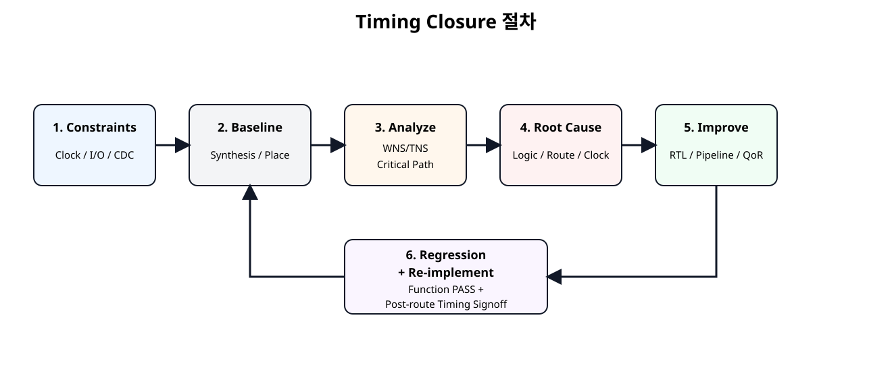
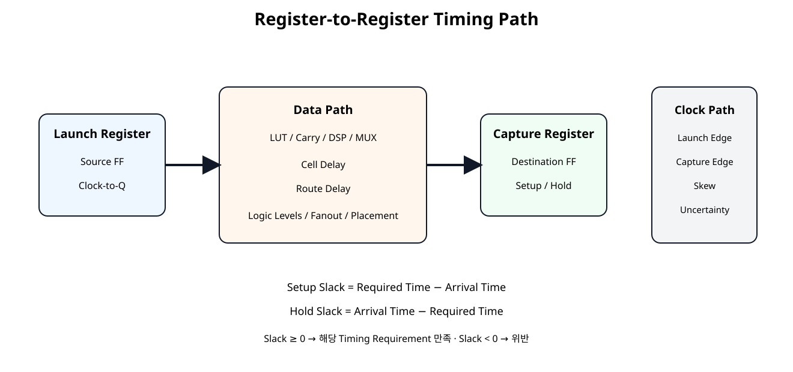
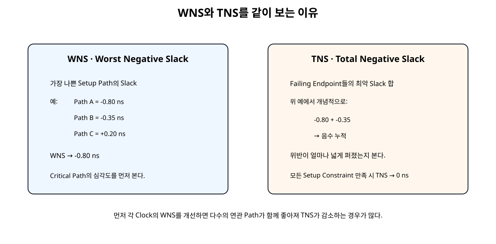
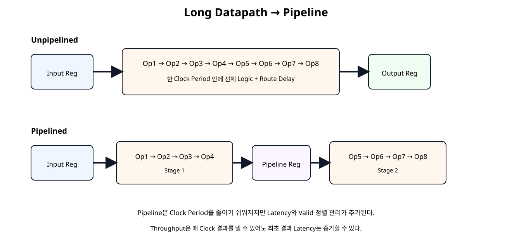

# Timing / Critical Path / WNS / TNS


## 전체 학습 위치


## 이번 장의 목표


[](../images/soc22/soc22_timing_closure_flow.svg)

Timing 문제는 Constraint → 분석 → 원인 → 구조 개선 → 재검증 순서로 해결한다.


## Timing Closure란 무엇인가

Timing Closure(타이밍 클로저, 모든 Timing 요구를 만족시키는 상태)는 단순히 WNS 하나를 양수로 만드는 작업이 아니다. Clock/CDC/I/O Constraint가 정확해야 하고 Setup/Hold 위반이 없어야 하며, 실제 Place/Route 결과에서 요구 Clock을 만족해야 한다.


## Constraint가 먼저다

Constraint가 틀린 상태에서 Slack 숫자를 개선하면 잘못된 문제를 최적화하게 된다. 먼저 Clock 정의, Generated Clock, Clock 관계, I/O Delay, CDC Exception을 검토한다.


## Clock Constraint

Basys3의 W5 100 MHz Clock은 Period 10 ns이다.


```text
create_clock \
    -name sys_clk \
    -period 10.000 \
    -waveform {0.000 5.000} \
    [get_ports clk]
```

MMCM/PLL 등으로 생성한 Clock은 Master Clock과의 관계를 create_generated_clock으로 표현한다.


## Timing Path 종류


| Path | 의미 |
| --- | --- |
| Input → Register | 외부 Device에서 FPGA 내부 Register까지 |
| Register → Register | 내부 동기회로의 핵심 Timing Path |
| Register → Output | FPGA Register에서 외부 Device까지 |
| Input → Output | 조합 I/O Path |


## Register-to-Register Path


[](../images/soc22/soc22_timing_path.svg)

Source Clock Path, Data Path, Destination Clock Path의 관계를 기준으로 Timing을 해석한다.


## Setup 분석

Setup은 Data가 다음 Capture Edge 전에 충분히 일찍 도착하는지 보는 Max Delay 분석이다.

Slack이 음수라면 Data Path가 주어진 Clock Budget보다 늦었다는 뜻이다.


## Hold 분석

Hold는 Data가 Capture Edge 직후 너무 빨리 바뀌지 않는지 보는 Min Delay 분석이다.

Setup과 Hold는 같은 Path라도 Delay 계산 방향과 Clock Delay 선택이 다르므로 별도로 확인한다.


## Slack 읽는 법


| Slack | 의미 |
| --- | --- |
| > 0 ns | 해당 Timing Requirement 만족 |
| = 0 ns | Margin 없이 경계 |
| < 0 ns | Timing Violation |

Slack이 양수라고 해서 전체 Design이 Timing Closure된 것은 아니다. 모든 관련 Clock/Path를 확인해야 한다.


## WNS

WNS(Worst Negative Slack, 최악의 음수 여유)는 Setup/Recovery Max Delay 분석에서 가장 나쁜 Slack이다. 이름에 Negative가 들어가지만 Timing을 만족하면 값 자체는 양수가 될 수 있다.


## TNS


[](../images/soc22/soc22_wns_tns.svg)

WNS는 최악 Path, TNS는 위반이 Endpoint 전체에 얼마나 퍼져 있는지를 본다.

모든 Setup 관련 Constraint가 만족되면 TNS는 0 ns이다. AMD는 Timing Closure 시 각 Clock의 WNS를 우선 개선하면 다수의 연관 Path가 함께 좋아져 TNS가 줄어드는 경우가 많다고 설명한다.


## WHS / THS

Hold 영역에서는 WHS(Worst Hold Slack, 최악 Hold 여유)와 THS(Total Hold Slack, Hold 위반 누적)를 본다.


## Synthesis Timing과 Post-route Timing

Synthesis 직후 Timing Report의 Net Delay는 Placement/Route가 완료되지 않았기 때문에 추정값이다. Route 완료 후에는 실제 Routing 정보를 기반으로 Delay가 계산된다.


## Critical Path

Critical Path는 현재 요구 조건에서 Slack이 가장 나쁜 Path다. Startpoint와 Endpoint 이름만 보지 말고 Path Requirement, Datapath Delay, Cell Delay, Route Delay, Clock Skew, Clock Uncertainty를 함께 본다.


## Cell Delay와 Route Delay


| 주요 원인 | 접근 |
| --- | --- |
| Logic Delay 비중 큼 | Logic Levels, 연산 구조, Pipeline 검토 |
| Route Delay 비중 큼 | Fanout, Placement, Congestion, Physical Optimization 검토 |
| Clock Skew 큼 | Clocking 구조와 Constraint 검토 |
| Uncertainty 큼 | Clock 정의와 실제 Clock 품질 검토 |


## Logic Levels

report_design_analysis -setup -logic_level_distribution으로 Worst Path의 Logic Level 분포를 볼 수 있다. Logic Level이 많으면 Placement 전에 RTL 구조 자체를 먼저 개선하는 것이 효율적인 경우가 많다.


## 실습용 긴 Data Path

이번 Timing Lab은 Input Register와 Output Register 사이에 8개의 의존 연산을 둔다. 연산 하나의 결과가 다음 연산 입력으로 이어지므로 한 Clock Period의 Logic Depth가 길어진다.


## Unpipelined RTL


```verilog
module timing_chain_unpipelined (
    input  wire        clk,
    input  wire        resetn,

    input  wire [31:0] a_i,
    input  wire [31:0] b_i,
    input  wire [31:0] c_i,
    input  wire [31:0] d_i,
    input  wire [31:0] e_i,
    input  wire [31:0] f_i,
    input  wire [31:0] g_i,
    input  wire [31:0] h_i,
    input  wire        valid_i,

    output reg  [31:0] result_o,
    output reg         valid_o
);

// Input registers create a true internal register-to-register timing path.
reg [31:0] a_q;
reg [31:0] b_q;
reg [31:0] c_q;
reg [31:0] d_q;
reg [31:0] e_q;
reg [31:0] f_q;
reg [31:0] g_q;
reg [31:0] h_q;
reg        valid_q;

// Dependent logic chain.
// Each result feeds the next operation, so logic depth matters.
wire [31:0] t1;
wire [31:0] t2;
wire [31:0] t3;
wire [31:0] t4;
wire [31:0] t5;
wire [31:0] t6;
wire [31:0] t7;
wire [31:0] t8;

assign t1 = a_q + b_q;
assign t2 = t1 ^ {c_q[15:0], c_q[31:16]};
assign t3 = t2 + d_q;
assign t4 = {t3[30:0], t3[31]} ^ e_q;
assign t5 = t4 + f_q;
assign t6 = t5 ^ {g_q[7:0], g_q[31:8]};
assign t7 = t6 + h_q;
assign t8 = (t7 ^ {t7[3:0], t7[31:4]}) + 32'h1357_9BDF;

always @(posedge clk) begin
    if (!resetn) begin
        a_q      <= 32'h0000_0000;
        b_q      <= 32'h0000_0000;
        c_q      <= 32'h0000_0000;
        d_q      <= 32'h0000_0000;
        e_q      <= 32'h0000_0000;
        f_q      <= 32'h0000_0000;
        g_q      <= 32'h0000_0000;
        h_q      <= 32'h0000_0000;
        valid_q  <= 1'b0;

        result_o <= 32'h0000_0000;
        valid_o  <= 1'b0;
    end else begin
        a_q     <= a_i;
        b_q     <= b_i;
        c_q     <= c_i;
        d_q     <= d_i;
        e_q     <= e_i;
        f_q     <= f_i;
        g_q     <= g_i;
        h_q     <= h_i;
        valid_q <= valid_i;

        result_o <= t8;
        valid_o  <= valid_q;
    end
end

endmodule
```

이 구조는 Latency가 짧지만 모든 연산 Delay를 한 Clock Period 안에서 만족해야 한다.


## Pipelined RTL


[](../images/soc22/soc22_pipeline_compare.svg)

중간 Register를 넣어 긴 조합 경로를 두 Clock Stage로 분할한다.


```verilog
module timing_chain_pipelined (
    input  wire        clk,
    input  wire        resetn,

    input  wire [31:0] a_i,
    input  wire [31:0] b_i,
    input  wire [31:0] c_i,
    input  wire [31:0] d_i,
    input  wire [31:0] e_i,
    input  wire [31:0] f_i,
    input  wire [31:0] g_i,
    input  wire [31:0] h_i,
    input  wire        valid_i,

    output reg  [31:0] result_o,
    output reg         valid_o
);

// Stage 0 input registers.
reg [31:0] a_q;
reg [31:0] b_q;
reg [31:0] c_q;
reg [31:0] d_q;
reg [31:0] e_q;
reg [31:0] f_q;
reg [31:0] g_q;
reg [31:0] h_q;
reg        valid_q;

// First half of the original dependent chain.
wire [31:0] s1_t1;
wire [31:0] s1_t2;
wire [31:0] s1_t3;
wire [31:0] s1_t4;

assign s1_t1 = a_q + b_q;
assign s1_t2 = s1_t1 ^ {c_q[15:0], c_q[31:16]};
assign s1_t3 = s1_t2 + d_q;
assign s1_t4 = {s1_t3[30:0], s1_t3[31]} ^ e_q;

// Pipeline registers split the long combinational path.
reg [31:0] mid_data_q;
reg [31:0] f_mid_q;
reg [31:0] g_mid_q;
reg [31:0] h_mid_q;
reg        mid_valid_q;

// Second half of the chain.
wire [31:0] s2_t5;
wire [31:0] s2_t6;
wire [31:0] s2_t7;
wire [31:0] s2_t8;

assign s2_t5 = mid_data_q + f_mid_q;
assign s2_t6 = s2_t5 ^ {g_mid_q[7:0], g_mid_q[31:8]};
assign s2_t7 = s2_t6 + h_mid_q;
assign s2_t8 = (s2_t7 ^ {s2_t7[3:0], s2_t7[31:4]}) + 32'h1357_9BDF;

always @(posedge clk) begin
    if (!resetn) begin
        a_q         <= 32'h0000_0000;
        b_q         <= 32'h0000_0000;
        c_q         <= 32'h0000_0000;
        d_q         <= 32'h0000_0000;
        e_q         <= 32'h0000_0000;
        f_q         <= 32'h0000_0000;
        g_q         <= 32'h0000_0000;
        h_q         <= 32'h0000_0000;
        valid_q     <= 1'b0;

        mid_data_q  <= 32'h0000_0000;
        f_mid_q     <= 32'h0000_0000;
        g_mid_q     <= 32'h0000_0000;
        h_mid_q     <= 32'h0000_0000;
        mid_valid_q <= 1'b0;

        result_o    <= 32'h0000_0000;
        valid_o     <= 1'b0;
    end else begin
        a_q     <= a_i;
        b_q     <= b_i;
        c_q     <= c_i;
        d_q     <= d_i;
        e_q     <= e_i;
        f_q     <= f_i;
        g_q     <= g_i;
        h_q     <= h_i;
        valid_q <= valid_i;

        mid_data_q  <= s1_t4;
        f_mid_q     <= f_q;
        g_mid_q     <= g_q;
        h_mid_q     <= h_q;
        mid_valid_q <= valid_q;

        result_o <= s2_t8;
        valid_o  <= mid_valid_q;
    end
end

endmodule
```


## Latency와 Throughput


| 항목 | Unpipelined | Pipelined |
| --- | --- | --- |
| 조합 경로 | 길다 | 분할됨 |
| Clock 요구 대응 | 불리할 수 있음 | 유리할 수 있음 |
| 최초 결과 Latency | 짧음 | 증가 |
| Steady-state Throughput | 매 Clock 가능 | 매 Clock 가능 |
| 제어 복잡도 | 낮음 | Valid/Data 정렬 필요 |


## Basys3 Implementation 구조


```text
W5 100 MHz
   ↓
timing_pattern_source
   ↓
timing_chain_[un]pipelined
   ↓
timing_result_sink
   ↓
LED[15:0]
```

Data를 수백 개 외부 Pin으로 만들지 않고 내부 Pattern Source를 사용한다. Board Top은 Reset Polarity Adapter와 Implementation Top을 연결만 한다.


```text
## SoC 22 Basys3 implementation pin constraints

## 100 MHz clock
set_property -dict { PACKAGE_PIN W5 IOSTANDARD LVCMOS33 } [get_ports clk]

## Center push button, active high.
## reset_active_high_to_active_low converts btnC to internal resetn.
set_property -dict { PACKAGE_PIN U18 IOSTANDARD LVCMOS33 } [get_ports btnC]

## LEDs 0..15
set_property -dict { PACKAGE_PIN U16 IOSTANDARD LVCMOS33 } [get_ports {led_o[0]}]
set_property -dict { PACKAGE_PIN E19 IOSTANDARD LVCMOS33 } [get_ports {led_o[1]}]
set_property -dict { PACKAGE_PIN U19 IOSTANDARD LVCMOS33 } [get_ports {led_o[2]}]
set_property -dict { PACKAGE_PIN V19 IOSTANDARD LVCMOS33 } [get_ports {led_o[3]}]
set_property -dict { PACKAGE_PIN W18 IOSTANDARD LVCMOS33 } [get_ports {led_o[4]}]
set_property -dict { PACKAGE_PIN U15 IOSTANDARD LVCMOS33 } [get_ports {led_o[5]}]
set_property -dict { PACKAGE_PIN U14 IOSTANDARD LVCMOS33 } [get_ports {led_o[6]}]
set_property -dict { PACKAGE_PIN V14 IOSTANDARD LVCMOS33 } [get_ports {led_o[7]}]
set_property -dict { PACKAGE_PIN V13 IOSTANDARD LVCMOS33 } [get_ports {led_o[8]}]
set_property -dict { PACKAGE_PIN V3 IOSTANDARD LVCMOS33 } [get_ports {led_o[9]}]
set_property -dict { PACKAGE_PIN W3 IOSTANDARD LVCMOS33 } [get_ports {led_o[10]}]
set_property -dict { PACKAGE_PIN U3 IOSTANDARD LVCMOS33 } [get_ports {led_o[11]}]
set_property -dict { PACKAGE_PIN P3 IOSTANDARD LVCMOS33 } [get_ports {led_o[12]}]
set_property -dict { PACKAGE_PIN N3 IOSTANDARD LVCMOS33 } [get_ports {led_o[13]}]
set_property -dict { PACKAGE_PIN P1 IOSTANDARD LVCMOS33 } [get_ports {led_o[14]}]
set_property -dict { PACKAGE_PIN L1 IOSTANDARD LVCMOS33 } [get_ports {led_o[15]}]
```


## 100 MHz Baseline

정상 Basys3 기준은 10 ns Clock이다.


```text
vivado -mode batch \
  -source scripts/run_timing_lab.tcl \
  -tclargs unpipelined 10.0

vivado -mode batch \
  -source scripts/run_timing_lab.tcl \
  -tclargs pipelined 10.0
```

두 구조가 모두 100 MHz에서 만족할 수도 있다. 실제 결과를 보고 판단한다.


## 200 MHz Stress Constraint

5 ns Constraint는 구조 차이를 더 분명하게 관찰하기 위한 Stress 실험이다.


## 자동 Timing Report


```text
# SoC 22 - Basys3 Timing Lab
#
# Usage examples:
#   vivado -mode batch -source scripts/run_timing_lab.tcl \
#          -tclargs unpipelined 10.0
#
#   vivado -mode batch -source scripts/run_timing_lab.tcl \
#          -tclargs pipelined 5.0
#
# arg0 : unpipelined | pipelined
# arg1 : clock period in ns

if {$argc < 2} {
    puts "ERROR: usage: run_timing_lab.tcl <unpipelined|pipelined> <period_ns>"
    exit 1
}

set variant [lindex $argv 0]
set period_ns [lindex $argv 1]

if {$variant eq "unpipelined"} {
    set top_name timing_lab_unpipelined_basys3_top
    set core_file timing_chain_unpipelined.v
} elseif {$variant eq "pipelined"} {
    set top_name timing_lab_pipelined_basys3_top
    set core_file timing_chain_pipelined.v
} else {
    puts "ERROR: unknown variant '$variant'"
    exit 1
}

set script_dir [file dirname [file normalize [info script]]]
set root_dir [file normalize [file join $script_dir ".."]]
set rtl_dir [file join $root_dir "rtl"]
set xdc_dir [file join $root_dir "constraints"]

set run_tag "${variant}_${period_ns}ns"
set out_dir [file normalize [file join $root_dir "reports" $run_tag]]

file mkdir $out_dir

create_project -in_memory -part xc7a35tcpg236-1

read_verilog [file join $rtl_dir "reset_active_high_to_active_low.v"]
read_verilog [file join $rtl_dir "timing_pattern_source.v"]
read_verilog [file join $rtl_dir "timing_result_sink.v"]
read_verilog [file join $rtl_dir $core_file]

if {$variant eq "unpipelined"} {
    read_verilog [file join $rtl_dir "timing_lab_unpipelined_impl_top.v"]
    read_verilog [file join $rtl_dir "timing_lab_unpipelined_basys3_top.v"]
} else {
    read_verilog [file join $rtl_dir "timing_lab_pipelined_impl_top.v"]
    read_verilog [file join $rtl_dir "timing_lab_pipelined_basys3_top.v"]
}

synth_design \
    -top $top_name \
    -part xc7a35tcpg236-1

read_xdc [file join $xdc_dir "basys3_timing_lab_pins.xdc"]

create_clock \
    -name sys_clk \
    -period $period_ns \
    [get_ports clk]

report_methodology \
    -file [file join $out_dir "01_methodology_synth.rpt"]

report_timing_summary \
    -delay_type min_max \
    -report_unconstrained \
    -max_paths 10 \
    -file [file join $out_dir "02_timing_summary_post_synth.rpt"]

report_design_analysis \
    -max_paths 50 \
    -setup \
    -logic_level_distribution \
    -file [file join $out_dir "03_design_analysis_post_synth.rpt"]

opt_design
place_design

report_timing_summary \
    -delay_type min_max \
    -report_unconstrained \
    -max_paths 10 \
    -file [file join $out_dir "04_timing_summary_post_place.rpt"]

phys_opt_design
route_design

report_timing_summary \
    -delay_type min_max \
    -report_unconstrained \
    -max_paths 20 \
    -file [file join $out_dir "05_timing_summary_post_route.rpt"]

report_timing \
    -delay_type max \
    -max_paths 20 \
    -nworst 1 \
    -sort_by group \
    -input_pins \
    -file [file join $out_dir "06_worst_setup_paths.rpt"]

report_timing \
    -delay_type min \
    -max_paths 20 \
    -nworst 1 \
    -sort_by group \
    -input_pins \
    -file [file join $out_dir "07_worst_hold_paths.rpt"]

report_design_analysis \
    -max_paths 50 \
    -setup \
    -logic_level_distribution \
    -file [file join $out_dir "08_design_analysis_post_route.rpt"]

report_qor_suggestions \
    -file [file join $out_dir "09_qor_suggestions.rpt"]

report_utilization \
    -hierarchical \
    -file [file join $out_dir "10_utilization.rpt"]

report_clock_interaction \
    -file [file join $out_dir "11_clock_interaction.rpt"]

report_methodology \
    -file [file join $out_dir "12_methodology_post_route.rpt"]

write_checkpoint -force \
    [file join $out_dir "${run_tag}_post_route.dcp"]

puts ""
puts "SoC 22 timing run complete."
puts "Variant      : $variant"
puts "Clock period : $period_ns ns"
puts "Reports      : $out_dir"
puts ""
puts "Use the post-route Timing Summary for final comparison."
```

각 Case는 Synthesis → Opt → Place → Phys Opt → Route 후 Timing Summary, Worst Setup/Hold, Design Analysis, QoR Suggestions, Utilization, Clock Interaction, Methodology Report를 저장한다.


## Post-route Timing Signoff

최종 비교 파일은 각 Case의 다음 Report다.


```text
reports/<variant>_<period>ns/
└── 05_timing_summary_post_route.rpt
```

Setup WNS/TNS, Hold WHS/THS, Failing Endpoint, Unconstrained Paths를 먼저 확인한다.


## Report Design Analysis

Timing Summary가 “얼마나 실패했는가”를 보여준다면 Report Design Analysis는 Worst Path의 Logic Level, Delay 특성, Routing Complexity를 분석해 “왜 실패했는가”를 찾는 데 유용하다.


## QoR Suggestions

report_qor_suggestions는 Timing/Clocking/Congestion/Netlist 문제를 분석해 개선 후보를 제시한다. 하지만 제안 적용 전에 RTL과 Constraint의 본질적인 문제를 먼저 확인한다.


## False Path 주의

set_false_path는 기능적으로 Timing 관계가 없는 Path를 Timing Analysis에서 제외하는 Constraint다.


## Multicycle Path 주의

set_multicycle_path는 설계 기능상 Data가 한 Clock이 아니라 여러 Clock 후 Capture되어도 되는 경우에만 사용한다.


## Hold Fix 주의

Hold는 Data가 너무 빨리 도착하는 문제다. Pipeline은 주로 긴 Setup Path 개선 기법이며 Hold 문제를 같은 방식으로 해석하면 안 된다. Hold Fix가 Setup을 악화시키지 않는지도 함께 확인한다.


## SoC 21 Regression과 연결


```verilog
`timescale 1ns / 1ps

module tb_timing_lab_compare;

logic clk = 1'b0;
logic resetn = 1'b0;

logic [31:0] a_i;
logic [31:0] b_i;
logic [31:0] c_i;
logic [31:0] d_i;
logic [31:0] e_i;
logic [31:0] f_i;
logic [31:0] g_i;
logic [31:0] h_i;
logic        valid_i;

wire [31:0] unpipelined_result_o;
wire        unpipelined_valid_o;

wire [31:0] pipelined_result_o;
wire        pipelined_valid_o;

int errors = 0;
int checks = 0;

logic [31:0] expected_unpipelined_q[$];
logic [31:0] expected_pipelined_q[$];

always #5 clk = ~clk;

timing_lab_compare_top dut (
    .clk(clk),
    .resetn(resetn),

    .a_i(a_i),
    .b_i(b_i),
    .c_i(c_i),
    .d_i(d_i),
    .e_i(e_i),
    .f_i(f_i),
    .g_i(g_i),
    .h_i(h_i),
    .valid_i(valid_i),

    .unpipelined_result_o(unpipelined_result_o),
    .unpipelined_valid_o(unpipelined_valid_o),

    .pipelined_result_o(pipelined_result_o),
    .pipelined_valid_o(pipelined_valid_o)
);

function automatic logic [31:0] reference_model(
    input logic [31:0] a,
    input logic [31:0] b,
    input logic [31:0] c,
    input logic [31:0] d,
    input logic [31:0] e,
    input logic [31:0] f,
    input logic [31:0] g,
    input logic [31:0] h
);
    logic [31:0] t1;
    logic [31:0] t2;
    logic [31:0] t3;
    logic [31:0] t4;
    logic [31:0] t5;
    logic [31:0] t6;
    logic [31:0] t7;
    logic [31:0] t8;

    begin
        t1 = a + b;
        t2 = t1 ^ {c[15:0], c[31:16]};
        t3 = t2 + d;
        t4 = {t3[30:0], t3[31]} ^ e;
        t5 = t4 + f;
        t6 = t5 ^ {g[7:0], g[31:8]};
        t7 = t6 + h;
        t8 = (t7 ^ {t7[3:0], t7[31:4]}) + 32'h1357_9BDF;

        reference_model = t8;
    end
endfunction

task automatic drive_case(
    input logic [31:0] a,
    input logic [31:0] b,
    input logic [31:0] c,
    input logic [31:0] d,
    input logic [31:0] e,
    input logic [31:0] f,
    input logic [31:0] g,
    input logic [31:0] h
);
    begin
        @(negedge clk);

        a_i = a;
        b_i = b;
        c_i = c;
        d_i = d;
        e_i = e;
        f_i = f;
        g_i = g;
        h_i = h;
        valid_i = 1'b1;

        expected_unpipelined_q.push_back(
            reference_model(a, b, c, d, e, f, g, h)
        );

        expected_pipelined_q.push_back(
            reference_model(a, b, c, d, e, f, g, h)
        );
    end
endtask

task automatic stop_input;
    begin
        @(negedge clk);
        valid_i = 1'b0;
    end
endtask

always @(posedge clk) begin
    if (resetn && unpipelined_valid_o) begin
        checks++;

        if (expected_unpipelined_q.size() == 0) begin
            errors++;
            $error("UNPIPELINED: unexpected valid");
        end else if (
            unpipelined_result_o !== expected_unpipelined_q[0]
        ) begin
            errors++;
            $error(
                "UNPIPELINED mismatch actual=%08h expected=%08h",
                unpipelined_result_o,
                expected_unpipelined_q[0]
            );
            expected_unpipelined_q.pop_front();
        end else begin
            $display(
                "PASS: unpipelined result=%08h",
                unpipelined_result_o
            );
            expected_unpipelined_q.pop_front();
        end
    end

    if (resetn && pipelined_valid_o) begin
        checks++;

        if (expected_pipelined_q.size() == 0) begin
            errors++;
            $error("PIPELINED: unexpected valid");
        end else if (
            pipelined_result_o !== expected_pipelined_q[0]
        ) begin
            errors++;
            $error(
                "PIPELINED mismatch actual=%08h expected=%08h",
                pipelined_result_o,
                expected_pipelined_q[0]
            );
            expected_pipelined_q.pop_front();
        end else begin
            $display(
                "PASS: pipelined result=%08h",
                pipelined_result_o
            );
            expected_pipelined_q.pop_front();
        end
    end
end

initial begin
    a_i = 0;
    b_i = 0;
    c_i = 0;
    d_i = 0;
    e_i = 0;
    f_i = 0;
    g_i = 0;
    h_i = 0;
    valid_i = 0;

    repeat (5) @(posedge clk);
    resetn = 1'b1;

    drive_case(
        32'h0000_0001,
        32'h0000_0002,
        32'h1234_5678,
        32'h0000_0010,
        32'hA5A5_5A5A,
        32'h0102_0304,
        32'h89AB_CDEF,
        32'h0000_1000
    );

    drive_case(
        32'hFFFF_FFFF,
        32'h0000_0001,
        32'h0F0F_F0F0,
        32'h1111_1111,
        32'h2222_2222,
        32'h3333_3333,
        32'h4444_4444,
        32'h5555_5555
    );

    repeat (20) begin
        drive_case(
            $urandom(),
            $urandom(),
            $urandom(),
            $urandom(),
            $urandom(),
            $urandom(),
            $urandom(),
            $urandom()
        );
    end

    stop_input();

    repeat (8) @(posedge clk);

    if (expected_unpipelined_q.size() != 0) begin
        errors++;
        $error(
            "Unpipelined expected queue not empty: %0d entries",
            expected_unpipelined_q.size()
        );
    end

    if (expected_pipelined_q.size() != 0) begin
        errors++;
        $error(
            "Pipelined expected queue not empty: %0d entries",
            expected_pipelined_q.size()
        );
    end

    $display("");
    $display("SOC22 CHECK COUNT : %0d", checks);
    $display("SOC22 ERROR COUNT : %0d", errors);

    if (errors == 0) begin
        $display("SOC22 FUNCTIONAL REGRESSION: PASS");
    end else begin
        $fatal(
            1,
            "SOC22 FUNCTIONAL REGRESSION: FAIL (%0d errors)",
            errors
        );
    end

    #30;
    $finish;
end

endmodule
```

Pipeline 추가 후 결과 Latency는 달라졌지만 Reference Model 기준 기능은 동일해야 한다. 따라서 Timing 최적화와 Functional Regression을 반드시 같이 수행한다.


## NPU / DSP 연결

향후 MAC Array, Accumulator Tree, Activation, Address Generation 같은 NPU Datapath에서도 동일한 원칙을 사용한다.


## 오류 점검


| 증상 | 원인 후보 | 확인 |
| --- | --- | --- |
| WNS가 음수 | 긴 Logic/Route/Clock 문제 | Worst Setup Path |
| TNS가 매우 큼 | 여러 Endpoint가 연쇄 실패 | Clock별 WNS부터 개선 |
| Post-synth는 PASS, Post-route는 FAIL | 실제 Route Delay 증가 | Route Delay 비율 |
| Logic Delay 비율 큼 | Logic Level 과다 | Pipeline/RTL 구조 |
| Route Delay 비율 큼 | Fanout/Placement/Congestion | Design Analysis/QoR |
| Hold만 실패 | Min Delay 문제 | WHS/THS |
| Exception 추가 후 PASS | 실제 요구를 숨겼을 가능성 | False/Multicycle 정당성 |
| Pipeline 후 기능 실패 | Latency/Valid 정렬 오류 | SoC 21 방식 Regression |


## SoC 22 완료 체크리스트

- [ ] Clock Constraint를 먼저 정의한다.
- [ ] Setup과 Hold의 Slack 식을 구분한다.
- [ ] WNS와 TNS의 의미를 구분한다.
- [ ] Hold는 WHS와 THS를 확인한다.
- [ ] Synthesis Timing을 최종 Signoff로 사용하지 않는다.
- [ ] Post-route Timing Summary를 최종 기준으로 사용한다.
- [ ] Critical Path의 Cell Delay와 Route Delay를 구분한다.
- [ ] Logic Level이 많은 Path는 RTL 구조 개선을 검토한다.
- [ ] 긴 Data Path를 Pipeline으로 분할할 수 있다.
- [ ] Pipeline의 Latency 증가와 Throughput을 구분한다.
- [ ] False Path로 Negative Slack을 숨기지 않는다.
- [ ] Multicycle은 기능적으로 정당한 Path에만 적용한다.
- [ ] Timing 변경 후 Functional Regression을 다시 실행한다.

## 공식 매뉴얼 및 원본 근거


| 문서 | 확인 항목 |
| --- | --- |
| AMD UG906 · Timing Analysis · 2026.1 | Timing Signoff와 Timing Report 기본 |
| AMD UG906 · Timing Path Summary · 2026.1 | Setup/Hold Slack 공식 |
| AMD UG906 · Setup Area · 2026.1 | WNS/TNS 정의 |
| AMD UG906 · Hold Area · 2026.1 | WHS/THS 정의 |
| AMD UG906 · Report Design Analysis · 2026.1 | Logic Level, Timing/Complexity/Congestion 분석 |
| AMD UG949 · Timing Closure · 2026.1 | WNS 우선 개선과 Post-route Signoff |
| AMD UG949 · Pipelining Considerations · 2026.1 | Long Datapath 분할과 Latency Trade-off |
| AMD UG903 · Timing Constraints · 2026.1 | Clock/Generated Clock/Timing Exception Constraint |

