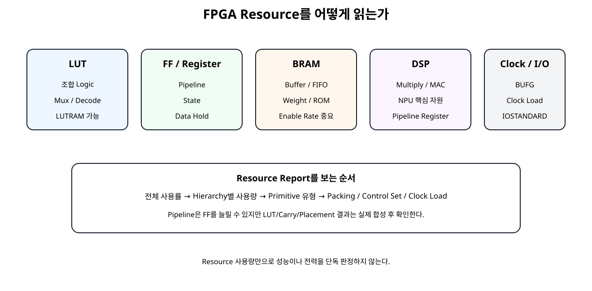
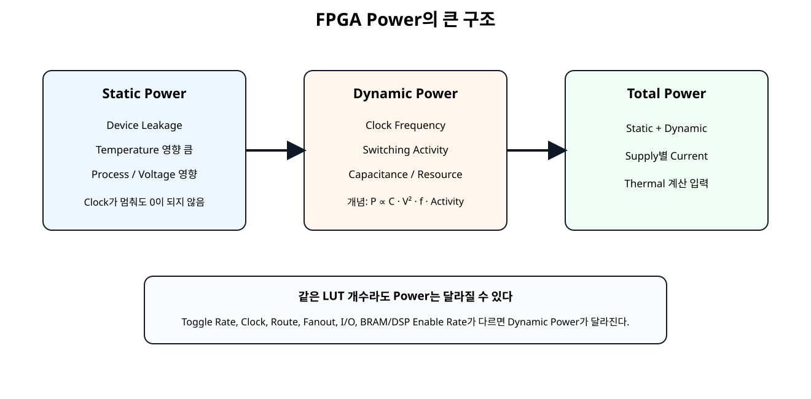
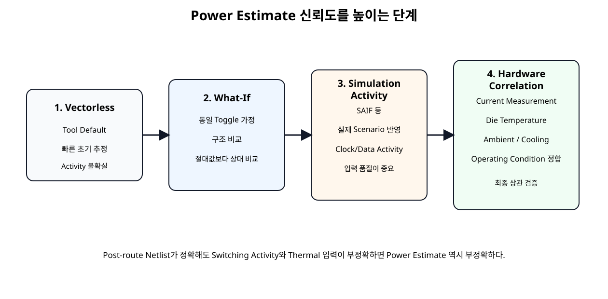
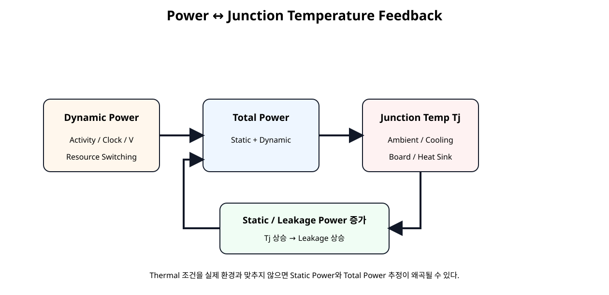
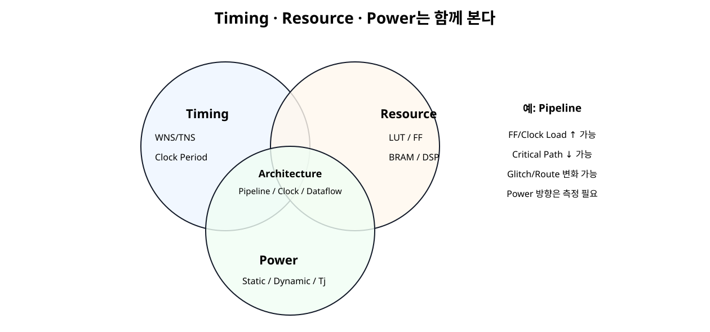

# Resource / Power / Thermal


## 전체 학습 위치


## 이번 장의 목표

“LUT가 적다 = 전력이 작다”처럼 단일 지표로 결론 내리지 않고, 동일 조건의 Vivado Report를 통해 구조 차이를 해석한다.


## 왜 Resource와 Power를 같이 보는가

FPGA Power는 Resource 개수뿐 아니라 Clock, Activity, Routing, I/O, Voltage, Temperature의 영향을 함께 받는다. 같은 Logic 기능이라도 구조와 배치가 달라지면 Dynamic Power가 달라질 수 있다.


## Resource Report 전체 구조


[](../images/soc23/soc23_resource_map.svg)

Vivado Utilization Report는 Logic, Register, RAM, Arithmetic, Clocking, I/O 등의 실제 구현 자원을 계층별로 보여준다.


## LUT / FF


| Resource | 주요 역할 | 확인 포인트 |
| --- | --- | --- |
| LUT | 조합 Logic, Decode, Mux | LUT as Logic / LUT as Memory 구분 |
| FF/Register | State, Pipeline, Data Hold | Pipeline 증가와 Clock Load 연결 |
| Carry | Add/Sub/Counter | Arithmetic Path와 Timing 영향 |


## BRAM / LUTRAM

Block RAM은 Buffer, FIFO, Weight/Activation Memory에 중요하다. report_ram_utilization -include_lutram으로 BRAM뿐 아니라 LUTRAM까지 확인한다.

Power 관점에서는 BRAM Enable Rate와 Write Activity가 중요하므로 단순 Block 개수만 보지 않는다.


## DSP

DSP48 계열은 Multiply, MAC, Accumulate 등에 사용되며 이후 NPU 과정에서 핵심 자원이다. DSP를 LUT로 구현했는지 Dedicated DSP를 사용했는지는 Timing과 Power 모두에 영향을 줄 수 있으므로 Utilization Report에서 확인한다.


## Clock / I/O Resource

report_clock_utilization은 Clock Primitive와 Clock Net Load를 확인하는 데 사용한다. Clock Network는 많은 Sequential Load를 계속 Toggle시키므로 Dynamic Power에서 중요한 축이다.


## Pipeline과 Resource 변화

SoC 22의 Pipeline 구조는 중간 Register가 추가되므로 FF가 늘 가능성이 높다. 하지만 LUT Packing, Carry Mapping, Route, Optimization 결과까지 포함한 실제 Resource 수는 합성·구현 결과를 확인해야 한다.


## Power의 큰 구조


[](../images/soc23/soc23_power_structure.svg)

Total Power는 Static과 Dynamic의 합이며 Dynamic은 Activity와 Clock에 민감하다.


## Static Power

Static Power는 Device Leakage와 관련되며 Process, Voltage, Junction Temperature의 영향을 받는다. Clock가 멈춰도 0이 되지 않는다.


## Dynamic Power

Dynamic Power는 Logic/Clock/I/O/BRAM/DSP 등이 실제로 전환될 때 발생한다.

FPGA에서는 Glitch, Routing, Clock Network, Resource 종류 때문에 단순 식만으로 실제 Power를 확정하지 않고 Vivado Power Model을 사용한다.


## Switching Activity

Report Power는 알려진 Activity를 Netlist에 Annotation하고, 정의되지 않은 Node에는 Tool Default를 적용한 뒤 Activity를 전파하여 Dynamic Power를 추정한다.


## Toggle Rate와 Static Probability


```text
set_switching_activity \
    -default_static_probability 0.5 \
    -default_toggle_rate 12.5
```

이번 Lab의 12.5%는 실제 Board 측정값이 아니라 두 구조의 비교 조건을 동일하게 만들기 위한 What-If 가정이다.


## Clock Frequency와 Dynamic Power

동일 Logic과 Activity 비율이라도 Clock Frequency가 올라가면 단위 시간당 전환 횟수가 증가한다. Clock Activity는 set_switching_activity가 아니라 Clock Constraint를 기준으로 해석한다.


## VCCINT / VCCAUX / VCCO


| Rail | 개념 |
| --- | --- |
| VCCINT | FPGA Core Logic의 주 내부 전원 |
| VCCAUX | 보조 내부 회로/일부 Clock·Configuration 계열 전원 |
| VCCO | I/O Bank 전원, IOSTANDARD와 연계 |

Report Power에서는 Supply별 Power와 Current를 확인하고 실제 Board Power Budget과 연결한다.


## Power Estimate 신뢰도


[](../images/soc23/soc23_power_confidence.svg)

Netlist 정확도뿐 아니라 Activity와 Thermal 입력 품질이 Power Estimate의 신뢰도를 결정한다.


## Vectorless Estimate

Simulation Activity File이 없으면 Vivado의 Tool Default와 Activity Propagation으로 빠르게 Power를 추정할 수 있다. 초기 Architecture 비교에는 유용하지만 실제 Application의 Absolute Power로 곧바로 해석하지 않는다.


## What-If Activity

두 Variant에 동일한 Toggle Rate와 Static Probability를 주면 “같은 Activity 가정에서 구조 차이가 Power Model에 어떻게 반영되는가”를 비교할 수 있다.


## Simulation Activity / SAIF

실제 Workload를 Testbench에서 실행한 Switching Activity를 SAIF로 반영하면 Vectorless보다 Application 동작을 더 잘 표현할 수 있다. Vivado report_power는 read_saif로 Annotation된 Activity를 사용할 수 있다.


## Post-route Power

Vivado는 Post-synthesis, Post-place, Post-route에서 Power Analysis를 수행할 수 있으며, Post-route는 실제 Logic과 Routing Resource 정보가 포함되므로 가장 정확한 구현 단계다.


## Junction Temperature

Junction Temperature(Tj, 접합 온도)는 Leakage와 Static Power에 직접 영향을 준다. 실제 Hardware Power와 비교할 때는 측정 시점의 Die/Junction Temperature를 Power Model의 조건과 맞춰야 한다.


## Thermal Feedback


[](../images/soc23/soc23_thermal_feedback.svg)

Dynamic Power가 Total Power와 Tj를 높이고, 높은 Tj는 Leakage/Static Power를 다시 증가시킬 수 있다.


## Operating Conditions

Power Report 비교 전 report_operating_conditions를 저장한다. Ambient, Thermal/Cooling, Voltage, Process Condition이 다르면 동일 Netlist라도 Power 결과가 달라질 수 있다.


## Unpipelined vs Pipelined 비교 원칙


| 고정 조건 | 비교 값 |
| --- | --- |
| xc7a35tcpg236-1 | LUT / FF / Carry |
| 100 MHz / 10 ns | Clock Load |
| 동일 XDC | Post-route WNS/TNS |
| 동일 Activity | Dynamic Power |
| 동일 Operating Conditions | Static / Total / Tj |


## 자동 Resource/Power Report


```text
# SoC 23 - Resource / Power / Thermal Lab
#
# Usage:
#   vivado -mode batch -source scripts/run_resource_power_lab.tcl \
#          -tclargs unpipelined
#
#   vivado -mode batch -source scripts/run_resource_power_lab.tcl \
#          -tclargs pipelined
#
# Comparison policy:
# - Same device
# - Same 100 MHz clock requirement
# - Same pin constraints
# - Same switching-activity assumption
# - Same implementation flow
#
# This keeps the comparison meaningful.

if {$argc < 1} {
    puts "ERROR: usage: run_resource_power_lab.tcl <unpipelined|pipelined>"
    exit 1
}

set variant [lindex $argv 0]

if {$variant eq "unpipelined"} {
    set top_name timing_lab_unpipelined_basys3_top
    set core_file timing_chain_unpipelined.v
    set impl_file timing_lab_unpipelined_impl_top.v
    set board_file timing_lab_unpipelined_basys3_top.v
} elseif {$variant eq "pipelined"} {
    set top_name timing_lab_pipelined_basys3_top
    set core_file timing_chain_pipelined.v
    set impl_file timing_lab_pipelined_impl_top.v
    set board_file timing_lab_pipelined_basys3_top.v
} else {
    puts "ERROR: unknown variant '$variant'"
    exit 1
}

set script_dir [file dirname [file normalize [info script]]]
set root_dir [file normalize [file join $script_dir ".."]]
set rtl_dir [file join $root_dir "rtl"]
set xdc_dir [file join $root_dir "constraints"]
set out_dir [file normalize [file join $root_dir "reports" $variant]]

file mkdir $out_dir

create_project -in_memory -part xc7a35tcpg236-1

read_verilog [file join $rtl_dir "reset_active_high_to_active_low.v"]
read_verilog [file join $rtl_dir "timing_pattern_source.v"]
read_verilog [file join $rtl_dir "timing_result_sink.v"]
read_verilog [file join $rtl_dir $core_file]
read_verilog [file join $rtl_dir $impl_file]
read_verilog [file join $rtl_dir $board_file]

synth_design \
    -top $top_name \
    -part xc7a35tcpg236-1

read_xdc [file join $xdc_dir "basys3_resource_power_pins.xdc"]

# Basys3 board clock baseline.
create_clock \
    -name sys_clk \
    -period 10.000 \
    [get_ports clk]

# Post-synthesis resource baseline.
report_utilization \
    -hierarchical \
    -file [file join $out_dir "01_utilization_post_synth.rpt"]

report_ram_utilization \
    -include_lutram \
    -file [file join $out_dir "02_ram_utilization_post_synth.rpt"]

opt_design
place_design
phys_opt_design
route_design

# Final implemented resource reports.
report_utilization \
    -hierarchical \
    -file [file join $out_dir "03_utilization_post_route.rpt"]

report_clock_utilization \
    -file [file join $out_dir "04_clock_utilization_post_route.rpt"]

report_ram_utilization \
    -include_lutram \
    -file [file join $out_dir "05_ram_utilization_post_route.rpt"]

# Keep timing visible: power/resource changes must not hide timing failures.
report_timing_summary \
    -delay_type min_max \
    -report_unconstrained \
    -max_paths 10 \
    -file [file join $out_dir "06_timing_summary_post_route.rpt"]

# Environment/voltage/process assumptions used by Report Power.
report_operating_conditions \
    -file [file join $out_dir "07_operating_conditions.rpt"]

# Power report using Vivado's current/default activity sources.
report_power \
    -file [file join $out_dir "08_power_default_activity.rpt"] \
    -rpx  [file join $out_dir "08_power_default_activity.rpx"]

# Controlled What-If comparison:
# same default activity assumptions for both variants.
set_switching_activity \
    -default_static_probability 0.5 \
    -default_toggle_rate 12.5

report_switching_activity \
    -file [file join $out_dir "09_switching_activity_normalized.rpt"]

report_power \
    -file [file join $out_dir "10_power_normalized_activity.rpt"] \
    -rpx  [file join $out_dir "10_power_normalized_activity.rpx"]

# Power optimization is intentionally not inserted into the baseline
# comparison. First compare equivalent implementations.
report_power_opt \
    -file [file join $out_dir "11_power_optimization_status.rpt"]

report_methodology \
    -file [file join $out_dir "12_methodology_post_route.rpt"]

write_checkpoint -force \
    [file join $out_dir "${variant}_post_route.dcp"]

puts ""
puts "SoC 23 resource/power run complete."
puts "Variant : $variant"
puts "Reports : $out_dir"
puts ""
puts "Compare:"
puts "  03_utilization_post_route.rpt"
puts "  06_timing_summary_post_route.rpt"
puts "  07_operating_conditions.rpt"
puts "  10_power_normalized_activity.rpt"
puts ""
puts "Do not compare power numbers unless activity/environment assumptions match."
```

Baseline 비교에는 power_opt_design을 넣지 않는다. 먼저 동일 Implementation Flow의 구조 차이를 비교한 뒤 Power Optimization을 별도 실험으로 수행한다.


## Power Report 읽는 순서

Power 숫자 하나만 복사하지 않고 “어떤 가정으로 나온 값인지”를 함께 기록한다.


## Power Optimization

Vivado에는 power_opt_design과 report_power_opt가 있다. AMD는 Power Optimization이 Timing에 영향을 줄 수 있음을 명시하고 있으며, Timing 보존이 우선이면 Post-place Optimization을 고려할 수 있다.


## Clock Gating / Clock Enable

사용하지 않는 Logic의 Transition을 줄이면 Dynamic Power를 줄일 수 있다. FPGA에서는 일반 Fabric Logic로 Clock를 AND하는 방식보다 Clock Enable이나 Device Clock Buffer의 Enable 기능을 사용한다.

AMD는 7-Series에서도 BUFGCE/BUFHCE 등의 Clock Network Control과 Data/Clock Gating을 Power 절감 기법으로 설명한다.


## Timing·Resource·Power Trade-off


[](../images/soc23/soc23_tradeoff.svg)

Architecture 변경은 Timing, Resource, Power를 동시에 움직이므로 한 지표만 최적화하지 않는다.


## NPU / DSP 확장

향후 NPU에서는 MAC 개수만 늘리는 것이 목표가 아니다.

따라서 GOPS, Latency, DSP Utilization, BRAM Bandwidth, Power를 함께 평가한다.


## 실제 Board 측정 연결

최종적으로는 Vivado Estimate와 실제 Board를 비교한다. 같은 Bitstream과 Workload에서 Supply Current, Die Temperature, Ambient 조건을 기록하고 Model과 상관시킨다.

Power 측정 전에는 온도가 안정된 상태인지 확인해야 Static Power 비교가 의미가 있다.


## 오류 점검


| 증상 | 원인 후보 | 확인 |
| --- | --- | --- |
| 구조 A/B Power 차이가 지나치게 큼 | Activity 가정 다름 | Switching Activity Source |
| Static Power가 예상보다 큼 | Tj/Voltage/Process 조건 | Operating Conditions |
| Pipeline 후 Power 증가 | FF/Clock Load 증가 | Clock + Register Power |
| Pipeline 후 Power 감소 | Route/Glitch/Logic 변화 가능 | Resource별 Dynamic |
| BRAM 많지만 Power가 낮음 | Enable Rate 낮음 가능 | BRAM Activity |
| Post-route인데 Confidence 낮음 | Activity 입력 부족 | SAIF/What-If 입력 |
| Power Opt 후 Timing 실패 | Optimization Trade-off | Timing 재검증 |
| Estimate와 실제 Board 차이 큼 | Workload/Tj/전압/측정조건 불일치 | Hardware Correlation |


## SoC 23 완료 체크리스트

- [ ] LUT, FF, Carry, BRAM, DSP를 구분한다.
- [ ] Resource 수와 Power를 같은 개념으로 보지 않는다.
- [ ] Static Power와 Dynamic Power를 구분한다.
- [ ] Dynamic Power와 Switching Activity 관계를 이해한다.
- [ ] Toggle Rate와 Static Probability의 의미를 확인한다.
- [ ] Clock Activity는 Timing Clock Constraint와 연결해 해석한다.
- [ ] VCCINT/VCCAUX/VCCO Supply별 결과를 확인한다.
- [ ] Vectorless와 Simulation Activity 기반 Power를 구분한다.
- [ ] Post-route가 가장 정확한 구현 단계임을 이해한다.
- [ ] Junction Temperature와 Leakage의 관계를 이해한다.
- [ ] 두 Architecture는 동일 Activity/Environment 조건으로 비교한다.
- [ ] Power Optimization 전후 Timing을 다시 확인한다.
- [ ] NPU에서는 Timing·Resource·Power·Throughput을 함께 평가한다.

## 공식 매뉴얼 및 원본 근거


| 문서 | 확인 항목 |
| --- | --- |
| AMD UG906 · Report Utilization · 2026.1 | LUT/Register/BRAM/DSP/I/O/Clock Resource |
| AMD UG906 · Report RAM Utilization · 2026.1 | BRAM/LUTRAM/FIFO 및 Enable Rate 관련 정보 |
| AMD UG907 · Vivado Power Analysis · 2026.1 | Post-synth/Post-place/Post-route Power Analysis |
| AMD UG907 · Netlist Element Activity · 2026.1 | Toggle Rate / Static Probability / Switching Activity |
| AMD UG907 · Junction Temperature · 2026.1 | Tj와 Static Power의 관계 |
| AMD UG907 · Device Environment · 2026.1 | Ambient, Voltage, Process, Thermal 조건 |
| AMD UG949 · Gate Clock or Data Paths · 2026.1 | Switching Activity 감소와 Dynamic Power |
| AMD UG949 · Running Power Optimization · 2026.1 | Power Optimization과 Timing Trade-off |
| AMD UG835 · report_power · 2026.1 | Power Report Tcl / RPX / SAIF 연계 |

