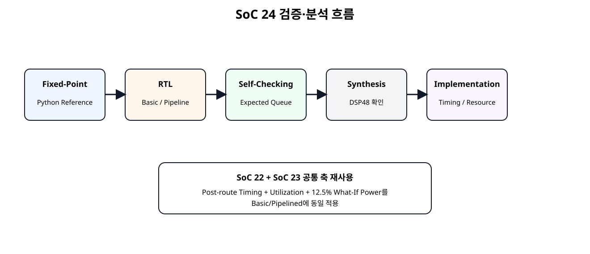
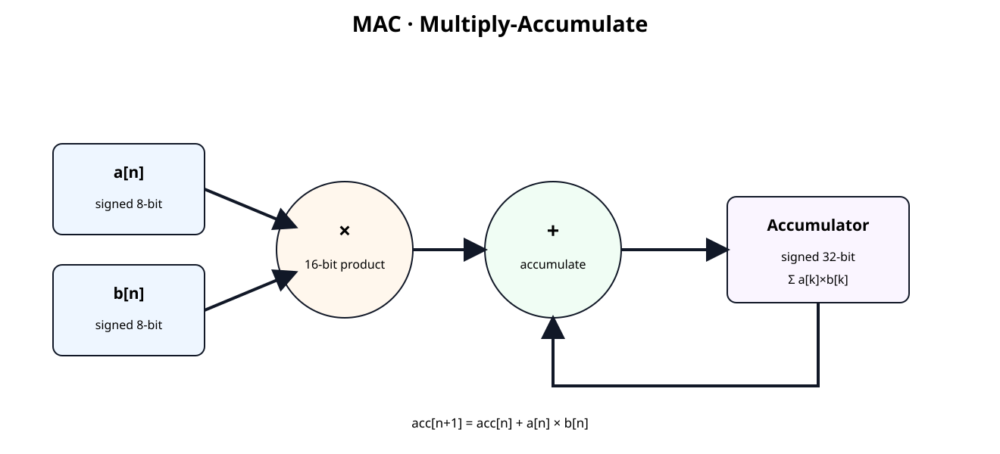
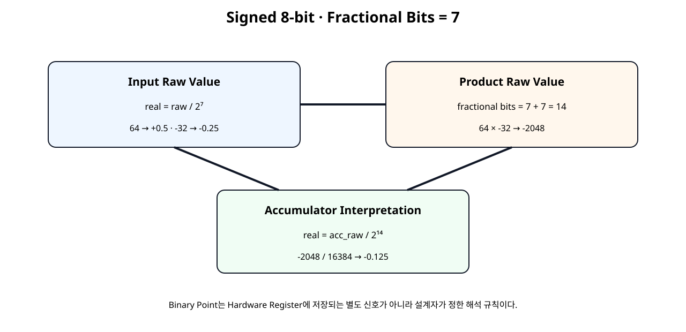
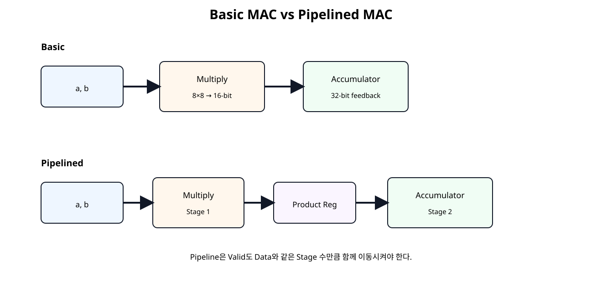
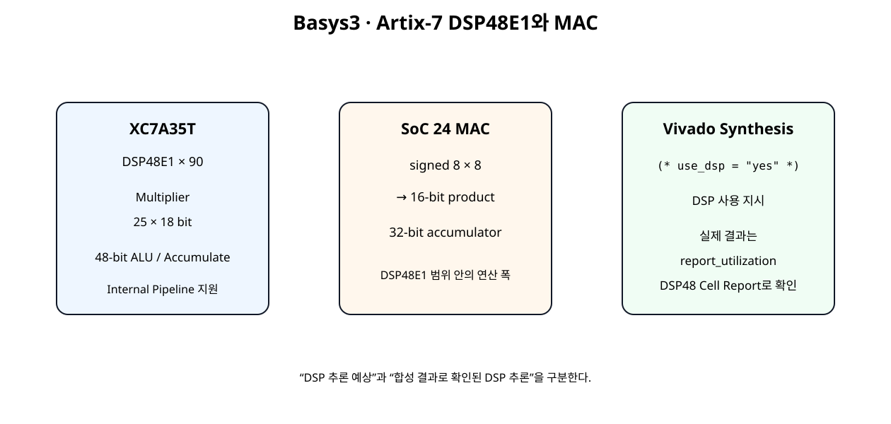

# NPU Datapath 시작 · MAC 기본 구조


## 전체 학습 위치


## 이번 장의 목표


[](../images/soc24/soc24_analysis_flow.svg)

Fixed-Point Reference부터 DSP 추론·Timing·Resource·Power까지 하나의 실습 흐름으로 연결한다.


## MAC이 NPU에서 중요한 이유

Neural Network의 Dense Layer와 Convolution은 결국 많은 곱셈과 덧셈의 반복으로 표현된다. Hardware에서는 이 반복을 MAC 단위로 만들고 여러 MAC을 병렬화하여 Throughput을 높인다.


## MAC 기본 수식


[](../images/soc24/soc24_mac_structure.svg)

MAC은 현재 입력의 곱을 이전 누산값에 더한다.


## Signed 8-bit 입력

a_i, b_i는 Verilog signed [7:0]으로 선언한다. Raw 정수 범위는 -128~127이다.

양자화 NPU에서 int8을 많이 사용하는 이유를 앞으로 다루지만, 이번 장에서는 먼저 signed arithmetic과 Bit Width에 집중한다.


## Fixed-Point 해석


[](../images/soc24/soc24_fixed_point.svg)

입력 7 Fractional Bits는 곱 후 14 Fractional Bits가 된다.

Q 표기 관습 차이를 피하기 위해 signed 8 bit + fractional bits 7이라고 직접 정의한다.


## Binary Point는 어디에 있는가

Hardware Register에 “소수점 위치”를 저장하는 별도 Bit가 있는 것이 아니다. 같은 8'b01000000도 정수로 읽으면 64이고 Fractional Bits를 7로 정하면 0.5로 해석한다.


## 곱셈 결과 폭

Vivado Synthesis는 Multiplier 결과 폭을 두 Operand Width의 합으로 설명한다. 따라서 8-bit × 8-bit의 전체 결과는 16-bit가 필요하다.


## Accumulator 폭

16-bit Product를 여러 번 더하면 Product Width만으로는 쉽게 Overflow한다. 이번 장에서는 32-bit Accumulator를 사용하고 16-bit Product를 Sign Extension하여 더한다.


```text
product_ext_w =
    {{16{product_w[15]}}, product_w};
```


## Basic MAC

valid_i=1인 Clock에서 Product를 현재 Accumulator에 더한다. clear_i는 누산 시작점을 다시 0으로 만든다.


## Basic MAC RTL


```verilog
(* use_dsp = "yes" *)
module mac_s8_acc32_basic (
    input  wire                    clk,
    input  wire                    resetn,
    input  wire                    clear_i,
    input  wire                    valid_i,

    input  wire signed [7:0]       a_i,
    input  wire signed [7:0]       b_i,

    output reg  signed [31:0]      acc_o,
    output reg                     valid_o
);

// Fixed-point interpretation used in this chapter:
// - a_i, b_i: signed 8-bit values with FRAC_BITS = 7
// - real value = raw signed integer / 2^7
// - product: 16-bit signed raw value with 14 fractional bits
// - accumulator keeps the same 14 fractional bits
//
// No rounding/truncation is needed before accumulation because the full
// 16-bit product is sign-extended into the 32-bit accumulator.

wire signed [15:0] product_w;
wire signed [31:0] product_ext_w;

assign product_w =
    $signed(a_i) * $signed(b_i);

assign product_ext_w =
    {{16{product_w[15]}}, product_w};

always @(posedge clk) begin
    if (!resetn) begin
        acc_o   <= 32'sd0;
        valid_o <= 1'b0;
    end else if (clear_i) begin
        acc_o   <= 32'sd0;
        valid_o <= 1'b0;
    end else begin
        valid_o <= valid_i;

        if (valid_i) begin
            acc_o <= acc_o + product_ext_w;
        end
    end
end

endmodule
```


## Pipeline이 필요한 이유

연산 규모와 Clock 요구가 커지면 Multiply와 Accumulate를 한 Timing Stage에 모두 넣는 것보다 중간 Register를 두어 Data Path를 분할하는 것이 Timing Closure에 유리할 수 있다.


## Pipelined MAC


[](../images/soc24/soc24_mac_pipeline.svg)

Product Register를 추가해 Multiply와 Accumulate를 다른 Clock Stage로 분리한다.


## Valid Pipeline


```text
Clock N
a/b + valid_i
   ↓
Multiply
   ↓
product_q + product_valid_q

Clock N+1
product_q + product_valid_q
   ↓
Accumulator
   ↓
acc_o + valid_o
```

Data만 Pipeline하고 Valid를 같이 지연시키지 않으면 결과와 유효 신호가 어긋난다.


## Pipelined MAC RTL


```verilog
(* use_dsp = "yes" *)
module mac_s8_acc32_pipelined (
    input  wire                    clk,
    input  wire                    resetn,
    input  wire                    clear_i,
    input  wire                    valid_i,

    input  wire signed [7:0]       a_i,
    input  wire signed [7:0]       b_i,

    output reg  signed [31:0]      acc_o,
    output reg                     valid_o
);

// Pipeline structure:
// Stage 1: signed multiply and product register
// Stage 2: sign extension + accumulation
//
// The binary point does not move during accumulation.
// a/b use 7 fractional bits, so product/accumulator use 14 fractional bits.

wire signed [15:0] product_w;

reg signed [15:0] product_q;
reg               product_valid_q;

wire signed [31:0] product_ext_w;

assign product_w =
    $signed(a_i) * $signed(b_i);

assign product_ext_w =
    {{16{product_q[15]}}, product_q};

always @(posedge clk) begin
    if (!resetn) begin
        product_q       <= 16'sd0;
        product_valid_q <= 1'b0;

        acc_o           <= 32'sd0;
        valid_o         <= 1'b0;
    end else if (clear_i) begin
        product_q       <= 16'sd0;
        product_valid_q <= 1'b0;

        acc_o           <= 32'sd0;
        valid_o         <= 1'b0;
    end else begin
        // Stage 1
        product_valid_q <= valid_i;

        if (valid_i) begin
            product_q <= product_w;
        end

        // Stage 2
        valid_o <= product_valid_q;

        if (product_valid_q) begin
            acc_o <= acc_o + product_ext_w;
        end
    end
end

endmodule
```


## DSP48E1 구조


[](../images/soc24/soc24_dsp48_mapping.svg)

SoC 24의 8×8/32-bit MAC은 DSP48E1의 연산 폭 안에 들어간다.

7-Series DSP48E1은 25×18 Multiplier와 48-bit Arithmetic/Accumulator 구조를 제공하며 내부 Pipeline을 지원한다.


## XC7A35T의 DSP 자원

Basys3의 XC7A35T에는 DSP48E1 Slice가 90개 있다. 향후 4/8/16 MAC 병렬화에서는 이 개수가 중요한 Resource Budget이 된다.


## USE_DSP


```verilog
(* use_dsp = "yes" *)
module mac_s8_acc32_basic (...);
```

Vivado 2026.1은 Multiplier를 Slice Logic 또는 DSP Block으로 구현할 수 있으며 USE_DSP Attribute로 DSP Block 사용을 지시할 수 있다.


## DSP 추론 확인 방법


## Python Fixed-Point Reference

RTL과 독립적인 Python Reference Model을 실제 실행해 Directed Case를 검증했다.


```text
a_raw,b_raw,a_real,b_real,product_raw,acc_raw,acc_real
64,-32,0.50000000,-0.25000000,-2048,-2048,-0.12500000
127,127,0.99218750,0.99218750,16129,14081,0.85943604
-128,127,-1.00000000,0.99218750,-16256,-2175,-0.13275146
-128,-128,-1.00000000,-1.00000000,16384,14209,0.86724854
1,-1,0.00781250,-0.00781250,-1,14208,0.86718750
0,127,0.00000000,0.99218750,0,14208,0.86718750
SOC24 PYTHON FIXED-POINT REFERENCE: PASS
Spreadsheet runtime warmup failed during python startup
Traceback (most recent call last):
  File "/tmp/tmp.L2TH2Y5coc/artifact_tool_v2-2.8.22/artifact_tool/patches/warm_spreadsheet_runtime_on_startup.py", line 26, in warm_spreadsheet_runtime_on_startup
  File "/tmp/tmp.L2TH2Y5coc/artifact_tool_v2-2.8.22/artifact_tool/spreadsheet_warmup.py", line 785, in warm_spreadsheet_runtime
  File "/tmp/tmp.L2TH2Y5coc/artifact_tool_v2-2.8.22/artifact_tool/spreadsheet_warmup.py", line 720, in _warm_feature_flows
  File "/tmp/tmp.L2TH2Y5coc/artifact_tool_v2-2.8.22/artifact_tool/spreadsheet_warmup.py", line 704, in _warm_collaboration_flows
  File "/tmp/tmp.L2TH2Y5coc/artifact_tool_v2-2.8.22/artifact_tool/generated/interface/models.py", line 32317, in hydrate_crdt_from_proto
  File "/tmp/tmp.L2TH2Y5coc/artifact_tool_v2-2.8.22/artifact_tool/rpc/remote.py", line 749, in __call__
  File "/tmp/tmp.L2TH2Y5coc/artifact_tool_v2-2.8.22/artifact_tool/rpc/client.py", line 150, in call
artifact_tool.rpc.client.RemoteError: hydrateCrdtFromProto requires an empty collaborative document.
```


## Self-Checking Testbench


```verilog
`timescale 1ns / 1ps

module tb_mac_s8_acc32_compare;

logic clk = 1'b0;
logic resetn = 1'b0;
logic clear_i = 1'b0;
logic valid_i = 1'b0;

logic signed [7:0] a_i = 8'sd0;
logic signed [7:0] b_i = 8'sd0;

wire signed [31:0] basic_acc_o;
wire               basic_valid_o;

wire signed [31:0] pipe_acc_o;
wire               pipe_valid_o;

logic signed [31:0] expected_basic_q[$];
logic signed [31:0] expected_pipe_q[$];

logic signed [31:0] reference_acc;

int error_count = 0;
int check_count = 0;

always #5 clk = ~clk;

mac_s8_acc32_basic u_basic (
    .clk(clk),
    .resetn(resetn),
    .clear_i(clear_i),
    .valid_i(valid_i),

    .a_i(a_i),
    .b_i(b_i),

    .acc_o(basic_acc_o),
    .valid_o(basic_valid_o)
);

mac_s8_acc32_pipelined u_pipe (
    .clk(clk),
    .resetn(resetn),
    .clear_i(clear_i),
    .valid_i(valid_i),

    .a_i(a_i),
    .b_i(b_i),

    .acc_o(pipe_acc_o),
    .valid_o(pipe_valid_o)
);

function automatic logic signed [31:0] reference_next(
    input logic signed [31:0] acc,
    input logic signed [7:0]  a,
    input logic signed [7:0]  b
);
    logic signed [15:0] product;
    logic signed [31:0] product_ext;

    begin
        product = a * b;
        product_ext = {
            {16{product[15]}},
            product
        };

        reference_next = acc + product_ext;
    end
endfunction

task automatic drive_valid(
    input integer a_value,
    input integer b_value
);
    logic signed [31:0] next_acc;

    begin
        @(negedge clk);

        clear_i = 1'b0;
        valid_i = 1'b1;
        a_i = a_value;
        b_i = b_value;

        next_acc = reference_next(
            reference_acc,
            a_i,
            b_i
        );

        reference_acc = next_acc;

        expected_basic_q.push_back(next_acc);
        expected_pipe_q.push_back(next_acc);
    end
endtask

task automatic drive_idle;
    begin
        @(negedge clk);
        valid_i = 1'b0;
        a_i = 8'sd0;
        b_i = 8'sd0;
    end
endtask

task automatic clear_mac;
    begin
        // Only call after pending expected queues are empty.
        @(negedge clk);
        valid_i = 1'b0;
        clear_i = 1'b1;

        @(negedge clk);
        clear_i = 1'b0;

        reference_acc = 32'sd0;
    end
endtask

task automatic wait_queues_empty;
    int k;

    begin
        drive_idle();

        for (k = 0; k < 20; k++) begin
            @(posedge clk);

            if (
                (expected_basic_q.size() == 0) &&
                (expected_pipe_q.size() == 0)
            ) begin
                return;
            end
        end

        error_count++;
        $error(
            "TIMEOUT: expected queues basic=%0d pipe=%0d",
            expected_basic_q.size(),
            expected_pipe_q.size()
        );
    end
endtask

always @(posedge clk) begin
    #1;

    if (resetn && basic_valid_o) begin
        check_count++;

        if (expected_basic_q.size() == 0) begin
            error_count++;
            $error("BASIC: unexpected valid");
        end else begin
            if (basic_acc_o !== expected_basic_q[0]) begin
                error_count++;
                $error(
                    "BASIC mismatch actual=%0d expected=%0d",
                    basic_acc_o,
                    expected_basic_q[0]
                );
            end else begin
                $display(
                    "PASS BASIC: acc=%0d",
                    basic_acc_o
                );
            end

            expected_basic_q.pop_front();
        end
    end

    if (resetn && pipe_valid_o) begin
        check_count++;

        if (expected_pipe_q.size() == 0) begin
            error_count++;
            $error("PIPE: unexpected valid");
        end else begin
            if (pipe_acc_o !== expected_pipe_q[0]) begin
                error_count++;
                $error(
                    "PIPE mismatch actual=%0d expected=%0d",
                    pipe_acc_o,
                    expected_pipe_q[0]
                );
            end else begin
                $display(
                    "PASS PIPE: acc=%0d",
                    pipe_acc_o
                );
            end

            expected_pipe_q.pop_front();
        end
    end
end

initial begin
    reference_acc = 32'sd0;

    repeat (5) @(posedge clk);
    resetn = 1'b1;

    // Directed signed/fixed-point cases.
    // FRAC_BITS = 7:
    // 64 -> +0.5, -32 -> -0.25.
    drive_valid(64, -32);   // product raw -2048 -> -0.125 real
    drive_valid(127, 127);  // max positive x max positive
    drive_valid(-128, 127); // min negative x max positive
    drive_valid(-128, -128);
    drive_valid(1, -1);
    drive_valid(0, 127);

    wait_queues_empty();
    clear_mac();

    // Random signed 8-bit regression.
    repeat (32) begin
        drive_valid(
            $signed($urandom_range(0, 255)),
            $signed($urandom_range(0, 255))
        );
    end

    wait_queues_empty();

    $display("");
    $display("SOC24 CHECK COUNT : %0d", check_count);
    $display("SOC24 ERROR COUNT : %0d", error_count);

    if (error_count == 0) begin
        $display("SOC24 MAC SELF-CHECKING TEST: PASS");
    end else begin
        $fatal(
            1,
            "SOC24 MAC SELF-CHECKING TEST: FAIL (%0d errors)",
            error_count
        );
    end

    #20;
    $finish;
end

endmodule
```

Basic과 Pipelined 구조의 Latency가 다르므로 Expected Queue를 각각 유지한다.


## Directed Signed Test


| a | b | 목적 |
| --- | --- | --- |
| 64 | -32 | 양수 × 음수 + Fixed-Point 예제 |
| 127 | 127 | 최대 양수 근처 |
| -128 | 127 | 최소 음수 × 최대 양수 |
| -128 | -128 | 최소 음수 × 최소 음수 |
| 1 | -1 | 작은 signed 값 |
| 0 | 127 | Zero Product |


## Random Regression

Directed Test 이후 signed 8-bit 범위의 Random Input 32개를 생성해 누적 결과를 Reference Model과 비교한다.


## Overflow 범위

8-bit signed Product의 최대 절대값은 입력 조합에 따라 약 16K 수준이고 32-bit Accumulator는 단일 Product보다 훨씬 넓다. 그러나 무한히 누적할 수 있는 것은 아니므로 Vector Length가 커지면 필요한 Accumulator 폭을 계산해야 한다.


## Saturation과 Wrap-around

이번 MAC은 교육용 기본 구조이므로 32-bit Two's Complement Overflow 시 자연스러운 Wrap-around가 발생한다. 실제 Quantized NPU에서는 Saturation, Rounding, Requantization 정책을 별도 설계해야 하며 이후 단계에서 확장한다.


## Basys3 Board 구조


```text
W5 100 MHz
   ↓
mac_pattern_source
   ↓
MAC Basic 또는 Pipelined
   ↓
mac_result_sink
   ↓
LED[15:0]

btnC → Reset Polarity Adapter → resetn
```

Board Top은 Module 연결만 수행하고 MAC 기능은 독립 RTL에 유지한다.


## Vivado 분석 Script


```text
# SoC 24 · NPU MAC analysis
#
# Usage:
#   vivado -mode batch -source scripts/run_mac_analysis.tcl \
#          -tclargs basic
#
#   vivado -mode batch -source scripts/run_mac_analysis.tcl \
#          -tclargs pipelined

if {$argc < 1} {
    puts "ERROR: usage: run_mac_analysis.tcl <basic|pipelined>"
    exit 1
}

set variant [lindex $argv 0]

if {$variant eq "basic"} {
    set top_name mac_basic_basys3_top
    set mac_file mac_s8_acc32_basic.v
    set board_file mac_basic_basys3_top.v
} elseif {$variant eq "pipelined"} {
    set top_name mac_pipelined_basys3_top
    set mac_file mac_s8_acc32_pipelined.v
    set board_file mac_pipelined_basys3_top.v
} else {
    puts "ERROR: unknown variant '$variant'"
    exit 1
}

set script_dir [file dirname [file normalize [info script]]]
set root_dir [file normalize [file join $script_dir ".."]]
set rtl_dir [file join $root_dir "rtl"]
set xdc_dir [file join $root_dir "constraints"]
set out_dir [file normalize [file join $root_dir "reports" $variant]]

file mkdir $out_dir

create_project -in_memory -part xc7a35tcpg236-1

read_verilog [file join $rtl_dir "reset_active_high_to_active_low.v"]
read_verilog [file join $rtl_dir "mac_pattern_source.v"]
read_verilog [file join $rtl_dir "mac_result_sink.v"]
read_verilog [file join $rtl_dir $mac_file]
read_verilog [file join $rtl_dir $board_file]

synth_design \
    -top $top_name \
    -part xc7a35tcpg236-1

read_xdc [file join $xdc_dir "basys3_mac_lab.xdc"]

create_clock \
    -name sys_clk \
    -period 10.000 \
    [get_ports clk]

# Confirm what synthesis actually inferred.
report_utilization \
    -hierarchical \
    -file [file join $out_dir "01_utilization_post_synth.rpt"]

redirect -file [file join $out_dir "02_dsp48_cells_post_synth.rpt"] {
    set dsp_cells [get_cells -hier -filter {REF_NAME =~ DSP48*}]
    puts "DSP48 cell count: [llength $dsp_cells]"

    foreach cell $dsp_cells {
        puts $cell
    }
}

report_timing_summary \
    -delay_type min_max \
    -report_unconstrained \
    -max_paths 10 \
    -file [file join $out_dir "03_timing_summary_post_synth.rpt"]

opt_design
place_design
phys_opt_design
route_design

report_utilization \
    -hierarchical \
    -file [file join $out_dir "04_utilization_post_route.rpt"]

report_timing_summary \
    -delay_type min_max \
    -report_unconstrained \
    -max_paths 20 \
    -file [file join $out_dir "05_timing_summary_post_route.rpt"]

report_timing \
    -delay_type max \
    -max_paths 20 \
    -nworst 1 \
    -sort_by group \
    -input_pins \
    -file [file join $out_dir "06_worst_setup_paths.rpt"]

# Same What-If activity assumption used in SoC 23.
set_switching_activity \
    -default_static_probability 0.5 \
    -default_toggle_rate 12.5

report_power \
    -file [file join $out_dir "07_power_normalized_activity.rpt"] \
    -rpx  [file join $out_dir "07_power_normalized_activity.rpx"]

report_methodology \
    -file [file join $out_dir "08_methodology_post_route.rpt"]

write_checkpoint -force \
    [file join $out_dir "${variant}_mac_post_route.dcp"]

puts ""
puts "SoC 24 MAC analysis complete."
puts "Variant : $variant"
puts "Reports : $out_dir"
puts ""
puts "Check DSP inference in:"
puts "  01_utilization_post_synth.rpt"
puts "  02_dsp48_cells_post_synth.rpt"
puts ""
puts "Do not claim DSP inference until these reports are generated."
```

Basic/Pipelined 각각에 대해 Synthesis DSP 확인, Post-route Timing, Utilization, 동일 12.5% What-If Power Report를 생성한다.


## Timing 비교

SoC 22와 동일하게 05_timing_summary_post_route.rpt의 WNS/TNS/WHS/THS를 기준으로 Basic과 Pipelined 구조를 비교한다.

Pipeline이 추가됐다고 반드시 더 높은 Fmax가 나온다고 미리 확정하지 않고 실제 Critical Path를 확인한다.


## Resource 비교

01_utilization_post_synth.rpt와 04_utilization_post_route.rpt에서 DSP, LUT, FF를 확인한다. Pipelined 구조는 Product Register/Valid Register 때문에 Register Resource가 증가할 수 있다.


## Power 비교

SoC 23과 동일한 Activity 가정으로 07_power_normalized_activity.rpt를 만든다. Pipeline은 Clocked Register가 늘지만 Route/Glitch가 바뀌므로 Dynamic Power 방향은 Report로 확인한다.


## MAC 하나에서 PE로

MAC 하나는 하나의 Weight×Activation Pair를 처리한다. 다음 단계에서는 여러 MAC을 하나의 PE(Processing Element, 처리 요소) 안에 병렬 배치한다.


## NPU Dot Product 연결

현재 MAC의 반복 누산은 Dot Product의 가장 단순한 Sequential 구현이다. 병렬 MAC 수를 늘리면 Throughput은 높아질 수 있지만 DSP Resource와 Memory Bandwidth 요구도 함께 증가한다.


## 오류 점검


| 증상 | 원인 | 확인 |
| --- | --- | --- |
| 음수 곱이 이상함 | signed 선언/캐스팅 누락 | $signed() |
| Product MSB 손실 | 결과 폭 부족 | 8×8 → 16 bit |
| 누산 중 음수 값 깨짐 | Sign Extension 오류 | 16→32 bit 부호 확장 |
| Pipeline 결과가 한 칸 밀림 | Valid 지연 불일치 | product_valid_q |
| DSP가 0개 | Synthesis Mapping 차이 | USE_DSP + Utilization |
| Timing 개선 안 됨 | Critical Path가 다른 곳 | Post-route Worst Path |
| Fixed-Point 값이 128배/16384배 차이 | Binary Point 해석 오류 | Input F=7 / Product F=14 |
| 긴 Vector에서 값 Wrap | Accumulator Overflow | ACC Width / Saturation |


## SoC 24 완료 체크리스트

- [ ] MAC의 Multiply + Accumulate 구조를 설명할 수 있다.
- [ ] signed 8-bit Raw 값과 Fractional Bits를 구분한다.
- [ ] 8×8 전체 Product에 16 bit가 필요한 이유를 이해한다.
- [ ] Product의 Fractional Bits가 14가 되는 이유를 이해한다.
- [ ] 16-bit Product를 32-bit로 Sign Extension한다.
- [ ] Basic MAC을 RTL로 구현한다.
- [ ] Product Register를 넣은 Pipelined MAC을 구현한다.
- [ ] Valid도 Data와 함께 Pipeline한다.
- [ ] DSP48E1의 25×18 / 48-bit 연산 범위를 이해한다.
- [ ] USE_DSP와 실제 DSP 추론 확인을 구분한다.
- [ ] Python Reference Model로 Fixed-Point 값을 검증한다.
- [ ] Self-Checking Testbench에서 서로 다른 Latency를 처리한다.
- [ ] Timing·Resource·Power를 Basic/Pipelined에 동일 조건으로 비교한다.

## 공식 매뉴얼 및 원본 근거


| 문서 | 확인 항목 |
| --- | --- |
| AMD UG901 · Multipliers · 2026.1 | Multiplier 추론과 결과 Bit Width |
| AMD UG901 · Multiply-Accumulate · 2026.1 | DSP Macro 추론과 Pipeline Register 흡수 |
| AMD UG901 · USE_DSP · 2026.1 | (* use_dsp = "yes" *) |
| AMD UG479 · 7 Series DSP48E1 | 25×18 Multiplier, 48-bit Datapath, Internal Pipeline |
| AMD DS180 · 7 Series Overview | XC7A35T DSP48E1 90개 |
| AMD UG906 · Report Utilization · 2026.1 | DSP/LUT/Register 실제 합성·구현 자원 확인 |
| AMD UG900 · Vivado Simulator · 2026.1 | SystemVerilog Self-Checking Simulation |

