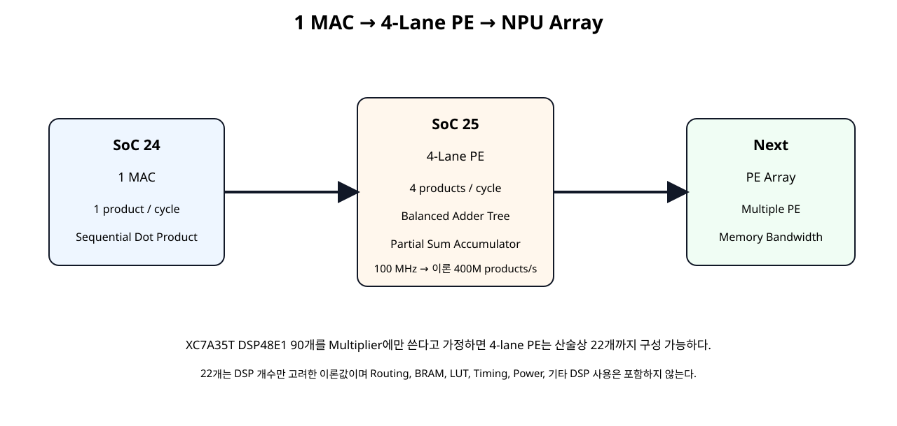
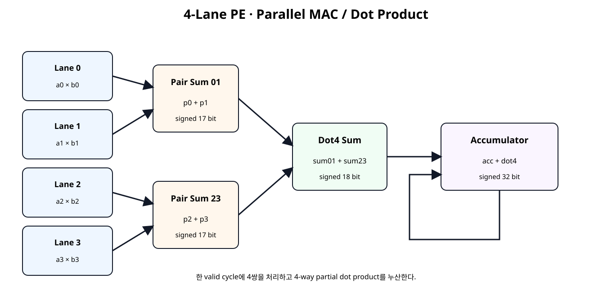
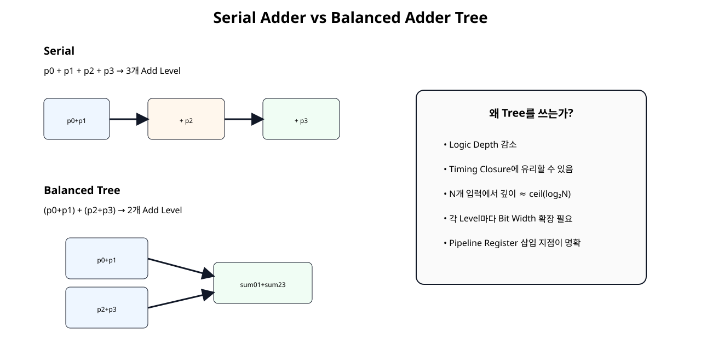
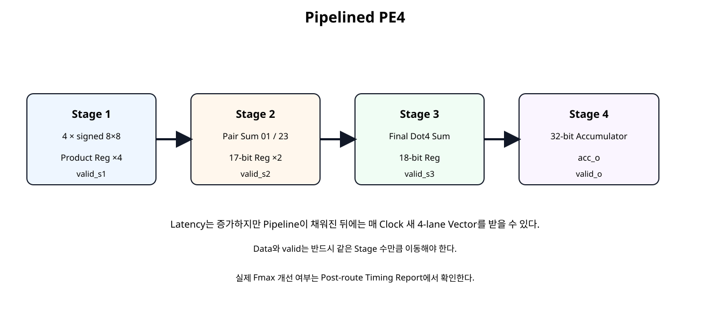

# PE / Parallel MAC / Vector Dot Product


## 전체 학습 위치


## 이번 장의 목표


[](../images/soc25/soc25_scaling.svg)

1 MAC에서 4-Lane PE로 계산 병렬도를 늘리고 이후 PE Array로 확장한다.


## MAC과 PE의 차이


| 구조 | 역할 |
| --- | --- |
| MAC | 한 쌍의 Multiply + Accumulate |
| PE | 여러 Multiply Lane + Reduction + Partial Sum/Accumulator + Valid/Control |

PE(Processing Element, 처리 요소)는 NPU Array를 구성하는 계산 블록 단위이며, 구현마다 내부 Lane 수와 Reduction 방식은 달라질 수 있다.


## 4-Lane PE 전체 구조


[](../images/soc25/soc25_pe4_architecture.svg)

4개 Product를 두 단계 Balanced Adder Tree로 합산한 뒤 Accumulator에 더한다.


## 4-way Vector Dot Product

한 Clock 입력에서 4개의 Weight×Activation Pair를 동시에 처리한다. 이 Dot4 결과를 여러 Cycle 누적하면 더 긴 Vector의 Dot Product가 된다.


## Packed Vector Lane Mapping


```text
a_vec_i[7:0]   → lane0
a_vec_i[15:8]  → lane1
a_vec_i[23:16] → lane2
a_vec_i[31:24] → lane3

b_vec_i도 동일
```

Top Interface는 32-bit Packed Bus로 단순화하고 내부에서 각 signed 8-bit Lane으로 분리한다.


## Fixed-Point 규칙 유지

SoC 24와 동일하게 각 입력은 signed 8 bit, Fractional Bits는 7이다. 각 Product는 Fractional Bits 14이며, 여러 Product를 더해도 Binary Point는 이동하지 않는다.


## 4개 Product의 폭

각 Lane의 signed 8×8 전체 Product는 signed 16 bit다.


```verilog
(* use_dsp = "yes" *)
module mul_s8_dsp (
    input  wire signed [7:0]  a_i,
    input  wire signed [7:0]  b_i,
    output wire signed [15:0] p_o
);

// Dedicated 8x8 signed multiplier building block.
// USE_DSP requests DSP implementation, but the final mapping
// must still be verified with Vivado synthesis reports.

assign p_o =
    $signed(a_i) * $signed(b_i);

endmodule
```


## Pair Sum 17 bit

두 Product를 더할 때 Carry/Sign 범위를 보존하려면 1 bit를 추가한다.


## Dot4 Sum 18 bit

4개 Lane 모두 -128 × -128이면 각 Product는 16384이고 합은 65536이다.


```text
4 × 16384 → 65536
signed 17-bit max → 65535
따라서 Dot4 → signed 18 bit 필요
```


## Balanced Adder Tree


[](../images/soc25/soc25_balanced_adder_tree.svg)

4개 입력에서는 Balanced Tree가 Serial Sum보다 Addition Logic Depth를 줄인다.


## Serial Sum과 Logic Depth


| 형태 | Add Depth |
| --- | --- |
| (((p0+p1)+p2)+p3) | 3 Level |
| (p0+p1)+(p2+p3) | 2 Level |

Lane 수가 N으로 증가하면 균형 Tree의 Reduction Depth는 대략 ceil(log₂N) 단계로 구성할 수 있다.


## Basic PE4

Basic 구조는 4개의 Multiply와 2-Level Adder Tree를 조합 경로로 계산한 후 같은 Clock Edge에서 32-bit Accumulator에 더한다.


## Basic PE4 RTL


```verilog
module pe4_dot_accum_basic (
    input  wire                    clk,
    input  wire                    resetn,
    input  wire                    clear_i,
    input  wire                    valid_i,

    input  wire [31:0]             a_vec_i,
    input  wire [31:0]             b_vec_i,

    output reg  signed [31:0]      acc_o,
    output reg                     valid_o
);

// 4-lane PE:
//   4 parallel signed 8x8 multipliers
//   balanced adder tree
//   32-bit accumulator
//
// Packed lane mapping:
//   lane0 = [7:0]
//   lane1 = [15:8]
//   lane2 = [23:16]
//   lane3 = [31:24]

wire signed [7:0] a0;
wire signed [7:0] a1;
wire signed [7:0] a2;
wire signed [7:0] a3;

wire signed [7:0] b0;
wire signed [7:0] b1;
wire signed [7:0] b2;
wire signed [7:0] b3;

assign a0 = $signed(a_vec_i[7:0]);
assign a1 = $signed(a_vec_i[15:8]);
assign a2 = $signed(a_vec_i[23:16]);
assign a3 = $signed(a_vec_i[31:24]);

assign b0 = $signed(b_vec_i[7:0]);
assign b1 = $signed(b_vec_i[15:8]);
assign b2 = $signed(b_vec_i[23:16]);
assign b3 = $signed(b_vec_i[31:24]);

wire signed [15:0] p0;
wire signed [15:0] p1;
wire signed [15:0] p2;
wire signed [15:0] p3;

mul_s8_dsp u_mul0 (.a_i(a0), .b_i(b0), .p_o(p0));
mul_s8_dsp u_mul1 (.a_i(a1), .b_i(b1), .p_o(p1));
mul_s8_dsp u_mul2 (.a_i(a2), .b_i(b2), .p_o(p2));
mul_s8_dsp u_mul3 (.a_i(a3), .b_i(b3), .p_o(p3));

// Pair sums need one extra signed bit.
wire signed [16:0] sum01;
wire signed [16:0] sum23;

assign sum01 =
    $signed({p0[15], p0}) +
    $signed({p1[15], p1});

assign sum23 =
    $signed({p2[15], p2}) +
    $signed({p3[15], p3});

// Four-product sum needs 18 signed bits.
// Worst positive case:
//   4 * (-128 * -128) = 65536
// which does not fit in signed 17-bit.
wire signed [17:0] dot4_w;

assign dot4_w =
    $signed({sum01[16], sum01}) +
    $signed({sum23[16], sum23});

wire signed [31:0] dot4_ext_w;

assign dot4_ext_w =
    {{14{dot4_w[17]}}, dot4_w};

always @(posedge clk) begin
    if (!resetn) begin
        acc_o   <= 32'sd0;
        valid_o <= 1'b0;
    end else if (clear_i) begin
        acc_o   <= 32'sd0;
        valid_o <= 1'b0;
    end else begin
        valid_o <= valid_i;

        if (valid_i) begin
            acc_o <= acc_o + dot4_ext_w;
        end
    end
end

endmodule
```


## Pipelined PE4


[](../images/soc25/soc25_pe4_pipeline.svg)

Product, Pair Sum, Dot4, Accumulator를 네 Stage로 분리한다.

AMD는 DSP Block을 사용하는 Datapath를 충분히 Pipeline하여 내부 Register Stage를 활용하도록 권장한다. 실제 Timing 개선 정도는 구현 결과로 확인한다.


## Valid Pipeline


```text
valid_i
  ↓
valid_s1_q
  ↓
valid_s2_q
  ↓
valid_s3_q
  ↓
valid_o
```

Product, Pair Sum, Dot4가 각각 한 Stage씩 이동하므로 Valid도 같은 순서로 이동해야 한다.


## Pipelined PE4 RTL


```verilog
module pe4_dot_accum_pipelined (
    input  wire                    clk,
    input  wire                    resetn,
    input  wire                    clear_i,
    input  wire                    valid_i,

    input  wire [31:0]             a_vec_i,
    input  wire [31:0]             b_vec_i,

    output reg  signed [31:0]      acc_o,
    output reg                     valid_o
);

// Four-stage datapath:
//   Stage 1: 4 parallel products
//   Stage 2: 2 pair sums
//   Stage 3: final 4-way dot-product sum
//   Stage 4: accumulator
//
// valid_i is pipelined through the same stages.

wire signed [7:0] a0;
wire signed [7:0] a1;
wire signed [7:0] a2;
wire signed [7:0] a3;

wire signed [7:0] b0;
wire signed [7:0] b1;
wire signed [7:0] b2;
wire signed [7:0] b3;

assign a0 = $signed(a_vec_i[7:0]);
assign a1 = $signed(a_vec_i[15:8]);
assign a2 = $signed(a_vec_i[23:16]);
assign a3 = $signed(a_vec_i[31:24]);

assign b0 = $signed(b_vec_i[7:0]);
assign b1 = $signed(b_vec_i[15:8]);
assign b2 = $signed(b_vec_i[23:16]);
assign b3 = $signed(b_vec_i[31:24]);

wire signed [15:0] p0_w;
wire signed [15:0] p1_w;
wire signed [15:0] p2_w;
wire signed [15:0] p3_w;

mul_s8_dsp u_mul0 (.a_i(a0), .b_i(b0), .p_o(p0_w));
mul_s8_dsp u_mul1 (.a_i(a1), .b_i(b1), .p_o(p1_w));
mul_s8_dsp u_mul2 (.a_i(a2), .b_i(b2), .p_o(p2_w));
mul_s8_dsp u_mul3 (.a_i(a3), .b_i(b3), .p_o(p3_w));

// Stage 1 registers.
reg signed [15:0] p0_q;
reg signed [15:0] p1_q;
reg signed [15:0] p2_q;
reg signed [15:0] p3_q;
reg               valid_s1_q;

// Stage 2 combinational pair sums.
wire signed [16:0] sum01_w;
wire signed [16:0] sum23_w;

assign sum01_w =
    $signed({p0_q[15], p0_q}) +
    $signed({p1_q[15], p1_q});

assign sum23_w =
    $signed({p2_q[15], p2_q}) +
    $signed({p3_q[15], p3_q});

// Stage 2 registers.
reg signed [16:0] sum01_q;
reg signed [16:0] sum23_q;
reg               valid_s2_q;

// Stage 3 final reduction.
wire signed [17:0] dot4_w;

assign dot4_w =
    $signed({sum01_q[16], sum01_q}) +
    $signed({sum23_q[16], sum23_q});

reg signed [17:0] dot4_q;
reg               valid_s3_q;

wire signed [31:0] dot4_ext_w;

assign dot4_ext_w =
    {{14{dot4_q[17]}}, dot4_q};

always @(posedge clk) begin
    if (!resetn) begin
        p0_q       <= 16'sd0;
        p1_q       <= 16'sd0;
        p2_q       <= 16'sd0;
        p3_q       <= 16'sd0;
        valid_s1_q <= 1'b0;

        sum01_q    <= 17'sd0;
        sum23_q    <= 17'sd0;
        valid_s2_q <= 1'b0;

        dot4_q     <= 18'sd0;
        valid_s3_q <= 1'b0;

        acc_o      <= 32'sd0;
        valid_o    <= 1'b0;
    end else if (clear_i) begin
        p0_q       <= 16'sd0;
        p1_q       <= 16'sd0;
        p2_q       <= 16'sd0;
        p3_q       <= 16'sd0;
        valid_s1_q <= 1'b0;

        sum01_q    <= 17'sd0;
        sum23_q    <= 17'sd0;
        valid_s2_q <= 1'b0;

        dot4_q     <= 18'sd0;
        valid_s3_q <= 1'b0;

        acc_o      <= 32'sd0;
        valid_o    <= 1'b0;
    end else begin
        // Stage 1
        valid_s1_q <= valid_i;

        if (valid_i) begin
            p0_q <= p0_w;
            p1_q <= p1_w;
            p2_q <= p2_w;
            p3_q <= p3_w;
        end

        // Stage 2
        valid_s2_q <= valid_s1_q;

        if (valid_s1_q) begin
            sum01_q <= sum01_w;
            sum23_q <= sum23_w;
        end

        // Stage 3
        valid_s3_q <= valid_s2_q;

        if (valid_s2_q) begin
            dot4_q <= dot4_w;
        end

        // Stage 4
        valid_o <= valid_s3_q;

        if (valid_s3_q) begin
            acc_o <= acc_o + dot4_ext_w;
        end
    end
end

endmodule
```


## Multiplier와 USE_DSP

각 Lane의 mul_s8_dsp에 (* use_dsp = "yes" *)를 적용했다. Vivado 2026.1에서 USE_DSP=yes는 해당 Arithmetic Structure를 DSP Block에 배치하도록 지시한다.


## DSP Register 흡수

Vivado Synthesis는 Multiply-Add/MAC 구조 주변의 Register를 DSP Block Pipeline에 흡수할 기회를 탐색한다. 따라서 Pipelined RTL의 Product Register가 실제 DSP 내부 Register로 Mapping되는지는 Netlist와 Utilization Report에서 확인한다.


## DSP Resource Scaling

XC7A35T에는 DSP48E1이 90개 있다. 각 Multiplier가 DSP 1개를 사용한다고 가정하면 4-Lane PE는 DSP 4개를 요구한다.


```text
90 // 4 → 22 PE4
22 × 4 → 88 DSP
잔여 → 2 DSP
```


## Python Reference

Bit Width와 Fixed-Point 해석, 4-Lane Dot Product를 Python으로 실제 검증했다.


```text
case,dot_raw,dot_real,acc_raw,acc_real
four lanes of 0.5 * 0.5,16384,1.00000000,16384,1.00000000
mixed sign cancellation,0,0.00000000,16384,1.00000000
worst positive lane products,65536,4.00000000,81920,5.00000000
large negative dot product,-65024,-3.96875000,16896,1.03125000

4-lane max positive dot raw = 65536
4-lane min negative dot raw = -65024
dot4 exact signed width = 18 bits

DSP-only theoretical PE4 groups on XC7A35T = 22 groups (88 DSP used, 2 remaining)
At 100 MHz: 4-lane product throughput = 400,000,000 products/s
If multiply and add are counted as separate operations: 0.800 GOPS
GOPS counting conventions vary; this is a theoretical arithmetic-rate illustration, not measured NPU performance.
SOC25 PYTHON PE4 REFERENCE: PASS
Spreadsheet runtime warmup failed during python startup
Traceback (most recent call last):
  File "/tmp/tmp.L2TH2Y5coc/artifact_tool_v2-2.8.22/artifact_tool/patches/warm_spreadsheet_runtime_on_startup.py", line 26, in warm_spreadsheet_runtime_on_startup
  File "/tmp/tmp.L2TH2Y5coc/artifact_tool_v2-2.8.22/artifact_tool/spreadsheet_warmup.py", line 785, in warm_spreadsheet_runtime
  File "/tmp/tmp.L2TH2Y5coc/artifact_tool_v2-2.8.22/artifact_tool/spreadsheet_warmup.py", line 720, in _warm_feature_flows
  File "/tmp/tmp.L2TH2Y5coc/artifact_tool_v2-2.8.22/artifact_tool/spreadsheet_warmup.py", line 704, in _warm_collaboration_flows
  File "/tmp/tmp.L2TH2Y5coc/artifact_tool_v2-2.8.22/artifact_tool/generated/interface/models.py", line 32317, in hydrate_crdt_from_proto
  File "/tmp/tmp.L2TH2Y5coc/artifact_tool_v2-2.8.22/artifact_tool/rpc/remote.py", line 749, in __call__
  File "/tmp/tmp.L2TH2Y5coc/artifact_tool_v2-2.8.22/artifact_tool/rpc/client.py", line 150, in call
artifact_tool.rpc.client.RemoteError: hydrateCrdtFromProto requires an empty collaborative document.
```


## Self-Checking Testbench


```verilog
`timescale 1ns / 1ps

module tb_pe4_dot_accum_compare;

logic clk = 1'b0;
logic resetn = 1'b0;
logic clear_i = 1'b0;
logic valid_i = 1'b0;

logic [31:0] a_vec_i = 32'h0;
logic [31:0] b_vec_i = 32'h0;

wire signed [31:0] basic_acc_o;
wire               basic_valid_o;

wire signed [31:0] pipe_acc_o;
wire               pipe_valid_o;

logic signed [31:0] expected_basic_q[$];
logic signed [31:0] expected_pipe_q[$];

logic signed [31:0] reference_acc;

int error_count = 0;
int check_count = 0;

always #5 clk = ~clk;

pe4_dot_accum_basic u_basic (
    .clk(clk),
    .resetn(resetn),
    .clear_i(clear_i),
    .valid_i(valid_i),
    .a_vec_i(a_vec_i),
    .b_vec_i(b_vec_i),
    .acc_o(basic_acc_o),
    .valid_o(basic_valid_o)
);

pe4_dot_accum_pipelined u_pipe (
    .clk(clk),
    .resetn(resetn),
    .clear_i(clear_i),
    .valid_i(valid_i),
    .a_vec_i(a_vec_i),
    .b_vec_i(b_vec_i),
    .acc_o(pipe_acc_o),
    .valid_o(pipe_valid_o)
);

function automatic logic [31:0] pack4(
    input integer x0,
    input integer x1,
    input integer x2,
    input integer x3
);
    begin
        pack4 = {
            x3[7:0],
            x2[7:0],
            x1[7:0],
            x0[7:0]
        };
    end
endfunction

function automatic logic signed [17:0] dot4_reference(
    input logic [31:0] avec,
    input logic [31:0] bvec
);
    logic signed [7:0] a0;
    logic signed [7:0] a1;
    logic signed [7:0] a2;
    logic signed [7:0] a3;

    logic signed [7:0] b0;
    logic signed [7:0] b1;
    logic signed [7:0] b2;
    logic signed [7:0] b3;

    logic signed [15:0] p0;
    logic signed [15:0] p1;
    logic signed [15:0] p2;
    logic signed [15:0] p3;

    logic signed [16:0] s01;
    logic signed [16:0] s23;

    begin
        a0 = $signed(avec[7:0]);
        a1 = $signed(avec[15:8]);
        a2 = $signed(avec[23:16]);
        a3 = $signed(avec[31:24]);

        b0 = $signed(bvec[7:0]);
        b1 = $signed(bvec[15:8]);
        b2 = $signed(bvec[23:16]);
        b3 = $signed(bvec[31:24]);

        p0 = a0 * b0;
        p1 = a1 * b1;
        p2 = a2 * b2;
        p3 = a3 * b3;

        s01 =
            $signed({p0[15], p0}) +
            $signed({p1[15], p1});

        s23 =
            $signed({p2[15], p2}) +
            $signed({p3[15], p3});

        dot4_reference =
            $signed({s01[16], s01}) +
            $signed({s23[16], s23});
    end
endfunction

function automatic logic signed [31:0] accum_reference(
    input logic signed [31:0] acc,
    input logic [31:0] avec,
    input logic [31:0] bvec
);
    logic signed [17:0] dot4;
    logic signed [31:0] dot4_ext;

    begin
        dot4 = dot4_reference(avec, bvec);

        dot4_ext = {
            {14{dot4[17]}},
            dot4
        };

        accum_reference = acc + dot4_ext;
    end
endfunction

task automatic drive_vector(
    input integer a0,
    input integer a1,
    input integer a2,
    input integer a3,
    input integer b0,
    input integer b1,
    input integer b2,
    input integer b3
);
    logic [31:0] avec;
    logic [31:0] bvec;
    logic signed [31:0] next_acc;

    begin
        @(negedge clk);

        avec = pack4(a0, a1, a2, a3);
        bvec = pack4(b0, b1, b2, b3);

        a_vec_i = avec;
        b_vec_i = bvec;
        valid_i = 1'b1;
        clear_i = 1'b0;

        next_acc = accum_reference(
            reference_acc,
            avec,
            bvec
        );

        reference_acc = next_acc;

        expected_basic_q.push_back(next_acc);
        expected_pipe_q.push_back(next_acc);
    end
endtask

task automatic drive_idle;
    begin
        @(negedge clk);
        valid_i = 1'b0;
        a_vec_i = 32'h0;
        b_vec_i = 32'h0;
    end
endtask

task automatic wait_queues_empty;
    int k;

    begin
        drive_idle();

        for (k = 0; k < 32; k++) begin
            @(posedge clk);

            if (
                (expected_basic_q.size() == 0) &&
                (expected_pipe_q.size() == 0)
            ) begin
                return;
            end
        end

        error_count++;
        $error(
            "TIMEOUT: basic_q=%0d pipe_q=%0d",
            expected_basic_q.size(),
            expected_pipe_q.size()
        );
    end
endtask

task automatic clear_pe;
    begin
        wait_queues_empty();

        @(negedge clk);
        clear_i = 1'b1;
        valid_i = 1'b0;

        @(negedge clk);
        clear_i = 1'b0;

        reference_acc = 32'sd0;
    end
endtask

always @(posedge clk) begin
    #1;

    if (resetn && basic_valid_o) begin
        check_count++;

        if (expected_basic_q.size() == 0) begin
            error_count++;
            $error("BASIC PE4: unexpected valid");
        end else begin
            if (basic_acc_o !== expected_basic_q[0]) begin
                error_count++;
                $error(
                    "BASIC PE4 mismatch actual=%0d expected=%0d",
                    basic_acc_o,
                    expected_basic_q[0]
                );
            end else begin
                $display(
                    "PASS BASIC PE4: acc=%0d",
                    basic_acc_o
                );
            end

            expected_basic_q.pop_front();
        end
    end

    if (resetn && pipe_valid_o) begin
        check_count++;

        if (expected_pipe_q.size() == 0) begin
            error_count++;
            $error("PIPE PE4: unexpected valid");
        end else begin
            if (pipe_acc_o !== expected_pipe_q[0]) begin
                error_count++;
                $error(
                    "PIPE PE4 mismatch actual=%0d expected=%0d",
                    pipe_acc_o,
                    expected_pipe_q[0]
                );
            end else begin
                $display(
                    "PASS PIPE PE4: acc=%0d",
                    pipe_acc_o
                );
            end

            expected_pipe_q.pop_front();
        end
    end
end

initial begin
    reference_acc = 32'sd0;

    repeat (5) @(posedge clk);
    resetn = 1'b1;

    // 4 lanes of +0.5 * +0.5.
    // Each lane = 0.25, dot4 = 1.0.
    drive_vector(
        64, 64, 64, 64,
        64, 64, 64, 64
    );

    // Mixed signs, dot4 = 0.0.
    drive_vector(
        64, -64, 32, -32,
        64, 64, 64, 64
    );

    // Worst positive lane product: -128 * -128.
    // Four lanes produce raw dot4 = 65536.
    drive_vector(
        -128, -128, -128, -128,
        -128, -128, -128, -128
    );

    // Large negative dot product.
    drive_vector(
        -128, -128, -128, -128,
        127, 127, 127, 127
    );

    wait_queues_empty();
    clear_pe();

    // Random signed 8-bit vectors.
    repeat (32) begin
        drive_vector(
            $urandom_range(0, 255),
            $urandom_range(0, 255),
            $urandom_range(0, 255),
            $urandom_range(0, 255),
            $urandom_range(0, 255),
            $urandom_range(0, 255),
            $urandom_range(0, 255),
            $urandom_range(0, 255)
        );
    end

    wait_queues_empty();

    $display("");
    $display("SOC25 CHECK COUNT : %0d", check_count);
    $display("SOC25 ERROR COUNT : %0d", error_count);

    if (error_count == 0) begin
        $display("SOC25 PE4 SELF-CHECKING TEST: PASS");
    end else begin
        $fatal(
            1,
            "SOC25 PE4 SELF-CHECKING TEST: FAIL (%0d errors)",
            error_count
        );
    end

    #20;
    $finish;
end

endmodule
```

Basic과 Pipelined PE는 Latency가 다르므로 Expected Queue를 각각 유지하면서 동일 Reference Accumulator와 비교한다.


## Directed Vector Test


| Vector | 목적 | Dot4 Raw |
| --- | --- | --- |
| 4×(64,64) | 0.5×0.5를 4 Lane | 16384 → 1.0 |
| Mixed Sign | 양수/음수 Cancellation | 0 |
| 4×(-128,-128) | 최대 양수 합 | 65536 |
| 4×(-128,127) | 큰 음수 합 | -65024 |


## Random Regression

Directed Test 후 4개 A Lane과 4개 B Lane을 각각 Random 8-bit 값으로 만든 Vector를 32회 입력하여 누적 결과를 Reference Model과 비교한다.


## Throughput 계산

Pipeline이 충분히 채워진 뒤 매 Clock 한 Vector Group을 받을 수 있다는 가정의 Arithmetic Throughput이다.


## GOPS 해석 주의

Multiply와 Add를 각각 한 Operation으로 세는 관습을 사용하면 4 Lane × 2 Operation × 100 MHz로 0.8 GOPS가 된다.


## Vector Length가 4보다 큰 경우

PE4는 한 Cycle에 4 Element를 처리한다. 따라서 Vector Length가 16이면 4개의 Group으로 나누어 같은 Accumulator에 순서대로 누산한다.


## Tail Handling

Vector Length가 4의 배수가 아니면 마지막 Cycle의 사용하지 않는 Lane을 0으로 Mask하면 된다.


```text
N=10
Cycle 0 → lane 0..3
Cycle 1 → lane 4..7
Cycle 2 → lane 8..9 + zero + zero
```

이번 장은 Datapath에 집중하고 Tail Mask와 Length Counter는 SoC 26 Controller에서 구현한다.


## Basys3 Board 구조


```text
W5 100 MHz
  ↓
pe4_pattern_source
  ↓
PE4 Basic 또는 Pipelined
  ↓
pe4_result_sink
  ↓
LED[15:0]

btnC → Reset Adapter → resetn
```

Board Top은 연결만 수행하고 PE Datapath 로직은 독립 Module에 유지한다.


## Vivado 분석 Script


```text
# SoC 25 · 4-Lane PE / Parallel MAC analysis
#
# Usage:
#   vivado -mode batch -source scripts/run_pe4_analysis.tcl \
#          -tclargs basic
#
#   vivado -mode batch -source scripts/run_pe4_analysis.tcl \
#          -tclargs pipelined

if {$argc < 1} {
    puts "ERROR: usage: run_pe4_analysis.tcl <basic|pipelined>"
    exit 1
}

set variant [lindex $argv 0]

if {$variant eq "basic"} {
    set top_name pe4_basic_basys3_top
    set pe_file pe4_dot_accum_basic.v
    set board_file pe4_basic_basys3_top.v
} elseif {$variant eq "pipelined"} {
    set top_name pe4_pipelined_basys3_top
    set pe_file pe4_dot_accum_pipelined.v
    set board_file pe4_pipelined_basys3_top.v
} else {
    puts "ERROR: unknown variant '$variant'"
    exit 1
}

set script_dir [file dirname [file normalize [info script]]]
set root_dir [file normalize [file join $script_dir ".."]]
set rtl_dir [file join $root_dir "rtl"]
set xdc_dir [file join $root_dir "constraints"]
set out_dir [file normalize [file join $root_dir "reports" $variant]]

file mkdir $out_dir

create_project -in_memory -part xc7a35tcpg236-1

read_verilog [file join $rtl_dir "reset_active_high_to_active_low.v"]
read_verilog [file join $rtl_dir "mul_s8_dsp.v"]
read_verilog [file join $rtl_dir "pe4_pattern_source.v"]
read_verilog [file join $rtl_dir "pe4_result_sink.v"]
read_verilog [file join $rtl_dir $pe_file]
read_verilog [file join $rtl_dir $board_file]

synth_design \
    -top $top_name \
    -part xc7a35tcpg236-1

read_xdc [file join $xdc_dir "basys3_pe4_lab.xdc"]

create_clock \
    -name sys_clk \
    -period 10.000 \
    [get_ports clk]

report_utilization \
    -hierarchical \
    -file [file join $out_dir "01_utilization_post_synth.rpt"]

redirect -file [file join $out_dir "02_dsp48_cells_post_synth.rpt"] {
    set dsp_cells [get_cells -hier -filter {REF_NAME =~ DSP48*}]
    puts "DSP48 cell count: [llength $dsp_cells]"

    foreach cell $dsp_cells {
        puts $cell
    }
}

report_timing_summary \
    -delay_type min_max \
    -report_unconstrained \
    -max_paths 10 \
    -file [file join $out_dir "03_timing_summary_post_synth.rpt"]

opt_design
place_design
phys_opt_design
route_design

report_utilization \
    -hierarchical \
    -file [file join $out_dir "04_utilization_post_route.rpt"]

report_timing_summary \
    -delay_type min_max \
    -report_unconstrained \
    -max_paths 20 \
    -file [file join $out_dir "05_timing_summary_post_route.rpt"]

report_timing \
    -delay_type max \
    -max_paths 20 \
    -nworst 1 \
    -sort_by group \
    -input_pins \
    -file [file join $out_dir "06_worst_setup_paths.rpt"]

report_design_analysis \
    -max_paths 50 \
    -setup \
    -logic_level_distribution \
    -file [file join $out_dir "07_design_analysis_post_route.rpt"]

# Same What-If activity assumption used in SoC 23/24.
set_switching_activity \
    -default_static_probability 0.5 \
    -default_toggle_rate 12.5

report_power \
    -file [file join $out_dir "08_power_normalized_activity.rpt"] \
    -rpx  [file join $out_dir "08_power_normalized_activity.rpx"]

report_methodology \
    -file [file join $out_dir "09_methodology_post_route.rpt"]

write_checkpoint -force \
    [file join $out_dir "${variant}_pe4_post_route.dcp"]

puts ""
puts "SoC 25 PE4 analysis complete."
puts "Variant : $variant"
puts "Reports : $out_dir"
puts ""
puts "DSP count must be read from actual synthesis reports."
```

Synthesis에서 DSP48 Cell을 확인한 뒤 Post-route Timing, Design Analysis, Utilization, 동일 12.5% What-If Activity Power를 생성한다.


## Timing 비교

Basic 구조는 Multiply + Adder Tree + Accumulate가 긴 Path가 될 수 있다. Pipelined 구조는 Product/Reduction Stage를 분리하므로 Timing Closure에 유리할 수 있지만 실제 Critical Path와 WNS는 Post-route Report로 확인한다.


## Resource / DSP 비교

01_utilization_post_synth.rpt와 02_dsp48_cells_post_synth.rpt에서 실제 DSP48 개수를 확인한다. Pipelined PE는 Register가 더 많아질 수 있으며 Vivado가 일부 Register를 DSP 내부 Pipeline으로 흡수할 수도 있다.


## Power 비교

SoC 23/24와 동일하게 Static Probability 0.5, Toggle Rate 12.5%를 What-If 비교 조건으로 적용한다. Lane 수 증가로 DSP Activity와 Data Routing이 늘기 때문에 1 MAC과 단순 비례한다고 가정하지 않는다.


## PE Array 확장


[](../images/soc25/soc25_scaling.svg)

PE를 여러 개 배치하면 여러 Output Channel이나 Neuron을 동시에 계산할 수 있다.


## Memory Bandwidth가 다음 병목

계산 Lane을 늘리면 매 Clock 공급해야 하는 Weight와 Activation 수도 늘어난다.

PE Array가 커질수록 DSP 개수보다 BRAM Port, Data Reuse, Buffer 구조, Memory Bandwidth가 먼저 병목이 될 수 있다.


## 오류 점검


| 증상 | 원인 | 확인 |
| --- | --- | --- |
| 65536 Case가 음수/0으로 변함 | Dot Sum 폭 부족 | 18-bit dot4 |
| 음수 Lane만 오류 | Lane signed 변환 누락 | $signed() |
| Serial Sum Timing 불리 | Add Logic Depth 증가 | Balanced Tree |
| Pipeline 출력 순서 불일치 | Valid Stage 오류 | s1/s2/s3/valid_o |
| DSP 수가 예상과 다름 | Synthesis Mapping/흡수 | DSP48 Cell Report |
| 4 Lane인데 성능 향상 적음 | Memory/Stall 병목 | Input Bandwidth/Utilization |
| Power가 4배보다 훨씬 다름 | Clock/Route/Activity 변화 | Resource별 Power |
| N이 4의 배수가 아닐 때 오답 | Tail Lane 미처리 | Zero Mask |


## SoC 25 완료 체크리스트

- [ ] MAC과 PE의 역할 차이를 설명할 수 있다.
- [ ] 4개의 signed 8×8 Multiply를 병렬 수행한다.
- [ ] Pair Sum은 signed 17 bit로 확장한다.
- [ ] 4-way Dot Product가 signed 18 bit인 이유를 설명할 수 있다.
- [ ] Serial Sum과 Balanced Adder Tree의 Logic Depth를 비교한다.
- [ ] 4-Lane Basic PE를 구현한다.
- [ ] 4-Stage Pipelined PE를 구현한다.
- [ ] Valid를 Data와 같은 Pipeline Stage로 이동한다.
- [ ] USE_DSP 요청과 실제 DSP Mapping 확인을 구분한다.
- [ ] Python Reference로 65536/-65024 극단값을 확인한다.
- [ ] Basic/Pipelined Latency를 독립 Expected Queue로 검증한다.
- [ ] 100 MHz에서 4 Lane Arithmetic Throughput의 의미를 계산한다.
- [ ] Vector Length > 4는 여러 Group 누산으로 확장한다.
- [ ] Tail Lane과 Memory Bandwidth가 다음 설계 문제임을 이해한다.

## 공식 매뉴얼 및 원본 근거


| 문서 | 확인 항목 |
| --- | --- |
| AMD UG901 · Multipliers · 2026.1 | Multiplier 추론과 결과 Width |
| AMD UG901 · USE_DSP · 2026.1 | DSP Block 사용 지시와 Attribute 우선순위 |
| AMD UG901 · Multiply-Add / MAC · 2026.1 | DSP Macro 및 Register Absorption |
| AMD UG949 · Optimal DSP Inference · 2026.1 | DSP Datapath Pipeline 권장 |
| AMD UG949 · Pipelining Considerations · 2026.1 | Logic Depth 분할과 Latency Trade-off |
| AMD UG906 · Report Utilization · 2026.1 | 실제 DSP/LUT/Register 사용 확인 |
| AMD UG907 · Netlist Element Activity · 2026.1 | 동일 What-If Switching Activity 비교 |
| AMD DS180 · 7 Series Overview | XC7A35T DSP48E1 90개 |

