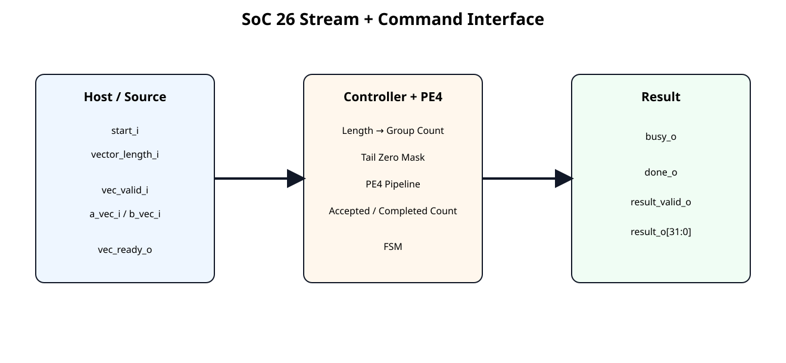
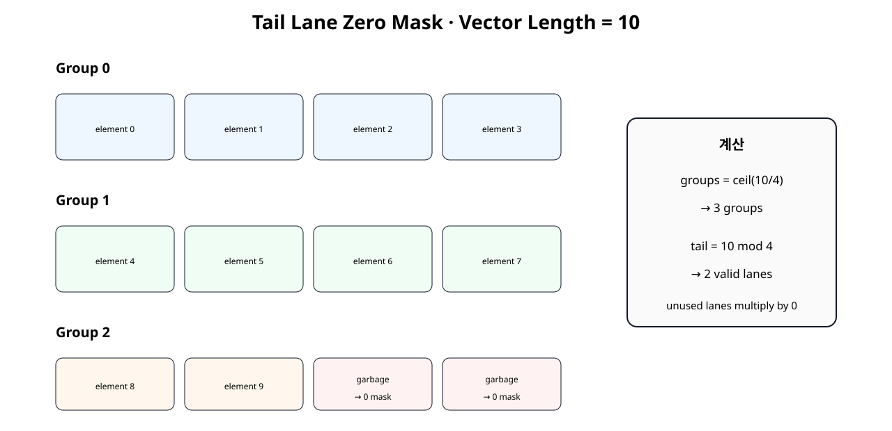
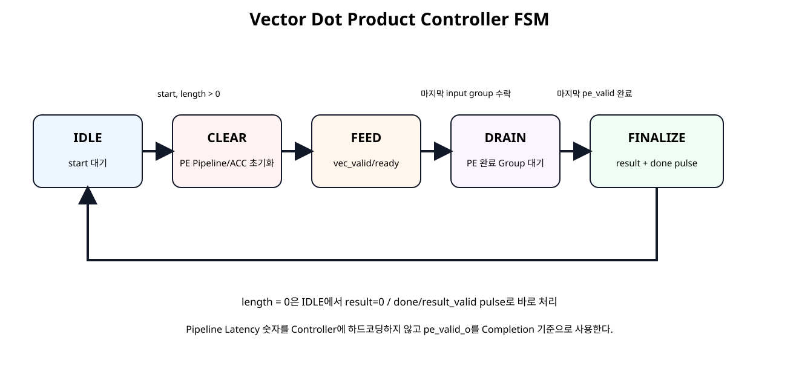
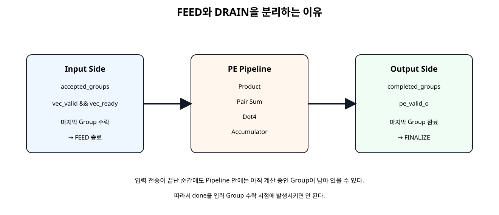

# Vector Dot Product Controller


## 전체 학습 위치


## 이번 장의 목표


[](../images/soc26/soc26_interface.svg)

명령 Interface와 Vector Stream, Result Interface를 분리한다.


## Datapath에서 연산기로

SoC 25 PE4는 valid_i가 들어오면 4개 Lane을 계산하는 Datapath였다. SoC 26은 “Vector 길이가 몇 개인가?”, “몇 Group을 받아야 하는가?”, “마지막 Lane은 몇 개가 유효한가?”, “언제 계산이 진짜 끝났는가?”를 Controller가 관리한다.


## Controller Interface


| 방향 | Signal | 역할 |
| --- | --- | --- |
| 입력 | start_i | 새 Vector 연산 시작 |
| 입력 | vector_length_i | Scalar Element 개수 |
| 입력 | vec_valid_i | 4-Lane Group 유효 |
| 출력 | vec_ready_o | 현재 Group 수락 가능 |
| 출력 | busy_o | 연산 진행 중 |
| 출력 | done_o | 연산 완료 Pulse |
| 출력 | result_valid_o | 최종 결과 유효 Pulse |
| 출력 | result_o | 32-bit 누산 결과 |


## start / busy / done


```text
IDLE
 start ↑
   ↓
 busy = 1
   ↓
 CLEAR → FEED → DRAIN
   ↓
 FINALIZE
   ↓
 result_valid = 1 pulse
 done = 1 pulse
 busy = 0
```


## Vector Length

vector_length_i는 4-Lane Group 수가 아니라 실제 Scalar Element 수다. 예를 들어 길이 10은 10개의 a[i]×b[i]를 의미한다.


## Group Count

Hardware 정수 연산에서는 다음처럼 계산한다.


```text
groups = (vector_length + 3) >> 2;
```


| Length | Group |
| --- | --- |
| 1~4 | 1 |
| 5~8 | 2 |
| 9~12 | 3 |
| 16 | 4 |
| 17 | 5 |


## 17-bit 중간 계산

vector_length_i가 16-bit이면 최대 65535다. 65535 + 3은 16-bit를 넘을 수 있으므로 먼저 17-bit로 확장한 뒤 Shift한다.


```text
length_plus3_w =
    {1'b0, vector_length_i} + 17'd3;

groups_from_length_w =
    length_plus3_w[16:2];
```


## Tail Lane 수


| Length mod 4 | 마지막 Group 유효 Lane |
| --- | --- |
| 1 | 1개 |
| 2 | 2개 |
| 3 | 3개 |
| 0 | 4개 |


## Tail Zero Mask


[](../images/soc26/soc26_tail_mask.svg)

마지막 Group의 Vector 범위 밖 Lane을 0으로 바꾸어 계산에서 제거한다.

A와 B 양쪽을 모두 0으로 Mask하므로 해당 Lane의 Product는 0이 된다.


## 길이 10 예제

Board Demo에서는 raw A를 1~10, raw B를 1로 두어 최종 Raw Result가 55가 된다. LED 하위 16-bit 예상값은 0x0037이다.


## FSM 전체 구조


[](../images/soc26/soc26_controller_fsm.svg)

IDLE → CLEAR → FEED → DRAIN → FINALIZE 구조로 역할을 분리한다.


## IDLE

start_i를 기다린다. Length가 0이면 결과 0을 즉시 반환하고, 0보다 크면 Group 수와 Tail Lane 수를 저장한 뒤 CLEAR로 이동한다.


## CLEAR

PE4 내부 Product/Adder Pipeline과 Accumulator를 한 Clock 상태 동안 Clear한다. Start와 첫 Vector 입력을 같은 Clock에 처리하지 않아 첫 Group이 Clear에 의해 사라지는 문제를 방지한다.


## FEED

vec_ready_o=1로 Source Group을 수락한다. 실제 Group 수락 기준은 다음 하나뿐이다.

마지막 Group이 수락되면 더 이상 입력을 받지 않고 DRAIN으로 이동한다.


## DRAIN


[](../images/soc26/soc26_pipeline_drain.svg)

Input 전송 종료와 계산 완료는 같은 시점이 아니다.

PE4 Pipeline에 남아 있는 Group의 pe_valid_o가 모두 나올 때까지 기다린다.


## FINALIZE

마지막 PE Completion 이후 최종 Accumulator를 result_o에 Capture하고 done_o, result_valid_o를 한 Clock Pulse로 발생시킨다.


## Accepted Group Count

accepted_groups_o는 Input Handshake가 실제 발생할 때만 증가한다.


```text
if (vec_valid_i && vec_ready_o)
    accepted_groups_o <=
        accepted_groups_o + 1;
```


## Completed Group Count

completed_groups_o는 PE4의 실제 pe_valid_o를 기준으로 증가한다.


## 왜 Pipeline Latency를 하드코딩하지 않는가

Controller가 “PE는 정확히 4 Clock 뒤에 끝난다”는 숫자에 의존하면 PE Pipeline Stage를 변경할 때 Controller도 수정해야 한다.

따라서 이후 Timing 개선으로 PE 내부 Stage 수가 바뀌어도 Interface Protocol을 유지하기 쉽다.


## READY / VALID 입력

Source는 vec_valid_i로 현재 Group이 유효함을 알리고 Controller는 vec_ready_o로 FEED 상태임을 알린다. 둘이 동시에 1인 Rising Edge에서만 Group이 소비된다.


## Source Gap 허용

Vector Group은 반드시 연속 Clock으로 들어올 필요가 없다. Testbench는 홀수 Group 전에 일부러 vec_valid_i=0 Gap을 넣어 Controller가 Input Stall을 정상적으로 처리하는지 확인한다.


## Zero Length 정책

길이 0의 의미를 애매하게 두지 않고 명시적으로 정의했다.


```text
vector_length = 0
→ group = 0
→ result = 0
→ busy = 0
→ done = 1 cycle
→ result_valid = 1 cycle
```


## Controller RTL


```verilog
module vector_dot_controller_pe4 (
    input  wire               clk,
    input  wire               resetn,

    input  wire               start_i,
    input  wire [15:0]        vector_length_i,

    input  wire               vec_valid_i,
    output wire               vec_ready_o,
    input  wire [31:0]        a_vec_i,
    input  wire [31:0]        b_vec_i,

    output wire               busy_o,
    output reg                done_o,
    output reg                result_valid_o,
    output reg signed [31:0]  result_o,

    output reg  [15:0]        accepted_groups_o,
    output reg  [15:0]        completed_groups_o
);

// Controller policy:
// - 4 signed 8-bit lanes per accepted input group
// - vector_length_i is the number of scalar elements, not the number of groups
// - ceil(vector_length / 4) groups are consumed
// - unused tail lanes are forced to zero
// - the PE pipeline latency is NOT hard-coded
// - completion is counted from pe_valid_o
//
// State flow:
// IDLE -> CLEAR -> FEED -> DRAIN -> FINALIZE -> IDLE

localparam [2:0] ST_IDLE     = 3'd0;
localparam [2:0] ST_CLEAR    = 3'd1;
localparam [2:0] ST_FEED     = 3'd2;
localparam [2:0] ST_DRAIN    = 3'd3;
localparam [2:0] ST_FINALIZE = 3'd4;

reg [2:0] state_q;

reg [15:0] total_groups_q;
reg [2:0]  tail_lanes_q;

wire [16:0] length_plus3_w;
wire [15:0] groups_from_length_w;

assign length_plus3_w =
    {1'b0, vector_length_i} + 17'd3;

assign groups_from_length_w =
    length_plus3_w[16:2];

// Remainder 0 means the final group uses all four lanes.
wire [2:0] tail_from_length_w;

assign tail_from_length_w =
    (vector_length_i[1:0] == 2'd0)
    ? 3'd4
    : {1'b0, vector_length_i[1:0]};

assign busy_o =
    (state_q != ST_IDLE);

assign vec_ready_o =
    (state_q == ST_FEED);

// The current FEED transfer is the final input group when the accepted
// group counter points to total_groups_q - 1.
wire current_group_is_last_w;

assign current_group_is_last_w =
    (state_q == ST_FEED) &&
    (total_groups_q != 16'd0) &&
    (accepted_groups_o == (total_groups_q - 16'd1));

function [31:0] mask_tail_lanes;
    input [31:0] vec;
    input [2:0]  valid_lanes;

    begin
        case (valid_lanes)
            3'd1: mask_tail_lanes = {
                24'h000000,
                vec[7:0]
            };

            3'd2: mask_tail_lanes = {
                16'h0000,
                vec[15:0]
            };

            3'd3: mask_tail_lanes = {
                8'h00,
                vec[23:0]
            };

            default: mask_tail_lanes = vec;
        endcase
    end
endfunction

wire [31:0] masked_a_vec_w;
wire [31:0] masked_b_vec_w;

assign masked_a_vec_w =
    current_group_is_last_w
    ? mask_tail_lanes(a_vec_i, tail_lanes_q)
    : a_vec_i;

assign masked_b_vec_w =
    current_group_is_last_w
    ? mask_tail_lanes(b_vec_i, tail_lanes_q)
    : b_vec_i;

wire pe_valid_i;
wire pe_clear_i;

assign pe_valid_i =
    vec_valid_i &&
    vec_ready_o;

assign pe_clear_i =
    (state_q == ST_CLEAR);

wire signed [31:0] pe_acc_w;
wire               pe_valid_o;

pe4_dot_accum_pipelined u_pe4 (
    .clk(clk),
    .resetn(resetn),
    .clear_i(pe_clear_i),
    .valid_i(pe_valid_i),

    .a_vec_i(masked_a_vec_w),
    .b_vec_i(masked_b_vec_w),

    .acc_o(pe_acc_w),
    .valid_o(pe_valid_o)
);

always @(posedge clk) begin
    if (!resetn) begin
        state_q             <= ST_IDLE;
        total_groups_q      <= 16'd0;
        tail_lanes_q        <= 3'd4;

        done_o              <= 1'b0;
        result_valid_o      <= 1'b0;
        result_o            <= 32'sd0;

        accepted_groups_o   <= 16'd0;
        completed_groups_o  <= 16'd0;
    end else begin
        // One-cycle output pulses by default.
        done_o         <= 1'b0;
        result_valid_o <= 1'b0;

        // Count actual PE completions independently of input feeding.
        if (
            pe_valid_o &&
            ((state_q == ST_FEED) || (state_q == ST_DRAIN))
        ) begin
            completed_groups_o <=
                completed_groups_o + 16'd1;
        end

        case (state_q)
            ST_IDLE: begin
                if (start_i) begin
                    result_o           <= 32'sd0;
                    accepted_groups_o  <= 16'd0;
                    completed_groups_o <= 16'd0;

                    if (vector_length_i == 16'd0) begin
                        // Defined zero-length behavior:
                        // result = 0, immediate one-cycle completion pulse.
                        total_groups_q <= 16'd0;
                        tail_lanes_q   <= 3'd4;

                        result_o       <= 32'sd0;
                        done_o         <= 1'b1;
                        result_valid_o <= 1'b1;
                    end else begin
                        total_groups_q <= groups_from_length_w;
                        tail_lanes_q   <= tail_from_length_w;

                        state_q <= ST_CLEAR;
                    end
                end
            end

            ST_CLEAR: begin
                // pe_clear_i is asserted for this full clock state.
                // Move to FEED only after the PE has observed the clear.
                state_q <= ST_FEED;
            end

            ST_FEED: begin
                if (pe_valid_i) begin
                    accepted_groups_o <=
                        accepted_groups_o + 16'd1;

                    if (current_group_is_last_w) begin
                        state_q <= ST_DRAIN;
                    end
                end
            end

            ST_DRAIN: begin
                // Count the final registered PE completion first.
                // FINALIZE isolates the final result capture and done pulse
                // from the pipeline-drain bookkeeping, without hard-coding
                // the PE latency.
                if (
                    pe_valid_o &&
                    (completed_groups_o == (total_groups_q - 16'd1))
                ) begin
                    state_q <= ST_FINALIZE;
                end
            end

            ST_FINALIZE: begin
                result_o       <= pe_acc_w;
                done_o         <= 1'b1;
                result_valid_o <= 1'b1;

                state_q <= ST_IDLE;
            end

            default: begin
                state_q <= ST_IDLE;
            end
        endcase
    end
end

endmodule
```


## Basys3 Demo Source


```verilog
module vector_demo_source_len10 (
    input  wire        clk,
    input  wire        resetn,

    output reg         start_o,
    output wire [15:0] vector_length_o,

    output reg         vec_valid_o,
    input  wire        vec_ready_i,
    output reg  [31:0] a_vec_o,
    output reg  [31:0] b_vec_o,

    input  wire        done_i
);

// One-shot demonstration:
// vector length = 10 scalar elements
// group count   = ceil(10 / 4) = 3
//
// The final group intentionally places non-zero garbage in lanes 2/3.
// The controller must zero-mask those two tail lanes.

localparam [2:0] S_START = 3'd0;
localparam [2:0] S_WAIT  = 3'd1;
localparam [2:0] S_SEND0 = 3'd2;
localparam [2:0] S_SEND1 = 3'd3;
localparam [2:0] S_SEND2 = 3'd4;
localparam [2:0] S_DONE  = 3'd5;

reg [2:0] state_q;

assign vector_length_o = 16'd10;

always @(*) begin
    start_o     = 1'b0;
    vec_valid_o = 1'b0;
    a_vec_o     = 32'h0000_0000;
    b_vec_o     = 32'h0000_0000;

    case (state_q)
        S_START: begin
            start_o = 1'b1;
        end

        S_SEND0: begin
            vec_valid_o = 1'b1;

            // Lane order in each 32-bit word:
            // {lane3, lane2, lane1, lane0}
            a_vec_o = {
                8'd4,
                8'd3,
                8'd2,
                8'd1
            };

            b_vec_o = {
                8'd1,
                8'd1,
                8'd1,
                8'd1
            };
        end

        S_SEND1: begin
            vec_valid_o = 1'b1;

            a_vec_o = {
                8'd8,
                8'd7,
                8'd6,
                8'd5
            };

            b_vec_o = {
                8'd1,
                8'd1,
                8'd1,
                8'd1
            };
        end

        S_SEND2: begin
            vec_valid_o = 1'b1;

            // Only lane0/lane1 belong to vector length 10.
            // lane2/lane3 are intentional garbage.
            a_vec_o = {
                8'h7F,
                8'h7F,
                8'd10,
                8'd9
            };

            b_vec_o = {
                8'h7F,
                8'h7F,
                8'd1,
                8'd1
            };
        end

        default: begin
        end
    endcase
end

always @(posedge clk) begin
    if (!resetn) begin
        state_q <= S_START;
    end else begin
        case (state_q)
            S_START: begin
                state_q <= S_WAIT;
            end

            S_WAIT: begin
                if (vec_ready_i) begin
                    state_q <= S_SEND0;
                end
            end

            S_SEND0: begin
                if (vec_ready_i) begin
                    state_q <= S_SEND1;
                end
            end

            S_SEND1: begin
                if (vec_ready_i) begin
                    state_q <= S_SEND2;
                end
            end

            S_SEND2: begin
                if (vec_ready_i) begin
                    state_q <= S_DONE;
                end
            end

            S_DONE: begin
                // Hold until controller reports completion.
                if (done_i) begin
                    state_q <= S_DONE;
                end
            end

            default: begin
                state_q <= S_START;
            end
        endcase
    end
end

endmodule
```

Length 10의 마지막 Group에 일부러 Garbage Lane을 넣어 Zero Mask가 없으면 LED 결과가 55가 되지 않도록 구성했다.


## Board Top


```verilog
module vector_dot_controller_basys3_top (
    input  wire        clk,
    input  wire        btnC,
    output wire [15:0] led_o
);

// Pure board Shell / Wrapper.

wire resetn;

wire        start;
wire [15:0] vector_length;

wire        vec_valid;
wire        vec_ready;
wire [31:0] a_vec;
wire [31:0] b_vec;

wire        busy;
wire        done;
wire        result_valid;
wire signed [31:0] result;

wire [15:0] accepted_groups;
wire [15:0] completed_groups;

reset_active_high_to_active_low u_reset_adapter (
    .reset_i(btnC),
    .resetn_o(resetn)
);

vector_demo_source_len10 u_demo_source (
    .clk(clk),
    .resetn(resetn),

    .start_o(start),
    .vector_length_o(vector_length),

    .vec_valid_o(vec_valid),
    .vec_ready_i(vec_ready),
    .a_vec_o(a_vec),
    .b_vec_o(b_vec),

    .done_i(done)
);

vector_dot_controller_pe4 u_controller (
    .clk(clk),
    .resetn(resetn),

    .start_i(start),
    .vector_length_i(vector_length),

    .vec_valid_i(vec_valid),
    .vec_ready_o(vec_ready),
    .a_vec_i(a_vec),
    .b_vec_i(b_vec),

    .busy_o(busy),
    .done_o(done),
    .result_valid_o(result_valid),
    .result_o(result),

    .accepted_groups_o(accepted_groups),
    .completed_groups_o(completed_groups)
);

vector_result_sink u_result_sink (
    .clk(clk),
    .resetn(resetn),

    .result_i(result),
    .result_valid_i(result_valid),

    .led_o(led_o)
);

endmodule
```

Top은 Reset Adapter, Demo Source, Controller, Result Sink 연결만 수행한다.


## Self-Checking Testbench


```verilog
`timescale 1ns / 1ps

module tb_vector_dot_controller_pe4;

logic clk = 1'b0;
logic resetn = 1'b0;

logic        start_i = 1'b0;
logic [15:0] vector_length_i = 16'd0;

logic        vec_valid_i = 1'b0;
wire         vec_ready_o;
logic [31:0] a_vec_i = 32'h0;
logic [31:0] b_vec_i = 32'h0;

wire         busy_o;
wire         done_o;
wire         result_valid_o;
wire signed [31:0] result_o;

wire [15:0] accepted_groups_o;
wire [15:0] completed_groups_o;

int error_count = 0;
int check_count = 0;

always #5 clk = ~clk;

vector_dot_controller_pe4 dut (
    .clk(clk),
    .resetn(resetn),

    .start_i(start_i),
    .vector_length_i(vector_length_i),

    .vec_valid_i(vec_valid_i),
    .vec_ready_o(vec_ready_o),
    .a_vec_i(a_vec_i),
    .b_vec_i(b_vec_i),

    .busy_o(busy_o),
    .done_o(done_o),
    .result_valid_o(result_valid_o),
    .result_o(result_o),

    .accepted_groups_o(accepted_groups_o),
    .completed_groups_o(completed_groups_o)
);

function automatic integer ceil_div4(
    input integer n
);
    ceil_div4 = (n + 3) / 4;
endfunction

function automatic integer signed gen_a(
    input integer scalar_index
);
    integer temp;

    begin
        // Deterministic signed 8-bit pattern.
        temp = ((scalar_index * 29) + 17) & 8'hFF;

        if (temp >= 128) begin
            temp = temp - 256;
        end

        gen_a = temp;
    end
endfunction

function automatic integer signed gen_b(
    input integer scalar_index
);
    integer temp;

    begin
        temp = ((scalar_index * 47) + 91) & 8'hFF;

        if (temp >= 128) begin
            temp = temp - 256;
        end

        gen_b = temp;
    end
endfunction

function automatic [31:0] pack4(
    input integer x0,
    input integer x1,
    input integer x2,
    input integer x3
);
    begin
        pack4 = {
            x3[7:0],
            x2[7:0],
            x1[7:0],
            x0[7:0]
        };
    end
endfunction

task automatic check_true(
    input string name,
    input bit condition
);
    begin
        check_count++;

        if (!condition) begin
            error_count++;
            $error("CHECK FAIL: %s", name);
        end else begin
            $display("CHECK PASS: %s", name);
        end
    end
endtask

task automatic check_eq32(
    input string name,
    input logic signed [31:0] actual,
    input logic signed [31:0] expected
);
    begin
        check_count++;

        if (actual !== expected) begin
            error_count++;
            $error(
                "CHECK FAIL: %s actual=%0d expected=%0d",
                name,
                actual,
                expected
            );
        end else begin
            $display(
                "CHECK PASS: %s = %0d",
                name,
                actual
            );
        end
    end
endtask

task automatic pulse_start(
    input integer length
);
    begin
        @(negedge clk);
        vector_length_i = length[15:0];
        start_i = 1'b1;

        @(negedge clk);
        start_i = 1'b0;
    end
endtask

task automatic drive_group(
    input integer group_index,
    input integer length,
    inout integer signed expected_acc
);
    integer lane;
    integer scalar_index;

    integer signed a0;
    integer signed a1;
    integer signed a2;
    integer signed a3;

    integer signed b0;
    integer signed b1;
    integer signed b2;
    integer signed b3;

    integer signed lane_a;
    integer signed lane_b;

    begin
        // Deliberately insert a one-cycle source gap before odd groups.
        if ((group_index & 1) != 0) begin
            @(negedge clk);
            vec_valid_i = 1'b0;
            a_vec_i = 32'h0;
            b_vec_i = 32'h0;
        end

        while (vec_ready_o !== 1'b1) begin
            @(negedge clk);
        end

        a0 = 127;
        a1 = 127;
        a2 = 127;
        a3 = 127;

        b0 = -128;
        b1 = -128;
        b2 = -128;
        b3 = -128;

        // Values beyond vector_length are intentional garbage.
        // The DUT tail-mask must remove them.
        for (lane = 0; lane < 4; lane++) begin
            scalar_index = (group_index * 4) + lane;

            if (scalar_index < length) begin
                lane_a = gen_a(scalar_index);
                lane_b = gen_b(scalar_index);

                expected_acc =
                    expected_acc +
                    (lane_a * lane_b);

                case (lane)
                    0: begin a0 = lane_a; b0 = lane_b; end
                    1: begin a1 = lane_a; b1 = lane_b; end
                    2: begin a2 = lane_a; b2 = lane_b; end
                    3: begin a3 = lane_a; b3 = lane_b; end
                endcase
            end
        end

        @(negedge clk);

        while (vec_ready_o !== 1'b1) begin
            @(negedge clk);
        end

        a_vec_i = pack4(a0, a1, a2, a3);
        b_vec_i = pack4(b0, b1, b2, b3);
        vec_valid_i = 1'b1;

        // READY is checked before the sampling edge because the DUT may
        // deassert READY immediately after the final group is accepted.
        check_true(
            "group presented only when ready",
            vec_ready_o === 1'b1
        );

        // Handshake occurs on the next rising edge.
        @(posedge clk);
        #1;

        @(negedge clk);
        vec_valid_i = 1'b0;
    end
endtask

task automatic run_case(
    input integer length
);
    integer group_count;
    integer group_index;
    integer signed expected_acc;
    integer timeout;

    begin
        expected_acc = 0;
        group_count = ceil_div4(length);

        $display("");
        $display(
            "RUN length=%0d groups=%0d",
            length,
            group_count
        );

        pulse_start(length);

        if (length == 0) begin
            timeout = 0;

            while (
                (result_valid_o !== 1'b1) &&
                (timeout < 20)
            ) begin
                @(posedge clk);
                #1;
                timeout++;
            end

            check_true(
                "zero-length result_valid",
                result_valid_o === 1'b1
            );

            check_true(
                "zero-length done",
                done_o === 1'b1
            );

            check_eq32(
                "zero-length result",
                result_o,
                32'sd0
            );

            check_true(
                "zero-length busy low",
                busy_o === 1'b0
            );

            @(posedge clk);
            #1;
            return;
        end

        // Wait for CLEAR state to finish and FEED to begin.
        while (vec_ready_o !== 1'b1) begin
            @(posedge clk);
            #1;
        end

        check_true(
            "busy asserted during operation",
            busy_o === 1'b1
        );

        for (
            group_index = 0;
            group_index < group_count;
            group_index++
        ) begin
            drive_group(
                group_index,
                length,
                expected_acc
            );
        end

        // Tail garbage has been sent for partial final groups.
        // Now wait for the PE pipeline to drain.
        timeout = 0;

        while (
            (result_valid_o !== 1'b1) &&
            (timeout < 100)
        ) begin
            @(posedge clk);
            #1;
            timeout++;
        end

        check_true(
            "result_valid after pipeline drain",
            result_valid_o === 1'b1
        );

        check_true(
            "done with result_valid",
            done_o === 1'b1
        );

        check_true(
            "busy low when done pulses",
            busy_o === 1'b0
        );

        check_eq32(
            "vector dot result",
            result_o,
            expected_acc
        );

        check_true(
            "accepted group count",
            accepted_groups_o == group_count
        );

        check_true(
            "completed group count",
            completed_groups_o == group_count
        );

        @(posedge clk);
        #1;

        check_true(
            "result_valid is one-cycle pulse",
            result_valid_o === 1'b0
        );
    end
endtask

initial begin
    repeat (5) @(posedge clk);
    resetn = 1'b1;

    // Zero length is explicitly defined as immediate result 0.
    run_case(0);

    // Every tail size: 1, 2, 3, and full 4 lanes.
    run_case(1);
    run_case(2);
    run_case(3);
    run_case(4);

    // Multiple groups + tail cases.
    run_case(5);
    run_case(10);
    run_case(16);
    run_case(17);
    run_case(31);

    $display("");
    $display("SOC26 CHECK COUNT : %0d", check_count);
    $display("SOC26 ERROR COUNT : %0d", error_count);

    if (error_count == 0) begin
        $display("SOC26 VECTOR CONTROLLER TEST: PASS");
    end else begin
        $fatal(
            1,
            "SOC26 VECTOR CONTROLLER TEST: FAIL (%0d errors)",
            error_count
        );
    end

    #20;
    $finish;
end

endmodule
```


## Tail Garbage Test

길이 1,2,3처럼 일부 Lane만 유효한 마지막 Group의 나머지 Lane에는 127과 -128 같은 큰 값을 넣는다. Reference Model은 Vector Length 안의 Scalar만 더하므로 Mask가 빠지면 즉시 Result Mismatch가 발생한다.


## Python Reference


```text
length,groups,tail,result_raw,last_group_masked_a
0,0,0,0,[]
1,1,1,1547,[17, 0, 0, 0]
2,1,2,-3881,[17, 46, 0, 0]
3,1,3,-9206,[17, 46, 75, 0]
4,1,4,-11702,[17, 46, 75, 104]
5,2,1,-14531,[-123, 0, 0, 0]
10,3,2,-25045,[-7, 22, 0, 0]
16,4,4,-19384,[109, -118, -89, -60]
17,5,1,-21709,[-31, 0, 0, 0]
31,8,3,-19552,[61, 90, 119, 0]

demo length 10 -> 3 groups, tail lanes = 2
demo expected raw result = 55 (LED lower 16 bits = 0x0037)
SOC26 PYTHON CONTROLLER REFERENCE: PASS
Spreadsheet runtime warmup failed during python startup
Traceback (most recent call last):
  File "/tmp/tmp.L2TH2Y5coc/artifact_tool_v2-2.8.22/artifact_tool/patches/warm_spreadsheet_runtime_on_startup.py", line 26, in warm_spreadsheet_runtime_on_startup
  File "/tmp/tmp.L2TH2Y5coc/artifact_tool_v2-2.8.22/artifact_tool/spreadsheet_warmup.py", line 785, in warm_spreadsheet_runtime
  File "/tmp/tmp.L2TH2Y5coc/artifact_tool_v2-2.8.22/artifact_tool/spreadsheet_warmup.py", line 720, in _warm_feature_flows
  File "/tmp/tmp.L2TH2Y5coc/artifact_tool_v2-2.8.22/artifact_tool/spreadsheet_warmup.py", line 704, in _warm_collaboration_flows
  File "/tmp/tmp.L2TH2Y5coc/artifact_tool_v2-2.8.22/artifact_tool/generated/interface/models.py", line 32317, in hydrate_crdt_from_proto
  File "/tmp/tmp.L2TH2Y5coc/artifact_tool_v2-2.8.22/artifact_tool/rpc/remote.py", line 749, in __call__
  File "/tmp/tmp.L2TH2Y5coc/artifact_tool_v2-2.8.22/artifact_tool/rpc/client.py", line 150, in call
artifact_tool.rpc.client.RemoteError: hydrateCrdtFromProto requires an empty collaborative document.
```

Length 0/1/2/3/4/5/10/16/17/31에 대해 Group 수와 Tail Lane 수를 실제 실행으로 확인했다.


## Vivado Simulation


```text
vivado -mode batch \
  -source scripts/prepare_soc26_simulation.tcl
```

생성된 Project에서 tb_vector_dot_controller_pe4를 Run All하면 자동 PASS/FAIL Testbench를 실행할 수 있다.


## Vivado Implementation


```text
# SoC 26 · Vector Dot Product Controller analysis
#
#   vivado -mode batch -source scripts/run_vector_controller_analysis.tcl

set script_dir [file dirname [file normalize [info script]]]
set root_dir   [file normalize [file join $script_dir ".."]]
set rtl_dir    [file join $root_dir "rtl"]
set xdc_dir    [file join $root_dir "constraints"]
set out_dir    [file normalize [file join $root_dir "reports"]]

file mkdir $out_dir

create_project -in_memory -part xc7a35tcpg236-1

read_verilog [file join $rtl_dir "reset_active_high_to_active_low.v"]
read_verilog [file join $rtl_dir "mul_s8_dsp.v"]
read_verilog [file join $rtl_dir "pe4_dot_accum_pipelined.v"]
read_verilog [file join $rtl_dir "vector_dot_controller_pe4.v"]
read_verilog [file join $rtl_dir "vector_demo_source_len10.v"]
read_verilog [file join $rtl_dir "vector_result_sink.v"]
read_verilog [file join $rtl_dir "vector_dot_controller_basys3_top.v"]

synth_design \
    -top vector_dot_controller_basys3_top \
    -part xc7a35tcpg236-1

read_xdc [file join $xdc_dir "basys3_vector_controller_lab.xdc"]

create_clock \
    -name sys_clk \
    -period 10.000 \
    [get_ports clk]

report_utilization \
    -hierarchical \
    -file [file join $out_dir "01_utilization_post_synth.rpt"]

redirect -file [file join $out_dir "02_dsp48_cells_post_synth.rpt"] {
    set dsp_cells [get_cells -hier -filter {REF_NAME =~ DSP48*}]
    puts "DSP48 cell count: [llength $dsp_cells]"

    foreach cell $dsp_cells {
        puts $cell
    }
}

report_timing_summary \
    -delay_type min_max \
    -report_unconstrained \
    -max_paths 10 \
    -file [file join $out_dir "03_timing_summary_post_synth.rpt"]

opt_design
place_design
phys_opt_design
route_design

report_utilization \
    -hierarchical \
    -file [file join $out_dir "04_utilization_post_route.rpt"]

report_timing_summary \
    -delay_type min_max \
    -report_unconstrained \
    -max_paths 20 \
    -file [file join $out_dir "05_timing_summary_post_route.rpt"]

report_timing \
    -delay_type max \
    -max_paths 20 \
    -nworst 1 \
    -sort_by group \
    -input_pins \
    -file [file join $out_dir "06_worst_setup_paths.rpt"]

report_design_analysis \
    -max_paths 50 \
    -setup \
    -logic_level_distribution \
    -file [file join $out_dir "07_design_analysis_post_route.rpt"]

# Keep the same What-If activity assumption as SoC 23~25.
set_switching_activity \
    -default_static_probability 0.5 \
    -default_toggle_rate 12.5

report_power \
    -file [file join $out_dir "08_power_normalized_activity.rpt"] \
    -rpx  [file join $out_dir "08_power_normalized_activity.rpx"]

report_methodology \
    -file [file join $out_dir "09_methodology_post_route.rpt"]

write_checkpoint -force \
    [file join $out_dir "soc26_vector_controller_post_route.dcp"]

puts ""
puts "SoC 26 vector controller analysis complete."
puts "Reports: $out_dir"
puts ""
puts "Board demo expectation:"
puts "  vector length = 10"
puts "  raw result = 55"
puts "  LED[15:0] = 0x0037"
```

Post-route Timing, Resource, DSP48 Cell, Design Analysis, Power, Methodology Report를 생성한다.


## Timing / Resource / Power

Controller가 추가되면서 FSM, Counter, Comparator, Mask Mux가 Resource와 Critical Path에 추가된다. SoC 22/23의 분석 축을 그대로 사용해 PE Datapath만 있을 때와 Controller가 붙었을 때를 비교한다.


## FSM Synthesis

Vivado 2026.1은 Moore/Mealy FSM을 추론하고 기본적으로 FSM Extraction을 수행한다. Encoding은 Tool의 Auto 선택을 기본으로 유지하며, 실제 Timing/Area 요구가 있을 때만 FSM_ENCODING을 명시적으로 검토한다.


## SoC 27 연결

현재 Source가 Vector Group을 외부에서 밀어 넣는다. 다음 단계에서는 PE가 필요한 Data를 Local BRAM에서 읽도록 바꾼다.

이 단계부터 Compute와 Data Movement가 분리되고 Memory Bandwidth가 실제 NPU Architecture의 핵심 설계축이 된다.


## 오류 점검


| 증상 | 원인 | 확인 |
| --- | --- | --- |
| 첫 Group이 사라짐 | Clear와 첫 Valid가 같은 Cycle | CLEAR 상태 분리 |
| 마지막 결과가 작음 | Pipeline Drain 전에 Done | completed_groups / DRAIN |
| Length 5/10/17에서 오답 | Tail Mask 오류 | 마지막 Group Lane Mask |
| Length 4/16에서 마지막 Lane 누락 | remainder 0을 0 Lane으로 해석 | 0 → 4 valid lanes |
| 65535 부근 Group 수 오류 | Length+3 Overflow | 17-bit 중간 계산 |
| Source Gap에서 Count 오류 | VALID만 세고 READY 미확인 | VALID && READY |
| Pipeline 변경 후 Controller 오동작 | Latency 숫자 하드코딩 | pe_valid_o 기반 완료 |
| Board 결과가 55가 아님 | Tail garbage 미마스킹 | LED 0x0037 예상 |


## SoC 26 완료 체크리스트

- [ ] start/busy/done/result_valid Protocol을 정의한다.
- [ ] vector_length가 Scalar 수라는 것을 구분한다.
- [ ] (length+3)>>2로 Group 수를 계산한다.
- [ ] 16-bit Length의 +3 계산을 17-bit로 확장한다.
- [ ] Length mod 4로 Tail Lane 수를 계산한다.
- [ ] remainder 0은 4개 Lane 유효로 처리한다.
- [ ] 마지막 Group의 unused A/B Lane을 0으로 Mask한다.
- [ ] CLEAR 상태로 PE 초기화와 첫 입력을 분리한다.
- [ ] FEED와 DRAIN을 분리한다.
- [ ] Accepted Count와 Completed Count를 구분한다.
- [ ] Pipeline Latency 숫자를 Controller에 하드코딩하지 않는다.
- [ ] Length 0의 동작 정책을 명시한다.
- [ ] Tail Garbage Test로 Mask를 검증한다.
- [ ] Board Demo에서 Length 10 → Result 55를 확인한다.

## 공식 매뉴얼 및 근거


| 문서 | 확인 항목 |
| --- | --- |
| AMD UG901 · FSM Description · 2026.1 | Vivado의 Moore/Mealy FSM 추론 |
| AMD UG901 · FSM_ENCODING · 2026.1 | auto/one_hot/sequential/gray 등 Encoding 선택 |
| AMD UG949 · Pipelining Considerations · 2026.1 | Pipeline으로 Logic Path를 분산하며 Latency 관리 필요 |
| AMD UG949 · Optimal DSP Inference · 2026.1 | DSP Datapath Pipeline 권장 |
| AMD UG949 · Methodology DRC · 2026.1 | report_methodology 단계별 검증 |
| AMD UG949 · Baselining · 2026.1 | 단순하고 유효한 Constraint로 RTL 구조를 조기 검증 |

