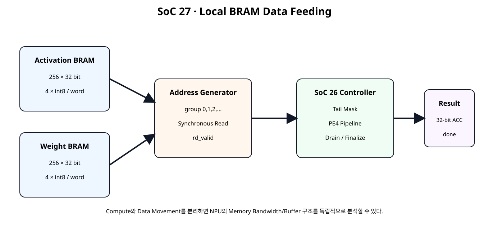
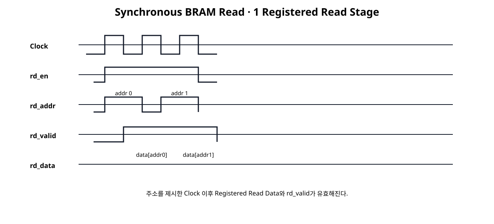
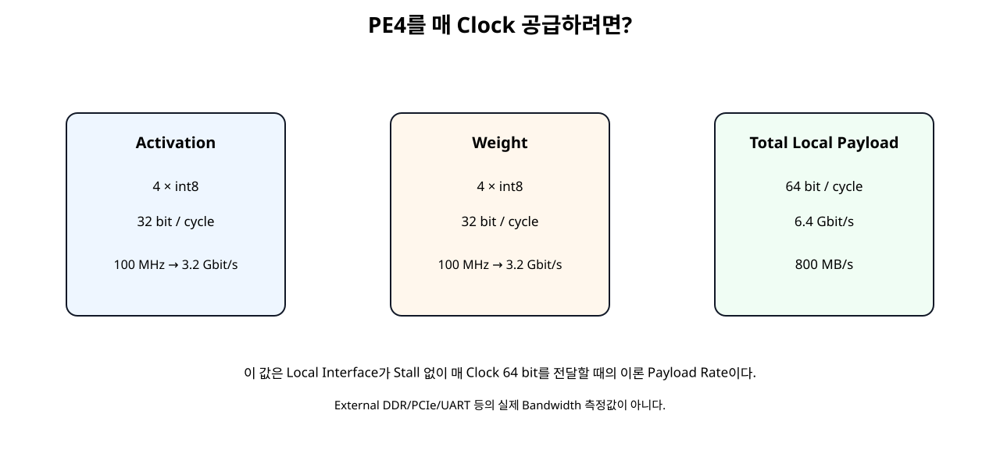

# Local BRAM / Address Generator / Data Feeding


## 전체 학습 위치


## 이번 장의 목표


[](../images/soc27/soc27_local_bram_architecture.svg)

Activation/Weight Local Buffer와 Compute Controller를 분리한다.


## 왜 Local Memory가 필요한가

PE를 여러 개 병렬화해도 매 Clock 필요한 Weight와 Activation을 공급하지 못하면 DSP는 대기한다. 따라서 NPU 성능은 계산량뿐 아니라 Data를 얼마나 빠르게 Local Datapath로 공급할 수 있는지가 중요하다.


## 전체 Architecture


```text
Host / Loader
   ↓ write
Activation BRAM ─┐
                  ├→ Address Generator / BRAM Feeder
Weight BRAM ─────┘
                  ↓
SoC 26 Vector Controller
                  ↓
PE4 Pipeline
                  ↓
Result
```


## Activation / Weight Buffer

Activation과 Weight를 별도 32-bit Memory로 분리했다. 두 Memory를 같은 Address로 병렬 Read하면 한 Group에 필요한 A 4개와 B 4개를 동시에 가져올 수 있다.


## Simple-Dual-Port 구조


| Port | 역할 |
| --- | --- |
| Write Port | Host/Loader가 Local Buffer를 채움 |
| Read Port | Compute Address Generator가 Group을 읽음 |

Write와 Read를 분리하면 이후 Double Buffering과 Compute/Load Overlap으로 확장하기 쉽다.


## Block RAM은 Synchronous Read


[](../images/soc27/soc27_bram_read_latency.svg)

Dedicated Block RAM은 Read가 동기식이므로 Address와 Data가 같은 순간에 나오지 않는다.


## RAM Inference 원칙

RAMB18E1/RAMB36E1 Primitive를 직접 Instantiate하지 않고 RTL Array를 사용해 Vivado가 Memory Primitive를 추론하도록 했다. AMD 2026.1은 일반적인 Memory 구조에 대해 HDL Inference를 우선 권장한다.


## RAM_STYLE=block


```text
(* ram_style = "block" *)
reg [31:0] mem [0:255];
```

이 Attribute는 Block RAM Mapping을 요청한다. 하지만 실제 RAMB Primitive 개수와 Mapping은 합성 후 report_ram_utilization로 확인한다.


## Read Data Valid

Memory Interface에 rd_valid_o를 별도로 둔다. Address Request와 Data Response를 구분하면 BRAM Latency가 Datapath에 명확히 드러난다.


## 32-bit Word와 4-Lane Packing


```text
word[7:0]   → lane0
word[15:8]  → lane1
word[23:16] → lane2
word[31:24] → lane3
```

SoC 25/26의 PE4 Input Format을 그대로 사용하므로 Memory에서 읽은 Word를 별도 재배열 없이 Controller에 공급할 수 있다.


## Address Generator

Address Generator는 Vector Group 번호를 Memory Address로 사용한다.


## Group Address

requested_groups_o의 하위 Address Bit를 Read Address로 사용한다. Length 10이면 Group 0,1,2의 세 Word를 읽는다.


## FEED 구간 연속 Read

SoC 26 Controller는 FEED 상태에서 vec_ready_o를 유지한다. 따라서 첫 BRAM Read Latency 이후 Address Generator는 매 Clock 다음 Address를 요청할 수 있다.


## BRAM Read Latency 흡수

Address Generator는 Request Count와 Delivered Count를 분리한다. requested_groups_o는 BRAM에 Address를 넣은 횟수이고 delivered_groups_o는 Read Data가 Controller에 실제 전달된 횟수다.


## Requested / Delivered Count

이 구분은 이후 External Memory, DMA, FIFO처럼 Request와 Response Latency가 더 길어질 때 그대로 확장할 수 있다.


## SoC26 Controller 재사용

vector_dot_controller_pe4.v는 SoC 26 파일을 BYTE-IDENTICAL로 재사용한다. 이번 장은 Compute Controller를 고치지 않고 Source를 External Stream에서 BRAM Feeder로 바꾸는 단계다.


## Tail Mask 재사용

Memory의 마지막 Word에는 Vector Length 밖의 Garbage Data가 들어 있어도 SoC 26 Controller가 Tail Lane을 0으로 Mask한다. 따라서 Local Buffer는 항상 완전한 32-bit Word 단위로 저장할 수 있다.


## Local Buffer Capacity


```text
ADDR_WIDTH = 8
→ Depth = 2⁸ = 256 words
→ 1 word = 4 scalar
→ 최대 1024 scalar elements
```


## Range Error

Length가 1024를 넘으면 Address가 8-bit 범위를 초과해 Wrap할 수 있으므로 Compute Start를 거부하고 range_error_o를 발생시킨다.


## Bandwidth 계산


[](../images/soc27/soc27_local_bandwidth.svg)

PE4 한 Group을 매 Clock 공급하려면 Activation 32 bit와 Weight 32 bit가 필요하다.


## 800 MB/s의 의미

이는 Local Interface가 Stall 없이 매 Clock 64 bit를 전달할 때의 Payload Rate이다. DDR, PCIe, UART 같은 외부 Memory/Link의 실제 측정 Bandwidth가 아니다.


## BRAM RTL


```verilog
module vector_bram_sdp #(
    parameter integer ADDR_WIDTH = 8,
    parameter integer DATA_WIDTH = 32
) (
    input  wire                      clk,
    input  wire                      resetn,

    input  wire                      wr_en_i,
    input  wire [ADDR_WIDTH-1:0]     wr_addr_i,
    input  wire [DATA_WIDTH-1:0]     wr_data_i,

    input  wire                      rd_en_i,
    input  wire [ADDR_WIDTH-1:0]     rd_addr_i,
    output reg  [DATA_WIDTH-1:0]     rd_data_o,
    output reg                       rd_valid_o
);

// Simple-dual-port local vector buffer.
//
// Write port: synchronous.
// Read port : synchronous, one registered read-data stage.
//
// Do not reset the RAM array itself. This coding style is intentionally
// kept close to Vivado RAM inference templates.
//
// RAM_STYLE requests block RAM mapping. Actual mapping must still be
// verified with report_ram_utilization after synthesis.

(* ram_style = "block" *)
reg [DATA_WIDTH-1:0] mem [
    0:(1 << ADDR_WIDTH)-1
];

always @(posedge clk) begin
    if (wr_en_i) begin
        mem[wr_addr_i] <= wr_data_i;
    end
end

always @(posedge clk) begin
    if (rd_en_i) begin
        rd_data_o <= mem[rd_addr_i];
    end
end

always @(posedge clk) begin
    if (!resetn) begin
        rd_valid_o <= 1'b0;
    end else begin
        rd_valid_o <= rd_en_i;
    end
end

endmodule
```


## Feeder RTL


```verilog
module bram_vector_feeder #(
    parameter integer ADDR_WIDTH = 8
) (
    input  wire                      clk,
    input  wire                      resetn,

    input  wire                      start_i,
    input  wire [15:0]               vector_length_i,

    input  wire                      downstream_ready_i,

    output wire                      act_rd_en_o,
    output wire [ADDR_WIDTH-1:0]     act_rd_addr_o,
    input  wire [31:0]               act_rd_data_i,
    input  wire                      act_rd_valid_i,

    output wire                      weight_rd_en_o,
    output wire [ADDR_WIDTH-1:0]     weight_rd_addr_o,
    input  wire [31:0]               weight_rd_data_i,
    input  wire                      weight_rd_valid_i,

    output wire                      vec_valid_o,
    output wire [31:0]               a_vec_o,
    output wire [31:0]               b_vec_o,

    output reg  [15:0]               requested_groups_o,
    output reg  [15:0]               delivered_groups_o,
    output wire                      active_o
);

// This feeder is paired with vector_dot_controller_pe4.
// The downstream controller keeps READY high throughout FEED, so the
// synchronous BRAM can issue one group every clock after startup.
//
// Request side:
//   rd_en_o + rd_addr_o
//
// Response side one clock later:
//   *_rd_valid_i + *_rd_data_i
//
// The feeder does not hard-code BRAM data values or PE pipeline latency.

wire [16:0] length_plus3_w;
wire [15:0] total_groups_w;

assign length_plus3_w =
    {1'b0, vector_length_i} + 17'd3;

assign total_groups_w =
    length_plus3_w[16:2];

reg [15:0] total_groups_q;
reg        active_q;

assign active_o = active_q;

wire can_issue_w;

assign can_issue_w =
    active_q &&
    downstream_ready_i &&
    (requested_groups_o < total_groups_q);

assign act_rd_en_o    = can_issue_w;
assign weight_rd_en_o = can_issue_w;

assign act_rd_addr_o =
    requested_groups_o[ADDR_WIDTH-1:0];

assign weight_rd_addr_o =
    requested_groups_o[ADDR_WIDTH-1:0];

assign vec_valid_o =
    act_rd_valid_i &&
    weight_rd_valid_i;

assign a_vec_o = act_rd_data_i;
assign b_vec_o = weight_rd_data_i;

always @(posedge clk) begin
    if (!resetn) begin
        total_groups_q      <= 16'd0;
        requested_groups_o  <= 16'd0;
        delivered_groups_o  <= 16'd0;
        active_q             <= 1'b0;
    end else begin
        if (start_i) begin
            total_groups_q     <= total_groups_w;
            requested_groups_o <= 16'd0;
            delivered_groups_o <= 16'd0;

            active_q <=
                (vector_length_i != 16'd0);
        end else begin
            if (can_issue_w) begin
                requested_groups_o <=
                    requested_groups_o + 16'd1;
            end

            if (
                vec_valid_o &&
                downstream_ready_i
            ) begin
                delivered_groups_o <=
                    delivered_groups_o + 16'd1;

                if (
                    delivered_groups_o ==
                    (total_groups_q - 16'd1)
                ) begin
                    active_q <= 1'b0;
                end
            end
        end
    end
end

endmodule
```


## Accelerator RTL


```verilog
module local_bram_dot_accelerator #(
    parameter integer ADDR_WIDTH = 8
) (
    input  wire                      clk,
    input  wire                      resetn,

    // Buffer load ports.
    input  wire                      act_wr_en_i,
    input  wire [ADDR_WIDTH-1:0]     act_wr_addr_i,
    input  wire [31:0]               act_wr_data_i,

    input  wire                      weight_wr_en_i,
    input  wire [ADDR_WIDTH-1:0]     weight_wr_addr_i,
    input  wire [31:0]               weight_wr_data_i,

    // Compute command.
    input  wire                      start_i,
    input  wire [15:0]               vector_length_i,

    // Status/result.
    output wire                      busy_o,
    output wire                      done_o,
    output wire                      result_valid_o,
    output wire signed [31:0]        result_o,

    // Debug/teaching status.
    output wire [15:0]               requested_groups_o,
    output wire [15:0]               delivered_groups_o,
    output wire [15:0]               accepted_groups_o,
    output wire [15:0]               completed_groups_o,

    output wire                      range_error_o
);

// Architecture:
//
// Activation BRAM ---\
//                     > BRAM feeder -> SoC26 controller/PE4 -> result
// Weight BRAM ------/
//
// Each 32-bit BRAM word contains four signed 8-bit scalar values.
//
// With ADDR_WIDTH=8:
//   depth        = 256 words
//   scalar lanes = 256 * 4 = 1024 elements
//
// Commands larger than the local-buffer capacity are rejected.

localparam [16:0] MAX_ELEMENTS_W =
    (17'd4 << ADDR_WIDTH);

wire range_error_w;
wire start_valid_w;

assign range_error_w =
    ({1'b0, vector_length_i} > MAX_ELEMENTS_W);

assign range_error_o =
    start_i && range_error_w;

assign start_valid_w =
    start_i && !range_error_w;

wire                      act_rd_en;
wire [ADDR_WIDTH-1:0]     act_rd_addr;
wire [31:0]               act_rd_data;
wire                      act_rd_valid;

wire                      weight_rd_en;
wire [ADDR_WIDTH-1:0]     weight_rd_addr;
wire [31:0]               weight_rd_data;
wire                      weight_rd_valid;

wire                      vec_valid;
wire                      vec_ready;
wire [31:0]               a_vec;
wire [31:0]               b_vec;

vector_bram_sdp #(
    .ADDR_WIDTH(ADDR_WIDTH),
    .DATA_WIDTH(32)
) u_activation_bram (
    .clk(clk),
    .resetn(resetn),

    .wr_en_i(act_wr_en_i),
    .wr_addr_i(act_wr_addr_i),
    .wr_data_i(act_wr_data_i),

    .rd_en_i(act_rd_en),
    .rd_addr_i(act_rd_addr),
    .rd_data_o(act_rd_data),
    .rd_valid_o(act_rd_valid)
);

vector_bram_sdp #(
    .ADDR_WIDTH(ADDR_WIDTH),
    .DATA_WIDTH(32)
) u_weight_bram (
    .clk(clk),
    .resetn(resetn),

    .wr_en_i(weight_wr_en_i),
    .wr_addr_i(weight_wr_addr_i),
    .wr_data_i(weight_wr_data_i),

    .rd_en_i(weight_rd_en),
    .rd_addr_i(weight_rd_addr),
    .rd_data_o(weight_rd_data),
    .rd_valid_o(weight_rd_valid)
);

bram_vector_feeder #(
    .ADDR_WIDTH(ADDR_WIDTH)
) u_bram_vector_feeder (
    .clk(clk),
    .resetn(resetn),

    .start_i(start_valid_w),
    .vector_length_i(vector_length_i),

    .downstream_ready_i(vec_ready),

    .act_rd_en_o(act_rd_en),
    .act_rd_addr_o(act_rd_addr),
    .act_rd_data_i(act_rd_data),
    .act_rd_valid_i(act_rd_valid),

    .weight_rd_en_o(weight_rd_en),
    .weight_rd_addr_o(weight_rd_addr),
    .weight_rd_data_i(weight_rd_data),
    .weight_rd_valid_i(weight_rd_valid),

    .vec_valid_o(vec_valid),
    .a_vec_o(a_vec),
    .b_vec_o(b_vec),

    .requested_groups_o(requested_groups_o),
    .delivered_groups_o(delivered_groups_o),
    .active_o()
);

vector_dot_controller_pe4 u_vector_controller (
    .clk(clk),
    .resetn(resetn),

    .start_i(start_valid_w),
    .vector_length_i(vector_length_i),

    .vec_valid_i(vec_valid),
    .vec_ready_o(vec_ready),
    .a_vec_i(a_vec),
    .b_vec_i(b_vec),

    .busy_o(busy_o),
    .done_o(done_o),
    .result_valid_o(result_valid_o),
    .result_o(result_o),

    .accepted_groups_o(accepted_groups_o),
    .completed_groups_o(completed_groups_o)
);

endmodule
```


## Board Demo

Board Demo Loader가 세 Word를 Activation/Weight Buffer에 먼저 Write한 뒤 Length 10 Compute를 시작한다.


```text
A = 1..10
B = 1
→ Σ A×B = 55
→ LED[15:0] = 0x0037
```

마지막 Word의 unused Lane에는 non-zero Garbage를 저장해 Tail Mask가 빠질 경우 결과가 달라지게 구성했다.


## Self-Checking Testbench


```verilog
`timescale 1ns / 1ps

module tb_local_bram_dot_accelerator;

logic clk = 1'b0;
logic resetn = 1'b0;

logic        act_wr_en_i = 1'b0;
logic [7:0]  act_wr_addr_i = 8'd0;
logic [31:0] act_wr_data_i = 32'h0;

logic        weight_wr_en_i = 1'b0;
logic [7:0]  weight_wr_addr_i = 8'd0;
logic [31:0] weight_wr_data_i = 32'h0;

logic        start_i = 1'b0;
logic [15:0] vector_length_i = 16'd0;

wire         busy_o;
wire         done_o;
wire         result_valid_o;
wire signed [31:0] result_o;

wire [15:0] requested_groups_o;
wire [15:0] delivered_groups_o;
wire [15:0] accepted_groups_o;
wire [15:0] completed_groups_o;
wire         range_error_o;

int error_count = 0;
int check_count = 0;

always #5 clk = ~clk;

local_bram_dot_accelerator #(
    .ADDR_WIDTH(8)
) dut (
    .clk(clk),
    .resetn(resetn),

    .act_wr_en_i(act_wr_en_i),
    .act_wr_addr_i(act_wr_addr_i),
    .act_wr_data_i(act_wr_data_i),

    .weight_wr_en_i(weight_wr_en_i),
    .weight_wr_addr_i(weight_wr_addr_i),
    .weight_wr_data_i(weight_wr_data_i),

    .start_i(start_i),
    .vector_length_i(vector_length_i),

    .busy_o(busy_o),
    .done_o(done_o),
    .result_valid_o(result_valid_o),
    .result_o(result_o),

    .requested_groups_o(requested_groups_o),
    .delivered_groups_o(delivered_groups_o),
    .accepted_groups_o(accepted_groups_o),
    .completed_groups_o(completed_groups_o),

    .range_error_o(range_error_o)
);

function automatic integer ceil_div4(
    input integer n
);
    ceil_div4 = (n + 3) / 4;
endfunction

function automatic integer signed gen_a(
    input integer scalar_index
);
    integer temp;
    begin
        temp = ((scalar_index * 29) + 17) & 8'hFF;

        if (temp >= 128)
            temp = temp - 256;

        gen_a = temp;
    end
endfunction

function automatic integer signed gen_b(
    input integer scalar_index
);
    integer temp;
    begin
        temp = ((scalar_index * 47) + 91) & 8'hFF;

        if (temp >= 128)
            temp = temp - 256;

        gen_b = temp;
    end
endfunction

function automatic [31:0] pack4(
    input integer x0,
    input integer x1,
    input integer x2,
    input integer x3
);
    begin
        pack4 = {
            x3[7:0],
            x2[7:0],
            x1[7:0],
            x0[7:0]
        };
    end
endfunction

task automatic check_true(
    input string name,
    input bit condition
);
    begin
        check_count++;

        if (!condition) begin
            error_count++;
            $error("CHECK FAIL: %s", name);
        end else begin
            $display("CHECK PASS: %s", name);
        end
    end
endtask

task automatic check_eq32(
    input string name,
    input logic signed [31:0] actual,
    input logic signed [31:0] expected
);
    begin
        check_count++;

        if (actual !== expected) begin
            error_count++;
            $error(
                "CHECK FAIL: %s actual=%0d expected=%0d",
                name,
                actual,
                expected
            );
        end else begin
            $display(
                "CHECK PASS: %s = %0d",
                name,
                actual
            );
        end
    end
endtask

task automatic write_group(
    input integer group_index,
    input integer length,
    inout integer signed expected_acc
);
    integer lane;
    integer scalar_index;

    integer signed a0;
    integer signed a1;
    integer signed a2;
    integer signed a3;

    integer signed b0;
    integer signed b1;
    integer signed b2;
    integer signed b3;

    integer signed lane_a;
    integer signed lane_b;

    begin
        // Intentional garbage in all lanes first.
        a0 = 127;
        a1 = 127;
        a2 = 127;
        a3 = 127;

        b0 = -128;
        b1 = -128;
        b2 = -128;
        b3 = -128;

        for (lane = 0; lane < 4; lane++) begin
            scalar_index = (group_index * 4) + lane;

            if (scalar_index < length) begin
                lane_a = gen_a(scalar_index);
                lane_b = gen_b(scalar_index);

                expected_acc =
                    expected_acc +
                    (lane_a * lane_b);

                case (lane)
                    0: begin a0 = lane_a; b0 = lane_b; end
                    1: begin a1 = lane_a; b1 = lane_b; end
                    2: begin a2 = lane_a; b2 = lane_b; end
                    3: begin a3 = lane_a; b3 = lane_b; end
                endcase
            end
        end

        @(negedge clk);

        act_wr_addr_i = group_index[7:0];
        act_wr_data_i = pack4(a0, a1, a2, a3);
        act_wr_en_i = 1'b1;

        weight_wr_addr_i = group_index[7:0];
        weight_wr_data_i = pack4(b0, b1, b2, b3);
        weight_wr_en_i = 1'b1;

        @(posedge clk);
        #1;

        @(negedge clk);
        act_wr_en_i = 1'b0;
        weight_wr_en_i = 1'b0;
    end
endtask

task automatic pulse_start(
    input integer length
);
    begin
        @(negedge clk);
        vector_length_i = length[15:0];
        start_i = 1'b1;

        @(negedge clk);
        start_i = 1'b0;
    end
endtask

task automatic run_case(
    input integer length
);
    integer groups;
    integer group_index;
    integer timeout;
    integer signed expected_acc;

    begin
        groups = ceil_div4(length);
        expected_acc = 0;

        $display("");
        $display(
            "RUN length=%0d groups=%0d",
            length,
            groups
        );

        for (
            group_index = 0;
            group_index < groups;
            group_index++
        ) begin
            write_group(
                group_index,
                length,
                expected_acc
            );
        end

        pulse_start(length);

        timeout = 0;

        while (
            (result_valid_o !== 1'b1) &&
            (timeout < 2000)
        ) begin
            @(posedge clk);
            #1;
            timeout++;
        end

        check_true(
            "result_valid arrived",
            result_valid_o === 1'b1
        );

        check_true(
            "done with result",
            done_o === 1'b1
        );

        check_eq32(
            "local BRAM vector result",
            result_o,
            expected_acc
        );

        check_true(
            "requested group count",
            requested_groups_o == groups
        );

        check_true(
            "delivered group count",
            delivered_groups_o == groups
        );

        check_true(
            "accepted group count",
            accepted_groups_o == groups
        );

        check_true(
            "completed group count",
            completed_groups_o == groups
        );

        check_true(
            "busy low at completion",
            busy_o === 1'b0
        );

        @(posedge clk);
        #1;
    end
endtask

task automatic run_range_error_case;
    begin
        $display("");
        $display("RUN out-of-range length=1025");

        @(negedge clk);
        vector_length_i = 16'd1025;
        start_i = 1'b1;
        #1;

        check_true(
            "range error asserted",
            range_error_o === 1'b1
        );

        @(posedge clk);
        #1;

        @(negedge clk);
        start_i = 1'b0;

        repeat (4) @(posedge clk);
        #1;

        check_true(
            "invalid command did not start busy",
            busy_o === 1'b0
        );

        check_true(
            "invalid command did not produce result",
            result_valid_o === 1'b0
        );
    end
endtask

initial begin
    repeat (5) @(posedge clk);
    resetn = 1'b1;

    run_case(0);
    run_case(1);
    run_case(2);
    run_case(3);
    run_case(4);
    run_case(5);
    run_case(10);
    run_case(16);
    run_case(17);
    run_case(31);
    run_case(64);

    run_range_error_case();

    $display("");
    $display("SOC27 CHECK COUNT : %0d", check_count);
    $display("SOC27 ERROR COUNT : %0d", error_count);

    if (error_count == 0) begin
        $display("SOC27 LOCAL BRAM FEEDING TEST: PASS");
    end else begin
        $fatal(
            1,
            "SOC27 LOCAL BRAM FEEDING TEST: FAIL (%0d errors)",
            error_count
        );
    end

    #20;
    $finish;
end

endmodule
```

Length 0/1/2/3/4/5/10/16/17/31/64를 Local Buffer에 실제 Write하고 BRAM Read 경로를 거쳐 최종 결과를 확인한다.


## Python Reference


```text
length,groups,result_raw
0,0,0
1,1,1547
2,1,-3881
3,1,-9206
4,1,-11702
5,2,-14531
10,3,-25045
16,4,-19384
17,5,-21709
31,8,-19552
64,16,-35552

buffer depth = 256 x 32 bit per BRAM array
maximum scalar elements = 1024
length 1025 -> range error
demo length 10 -> expected raw result 55 -> LED 0x0037
100 MHz local read payload = 6.400 Gbit/s = 800.0 MB/s
Bandwidth number is an interface payload rate, not measured external-memory performance.
SOC27 PYTHON LOCAL BRAM REFERENCE: PASS
Spreadsheet runtime warmup failed during python startup
Traceback (most recent call last):
  File "/tmp/tmp.L2TH2Y5coc/artifact_tool_v2-2.8.22/artifact_tool/patches/warm_spreadsheet_runtime_on_startup.py", line 26, in warm_spreadsheet_runtime_on_startup
  File "/tmp/tmp.L2TH2Y5coc/artifact_tool_v2-2.8.22/artifact_tool/spreadsheet_warmup.py", line 785, in warm_spreadsheet_runtime
  File "/tmp/tmp.L2TH2Y5coc/artifact_tool_v2-2.8.22/artifact_tool/spreadsheet_warmup.py", line 720, in _warm_feature_flows
  File "/tmp/tmp.L2TH2Y5coc/artifact_tool_v2-2.8.22/artifact_tool/spreadsheet_warmup.py", line 704, in _warm_collaboration_flows
  File "/tmp/tmp.L2TH2Y5coc/artifact_tool_v2-2.8.22/artifact_tool/generated/interface/models.py", line 32317, in hydrate_crdt_from_proto
  File "/tmp/tmp.L2TH2Y5coc/artifact_tool_v2-2.8.22/artifact_tool/rpc/remote.py", line 749, in __call__
  File "/tmp/tmp.L2TH2Y5coc/artifact_tool_v2-2.8.22/artifact_tool/rpc/client.py", line 150, in call
artifact_tool.rpc.client.RemoteError: hydrateCrdtFromProto requires an empty collaborative document.
```


## OOC Memory Inference

고정 Length 10 Board Demo만 합성하면 Optimizer가 사용하지 않는 Memory 영역을 줄일 가능성이 있다. 그래서 Generic local_bram_dot_accelerator를 Out-of-Context로 별도 합성해 Memory 구조를 검증한다.


```text
# SoC 27 · Generic local-buffer memory inference check
#
# This flow synthesizes the generic accelerator out-of-context so the
# local memories are not reduced to the fixed three-word board demo.

set script_dir [file dirname [file normalize [info script]]]
set root_dir   [file normalize [file join $script_dir ".."]]
set rtl_dir    [file join $root_dir "rtl"]
set out_dir    [file normalize [file join $root_dir "reports" "memory_inference"]]

file mkdir $out_dir

create_project -in_memory -part xc7a35tcpg236-1

read_verilog [file join $rtl_dir "mul_s8_dsp.v"]
read_verilog [file join $rtl_dir "pe4_dot_accum_pipelined.v"]
read_verilog [file join $rtl_dir "vector_dot_controller_pe4.v"]
read_verilog [file join $rtl_dir "vector_bram_sdp.v"]
read_verilog [file join $rtl_dir "bram_vector_feeder.v"]
read_verilog [file join $rtl_dir "local_bram_dot_accelerator.v"]

synth_design \
    -mode out_of_context \
    -top local_bram_dot_accelerator \
    -part xc7a35tcpg236-1

report_utilization \
    -hierarchical \
    -file [file join $out_dir "01_utilization_ooc.rpt"]

report_ram_utilization \
    -include_lutram \
    -file [file join $out_dir "02_ram_utilization_ooc.rpt"] \
    -csv [file join $out_dir "02_ram_utilization_ooc.csv"]

redirect -file [file join $out_dir "03_ramb_cells_ooc.rpt"] {
    set ramb_cells [get_cells -hier -filter {REF_NAME =~ RAMB*}]
    puts "RAMB primitive count: [llength $ramb_cells]"

    foreach cell $ramb_cells {
        puts "[get_property REF_NAME $cell]  $cell"
    }
}

redirect -file [file join $out_dir "04_dsp_cells_ooc.rpt"] {
    set dsp_cells [get_cells -hier -filter {REF_NAME =~ DSP48*}]
    puts "DSP48 primitive count: [llength $dsp_cells]"

    foreach cell $dsp_cells {
        puts "[get_property REF_NAME $cell]  $cell"
    }
}

report_timing_summary \
    -delay_type min_max \
    -report_unconstrained \
    -max_paths 10 \
    -file [file join $out_dir "05_timing_summary_ooc.rpt"]

puts ""
puts "SoC 27 OOC memory-inference check complete."
puts "Verify BRAM mapping in 02_ram_utilization_ooc.rpt / CSV."
puts "Do not claim RAMB18/RAMB36 counts until this report is generated."
```


## RAM Utilization Report

report_ram_utilization -include_lutram은 RTL Memory Array가 실제 Block RAM/Distributed RAM Primitive에 어떻게 Mapping됐는지 보여준다. CSV도 같이 생성해 향후 자원 비교에 사용할 수 있다.


## Board Implementation


```text
# SoC 27 · Basys3 board-demo implementation

set script_dir [file dirname [file normalize [info script]]]
set root_dir   [file normalize [file join $script_dir ".."]]
set rtl_dir    [file join $root_dir "rtl"]
set xdc_dir    [file join $root_dir "constraints"]
set out_dir    [file normalize [file join $root_dir "reports" "board_demo"]]

file mkdir $out_dir

create_project -in_memory -part xc7a35tcpg236-1

read_verilog [file join $rtl_dir "reset_active_high_to_active_low.v"]
read_verilog [file join $rtl_dir "mul_s8_dsp.v"]
read_verilog [file join $rtl_dir "pe4_dot_accum_pipelined.v"]
read_verilog [file join $rtl_dir "vector_dot_controller_pe4.v"]
read_verilog [file join $rtl_dir "vector_bram_sdp.v"]
read_verilog [file join $rtl_dir "bram_vector_feeder.v"]
read_verilog [file join $rtl_dir "local_bram_dot_accelerator.v"]
read_verilog [file join $rtl_dir "local_bram_demo_loader_len10.v"]
read_verilog [file join $rtl_dir "local_bram_result_sink.v"]
read_verilog [file join $rtl_dir "local_bram_dot_basys3_top.v"]

synth_design \
    -top local_bram_dot_basys3_top \
    -part xc7a35tcpg236-1

read_xdc [file join $xdc_dir "basys3_local_bram_lab.xdc"]

create_clock \
    -name sys_clk \
    -period 10.000 \
    [get_ports clk]

report_utilization \
    -hierarchical \
    -file [file join $out_dir "01_utilization_post_synth.rpt"]

report_ram_utilization \
    -include_lutram \
    -file [file join $out_dir "02_ram_utilization_post_synth.rpt"]

opt_design
place_design
phys_opt_design
route_design

report_utilization \
    -hierarchical \
    -file [file join $out_dir "03_utilization_post_route.rpt"]

report_ram_utilization \
    -include_lutram \
    -file [file join $out_dir "04_ram_utilization_post_route.rpt"]

report_timing_summary \
    -delay_type min_max \
    -report_unconstrained \
    -max_paths 20 \
    -file [file join $out_dir "05_timing_summary_post_route.rpt"]

report_design_analysis \
    -max_paths 50 \
    -setup \
    -logic_level_distribution \
    -file [file join $out_dir "06_design_analysis_post_route.rpt"]

set_switching_activity \
    -default_static_probability 0.5 \
    -default_toggle_rate 12.5

report_power \
    -file [file join $out_dir "07_power_normalized_activity.rpt"] \
    -rpx  [file join $out_dir "07_power_normalized_activity.rpx"]

report_methodology \
    -file [file join $out_dir "08_methodology_post_route.rpt"]

write_checkpoint -force \
    [file join $out_dir "soc27_board_demo_post_route.dcp"]

puts ""
puts "SoC 27 board implementation complete."
puts "Expected demo result: raw 55, LED 0x0037."
```

Board Flow에서는 Timing, RAM Utilization, 전체 Resource, Power, Methodology를 다시 확인한다.


## Post-route Timing / Power

BRAM을 넣으면 Address/Control Fanout, BRAM Clock-to-Output, Data Routing이 새로운 Timing 요소가 된다. AMD는 높은 Clock에서 Memory Output Pipeline Register를 활용해 Timing Closure를 쉽게 하도록 권장한다. 이 Output Pipeline 확장은 SoC 28에서 다룬다.


## 왜 Generic OOC Report가 필요한가

교육용 Board Demo의 상수 Data/Length는 합성 최적화 대상이 될 수 있다. Memory Architecture 자체를 평가할 때는 Generic Accelerator를 별도 합성해 실제 Inference 결과를 확인하고, Board Demo Report는 전체 시스템 동작용으로 구분한다.


## SoC28 연결

다음 장에서는 “Memory가 PE보다 느리거나 READY가 중간에 내려가면 어떻게 할 것인가?”를 처리한다.


## 오류 점검


| 증상 | 원인 | 확인 |
| --- | --- | --- |
| Address와 Data가 한 Cycle 어긋남 | BRAM Synchronous Read 무시 | rd_valid |
| BRAM 대신 LUTRAM 사용 | Coding Style/Depth/Attribute | report_ram_utilization |
| Length 10 결과가 55가 아님 | Tail Mask 또는 Word Packing | 0x0037 예상 |
| Length 1025에서 오래된 Data 사용 | Address Wrap | range_error |
| 첫 Word 누락 | Controller CLEAR 중 Read Response | READY 기반 Request |
| 마지막 Word 누락 | Request/Delivered Count 혼동 | 두 Counter 비교 |
| Board Report에서 RAM이 작아짐 | 고정 Demo 최적화 | Generic OOC Report |
| PE가 자주 Idle | Memory Feeding Stall | SoC28 FIFO/Prefetch |


## SoC 27 완료 체크리스트

- [ ] Activation과 Weight Local Buffer를 분리한다.
- [ ] 32-bit Word에 signed int8 4개를 Packing한다.
- [ ] Simple-Dual-Port RAM 구조를 이해한다.
- [ ] Block RAM Read가 Synchronous임을 이해한다.
- [ ] rd_en/rd_addr와 rd_valid/rd_data를 구분한다.
- [ ] RAM_STYLE=block과 실제 Mapping 확인을 구분한다.
- [ ] Address Generator가 Group 번호를 순차 생성한다.
- [ ] Requested와 Delivered Count를 분리한다.
- [ ] SoC 26 Controller를 수정 없이 재사용한다.
- [ ] Local Buffer 256×32가 1024 Scalar를 저장함을 계산한다.
- [ ] Length 1025를 Range Error로 차단한다.
- [ ] 100 MHz에서 Local Payload 64 bit/cycle의 의미를 계산한다.
- [ ] Generic OOC Memory Inference와 Board Implementation을 분리 검증한다.

## 공식 매뉴얼 및 근거


| 문서 | 확인 항목 |
| --- | --- |
| AMD UG949 · Inferring RAM and ROM · 2026.1 | 일반적으로 RAM/ROM Inference 권장 |
| AMD UG901 · RAM HDL Coding Techniques · 2026.1 | RTL RAM Coding과 Memory Primitive Mapping |
| AMD UG901 · Distributed vs Block RAM · 2026.1 | Distributed RAM Async Read / Block RAM Sync Read |
| AMD UG901 · Memory Inference Capabilities · 2026.1 | Single/Simple Dual/True Dual Port, Enable, Output Register |
| AMD UG949 · RAM Performance · 2026.1 | Memory Depth 선택과 Output Pipeline 권장 |
| AMD UG906 · Report RAM Utilization · 2026.1 | Memory Primitive/Width/Depth/Pipeline/Enable 분석 |
| AMD UG906 · Running RAM Utilization · 2026.1 | -include_lutram와 CSV Report |

