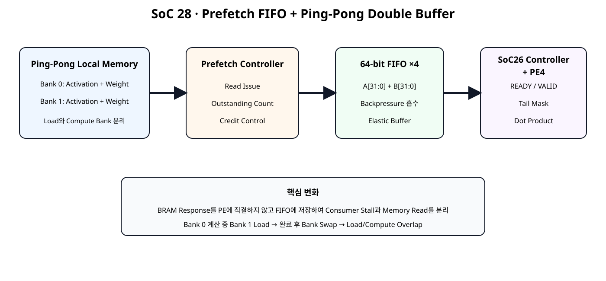
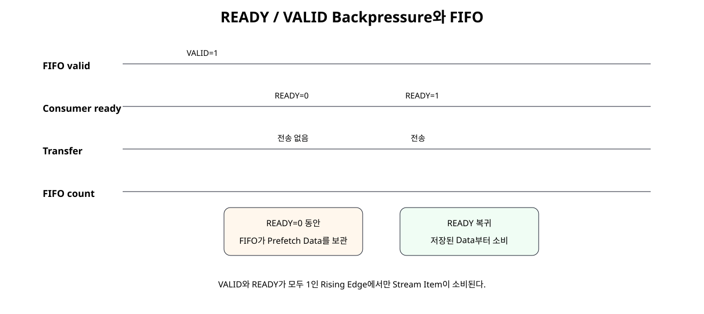
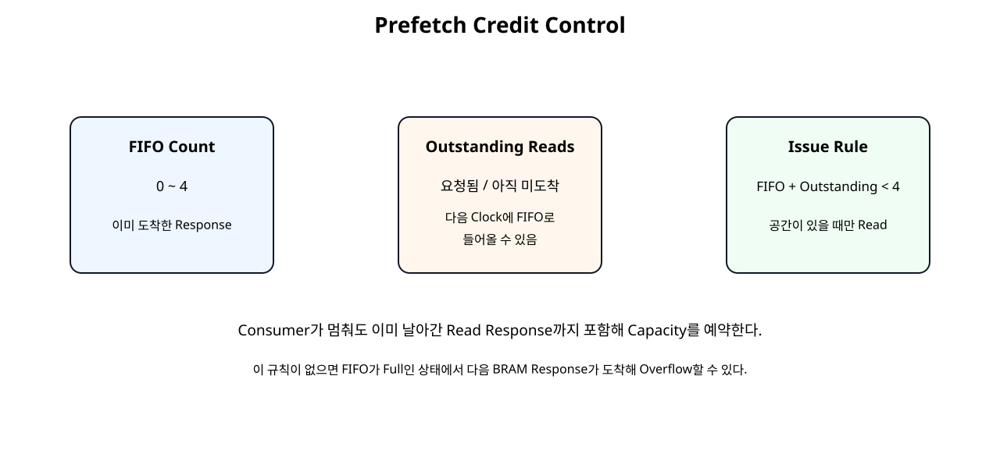
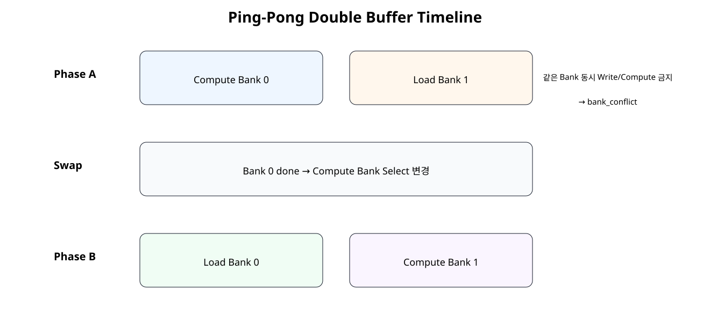

# Prefetch / FIFO / Double Buffer / Stall-safe Feeding


## 전체 학습 위치


## 이번 장의 목표


[](../images/soc28/soc28_architecture.svg)

Memory Request와 Compute Consumption을 FIFO로 분리하고 두 Local Buffer Bank를 Ping-Pong 방식으로 사용한다.


## SoC 27의 제한

SoC 27의 BRAM Feeder는 SoC 26 Controller가 FEED 동안 READY를 유지한다는 Contract를 이용했다. Consumer가 중간에 멈추면 이미 요청한 BRAM Response를 저장할 곳이 부족해질 수 있다.


## 전체 Architecture


[](../images/soc28/soc28_architecture.svg)

Local Memory, Prefetch, Elastic FIFO, Compute를 독립 블록으로 분리한다.


## Prefetch란 무엇인가

Consumer가 Data를 요구한 뒤 Memory Read를 시작하는 대신 FIFO 공간이 있을 때 다음 Vector Group을 미리 읽는다. 첫 Read Latency 이후 PE가 Data를 기다리는 시간을 줄이는 것이 목적이다.


## 왜 FIFO가 필요한가

BRAM은 이미 발생한 Read Request를 즉시 취소할 수 있는 구조가 아니다. Consumer가 갑자기 READY를 내리더라도 이미 요청된 Response는 돌아온다. FIFO는 이 Data를 임시 저장하는 Elastic Buffer 역할을 한다.


## READY / VALID Backpressure


[](../images/soc28/soc28_backpressure.svg)

VALID와 READY가 모두 1인 Clock에서만 Stream Item을 소비한다.


## 64-bit FIFO 구조


```text
FIFO width → 64 bit
FIFO depth → 4
payload → {weight[31:0], activation[31:0]}
```

한 Entry에 PE4 한 Group의 A/B를 함께 저장하므로 두 Stream의 정렬이 깨지지 않는다.


## FIFO Push / Pop

Full 상태에서도 같은 Clock에 Pop이 일어나면 한 Entry를 교체할 수 있도록 push_ready를 구성했다.


## Outstanding Read

Outstanding Read는 BRAM에 Address를 요청했지만 아직 Response가 FIFO에 도착하지 않은 Item이다. FIFO Count만 보면 미래에 들어올 Data를 놓치게 된다.


## Credit 계산


[](../images/soc28/soc28_credit_control.svg)

이미 저장된 Item과 이미 날아간 Read Request를 모두 FIFO Capacity에 포함한다.


## Overflow 방지


```text
새 BRAM Read 허용:
fifo_count + outstanding_reads < FIFO_DEPTH
```

Consumer가 정지하더라도 이미 예약된 Response까지 포함해 공간을 확보하므로 FIFO Overflow를 방지한다.


## Conservative Issue 정책

현재 구현은 같은 Clock의 FIFO Pop을 즉시 새로운 Credit으로 계산하지 않는다. Full 경계에서 Read Request가 한 Clock 늦어질 수 있지만 Control을 단순하게 유지하고 Overflow Safety를 우선한다.


## BRAM Read와 FIFO Push

Activation/Weight의 Response Valid가 서로 다르면 response_mismatch_error_o를 남긴다.


## Stall 시 동작

feed_stall_i=1은 교육용 Backpressure Hook이다. 이때 Consumer로 VALID를 전달하지 않고 FIFO Pop도 막는다. FIFO가 차면 Credit 조건에 의해 Memory Read Issue도 자동 중단된다.


## READY 복귀 시 동작

READY가 다시 올라오면 FIFO에 이미 Prefetch된 Group부터 즉시 전달한다. Memory는 FIFO 공간이 다시 확보되는 만큼 Read Issue를 재개한다.


## Ping-Pong Double Buffer


[](../images/soc28/soc28_pingpong.svg)

한 Bank를 Compute하는 동안 다른 Bank에 다음 Vector를 Load한다.


## Bank 0 / Bank 1

각 Bank는 Activation BRAM과 Weight BRAM을 한 쌍으로 가진다. 따라서 전체 Local Memory는 네 개의 Memory Array로 구성된다.


```text
Bank 0 → Activation0 + Weight0
Bank 1 → Activation1 + Weight1
```


## Load / Compute Overlap

Load Time이 Compute Time에 가려지면 전체 Job 사이의 Memory Preparation Gap을 줄일 수 있다.


## Bank Conflict 보호

현재 Compute 중인 Bank에 Write하려고 하면 Write Enable을 차단하고 bank_conflict_o를 발생시킨다. Testbench는 실제로 잘못된 Same-bank Write를 시도해 차단되는지 검사한다.


## Compute Bank Latch

compute_bank_i는 유효한 start_i에서 내부 Register에 저장한다. 따라서 Host가 Operation 도중 Bank Select를 바꾸더라도 현재 Compute Memory가 바뀌지 않는다.


## SoC 26 Controller 재사용

Vector Length, Tail Mask, PE4, DRAIN/FINALIZE 로직은 SoC 26의 vector_dot_controller_pe4.v를 그대로 재사용한다. SoC 28은 Memory Subsystem만 확장한다.


## Prefetch FIFO RTL


```verilog
module stream_fifo_64x4 (
    input  wire         clk,
    input  wire         resetn,
    input  wire         clear_i,

    input  wire         push_valid_i,
    output wire         push_ready_o,
    input  wire [63:0]  push_data_i,

    output wire         pop_valid_o,
    input  wire         pop_ready_i,
    output wire [63:0]  pop_data_o,

    output reg  [2:0]   count_o
);

// Small elastic FIFO for BRAM prefetch responses.
//
// Depth = 4 entries.
// Width = 64 bits = {weight[31:0], activation[31:0]}.
//
// A tiny FIFO is intentionally kept separate from the local BRAM arrays.
// It absorbs consumer backpressure without changing the BRAM contents.

reg [63:0] mem [0:3];

reg [1:0] wr_ptr_q;
reg [1:0] rd_ptr_q;

wire push_w;
wire pop_w;

assign pop_valid_o =
    (count_o != 3'd0);

assign pop_data_o =
    mem[rd_ptr_q];

// Allow replacement in the same cycle when full and one item pops.
assign push_ready_o =
    (count_o < 3'd4) ||
    (
        (count_o == 3'd4) &&
        pop_valid_o &&
        pop_ready_i
    );

assign push_w =
    push_valid_i &&
    push_ready_o;

assign pop_w =
    pop_valid_o &&
    pop_ready_i;

always @(posedge clk) begin
    if (!resetn || clear_i) begin
        wr_ptr_q <= 2'd0;
        rd_ptr_q <= 2'd0;
        count_o  <= 3'd0;
    end else begin
        if (push_w) begin
            mem[wr_ptr_q] <= push_data_i;
            wr_ptr_q <= wr_ptr_q + 2'd1;
        end

        if (pop_w) begin
            rd_ptr_q <= rd_ptr_q + 2'd1;
        end

        case ({push_w, pop_w})
            2'b10: count_o <= count_o + 3'd1;
            2'b01: count_o <= count_o - 3'd1;
            default: count_o <= count_o;
        endcase
    end
end

endmodule
```


## Credit Feeder RTL


```verilog
module bram_prefetch_fifo_feeder #(
    parameter integer ADDR_WIDTH = 8
) (
    input  wire                      clk,
    input  wire                      resetn,

    input  wire                      start_i,
    input  wire [15:0]               vector_length_i,

    input  wire                      downstream_ready_i,

    output wire                      act_rd_en_o,
    output wire [ADDR_WIDTH-1:0]     act_rd_addr_o,
    input  wire [31:0]               act_rd_data_i,
    input  wire                      act_rd_valid_i,

    output wire                      weight_rd_en_o,
    output wire [ADDR_WIDTH-1:0]     weight_rd_addr_o,
    input  wire [31:0]               weight_rd_data_i,
    input  wire                      weight_rd_valid_i,

    output wire                      vec_valid_o,
    output wire [31:0]               a_vec_o,
    output wire [31:0]               b_vec_o,

    output reg  [15:0]               requested_groups_o,
    output reg  [15:0]               received_groups_o,
    output reg  [15:0]               delivered_groups_o,

    output wire [2:0]                fifo_count_o,
    output reg  [2:0]                outstanding_reads_o,

    output reg                       response_mismatch_error_o,
    output reg                       fifo_overflow_error_o,
    output wire                      active_o
);

// Prefetch policy:
//
// buffered credits = FIFO entries + outstanding BRAM reads.
//
// A new BRAM read request is issued only if:
//   1. operation is active
//   2. more groups remain
//   3. FIFO + outstanding < FIFO depth
//
// This prevents a response from arriving after the FIFO has run out
// of capacity, even when the consumer deasserts READY.
//
// The implementation is intentionally conservative:
// it does not count a same-cycle FIFO pop as immediate new credit.
// This can delay a new read request by one cycle at the full boundary,
// but keeps the control logic simple and safe.

wire [16:0] length_plus3_w;
wire [15:0] total_groups_w;

assign length_plus3_w =
    {1'b0, vector_length_i} + 17'd3;

assign total_groups_w =
    length_plus3_w[16:2];

reg [15:0] total_groups_q;
reg        active_q;

assign active_o = active_q;

wire [3:0] buffered_credits_w;

assign buffered_credits_w =
    {1'b0, fifo_count_o} +
    {1'b0, outstanding_reads_o};

wire can_issue_w;

assign can_issue_w =
    active_q &&
    (requested_groups_o < total_groups_q) &&
    (buffered_credits_w < 4'd4);

assign act_rd_en_o =
    can_issue_w;

assign weight_rd_en_o =
    can_issue_w;

assign act_rd_addr_o =
    requested_groups_o[ADDR_WIDTH-1:0];

assign weight_rd_addr_o =
    requested_groups_o[ADDR_WIDTH-1:0];

wire paired_response_valid_w;

assign paired_response_valid_w =
    act_rd_valid_i &&
    weight_rd_valid_i;

wire [63:0] fifo_push_data_w;

assign fifo_push_data_w = {
    weight_rd_data_i,
    act_rd_data_i
};

wire fifo_push_ready_w;
wire fifo_pop_valid_w;
wire [63:0] fifo_pop_data_w;

stream_fifo_64x4 u_prefetch_fifo (
    .clk(clk),
    .resetn(resetn),
    .clear_i(start_i),

    .push_valid_i(paired_response_valid_w),
    .push_ready_o(fifo_push_ready_w),
    .push_data_i(fifo_push_data_w),

    .pop_valid_o(fifo_pop_valid_w),
    .pop_ready_i(downstream_ready_i),
    .pop_data_o(fifo_pop_data_w),

    .count_o(fifo_count_o)
);

assign vec_valid_o =
    fifo_pop_valid_w;

assign a_vec_o =
    fifo_pop_data_w[31:0];

assign b_vec_o =
    fifo_pop_data_w[63:32];

wire fifo_pop_w;

assign fifo_pop_w =
    fifo_pop_valid_w &&
    downstream_ready_i;

always @(posedge clk) begin
    if (!resetn) begin
        total_groups_q            <= 16'd0;
        active_q                  <= 1'b0;

        requested_groups_o        <= 16'd0;
        received_groups_o         <= 16'd0;
        delivered_groups_o        <= 16'd0;

        outstanding_reads_o       <= 3'd0;

        response_mismatch_error_o <= 1'b0;
        fifo_overflow_error_o     <= 1'b0;
    end else begin
        if (start_i) begin
            total_groups_q            <= total_groups_w;
            active_q                  <=
                (vector_length_i != 16'd0);

            requested_groups_o        <= 16'd0;
            received_groups_o         <= 16'd0;
            delivered_groups_o        <= 16'd0;
            outstanding_reads_o       <= 3'd0;

            response_mismatch_error_o <= 1'b0;
            fifo_overflow_error_o     <= 1'b0;
        end else begin
            if (
                act_rd_valid_i ^
                weight_rd_valid_i
            ) begin
                response_mismatch_error_o <= 1'b1;
            end

            if (
                paired_response_valid_w &&
                !fifo_push_ready_w
            ) begin
                fifo_overflow_error_o <= 1'b1;
            end

            if (can_issue_w) begin
                requested_groups_o <=
                    requested_groups_o + 16'd1;
            end

            if (paired_response_valid_w) begin
                received_groups_o <=
                    received_groups_o + 16'd1;
            end

            if (fifo_pop_w) begin
                delivered_groups_o <=
                    delivered_groups_o + 16'd1;

                if (
                    delivered_groups_o ==
                    (total_groups_q - 16'd1)
                ) begin
                    active_q <= 1'b0;
                end
            end

            case ({
                can_issue_w,
                paired_response_valid_w
            })
                2'b10:
                    outstanding_reads_o <=
                        outstanding_reads_o + 3'd1;

                2'b01:
                    outstanding_reads_o <=
                        outstanding_reads_o - 3'd1;

                default:
                    outstanding_reads_o <=
                        outstanding_reads_o;
            endcase
        end
    end
end

endmodule
```


## Ping-Pong Memory RTL


```verilog
module pingpong_vector_memory #(
    parameter integer ADDR_WIDTH = 8
) (
    input  wire                      clk,
    input  wire                      resetn,

    input  wire                      load_bank_i,
    input  wire                      load_active_i,

    input  wire                      act_wr_en_i,
    input  wire [ADDR_WIDTH-1:0]     act_wr_addr_i,
    input  wire [31:0]               act_wr_data_i,

    input  wire                      weight_wr_en_i,
    input  wire [ADDR_WIDTH-1:0]     weight_wr_addr_i,
    input  wire [31:0]               weight_wr_data_i,

    input  wire                      compute_bank_i,
    input  wire                      compute_active_i,

    input  wire                      act_rd_en_i,
    input  wire [ADDR_WIDTH-1:0]     act_rd_addr_i,
    output wire [31:0]               act_rd_data_o,
    output wire                      act_rd_valid_o,

    input  wire                      weight_rd_en_i,
    input  wire [ADDR_WIDTH-1:0]     weight_rd_addr_i,
    output wire [31:0]               weight_rd_data_o,
    output wire                      weight_rd_valid_o,

    output wire                      bank_conflict_o
);

// Two complete local-buffer banks.
//
// Bank 0:
//   activation0 + weight0
//
// Bank 1:
//   activation1 + weight1
//
// Intended ping-pong operation:
//   Compute bank 0 while load bank 1.
//   Then compute bank 1 while load bank 0.
//
// Writes to the currently-computed bank are blocked while compute_active_i
// is high. A conflict flag makes the violation observable.

wire same_bank_conflict_w;

assign same_bank_conflict_w =
    load_active_i &&
    compute_active_i &&
    (load_bank_i == compute_bank_i);

assign bank_conflict_o =
    same_bank_conflict_w &&
    (
        act_wr_en_i ||
        weight_wr_en_i
    );

wire safe_act_write_w;
wire safe_weight_write_w;

assign safe_act_write_w =
    act_wr_en_i &&
    !same_bank_conflict_w;

assign safe_weight_write_w =
    weight_wr_en_i &&
    !same_bank_conflict_w;

// ---------------- Bank 0 ----------------
wire [31:0] act0_rd_data;
wire        act0_rd_valid;

wire [31:0] weight0_rd_data;
wire        weight0_rd_valid;

vector_bram_sdp #(
    .ADDR_WIDTH(ADDR_WIDTH),
    .DATA_WIDTH(32)
) u_act_bank0 (
    .clk(clk),
    .resetn(resetn),

    .wr_en_i(
        safe_act_write_w &&
        (load_bank_i == 1'b0)
    ),
    .wr_addr_i(act_wr_addr_i),
    .wr_data_i(act_wr_data_i),

    .rd_en_i(
        act_rd_en_i &&
        (compute_bank_i == 1'b0)
    ),
    .rd_addr_i(act_rd_addr_i),
    .rd_data_o(act0_rd_data),
    .rd_valid_o(act0_rd_valid)
);

vector_bram_sdp #(
    .ADDR_WIDTH(ADDR_WIDTH),
    .DATA_WIDTH(32)
) u_weight_bank0 (
    .clk(clk),
    .resetn(resetn),

    .wr_en_i(
        safe_weight_write_w &&
        (load_bank_i == 1'b0)
    ),
    .wr_addr_i(weight_wr_addr_i),
    .wr_data_i(weight_wr_data_i),

    .rd_en_i(
        weight_rd_en_i &&
        (compute_bank_i == 1'b0)
    ),
    .rd_addr_i(weight_rd_addr_i),
    .rd_data_o(weight0_rd_data),
    .rd_valid_o(weight0_rd_valid)
);

// ---------------- Bank 1 ----------------
wire [31:0] act1_rd_data;
wire        act1_rd_valid;

wire [31:0] weight1_rd_data;
wire        weight1_rd_valid;

vector_bram_sdp #(
    .ADDR_WIDTH(ADDR_WIDTH),
    .DATA_WIDTH(32)
) u_act_bank1 (
    .clk(clk),
    .resetn(resetn),

    .wr_en_i(
        safe_act_write_w &&
        (load_bank_i == 1'b1)
    ),
    .wr_addr_i(act_wr_addr_i),
    .wr_data_i(act_wr_data_i),

    .rd_en_i(
        act_rd_en_i &&
        (compute_bank_i == 1'b1)
    ),
    .rd_addr_i(act_rd_addr_i),
    .rd_data_o(act1_rd_data),
    .rd_valid_o(act1_rd_valid)
);

vector_bram_sdp #(
    .ADDR_WIDTH(ADDR_WIDTH),
    .DATA_WIDTH(32)
) u_weight_bank1 (
    .clk(clk),
    .resetn(resetn),

    .wr_en_i(
        safe_weight_write_w &&
        (load_bank_i == 1'b1)
    ),
    .wr_addr_i(weight_wr_addr_i),
    .wr_data_i(weight_wr_data_i),

    .rd_en_i(
        weight_rd_en_i &&
        (compute_bank_i == 1'b1)
    ),
    .rd_addr_i(weight_rd_addr_i),
    .rd_data_o(weight1_rd_data),
    .rd_valid_o(weight1_rd_valid)
);

assign act_rd_data_o =
    compute_bank_i
    ? act1_rd_data
    : act0_rd_data;

assign act_rd_valid_o =
    compute_bank_i
    ? act1_rd_valid
    : act0_rd_valid;

assign weight_rd_data_o =
    compute_bank_i
    ? weight1_rd_data
    : weight0_rd_data;

assign weight_rd_valid_o =
    compute_bank_i
    ? weight1_rd_valid
    : weight0_rd_valid;

endmodule
```


## Integrated Accelerator RTL


```verilog
module prefetch_double_buffer_dot_accelerator #(
    parameter integer ADDR_WIDTH = 8
) (
    input  wire                      clk,
    input  wire                      resetn,

    // ---------------- Load side ----------------
    input  wire                      load_bank_i,
    input  wire                      load_active_i,

    input  wire                      act_wr_en_i,
    input  wire [ADDR_WIDTH-1:0]     act_wr_addr_i,
    input  wire [31:0]               act_wr_data_i,

    input  wire                      weight_wr_en_i,
    input  wire [ADDR_WIDTH-1:0]     weight_wr_addr_i,
    input  wire [31:0]               weight_wr_data_i,

    // ---------------- Compute command ----------------
    input  wire                      compute_bank_i,
    input  wire                      start_i,
    input  wire [15:0]               vector_length_i,

    // Teaching/test hook:
    // when high, temporarily backpressure the stream between
    // prefetch FIFO and the SoC26 vector controller.
    input  wire                      feed_stall_i,

    // ---------------- Result/status ----------------
    output wire                      busy_o,
    output wire                      done_o,
    output wire                      result_valid_o,
    output wire signed [31:0]        result_o,

    output wire [15:0]               requested_groups_o,
    output wire [15:0]               received_groups_o,
    output wire [15:0]               delivered_groups_o,
    output wire [15:0]               accepted_groups_o,
    output wire [15:0]               completed_groups_o,

    output wire [2:0]                fifo_count_o,
    output wire [2:0]                outstanding_reads_o,

    output wire                      bank_conflict_o,
    output wire                      range_error_o,
    output wire                      response_mismatch_error_o,
    output wire                      fifo_overflow_error_o
);

// SoC 28 architecture:
//
// Ping-pong local memory
//      ↓
// BRAM prefetch + credit control
//      ↓
// 64-bit elastic FIFO
//      ↓
// optional backpressure gate
//      ↓
// SoC 26 vector controller + PE4
//
// The compute-bank selection is latched on a valid start command so the
// memory bank cannot change in the middle of an operation.

localparam [16:0] MAX_ELEMENTS_W =
    (17'd4 << ADDR_WIDTH);

wire range_error_w;
wire start_valid_w;

assign range_error_w =
    ({1'b0, vector_length_i} > MAX_ELEMENTS_W);

assign range_error_o =
    start_i &&
    range_error_w;

assign start_valid_w =
    start_i &&
    !range_error_w;

reg compute_bank_q;

always @(posedge clk) begin
    if (!resetn) begin
        compute_bank_q <= 1'b0;
    end else if (start_valid_w) begin
        compute_bank_q <= compute_bank_i;
    end
end

// ---------------- Ping-pong memory ----------------
wire                      act_rd_en;
wire [ADDR_WIDTH-1:0]     act_rd_addr;
wire [31:0]               act_rd_data;
wire                      act_rd_valid;

wire                      weight_rd_en;
wire [ADDR_WIDTH-1:0]     weight_rd_addr;
wire [31:0]               weight_rd_data;
wire                      weight_rd_valid;

wire compute_active_w;

assign compute_active_w =
    busy_o ||
    start_valid_w;

pingpong_vector_memory #(
    .ADDR_WIDTH(ADDR_WIDTH)
) u_pingpong_memory (
    .clk(clk),
    .resetn(resetn),

    .load_bank_i(load_bank_i),
    .load_active_i(load_active_i),

    .act_wr_en_i(act_wr_en_i),
    .act_wr_addr_i(act_wr_addr_i),
    .act_wr_data_i(act_wr_data_i),

    .weight_wr_en_i(weight_wr_en_i),
    .weight_wr_addr_i(weight_wr_addr_i),
    .weight_wr_data_i(weight_wr_data_i),

    .compute_bank_i(compute_bank_q),
    .compute_active_i(compute_active_w),

    .act_rd_en_i(act_rd_en),
    .act_rd_addr_i(act_rd_addr),
    .act_rd_data_o(act_rd_data),
    .act_rd_valid_o(act_rd_valid),

    .weight_rd_en_i(weight_rd_en),
    .weight_rd_addr_i(weight_rd_addr),
    .weight_rd_data_o(weight_rd_data),
    .weight_rd_valid_o(weight_rd_valid),

    .bank_conflict_o(bank_conflict_o)
);

// ---------------- Prefetch FIFO feeder ----------------
wire        feeder_vec_valid;
wire [31:0] feeder_a_vec;
wire [31:0] feeder_b_vec;

wire        controller_vec_ready;
wire        feeder_downstream_ready;

assign feeder_downstream_ready =
    controller_vec_ready &&
    !feed_stall_i;

bram_prefetch_fifo_feeder #(
    .ADDR_WIDTH(ADDR_WIDTH)
) u_prefetch_feeder (
    .clk(clk),
    .resetn(resetn),

    .start_i(start_valid_w),
    .vector_length_i(vector_length_i),

    .downstream_ready_i(feeder_downstream_ready),

    .act_rd_en_o(act_rd_en),
    .act_rd_addr_o(act_rd_addr),
    .act_rd_data_i(act_rd_data),
    .act_rd_valid_i(act_rd_valid),

    .weight_rd_en_o(weight_rd_en),
    .weight_rd_addr_o(weight_rd_addr),
    .weight_rd_data_i(weight_rd_data),
    .weight_rd_valid_i(weight_rd_valid),

    .vec_valid_o(feeder_vec_valid),
    .a_vec_o(feeder_a_vec),
    .b_vec_o(feeder_b_vec),

    .requested_groups_o(requested_groups_o),
    .received_groups_o(received_groups_o),
    .delivered_groups_o(delivered_groups_o),

    .fifo_count_o(fifo_count_o),
    .outstanding_reads_o(outstanding_reads_o),

    .response_mismatch_error_o(
        response_mismatch_error_o
    ),
    .fifo_overflow_error_o(
        fifo_overflow_error_o
    ),
    .active_o()
);

// ---------------- SoC26 controller + PE4 ----------------
wire controller_vec_valid;

assign controller_vec_valid =
    feeder_vec_valid &&
    !feed_stall_i;

vector_dot_controller_pe4 u_vector_controller (
    .clk(clk),
    .resetn(resetn),

    .start_i(start_valid_w),
    .vector_length_i(vector_length_i),

    .vec_valid_i(controller_vec_valid),
    .vec_ready_o(controller_vec_ready),
    .a_vec_i(feeder_a_vec),
    .b_vec_i(feeder_b_vec),

    .busy_o(busy_o),
    .done_o(done_o),
    .result_valid_o(result_valid_o),
    .result_o(result_o),

    .accepted_groups_o(accepted_groups_o),
    .completed_groups_o(completed_groups_o)
);

endmodule
```


## Board Demo


| Bank | A | B | 예상 결과 |
| --- | --- | --- | --- |
| 0 | 1~10 | 1 | 55 → 0x0037 |
| 1 | 2,4,...,20 | 1 | 110 → 0x006E |

Bank 0을 계산하는 동안 Bank 1 세 Word를 Load하고, 첫 결과가 끝나면 Bank 1로 Swap하여 두 번째 계산을 수행한다.


## Self-Checking Testbench


```verilog
`timescale 1ns / 1ps

module tb_prefetch_double_buffer_dot_accelerator;

logic clk = 1'b0;
logic resetn = 1'b0;

// Load side.
logic        load_bank_i = 1'b0;
logic        load_active_i = 1'b0;

logic        act_wr_en_i = 1'b0;
logic [7:0]  act_wr_addr_i = 8'd0;
logic [31:0] act_wr_data_i = 32'h0;

logic        weight_wr_en_i = 1'b0;
logic [7:0]  weight_wr_addr_i = 8'd0;
logic [31:0] weight_wr_data_i = 32'h0;

// Compute side.
logic        compute_bank_i = 1'b0;
logic        start_i = 1'b0;
logic [15:0] vector_length_i = 16'd0;

logic        feed_stall_i = 1'b0;

wire         busy_o;
wire         done_o;
wire         result_valid_o;
wire signed [31:0] result_o;

wire [15:0] requested_groups_o;
wire [15:0] received_groups_o;
wire [15:0] delivered_groups_o;
wire [15:0] accepted_groups_o;
wire [15:0] completed_groups_o;

wire [2:0]  fifo_count_o;
wire [2:0]  outstanding_reads_o;

wire bank_conflict_o;
wire range_error_o;
wire response_mismatch_error_o;
wire fifo_overflow_error_o;

int error_count = 0;
int check_count = 0;

int stall_counter = 0;
bit stall_enable = 0;
int max_fifo_seen = 0;

always #5 clk = ~clk;

prefetch_double_buffer_dot_accelerator #(
    .ADDR_WIDTH(8)
) dut (
    .clk(clk),
    .resetn(resetn),

    .load_bank_i(load_bank_i),
    .load_active_i(load_active_i),

    .act_wr_en_i(act_wr_en_i),
    .act_wr_addr_i(act_wr_addr_i),
    .act_wr_data_i(act_wr_data_i),

    .weight_wr_en_i(weight_wr_en_i),
    .weight_wr_addr_i(weight_wr_addr_i),
    .weight_wr_data_i(weight_wr_data_i),

    .compute_bank_i(compute_bank_i),
    .start_i(start_i),
    .vector_length_i(vector_length_i),

    .feed_stall_i(feed_stall_i),

    .busy_o(busy_o),
    .done_o(done_o),
    .result_valid_o(result_valid_o),
    .result_o(result_o),

    .requested_groups_o(requested_groups_o),
    .received_groups_o(received_groups_o),
    .delivered_groups_o(delivered_groups_o),
    .accepted_groups_o(accepted_groups_o),
    .completed_groups_o(completed_groups_o),

    .fifo_count_o(fifo_count_o),
    .outstanding_reads_o(outstanding_reads_o),

    .bank_conflict_o(bank_conflict_o),
    .range_error_o(range_error_o),
    .response_mismatch_error_o(response_mismatch_error_o),
    .fifo_overflow_error_o(fifo_overflow_error_o)
);

always @(posedge clk) begin
    if (fifo_count_o > max_fifo_seen) begin
        max_fifo_seen <= fifo_count_o;
    end
end

// Deterministic consumer backpressure.
// Pattern contains both single-cycle and two-cycle stalls.
always @(negedge clk) begin
    if (!resetn) begin
        stall_counter <= 0;
        feed_stall_i <= 1'b0;
    end else if (stall_enable) begin
        stall_counter <= stall_counter + 1;

        feed_stall_i <=
            ((stall_counter % 7) == 2) ||
            ((stall_counter % 7) == 3) ||
            ((stall_counter % 11) == 6);
    end else begin
        feed_stall_i <= 1'b0;
        stall_counter <= 0;
    end
end

function automatic integer ceil_div4(
    input integer n
);
    ceil_div4 = (n + 3) / 4;
endfunction

function automatic integer signed signed8(
    input integer value
);
    integer temp;
    begin
        temp = value & 8'hFF;

        if (temp >= 128)
            temp = temp - 256;

        signed8 = temp;
    end
endfunction

function automatic integer signed gen_a0(
    input integer index
);
    gen_a0 = signed8((index * 29) + 17);
endfunction

function automatic integer signed gen_b0(
    input integer index
);
    gen_b0 = signed8((index * 47) + 91);
endfunction

function automatic integer signed gen_a1(
    input integer index
);
    gen_a1 = signed8((index * 13) + 33);
endfunction

function automatic integer signed gen_b1(
    input integer index
);
    gen_b1 = signed8((index * 19) + 7);
endfunction

function automatic [31:0] pack4(
    input integer x0,
    input integer x1,
    input integer x2,
    input integer x3
);
    begin
        pack4 = {
            x3[7:0],
            x2[7:0],
            x1[7:0],
            x0[7:0]
        };
    end
endfunction

task automatic check_true(
    input string name,
    input bit condition
);
    begin
        check_count++;

        if (!condition) begin
            error_count++;
            $error("CHECK FAIL: %s", name);
        end else begin
            $display("CHECK PASS: %s", name);
        end
    end
endtask

task automatic check_eq32(
    input string name,
    input logic signed [31:0] actual,
    input logic signed [31:0] expected
);
    begin
        check_count++;

        if (actual !== expected) begin
            error_count++;
            $error(
                "CHECK FAIL: %s actual=%0d expected=%0d",
                name,
                actual,
                expected
            );
        end else begin
            $display(
                "CHECK PASS: %s = %0d",
                name,
                actual
            );
        end
    end
endtask

task automatic write_group(
    input integer bank,
    input integer group_index,
    input integer length,
    input integer pattern_id,
    inout integer signed expected_acc
);
    integer lane;
    integer scalar_index;

    integer signed a_lane [0:3];
    integer signed b_lane [0:3];

    integer signed a_value;
    integer signed b_value;

    begin
        // Intentional garbage first. Tail elements must be masked later.
        for (lane = 0; lane < 4; lane++) begin
            a_lane[lane] = 127;
            b_lane[lane] = -128;
        end

        for (lane = 0; lane < 4; lane++) begin
            scalar_index = (group_index * 4) + lane;

            if (scalar_index < length) begin
                if (pattern_id == 0) begin
                    a_value = gen_a0(scalar_index);
                    b_value = gen_b0(scalar_index);
                end else begin
                    a_value = gen_a1(scalar_index);
                    b_value = gen_b1(scalar_index);
                end

                a_lane[lane] = a_value;
                b_lane[lane] = b_value;

                expected_acc =
                    expected_acc +
                    (a_value * b_value);
            end
        end

        @(negedge clk);

        load_bank_i = bank[0];
        load_active_i = 1'b1;

        act_wr_addr_i = group_index[7:0];
        act_wr_data_i = pack4(
            a_lane[0],
            a_lane[1],
            a_lane[2],
            a_lane[3]
        );
        act_wr_en_i = 1'b1;

        weight_wr_addr_i = group_index[7:0];
        weight_wr_data_i = pack4(
            b_lane[0],
            b_lane[1],
            b_lane[2],
            b_lane[3]
        );
        weight_wr_en_i = 1'b1;

        @(posedge clk);
        #1;

        @(negedge clk);
        act_wr_en_i = 1'b0;
        weight_wr_en_i = 1'b0;
        load_active_i = 1'b0;
    end
endtask

task automatic load_vector(
    input integer bank,
    input integer length,
    input integer pattern_id,
    output integer signed expected_acc
);
    integer groups;
    integer group_index;

    begin
        groups = ceil_div4(length);
        expected_acc = 0;

        for (
            group_index = 0;
            group_index < groups;
            group_index++
        ) begin
            write_group(
                bank,
                group_index,
                length,
                pattern_id,
                expected_acc
            );
        end
    end
endtask

task automatic pulse_start(
    input integer bank,
    input integer length
);
    begin
        @(negedge clk);
        compute_bank_i = bank[0];
        vector_length_i = length[15:0];
        start_i = 1'b1;

        @(negedge clk);
        start_i = 1'b0;
    end
endtask

task automatic wait_and_check_result(
    input string name,
    input integer length,
    input integer signed expected_acc
);
    integer groups;
    integer timeout;

    begin
        groups = ceil_div4(length);
        timeout = 0;

        while (
            (result_valid_o !== 1'b1) &&
            (timeout < 4000)
        ) begin
            @(posedge clk);
            #1;
            timeout++;
        end

        check_true(
            {name, " result_valid"},
            result_valid_o === 1'b1
        );

        check_true(
            {name, " done"},
            done_o === 1'b1
        );

        check_eq32(
            {name, " result"},
            result_o,
            expected_acc
        );

        check_true(
            {name, " requested"},
            requested_groups_o == groups
        );

        check_true(
            {name, " received"},
            received_groups_o == groups
        );

        check_true(
            {name, " delivered"},
            delivered_groups_o == groups
        );

        check_true(
            {name, " accepted"},
            accepted_groups_o == groups
        );

        check_true(
            {name, " completed"},
            completed_groups_o == groups
        );

        check_true(
            {name, " no response mismatch"},
            response_mismatch_error_o === 1'b0
        );

        check_true(
            {name, " no FIFO overflow"},
            fifo_overflow_error_o === 1'b0
        );

        @(posedge clk);
        #1;
    end
endtask

task automatic attempt_same_bank_write_conflict;
    begin
        check_true(
            "compute still busy before conflict test",
            busy_o === 1'b1
        );

        @(negedge clk);

        load_bank_i = 1'b0;
        load_active_i = 1'b1;

        act_wr_addr_i = 8'd0;
        act_wr_data_i = 32'hDEAD_BEEF;
        act_wr_en_i = 1'b1;

        weight_wr_addr_i = 8'd0;
        weight_wr_data_i = 32'hCAFE_BABE;
        weight_wr_en_i = 1'b1;

        #1;

        check_true(
            "same-bank write conflict asserted",
            bank_conflict_o === 1'b1
        );

        @(posedge clk);
        #1;

        @(negedge clk);
        act_wr_en_i = 1'b0;
        weight_wr_en_i = 1'b0;
        load_active_i = 1'b0;
    end
endtask

task automatic run_range_error_case;
    begin
        @(negedge clk);

        compute_bank_i = 1'b0;
        vector_length_i = 16'd1025;
        start_i = 1'b1;

        #1;

        check_true(
            "length 1025 range error",
            range_error_o === 1'b1
        );

        @(posedge clk);
        #1;

        @(negedge clk);
        start_i = 1'b0;

        repeat (4) @(posedge clk);
        #1;

        check_true(
            "range error command not busy",
            busy_o === 1'b0
        );
    end
endtask

initial begin
    integer signed expected_bank0;
    integer signed expected_bank1;
    integer group_index;

    repeat (5) @(posedge clk);
    resetn = 1'b1;

    // --------------------------------------------------------
    // 1. Load Bank 0 completely.
    // --------------------------------------------------------
    load_vector(
        0,
        64,
        0,
        expected_bank0
    );

    // --------------------------------------------------------
    // 2. Start computing Bank 0 with backpressure enabled.
    // --------------------------------------------------------
    stall_enable = 1'b1;

    pulse_start(
        0,
        64
    );

    // --------------------------------------------------------
    // 3. While Bank 0 computes, load Bank 1.
    // --------------------------------------------------------
    expected_bank1 = 0;

    for (group_index = 0; group_index < ceil_div4(31); group_index++) begin
        write_group(
            1,
            group_index,
            31,
            1,
            expected_bank1
        );
    end

    // Wrong-bank write must be rejected while Bank 0 is active.
    attempt_same_bank_write_conflict();

    wait_and_check_result(
        "bank0",
        64,
        expected_bank0
    );

    check_true(
        "prefetch FIFO exercised",
        max_fifo_seen >= 2
    );

    // --------------------------------------------------------
    // 4. Compute the Bank 1 data loaded during Bank 0 compute.
    // --------------------------------------------------------
    stall_enable = 1'b1;

    pulse_start(
        1,
        31
    );

    wait_and_check_result(
        "bank1",
        31,
        expected_bank1
    );

    stall_enable = 1'b0;

    // --------------------------------------------------------
    // 5. Capacity guard.
    // --------------------------------------------------------
    run_range_error_case();

    $display("");
    $display("SOC28 MAX FIFO COUNT : %0d", max_fifo_seen);
    $display("SOC28 CHECK COUNT    : %0d", check_count);
    $display("SOC28 ERROR COUNT    : %0d", error_count);

    if (error_count == 0) begin
        $display("SOC28 PREFETCH/DOUBLE-BUFFER TEST: PASS");
    end else begin
        $fatal(
            1,
            "SOC28 PREFETCH/DOUBLE-BUFFER TEST: FAIL (%0d errors)",
            error_count
        );
    end

    #20;
    $finish;
end

endmodule
```

Bank 0 Length 64 계산 중 Bank 1 Length 31을 Load하고, Consumer Stall Pattern과 Same-bank Conflict를 동시에 운동시킨다.


## Python Credit Model


```text
bank,length,groups,result_raw,max_fifo,cycles
0,64,16,-35552,4,26
1,31,8,11968,3,14

credit rule: FIFO entries + outstanding reads < 4 before issue
bank0 compute may overlap bank1 load because memories are separate
same-bank write during active compute must be blocked
board demo first result = 55 -> 0x0037
board demo second result = 110 -> 0x006E
SOC28 PYTHON PREFETCH/DOUBLE-BUFFER REFERENCE: PASS
Spreadsheet runtime warmup failed during python startup
Traceback (most recent call last):
  File "/tmp/tmp.L2TH2Y5coc/artifact_tool_v2-2.8.22/artifact_tool/patches/warm_spreadsheet_runtime_on_startup.py", line 26, in warm_spreadsheet_runtime_on_startup
  File "/tmp/tmp.L2TH2Y5coc/artifact_tool_v2-2.8.22/artifact_tool/spreadsheet_warmup.py", line 785, in warm_spreadsheet_runtime
  File "/tmp/tmp.L2TH2Y5coc/artifact_tool_v2-2.8.22/artifact_tool/spreadsheet_warmup.py", line 720, in _warm_feature_flows
  File "/tmp/tmp.L2TH2Y5coc/artifact_tool_v2-2.8.22/artifact_tool/spreadsheet_warmup.py", line 704, in _warm_collaboration_flows
  File "/tmp/tmp.L2TH2Y5coc/artifact_tool_v2-2.8.22/artifact_tool/generated/interface/models.py", line 32317, in hydrate_crdt_from_proto
  File "/tmp/tmp.L2TH2Y5coc/artifact_tool_v2-2.8.22/artifact_tool/rpc/remote.py", line 749, in __call__
  File "/tmp/tmp.L2TH2Y5coc/artifact_tool_v2-2.8.22/artifact_tool/rpc/client.py", line 150, in call
artifact_tool.rpc.client.RemoteError: hydrateCrdtFromProto requires an empty collaborative document.
```

BRAM Response 1 Clock 모델과 동일 Stall Pattern으로 FIFO Occupancy 및 Credit Safety를 독립 검증했다.


## FIFO Occupancy 검증

Python Reference에서 Bank 0은 FIFO 최대 4 Entry, Bank 1은 최대 3 Entry까지 사용했다. 두 경우 모두 requested = received = delivered가 유지되고 FIFO Depth 4를 넘지 않았다.


## OOC Synthesis


```text
# SoC 28 · Generic Prefetch/FIFO/Double-Buffer inference check
#
# This flow keeps the accelerator generic so that synthesis can be used
# to inspect the complete two-bank memory subsystem, FIFO, and PE4.

set script_dir [file dirname [file normalize [info script]]]
set root_dir   [file normalize [file join $script_dir ".."]]
set rtl_dir    [file join $root_dir "rtl"]
set out_dir    [file normalize [file join $root_dir "reports" "generic_ooc"]]

file mkdir $out_dir

create_project -in_memory -part xc7a35tcpg236-1

read_verilog [file join $rtl_dir "mul_s8_dsp.v"]
read_verilog [file join $rtl_dir "pe4_dot_accum_pipelined.v"]
read_verilog [file join $rtl_dir "vector_dot_controller_pe4.v"]
read_verilog [file join $rtl_dir "vector_bram_sdp.v"]
read_verilog [file join $rtl_dir "stream_fifo_64x4.v"]
read_verilog [file join $rtl_dir "bram_prefetch_fifo_feeder.v"]
read_verilog [file join $rtl_dir "pingpong_vector_memory.v"]
read_verilog [file join $rtl_dir "prefetch_double_buffer_dot_accelerator.v"]

synth_design \
    -mode out_of_context \
    -top prefetch_double_buffer_dot_accelerator \
    -part xc7a35tcpg236-1

report_utilization \
    -hierarchical \
    -file [file join $out_dir "01_utilization_ooc.rpt"]

report_ram_utilization \
    -include_lutram \
    -file [file join $out_dir "02_ram_utilization_ooc.rpt"] \
    -csv [file join $out_dir "02_ram_utilization_ooc.csv"]

redirect -file [file join $out_dir "03_ramb_cells_ooc.rpt"] {
    set ramb_cells [get_cells -hier -filter {REF_NAME =~ RAMB*}]
    puts "RAMB primitive count: [llength $ramb_cells]"

    foreach cell $ramb_cells {
        puts "[get_property REF_NAME $cell]  $cell"
    }
}

redirect -file [file join $out_dir "04_dsp_cells_ooc.rpt"] {
    set dsp_cells [get_cells -hier -filter {REF_NAME =~ DSP48*}]
    puts "DSP48 primitive count: [llength $dsp_cells]"

    foreach cell $dsp_cells {
        puts "[get_property REF_NAME $cell]  $cell"
    }
}

report_timing_summary \
    -delay_type min_max \
    -report_unconstrained \
    -max_paths 20 \
    -file [file join $out_dir "05_timing_summary_ooc.rpt"]

report_design_analysis \
    -max_paths 50 \
    -setup \
    -logic_level_distribution \
    -file [file join $out_dir "06_design_analysis_ooc.rpt"]

puts ""
puts "SoC 28 generic OOC synthesis complete."
puts "Check:"
puts "  - four local memory arrays"
puts "  - RAMB mapping"
puts "  - small FIFO implementation"
puts "  - DSP48 mapping"
puts "Do not claim primitive counts until these reports are generated."
```

Generic Accelerator를 Out-of-Context로 합성해 두 Bank의 네 Memory Array, Tiny FIFO, DSP Mapping을 고정 Demo 최적화와 분리해 확인한다.


## RAM / FIFO Mapping 확인

report_ram_utilization -include_lutram로 Local Buffer와 Tiny FIFO가 실제 어떤 Primitive에 Mapping됐는지 확인한다. 4-entry FIFO는 작기 때문에 Block RAM 사용을 강제하지 않았다.


## Post-route Timing


```text
# SoC 28 · Basys3 ping-pong board demonstration

set script_dir [file dirname [file normalize [info script]]]
set root_dir   [file normalize [file join $script_dir ".."]]
set rtl_dir    [file join $root_dir "rtl"]
set xdc_dir    [file join $root_dir "constraints"]
set out_dir    [file normalize [file join $root_dir "reports" "board_demo"]]

file mkdir $out_dir

create_project -in_memory -part xc7a35tcpg236-1

read_verilog [file join $rtl_dir "reset_active_high_to_active_low.v"]
read_verilog [file join $rtl_dir "mul_s8_dsp.v"]
read_verilog [file join $rtl_dir "pe4_dot_accum_pipelined.v"]
read_verilog [file join $rtl_dir "vector_dot_controller_pe4.v"]
read_verilog [file join $rtl_dir "vector_bram_sdp.v"]
read_verilog [file join $rtl_dir "stream_fifo_64x4.v"]
read_verilog [file join $rtl_dir "bram_prefetch_fifo_feeder.v"]
read_verilog [file join $rtl_dir "pingpong_vector_memory.v"]
read_verilog [file join $rtl_dir "prefetch_double_buffer_dot_accelerator.v"]
read_verilog [file join $rtl_dir "double_buffer_demo_controller.v"]
read_verilog [file join $rtl_dir "double_buffer_result_sink.v"]
read_verilog [file join $rtl_dir "prefetch_double_buffer_basys3_top.v"]

synth_design \
    -top prefetch_double_buffer_basys3_top \
    -part xc7a35tcpg236-1

read_xdc [file join $xdc_dir "basys3_soc28_lab.xdc"]

create_clock \
    -name sys_clk \
    -period 10.000 \
    [get_ports clk]

report_utilization \
    -hierarchical \
    -file [file join $out_dir "01_utilization_post_synth.rpt"]

report_ram_utilization \
    -include_lutram \
    -file [file join $out_dir "02_ram_utilization_post_synth.rpt"]

opt_design
place_design
phys_opt_design
route_design

report_utilization \
    -hierarchical \
    -file [file join $out_dir "03_utilization_post_route.rpt"]

report_ram_utilization \
    -include_lutram \
    -file [file join $out_dir "04_ram_utilization_post_route.rpt"]

report_timing_summary \
    -delay_type min_max \
    -report_unconstrained \
    -max_paths 20 \
    -file [file join $out_dir "05_timing_summary_post_route.rpt"]

report_timing \
    -delay_type max \
    -max_paths 20 \
    -nworst 1 \
    -sort_by group \
    -input_pins \
    -file [file join $out_dir "06_worst_setup_paths.rpt"]

report_design_analysis \
    -max_paths 50 \
    -setup \
    -logic_level_distribution \
    -file [file join $out_dir "07_design_analysis_post_route.rpt"]

set_switching_activity \
    -default_static_probability 0.5 \
    -default_toggle_rate 12.5

report_power \
    -file [file join $out_dir "08_power_normalized_activity.rpt"] \
    -rpx  [file join $out_dir "08_power_normalized_activity.rpx"]

report_methodology \
    -file [file join $out_dir "09_methodology_post_route.rpt"]

write_checkpoint -force \
    [file join $out_dir "soc28_board_demo_post_route.dcp"]

puts ""
puts "SoC 28 board implementation complete."
puts "Expected board-demo sequence:"
puts "  first result  = 55  = 0x0037"
puts "  second result = 110 = 0x006E"
```

BRAM → Prefetch/FIFO → Controller 경로와 Bank Select/Conflict Logic이 추가되므로 Post-route WNS/TNS와 Worst Setup Path를 다시 확인한다.


## Power 관점

Double Buffer는 Local BRAM 수를 늘리고 Prefetch는 불필요한 Stall을 줄여 Activity Pattern을 바꾼다. 따라서 “Buffer를 두 배로 만들었으니 Power도 두 배”라고 단정하지 않고 동일 Activity 조건의 Post-route Power Report로 비교한다.


## Double Buffer의 한계

Double Buffer는 Load와 Compute를 겹칠 수 있지만, 다음 Tile Load 시간이 Compute 시간보다 길면 결국 Compute가 기다린다. 이후에는 Data Reuse와 Tiling으로 외부 Memory Traffic 자체를 줄여야 한다.


## SoC 29 연결

다음 장에서는 Weight Stationary, Activation Broadcast, Tiling을 이용해 같은 Weight/Activation을 여러 연산에서 재사용한다.


## 오류 점검


| 증상 | 원인 | 확인 |
| --- | --- | --- |
| FIFO Overflow | Outstanding Read를 Credit에 미포함 | fifo + outstanding < depth |
| STALL 중 Data 손실 | VALID/Data 유지 실패 | FIFO Pop은 READY에서만 |
| A/B Pair가 어긋남 | Response Valid 불일치 | response_mismatch_error |
| 같은 Bank Data가 깨짐 | Compute 중 Same-bank Write | bank_conflict |
| Bank Swap 후 잘못된 Memory Read | Bank Select 미Latch | compute_bank_q |
| FIFO가 전혀 차지 않음 | Prefetch가 Consumer와 동일 속도만 발행 | Stall Test |
| BRAM이 예상보다 많음/적음 | Mapping/Optimization | OOC RAM Report |
| Double Buffer인데 성능 향상 없음 | Load가 Compute보다 길거나 Reuse 부족 | SoC29 Tiling/Data Reuse |


## SoC 28 완료 체크리스트

- [ ] Prefetch와 Demand Read의 차이를 설명한다.
- [ ] FIFO가 Consumer Backpressure를 흡수하는 이유를 이해한다.
- [ ] VALID와 READY가 모두 1일 때만 Item이 소비됨을 이해한다.
- [ ] FIFO Count와 Outstanding Read를 구분한다.
- [ ] fifo + outstanding < depth Credit 규칙을 설명한다.
- [ ] BRAM Response Pair를 64-bit FIFO Entry로 저장한다.
- [ ] Consumer Stall 시 Read Issue가 자동 중단된다.
- [ ] READY 복귀 후 Prefetch Data부터 다시 소비한다.
- [ ] Ping-Pong Bank 0/1 구조를 구현한다.
- [ ] Compute Bank와 Load Bank를 분리한다.
- [ ] Same-bank Write를 차단하고 Conflict를 검출한다.
- [ ] Compute Bank를 Start 시점에 Latch한다.
- [ ] Compute 중 다음 Bank Load를 실제 Test한다.
- [ ] Generic OOC와 Board Post-route Report를 분리한다.

## 공식 매뉴얼 및 근거


| 문서 | 확인 항목 |
| --- | --- |
| AMD UG901 · Memory Inference Capabilities · 2026.1 | Simple Dual Port, Enable, Optional Output Register |
| AMD UG901 · RAM HDL Coding Techniques · 2026.1 | RAM Primitive 직접 Instantiation 대신 HDL Inference |
| AMD UG949 · RAM Performance · 2026.1 | Dedicated/Distributed RAM 선택과 Output Pipeline 권장 |
| AMD UG949 · Dedicated Block Timing · 2026.1 | BRAM/DSP 경로 Pipeline과 Timing 주의 |
| AMD UG906 · Report RAM Utilization · 2026.1 | Memory Width/Depth/Pipeline/Enable/Primitive 분석 |
| AMD UG906 · Running RAM Utilization · 2026.1 | -include_lutram와 CSV Report |
| AMD PG103 · READY/VALID Handshake · 2026 | READY와 VALID가 Rising Edge에서 동시에 High일 때 Transfer |

