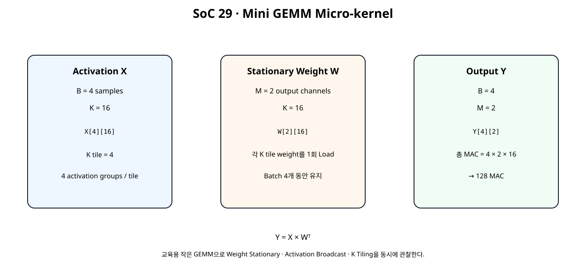
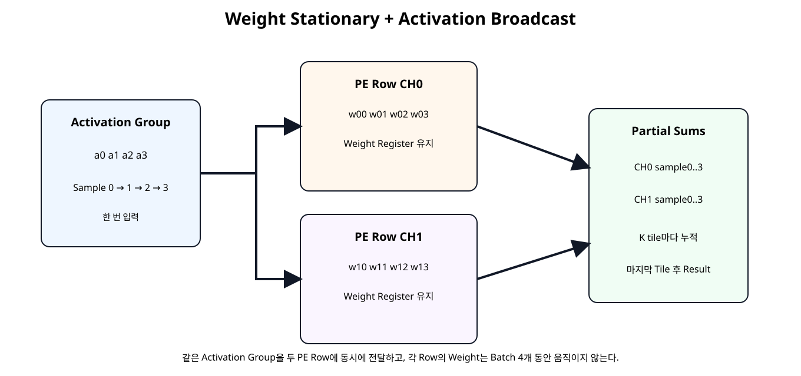
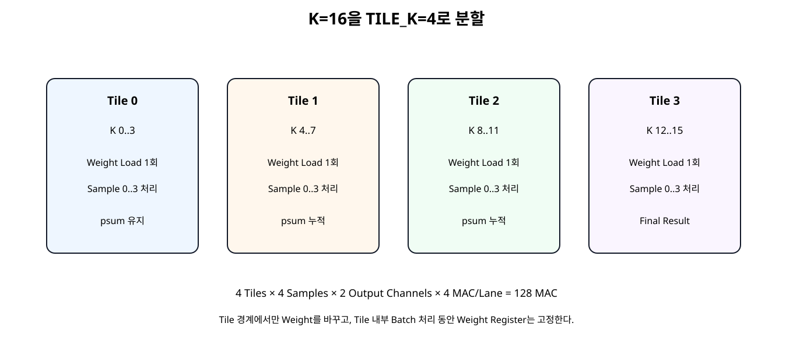
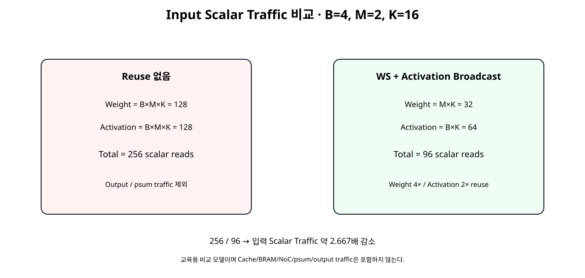

# Data Reuse · Weight Stationary · Activation Broadcast · Tiling


## 전체 학습 위치


## 이번 장의 목표


[](../images/soc29/soc29_mini_gemm.svg)

B=4, M=2, K=16의 작은 GEMM으로 Weight Stationary와 Activation Broadcast를 동시에 구현한다.


## Data Movement가 중요한 이유

NPU는 MAC 수를 늘리는 것만으로 효율이 좋아지지 않는다. 같은 Weight나 Activation을 반복해서 Memory에서 읽으면 Compute보다 Data Movement가 병목이 될 수 있다.


## Mini GEMM 문제 정의


[](../images/soc29/soc29_mini_gemm.svg)

Y = X × Wᵀ, X[4][16], W[2][16], Y[4][2]


```text
Batch B = 4
Output Channel M = 2
K = 16
K Tile = 4
총 MAC = 4 × 2 × 16 = 128
```


## Weight Stationary

Weight Stationary(웨이트 스테이셔너리, 가중치 고정형 데이터플로우)는 Weight를 PE 내부 Register/Local Storage에 유지하고 여러 연산에서 재사용하는 방식이다.

이번 실습에서는 K Tile마다 CH0/CH1의 4개 Weight를 한 번 Load하고 Batch Sample 4개가 지나갈 동안 그대로 유지한다.


## Activation Broadcast


[](../images/soc29/soc29_weight_stationary_broadcast.svg)

한 Activation Group을 두 PE Row에 동시에 전달하여 CH0/CH1 Weight와 병렬 계산한다.


## K Tiling


[](../images/soc29/soc29_tiling.svg)

K=16을 네 개의 K=4 Tile로 나누고 Partial Sum을 Tile 사이에서 유지한다.


## 2 PE Row 구조


```text
PE Row CH0 → Weight Vector 4개 → Dot4
PE Row CH1 → Weight Vector 4개 → Dot4

Activation 4-Lane Group
       ↓
CH0와 CH1에 동시 전달
```

두 Row는 서로 다른 Output Channel의 Weight를 보유한다.


## Stationary Weight Register

load_weights_i가 1일 때만 두 Weight Vector Register를 갱신한다. Activation이 여러 번 들어오는 동안 Weight Register는 바뀌지 않는다.


## Activation Fanout

같은 act_vec_i[31:0]를 CH0와 CH1의 네 Multiplier에 각각 연결한다. External/Input Stream 입장에서는 Activation Group을 한 번만 공급하지만 두 Output Channel 계산에 동시에 사용된다.


## Dot4 Pipeline

각 Row는 SoC 25의 Balanced Reduction 개념을 그대로 사용한다.


## Sample별 Partial Sum

Batch Sample 0~3마다 CH0/CH1 Partial Sum Register를 별도로 둔다.


```text
psum0[sample0..3]
psum1[sample0..3]
```

한 K Tile의 Dot4가 끝나면 해당 Sample의 psum에 더한다.


## Tile 누적


## Traffic 기준 모델

Output/Partial Sum Traffic은 제외하고 Input Scalar int8 Read만 비교한다. 이는 실제 DRAM Energy 측정이 아니라 Data Reuse 효과를 이해하기 위한 교육용 모델이다.


## Weight Traffic 4배 감소

Batch 4개가 같은 Model Weight를 공유하므로 Weight Read는 4배 줄어든다.


## Activation Traffic 2배 감소

같은 Activation을 두 Output Channel PE Row가 공유하므로 Input-side Activation 공급량을 절반으로 줄일 수 있다.


## 전체 Input Traffic


[](../images/soc29/soc29_traffic_comparison.svg)

교육용 Scalar Read 모델에서는 256 → 96으로 약 2.667배 감소한다.


## Data Reuse와 Energy

DNN Accelerator 연구에서는 Data Movement가 계산 자체보다 큰 비용을 만들 수 있어 Local Reuse를 높이는 Dataflow가 중요하다. Weight Stationary는 그중 하나이며 Weight를 PE에 고정해 Weight 이동을 줄이는 방식으로 분류된다.


## Weight Stationary의 한계

Weight Stationary가 모든 Layer에서 항상 최선인 것은 아니다. Layer Shape, Batch Size, Output Channel 수, Activation Reuse, Local Storage 크기에 따라 Output Stationary나 Row Stationary 같은 다른 Dataflow가 더 유리할 수 있다.


## RTL Datapath


```verilog
module ws_dual_pe4_datapath (
    input  wire               clk,
    input  wire               resetn,

    input  wire               load_weights_i,
    input  wire [31:0]        weight_ch0_vec_i,
    input  wire [31:0]        weight_ch1_vec_i,

    input  wire               act_valid_i,
    input  wire [1:0]         sample_id_i,
    input  wire [31:0]        act_vec_i,

    output reg                dot_valid_o,
    output reg  [1:0]         sample_id_o,
    output reg signed [17:0]  dot_ch0_o,
    output reg signed [17:0]  dot_ch1_o,

    output reg                weights_loaded_o
);

// Mini weight-stationary datapath.
//
// Two output-channel PE rows:
//   CH0: 4 stationary weights
//   CH1: 4 stationary weights
//
// One 4-lane activation group is broadcast to both PE rows.
//
// Pipeline:
//   Stage 1: 8 signed 8x8 products
//   Stage 2: pair sums
//   Stage 3: final dot4 sums
//
// Weight registers remain unchanged while multiple activation
// sample groups pass through the PE rows.

reg [31:0] weight_ch0_q;
reg [31:0] weight_ch1_q;

always @(posedge clk) begin
    if (!resetn) begin
        weight_ch0_q    <= 32'h0000_0000;
        weight_ch1_q    <= 32'h0000_0000;
        weights_loaded_o<= 1'b0;
    end else if (load_weights_i) begin
        weight_ch0_q    <= weight_ch0_vec_i;
        weight_ch1_q    <= weight_ch1_vec_i;
        weights_loaded_o<= 1'b1;
    end
end

wire signed [7:0] a0;
wire signed [7:0] a1;
wire signed [7:0] a2;
wire signed [7:0] a3;

assign a0 = $signed(act_vec_i[7:0]);
assign a1 = $signed(act_vec_i[15:8]);
assign a2 = $signed(act_vec_i[23:16]);
assign a3 = $signed(act_vec_i[31:24]);

wire signed [7:0] w00;
wire signed [7:0] w01;
wire signed [7:0] w02;
wire signed [7:0] w03;

wire signed [7:0] w10;
wire signed [7:0] w11;
wire signed [7:0] w12;
wire signed [7:0] w13;

assign w00 = $signed(weight_ch0_q[7:0]);
assign w01 = $signed(weight_ch0_q[15:8]);
assign w02 = $signed(weight_ch0_q[23:16]);
assign w03 = $signed(weight_ch0_q[31:24]);

assign w10 = $signed(weight_ch1_q[7:0]);
assign w11 = $signed(weight_ch1_q[15:8]);
assign w12 = $signed(weight_ch1_q[23:16]);
assign w13 = $signed(weight_ch1_q[31:24]);

wire signed [15:0] p00_w;
wire signed [15:0] p01_w;
wire signed [15:0] p02_w;
wire signed [15:0] p03_w;

wire signed [15:0] p10_w;
wire signed [15:0] p11_w;
wire signed [15:0] p12_w;
wire signed [15:0] p13_w;

mul_s8_dsp u_mul00 (.a_i(a0), .b_i(w00), .p_o(p00_w));
mul_s8_dsp u_mul01 (.a_i(a1), .b_i(w01), .p_o(p01_w));
mul_s8_dsp u_mul02 (.a_i(a2), .b_i(w02), .p_o(p02_w));
mul_s8_dsp u_mul03 (.a_i(a3), .b_i(w03), .p_o(p03_w));

mul_s8_dsp u_mul10 (.a_i(a0), .b_i(w10), .p_o(p10_w));
mul_s8_dsp u_mul11 (.a_i(a1), .b_i(w11), .p_o(p11_w));
mul_s8_dsp u_mul12 (.a_i(a2), .b_i(w12), .p_o(p12_w));
mul_s8_dsp u_mul13 (.a_i(a3), .b_i(w13), .p_o(p13_w));

// ---------------- Stage 1 ----------------
reg signed [15:0] p00_q;
reg signed [15:0] p01_q;
reg signed [15:0] p02_q;
reg signed [15:0] p03_q;

reg signed [15:0] p10_q;
reg signed [15:0] p11_q;
reg signed [15:0] p12_q;
reg signed [15:0] p13_q;

reg               valid_s1_q;
reg [1:0]         sample_s1_q;

always @(posedge clk) begin
    if (!resetn) begin
        p00_q <= 16'sd0;
        p01_q <= 16'sd0;
        p02_q <= 16'sd0;
        p03_q <= 16'sd0;

        p10_q <= 16'sd0;
        p11_q <= 16'sd0;
        p12_q <= 16'sd0;
        p13_q <= 16'sd0;

        valid_s1_q  <= 1'b0;
        sample_s1_q <= 2'd0;
    end else begin
        valid_s1_q  <= act_valid_i;
        sample_s1_q <= sample_id_i;

        if (act_valid_i) begin
            p00_q <= p00_w;
            p01_q <= p01_w;
            p02_q <= p02_w;
            p03_q <= p03_w;

            p10_q <= p10_w;
            p11_q <= p11_w;
            p12_q <= p12_w;
            p13_q <= p13_w;
        end
    end
end

// ---------------- Stage 2 ----------------
wire signed [16:0] s00_w;
wire signed [16:0] s01_w;

wire signed [16:0] s10_w;
wire signed [16:0] s11_w;

assign s00_w =
    $signed({p00_q[15], p00_q}) +
    $signed({p01_q[15], p01_q});

assign s01_w =
    $signed({p02_q[15], p02_q}) +
    $signed({p03_q[15], p03_q});

assign s10_w =
    $signed({p10_q[15], p10_q}) +
    $signed({p11_q[15], p11_q});

assign s11_w =
    $signed({p12_q[15], p12_q}) +
    $signed({p13_q[15], p13_q});

reg signed [16:0] s00_q;
reg signed [16:0] s01_q;

reg signed [16:0] s10_q;
reg signed [16:0] s11_q;

reg               valid_s2_q;
reg [1:0]         sample_s2_q;

always @(posedge clk) begin
    if (!resetn) begin
        s00_q <= 17'sd0;
        s01_q <= 17'sd0;
        s10_q <= 17'sd0;
        s11_q <= 17'sd0;

        valid_s2_q  <= 1'b0;
        sample_s2_q <= 2'd0;
    end else begin
        valid_s2_q  <= valid_s1_q;
        sample_s2_q <= sample_s1_q;

        if (valid_s1_q) begin
            s00_q <= s00_w;
            s01_q <= s01_w;
            s10_q <= s10_w;
            s11_q <= s11_w;
        end
    end
end

// ---------------- Stage 3 ----------------
wire signed [17:0] dot0_w;
wire signed [17:0] dot1_w;

assign dot0_w =
    $signed({s00_q[16], s00_q}) +
    $signed({s01_q[16], s01_q});

assign dot1_w =
    $signed({s10_q[16], s10_q}) +
    $signed({s11_q[16], s11_q});

always @(posedge clk) begin
    if (!resetn) begin
        dot_ch0_o  <= 18'sd0;
        dot_ch1_o  <= 18'sd0;
        dot_valid_o<= 1'b0;
        sample_id_o<= 2'd0;
    end else begin
        dot_valid_o <= valid_s2_q;
        sample_id_o <= sample_s2_q;

        if (valid_s2_q) begin
            dot_ch0_o <= dot0_w;
            dot_ch1_o <= dot1_w;
        end
    end
end

endmodule
```


## Tiled Batch Engine RTL


```verilog
module ws_tiled_batch_engine (
    input  wire                clk,
    input  wire                resetn,

    input  wire                job_start_i,

    input  wire                tile_start_i,
    output wire                tile_ready_o,
    input  wire                tile_last_i,

    input  wire [31:0]         weight_ch0_vec_i,
    input  wire [31:0]         weight_ch1_vec_i,

    input  wire                act_valid_i,
    output wire                act_ready_o,
    input  wire [1:0]          act_sample_id_i,
    input  wire [31:0]         act_vec_i,

    output reg                 tile_done_o,
    output reg                 job_done_o,
    output reg                 result_valid_o,

    output reg [127:0]         result_ch0_batch_o,
    output reg [127:0]         result_ch1_batch_o,

    output reg [15:0]          weight_tile_loads_o,
    output reg [15:0]          activation_groups_o,
    output reg [15:0]          dot_results_o
);

// Mini tiled GEMM engine.
//
// Fixed teaching shape:
//   Batch B = 4
//   Output channels M = 2
//   K tile size = 4
//
// Each tile:
//   1. Load two 4-weight vectors once.
//   2. Feed four activation vectors, one per batch sample.
//   3. The same activation group is broadcast to both PE rows.
//   4. Accumulate two dot4 partial sums into per-sample psums.
//
// Across multiple K tiles, psums persist.
//
// Final packed result:
//   result_chX_batch_o[31:0]   = sample 0
//   result_chX_batch_o[63:32]  = sample 1
//   result_chX_batch_o[95:64]  = sample 2
//   result_chX_batch_o[127:96] = sample 3

localparam [2:0] ST_IDLE      = 3'd0;
localparam [2:0] ST_WAIT_TILE = 3'd1;
localparam [2:0] ST_FEED      = 3'd2;
localparam [2:0] ST_DRAIN     = 3'd3;
localparam [2:0] ST_FINALIZE  = 3'd4;

reg [2:0] state_q;

reg       tile_last_q;
reg [2:0] accepted_in_tile_q;
reg [2:0] completed_in_tile_q;

reg signed [31:0] psum0_q [0:3];
reg signed [31:0] psum1_q [0:3];

wire datapath_load_weights_w;

assign datapath_load_weights_w =
    tile_start_i &&
    tile_ready_o;

assign tile_ready_o =
    (state_q == ST_WAIT_TILE);

assign act_ready_o =
    (state_q == ST_FEED);

wire datapath_act_valid_w;

assign datapath_act_valid_w =
    act_valid_i &&
    act_ready_o;

wire              dot_valid_w;
wire [1:0]        dot_sample_id_w;
wire signed [17:0] dot_ch0_w;
wire signed [17:0] dot_ch1_w;
wire              weights_loaded_w;

ws_dual_pe4_datapath u_ws_datapath (
    .clk(clk),
    .resetn(resetn),

    .load_weights_i(datapath_load_weights_w),
    .weight_ch0_vec_i(weight_ch0_vec_i),
    .weight_ch1_vec_i(weight_ch1_vec_i),

    .act_valid_i(datapath_act_valid_w),
    .sample_id_i(act_sample_id_i),
    .act_vec_i(act_vec_i),

    .dot_valid_o(dot_valid_w),
    .sample_id_o(dot_sample_id_w),
    .dot_ch0_o(dot_ch0_w),
    .dot_ch1_o(dot_ch1_w),

    .weights_loaded_o(weights_loaded_w)
);

wire signed [31:0] dot_ch0_ext_w;
wire signed [31:0] dot_ch1_ext_w;

assign dot_ch0_ext_w =
    {{14{dot_ch0_w[17]}}, dot_ch0_w};

assign dot_ch1_ext_w =
    {{14{dot_ch1_w[17]}}, dot_ch1_w};

integer i;

always @(posedge clk) begin
    if (!resetn) begin
        state_q <= ST_IDLE;

        tile_last_q          <= 1'b0;
        accepted_in_tile_q   <= 3'd0;
        completed_in_tile_q  <= 3'd0;

        tile_done_o          <= 1'b0;
        job_done_o           <= 1'b0;
        result_valid_o       <= 1'b0;

        result_ch0_batch_o   <= 128'd0;
        result_ch1_batch_o   <= 128'd0;

        weight_tile_loads_o  <= 16'd0;
        activation_groups_o  <= 16'd0;
        dot_results_o        <= 16'd0;

        for (i = 0; i < 4; i = i + 1) begin
            psum0_q[i] <= 32'sd0;
            psum1_q[i] <= 32'sd0;
        end
    end else begin
        tile_done_o    <= 1'b0;
        job_done_o     <= 1'b0;
        result_valid_o <= 1'b0;

        // Datapath completion is independent of input feed timing.
        if (
            dot_valid_w &&
            (
                (state_q == ST_FEED) ||
                (state_q == ST_DRAIN)
            )
        ) begin
            psum0_q[dot_sample_id_w] <=
                psum0_q[dot_sample_id_w] +
                dot_ch0_ext_w;

            psum1_q[dot_sample_id_w] <=
                psum1_q[dot_sample_id_w] +
                dot_ch1_ext_w;

            dot_results_o <=
                dot_results_o + 16'd2;

            completed_in_tile_q <=
                completed_in_tile_q + 3'd1;
        end

        case (state_q)
            ST_IDLE: begin
                if (job_start_i) begin
                    accepted_in_tile_q  <= 3'd0;
                    completed_in_tile_q <= 3'd0;

                    weight_tile_loads_o <= 16'd0;
                    activation_groups_o <= 16'd0;
                    dot_results_o       <= 16'd0;

                    for (i = 0; i < 4; i = i + 1) begin
                        psum0_q[i] <= 32'sd0;
                        psum1_q[i] <= 32'sd0;
                    end

                    state_q <= ST_WAIT_TILE;
                end
            end

            ST_WAIT_TILE: begin
                if (datapath_load_weights_w) begin
                    tile_last_q         <= tile_last_i;
                    accepted_in_tile_q  <= 3'd0;
                    completed_in_tile_q <= 3'd0;

                    weight_tile_loads_o <=
                        weight_tile_loads_o + 16'd1;

                    state_q <= ST_FEED;
                end
            end

            ST_FEED: begin
                if (datapath_act_valid_w) begin
                    accepted_in_tile_q <=
                        accepted_in_tile_q + 3'd1;

                    activation_groups_o <=
                        activation_groups_o + 16'd1;

                    if (accepted_in_tile_q == 3'd3) begin
                        state_q <= ST_DRAIN;
                    end
                end
            end

            ST_DRAIN: begin
                if (
                    dot_valid_w &&
                    (completed_in_tile_q == 3'd3)
                ) begin
                    tile_done_o <= 1'b1;

                    if (tile_last_q) begin
                        state_q <= ST_FINALIZE;
                    end else begin
                        state_q <= ST_WAIT_TILE;
                    end
                end
            end

            ST_FINALIZE: begin
                result_ch0_batch_o[31:0] <=
                    psum0_q[0];

                result_ch0_batch_o[63:32] <=
                    psum0_q[1];

                result_ch0_batch_o[95:64] <=
                    psum0_q[2];

                result_ch0_batch_o[127:96] <=
                    psum0_q[3];

                result_ch1_batch_o[31:0] <=
                    psum1_q[0];

                result_ch1_batch_o[63:32] <=
                    psum1_q[1];

                result_ch1_batch_o[95:64] <=
                    psum1_q[2];

                result_ch1_batch_o[127:96] <=
                    psum1_q[3];

                result_valid_o <= 1'b1;
                job_done_o     <= 1'b1;

                state_q <= ST_IDLE;
            end

            default: begin
                state_q <= ST_IDLE;
            end
        endcase
    end
end

endmodule
```


## Tile Protocol


```text
job_start
  ↓
tile_ready
  ↓
tile_start + weights
  ↓
sample0..3 activation
  ↓
tile_done
  ↓
다음 tile 또는 final result
```


## Job / Tile State Flow

새 Weight Tile은 이전 Tile의 Dot Pipeline이 모두 빠진 뒤에만 Load한다.


## Result Packing


```text
result_ch0_batch[31:0]   → sample0
result_ch0_batch[63:32]  → sample1
result_ch0_batch[95:64]  → sample2
result_ch0_batch[127:96] → sample3

CH1도 동일
```


## Board Demo


| Sample | CH0 Weight=1 | CH1 Weight=2 |
| --- | --- | --- |
| 0 · Activation=1 | 16 | 32 |
| 1 · Activation=2 | 32 | 64 |
| 2 · Activation=3 | 48 | 96 |
| 3 · Activation=4 | 64 | 128 |

LED는 CH1 Sample3을 선택하므로 예상값은 128 = 0x0080이다.


## Self-Checking Testbench


```verilog
`timescale 1ns / 1ps

module tb_ws_tiled_batch_engine;

logic clk = 1'b0;
logic resetn = 1'b0;

logic job_start_i = 1'b0;

logic tile_start_i = 1'b0;
wire  tile_ready_o;
logic tile_last_i = 1'b0;

logic [31:0] weight_ch0_vec_i = 32'h0;
logic [31:0] weight_ch1_vec_i = 32'h0;

logic act_valid_i = 1'b0;
wire  act_ready_o;
logic [1:0] act_sample_id_i = 2'd0;
logic [31:0] act_vec_i = 32'h0;

wire tile_done_o;
wire job_done_o;
wire result_valid_o;

wire [127:0] result_ch0_batch_o;
wire [127:0] result_ch1_batch_o;

wire [15:0] weight_tile_loads_o;
wire [15:0] activation_groups_o;
wire [15:0] dot_results_o;

int error_count = 0;
int check_count = 0;

integer signed expected_ch0 [0:3];
integer signed expected_ch1 [0:3];

always #5 clk = ~clk;

ws_tiled_batch_engine dut (
    .clk(clk),
    .resetn(resetn),

    .job_start_i(job_start_i),

    .tile_start_i(tile_start_i),
    .tile_ready_o(tile_ready_o),
    .tile_last_i(tile_last_i),

    .weight_ch0_vec_i(weight_ch0_vec_i),
    .weight_ch1_vec_i(weight_ch1_vec_i),

    .act_valid_i(act_valid_i),
    .act_ready_o(act_ready_o),
    .act_sample_id_i(act_sample_id_i),
    .act_vec_i(act_vec_i),

    .tile_done_o(tile_done_o),
    .job_done_o(job_done_o),
    .result_valid_o(result_valid_o),

    .result_ch0_batch_o(result_ch0_batch_o),
    .result_ch1_batch_o(result_ch1_batch_o),

    .weight_tile_loads_o(weight_tile_loads_o),
    .activation_groups_o(activation_groups_o),
    .dot_results_o(dot_results_o)
);

function automatic integer signed signed8(
    input integer value
);
    integer temp;

    begin
        temp = value & 8'hFF;

        if (temp >= 128) begin
            temp = temp - 256;
        end

        signed8 = temp;
    end
endfunction

function automatic integer signed weight0_value(
    input integer k
);
    begin
        weight0_value =
            signed8(((k * 3) + 5) % 17 - 8);
    end
endfunction

function automatic integer signed weight1_value(
    input integer k
);
    begin
        weight1_value =
            signed8(((k * 5) + 2) % 19 - 9);
    end
endfunction

function automatic integer signed activation_value(
    input integer sample_id,
    input integer k
);
    begin
        activation_value =
            signed8(
                (((sample_id + 1) * 7) + (k * 4)) % 23 - 11
            );
    end
endfunction

function automatic [31:0] pack4(
    input integer x0,
    input integer x1,
    input integer x2,
    input integer x3
);
    begin
        pack4 = {
            x3[7:0],
            x2[7:0],
            x1[7:0],
            x0[7:0]
        };
    end
endfunction

// (변경) SystemVerilog 예약어와 충돌하지 않는 packed_result를 사용한다.
function automatic logic signed [31:0] unpack_result(
    input [127:0] packed_result,
    input integer sample_id
);
    begin
        case (sample_id)
            0: unpack_result = $signed(packed_result[31:0]);
            1: unpack_result = $signed(packed_result[63:32]);
            2: unpack_result = $signed(packed_result[95:64]);
            default: unpack_result = $signed(packed_result[127:96]);
        endcase
    end
endfunction

task automatic check_true(
    input string name,
    input bit condition
);
    begin
        check_count++;

        if (!condition) begin
            error_count++;
            $error("CHECK FAIL: %s", name);
        end else begin
            $display("CHECK PASS: %s", name);
        end
    end
endtask

task automatic check_eq32(
    input string name,
    input logic signed [31:0] actual,
    input logic signed [31:0] expected
);
    begin
        check_count++;

        if (actual !== expected) begin
            error_count++;
            $error(
                "CHECK FAIL: %s actual=%0d expected=%0d",
                name,
                actual,
                expected
            );
        end else begin
            $display(
                "CHECK PASS: %s = %0d",
                name,
                actual
            );
        end
    end
endtask

task automatic pulse_job_start;
    begin
        @(negedge clk);
        job_start_i = 1'b1;

        @(negedge clk);
        job_start_i = 1'b0;
    end
endtask

task automatic start_tile(
    input integer tile_index
);
    integer base_k;

    begin
        base_k = tile_index * 4;

        while (tile_ready_o !== 1'b1) begin
            @(negedge clk);
        end

        @(negedge clk);

        weight_ch0_vec_i = pack4(
            weight0_value(base_k + 0),
            weight0_value(base_k + 1),
            weight0_value(base_k + 2),
            weight0_value(base_k + 3)
        );

        weight_ch1_vec_i = pack4(
            weight1_value(base_k + 0),
            weight1_value(base_k + 1),
            weight1_value(base_k + 2),
            weight1_value(base_k + 3)
        );

        tile_last_i = (tile_index == 3);
        tile_start_i = 1'b1;

        @(negedge clk);
        tile_start_i = 1'b0;
        tile_last_i = 1'b0;
    end
endtask

task automatic send_activation(
    input integer sample_id,
    input integer tile_index
);
    integer base_k;
    integer signed a0;
    integer signed a1;
    integer signed a2;
    integer signed a3;

    begin
        base_k = tile_index * 4;

        a0 = activation_value(sample_id, base_k + 0);
        a1 = activation_value(sample_id, base_k + 1);
        a2 = activation_value(sample_id, base_k + 2);
        a3 = activation_value(sample_id, base_k + 3);

        // Deliberate source gap before odd samples.
        if ((sample_id & 1) != 0) begin
            @(negedge clk);
            act_valid_i = 1'b0;
        end

        while (act_ready_o !== 1'b1) begin
            @(negedge clk);
        end

        @(negedge clk);

        act_sample_id_i = sample_id[1:0];
        act_vec_i = pack4(a0, a1, a2, a3);
        act_valid_i = 1'b1;

        // Check READY before the sampling edge. On the fourth sample,
        // the engine may leave FEED immediately after that edge.
        check_true(
            "activation presented only in FEED",
            act_ready_o === 1'b1
        );

        @(posedge clk);
        #1;

        @(negedge clk);
        act_valid_i = 1'b0;
    end
endtask

task automatic wait_tile_done;
    integer timeout;

    begin
        timeout = 0;

        while (
            (tile_done_o !== 1'b1) &&
            (timeout < 100)
        ) begin
            @(posedge clk);
            #1;
            timeout++;
        end

        check_true(
            "tile_done arrived",
            tile_done_o === 1'b1
        );
    end
endtask

initial begin
    integer tile_index;
    integer sample_id;
    integer k;

    for (sample_id = 0; sample_id < 4; sample_id++) begin
        expected_ch0[sample_id] = 0;
        expected_ch1[sample_id] = 0;

        for (k = 0; k < 16; k++) begin
            expected_ch0[sample_id] =
                expected_ch0[sample_id] +
                activation_value(sample_id, k) *
                weight0_value(k);

            expected_ch1[sample_id] =
                expected_ch1[sample_id] +
                activation_value(sample_id, k) *
                weight1_value(k);
        end
    end

    repeat (5) @(posedge clk);
    resetn = 1'b1;

    pulse_job_start();

    for (tile_index = 0; tile_index < 4; tile_index++) begin
        start_tile(tile_index);

        for (sample_id = 0; sample_id < 4; sample_id++) begin
            send_activation(
                sample_id,
                tile_index
            );
        end

        wait_tile_done();
    end

    // Final results follow the final tile completion.
    while (result_valid_o !== 1'b1) begin
        @(posedge clk);
        #1;
    end

    check_true(
        "job_done with final result",
        job_done_o === 1'b1
    );

    for (sample_id = 0; sample_id < 4; sample_id++) begin
        check_eq32(
            $sformatf("CH0 sample%0d", sample_id),
            unpack_result(result_ch0_batch_o, sample_id),
            expected_ch0[sample_id]
        );

        check_eq32(
            $sformatf("CH1 sample%0d", sample_id),
            unpack_result(result_ch1_batch_o, sample_id),
            expected_ch1[sample_id]
        );
    end

    check_true(
        "weight tile load count = 4",
        weight_tile_loads_o == 16'd4
    );

    check_true(
        "activation group count = 16",
        activation_groups_o == 16'd16
    );

    check_true(
        "dot result count = 32",
        dot_results_o == 16'd32
    );

    $display("");
    $display("SOC29 WEIGHT LOADS      : %0d", weight_tile_loads_o);
    $display("SOC29 ACTIVATION GROUPS : %0d", activation_groups_o);
    $display("SOC29 DOT RESULTS       : %0d", dot_results_o);
    $display("SOC29 CHECK COUNT       : %0d", check_count);
    $display("SOC29 ERROR COUNT       : %0d", error_count);

    if (error_count == 0) begin
        $display("SOC29 WEIGHT-STATIONARY/TILING TEST: PASS");
    end else begin
        $fatal(
            1,
            "SOC29 WEIGHT-STATIONARY/TILING TEST: FAIL (%0d errors)",
            error_count
        );
    end

    #20;
    $finish;
end

endmodule
```

Signed Weight/Activation, 4개 K Tile, Batch 4개, Output Channel 2개, Source Gap을 포함하고 8개 최종 Result를 독립 Reference와 비교한다.


## Python GEMM Reference


```text
sample,ch0_raw,ch1_raw
0,495,119
1,-153,54
2,-226,-149
3,138,108

BATCH=4, OUT_CH=2, K=16, TILE_K=4
K tiles = 4
total MACs = 128
weight scalar traffic naive = 128
weight scalar traffic stationary = 32
weight reuse factor = 4.0x
activation scalar traffic naive = 128
activation scalar traffic with broadcast = 64
activation reuse factor = 2.0x
input scalar traffic naive = 256
input scalar traffic optimized = 96
input traffic reduction = 2.667x

board demo CH0 = [16, 32, 48, 64]
board demo CH1 = [32, 64, 96, 128]
board demo selected LED result = CH1 sample3 = 128 = 0x0080
SOC29 PYTHON WEIGHT-STATIONARY REFERENCE: PASS
Spreadsheet runtime warmup failed during python startup
Traceback (most recent call last):
  File "/tmp/tmp.L2TH2Y5coc/artifact_tool_v2-2.8.22/artifact_tool/patches/warm_spreadsheet_runtime_on_startup.py", line 26, in warm_spreadsheet_runtime_on_startup
  File "/tmp/tmp.L2TH2Y5coc/artifact_tool_v2-2.8.22/artifact_tool/spreadsheet_warmup.py", line 785, in warm_spreadsheet_runtime
  File "/tmp/tmp.L2TH2Y5coc/artifact_tool_v2-2.8.22/artifact_tool/spreadsheet_warmup.py", line 720, in _warm_feature_flows
  File "/tmp/tmp.L2TH2Y5coc/artifact_tool_v2-2.8.22/artifact_tool/spreadsheet_warmup.py", line 704, in _warm_collaboration_flows
  File "/tmp/tmp.L2TH2Y5coc/artifact_tool_v2-2.8.22/artifact_tool/generated/interface/models.py", line 32317, in hydrate_crdt_from_proto
  File "/tmp/tmp.L2TH2Y5coc/artifact_tool_v2-2.8.22/artifact_tool/rpc/remote.py", line 749, in __call__
  File "/tmp/tmp.L2TH2Y5coc/artifact_tool_v2-2.8.22/artifact_tool/rpc/client.py", line 150, in call
artifact_tool.rpc.client.RemoteError: hydrateCrdtFromProto requires an empty collaborative document.
```


## Traffic Reference

Python Reference에서 Weight Reuse 4.0×, Activation Reuse 2.0×, Input Scalar Traffic 256 → 96을 실제 계산한다.


## DSP Mapping

두 PE Row × 4 Lane으로 RTL에는 8개의 signed 8×8 Multiplier가 존재하고 각 Multiplier에는 SoC 24부터 사용한 USE_DSP 요청이 적용된다.


## OOC Synthesis


```text
# SoC 29 · Generic weight-stationary/tiled engine synthesis

set script_dir [file dirname [file normalize [info script]]]
set root_dir   [file normalize [file join $script_dir ".."]]
set rtl_dir    [file join $root_dir "rtl"]
set out_dir    [file normalize [file join $root_dir "reports" "generic_ooc"]]

file mkdir $out_dir

create_project -in_memory -part xc7a35tcpg236-1

read_verilog [file join $rtl_dir "mul_s8_dsp.v"]
read_verilog [file join $rtl_dir "ws_dual_pe4_datapath.v"]
read_verilog [file join $rtl_dir "ws_tiled_batch_engine.v"]

synth_design \
    -mode out_of_context \
    -top ws_tiled_batch_engine \
    -part xc7a35tcpg236-1

report_utilization \
    -hierarchical \
    -file [file join $out_dir "01_utilization_ooc.rpt"]

redirect -file [file join $out_dir "02_dsp48_cells_ooc.rpt"] {
    set dsp_cells [get_cells -hier -filter {REF_NAME =~ DSP48*}]
    puts "DSP48 primitive count: [llength $dsp_cells]"

    foreach cell $dsp_cells {
        puts "[get_property REF_NAME $cell]  $cell"
    }
}

report_timing_summary \
    -delay_type min_max \
    -report_unconstrained \
    -max_paths 20 \
    -file [file join $out_dir "03_timing_summary_ooc.rpt"]

report_design_analysis \
    -max_paths 50 \
    -setup \
    -logic_level_distribution \
    -file [file join $out_dir "04_design_analysis_ooc.rpt"]

puts ""
puts "SoC 29 generic OOC synthesis complete."
puts "Check actual DSP mapping in 02_dsp48_cells_ooc.rpt."
puts "Do not claim eight DSP48 cells until synthesis confirms it."
```

Generic Engine을 Out-of-Context로 합성해 DSP Mapping과 Logic Resource를 Board Demo 상수 최적화와 분리해 확인한다.


## Post-route Timing


```text
# SoC 29 · Basys3 board demo implementation

set script_dir [file dirname [file normalize [info script]]]
set root_dir   [file normalize [file join $script_dir ".."]]
set rtl_dir    [file join $root_dir "rtl"]
set xdc_dir    [file join $root_dir "constraints"]
set out_dir    [file normalize [file join $root_dir "reports" "board_demo"]]

file mkdir $out_dir

create_project -in_memory -part xc7a35tcpg236-1

read_verilog [file join $rtl_dir "reset_active_high_to_active_low.v"]
read_verilog [file join $rtl_dir "mul_s8_dsp.v"]
read_verilog [file join $rtl_dir "ws_dual_pe4_datapath.v"]
read_verilog [file join $rtl_dir "ws_tiled_batch_engine.v"]
read_verilog [file join $rtl_dir "ws_board_demo_controller.v"]
read_verilog [file join $rtl_dir "ws_result_sink.v"]
read_verilog [file join $rtl_dir "ws_tiled_batch_basys3_top.v"]

synth_design \
    -top ws_tiled_batch_basys3_top \
    -part xc7a35tcpg236-1

read_xdc [file join $xdc_dir "basys3_soc29_lab.xdc"]

create_clock \
    -name sys_clk \
    -period 10.000 \
    [get_ports clk]

report_utilization \
    -hierarchical \
    -file [file join $out_dir "01_utilization_post_synth.rpt"]

redirect -file [file join $out_dir "02_dsp48_cells_post_synth.rpt"] {
    set dsp_cells [get_cells -hier -filter {REF_NAME =~ DSP48*}]
    puts "DSP48 primitive count: [llength $dsp_cells]"

    foreach cell $dsp_cells {
        puts "[get_property REF_NAME $cell]  $cell"
    }
}

opt_design
place_design
phys_opt_design
route_design

report_utilization \
    -hierarchical \
    -file [file join $out_dir "03_utilization_post_route.rpt"]

report_timing_summary \
    -delay_type min_max \
    -report_unconstrained \
    -max_paths 20 \
    -file [file join $out_dir "04_timing_summary_post_route.rpt"]

report_timing \
    -delay_type max \
    -max_paths 20 \
    -nworst 1 \
    -sort_by group \
    -input_pins \
    -file [file join $out_dir "05_worst_setup_paths.rpt"]

set_switching_activity \
    -default_static_probability 0.5 \
    -default_toggle_rate 12.5

report_power \
    -file [file join $out_dir "06_power_normalized_activity.rpt"] \
    -rpx  [file join $out_dir "06_power_normalized_activity.rpx"]

report_methodology \
    -file [file join $out_dir "07_methodology_post_route.rpt"]

write_checkpoint -force \
    [file join $out_dir "soc29_board_demo_post_route.dcp"]

puts ""
puts "SoC 29 board demo implementation complete."
puts "Expected selected LED result: CH1 sample3 = 128 = 0x0080."
```

Activation Fanout가 두 PE Row로 늘어나므로 Fanout/Route 영향과 Reduction Pipeline 경로를 Post-route Timing으로 확인한다.


## Power 관점

Data Reuse는 External/Local Memory Access를 줄이는 목적이 있지만, PE Row와 DSP 수가 늘면 Compute-side Dynamic Power는 증가할 수 있다. 따라서 실제 Total Energy Benefit은 Memory Traffic과 Compute Resource를 함께 봐야 한다.


## SoC 28과의 연결

실제 Accelerator에서는 두 구조를 결합해 다음 Tile을 Load하는 동안 현재 Tile의 Weight를 PE에 고정하고 Activation을 소비한다.


## SoC 30 연결

현재 최종 Output은 32-bit Partial/Accumulation 결과다. 다음 단계에서는 Bias, Scale, Rounding, Saturation을 적용해 다시 int8 Tensor로 만드는 Requantization Datapath를 구성한다.


## 오류 점검


| 증상 | 원인 | 확인 |
| --- | --- | --- |
| Tile마다 결과가 초기화됨 | psum을 Tile 시작에서 Clear | Job 시작에서만 Clear |
| Batch Sample 결과 섞임 | sample_id Pipeline 불일치 | sample_s1/s2/output |
| CH0/CH1 결과 동일 | Weight Register 분리 실패 | weight_ch0_q / weight_ch1_q |
| 마지막 Tile 일부 누락 | DRAIN 전에 다음 Tile Load | tile_ready / tile_done |
| Weight Traffic 감소 없음 | Batch마다 Weight Reload | Tile당 1회 Load |
| Activation Traffic 두 배 | PE Row별 Stream 복제 | 한 act_vec fanout |
| DSP Count가 8이 아님 | Synthesis Mapping 차이 | DSP48 Cell Report |
| Reuse가 커도 성능 향상 없음 | Layer Shape/Memory 병목 | Dataflow/Tiling 재평가 |


## SoC 29 완료 체크리스트

- [ ] Weight Stationary의 의미를 설명한다.
- [ ] Activation Broadcast의 의미를 설명한다.
- [ ] B=4, M=2, K=16 GEMM Shape를 이해한다.
- [ ] K=16을 TILE_K=4로 나눈다.
- [ ] 한 Tile의 Weight를 Batch 4개 동안 유지한다.
- [ ] 같은 Activation Group을 두 PE Row에 전달한다.
- [ ] Sample별 CH0/CH1 Partial Sum을 유지한다.
- [ ] Tile 간 Partial Sum을 누적한다.
- [ ] Weight Traffic 128→32를 계산한다.
- [ ] Activation Traffic 128→64를 계산한다.
- [ ] Input Scalar Traffic 256→96을 계산한다.
- [ ] 실제 DSP Count는 Synthesis Report로 확인한다.
- [ ] Weight Stationary가 모든 Layer에서 항상 최선은 아님을 이해한다.

## 공식 매뉴얼 및 연구 근거


| 문서 | 확인 항목 |
| --- | --- |
| AMD UG901 · MAC Implementation · 2026.1 | DSP Macro 추론과 Pipeline Register 활용 |
| AMD UG901 · Multipliers · 2026.1 | Multiplier의 DSP/Slice 구현 선택 |
| AMD UG901 · USE_DSP · 2026.1 | (* use_dsp = "yes" *) |
| Eyeriss · ISCA 2016 | Row Stationary 데이터 흐름과 로컬 재사용 비교. 본 실습의 Weight Stationary 구조와 구분한다. |
| Sze et al. · Efficient Processing of DNNs | DNN Accelerator의 Data Movement, Energy, Reuse 설계 관점 |

