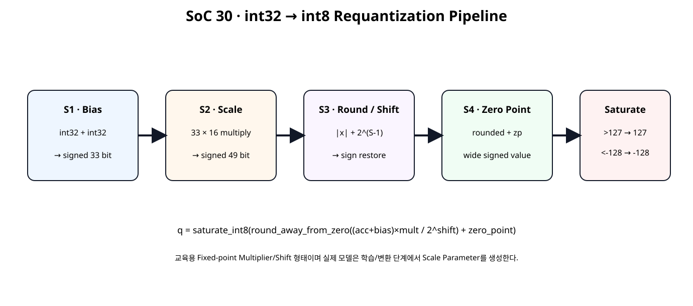
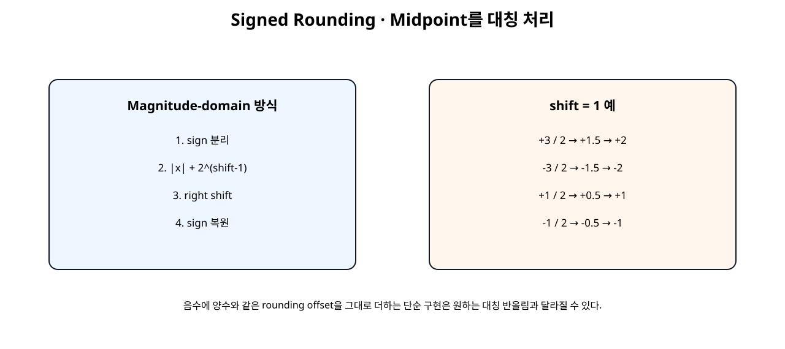
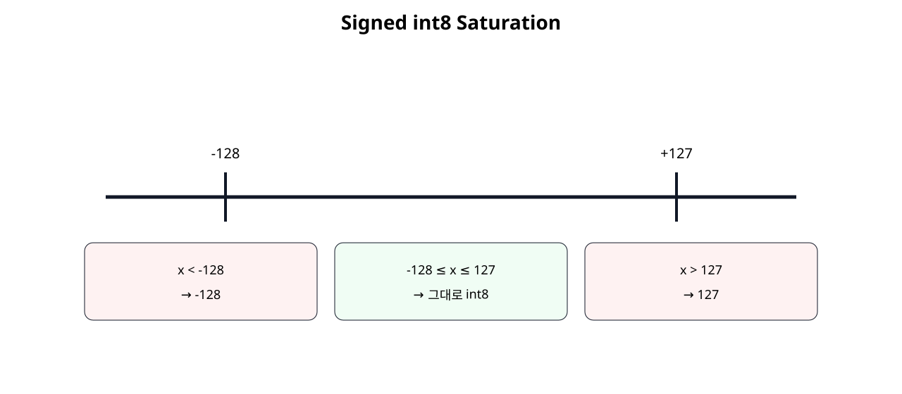
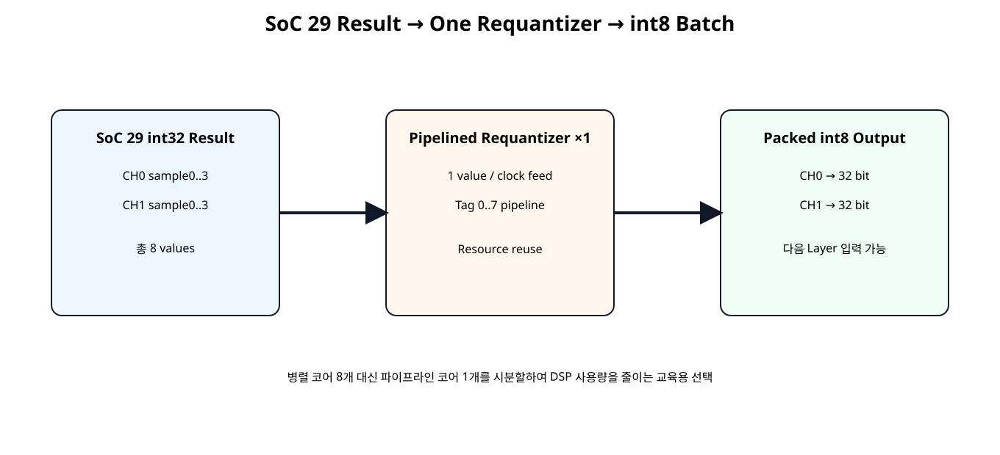

# Bias · Requantization · Rounding · Saturation · int8 Output


## 전체 학습 위치


## 이번 장의 목표


[](../images/soc30/soc30_requant_pipeline.svg)

int32 누산 결과를 Bias → Scale → Round/Shift → Zero Point → int8 Saturation 순서로 처리한다.


## 왜 int32에서 int8로 돌아가는가

int8 Weight와 int8 Activation을 곱해 여러 항을 누적하면 결과 범위가 int8을 크게 넘기 때문에 Accumulator는 보통 더 넓은 정수형을 사용한다. 하지만 다음 Quantized Layer의 입력은 다시 8-bit Tensor가 필요하므로 Output Stage에서 Scale을 바꾸고 8-bit 범위로 Clamp해야 한다.


## Requantization 수식

이번 수식은 RTL 학습을 위한 명시적 Fixed-point 형태다. 실제 모델 변환기는 Real Scale을 Integer Multiplier와 Shift로 근사하는 파라미터를 생성한다.


## Bias

Bias는 Accumulator Scale과 정렬된 정수값으로 더한다. Bias를 Scale 이후가 아니라 int32 누산 영역에서 먼저 더하는 이유는 모델의 Linear/Convolution Output 식을 정수 영역에서 유지하기 위해서다.


## 33-bit Bias Sum

두 32-bit 값을 그대로 32-bit로 더하면 최대/최소 경계에서 Overflow할 수 있으므로 Sign Bit를 각각 한 비트 확장한 뒤 더한다.


## Fixed-point Scale

실수 Scale을 Hardware에서 직접 Floating-point Multiply하지 않고 multiplier / 2^shift 형태로 근사한다.


```text
예: multiplier=3, shift=2
→ 3 / 4
→ 0.75 배
```


## 49-bit Product

Vivado는 곱셈 연산에서 두 Operand Width의 합으로 Product Width를 추론한다. 실제 DSP48 사용 개수는 Operand 크기와 합성 결과로 확인한다.


## Shift

shift=0이면 Scale Product를 그대로 사용하고, shift>0이면 Power-of-two Division을 Right Shift로 구현한다.


## Signed Rounding


[](../images/soc30/soc30_signed_rounding.svg)

Magnitude 영역에서 반올림한 뒤 Sign을 복원하여 양수와 음수 Midpoint를 대칭 처리한다.


## Midpoint 예


| 입력 | 실수값 | 정책 결과 |
| --- | --- | --- |
| +3 / 2 | +1.5 | +2 |
| -3 / 2 | -1.5 | -2 |
| +1 / 2 | +0.5 | +1 |
| -1 / 2 | -0.5 | -1 |


## Zero Point

Scale 변환이 끝난 정수값에 Output Zero Point를 더할 수 있도록 입력을 제공한다. signed int8 대칭 양자화에서는 zero_point=0을 사용할 수 있지만, RTL 구조는 Offset 적용 단계가 보이도록 파라미터화했다.


## Saturation


[](../images/soc30/soc30_saturation.svg)

signed int8 범위를 넘어간 값을 Wrap-around시키지 않고 -128 또는 127에 고정한다.


## Pipeline 구조

AMD는 DSP 기반 Arithmetic Datapath를 충분히 Pipeline하여 내부 Register 자원을 활용하도록 권장한다.


## Valid 정렬


```text
valid_i
  ↓
valid_s1_q
  ↓
valid_s2_q
  ↓
valid_s3_q
  ↓
valid_o
```

Data와 Multiplier/Shift/Zero Point 파라미터도 동일한 Stage로 이동한다.


## Requantizer RTL


```verilog
module requantize_s32_to_s8 (
    input  wire                 clk,
    input  wire                 resetn,

    input  wire                 valid_i,

    input  wire signed [31:0]   acc_i,
    input  wire signed [31:0]   bias_i,

    input  wire signed [15:0]   multiplier_i,
    input  wire        [5:0]    shift_i,
    input  wire signed [15:0]   zero_point_i,

    output reg                  valid_o,
    output reg signed [7:0]     q_o,

    output reg                  sat_pos_o,
    output reg                  sat_neg_o
);

// Educational integer-only requantization core.
//
// Formula:
//
//   biased = acc + bias
//
//   scaled_product = biased * multiplier
//
//   rounded = round_away_from_zero(
//       scaled_product / 2^shift
//   )
//
//   shifted = rounded + zero_point
//
//   q = saturate_to_int8(shifted)
//
// Notes:
// - acc+bias uses 33 bits to preserve the full signed sum.
// - 33x16 multiply produces a signed 49-bit product.
// - multiplier is normally positive for NN requantization.
// - shift=0 means no right shift and no rounding offset.
// - rounding policy is explicitly symmetric:
//     +0.5 -> +1
//     -0.5 -> -1
// - saturation range is signed int8: -128..127.
//
// Pipeline:
//   S1 : bias add + parameter capture
//   S2 : fixed-point multiply
//   S3 : symmetric rounding/right shift
//   S4 : zero-point add + int8 saturation

// ---------------- Stage 1: bias ----------------
reg signed [32:0] biased_s1_q;
reg signed [15:0] mult_s1_q;
reg        [5:0]  shift_s1_q;
reg signed [15:0] zp_s1_q;
reg               valid_s1_q;

wire signed [32:0] biased_w;

assign biased_w =
    $signed({acc_i[31], acc_i}) +
    $signed({bias_i[31], bias_i});

always @(posedge clk) begin
    if (!resetn) begin
        biased_s1_q <= 33'sd0;
        mult_s1_q   <= 16'sd0;
        shift_s1_q  <= 6'd0;
        zp_s1_q     <= 16'sd0;
        valid_s1_q  <= 1'b0;
    end else begin
        valid_s1_q <= valid_i;

        if (valid_i) begin
            biased_s1_q <= biased_w;
            mult_s1_q   <= multiplier_i;
            shift_s1_q  <= shift_i;
            zp_s1_q     <= zero_point_i;
        end
    end
end

// ---------------- Stage 2: scale multiply ----------------
(* use_dsp = "yes" *)
wire signed [48:0] product_w;

assign product_w =
    biased_s1_q *
    mult_s1_q;

reg signed [48:0] product_s2_q;
reg        [5:0]  shift_s2_q;
reg signed [15:0] zp_s2_q;
reg               valid_s2_q;

always @(posedge clk) begin
    if (!resetn) begin
        product_s2_q <= 49'sd0;
        shift_s2_q   <= 6'd0;
        zp_s2_q      <= 16'sd0;
        valid_s2_q   <= 1'b0;
    end else begin
        valid_s2_q <= valid_s1_q;

        if (valid_s1_q) begin
            product_s2_q <= product_w;
            shift_s2_q   <= shift_s1_q;
            zp_s2_q      <= zp_s1_q;
        end
    end
end

// ---------------- Stage 3: symmetric rounding ----------------
//
// Magnitude-domain rounding avoids the common bug where adding the
// same positive rounding constant to negative two's-complement values
// rounds midpoint cases toward zero instead of away from zero.

wire product_negative_w;

assign product_negative_w =
    product_s2_q[48];

wire [48:0] product_magnitude_w;

assign product_magnitude_w =
    product_negative_w
    ? $unsigned(-product_s2_q)
    : $unsigned(product_s2_q);

wire [48:0] rounding_add_w;

assign rounding_add_w =
    (shift_s2_q == 6'd0)
    ? 49'd0
    : (49'd1 << (shift_s2_q - 6'd1));

wire [49:0] rounded_magnitude_extended_w;

assign rounded_magnitude_extended_w =
    {1'b0, product_magnitude_w} +
    {1'b0, rounding_add_w};

wire [49:0] shifted_magnitude_w;

assign shifted_magnitude_w =
    rounded_magnitude_extended_w >>
    shift_s2_q;

wire signed [50:0] rounded_signed_w;

assign rounded_signed_w =
    product_negative_w
    ? -$signed({1'b0, shifted_magnitude_w})
    :  $signed({1'b0, shifted_magnitude_w});

reg signed [50:0] rounded_s3_q;
reg signed [15:0] zp_s3_q;
reg               valid_s3_q;

always @(posedge clk) begin
    if (!resetn) begin
        rounded_s3_q <= 51'sd0;
        zp_s3_q      <= 16'sd0;
        valid_s3_q   <= 1'b0;
    end else begin
        valid_s3_q <= valid_s2_q;

        if (valid_s2_q) begin
            rounded_s3_q <= rounded_signed_w;
            zp_s3_q      <= zp_s2_q;
        end
    end
end

// ---------------- Stage 4: zero point + saturation ----------------
wire signed [51:0] shifted_with_zp_w;

assign shifted_with_zp_w =
    $signed({rounded_s3_q[50], rounded_s3_q}) +
    $signed({
        {36{zp_s3_q[15]}},
        zp_s3_q
    });

wire sat_pos_w;
wire sat_neg_w;

assign sat_pos_w =
    (shifted_with_zp_w > 52'sd127);

assign sat_neg_w =
    (shifted_with_zp_w < -52'sd128);

wire signed [7:0] saturated_w;

assign saturated_w =
    sat_pos_w
    ? 8'sd127
    : sat_neg_w
      ? -8'sd128
      : shifted_with_zp_w[7:0];

always @(posedge clk) begin
    if (!resetn) begin
        q_o       <= 8'sd0;
        valid_o   <= 1'b0;
        sat_pos_o <= 1'b0;
        sat_neg_o <= 1'b0;
    end else begin
        valid_o <= valid_s3_q;

        if (valid_s3_q) begin
            q_o       <= saturated_w;
            sat_pos_o <= sat_pos_w;
            sat_neg_o <= sat_neg_w;
        end else begin
            sat_pos_o <= 1'b0;
            sat_neg_o <= 1'b0;
        end
    end
end

endmodule
```


## SoC29 2×4 Batch 입력


[](../images/soc30/soc30_batch_serialization.svg)

SoC 29의 CH0/CH1 × Sample4 총 8개의 int32 값을 하나의 Pipelined Requantizer로 처리한다.


## Serial Resource Reuse

Requantizer를 8개 병렬 배치하지 않고 하나의 Pipeline Core를 재사용한다. FEED 중에는 매 Clock 새 값을 넣을 수 있으므로 Resource를 줄이면서 Throughput은 1 value/clock까지 유지할 수 있다.


## Tag Pipeline

입력 순서 0~7을 Data와 함께 Pipeline으로 이동해 Output Byte를 원래 CH/Sample 위치에 다시 배치한다.


```text
0..3 → CH0 sample0..3
4..7 → CH1 sample0..3
```


## Batch Wrapper RTL


```verilog
module requantize_batch2x4_serial (
    input  wire                 clk,
    input  wire                 resetn,

    input  wire                 start_i,

    input  wire [127:0]         acc_ch0_batch_i,
    input  wire [127:0]         acc_ch1_batch_i,

    input  wire signed [31:0]   bias_ch0_i,
    input  wire signed [31:0]   bias_ch1_i,

    input  wire signed [15:0]   mult_ch0_i,
    input  wire signed [15:0]   mult_ch1_i,

    input  wire        [5:0]    shift_ch0_i,
    input  wire        [5:0]    shift_ch1_i,

    input  wire signed [15:0]   zp_ch0_i,
    input  wire signed [15:0]   zp_ch1_i,

    output wire                 busy_o,
    output reg                  done_o,
    output reg                  result_valid_o,

    output reg  [31:0]          q_ch0_batch_o,
    output reg  [31:0]          q_ch1_batch_o,

    output reg  [7:0]           saturation_count_o
);

// Serializes the 2-channel x 4-sample int32 result block from SoC 29
// through one pipelined requantization core.
//
// Feed order:
//   index 0..3 -> CH0 sample 0..3
//   index 4..7 -> CH1 sample 0..3
//
// One item is launched per clock while FEED is active.
// The requantizer itself is fully pipelined, so after startup it also
// produces one result per clock.

localparam [1:0] ST_IDLE  = 2'd0;
localparam [1:0] ST_FEED  = 2'd1;
localparam [1:0] ST_DRAIN = 2'd2;

reg [1:0] state_q;
reg [3:0] feed_index_q;
reg [3:0] output_count_q;

assign busy_o =
    (state_q != ST_IDLE);

wire core_valid_i;

assign core_valid_i =
    (state_q == ST_FEED);

wire current_is_ch1_w;
wire [1:0] current_sample_w;

assign current_is_ch1_w =
    feed_index_q[2];

assign current_sample_w =
    feed_index_q[1:0];

reg signed [31:0] selected_acc_w;

always @(*) begin
    case (feed_index_q)
        4'd0: selected_acc_w = $signed(acc_ch0_batch_i[31:0]);
        4'd1: selected_acc_w = $signed(acc_ch0_batch_i[63:32]);
        4'd2: selected_acc_w = $signed(acc_ch0_batch_i[95:64]);
        4'd3: selected_acc_w = $signed(acc_ch0_batch_i[127:96]);

        4'd4: selected_acc_w = $signed(acc_ch1_batch_i[31:0]);
        4'd5: selected_acc_w = $signed(acc_ch1_batch_i[63:32]);
        4'd6: selected_acc_w = $signed(acc_ch1_batch_i[95:64]);

        default:
            selected_acc_w = $signed(acc_ch1_batch_i[127:96]);
    endcase
end

wire signed [31:0] selected_bias_w;
wire signed [15:0] selected_mult_w;
wire        [5:0]  selected_shift_w;
wire signed [15:0] selected_zp_w;

assign selected_bias_w =
    current_is_ch1_w
    ? bias_ch1_i
    : bias_ch0_i;

assign selected_mult_w =
    current_is_ch1_w
    ? mult_ch1_i
    : mult_ch0_i;

assign selected_shift_w =
    current_is_ch1_w
    ? shift_ch1_i
    : shift_ch0_i;

assign selected_zp_w =
    current_is_ch1_w
    ? zp_ch1_i
    : zp_ch0_i;

wire              core_valid_o;
wire signed [7:0] core_q_w;
wire              core_sat_pos_w;
wire              core_sat_neg_w;

requantize_s32_to_s8 u_requantizer (
    .clk(clk),
    .resetn(resetn),

    .valid_i(core_valid_i),

    .acc_i(selected_acc_w),
    .bias_i(selected_bias_w),

    .multiplier_i(selected_mult_w),
    .shift_i(selected_shift_w),
    .zero_point_i(selected_zp_w),

    .valid_o(core_valid_o),
    .q_o(core_q_w),

    .sat_pos_o(core_sat_pos_w),
    .sat_neg_o(core_sat_neg_w)
);

// Tag pipeline matches the 4 registered stages in requantize_s32_to_s8.
reg [3:0] tag_s1_q;
reg [3:0] tag_s2_q;
reg [3:0] tag_s3_q;
reg [3:0] tag_s4_q;

reg valid_tag_s1_q;
reg valid_tag_s2_q;
reg valid_tag_s3_q;
reg valid_tag_s4_q;

always @(posedge clk) begin
    if (!resetn) begin
        tag_s1_q <= 4'd0;
        tag_s2_q <= 4'd0;
        tag_s3_q <= 4'd0;
        tag_s4_q <= 4'd0;

        valid_tag_s1_q <= 1'b0;
        valid_tag_s2_q <= 1'b0;
        valid_tag_s3_q <= 1'b0;
        valid_tag_s4_q <= 1'b0;
    end else begin
        valid_tag_s1_q <= core_valid_i;
        valid_tag_s2_q <= valid_tag_s1_q;
        valid_tag_s3_q <= valid_tag_s2_q;
        valid_tag_s4_q <= valid_tag_s3_q;

        if (core_valid_i) begin
            tag_s1_q <= feed_index_q;
        end

        if (valid_tag_s1_q) begin
            tag_s2_q <= tag_s1_q;
        end

        if (valid_tag_s2_q) begin
            tag_s3_q <= tag_s2_q;
        end

        if (valid_tag_s3_q) begin
            tag_s4_q <= tag_s3_q;
        end
    end
end

always @(posedge clk) begin
    if (!resetn) begin
        state_q             <= ST_IDLE;
        feed_index_q        <= 4'd0;
        output_count_q      <= 4'd0;

        done_o              <= 1'b0;
        result_valid_o      <= 1'b0;

        q_ch0_batch_o       <= 32'h0000_0000;
        q_ch1_batch_o       <= 32'h0000_0000;

        saturation_count_o  <= 8'd0;
    end else begin
        done_o         <= 1'b0;
        result_valid_o <= 1'b0;

        if (core_valid_o) begin
            case (tag_s4_q)
                4'd0: q_ch0_batch_o[7:0]   <= core_q_w;
                4'd1: q_ch0_batch_o[15:8]  <= core_q_w;
                4'd2: q_ch0_batch_o[23:16] <= core_q_w;
                4'd3: q_ch0_batch_o[31:24] <= core_q_w;

                4'd4: q_ch1_batch_o[7:0]   <= core_q_w;
                4'd5: q_ch1_batch_o[15:8]  <= core_q_w;
                4'd6: q_ch1_batch_o[23:16] <= core_q_w;

                default:
                    q_ch1_batch_o[31:24] <= core_q_w;
            endcase

            if (
                core_sat_pos_w ||
                core_sat_neg_w
            ) begin
                saturation_count_o <=
                    saturation_count_o + 8'd1;
            end

            output_count_q <=
                output_count_q + 4'd1;

            if (tag_s4_q == 4'd7) begin
                done_o         <= 1'b1;
                result_valid_o <= 1'b1;
                state_q        <= ST_IDLE;
            end
        end

        case (state_q)
            ST_IDLE: begin
                if (start_i) begin
                    feed_index_q       <= 4'd0;
                    output_count_q     <= 4'd0;

                    q_ch0_batch_o      <= 32'h0000_0000;
                    q_ch1_batch_o      <= 32'h0000_0000;

                    saturation_count_o <= 8'd0;

                    state_q <= ST_FEED;
                end
            end

            ST_FEED: begin
                if (feed_index_q == 4'd7) begin
                    state_q <= ST_DRAIN;
                end else begin
                    feed_index_q <=
                        feed_index_q + 4'd1;
                end
            end

            ST_DRAIN: begin
                // Wait for tag 7 to return from the 4-stage core.
            end

            default: begin
                state_q <= ST_IDLE;
            end
        endcase
    end
end

endmodule
```


## Board Demo CH0


```text
SoC29 CH0 int32 = [16,32,48,64]
bias=0
mult=1
shift=1
zero_point=0
→ int8 [8,16,24,32]
```


## Board Demo CH1


```text
SoC29 CH1 int32 = [32,64,96,128]
bias=4
mult=3
shift=1
zero_point=-3
→ [51,99,147,195]
→ Saturation
→ int8 [51,99,127,127]
```


## Saturation Count

Batch Wrapper는 sat_pos_o || sat_neg_o 횟수를 세어 이번 Batch에서 몇 개 값이 int8 Range를 벗어났는지 확인할 수 있다. Board Demo 예상값은 2회다.


## LED 출력


## Python Reference


```text
rounding midpoint checks:
+3 / 2 -> 2
-3 / 2 -> -2
+1 / 2 -> 1
-1 / 2 -> -1

CH0 int32 -> int8 = [8, 16, 24, 32]
CH1 int32 -> int8 = [51, 99, 127, 127]
saturation count = 2
selected LED = 0x207F

formula: saturate_int8(round_away_from_zero((acc+bias)*mult / 2^shift) + zero_point)
SOC30 PYTHON REQUANTIZATION REFERENCE: PASS
Spreadsheet runtime warmup failed during python startup
Traceback (most recent call last):
  File "/tmp/tmp.L2TH2Y5coc/artifact_tool_v2-2.8.22/artifact_tool/patches/warm_spreadsheet_runtime_on_startup.py", line 26, in warm_spreadsheet_runtime_on_startup
  File "/tmp/tmp.L2TH2Y5coc/artifact_tool_v2-2.8.22/artifact_tool/spreadsheet_warmup.py", line 785, in warm_spreadsheet_runtime
  File "/tmp/tmp.L2TH2Y5coc/artifact_tool_v2-2.8.22/artifact_tool/spreadsheet_warmup.py", line 720, in _warm_feature_flows
  File "/tmp/tmp.L2TH2Y5coc/artifact_tool_v2-2.8.22/artifact_tool/spreadsheet_warmup.py", line 704, in _warm_collaboration_flows
  File "/tmp/tmp.L2TH2Y5coc/artifact_tool_v2-2.8.22/artifact_tool/generated/interface/models.py", line 32317, in hydrate_crdt_from_proto
  File "/tmp/tmp.L2TH2Y5coc/artifact_tool_v2-2.8.22/artifact_tool/rpc/remote.py", line 749, in __call__
  File "/tmp/tmp.L2TH2Y5coc/artifact_tool_v2-2.8.22/artifact_tool/rpc/client.py", line 150, in call
artifact_tool.rpc.client.RemoteError: hydrateCrdtFromProto requires an empty collaborative document.
```


## Core Self-Checking Test


```verilog
`timescale 1ns / 1ps

module tb_requantize_s32_to_s8;

logic clk = 1'b0;
logic resetn = 1'b0;

logic valid_i = 1'b0;
logic signed [31:0] acc_i = 32'sd0;
logic signed [31:0] bias_i = 32'sd0;
logic signed [15:0] multiplier_i = 16'sd1;
logic [5:0] shift_i = 6'd0;
logic signed [15:0] zero_point_i = 16'sd0;

wire valid_o;
wire signed [7:0] q_o;
wire sat_pos_o;
wire sat_neg_o;

integer check_count = 0;
integer error_count = 0;

integer wr_ptr = 0;
integer rd_ptr = 0;

reg signed [7:0] expected_q [0:255];
reg expected_sat_pos [0:255];
reg expected_sat_neg [0:255];

always #5 clk = ~clk;

requantize_s32_to_s8 dut (
    .clk(clk),
    .resetn(resetn),

    .valid_i(valid_i),

    .acc_i(acc_i),
    .bias_i(bias_i),

    .multiplier_i(multiplier_i),
    .shift_i(shift_i),
    .zero_point_i(zero_point_i),

    .valid_o(valid_o),
    .q_o(q_o),

    .sat_pos_o(sat_pos_o),
    .sat_neg_o(sat_neg_o)
);

function automatic integer signed ref_requant(
    input integer signed acc,
    input integer signed bias,
    input integer signed mult,
    input integer shift,
    input integer signed zp
);
    reg signed [63:0] biased;
    reg signed [63:0] product;
    reg signed [63:0] magnitude;
    reg signed [63:0] rounded;
    reg signed [63:0] shifted;
    reg signed [63:0] rounding_add;

    begin
        biased = acc;
        biased = biased + bias;

        product = biased * mult;

        if (product < 0)
            magnitude = -product;
        else
            magnitude = product;

        if (shift == 0) begin
            rounded = magnitude;
        end else begin
            rounding_add = 64'sd1 <<< (shift - 1);
            rounded = (magnitude + rounding_add) >>> shift;
        end

        if (product < 0)
            rounded = -rounded;

        shifted = rounded + zp;

        if (shifted > 127)
            ref_requant = 127;
        else if (shifted < -128)
            ref_requant = -128;
        else
            ref_requant = shifted;
    end
endfunction

function automatic bit ref_sat_pos(
    input integer signed acc,
    input integer signed bias,
    input integer signed mult,
    input integer shift,
    input integer signed zp
);
    reg signed [63:0] biased;
    reg signed [63:0] product;
    reg signed [63:0] magnitude;
    reg signed [63:0] rounded;
    reg signed [63:0] shifted;

    begin
        biased = acc;
        biased = biased + bias;
        product = biased * mult;

        magnitude = (product < 0) ? -product : product;

        if (shift == 0)
            rounded = magnitude;
        else
            rounded =
                (magnitude + (64'sd1 <<< (shift - 1))) >>> shift;

        if (product < 0)
            rounded = -rounded;

        shifted = rounded + zp;

        ref_sat_pos = (shifted > 127);
    end
endfunction

function automatic bit ref_sat_neg(
    input integer signed acc,
    input integer signed bias,
    input integer signed mult,
    input integer shift,
    input integer signed zp
);
    reg signed [63:0] biased;
    reg signed [63:0] product;
    reg signed [63:0] magnitude;
    reg signed [63:0] rounded;
    reg signed [63:0] shifted;

    begin
        biased = acc;
        biased = biased + bias;
        product = biased * mult;

        magnitude = (product < 0) ? -product : product;

        if (shift == 0)
            rounded = magnitude;
        else
            rounded =
                (magnitude + (64'sd1 <<< (shift - 1))) >>> shift;

        if (product < 0)
            rounded = -rounded;

        shifted = rounded + zp;

        ref_sat_neg = (shifted < -128);
    end
endfunction

task automatic send_case(
    input integer signed acc,
    input integer signed bias,
    input integer signed mult,
    input integer shift,
    input integer signed zp
);
    integer signed q_ref;

    begin
        q_ref = ref_requant(
            acc,
            bias,
            mult,
            shift,
            zp
        );

        expected_q[wr_ptr] =
            q_ref[7:0];

        expected_sat_pos[wr_ptr] =
            ref_sat_pos(acc, bias, mult, shift, zp);

        expected_sat_neg[wr_ptr] =
            ref_sat_neg(acc, bias, mult, shift, zp);

        wr_ptr = wr_ptr + 1;

        @(negedge clk);

        acc_i = acc;
        bias_i = bias;
        multiplier_i = mult;
        shift_i = shift[5:0];
        zero_point_i = zp;
        valid_i = 1'b1;
    end
endtask

task automatic stop_input;
    begin
        @(negedge clk);
        valid_i = 1'b0;
    end
endtask

always @(posedge clk) begin
    #1;

    if (valid_o) begin
        check_count = check_count + 1;

        if (q_o !== expected_q[rd_ptr]) begin
            error_count = error_count + 1;

            $error(
                "Q FAIL idx=%0d actual=%0d expected=%0d",
                rd_ptr,
                q_o,
                expected_q[rd_ptr]
            );
        end

        if (sat_pos_o !== expected_sat_pos[rd_ptr]) begin
            error_count = error_count + 1;

            $error(
                "SAT+ FAIL idx=%0d",
                rd_ptr
            );
        end

        if (sat_neg_o !== expected_sat_neg[rd_ptr]) begin
            error_count = error_count + 1;

            $error(
                "SAT- FAIL idx=%0d",
                rd_ptr
            );
        end

        rd_ptr = rd_ptr + 1;
    end
end

initial begin
    integer i;
    integer signed r_acc;
    integer signed r_bias;
    integer signed r_mult;
    integer r_shift;
    integer signed r_zp;

    repeat (5) @(posedge clk);
    resetn = 1'b1;

    // Directed midpoint / sign / saturation cases.
    send_case(0, 0, 1, 0, 0);

    send_case(3, 0, 1, 1, 0);    // +1.5 -> +2
    send_case(-3, 0, 1, 1, 0);   // -1.5 -> -2

    send_case(1, 0, 1, 1, 0);    // +0.5 -> +1
    send_case(-1, 0, 1, 1, 0);   // -0.5 -> -1

    send_case(200, 0, 1, 0, 0);  // + saturation
    send_case(-200, 0, 1, 0, 0); // - saturation

    send_case(120, 20, 1, 0, 0);
    send_case(-120, -20, 1, 0, 0);

    send_case(100, 0, 3, 1, -3);
    send_case(-100, 0, 3, 1, 5);

    send_case(10, 0, 1, 0, 5);
    send_case(-10, 0, 1, 0, 5);

    // Bias addition must not overflow at 32-bit boundary.
    send_case(32'sh7FFF_FFFF, 32'sh7FFF_FFFF, 1, 25, 0);
    send_case(32'sh8000_0000, -32'sh7FFF_FFFF, 1, 25, 0);

    // Randomized moderate-range regression.
    for (i = 0; i < 80; i = i + 1) begin
        r_acc = ($urandom % 4001) - 2000;
        r_bias = ($urandom % 401) - 200;
        r_mult = ($urandom % 15) + 1;
        r_shift = $urandom % 9;
        r_zp = ($urandom % 21) - 10;

        send_case(
            r_acc,
            r_bias,
            r_mult,
            r_shift,
            r_zp
        );
    end

    stop_input();

    while (rd_ptr < wr_ptr) begin
        @(posedge clk);
    end

    repeat (3) @(posedge clk);

    $display("");
    $display("SOC30 CORE CASES  : %0d", wr_ptr);
    $display("SOC30 CORE CHECKS : %0d", check_count);
    $display("SOC30 CORE ERRORS : %0d", error_count);

    if (error_count == 0) begin
        $display("SOC30 REQUANT CORE TEST: PASS");
    end else begin
        $fatal(
            1,
            "SOC30 REQUANT CORE TEST: FAIL (%0d errors)",
            error_count
        );
    end

    #20;
    $finish;
end

endmodule
```

Midpoint, Positive/Negative Saturation, Bias Boundary와 Random 80 Case를 Reference Function과 비교한다.


## Batch Self-Checking Test


```verilog
`timescale 1ns / 1ps

module tb_requantize_batch2x4_serial;

logic clk = 1'b0;
logic resetn = 1'b0;
logic start_i = 1'b0;

logic [127:0] acc_ch0_batch_i;
logic [127:0] acc_ch1_batch_i;

logic signed [31:0] bias_ch0_i;
logic signed [31:0] bias_ch1_i;

logic signed [15:0] mult_ch0_i;
logic signed [15:0] mult_ch1_i;

logic [5:0] shift_ch0_i;
logic [5:0] shift_ch1_i;

logic signed [15:0] zp_ch0_i;
logic signed [15:0] zp_ch1_i;

wire busy_o;
wire done_o;
wire result_valid_o;

wire [31:0] q_ch0_batch_o;
wire [31:0] q_ch1_batch_o;

wire [7:0] saturation_count_o;

integer error_count = 0;
integer check_count = 0;

always #5 clk = ~clk;

requantize_batch2x4_serial dut (
    .clk(clk),
    .resetn(resetn),

    .start_i(start_i),

    .acc_ch0_batch_i(acc_ch0_batch_i),
    .acc_ch1_batch_i(acc_ch1_batch_i),

    .bias_ch0_i(bias_ch0_i),
    .bias_ch1_i(bias_ch1_i),

    .mult_ch0_i(mult_ch0_i),
    .mult_ch1_i(mult_ch1_i),

    .shift_ch0_i(shift_ch0_i),
    .shift_ch1_i(shift_ch1_i),

    .zp_ch0_i(zp_ch0_i),
    .zp_ch1_i(zp_ch1_i),

    .busy_o(busy_o),
    .done_o(done_o),
    .result_valid_o(result_valid_o),

    .q_ch0_batch_o(q_ch0_batch_o),
    .q_ch1_batch_o(q_ch1_batch_o),

    .saturation_count_o(saturation_count_o)
);

task automatic check_true(
    input string name,
    input bit condition
);
    begin
        check_count = check_count + 1;

        if (!condition) begin
            error_count = error_count + 1;
            $error("CHECK FAIL: %s", name);
        end else begin
            $display("CHECK PASS: %s", name);
        end
    end
endtask

initial begin
    integer timeout;

    // SoC 29 board-demo int32 output:
    // CH0 = [16, 32, 48, 64]
    // CH1 = [32, 64, 96, 128]
    acc_ch0_batch_i = {
        32'sd64,
        32'sd48,
        32'sd32,
        32'sd16
    };

    acc_ch1_batch_i = {
        32'sd128,
        32'sd96,
        32'sd64,
        32'sd32
    };

    // CH0:
    // q = round(x / 2)
    // -> [8, 16, 24, 32]
    bias_ch0_i = 32'sd0;
    mult_ch0_i = 16'sd1;
    shift_ch0_i = 6'd1;
    zp_ch0_i = 16'sd0;

    // CH1:
    // q = round((x + 4) * 3 / 2) - 3
    // -> [51, 99, 127, 127]
    // last two saturate positive.
    bias_ch1_i = 32'sd4;
    mult_ch1_i = 16'sd3;
    shift_ch1_i = 6'd1;
    zp_ch1_i = -16'sd3;

    repeat (5) @(posedge clk);
    resetn = 1'b1;

    @(negedge clk);
    start_i = 1'b1;

    @(negedge clk);
    start_i = 1'b0;

    timeout = 0;

    while (
        (result_valid_o !== 1'b1) &&
        (timeout < 100)
    ) begin
        @(posedge clk);
        #1;
        timeout = timeout + 1;
    end

    check_true(
        "result_valid arrived",
        result_valid_o === 1'b1
    );

    check_true(
        "done aligned with result",
        done_o === 1'b1
    );

    check_true(
        "CH0 packed int8",
        q_ch0_batch_o == 32'h2018_1008
    );

    check_true(
        "CH1 packed int8",
        q_ch1_batch_o == 32'h7F7F_6333
    );

    check_true(
        "saturation count = 2",
        saturation_count_o == 8'd2
    );

    $display("");
    $display("CH0 quantized = 0x%08h", q_ch0_batch_o);
    $display("CH1 quantized = 0x%08h", q_ch1_batch_o);
    $display("saturation count = %0d", saturation_count_o);

    if (error_count == 0) begin
        $display("SOC30 BATCH REQUANT TEST: PASS");
    end else begin
        $fatal(
            1,
            "SOC30 BATCH REQUANT TEST: FAIL (%0d errors)",
            error_count
        );
    end

    #20;
    $finish;
end

endmodule
```

SoC 29 Board Demo 결과를 입력해 Packed CH0 0x20181008, Packed CH1 0x7F7F6333, Saturation Count 2를 확인한다.


## Integer-only Inference와의 관계

Integer-only Quantized Inference에서는 int32 Accumulator를 Output Scale로 다시 변환하는 단계가 필요하다. Jacob 등은 8-bit Weight/Activation과 Integer-only Arithmetic으로 Inference를 수행하는 Quantization Scheme을 제시했다.


## 교육용 Scale 모델

gemmlowp 계열 구현은 Fixed-point Multiplier와 Rounding Shift를 사용하지만 실제 구현은 Q31 Multiplier, Saturating High Multiply 등 더 정교한 형태를 사용한다. 이번 장의 16-bit Multiplier / Power-of-two Shift는 Hardware 원리를 이해하기 위한 단순화 모델이다.


## DSP Mapping

Scale Multiply에 (* use_dsp = "yes" *)를 적용했다. 하지만 33×16 Multiply는 7-Series DSP48 하나에 들어간다고 가정하지 않는다. 실제 Primitive Count는 Synthesis Report를 기준으로 한다.


## OOC Synthesis


```text
# SoC 30 · Generic requantization core OOC synthesis

set script_dir [file dirname [file normalize [info script]]]
set root_dir   [file normalize [file join $script_dir ".."]]
set rtl_dir    [file join $root_dir "rtl"]
set out_dir    [file normalize [file join $root_dir "reports" "generic_ooc"]]

file mkdir $out_dir

create_project -in_memory -part xc7a35tcpg236-1

read_verilog [file join $rtl_dir "requantize_s32_to_s8.v"]

synth_design \
    -mode out_of_context \
    -top requantize_s32_to_s8 \
    -part xc7a35tcpg236-1

report_utilization \
    -hierarchical \
    -file [file join $out_dir "01_utilization_ooc.rpt"]

redirect -file [file join $out_dir "02_dsp48_cells_ooc.rpt"] {
    set dsp_cells [get_cells -hier -filter {REF_NAME =~ DSP48*}]
    puts "DSP48 primitive count: [llength $dsp_cells]"

    foreach cell $dsp_cells {
        puts "[get_property REF_NAME $cell]  $cell"
    }
}

report_timing_summary \
    -delay_type min_max \
    -report_unconstrained \
    -max_paths 20 \
    -file [file join $out_dir "03_timing_summary_ooc.rpt"]

report_design_analysis \
    -max_paths 50 \
    -setup \
    -logic_level_distribution \
    -file [file join $out_dir "04_design_analysis_ooc.rpt"]

puts ""
puts "SoC 30 OOC synthesis complete."
puts "Check actual DSP mapping in 02_dsp48_cells_ooc.rpt."
puts "33x16 multiplication may require more than one DSP48 on 7-series."
```


## Post-route Timing


```text
# SoC 30 · Basys3 board demo implementation

set script_dir [file dirname [file normalize [info script]]]
set root_dir   [file normalize [file join $script_dir ".."]]
set rtl_dir    [file join $root_dir "rtl"]
set xdc_dir    [file join $root_dir "constraints"]
set out_dir    [file normalize [file join $root_dir "reports" "board_demo"]]

file mkdir $out_dir

create_project -in_memory -part xc7a35tcpg236-1

read_verilog [file join $rtl_dir "reset_active_high_to_active_low.v"]
read_verilog [file join $rtl_dir "requantize_s32_to_s8.v"]
read_verilog [file join $rtl_dir "requantize_batch2x4_serial.v"]
read_verilog [file join $rtl_dir "soc29_result_demo_source.v"]
read_verilog [file join $rtl_dir "requant_result_sink.v"]
read_verilog [file join $rtl_dir "requantization_basys3_top.v"]

synth_design \
    -top requantization_basys3_top \
    -part xc7a35tcpg236-1

read_xdc [file join $xdc_dir "basys3_soc30_lab.xdc"]

create_clock \
    -name sys_clk \
    -period 10.000 \
    [get_ports clk]

report_utilization \
    -hierarchical \
    -file [file join $out_dir "01_utilization_post_synth.rpt"]

redirect -file [file join $out_dir "02_dsp48_cells_post_synth.rpt"] {
    set dsp_cells [get_cells -hier -filter {REF_NAME =~ DSP48*}]
    puts "DSP48 primitive count: [llength $dsp_cells]"

    foreach cell $dsp_cells {
        puts "[get_property REF_NAME $cell]  $cell"
    }
}

opt_design
place_design
phys_opt_design
route_design

report_utilization \
    -hierarchical \
    -file [file join $out_dir "03_utilization_post_route.rpt"]

report_timing_summary \
    -delay_type min_max \
    -report_unconstrained \
    -max_paths 20 \
    -file [file join $out_dir "04_timing_summary_post_route.rpt"]

report_timing \
    -delay_type max \
    -max_paths 20 \
    -nworst 1 \
    -sort_by group \
    -input_pins \
    -file [file join $out_dir "05_worst_setup_paths.rpt"]

set_switching_activity \
    -default_static_probability 0.5 \
    -default_toggle_rate 12.5

report_power \
    -file [file join $out_dir "06_power_normalized_activity.rpt"] \
    -rpx  [file join $out_dir "06_power_normalized_activity.rpx"]

report_methodology \
    -file [file join $out_dir "07_methodology_post_route.rpt"]

write_checkpoint -force \
    [file join $out_dir "soc30_board_demo_post_route.dcp"]

puts ""
puts "SoC 30 board implementation complete."
puts "Expected LED[15:0] = 0x207F."
```

Dynamic Right Shift는 Barrel Shifter Logic을 만들 수 있고 33×16 Multiply도 Resource가 크므로 Post-route WNS/TNS와 Worst Setup Path를 반드시 확인한다.


## Power / Resource Trade-off

코어 1개 시분할 방식은 병렬 코어 8개보다 Resource 사용량을 줄일 수 있지만 Batch Completion Latency는 증가한다. 실제 NPU에서는 요구 Throughput에 따라 Requantizer 병렬도를 결정한다.


## 오류 점검


| 증상 | 원인 | 확인 |
| --- | --- | --- |
| 큰 Bias에서 부호 반전 | 32-bit Bias Sum Overflow | 33-bit sum |
| -1.5가 -1로 나옴 | 음수 반올림 정책 오류 | Magnitude-domain rounding |
| 128이 -128로 Wrap | Saturation 누락 | 127/-128 Clamp |
| CH/Sample 결과 섞임 | Tag Pipeline 불일치 | tag_s1~s4 |
| Scale이 지나치게 큼 | Multiplier/Shift 파라미터 오류 | Offline Quantization 값 확인 |
| DSP 개수 예상과 다름 | 33×16 Mapping | DSP48 Cell Report |
| Timing 악화 | Wide Multiply/Dynamic Shift | Pipeline/Post-route Timing |


## SoC 30 완료 체크리스트

- [ ] int32 Accumulator를 다시 int8로 변환해야 하는 이유를 설명한다.
- [ ] acc+bias를 signed 33 bit로 계산한다.
- [ ] 33×16 Product가 signed 49 bit임을 이해한다.
- [ ] multiplier/2^shift 형태의 Fixed-point Scale을 이해한다.
- [ ] Signed Midpoint를 대칭적으로 반올림한다.
- [ ] Zero Point 적용 위치를 이해한다.
- [ ] signed int8 -128~127 Saturation을 구현한다.
- [ ] Valid를 4 Pipeline Stage와 정렬한다.
- [ ] SoC29의 8개 int32 결과를 코어 하나로 시분할한다.
- [ ] Tag Pipeline으로 CH/Sample 위치를 복원한다.
- [ ] Board Demo Saturation 2회를 확인한다.
- [ ] 실제 DSP Count는 Synthesis Report로 확인한다.

## 공식 매뉴얼 및 연구 근거


| 문서 | 확인 항목 |
| --- | --- |
| AMD UG901 · Multipliers · 2026.1 | Multiplier Product Width와 추론 |
| AMD UG901 · Multipliers Implementation · 2026.1 | DSP/Slice 구현 선택과 USE_DSP |
| AMD UG949 · Optimal DSP Inference · 2026.1 | DSP Datapath Pipeline 권장 |
| AMD UG949 · Pipelining Considerations · 2026.1 | Latency/Throughput Trade-off |
| Jacob et al. · CVPR 2018 | Integer-only 8-bit Quantized Inference |
| gemmlowp · Output Stages | int32 Quantize-down, Multiplier, Shift, Rounding, Saturating Cast |

