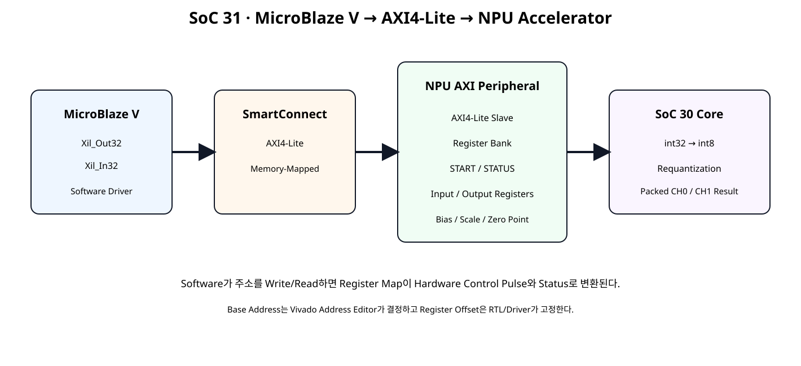
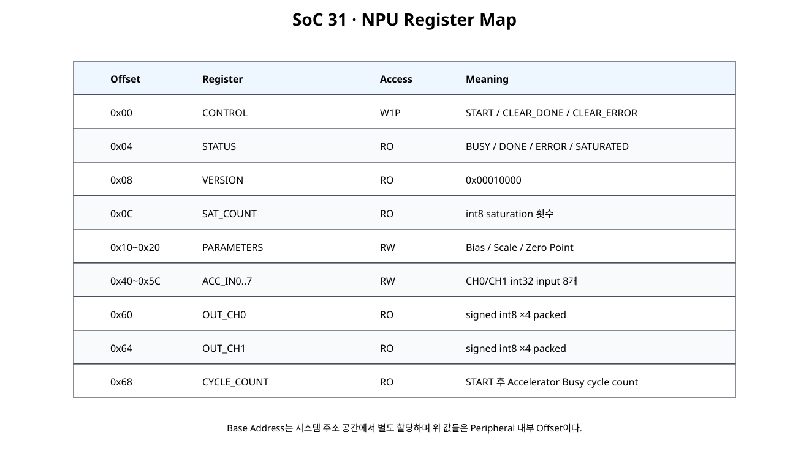
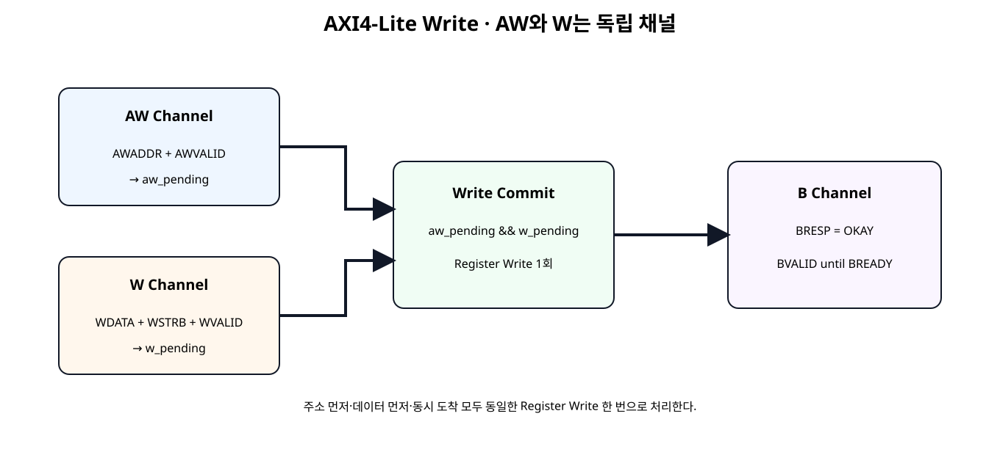
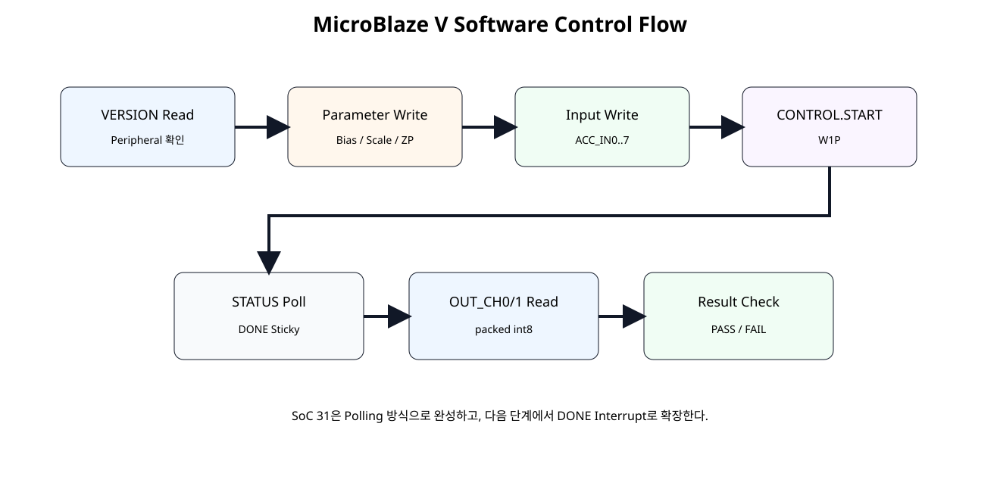

# NPU Register Map · MicroBlaze V Control · AXI4-Lite Integration


## 전체 학습 위치


## 이번 장의 목표


[](../images/soc31/soc31_architecture.svg)

MicroBlaze V가 Register Read/Write만으로 NPU Accelerator를 시작하고 결과를 읽는다.


## NPU를 Peripheral로 본다

MicroBlaze V 입장에서는 NPU 내부의 Multiplier, Pipeline, Requantization 구조를 직접 알 필요가 없다. Processor는 주소가 할당된 Register만 읽고 쓴다.


## 전체 Architecture


[](../images/soc31/soc31_architecture.svg)

SmartConnect가 MicroBlaze V AXI Master와 NPU AXI4-Lite Slave를 연결한다.


## Register Map이 필요한 이유

Register Map은 Software와 Hardware가 공유하는 고정 계약이다. Offset, Bit 의미, Read/Write 속성이 한번 정해지면 RTL과 C Driver가 같은 정의를 사용해야 한다.


## Register Map 전체


[](../images/soc31/soc31_register_map.svg)

Base Address와 별개로 Peripheral 내부 Offset 0x00~0x68을 고정한다.


| Offset | Register | Access | 역할 |
| --- | --- | --- | --- |
| 0x00 | CONTROL | W1P | START / CLEAR_DONE / CLEAR_ERROR |
| 0x04 | STATUS | RO | BUSY / DONE / ERROR / SATURATED |
| 0x08 | VERSION | RO | 0x00010000 |
| 0x0C | SAT_COUNT | RO | Saturation 횟수 |
| 0x10~0x20 | PARAMETERS | RW | Bias / Multiplier / Shift / Zero Point |
| 0x40~0x5C | ACC_IN0..7 | RW | int32 Input 8개 |
| 0x60 | OUT_CH0 | RO | int8 ×4 Packed |
| 0x64 | OUT_CH1 | RO | int8 ×4 Packed |
| 0x68 | CYCLE_COUNT | RO | Operation Cycle Count |


## CONTROL


```text
bit0 START        → write 1 → one-clock pulse
bit1 CLEAR_DONE   → write 1 → DONE sticky clear
bit2 CLEAR_ERROR  → write 1 → ERROR sticky clear
```

이런 Register를 여기서는 W1P(Write-One-Pulse, 1을 쓰면 Pulse 발생)로 사용한다. Register 값 자체를 계속 1로 보관하지 않는다.


## STATUS Sticky Bit


```text
bit0 BUSY          → Accelerator 실시간 상태
bit1 DONE_STICKY   → 완료 후 Software Clear 전까지 1
bit2 ERROR_STICKY  → 오류 발생 후 Software Clear 전까지 1
bit3 SATURATED_ANY → SAT_COUNT != 0
```

DONE을 1 Clock Pulse만 제공하면 Software Polling이 놓칠 수 있으므로 Register Interface에서는 Sticky 상태로 변환한다.


## VERSION

VERSION = 0x00010000을 두어 Software가 예상하는 Peripheral Revision인지 먼저 확인한다. 이후 Register Map이 변경되면 Version 관리가 가능하다.


## Parameter Registers


```text
0x10 BIAS_CH0
0x14 BIAS_CH1
0x18 SCALE_CH0 → multiplier[15:0] + shift[21:16]
0x1C SCALE_CH1 → multiplier[15:0] + shift[21:16]
0x20 ZERO_POINT → CH0[15:0] + CH1[31:16]
```


## Input / Output Registers

SoC 31에서는 SoC 29의 8개 int32 결과를 Register Buffer로 입력한다. 이는 AXI Register Control을 집중적으로 배우기 위한 작은 Input Buffer다.


```text
ACC_IN0..3 → CH0 sample0..3
ACC_IN4..7 → CH1 sample0..3
OUT_CH0    → signed int8 ×4
OUT_CH1    → signed int8 ×4
```


## Base Address와 Offset

Register Offset은 RTL에서 고정하지만 Base Address는 Vivado Address Editor가 시스템 주소 공간에 할당한다.


## AXI4-Lite 5개 채널


| Channel | 핵심 신호 | 역할 |
| --- | --- | --- |
| AW | AWADDR / AWVALID / AWREADY | Write Address |
| W | WDATA / WSTRB / WVALID / WREADY | Write Data |
| B | BRESP / BVALID / BREADY | Write Response |
| AR | ARADDR / ARVALID / ARREADY | Read Address |
| R | RDATA / RRESP / RVALID / RREADY | Read Data |


## AW / W 독립성


[](../images/soc31/soc31_axi_write_channels.svg)

Write Address와 Write Data를 각각 저장한 뒤 둘 다 확보됐을 때 Write를 Commit한다.


## Write Commit

따라서 AW가 먼저 오거나 W가 먼저 와도 동일하게 동작한다.


## WSTRB

WSTRB[0]은 WDATA[7:0], WSTRB[1]은 WDATA[15:8]처럼 각 Byte Lane의 유효 여부를 나타낸다. RW Register는 apply_wstrb32()로 Byte Partial Write를 지원한다.


## Read Channel

SoC 31은 Side Effect가 없는 Register Read를 사용하고 한 번에 한 Read Transaction만 Outstanding으로 둔다.


## Register Bank RTL


```verilog
module npu_register_bank (
    input  wire               clk,
    input  wire               resetn,

    // Register-write interface from AXI4-Lite shell.
    input  wire               wr_en_i,
    input  wire [7:0]         wr_addr_i,
    input  wire [31:0]        wr_data_i,
    input  wire [3:0]         wr_strb_i,

    // Register-read interface from AXI4-Lite shell.
    input  wire [7:0]         rd_addr_i,
    output reg  [31:0]        rd_data_o,

    // Optional debug/status outputs.
    output wire               accel_busy_o,
    output wire               accel_done_sticky_o,
    output wire               accel_error_sticky_o,
    output wire [7:0]         saturation_count_o
);

// ------------------------------------------------------------
// SoC 31 NPU Register Map
// ------------------------------------------------------------
//
// 0x00 CONTROL      RW/W1P
//      bit 0 START        : write 1 -> one-clock start pulse
//      bit 1 CLEAR_DONE   : write 1 -> clear DONE sticky
//      bit 2 CLEAR_ERROR  : write 1 -> clear ERROR sticky
//
// 0x04 STATUS       RO
//      bit 0 BUSY
//      bit 1 DONE_STICKY
//      bit 2 ERROR_STICKY
//      bit 3 SATURATED_ANY
//
// 0x08 VERSION      RO = 0x0001_0000
// 0x0C SAT_COUNT    RO
//
// 0x10 BIAS_CH0     RW signed int32
// 0x14 BIAS_CH1     RW signed int32
//
// 0x18 SCALE_CH0    RW
//      [15:0]  signed multiplier
//      [21:16] unsigned right shift
//
// 0x1C SCALE_CH1    RW
//      [15:0]  signed multiplier
//      [21:16] unsigned right shift
//
// 0x20 ZERO_POINT   RW
//      [15:0]  signed zp_ch0
//      [31:16] signed zp_ch1
//
// 0x40..0x5C ACC_IN[0..7] RW signed int32
//      0..3 -> CH0 sample0..3
//      4..7 -> CH1 sample0..3
//
// 0x60 OUT_CH0      RO four packed signed int8 values
// 0x64 OUT_CH1      RO four packed signed int8 values
// 0x68 CYCLE_COUNT  RO cycles from accepted START to accelerator DONE
//
// START while BUSY is rejected and sets ERROR_STICKY.
//
// Register bank and accelerator share one clock domain in SoC 31.

localparam [31:0] VERSION_VALUE = 32'h0001_0000;

// ------------------------------------------------------------
// Byte-write helper.
// ------------------------------------------------------------
function [31:0] apply_wstrb32;
    input [31:0] old_value;
    input [31:0] new_value;
    input [3:0]  strb;

    integer byte_index;

    begin
        apply_wstrb32 = old_value;

        for (
            byte_index = 0;
            byte_index < 4;
            byte_index = byte_index + 1
        ) begin
            if (strb[byte_index]) begin
                apply_wstrb32[
                    (byte_index * 8) +: 8
                ] =
                    new_value[
                        (byte_index * 8) +: 8
                    ];
            end
        end
    end
endfunction

// ------------------------------------------------------------
// Software-visible configuration registers.
// ------------------------------------------------------------
reg signed [31:0] bias_ch0_q;
reg signed [31:0] bias_ch1_q;

reg signed [15:0] mult_ch0_q;
reg signed [15:0] mult_ch1_q;

reg [5:0] shift_ch0_q;
reg [5:0] shift_ch1_q;

reg signed [15:0] zp_ch0_q;
reg signed [15:0] zp_ch1_q;

reg signed [31:0] acc_in_q [0:7];

// ------------------------------------------------------------
// Accelerator control/status.
// ------------------------------------------------------------
reg start_pulse_q;
reg done_sticky_q;
reg error_sticky_q;

wire accel_busy_w;
wire accel_done_w;
wire accel_result_valid_w;

wire [31:0] q_ch0_batch_w;
wire [31:0] q_ch1_batch_w;

wire [7:0] saturation_count_w;

reg [31:0] cycle_count_q;

wire control_write_w;

assign control_write_w =
    wr_en_i &&
    (wr_addr_i[7:2] == 6'h00);

wire start_request_w;

assign start_request_w =
    control_write_w &&
    wr_strb_i[0] &&
    wr_data_i[0];

wire clear_done_request_w;

assign clear_done_request_w =
    control_write_w &&
    wr_strb_i[0] &&
    wr_data_i[1];

wire clear_error_request_w;

assign clear_error_request_w =
    control_write_w &&
    wr_strb_i[0] &&
    wr_data_i[2];

assign accel_busy_o =
    accel_busy_w;

assign accel_done_sticky_o =
    done_sticky_q;

assign accel_error_sticky_o =
    error_sticky_q;

assign saturation_count_o =
    saturation_count_w;

// ------------------------------------------------------------
// Requantization accelerator from SoC 30.
// ------------------------------------------------------------
wire [127:0] acc_ch0_batch_w;
wire [127:0] acc_ch1_batch_w;

assign acc_ch0_batch_w = {
    acc_in_q[3],
    acc_in_q[2],
    acc_in_q[1],
    acc_in_q[0]
};

assign acc_ch1_batch_w = {
    acc_in_q[7],
    acc_in_q[6],
    acc_in_q[5],
    acc_in_q[4]
};

requantize_batch2x4_serial u_accelerator (
    .clk(clk),
    .resetn(resetn),

    .start_i(start_pulse_q),

    .acc_ch0_batch_i(acc_ch0_batch_w),
    .acc_ch1_batch_i(acc_ch1_batch_w),

    .bias_ch0_i(bias_ch0_q),
    .bias_ch1_i(bias_ch1_q),

    .mult_ch0_i(mult_ch0_q),
    .mult_ch1_i(mult_ch1_q),

    .shift_ch0_i(shift_ch0_q),
    .shift_ch1_i(shift_ch1_q),

    .zp_ch0_i(zp_ch0_q),
    .zp_ch1_i(zp_ch1_q),

    .busy_o(accel_busy_w),
    .done_o(accel_done_w),
    .result_valid_o(accel_result_valid_w),

    .q_ch0_batch_o(q_ch0_batch_w),
    .q_ch1_batch_o(q_ch1_batch_w),

    .saturation_count_o(saturation_count_w)
);

// ------------------------------------------------------------
// Register write/control process.
// ------------------------------------------------------------
integer i;

reg [31:0] merged_w;

always @(posedge clk) begin
    if (!resetn) begin
        bias_ch0_q <= 32'sd0;
        bias_ch1_q <= 32'sd0;

        mult_ch0_q <= 16'sd1;
        mult_ch1_q <= 16'sd1;

        shift_ch0_q <= 6'd0;
        shift_ch1_q <= 6'd0;

        zp_ch0_q <= 16'sd0;
        zp_ch1_q <= 16'sd0;

        for (i = 0; i < 8; i = i + 1) begin
            acc_in_q[i] <= 32'sd0;
        end

        start_pulse_q  <= 1'b0;
        done_sticky_q  <= 1'b0;
        error_sticky_q <= 1'b0;

        cycle_count_q <= 32'd0;
    end else begin
        // W1P behavior: pulse returns low automatically.
        start_pulse_q <= 1'b0;

        // Sticky status clear requests.
        if (clear_done_request_w) begin
            done_sticky_q <= 1'b0;
        end

        if (clear_error_request_w) begin
            error_sticky_q <= 1'b0;
        end

        // Accelerator completion wins after clear in the same clock.
        if (accel_done_w) begin
            done_sticky_q <= 1'b1;
        end

        // START:
        // - accepted only while idle
        // - clears previous DONE
        // - START while BUSY becomes sticky error
        if (start_request_w) begin
            if (accel_busy_w) begin
                error_sticky_q <= 1'b1;
            end else begin
                start_pulse_q <= 1'b1;
                done_sticky_q <= 1'b0;
                cycle_count_q <= 32'd0;
            end
        end

        if (accel_busy_w) begin
            cycle_count_q <= cycle_count_q + 32'd1;
        end

        // Configuration/input writes.
        if (wr_en_i) begin
            case (wr_addr_i[7:2])
                6'h04: begin
                    merged_w = apply_wstrb32(
                        bias_ch0_q,
                        wr_data_i,
                        wr_strb_i
                    );
                    bias_ch0_q <= $signed(merged_w);
                end

                6'h05: begin
                    merged_w = apply_wstrb32(
                        bias_ch1_q,
                        wr_data_i,
                        wr_strb_i
                    );
                    bias_ch1_q <= $signed(merged_w);
                end

                6'h06: begin
                    merged_w = apply_wstrb32(
                        {
                            10'd0,
                            shift_ch0_q,
                            mult_ch0_q
                        },
                        wr_data_i,
                        wr_strb_i
                    );

                    mult_ch0_q <=
                        $signed(merged_w[15:0]);

                    shift_ch0_q <=
                        merged_w[21:16];
                end

                6'h07: begin
                    merged_w = apply_wstrb32(
                        {
                            10'd0,
                            shift_ch1_q,
                            mult_ch1_q
                        },
                        wr_data_i,
                        wr_strb_i
                    );

                    mult_ch1_q <=
                        $signed(merged_w[15:0]);

                    shift_ch1_q <=
                        merged_w[21:16];
                end

                6'h08: begin
                    merged_w = apply_wstrb32(
                        {
                            zp_ch1_q,
                            zp_ch0_q
                        },
                        wr_data_i,
                        wr_strb_i
                    );

                    zp_ch0_q <=
                        $signed(merged_w[15:0]);

                    zp_ch1_q <=
                        $signed(merged_w[31:16]);
                end

                6'h10: begin
                    merged_w = apply_wstrb32(
                        acc_in_q[0],
                        wr_data_i,
                        wr_strb_i
                    );
                    acc_in_q[0] <= $signed(merged_w);
                end

                6'h11: begin
                    merged_w = apply_wstrb32(
                        acc_in_q[1],
                        wr_data_i,
                        wr_strb_i
                    );
                    acc_in_q[1] <= $signed(merged_w);
                end

                6'h12: begin
                    merged_w = apply_wstrb32(
                        acc_in_q[2],
                        wr_data_i,
                        wr_strb_i
                    );
                    acc_in_q[2] <= $signed(merged_w);
                end

                6'h13: begin
                    merged_w = apply_wstrb32(
                        acc_in_q[3],
                        wr_data_i,
                        wr_strb_i
                    );
                    acc_in_q[3] <= $signed(merged_w);
                end

                6'h14: begin
                    merged_w = apply_wstrb32(
                        acc_in_q[4],
                        wr_data_i,
                        wr_strb_i
                    );
                    acc_in_q[4] <= $signed(merged_w);
                end

                6'h15: begin
                    merged_w = apply_wstrb32(
                        acc_in_q[5],
                        wr_data_i,
                        wr_strb_i
                    );
                    acc_in_q[5] <= $signed(merged_w);
                end

                6'h16: begin
                    merged_w = apply_wstrb32(
                        acc_in_q[6],
                        wr_data_i,
                        wr_strb_i
                    );
                    acc_in_q[6] <= $signed(merged_w);
                end

                6'h17: begin
                    merged_w = apply_wstrb32(
                        acc_in_q[7],
                        wr_data_i,
                        wr_strb_i
                    );
                    acc_in_q[7] <= $signed(merged_w);
                end

                default: begin
                end
            endcase
        end
    end
end

// ------------------------------------------------------------
// Register read mux.
// ------------------------------------------------------------
always @(*) begin
    case (rd_addr_i[7:2])
        6'h00: rd_data_o = 32'h0000_0000;

        6'h01: rd_data_o = {
            28'd0,
            (saturation_count_w != 8'd0),
            error_sticky_q,
            done_sticky_q,
            accel_busy_w
        };

        6'h02: rd_data_o = VERSION_VALUE;

        6'h03: rd_data_o = {
            24'd0,
            saturation_count_w
        };

        6'h04: rd_data_o = bias_ch0_q;
        6'h05: rd_data_o = bias_ch1_q;

        6'h06: rd_data_o = {
            10'd0,
            shift_ch0_q,
            mult_ch0_q
        };

        6'h07: rd_data_o = {
            10'd0,
            shift_ch1_q,
            mult_ch1_q
        };

        6'h08: rd_data_o = {
            zp_ch1_q,
            zp_ch0_q
        };

        6'h10: rd_data_o = acc_in_q[0];
        6'h11: rd_data_o = acc_in_q[1];
        6'h12: rd_data_o = acc_in_q[2];
        6'h13: rd_data_o = acc_in_q[3];

        6'h14: rd_data_o = acc_in_q[4];
        6'h15: rd_data_o = acc_in_q[5];
        6'h16: rd_data_o = acc_in_q[6];
        6'h17: rd_data_o = acc_in_q[7];

        6'h18: rd_data_o = q_ch0_batch_w;
        6'h19: rd_data_o = q_ch1_batch_w;
        6'h1A: rd_data_o = cycle_count_q;

        default: rd_data_o = 32'h0000_0000;
    endcase
end

endmodule
```


## AXI4-Lite Slave RTL


```verilog
module npu_axi4lite_slave #(
    parameter integer C_S_AXI_ADDR_WIDTH = 8,
    parameter integer C_S_AXI_DATA_WIDTH = 32
) (
    input  wire                            s_axi_aclk,
    input  wire                            s_axi_aresetn,

    input  wire [C_S_AXI_ADDR_WIDTH-1:0]   s_axi_awaddr,
    input  wire                            s_axi_awvalid,
    output wire                            s_axi_awready,

    input  wire [C_S_AXI_DATA_WIDTH-1:0]   s_axi_wdata,
    input  wire [(C_S_AXI_DATA_WIDTH/8)-1:0] s_axi_wstrb,
    input  wire                            s_axi_wvalid,
    output wire                            s_axi_wready,

    output wire [1:0]                      s_axi_bresp,
    output reg                             s_axi_bvalid,
    input  wire                            s_axi_bready,

    input  wire [C_S_AXI_ADDR_WIDTH-1:0]   s_axi_araddr,
    input  wire                            s_axi_arvalid,
    output wire                            s_axi_arready,

    output reg  [C_S_AXI_DATA_WIDTH-1:0]   s_axi_rdata,
    output wire [1:0]                      s_axi_rresp,
    output reg                             s_axi_rvalid,
    input  wire                            s_axi_rready,

    output wire                            accel_busy_o,
    output wire                            accel_done_sticky_o,
    output wire                            accel_error_sticky_o,
    output wire [7:0]                      saturation_count_o
);

// AXI4-Lite control/status shell.
//
// Important implementation point:
// AXI write-address (AW) and write-data (W) are independent channels.
// The slave therefore captures them independently and commits a register
// write only after both are present.
//
// One write transaction and one read transaction may be outstanding.
// BRESP/RRESP are OKAY in this introductory register peripheral.

reg                            aw_pending_q;
reg [C_S_AXI_ADDR_WIDTH-1:0]   awaddr_q;

reg                            w_pending_q;
reg [C_S_AXI_DATA_WIDTH-1:0]   wdata_q;
reg [(C_S_AXI_DATA_WIDTH/8)-1:0] wstrb_q;

assign s_axi_awready =
    !aw_pending_q &&
    !s_axi_bvalid;

assign s_axi_wready =
    !w_pending_q &&
    !s_axi_bvalid;

assign s_axi_bresp =
    2'b00;

wire aw_handshake_w;
wire w_handshake_w;

assign aw_handshake_w =
    s_axi_awvalid &&
    s_axi_awready;

assign w_handshake_w =
    s_axi_wvalid &&
    s_axi_wready;

wire register_write_fire_w;

assign register_write_fire_w =
    aw_pending_q &&
    w_pending_q &&
    !s_axi_bvalid;

reg register_wr_en_q;

wire [31:0] register_rd_data_w;

npu_register_bank u_register_bank (
    .clk(s_axi_aclk),
    .resetn(s_axi_aresetn),

    .wr_en_i(register_wr_en_q),
    .wr_addr_i(awaddr_q[7:0]),
    .wr_data_i(wdata_q),
    .wr_strb_i(wstrb_q),

    .rd_addr_i(s_axi_araddr[7:0]),
    .rd_data_o(register_rd_data_w),

    .accel_busy_o(accel_busy_o),
    .accel_done_sticky_o(accel_done_sticky_o),
    .accel_error_sticky_o(accel_error_sticky_o),
    .saturation_count_o(saturation_count_o)
);

// ------------------------------------------------------------
// Write channels.
// ------------------------------------------------------------
always @(posedge s_axi_aclk) begin
    if (!s_axi_aresetn) begin
        aw_pending_q    <= 1'b0;
        awaddr_q        <= {C_S_AXI_ADDR_WIDTH{1'b0}};

        w_pending_q     <= 1'b0;
        wdata_q         <= {C_S_AXI_DATA_WIDTH{1'b0}};
        wstrb_q         <= {(C_S_AXI_DATA_WIDTH/8){1'b0}};

        register_wr_en_q<= 1'b0;

        s_axi_bvalid    <= 1'b0;
    end else begin
        register_wr_en_q <= 1'b0;

        if (aw_handshake_w) begin
            aw_pending_q <= 1'b1;
            awaddr_q     <= s_axi_awaddr;
        end

        if (w_handshake_w) begin
            w_pending_q <= 1'b1;
            wdata_q     <= s_axi_wdata;
            wstrb_q     <= s_axi_wstrb;
        end

        if (register_write_fire_w) begin
            register_wr_en_q <= 1'b1;

            aw_pending_q <= 1'b0;
            w_pending_q  <= 1'b0;

            s_axi_bvalid <= 1'b1;
        end

        if (
            s_axi_bvalid &&
            s_axi_bready
        ) begin
            s_axi_bvalid <= 1'b0;
        end
    end
end

// ------------------------------------------------------------
// Read channel.
// ------------------------------------------------------------
assign s_axi_arready =
    !s_axi_rvalid;

assign s_axi_rresp =
    2'b00;

wire ar_handshake_w;

assign ar_handshake_w =
    s_axi_arvalid &&
    s_axi_arready;

always @(posedge s_axi_aclk) begin
    if (!s_axi_aresetn) begin
        s_axi_rdata  <= {C_S_AXI_DATA_WIDTH{1'b0}};
        s_axi_rvalid <= 1'b0;
    end else begin
        if (ar_handshake_w) begin
            s_axi_rdata  <= register_rd_data_w;
            s_axi_rvalid <= 1'b1;
        end

        if (
            s_axi_rvalid &&
            s_axi_rready
        ) begin
            s_axi_rvalid <= 1'b0;
        end
    end
end

endmodule
```


## Module Reference Top


```verilog
module npu_axi_accel_ip (
    (* X_INTERFACE_INFO = "xilinx.com:signal:clock:1.0 s_axi_aclk CLK" *)
    (* X_INTERFACE_PARAMETER = "XIL_INTERFACENAME s_axi_aclk, ASSOCIATED_BUSIF S_AXI, ASSOCIATED_RESET s_axi_aresetn" *)
    input  wire        s_axi_aclk,

    (* X_INTERFACE_INFO = "xilinx.com:signal:reset:1.0 s_axi_aresetn RST" *)
    (* X_INTERFACE_PARAMETER = "XIL_INTERFACENAME s_axi_aresetn, POLARITY ACTIVE_LOW" *)
    input  wire        s_axi_aresetn,

    (* X_INTERFACE_INFO = "xilinx.com:interface:aximm:1.0 S_AXI AWADDR" *)
    input  wire [7:0]  s_axi_awaddr,
    (* X_INTERFACE_INFO = "xilinx.com:interface:aximm:1.0 S_AXI AWVALID" *)
    input  wire        s_axi_awvalid,
    (* X_INTERFACE_INFO = "xilinx.com:interface:aximm:1.0 S_AXI AWREADY" *)
    output wire        s_axi_awready,

    (* X_INTERFACE_INFO = "xilinx.com:interface:aximm:1.0 S_AXI WDATA" *)
    input  wire [31:0] s_axi_wdata,
    (* X_INTERFACE_INFO = "xilinx.com:interface:aximm:1.0 S_AXI WSTRB" *)
    input  wire [3:0]  s_axi_wstrb,
    (* X_INTERFACE_INFO = "xilinx.com:interface:aximm:1.0 S_AXI WVALID" *)
    input  wire        s_axi_wvalid,
    (* X_INTERFACE_INFO = "xilinx.com:interface:aximm:1.0 S_AXI WREADY" *)
    output wire        s_axi_wready,

    (* X_INTERFACE_INFO = "xilinx.com:interface:aximm:1.0 S_AXI BRESP" *)
    output wire [1:0]  s_axi_bresp,
    (* X_INTERFACE_INFO = "xilinx.com:interface:aximm:1.0 S_AXI BVALID" *)
    output wire        s_axi_bvalid,
    (* X_INTERFACE_INFO = "xilinx.com:interface:aximm:1.0 S_AXI BREADY" *)
    input  wire        s_axi_bready,

    (* X_INTERFACE_INFO = "xilinx.com:interface:aximm:1.0 S_AXI ARADDR" *)
    input  wire [7:0]  s_axi_araddr,
    (* X_INTERFACE_INFO = "xilinx.com:interface:aximm:1.0 S_AXI ARVALID" *)
    input  wire        s_axi_arvalid,
    (* X_INTERFACE_INFO = "xilinx.com:interface:aximm:1.0 S_AXI ARREADY" *)
    output wire        s_axi_arready,

    (* X_INTERFACE_INFO = "xilinx.com:interface:aximm:1.0 S_AXI RDATA" *)
    output wire [31:0] s_axi_rdata,
    (* X_INTERFACE_INFO = "xilinx.com:interface:aximm:1.0 S_AXI RRESP" *)
    output wire [1:0]  s_axi_rresp,
    (* X_INTERFACE_INFO = "xilinx.com:interface:aximm:1.0 S_AXI RVALID" *)
    output wire        s_axi_rvalid,
    (* X_INTERFACE_INFO = "xilinx.com:interface:aximm:1.0 S_AXI RREADY" *)
    input  wire        s_axi_rready
);

// Pure AXI Shell / Wrapper.
//
// Vivado can use this RTL as a Module Reference in Block Design.
// The functional register and accelerator logic remains in submodules.

wire       accel_busy;
wire       accel_done_sticky;
wire       accel_error_sticky;
wire [7:0] saturation_count;

npu_axi4lite_slave u_axi_slave (
    .s_axi_aclk(s_axi_aclk),
    .s_axi_aresetn(s_axi_aresetn),

    .s_axi_awaddr(s_axi_awaddr),
    .s_axi_awvalid(s_axi_awvalid),
    .s_axi_awready(s_axi_awready),

    .s_axi_wdata(s_axi_wdata),
    .s_axi_wstrb(s_axi_wstrb),
    .s_axi_wvalid(s_axi_wvalid),
    .s_axi_wready(s_axi_wready),

    .s_axi_bresp(s_axi_bresp),
    .s_axi_bvalid(s_axi_bvalid),
    .s_axi_bready(s_axi_bready),

    .s_axi_araddr(s_axi_araddr),
    .s_axi_arvalid(s_axi_arvalid),
    .s_axi_arready(s_axi_arready),

    .s_axi_rdata(s_axi_rdata),
    .s_axi_rresp(s_axi_rresp),
    .s_axi_rvalid(s_axi_rvalid),
    .s_axi_rready(s_axi_rready),

    .accel_busy_o(accel_busy),
    .accel_done_sticky_o(accel_done_sticky),
    .accel_error_sticky_o(accel_error_sticky),
    .saturation_count_o(saturation_count)
);

endmodule
```

Top은 AXI Port와 하위 Slave 연결만 담당한다. 기능 로직을 Top에 넣지 않는 기존 Shell/Wrapper 원칙을 유지한다.


## START Pulse

Software가 CONTROL bit0에 1을 쓰면 Register Bank 내부에서 start_pulse_q를 정확히 한 Clock만 High로 만든다. Software가 Register를 다시 0으로 쓰는 절차는 필요하지 않다.


## START while BUSY

Accelerator가 BUSY일 때 다시 START를 쓰면 명령은 무시하고 ERROR_STICKY를 1로 만든다. Software가 잘못된 재시작을 감지할 수 있다.


## Cycle Counter

START를 수락할 때 0으로 초기화하고 BUSY 동안 증가한다. 이번 단계에서는 고정 성능 기준값으로 판정하지 않고 Software가 Accelerator Latency를 관찰하는 Status Register로 사용한다.


## SoC30 Core 재사용

requantize_s32_to_s8.v와 requantize_batch2x4_serial.v는 SoC 30 파일을 수정 없이 재사용한다. SoC 31의 변경점은 계산 회로가 아니라 제어/주소 경계다.


## MicroBlaze V Driver


```c
#ifndef NPU_ACCEL_H
#define NPU_ACCEL_H

#include "xil_io.h"
#include "xil_types.h"

// ------------------------------------------------------------
// SoC 31 NPU AXI4-Lite Register Map
// ------------------------------------------------------------
#define NPU_CONTROL_OFFSET       0x00U
#define NPU_STATUS_OFFSET        0x04U
#define NPU_VERSION_OFFSET       0x08U
#define NPU_SAT_COUNT_OFFSET     0x0CU

#define NPU_BIAS_CH0_OFFSET      0x10U
#define NPU_BIAS_CH1_OFFSET      0x14U
#define NPU_SCALE_CH0_OFFSET     0x18U
#define NPU_SCALE_CH1_OFFSET     0x1CU
#define NPU_ZERO_POINT_OFFSET    0x20U

#define NPU_ACC_IN0_OFFSET       0x40U
#define NPU_ACC_IN1_OFFSET       0x44U
#define NPU_ACC_IN2_OFFSET       0x48U
#define NPU_ACC_IN3_OFFSET       0x4CU
#define NPU_ACC_IN4_OFFSET       0x50U
#define NPU_ACC_IN5_OFFSET       0x54U
#define NPU_ACC_IN6_OFFSET       0x58U
#define NPU_ACC_IN7_OFFSET       0x5CU

#define NPU_OUT_CH0_OFFSET       0x60U
#define NPU_OUT_CH1_OFFSET       0x64U
#define NPU_CYCLE_COUNT_OFFSET   0x68U

#define NPU_CONTROL_START_MASK       0x00000001U
#define NPU_CONTROL_CLEAR_DONE_MASK  0x00000002U
#define NPU_CONTROL_CLEAR_ERROR_MASK 0x00000004U

#define NPU_STATUS_BUSY_MASK         0x00000001U
#define NPU_STATUS_DONE_MASK         0x00000002U
#define NPU_STATUS_ERROR_MASK        0x00000004U
#define NPU_STATUS_SATURATED_MASK    0x00000008U

#define NPU_VERSION_EXPECTED         0x00010000U

static inline void Npu_WriteReg(
    UINTPTR BaseAddress,
    u32 Offset,
    u32 Value
)
{
    Xil_Out32(BaseAddress + (UINTPTR)Offset, Value);
}

static inline u32 Npu_ReadReg(
    UINTPTR BaseAddress,
    u32 Offset
)
{
    return Xil_In32(BaseAddress + (UINTPTR)Offset);
}

static inline u32 Npu_PackScale(
    s16 Multiplier,
    u8 Shift
)
{
    return
        ((u32)Multiplier & 0x0000FFFFU) |
        (((u32)Shift & 0x3FU) << 16U);
}

static inline u32 Npu_PackZeroPoint(
    s16 ZpCh0,
    s16 ZpCh1
)
{
    return
        ((u32)ZpCh0 & 0x0000FFFFU) |
        (((u32)ZpCh1 & 0x0000FFFFU) << 16U);
}

static inline void Npu_Start(UINTPTR BaseAddress)
{
    Npu_WriteReg(
        BaseAddress,
        NPU_CONTROL_OFFSET,
        NPU_CONTROL_START_MASK
    );
}

static inline void Npu_ClearDone(UINTPTR BaseAddress)
{
    Npu_WriteReg(
        BaseAddress,
        NPU_CONTROL_OFFSET,
        NPU_CONTROL_CLEAR_DONE_MASK
    );
}

static inline void Npu_ClearError(UINTPTR BaseAddress)
{
    Npu_WriteReg(
        BaseAddress,
        NPU_CONTROL_OFFSET,
        NPU_CONTROL_CLEAR_ERROR_MASK
    );
}

static inline u32 Npu_GetStatus(UINTPTR BaseAddress)
{
    return Npu_ReadReg(
        BaseAddress,
        NPU_STATUS_OFFSET
    );
}

static inline int Npu_IsBusy(UINTPTR BaseAddress)
{
    return
        (Npu_GetStatus(BaseAddress) & NPU_STATUS_BUSY_MASK)
        != 0U;
}

static inline int Npu_IsDone(UINTPTR BaseAddress)
{
    return
        (Npu_GetStatus(BaseAddress) & NPU_STATUS_DONE_MASK)
        != 0U;
}

#endif
```


## Xil_Out32 / Xil_In32

현재 AMD Embedded Software Driver들도 Base Address + Register Offset 형태로 Xil_Out32(), Xil_In32()를 사용한다. SoC 31 Driver도 동일한 최소 MMIO Pattern을 사용한다.


## MicroBlaze V Application


```c
#include "xil_printf.h"
#include "xparameters.h"

#include "npu_accel.h"

// Vivado Address Editor assigns the final base address.
// Classic BSP commonly exports XPAR_NPU_AXI_0_BASEADDR.
//
// If your generated name differs, replace NPU_BASEADDR below
// with the symbol from the generated xparameters.h.
//
// Example:
// #define NPU_BASEADDR XPAR_NPU_AXI_0_BASEADDR

#ifndef NPU_BASEADDR
#ifdef XPAR_NPU_AXI_0_BASEADDR
#define NPU_BASEADDR XPAR_NPU_AXI_0_BASEADDR
#else
#error "Define NPU_BASEADDR using the generated xparameters.h base address."
#endif
#endif

static void npu_write_demo_inputs(UINTPTR base)
{
    // SoC 29 board-demo int32 outputs.
    // CH0 = [16, 32, 48, 64]
    // CH1 = [32, 64, 96, 128]

    Npu_WriteReg(base, NPU_ACC_IN0_OFFSET, 16U);
    Npu_WriteReg(base, NPU_ACC_IN1_OFFSET, 32U);
    Npu_WriteReg(base, NPU_ACC_IN2_OFFSET, 48U);
    Npu_WriteReg(base, NPU_ACC_IN3_OFFSET, 64U);

    Npu_WriteReg(base, NPU_ACC_IN4_OFFSET, 32U);
    Npu_WriteReg(base, NPU_ACC_IN5_OFFSET, 64U);
    Npu_WriteReg(base, NPU_ACC_IN6_OFFSET, 96U);
    Npu_WriteReg(base, NPU_ACC_IN7_OFFSET, 128U);
}

static void npu_write_demo_parameters(UINTPTR base)
{
    // CH0:
    // q = round_away_from_zero(x / 2)
    Npu_WriteReg(base, NPU_BIAS_CH0_OFFSET, 0U);
    Npu_WriteReg(
        base,
        NPU_SCALE_CH0_OFFSET,
        Npu_PackScale(1, 1U)
    );

    // CH1:
    // q = round_away_from_zero((x + 4) * 3 / 2) - 3
    Npu_WriteReg(base, NPU_BIAS_CH1_OFFSET, 4U);
    Npu_WriteReg(
        base,
        NPU_SCALE_CH1_OFFSET,
        Npu_PackScale(3, 1U)
    );

    Npu_WriteReg(
        base,
        NPU_ZERO_POINT_OFFSET,
        Npu_PackZeroPoint(0, -3)
    );
}

int main(void)
{
    const UINTPTR base = (UINTPTR)NPU_BASEADDR;

    u32 version;
    u32 status;
    u32 out_ch0;
    u32 out_ch1;
    u32 sat_count;
    u32 cycle_count;
    u32 timeout;

    xil_printf("\r\nSoC31 NPU AXI4-Lite demo\r\n");

    version = Npu_ReadReg(
        base,
        NPU_VERSION_OFFSET
    );

    xil_printf(
        "VERSION = 0x%08x\r\n",
        (unsigned int)version
    );

    if (version != NPU_VERSION_EXPECTED) {
        xil_printf("ERROR: unexpected NPU version\r\n");
        return 1;
    }

    Npu_ClearDone(base);
    Npu_ClearError(base);

    npu_write_demo_inputs(base);
    npu_write_demo_parameters(base);

    Npu_Start(base);

    timeout = 1000000U;
    status = 0U;

    while (
        ((status & NPU_STATUS_DONE_MASK) == 0U) &&
        (timeout != 0U)
    ) {
        status = Npu_GetStatus(base);
        timeout--;
    }

    if (timeout == 0U) {
        xil_printf("ERROR: accelerator timeout\r\n");
        return 1;
    }

    if ((status & NPU_STATUS_ERROR_MASK) != 0U) {
        xil_printf("ERROR: accelerator status error\r\n");
        return 1;
    }

    out_ch0 = Npu_ReadReg(
        base,
        NPU_OUT_CH0_OFFSET
    );

    out_ch1 = Npu_ReadReg(
        base,
        NPU_OUT_CH1_OFFSET
    );

    sat_count = Npu_ReadReg(
        base,
        NPU_SAT_COUNT_OFFSET
    );

    cycle_count = Npu_ReadReg(
        base,
        NPU_CYCLE_COUNT_OFFSET
    );

    xil_printf(
        "OUT_CH0 = 0x%08x\r\n",
        (unsigned int)out_ch0
    );

    xil_printf(
        "OUT_CH1 = 0x%08x\r\n",
        (unsigned int)out_ch1
    );

    xil_printf(
        "SAT_COUNT = %u\r\n",
        (unsigned int)sat_count
    );

    xil_printf(
        "CYCLE_COUNT = %u\r\n",
        (unsigned int)cycle_count
    );

    // Expected from SoC 30:
    // CH0 [8,16,24,32]   -> 0x20181008
    // CH1 [51,99,127,127]-> 0x7F7F6333
    if (
        (out_ch0 != 0x20181008U) ||
        (out_ch1 != 0x7F7F6333U) ||
        ((sat_count & 0xFFU) != 2U)
    ) {
        xil_printf("SOC31 RESULT: FAIL\r\n");
        return 1;
    }

    xil_printf("SOC31 RESULT: PASS\r\n");

    return 0;
}
```

Polling에는 Timeout을 두어 Hardware 연결 오류가 있을 때 무한 Loop에 빠지지 않도록 했다.


## Software Control Flow


[](../images/soc31/soc31_software_flow.svg)

VERSION → Parameter/Input → START → DONE Poll → Result Read 순서다.


## Address Editor

Vivado Block Design에서 NPU Slave를 SmartConnect에 연결한 뒤 Address Editor에서 주소 공간을 할당한다. 실제 Base Address Symbol은 Vitis/BSP가 생성한 xparameters.h를 확인한다.


```text
MicroBlaze V M_AXI
  ↓
SmartConnect
  ↓
npu_axi_accel_ip/S_AXI
  ↓
Address Editor
  ↓
xparameters.h Base Address
```


## Expected Result


```text
OUT_CH0 = 0x20181008
OUT_CH1 = 0x7F7F6333
SAT_COUNT = 2
CYCLE_COUNT = non-zero
```

이는 SoC 30에서 검증한 동일 Requantization Demo를 AXI Register 경유로 실행한 결과다.


## AXI Self-Checking Test


```verilog
`timescale 1ns / 1ps

module tb_npu_axi4lite_slave;

logic clk = 1'b0;
logic resetn = 1'b0;

logic [7:0]  awaddr = 8'h00;
logic        awvalid = 1'b0;
wire         awready;

logic [31:0] wdata = 32'h0000_0000;
logic [3:0]  wstrb = 4'h0;
logic        wvalid = 1'b0;
wire         wready;

wire [1:0]   bresp;
wire         bvalid;
logic        bready = 1'b1;

logic [7:0]  araddr = 8'h00;
logic        arvalid = 1'b0;
wire         arready;

wire [31:0]  rdata;
wire [1:0]   rresp;
wire         rvalid;
logic        rready = 1'b1;

wire accel_busy;
wire accel_done_sticky;
wire accel_error_sticky;
wire [7:0] saturation_count;

integer error_count = 0;
integer check_count = 0;

always #5 clk = ~clk;

npu_axi4lite_slave dut (
    .s_axi_aclk(clk),
    .s_axi_aresetn(resetn),

    .s_axi_awaddr(awaddr),
    .s_axi_awvalid(awvalid),
    .s_axi_awready(awready),

    .s_axi_wdata(wdata),
    .s_axi_wstrb(wstrb),
    .s_axi_wvalid(wvalid),
    .s_axi_wready(wready),

    .s_axi_bresp(bresp),
    .s_axi_bvalid(bvalid),
    .s_axi_bready(bready),

    .s_axi_araddr(araddr),
    .s_axi_arvalid(arvalid),
    .s_axi_arready(arready),

    .s_axi_rdata(rdata),
    .s_axi_rresp(rresp),
    .s_axi_rvalid(rvalid),
    .s_axi_rready(rready),

    .accel_busy_o(accel_busy),
    .accel_done_sticky_o(accel_done_sticky),
    .accel_error_sticky_o(accel_error_sticky),
    .saturation_count_o(saturation_count)
);

task automatic check_true(
    input string name,
    input bit condition
);
    begin
        check_count = check_count + 1;

        if (!condition) begin
            error_count = error_count + 1;
            $error("CHECK FAIL: %s", name);
        end else begin
            $display("CHECK PASS: %s", name);
        end
    end
endtask

task automatic check_eq32(
    input string name,
    input logic [31:0] actual,
    input logic [31:0] expected
);
    begin
        check_count = check_count + 1;

        if (actual !== expected) begin
            error_count = error_count + 1;

            $error(
                "CHECK FAIL: %s actual=0x%08h expected=0x%08h",
                name,
                actual,
                expected
            );
        end else begin
            $display(
                "CHECK PASS: %s = 0x%08h",
                name,
                actual
            );
        end
    end
endtask

// order:
//   0 = AW and W together
//   1 = AW first, W later
//   2 = W first, AW later
task automatic axi_write(
    input [7:0] address,
    input [31:0] data,
    input [3:0] strobe,
    input integer order
);
    bit aw_done;
    bit w_done;
    integer timeout;

    begin
        aw_done = 0;
        w_done = 0;

        @(negedge clk);

        awaddr = address;
        wdata = data;
        wstrb = strobe;

        case (order)
            0: begin
                awvalid = 1'b1;
                wvalid = 1'b1;
            end

            1: begin
                awvalid = 1'b1;
                wvalid = 1'b0;
            end

            default: begin
                awvalid = 1'b0;
                wvalid = 1'b1;
            end
        endcase

        timeout = 0;

        while (!(aw_done && w_done)) begin
            @(posedge clk);
            // (변경) READY가 갱신되기 전 상승 에지의 handshake를 관측한다.

            if (
                awvalid &&
                awready
            ) begin
                aw_done = 1;
            end

            if (
                wvalid &&
                wready
            ) begin
                w_done = 1;
            end

            @(negedge clk);

            if (aw_done) begin
                awvalid = 1'b0;
            end

            if (w_done) begin
                wvalid = 1'b0;
            end

            if ((order == 1) && aw_done && !w_done) begin
                wvalid = 1'b1;
            end

            if ((order == 2) && w_done && !aw_done) begin
                awvalid = 1'b1;
            end

            timeout = timeout + 1;

            if (timeout > 30) begin
                $fatal(1, "AXI write handshake timeout");
            end
        end

        timeout = 0;

        while (!bvalid) begin
            @(posedge clk);
            #1;

            timeout = timeout + 1;

            if (timeout > 30) begin
                $fatal(1, "AXI BVALID timeout");
            end
        end

        check_true(
            "AXI BRESP OKAY",
            bresp == 2'b00
        );

        // Allow response handshake and register-side effect to settle.
        @(posedge clk);
        #1;
    end
endtask

task automatic axi_read(
    input [7:0] address,
    output [31:0] data
);
    integer timeout;

    begin
        @(negedge clk);

        araddr = address;
        arvalid = 1'b1;

        timeout = 0;

        while (!arready) begin
            @(posedge clk);
            #1;

            timeout = timeout + 1;

            if (timeout > 30) begin
                $fatal(1, "AXI ARREADY timeout");
            end
        end

        @(posedge clk);
        #1;

        // The read data may be returned immediately after this edge.
        if (!rvalid) begin
            timeout = 0;

            while (!rvalid) begin
                @(posedge clk);
                #1;

                timeout = timeout + 1;

                if (timeout > 30) begin
                    $fatal(1, "AXI RVALID timeout");
                end
            end
        end

        data = rdata;

        check_true(
            "AXI RRESP OKAY",
            rresp == 2'b00
        );

        @(negedge clk);
        arvalid = 1'b0;

        @(posedge clk);
        #1;
    end
endtask

task automatic wait_busy;
    reg [31:0] status;
    integer timeout;

    begin
        timeout = 0;
        status = 32'd0;

        while ((status & 32'h1) == 0) begin
            axi_read(8'h04, status);

            timeout = timeout + 1;

            if (timeout > 20) begin
                $fatal(1, "BUSY did not assert");
            end
        end
    end
endtask

task automatic wait_done;
    reg [31:0] status;
    integer timeout;

    begin
        timeout = 0;
        status = 32'd0;

        while ((status & 32'h2) == 0) begin
            axi_read(8'h04, status);

            timeout = timeout + 1;

            if (timeout > 50) begin
                $fatal(1, "DONE did not assert");
            end
        end
    end
endtask

initial begin
    reg [31:0] rd;

    repeat (5) @(posedge clk);
    resetn = 1'b1;

    // --------------------------------------------------------
    // 1. Basic RO map.
    // --------------------------------------------------------
    axi_read(8'h08, rd);
    check_eq32(
        "VERSION",
        rd,
        32'h0001_0000
    );

    // --------------------------------------------------------
    // 2. WSTRB partial-write test.
    //    Full write, then update only byte lane 1.
    // --------------------------------------------------------
    axi_write(
        8'h10,
        32'h1122_3344,
        4'b1111,
        0
    );

    axi_write(
        8'h10,
        32'h0000_AA00,
        4'b0010,
        1
    );

    axi_read(8'h10, rd);
    check_eq32(
        "WSTRB partial BIAS_CH0",
        rd,
        32'h1122_AA44
    );

    // --------------------------------------------------------
    // 3. Demo parameters.
    //    Exercise simultaneous, AW-first, W-first ordering.
    // --------------------------------------------------------
    axi_write(8'h10, 32'd0,         4'hF, 0);
    axi_write(8'h14, 32'd4,         4'hF, 1);
    axi_write(8'h18, 32'h0001_0001, 4'hF, 2);
    axi_write(8'h1C, 32'h0001_0003, 4'hF, 0);
    axi_write(8'h20, 32'hFFFD_0000, 4'hF, 1);

    axi_read(8'h18, rd);
    check_eq32("SCALE_CH0", rd, 32'h0001_0001);

    axi_read(8'h1C, rd);
    check_eq32("SCALE_CH1", rd, 32'h0001_0003);

    axi_read(8'h20, rd);
    check_eq32("ZERO_POINT", rd, 32'hFFFD_0000);

    // --------------------------------------------------------
    // 4. SoC29 int32 input registers.
    // --------------------------------------------------------
    axi_write(8'h40, 32'd16,  4'hF, 0);
    axi_write(8'h44, 32'd32,  4'hF, 1);
    axi_write(8'h48, 32'd48,  4'hF, 2);
    axi_write(8'h4C, 32'd64,  4'hF, 0);

    axi_write(8'h50, 32'd32,  4'hF, 1);
    axi_write(8'h54, 32'd64,  4'hF, 2);
    axi_write(8'h58, 32'd96,  4'hF, 0);
    axi_write(8'h5C, 32'd128, 4'hF, 1);

    // Clear sticky flags before run.
    axi_write(
        8'h00,
        32'h0000_0006,
        4'b0001,
        0
    );

    // --------------------------------------------------------
    // 5. START and BUSY.
    // --------------------------------------------------------
    axi_write(
        8'h00,
        32'h0000_0001,
        4'b0001,
        2
    );

    wait_busy();

    check_true(
        "debug BUSY output",
        accel_busy === 1'b1
    );

    // START while BUSY must be rejected and set ERROR sticky.
    axi_write(
        8'h00,
        32'h0000_0001,
        4'b0001,
        0
    );

    wait_done();

    // --------------------------------------------------------
    // 6. Status and result.
    // --------------------------------------------------------
    axi_read(8'h04, rd);

    check_true(
        "DONE sticky set",
        (rd & 32'h2) != 0
    );

    check_true(
        "ERROR sticky set by START while BUSY",
        (rd & 32'h4) != 0
    );

    check_true(
        "SATURATED_ANY set",
        (rd & 32'h8) != 0
    );

    axi_read(8'h0C, rd);
    check_eq32(
        "SAT_COUNT",
        rd,
        32'd2
    );

    axi_read(8'h60, rd);
    check_eq32(
        "OUT_CH0",
        rd,
        32'h2018_1008
    );

    axi_read(8'h64, rd);
    check_eq32(
        "OUT_CH1",
        rd,
        32'h7F7F_6333
    );

    axi_read(8'h68, rd);
    check_true(
        "CYCLE_COUNT non-zero",
        rd != 32'd0
    );

    // --------------------------------------------------------
    // 7. Clear sticky flags.
    // --------------------------------------------------------
    axi_write(
        8'h00,
        32'h0000_0006,
        4'b0001,
        1
    );

    axi_read(8'h04, rd);

    check_true(
        "DONE sticky cleared",
        (rd & 32'h2) == 0
    );

    check_true(
        "ERROR sticky cleared",
        (rd & 32'h4) == 0
    );

    $display("");
    $display("SOC31 CHECK COUNT : %0d", check_count);
    $display("SOC31 ERROR COUNT : %0d", error_count);

    if (error_count == 0) begin
        $display("SOC31 AXI4-LITE NPU REGISTER TEST: PASS");
    end else begin
        $fatal(
            1,
            "SOC31 AXI4-LITE NPU REGISTER TEST: FAIL (%0d errors)",
            error_count
        );
    end

    #20;
    $finish;
end

endmodule
```


## Protocol Test Cases


| Test | 목적 |
| --- | --- |
| AW + W 동시 | 일반 Write |
| AW 먼저 | Write Address/Data 독립성 |
| W 먼저 | 반대 순서 독립성 |
| WSTRB 0010 | Byte Lane Partial Write |
| START | W1P Pulse |
| START while BUSY | Error Sticky |
| CLEAR_DONE/ERROR | Sticky Clear |
| OUT Read | SoC30 결과 유지 |


## Python Register Reference


```text
Register map:
CONTROL      0x00
STATUS       0x04
VERSION      0x08
SAT_COUNT    0x0C
BIAS_CH0     0x10
BIAS_CH1     0x14
SCALE_CH0    0x18
SCALE_CH1    0x1C
ZERO_POINT   0x20
ACC_IN0      0x40
ACC_IN1      0x44
ACC_IN2      0x48
ACC_IN3      0x4C
ACC_IN4      0x50
ACC_IN5      0x54
ACC_IN6      0x58
ACC_IN7      0x5C
OUT_CH0      0x60
OUT_CH1      0x64
CYCLE_COUNT  0x68

WSTRB partial-write model: PASS
scale CH0 demo = 0x00010001
scale CH1 demo = 0x00010003
zero-point demo = 0xFFFD0000
expected OUT_CH0 = 0x20181008
expected OUT_CH1 = 0x7F7F6333
expected SAT_COUNT = 2
SOC31 PYTHON REGISTER-MAP REFERENCE: PASS
Spreadsheet runtime warmup failed during python startup
Traceback (most recent call last):
  File "/tmp/tmp.L2TH2Y5coc/artifact_tool_v2-2.8.22/artifact_tool/patches/warm_spreadsheet_runtime_on_startup.py", line 26, in warm_spreadsheet_runtime_on_startup
  File "/tmp/tmp.L2TH2Y5coc/artifact_tool_v2-2.8.22/artifact_tool/spreadsheet_warmup.py", line 785, in warm_spreadsheet_runtime
  File "/tmp/tmp.L2TH2Y5coc/artifact_tool_v2-2.8.22/artifact_tool/spreadsheet_warmup.py", line 720, in _warm_feature_flows
  File "/tmp/tmp.L2TH2Y5coc/artifact_tool_v2-2.8.22/artifact_tool/spreadsheet_warmup.py", line 704, in _warm_collaboration_flows
  File "/tmp/tmp.L2TH2Y5coc/artifact_tool_v2-2.8.22/artifact_tool/generated/interface/models.py", line 32317, in hydrate_crdt_from_proto
  File "/tmp/tmp.L2TH2Y5coc/artifact_tool_v2-2.8.22/artifact_tool/rpc/remote.py", line 749, in __call__
  File "/tmp/tmp.L2TH2Y5coc/artifact_tool_v2-2.8.22/artifact_tool/rpc/client.py", line 150, in call
artifact_tool.rpc.client.RemoteError: hydrateCrdtFromProto requires an empty collaborative document.
```

Offset 중복, 4-byte 정렬, WSTRB Byte Merge, Parameter Packing을 RTL과 독립적으로 확인한다.


## OOC Synthesis


```text
# SoC 31 · AXI4-Lite NPU peripheral OOC synthesis

set script_dir [file dirname [file normalize [info script]]]
set root_dir   [file normalize [file join $script_dir ".."]]
set rtl_dir    [file join $root_dir "rtl"]
set out_dir    [file normalize [file join $root_dir "reports" "generic_ooc"]]

file mkdir $out_dir

create_project -in_memory -part xc7a35tcpg236-1

read_verilog [file join $rtl_dir "requantize_s32_to_s8.v"]
read_verilog [file join $rtl_dir "requantize_batch2x4_serial.v"]
read_verilog [file join $rtl_dir "npu_register_bank.v"]
read_verilog [file join $rtl_dir "npu_axi4lite_slave.v"]
read_verilog [file join $rtl_dir "npu_axi_accel_ip.v"]

synth_design \
    -mode out_of_context \
    -top npu_axi_accel_ip \
    -part xc7a35tcpg236-1

create_clock \
    -name s_axi_aclk \
    -period 10.000 \
    [get_ports s_axi_aclk]

report_utilization \
    -hierarchical \
    -file [file join $out_dir "01_utilization_ooc.rpt"]

redirect -file [file join $out_dir "02_dsp48_cells_ooc.rpt"] {
    set dsp_cells [get_cells -hier -filter {REF_NAME =~ DSP48*}]
    puts "DSP48 primitive count: [llength $dsp_cells]"

    foreach cell $dsp_cells {
        puts "[get_property REF_NAME $cell]  $cell"
    }
}

report_timing_summary \
    -delay_type min_max \
    -report_unconstrained \
    -max_paths 20 \
    -file [file join $out_dir "03_timing_summary_ooc.rpt"]

report_design_analysis \
    -max_paths 50 \
    -setup \
    -logic_level_distribution \
    -file [file join $out_dir "04_design_analysis_ooc.rpt"]

report_methodology \
    -file [file join $out_dir "05_methodology_ooc.rpt"]

puts ""
puts "SoC 31 AXI4-Lite NPU peripheral OOC synthesis complete."
puts "Check DSP mapping, timing, and methodology reports."
```

AXI Shell + Register Bank + SoC30 Accelerator를 Out-of-Context로 합성하여 Resource, DSP Mapping, Timing, Methodology를 확인한다.


## Timing / Resource

AXI4-Lite 자체는 고대역폭 Data Path가 아니라 Control Plane이다. Critical Path는 Address Decode, Register Control, Requantizer Wide Multiply/Shift 중 어디에 생기는지 실제 Report로 확인한다.


## SoC 32 연결

다음 장에서는 CPU가 계속 STATUS를 읽지 않아도 NPU 완료를 알 수 있도록 Interrupt-driven 제어로 확장한다.


## 오류 점검


| 증상 | 원인 | 확인 |
| --- | --- | --- |
| Write가 가끔 누락 | AW와 W를 같은 Cycle이라고 가정 | Independent Pending Register |
| Byte Write 시 다른 Byte 손상 | WSTRB 무시 | apply_wstrb32 |
| DONE Polling이 끝나지 않음 | Pulse를 Sticky로 변환하지 않음 | DONE_STICKY |
| 두 번 START 후 결과 이상 | BUSY 중 재시작 허용 | ERROR_STICKY |
| Software가 잘못된 주소 접근 | Base Address 하드코딩 | xparameters.h |
| OUT 값이 SoC30과 다름 | Parameter Packing/Offset 오류 | 0x18/0x1C/0x20 Readback |
| Module Reference에서 AXI가 안 묶임 | Interface Attribute/Port 이름 문제 | npu_axi_accel_ip |


## SoC 31 완료 체크리스트

- [ ] NPU를 Memory-Mapped Peripheral로 설명한다.
- [ ] Base Address와 Register Offset을 구분한다.
- [ ] CONTROL/STATUS/PARAMETER/INPUT/OUTPUT Register를 정의한다.
- [ ] START를 Write-One-Pulse로 만든다.
- [ ] DONE/ERROR를 Sticky Bit로 만든다.
- [ ] AXI4-Lite AW와 W 채널이 독립적임을 처리한다.
- [ ] WSTRB Partial Write를 구현한다.
- [ ] MicroBlaze V에서 Xil_Out32/Xil_In32로 접근한다.
- [ ] Address Editor 결과를 xparameters.h와 연결한다.
- [ ] START while BUSY를 오류로 검출한다.
- [ ] SoC30 결과가 AXI Register 경유로 유지됨을 확인한다.
- [ ] Top은 AXI Shell/Wrapper 역할만 담당한다.

## 공식 문서 및 근거


| 자료 | 확인 항목 |
| --- | --- |
| AMD UG1399 · AXI4-Lite Interface · 2026.1 | Embedded Processor가 AXI4-Lite Register를 통해 Kernel/Peripheral을 제어 |
| AMD PG138 · AXI4-Lite Signals · 2026 | AW/W/B/AR/R와 WSTRB Byte Lane 의미 |
| AMD embeddedsw · Register Access Pattern | BaseAddress + RegOffset, Xil_In32/Xil_Out32 |
| AMD embeddedsw · xil_types.h | UINTPTR, u32, xparameters.h 연계 |

