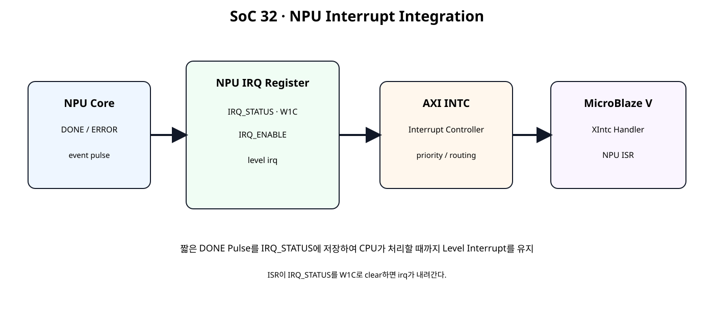
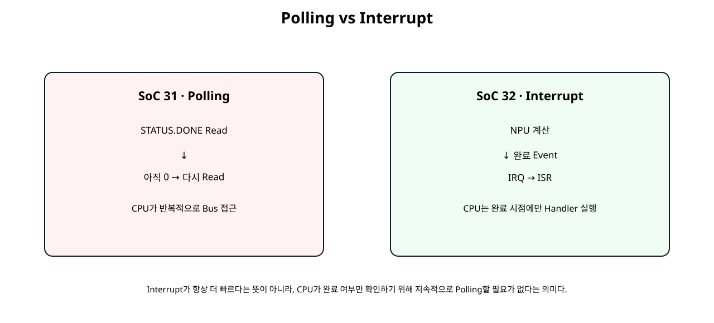
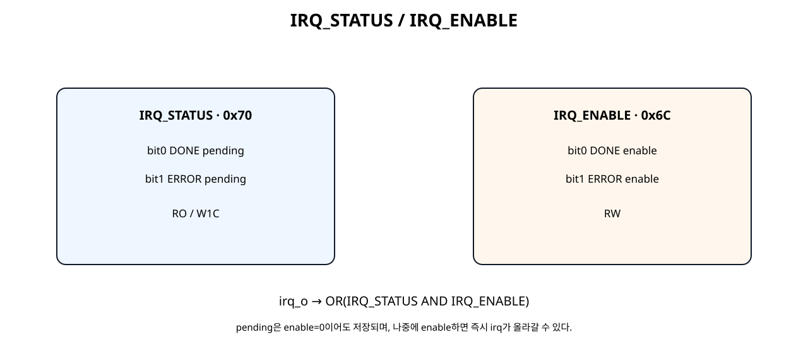
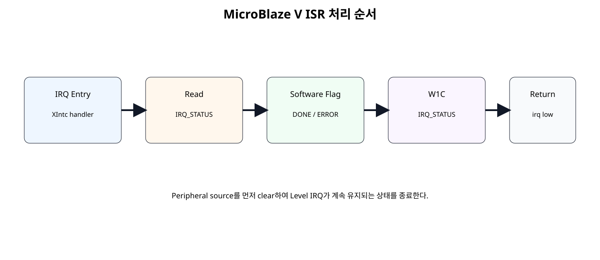

# NPU Done Interrupt · AXI Interrupt Controller · ISR


## 전체 학습 위치


## 이번 장의 목표


[](../images/soc32/soc32_interrupt_architecture.svg)

짧은 NPU Event를 Register에 저장해 MicroBlaze V가 처리할 때까지 Level Interrupt를 유지한다.


## Polling에서 Interrupt로


[](../images/soc32/soc32_polling_vs_interrupt.svg)

SoC 31은 완료 여부를 반복 읽었고, SoC 32는 완료 Event에서 CPU Handler를 호출한다.

Interrupt가 무조건 더 빠르다는 뜻은 아니다. 핵심은 CPU가 완료 여부만 확인하기 위해 지속적으로 STATUS Register를 읽을 필요가 없다는 점이다.


## 전체 Architecture


## 왜 DONE Pulse를 직접 연결하지 않는가

Accelerator의 DONE은 짧은 Event일 수 있다. CPU/Interrupt Controller가 처리하기 전에 Pulse가 끝나면 Software가 Event를 복구하기 어렵다. 따라서 Peripheral 내부 Status Register에 Event를 Latched한다.


## Level IRQ 구조

Pending Source가 Enable된 동안 IRQ는 High 상태를 유지한다. ISR이 Pending Bit를 Clear한 뒤에야 IRQ가 Low로 내려간다.


## Register Map 확장


[](../images/soc32/soc32_irq_registers.svg)

SoC 31의 기존 Offset은 유지하고 0x6C와 0x70만 추가한다.


| Offset | Register | Access | bit |
| --- | --- | --- | --- |
| 0x6C | IRQ_ENABLE | RW | bit0 DONE, bit1 ERROR |
| 0x70 | IRQ_STATUS | RO/W1C | bit0 DONE pending, bit1 ERROR pending |


## IRQ_ENABLE

Event를 저장할지 여부가 아니라 CPU에 IRQ를 전달할지를 제어한다. Enable이 0이어도 Pending은 저장될 수 있다.


## IRQ_STATUS W1C

W1C(Write-One-to-Clear, 1을 써서 클리어)는 해당 Bit에 1을 Write하면 Pending을 Clear하는 방식이다.


```text
DONE pending clear  → write 0x00000001
ERROR pending clear → write 0x00000002
둘 다 clear         → write 0x00000003
```


## Pending과 Enable의 차이


```text
IRQ_STATUS → 사건이 발생했는가?
IRQ_ENABLE → 그 사건을 CPU Interrupt로 전달할 것인가?
```

DONE Event가 발생한 뒤 Enable을 켜도 Pending이 남아 있으면 IRQ가 바로 High가 된다.


## Event-set 우선


```text
irq_status_next
→ (old_status AND NOT clear_mask) OR event_set
```

Clear와 새 Event가 같은 Clock에 겹쳐도 Event가 사라지지 않도록 Set을 마지막 우선순위로 둔다.


## DONE Interrupt


## ERROR Interrupt

이번 장의 Error Event는 SoC 31과 동일하게 BUSY 중 재START를 대표 사례로 사용한다.


## START while BUSY

BUSY 중 START는 수락하지 않으며 STATUS.ERROR와 IRQ_STATUS.ERROR를 각각 Latched한다. 일반 Status Sticky와 Interrupt Pending은 독립적으로 Clear할 수 있다.


## AXI Write Commit 보강

AW와 W를 독립 Capture한 뒤 둘 다 Pending일 때 Register Write와 BVALID를 같은 Commit Clock에 처리한다. Write Response가 Register Side Effect보다 앞서지 않도록 한 구조다.


## Register Bank RTL


```verilog
module npu_register_bank_irq (
    input  wire               clk,
    input  wire               resetn,

    input  wire               wr_en_i,
    input  wire [7:0]         wr_addr_i,
    input  wire [31:0]        wr_data_i,
    input  wire [3:0]         wr_strb_i,

    input  wire [7:0]         rd_addr_i,
    output reg  [31:0]        rd_data_o,

    output wire               irq_o,

    output wire               accel_busy_o,
    output wire               accel_done_sticky_o,
    output wire               accel_error_sticky_o,
    output wire [7:0]         saturation_count_o
);

// ------------------------------------------------------------
// SoC 32 · NPU Interrupt Register Bank
// ------------------------------------------------------------
//
// Existing SoC 31 map:
//
// 0x00 CONTROL      W1P
// 0x04 STATUS       RO
// 0x08 VERSION      RO
// 0x0C SAT_COUNT    RO
// 0x10 BIAS_CH0     RW
// 0x14 BIAS_CH1     RW
// 0x18 SCALE_CH0    RW
// 0x1C SCALE_CH1    RW
// 0x20 ZERO_POINT   RW
// 0x40..0x5C ACC_IN0..7 RW
// 0x60 OUT_CH0      RO
// 0x64 OUT_CH1      RO
// 0x68 CYCLE_COUNT  RO
//
// SoC 32 additions:
//
// 0x6C IRQ_ENABLE   RW
//      bit 0 DONE IRQ enable
//      bit 1 ERROR IRQ enable
//
// 0x70 IRQ_STATUS   RO / W1C
//      bit 0 DONE event pending
//      bit 1 ERROR event pending
//
// Level interrupt:
//
//   irq_o = |(IRQ_ENABLE & IRQ_STATUS)
//
// IRQ_STATUS remains set until software writes 1 to the
// corresponding bit. Event set wins over W1C clear if both
// happen in the same clock.

localparam [31:0] VERSION_VALUE = 32'h0001_0000;

function [31:0] apply_wstrb32;
    input [31:0] old_value;
    input [31:0] new_value;
    input [3:0]  strb;

    integer byte_index;

    begin
        apply_wstrb32 = old_value;

        for (
            byte_index = 0;
            byte_index < 4;
            byte_index = byte_index + 1
        ) begin
            if (strb[byte_index]) begin
                apply_wstrb32[
                    (byte_index * 8) +: 8
                ] =
                    new_value[
                        (byte_index * 8) +: 8
                    ];
            end
        end
    end
endfunction

reg signed [31:0] bias_ch0_q;
reg signed [31:0] bias_ch1_q;

reg signed [15:0] mult_ch0_q;
reg signed [15:0] mult_ch1_q;

reg [5:0] shift_ch0_q;
reg [5:0] shift_ch1_q;

reg signed [15:0] zp_ch0_q;
reg signed [15:0] zp_ch1_q;

reg signed [31:0] acc_in_q [0:7];

reg start_pulse_q;
reg done_sticky_q;
reg error_sticky_q;

reg [1:0] irq_enable_q;
reg [1:0] irq_status_q;

wire accel_busy_w;
wire accel_done_w;
wire accel_result_valid_w;

wire [31:0] q_ch0_batch_w;
wire [31:0] q_ch1_batch_w;

wire [7:0] saturation_count_w;

reg [31:0] cycle_count_q;

assign accel_busy_o = accel_busy_w;
assign accel_done_sticky_o = done_sticky_q;
assign accel_error_sticky_o = error_sticky_q;
assign saturation_count_o = saturation_count_w;

assign irq_o =
    |(irq_enable_q & irq_status_q);

// ------------------------------------------------------------
// CONTROL decode.
// ------------------------------------------------------------
wire control_write_w;

assign control_write_w =
    wr_en_i &&
    (wr_addr_i[7:2] == 6'h00);

wire start_request_w;
wire clear_done_request_w;
wire clear_error_request_w;

assign start_request_w =
    control_write_w &&
    wr_strb_i[0] &&
    wr_data_i[0];

assign clear_done_request_w =
    control_write_w &&
    wr_strb_i[0] &&
    wr_data_i[1];

assign clear_error_request_w =
    control_write_w &&
    wr_strb_i[0] &&
    wr_data_i[2];

// ------------------------------------------------------------
// IRQ decode.
// ------------------------------------------------------------
wire irq_enable_write_w;
wire irq_status_write_w;

assign irq_enable_write_w =
    wr_en_i &&
    (wr_addr_i[7:2] == 6'h1B);

assign irq_status_write_w =
    wr_en_i &&
    (wr_addr_i[7:2] == 6'h1C);

wire [1:0] irq_clear_mask_w;

assign irq_clear_mask_w =
    irq_status_write_w &&
    wr_strb_i[0]
    ? wr_data_i[1:0]
    : 2'b00;

// ------------------------------------------------------------
// Event generation.
// ------------------------------------------------------------
wire error_event_w;

assign error_event_w =
    start_request_w &&
    accel_busy_w;

wire [1:0] irq_event_set_w;

assign irq_event_set_w = {
    error_event_w,
    accel_done_w
};

wire [1:0] irq_status_after_clear_w;
wire [1:0] irq_status_next_w;

assign irq_status_after_clear_w =
    irq_status_q &
    ~irq_clear_mask_w;

assign irq_status_next_w =
    irq_status_after_clear_w |
    irq_event_set_w;

wire done_sticky_next_w;
wire error_sticky_next_w;

assign done_sticky_next_w =
    (done_sticky_q && !clear_done_request_w) ||
    accel_done_w;

assign error_sticky_next_w =
    (error_sticky_q && !clear_error_request_w) ||
    error_event_w;

// ------------------------------------------------------------
// SoC 30 accelerator reused unchanged.
// ------------------------------------------------------------
wire [127:0] acc_ch0_batch_w;
wire [127:0] acc_ch1_batch_w;

assign acc_ch0_batch_w = {
    acc_in_q[3],
    acc_in_q[2],
    acc_in_q[1],
    acc_in_q[0]
};

assign acc_ch1_batch_w = {
    acc_in_q[7],
    acc_in_q[6],
    acc_in_q[5],
    acc_in_q[4]
};

requantize_batch2x4_serial u_accelerator (
    .clk(clk),
    .resetn(resetn),

    .start_i(start_pulse_q),

    .acc_ch0_batch_i(acc_ch0_batch_w),
    .acc_ch1_batch_i(acc_ch1_batch_w),

    .bias_ch0_i(bias_ch0_q),
    .bias_ch1_i(bias_ch1_q),

    .mult_ch0_i(mult_ch0_q),
    .mult_ch1_i(mult_ch1_q),

    .shift_ch0_i(shift_ch0_q),
    .shift_ch1_i(shift_ch1_q),

    .zp_ch0_i(zp_ch0_q),
    .zp_ch1_i(zp_ch1_q),

    .busy_o(accel_busy_w),
    .done_o(accel_done_w),
    .result_valid_o(accel_result_valid_w),

    .q_ch0_batch_o(q_ch0_batch_w),
    .q_ch1_batch_o(q_ch1_batch_w),

    .saturation_count_o(saturation_count_w)
);

integer i;
reg [31:0] merged_w;

always @(posedge clk) begin
    if (!resetn) begin
        bias_ch0_q <= 32'sd0;
        bias_ch1_q <= 32'sd0;

        mult_ch0_q <= 16'sd1;
        mult_ch1_q <= 16'sd1;

        shift_ch0_q <= 6'd0;
        shift_ch1_q <= 6'd0;

        zp_ch0_q <= 16'sd0;
        zp_ch1_q <= 16'sd0;

        for (i = 0; i < 8; i = i + 1) begin
            acc_in_q[i] <= 32'sd0;
        end

        start_pulse_q  <= 1'b0;
        done_sticky_q  <= 1'b0;
        error_sticky_q <= 1'b0;

        irq_enable_q <= 2'b00;
        irq_status_q <= 2'b00;

        cycle_count_q <= 32'd0;
    end else begin
        start_pulse_q <= 1'b0;

        done_sticky_q  <= done_sticky_next_w;
        error_sticky_q <= error_sticky_next_w;
        irq_status_q   <= irq_status_next_w;

        if (
            start_request_w &&
            !accel_busy_w
        ) begin
            start_pulse_q <= 1'b1;
            done_sticky_q <= 1'b0;
            cycle_count_q <= 32'd0;
        end

        if (accel_busy_w) begin
            cycle_count_q <=
                cycle_count_q + 32'd1;
        end

        if (irq_enable_write_w) begin
            merged_w = apply_wstrb32(
                {30'd0, irq_enable_q},
                wr_data_i,
                wr_strb_i
            );

            irq_enable_q <=
                merged_w[1:0];
        end

        if (wr_en_i) begin
            case (wr_addr_i[7:2])
                6'h04: begin
                    merged_w = apply_wstrb32(
                        bias_ch0_q,
                        wr_data_i,
                        wr_strb_i
                    );
                    bias_ch0_q <= $signed(merged_w);
                end

                6'h05: begin
                    merged_w = apply_wstrb32(
                        bias_ch1_q,
                        wr_data_i,
                        wr_strb_i
                    );
                    bias_ch1_q <= $signed(merged_w);
                end

                6'h06: begin
                    merged_w = apply_wstrb32(
                        {
                            10'd0,
                            shift_ch0_q,
                            mult_ch0_q
                        },
                        wr_data_i,
                        wr_strb_i
                    );

                    mult_ch0_q <=
                        $signed(merged_w[15:0]);

                    shift_ch0_q <=
                        merged_w[21:16];
                end

                6'h07: begin
                    merged_w = apply_wstrb32(
                        {
                            10'd0,
                            shift_ch1_q,
                            mult_ch1_q
                        },
                        wr_data_i,
                        wr_strb_i
                    );

                    mult_ch1_q <=
                        $signed(merged_w[15:0]);

                    shift_ch1_q <=
                        merged_w[21:16];
                end

                6'h08: begin
                    merged_w = apply_wstrb32(
                        {
                            zp_ch1_q,
                            zp_ch0_q
                        },
                        wr_data_i,
                        wr_strb_i
                    );

                    zp_ch0_q <=
                        $signed(merged_w[15:0]);

                    zp_ch1_q <=
                        $signed(merged_w[31:16]);
                end

                6'h10: begin
                    merged_w = apply_wstrb32(
                        acc_in_q[0],
                        wr_data_i,
                        wr_strb_i
                    );
                    acc_in_q[0] <= $signed(merged_w);
                end

                6'h11: begin
                    merged_w = apply_wstrb32(
                        acc_in_q[1],
                        wr_data_i,
                        wr_strb_i
                    );
                    acc_in_q[1] <= $signed(merged_w);
                end

                6'h12: begin
                    merged_w = apply_wstrb32(
                        acc_in_q[2],
                        wr_data_i,
                        wr_strb_i
                    );
                    acc_in_q[2] <= $signed(merged_w);
                end

                6'h13: begin
                    merged_w = apply_wstrb32(
                        acc_in_q[3],
                        wr_data_i,
                        wr_strb_i
                    );
                    acc_in_q[3] <= $signed(merged_w);
                end

                6'h14: begin
                    merged_w = apply_wstrb32(
                        acc_in_q[4],
                        wr_data_i,
                        wr_strb_i
                    );
                    acc_in_q[4] <= $signed(merged_w);
                end

                6'h15: begin
                    merged_w = apply_wstrb32(
                        acc_in_q[5],
                        wr_data_i,
                        wr_strb_i
                    );
                    acc_in_q[5] <= $signed(merged_w);
                end

                6'h16: begin
                    merged_w = apply_wstrb32(
                        acc_in_q[6],
                        wr_data_i,
                        wr_strb_i
                    );
                    acc_in_q[6] <= $signed(merged_w);
                end

                6'h17: begin
                    merged_w = apply_wstrb32(
                        acc_in_q[7],
                        wr_data_i,
                        wr_strb_i
                    );
                    acc_in_q[7] <= $signed(merged_w);
                end

                default: begin
                end
            endcase
        end
    end
end

always @(*) begin
    case (rd_addr_i[7:2])
        6'h00: rd_data_o = 32'h0000_0000;

        6'h01: rd_data_o = {
            28'd0,
            (saturation_count_w != 8'd0),
            error_sticky_q,
            done_sticky_q,
            accel_busy_w
        };

        6'h02: rd_data_o = VERSION_VALUE;

        6'h03: rd_data_o = {
            24'd0,
            saturation_count_w
        };

        6'h04: rd_data_o = bias_ch0_q;
        6'h05: rd_data_o = bias_ch1_q;

        6'h06: rd_data_o = {
            10'd0,
            shift_ch0_q,
            mult_ch0_q
        };

        6'h07: rd_data_o = {
            10'd0,
            shift_ch1_q,
            mult_ch1_q
        };

        6'h08: rd_data_o = {
            zp_ch1_q,
            zp_ch0_q
        };

        6'h10: rd_data_o = acc_in_q[0];
        6'h11: rd_data_o = acc_in_q[1];
        6'h12: rd_data_o = acc_in_q[2];
        6'h13: rd_data_o = acc_in_q[3];

        6'h14: rd_data_o = acc_in_q[4];
        6'h15: rd_data_o = acc_in_q[5];
        6'h16: rd_data_o = acc_in_q[6];
        6'h17: rd_data_o = acc_in_q[7];

        6'h18: rd_data_o = q_ch0_batch_w;
        6'h19: rd_data_o = q_ch1_batch_w;
        6'h1A: rd_data_o = cycle_count_q;

        6'h1B: rd_data_o = {
            30'd0,
            irq_enable_q
        };

        6'h1C: rd_data_o = {
            30'd0,
            irq_status_q
        };

        default: rd_data_o = 32'h0000_0000;
    endcase
end

endmodule
```


## AXI4-Lite IRQ Slave


```verilog
module npu_axi4lite_irq_slave #(
    parameter integer C_S_AXI_ADDR_WIDTH = 8,
    parameter integer C_S_AXI_DATA_WIDTH = 32
) (
    input  wire                            s_axi_aclk,
    input  wire                            s_axi_aresetn,

    input  wire [C_S_AXI_ADDR_WIDTH-1:0]   s_axi_awaddr,
    input  wire                            s_axi_awvalid,
    output wire                            s_axi_awready,

    input  wire [C_S_AXI_DATA_WIDTH-1:0]   s_axi_wdata,
    input  wire [(C_S_AXI_DATA_WIDTH/8)-1:0] s_axi_wstrb,
    input  wire                            s_axi_wvalid,
    output wire                            s_axi_wready,

    output wire [1:0]                      s_axi_bresp,
    output reg                             s_axi_bvalid,
    input  wire                            s_axi_bready,

    input  wire [C_S_AXI_ADDR_WIDTH-1:0]   s_axi_araddr,
    input  wire                            s_axi_arvalid,
    output wire                            s_axi_arready,

    output reg  [C_S_AXI_DATA_WIDTH-1:0]   s_axi_rdata,
    output wire [1:0]                      s_axi_rresp,
    output reg                             s_axi_rvalid,
    input  wire                            s_axi_rready,

    output wire                            irq_o,

    output wire                            accel_busy_o,
    output wire                            accel_done_sticky_o,
    output wire                            accel_error_sticky_o,
    output wire [7:0]                      saturation_count_o
);

// AW and W are independent channels.
// The register write and BVALID generation occur on the same
// commit clock after both address and data have been captured.

reg                            aw_pending_q;
reg [C_S_AXI_ADDR_WIDTH-1:0]   awaddr_q;

reg                            w_pending_q;
reg [C_S_AXI_DATA_WIDTH-1:0]   wdata_q;
reg [(C_S_AXI_DATA_WIDTH/8)-1:0] wstrb_q;

assign s_axi_awready =
    !aw_pending_q &&
    !s_axi_bvalid;

assign s_axi_wready =
    !w_pending_q &&
    !s_axi_bvalid;

assign s_axi_bresp = 2'b00;

wire aw_handshake_w;
wire w_handshake_w;

assign aw_handshake_w =
    s_axi_awvalid &&
    s_axi_awready;

assign w_handshake_w =
    s_axi_wvalid &&
    s_axi_wready;

wire register_write_fire_w;

assign register_write_fire_w =
    aw_pending_q &&
    w_pending_q &&
    !s_axi_bvalid;

wire [31:0] register_rd_data_w;

npu_register_bank_irq u_register_bank (
    .clk(s_axi_aclk),
    .resetn(s_axi_aresetn),

    .wr_en_i(register_write_fire_w),
    .wr_addr_i(awaddr_q[7:0]),
    .wr_data_i(wdata_q),
    .wr_strb_i(wstrb_q),

    .rd_addr_i(s_axi_araddr[7:0]),
    .rd_data_o(register_rd_data_w),

    .irq_o(irq_o),

    .accel_busy_o(accel_busy_o),
    .accel_done_sticky_o(accel_done_sticky_o),
    .accel_error_sticky_o(accel_error_sticky_o),
    .saturation_count_o(saturation_count_o)
);

always @(posedge s_axi_aclk) begin
    if (!s_axi_aresetn) begin
        aw_pending_q <= 1'b0;
        awaddr_q     <= {C_S_AXI_ADDR_WIDTH{1'b0}};

        w_pending_q <= 1'b0;
        wdata_q     <= {C_S_AXI_DATA_WIDTH{1'b0}};
        wstrb_q     <= {(C_S_AXI_DATA_WIDTH/8){1'b0}};

        s_axi_bvalid <= 1'b0;
    end else begin
        if (aw_handshake_w) begin
            aw_pending_q <= 1'b1;
            awaddr_q     <= s_axi_awaddr;
        end

        if (w_handshake_w) begin
            w_pending_q <= 1'b1;
            wdata_q     <= s_axi_wdata;
            wstrb_q     <= s_axi_wstrb;
        end

        if (register_write_fire_w) begin
            aw_pending_q <= 1'b0;
            w_pending_q  <= 1'b0;
            s_axi_bvalid <= 1'b1;
        end

        if (
            s_axi_bvalid &&
            s_axi_bready
        ) begin
            s_axi_bvalid <= 1'b0;
        end
    end
end

assign s_axi_arready =
    !s_axi_rvalid;

assign s_axi_rresp = 2'b00;

wire ar_handshake_w;

assign ar_handshake_w =
    s_axi_arvalid &&
    s_axi_arready;

always @(posedge s_axi_aclk) begin
    if (!s_axi_aresetn) begin
        s_axi_rdata  <= {C_S_AXI_DATA_WIDTH{1'b0}};
        s_axi_rvalid <= 1'b0;
    end else begin
        if (ar_handshake_w) begin
            s_axi_rdata  <= register_rd_data_w;
            s_axi_rvalid <= 1'b1;
        end

        if (
            s_axi_rvalid &&
            s_axi_rready
        ) begin
            s_axi_rvalid <= 1'b0;
        end
    end
end

endmodule
```


## Module Reference Top


```verilog
module npu_axi_irq_accel_ip (
    (* X_INTERFACE_INFO = "xilinx.com:signal:clock:1.0 s_axi_aclk CLK" *)
    (* X_INTERFACE_PARAMETER = "XIL_INTERFACENAME s_axi_aclk, ASSOCIATED_BUSIF S_AXI, ASSOCIATED_RESET s_axi_aresetn" *)
    input  wire        s_axi_aclk,

    (* X_INTERFACE_INFO = "xilinx.com:signal:reset:1.0 s_axi_aresetn RST" *)
    (* X_INTERFACE_PARAMETER = "XIL_INTERFACENAME s_axi_aresetn, POLARITY ACTIVE_LOW" *)
    input  wire        s_axi_aresetn,

    (* X_INTERFACE_INFO = "xilinx.com:interface:aximm:1.0 S_AXI AWADDR" *)
    input  wire [7:0]  s_axi_awaddr,
    (* X_INTERFACE_INFO = "xilinx.com:interface:aximm:1.0 S_AXI AWVALID" *)
    input  wire        s_axi_awvalid,
    (* X_INTERFACE_INFO = "xilinx.com:interface:aximm:1.0 S_AXI AWREADY" *)
    output wire        s_axi_awready,

    (* X_INTERFACE_INFO = "xilinx.com:interface:aximm:1.0 S_AXI WDATA" *)
    input  wire [31:0] s_axi_wdata,
    (* X_INTERFACE_INFO = "xilinx.com:interface:aximm:1.0 S_AXI WSTRB" *)
    input  wire [3:0]  s_axi_wstrb,
    (* X_INTERFACE_INFO = "xilinx.com:interface:aximm:1.0 S_AXI WVALID" *)
    input  wire        s_axi_wvalid,
    (* X_INTERFACE_INFO = "xilinx.com:interface:aximm:1.0 S_AXI WREADY" *)
    output wire        s_axi_wready,

    (* X_INTERFACE_INFO = "xilinx.com:interface:aximm:1.0 S_AXI BRESP" *)
    output wire [1:0]  s_axi_bresp,
    (* X_INTERFACE_INFO = "xilinx.com:interface:aximm:1.0 S_AXI BVALID" *)
    output wire        s_axi_bvalid,
    (* X_INTERFACE_INFO = "xilinx.com:interface:aximm:1.0 S_AXI BREADY" *)
    input  wire        s_axi_bready,

    (* X_INTERFACE_INFO = "xilinx.com:interface:aximm:1.0 S_AXI ARADDR" *)
    input  wire [7:0]  s_axi_araddr,
    (* X_INTERFACE_INFO = "xilinx.com:interface:aximm:1.0 S_AXI ARVALID" *)
    input  wire        s_axi_arvalid,
    (* X_INTERFACE_INFO = "xilinx.com:interface:aximm:1.0 S_AXI ARREADY" *)
    output wire        s_axi_arready,

    (* X_INTERFACE_INFO = "xilinx.com:interface:aximm:1.0 S_AXI RDATA" *)
    output wire [31:0] s_axi_rdata,
    (* X_INTERFACE_INFO = "xilinx.com:interface:aximm:1.0 S_AXI RRESP" *)
    output wire [1:0]  s_axi_rresp,
    (* X_INTERFACE_INFO = "xilinx.com:interface:aximm:1.0 S_AXI RVALID" *)
    output wire        s_axi_rvalid,
    (* X_INTERFACE_INFO = "xilinx.com:interface:aximm:1.0 S_AXI RREADY" *)
    input  wire        s_axi_rready,

    (* X_INTERFACE_INFO = "xilinx.com:signal:interrupt:1.0 irq INTERRUPT" *)
    (* X_INTERFACE_PARAMETER = "XIL_INTERFACENAME irq, SENSITIVITY LEVEL_HIGH" *)
    output wire        irq
);

// Pure AXI / IRQ Shell / Wrapper.

wire       accel_busy;
wire       accel_done_sticky;
wire       accel_error_sticky;
wire [7:0] saturation_count;

npu_axi4lite_irq_slave u_axi_slave (
    .s_axi_aclk(s_axi_aclk),
    .s_axi_aresetn(s_axi_aresetn),

    .s_axi_awaddr(s_axi_awaddr),
    .s_axi_awvalid(s_axi_awvalid),
    .s_axi_awready(s_axi_awready),

    .s_axi_wdata(s_axi_wdata),
    .s_axi_wstrb(s_axi_wstrb),
    .s_axi_wvalid(s_axi_wvalid),
    .s_axi_wready(s_axi_wready),

    .s_axi_bresp(s_axi_bresp),
    .s_axi_bvalid(s_axi_bvalid),
    .s_axi_bready(s_axi_bready),

    .s_axi_araddr(s_axi_araddr),
    .s_axi_arvalid(s_axi_arvalid),
    .s_axi_arready(s_axi_arready),

    .s_axi_rdata(s_axi_rdata),
    .s_axi_rresp(s_axi_rresp),
    .s_axi_rvalid(s_axi_rvalid),
    .s_axi_rready(s_axi_rready),

    .irq_o(irq),

    .accel_busy_o(accel_busy),
    .accel_done_sticky_o(accel_done_sticky),
    .accel_error_sticky_o(accel_error_sticky),
    .saturation_count_o(saturation_count)
);

endmodule
```

Top은 S_AXI와 irq Port를 하위 Slave에 연결하는 Shell/Wrapper 역할만 한다.


## AXI Interrupt Controller

AMD의 현재 MicroBlaze V IP Integrator 가이드에서는 MicroBlaze V Processor의 Interrupt 관리를 위해 AXI Interrupt Controller를 사용하도록 설명한다.


## xlconcat

NPU 외에 Timer, GPIO, UART 등의 Interrupt Source가 있다면 xlconcat로 여러 Source를 하나의 Interrupt Vector로 묶어 AXI Interrupt Controller의 intr에 연결한다.


## MicroBlaze V Exception Flow

CPU는 표준 외부 인터럽트 모드로 설정한다. AXI INTC의 irq를 microblaze_riscv_0/Interrupt에 연결하고 입력은 Level-High로 맞춘다. MicroBlaze V의 mtvec 진입과 mepc 저장·MRET 복귀는 생성 BSP가 처리한다. Xil_ExceptionEnable()은 외부 인터럽트 허용과 전역 허용을 설정하며, ISR은 주변장치의 원인을 해제한다.


## XIntc Setup


```text
XIntc_Initialize
XIntc_Connect
XIntc_Start(..., XIN_REAL_MODE)
XIntc_Enable
Xil_ExceptionInit
Xil_ExceptionRegisterHandler
Xil_ExceptionEnable
```

현재 AMD embeddedsw의 AXI Interrupt Controller 예제와 같은 기본 흐름을 사용한다.


## NPU ISR


[](../images/soc32/soc32_isr_flow.svg)

ISR은 Pending 원인을 먼저 읽고 Software Flag를 갱신한 뒤 Peripheral Source를 Clear한다.


## ISR에서 W1C

Level Interrupt는 Source가 남아 있으면 ISR에서 Return해도 다시 Interrupt가 들어올 수 있다. 따라서 Handler 안에서 Peripheral의 Pending Source를 Clear한다.


## Software Driver 확장


```c
#ifndef NPU_ACCEL_H
#define NPU_ACCEL_H

#include "xil_io.h"
#include "xil_types.h"

// ------------------------------------------------------------
// SoC 31 NPU AXI4-Lite Register Map
// ------------------------------------------------------------
#define NPU_CONTROL_OFFSET       0x00U
#define NPU_STATUS_OFFSET        0x04U
#define NPU_VERSION_OFFSET       0x08U
#define NPU_SAT_COUNT_OFFSET     0x0CU

#define NPU_BIAS_CH0_OFFSET      0x10U
#define NPU_BIAS_CH1_OFFSET      0x14U
#define NPU_SCALE_CH0_OFFSET     0x18U
#define NPU_SCALE_CH1_OFFSET     0x1CU
#define NPU_ZERO_POINT_OFFSET    0x20U

#define NPU_ACC_IN0_OFFSET       0x40U
#define NPU_ACC_IN1_OFFSET       0x44U
#define NPU_ACC_IN2_OFFSET       0x48U
#define NPU_ACC_IN3_OFFSET       0x4CU
#define NPU_ACC_IN4_OFFSET       0x50U
#define NPU_ACC_IN5_OFFSET       0x54U
#define NPU_ACC_IN6_OFFSET       0x58U
#define NPU_ACC_IN7_OFFSET       0x5CU

#define NPU_OUT_CH0_OFFSET       0x60U
#define NPU_OUT_CH1_OFFSET       0x64U
#define NPU_CYCLE_COUNT_OFFSET   0x68U

#define NPU_IRQ_ENABLE_OFFSET     0x6CU
#define NPU_IRQ_STATUS_OFFSET     0x70U

#define NPU_CONTROL_START_MASK       0x00000001U
#define NPU_CONTROL_CLEAR_DONE_MASK  0x00000002U
#define NPU_CONTROL_CLEAR_ERROR_MASK 0x00000004U

#define NPU_STATUS_BUSY_MASK         0x00000001U
#define NPU_STATUS_DONE_MASK         0x00000002U
#define NPU_STATUS_ERROR_MASK        0x00000004U
#define NPU_STATUS_SATURATED_MASK    0x00000008U

#define NPU_IRQ_DONE_MASK             0x00000001U
#define NPU_IRQ_ERROR_MASK            0x00000002U
#define NPU_IRQ_ALL_MASK              0x00000003U

#define NPU_VERSION_EXPECTED         0x00010000U

static inline void Npu_WriteReg(
    UINTPTR BaseAddress,
    u32 Offset,
    u32 Value
)
{
    Xil_Out32(BaseAddress + (UINTPTR)Offset, Value);
}

static inline u32 Npu_ReadReg(
    UINTPTR BaseAddress,
    u32 Offset
)
{
    return Xil_In32(BaseAddress + (UINTPTR)Offset);
}

static inline u32 Npu_PackScale(
    s16 Multiplier,
    u8 Shift
)
{
    return
        ((u32)Multiplier & 0x0000FFFFU) |
        (((u32)Shift & 0x3FU) << 16U);
}

static inline u32 Npu_PackZeroPoint(
    s16 ZpCh0,
    s16 ZpCh1
)
{
    return
        ((u32)ZpCh0 & 0x0000FFFFU) |
        (((u32)ZpCh1 & 0x0000FFFFU) << 16U);
}

static inline void Npu_Start(UINTPTR BaseAddress)
{
    Npu_WriteReg(
        BaseAddress,
        NPU_CONTROL_OFFSET,
        NPU_CONTROL_START_MASK
    );
}

static inline void Npu_ClearDone(UINTPTR BaseAddress)
{
    Npu_WriteReg(
        BaseAddress,
        NPU_CONTROL_OFFSET,
        NPU_CONTROL_CLEAR_DONE_MASK
    );
}

static inline void Npu_ClearError(UINTPTR BaseAddress)
{
    Npu_WriteReg(
        BaseAddress,
        NPU_CONTROL_OFFSET,
        NPU_CONTROL_CLEAR_ERROR_MASK
    );
}

static inline u32 Npu_GetStatus(UINTPTR BaseAddress)
{
    return Npu_ReadReg(
        BaseAddress,
        NPU_STATUS_OFFSET
    );
}

static inline int Npu_IsBusy(UINTPTR BaseAddress)
{
    return
        (Npu_GetStatus(BaseAddress) & NPU_STATUS_BUSY_MASK)
        != 0U;
}

static inline int Npu_IsDone(UINTPTR BaseAddress)
{
    return
        (Npu_GetStatus(BaseAddress) & NPU_STATUS_DONE_MASK)
        != 0U;
}


static inline void Npu_SetIrqEnable(
    UINTPTR BaseAddress,
    u32 Mask
)
{
    Npu_WriteReg(
        BaseAddress,
        NPU_IRQ_ENABLE_OFFSET,
        Mask & NPU_IRQ_ALL_MASK
    );
}

static inline u32 Npu_GetIrqEnable(UINTPTR BaseAddress)
{
    return Npu_ReadReg(
        BaseAddress,
        NPU_IRQ_ENABLE_OFFSET
    );
}

static inline u32 Npu_GetIrqStatus(UINTPTR BaseAddress)
{
    return Npu_ReadReg(
        BaseAddress,
        NPU_IRQ_STATUS_OFFSET
    );
}

static inline void Npu_ClearIrq(
    UINTPTR BaseAddress,
    u32 Mask
)
{
    // IRQ_STATUS is W1C.
    Npu_WriteReg(
        BaseAddress,
        NPU_IRQ_STATUS_OFFSET,
        Mask & NPU_IRQ_ALL_MASK
    );
}

#endif
```


## Interrupt Application


```c
#include "xil_exception.h"
#include "xil_printf.h"
#include "xintc.h"
#include "xparameters.h"

#include "npu_accel.h"

// ------------------------------------------------------------
// Platform symbols
// ------------------------------------------------------------
//
// NPU_BASEADDR:
//   Generated xparameters.h symbol for npu_axi_irq_accel_ip.
//
// INTC_DEVICE_ID:
//   AXI Interrupt Controller Device ID.
//
// NPU_INTR_ID:
//   Interrupt ID assigned to the NPU irq input.
//
// Exact symbol names depend on Vivado instance names.
// Do not invent fixed addresses or interrupt IDs.

#ifndef NPU_BASEADDR
#ifdef XPAR_NPU_AXI_IRQ_0_BASEADDR
#define NPU_BASEADDR XPAR_NPU_AXI_IRQ_0_BASEADDR
#elif defined(XPAR_NPU_AXI_0_BASEADDR)
#define NPU_BASEADDR XPAR_NPU_AXI_0_BASEADDR
#else
#error "Define NPU_BASEADDR from generated xparameters.h."
#endif
#endif

// (변경) 생성 BSP 흐름에 맞춰 INTC 식별자를 선택한다.
#ifndef SDT
#ifndef INTC_DEVICE_ID
#ifdef XPAR_INTC_0_DEVICE_ID
#define INTC_DEVICE_ID XPAR_INTC_0_DEVICE_ID
#else
#error "Define INTC_DEVICE_ID from generated xparameters.h."
#endif
#endif
#else
#ifndef INTC_BASEADDR
#if defined(XPAR_XINTC_0_BASEADDR)
#define INTC_BASEADDR XPAR_XINTC_0_BASEADDR
#elif defined(XPAR_INTC_0_BASEADDR)
#define INTC_BASEADDR XPAR_INTC_0_BASEADDR
#else
#error "Define INTC_BASEADDR from generated xparameters.h."
#endif
#endif
#endif

#ifndef NPU_INTR_ID
#error "Define NPU_INTR_ID from generated xparameters.h."
#endif

static XIntc Intc;

static volatile u32 NpuDoneFlag = 0U;
static volatile u32 NpuErrorFlag = 0U;
static volatile u32 NpuLastIrqStatus = 0U;

static void NpuIsr(void *CallbackRef)
{
    const UINTPTR base = (UINTPTR)CallbackRef;
    const u32 irq_status = Npu_GetIrqStatus(base);

    NpuLastIrqStatus = irq_status;

    if ((irq_status & NPU_IRQ_DONE_MASK) != 0U) {
        NpuDoneFlag = 1U;
    }

    if ((irq_status & NPU_IRQ_ERROR_MASK) != 0U) {
        NpuErrorFlag = 1U;
    }

    // Clear the peripheral source before returning.
    // IRQ_STATUS uses Write-One-to-Clear.
    Npu_ClearIrq(
        base,
        irq_status & NPU_IRQ_ALL_MASK
    );
}

static int SetupInterruptSystem(UINTPTR base)
{
    int status;

    // (변경) SDT는 BaseAddress, 비 SDT는 DeviceId를 사용한다.
#ifndef SDT
    status = XIntc_Initialize(&Intc, INTC_DEVICE_ID);
#else
    status = XIntc_Initialize(&Intc, INTC_BASEADDR);
#endif

    if (status != XST_SUCCESS) {
        return XST_FAILURE;
    }

    status = XIntc_Connect(
        &Intc,
        NPU_INTR_ID,
        (XInterruptHandler)NpuIsr,
        (void *)base
    );

    if (status != XST_SUCCESS) {
        return XST_FAILURE;
    }

    status = XIntc_Start(
        &Intc,
        XIN_REAL_MODE
    );

    if (status != XST_SUCCESS) {
        return XST_FAILURE;
    }

    XIntc_Enable(
        &Intc,
        NPU_INTR_ID
    );

    Xil_ExceptionInit();

    Xil_ExceptionRegisterHandler(
        XIL_EXCEPTION_ID_INT,
        (Xil_ExceptionHandler)XIntc_InterruptHandler,
        &Intc
    );

    Xil_ExceptionEnable();

    return XST_SUCCESS;
}

static void WriteDemoInputs(UINTPTR base)
{
    Npu_WriteReg(base, NPU_ACC_IN0_OFFSET, 16U);
    Npu_WriteReg(base, NPU_ACC_IN1_OFFSET, 32U);
    Npu_WriteReg(base, NPU_ACC_IN2_OFFSET, 48U);
    Npu_WriteReg(base, NPU_ACC_IN3_OFFSET, 64U);

    Npu_WriteReg(base, NPU_ACC_IN4_OFFSET, 32U);
    Npu_WriteReg(base, NPU_ACC_IN5_OFFSET, 64U);
    Npu_WriteReg(base, NPU_ACC_IN6_OFFSET, 96U);
    Npu_WriteReg(base, NPU_ACC_IN7_OFFSET, 128U);
}

static void WriteDemoParameters(UINTPTR base)
{
    Npu_WriteReg(base, NPU_BIAS_CH0_OFFSET, 0U);
    Npu_WriteReg(
        base,
        NPU_SCALE_CH0_OFFSET,
        Npu_PackScale(1, 1U)
    );

    Npu_WriteReg(base, NPU_BIAS_CH1_OFFSET, 4U);
    Npu_WriteReg(
        base,
        NPU_SCALE_CH1_OFFSET,
        Npu_PackScale(3, 1U)
    );

    Npu_WriteReg(
        base,
        NPU_ZERO_POINT_OFFSET,
        Npu_PackZeroPoint(0, -3)
    );
}

int main(void)
{
    const UINTPTR base = (UINTPTR)NPU_BASEADDR;

    u32 version;
    u32 out_ch0;
    u32 out_ch1;
    u32 sat_count;
    u32 timeout;

    xil_printf("\r\nSoC32 NPU interrupt demo\r\n");

    version = Npu_ReadReg(
        base,
        NPU_VERSION_OFFSET
    );

    if (version != NPU_VERSION_EXPECTED) {
        xil_printf("ERROR: unexpected NPU version\r\n");
        return 1;
    }

    if (SetupInterruptSystem(base) != XST_SUCCESS) {
        xil_printf("ERROR: interrupt setup failed\r\n");
        return 1;
    }

    // Clear stale software-visible and interrupt status.
    Npu_ClearDone(base);
    Npu_ClearError(base);
    Npu_ClearIrq(base, NPU_IRQ_ALL_MASK);

    // Enable DONE and ERROR sources inside the NPU peripheral.
    Npu_SetIrqEnable(
        base,
        NPU_IRQ_DONE_MASK |
        NPU_IRQ_ERROR_MASK
    );

    WriteDemoInputs(base);
    WriteDemoParameters(base);

    NpuDoneFlag = 0U;
    NpuErrorFlag = 0U;
    NpuLastIrqStatus = 0U;

    Npu_Start(base);

    // No STATUS.DONE polling.
    // Timeout is only a safety guard for the teaching example.
    timeout = 1000000U;

    while (
        (NpuDoneFlag == 0U) &&
        (NpuErrorFlag == 0U) &&
        (timeout != 0U)
    ) {
        timeout--;
    }

    if (timeout == 0U) {
        xil_printf("ERROR: interrupt timeout\r\n");
        return 1;
    }

    if (NpuErrorFlag != 0U) {
        xil_printf(
            "ERROR: NPU IRQ_STATUS = 0x%08x\r\n",
            (unsigned int)NpuLastIrqStatus
        );
        return 1;
    }

    out_ch0 = Npu_ReadReg(
        base,
        NPU_OUT_CH0_OFFSET
    );

    out_ch1 = Npu_ReadReg(
        base,
        NPU_OUT_CH1_OFFSET
    );

    sat_count = Npu_ReadReg(
        base,
        NPU_SAT_COUNT_OFFSET
    );

    xil_printf(
        "IRQ_STATUS = 0x%08x\r\n",
        (unsigned int)NpuLastIrqStatus
    );

    xil_printf(
        "OUT_CH0 = 0x%08x\r\n",
        (unsigned int)out_ch0
    );

    xil_printf(
        "OUT_CH1 = 0x%08x\r\n",
        (unsigned int)out_ch1
    );

    xil_printf(
        "SAT_COUNT = %u\r\n",
        (unsigned int)sat_count
    );

    if (
        ((NpuLastIrqStatus & NPU_IRQ_DONE_MASK) == 0U) ||
        (out_ch0 != 0x20181008U) ||
        (out_ch1 != 0x7F7F6333U) ||
        ((sat_count & 0xFFU) != 2U)
    ) {
        xil_printf("SOC32 RESULT: FAIL\r\n");
        return 1;
    }

    xil_printf("SOC32 RESULT: PASS\r\n");

    return 0;
}
```


## Polling과의 차이


| SoC31 | SoC32 |
| --- | --- |
| STATUS.DONE 반복 Read | DONE Event에서 ISR 실행 |
| CPU가 완료 확인에 계속 Bus 접근 | 완료 시점에만 Interrupt 처리 |
| DONE Sticky 중심 | DONE Sticky + IRQ Pending |
| Interrupt Controller 불필요 | AXI Interrupt Controller 사용 |


## Address / Interrupt ID

SDT 빌드는 INTC_BASEADDR, 비 SDT 빌드는 INTC_DEVICE_ID를 생성 메타데이터에 연결한다. NPU_INTR_ID는 실제 xlconcat·INTC 입력 번호와 일치시킨다.


## Vivado Block Design


```text
NPU irq
  ↓
xlconcat
  ↓
AXI Interrupt Controller
  ↓
MicroBlaze V Interrupt
```

AXI INTC의 S_AXI도 MicroBlaze V Peripheral AXI 경로에 연결하여 Software Driver가 Controller Register에 접근할 수 있게 한다.


## Self-Checking Testbench


```verilog
`timescale 1ns / 1ps

module tb_npu_axi4lite_irq_slave;

logic clk = 1'b0;
logic resetn = 1'b0;

logic [7:0]  awaddr = 8'h00;
logic        awvalid = 1'b0;
wire         awready;

logic [31:0] wdata = 32'h0000_0000;
logic [3:0]  wstrb = 4'h0;
logic        wvalid = 1'b0;
wire         wready;

wire [1:0]   bresp;
wire         bvalid;
logic        bready = 1'b1;

logic [7:0]  araddr = 8'h00;
logic        arvalid = 1'b0;
wire         arready;

wire [31:0]  rdata;
wire [1:0]   rresp;
wire         rvalid;
logic        rready = 1'b1;

wire accel_busy;
wire accel_done_sticky;
wire accel_error_sticky;
wire [7:0] saturation_count;
wire irq;

integer error_count = 0;
integer check_count = 0;

always #5 clk = ~clk;

npu_axi4lite_irq_slave dut (
    .s_axi_aclk(clk),
    .s_axi_aresetn(resetn),

    .s_axi_awaddr(awaddr),
    .s_axi_awvalid(awvalid),
    .s_axi_awready(awready),

    .s_axi_wdata(wdata),
    .s_axi_wstrb(wstrb),
    .s_axi_wvalid(wvalid),
    .s_axi_wready(wready),

    .s_axi_bresp(bresp),
    .s_axi_bvalid(bvalid),
    .s_axi_bready(bready),

    .s_axi_araddr(araddr),
    .s_axi_arvalid(arvalid),
    .s_axi_arready(arready),

    .s_axi_rdata(rdata),
    .s_axi_rresp(rresp),
    .s_axi_rvalid(rvalid),
    .s_axi_rready(rready),

    .irq_o(irq),

    .accel_busy_o(accel_busy),
    .accel_done_sticky_o(accel_done_sticky),
    .accel_error_sticky_o(accel_error_sticky),
    .saturation_count_o(saturation_count)
);

task automatic check_true(
    input string name,
    input bit condition
);
    begin
        check_count = check_count + 1;

        if (!condition) begin
            error_count = error_count + 1;
            $error("CHECK FAIL: %s", name);
        end else begin
            $display("CHECK PASS: %s", name);
        end
    end
endtask

task automatic check_eq32(
    input string name,
    input logic [31:0] actual,
    input logic [31:0] expected
);
    begin
        check_count = check_count + 1;

        if (actual !== expected) begin
            error_count = error_count + 1;

            $error(
                "CHECK FAIL: %s actual=0x%08h expected=0x%08h",
                name,
                actual,
                expected
            );
        end else begin
            $display(
                "CHECK PASS: %s = 0x%08h",
                name,
                actual
            );
        end
    end
endtask

// order:
//   0 = AW and W together
//   1 = AW first, W later
//   2 = W first, AW later
task automatic axi_write(
    input [7:0] address,
    input [31:0] data,
    input [3:0] strobe,
    input integer order
);
    bit aw_done;
    bit w_done;
    integer timeout;

    begin
        aw_done = 0;
        w_done = 0;

        @(negedge clk);

        awaddr = address;
        wdata = data;
        wstrb = strobe;

        case (order)
            0: begin
                awvalid = 1'b1;
                wvalid = 1'b1;
            end

            1: begin
                awvalid = 1'b1;
                wvalid = 1'b0;
            end

            default: begin
                awvalid = 1'b0;
                wvalid = 1'b1;
            end
        endcase

        timeout = 0;

        while (!(aw_done && w_done)) begin
            @(posedge clk);
            // (변경) READY가 갱신되기 전 상승 에지의 handshake를 관측한다.

            if (
                awvalid &&
                awready
            ) begin
                aw_done = 1;
            end

            if (
                wvalid &&
                wready
            ) begin
                w_done = 1;
            end

            @(negedge clk);

            if (aw_done) begin
                awvalid = 1'b0;
            end

            if (w_done) begin
                wvalid = 1'b0;
            end

            if (
                (order == 1) &&
                aw_done &&
                !w_done
            ) begin
                wvalid = 1'b1;
            end

            if (
                (order == 2) &&
                w_done &&
                !aw_done
            ) begin
                awvalid = 1'b1;
            end

            timeout = timeout + 1;

            if (timeout > 30) begin
                $fatal(1, "AXI write handshake timeout");
            end
        end

        timeout = 0;

        while (!bvalid) begin
            @(posedge clk);
            #1;

            timeout = timeout + 1;

            if (timeout > 30) begin
                $fatal(1, "AXI BVALID timeout");
            end
        end

        check_true(
            "AXI BRESP OKAY",
            bresp == 2'b00
        );

        // One extra clock ensures the B-channel handshake is complete.
        @(posedge clk);
        #1;
    end
endtask

task automatic axi_read(
    input [7:0] address,
    output [31:0] data
);
    integer timeout;

    begin
        @(negedge clk);

        araddr = address;
        arvalid = 1'b1;

        timeout = 0;

        while (!arready) begin
            @(posedge clk);
            #1;

            timeout = timeout + 1;

            if (timeout > 30) begin
                $fatal(1, "AXI ARREADY timeout");
            end
        end

        @(posedge clk);
        #1;

        if (!rvalid) begin
            timeout = 0;

            while (!rvalid) begin
                @(posedge clk);
                #1;

                timeout = timeout + 1;

                if (timeout > 30) begin
                    $fatal(1, "AXI RVALID timeout");
                end
            end
        end

        data = rdata;

        check_true(
            "AXI RRESP OKAY",
            rresp == 2'b00
        );

        @(negedge clk);
        arvalid = 1'b0;

        @(posedge clk);
        #1;
    end
endtask

task automatic wait_busy;
    reg [31:0] status;
    integer timeout;

    begin
        timeout = 0;
        status = 32'd0;

        while ((status & 32'h1) == 0) begin
            axi_read(8'h04, status);

            timeout = timeout + 1;

            if (timeout > 20) begin
                $fatal(1, "BUSY did not assert");
            end
        end
    end
endtask

task automatic wait_done;
    reg [31:0] status;
    integer timeout;

    begin
        timeout = 0;
        status = 32'd0;

        while ((status & 32'h2) == 0) begin
            axi_read(8'h04, status);

            timeout = timeout + 1;

            if (timeout > 50) begin
                $fatal(1, "DONE did not assert");
            end
        end
    end
endtask

task automatic wait_irq_high;
    integer timeout;

    begin
        timeout = 0;

        while (irq !== 1'b1) begin
            @(posedge clk);
            #1;

            timeout = timeout + 1;

            if (timeout > 80) begin
                $fatal(1, "IRQ did not assert");
            end
        end
    end
endtask

initial begin
    reg [31:0] rd;

    repeat (5) @(posedge clk);
    resetn = 1'b1;

    // --------------------------------------------------------
    // 1. SoC31 protocol/register regression.
    // --------------------------------------------------------
    axi_read(8'h08, rd);
    check_eq32(
        "VERSION",
        rd,
        32'h0001_0000
    );

    // WSTRB regression.
    axi_write(
        8'h10,
        32'h1122_3344,
        4'b1111,
        0
    );

    axi_write(
        8'h10,
        32'h0000_AA00,
        4'b0010,
        1
    );

    axi_read(8'h10, rd);
    check_eq32(
        "WSTRB partial BIAS_CH0",
        rd,
        32'h1122_AA44
    );

    // Demo parameters.
    axi_write(8'h10, 32'd0,         4'hF, 0);
    axi_write(8'h14, 32'd4,         4'hF, 1);
    axi_write(8'h18, 32'h0001_0001, 4'hF, 2);
    axi_write(8'h1C, 32'h0001_0003, 4'hF, 0);
    axi_write(8'h20, 32'hFFFD_0000, 4'hF, 1);

    // Demo inputs.
    axi_write(8'h40, 32'd16,  4'hF, 0);
    axi_write(8'h44, 32'd32,  4'hF, 1);
    axi_write(8'h48, 32'd48,  4'hF, 2);
    axi_write(8'h4C, 32'd64,  4'hF, 0);

    axi_write(8'h50, 32'd32,  4'hF, 1);
    axi_write(8'h54, 32'd64,  4'hF, 2);
    axi_write(8'h58, 32'd96,  4'hF, 0);
    axi_write(8'h5C, 32'd128, 4'hF, 1);

    // --------------------------------------------------------
    // 2. IRQ disabled:
    //    DONE event is latched, but irq output stays low.
    // --------------------------------------------------------
    axi_write(8'h6C, 32'h0000_0000, 4'hF, 0);
    axi_write(8'h70, 32'h0000_0003, 4'b0001, 1);
    axi_write(8'h00, 32'h0000_0006, 4'b0001, 2);

    check_true(
        "IRQ low before start",
        irq === 1'b0
    );

    axi_write(
        8'h00,
        32'h0000_0001,
        4'b0001,
        0
    );

    wait_done();

    check_true(
        "IRQ remains low when disabled",
        irq === 1'b0
    );

    axi_read(8'h70, rd);
    check_true(
        "DONE pending latched while disabled",
        (rd & 32'h1) != 0
    );

    // Enabling an already-pending source must assert level IRQ.
    axi_write(8'h6C, 32'h0000_0001, 4'hF, 1);

    repeat (2) @(posedge clk);
    #1;

    check_true(
        "pending DONE asserts IRQ after enable",
        irq === 1'b1
    );

    // W1C clear drops IRQ, STATUS.DONE remains independently sticky.
    axi_write(8'h70, 32'h0000_0001, 4'b0001, 2);

    repeat (2) @(posedge clk);
    #1;

    check_true(
        "DONE IRQ clear drops level",
        irq === 1'b0
    );

    axi_read(8'h04, rd);
    check_true(
        "STATUS DONE independent from IRQ_STATUS",
        (rd & 32'h2) != 0
    );

    // --------------------------------------------------------
    // 3. Normal interrupt-driven DONE run.
    // --------------------------------------------------------
    axi_write(8'h00, 32'h0000_0002, 4'b0001, 0);
    axi_write(8'h70, 32'h0000_0003, 4'b0001, 1);
    axi_write(8'h6C, 32'h0000_0001, 4'hF, 2);

    axi_write(
        8'h00,
        32'h0000_0001,
        4'b0001,
        0
    );

    wait_busy();
    wait_irq_high();

    axi_read(8'h70, rd);

    check_true(
        "IRQ_STATUS DONE pending",
        (rd & 32'h1) != 0
    );

    check_true(
        "IRQ_STATUS ERROR clear",
        (rd & 32'h2) == 0
    );

    axi_read(8'h60, rd);
    check_eq32(
        "OUT_CH0",
        rd,
        32'h2018_1008
    );

    axi_read(8'h64, rd);
    check_eq32(
        "OUT_CH1",
        rd,
        32'h7F7F_6333
    );

    axi_read(8'h0C, rd);
    check_eq32(
        "SAT_COUNT",
        rd,
        32'd2
    );

    axi_write(8'h70, 32'h0000_0001, 4'b0001, 1);

    repeat (2) @(posedge clk);
    #1;

    check_true(
        "DONE W1C deasserts IRQ",
        irq === 1'b0
    );

    // --------------------------------------------------------
    // 4. ERROR interrupt:
    //    enable ERROR only, then START while BUSY.
    // --------------------------------------------------------
    axi_write(8'h70, 32'h0000_0003, 4'b0001, 0);
    axi_write(8'h00, 32'h0000_0006, 4'b0001, 1);
    axi_write(8'h6C, 32'h0000_0002, 4'hF, 2);

    axi_write(8'h00, 32'h0000_0001, 4'b0001, 0);
    wait_busy();

    axi_write(8'h00, 32'h0000_0001, 4'b0001, 1);

    repeat (2) @(posedge clk);
    #1;

    check_true(
        "ERROR source asserts IRQ",
        irq === 1'b1
    );

    axi_read(8'h70, rd);
    check_true(
        "IRQ_STATUS ERROR pending",
        (rd & 32'h2) != 0
    );

    axi_read(8'h04, rd);
    check_true(
        "STATUS ERROR sticky",
        (rd & 32'h4) != 0
    );

    axi_write(8'h70, 32'h0000_0002, 4'b0001, 2);

    repeat (2) @(posedge clk);
    #1;

    check_true(
        "ERROR W1C deasserts IRQ",
        irq === 1'b0
    );

    // DONE remains disabled in IRQ_ENABLE.
    wait_done();

    check_true(
        "DONE disabled so IRQ stays low",
        irq === 1'b0
    );

    // --------------------------------------------------------
    // 5. Final clear.
    // --------------------------------------------------------
    axi_write(8'h6C, 32'h0000_0000, 4'hF, 0);
    axi_write(8'h70, 32'h0000_0003, 4'b0001, 1);
    axi_write(8'h00, 32'h0000_0006, 4'b0001, 2);

    axi_read(8'h70, rd);
    check_eq32(
        "IRQ_STATUS final clear",
        rd,
        32'h0000_0000
    );

    $display("");
    $display("SOC32 CHECK COUNT : %0d", check_count);
    $display("SOC32 ERROR COUNT : %0d", error_count);

    if (error_count == 0) begin
        $display("SOC32 NPU INTERRUPT TEST: PASS");
    end else begin
        $fatal(
            1,
            "SOC32 NPU INTERRUPT TEST: FAIL (%0d errors)",
            error_count
        );
    end

    #20;
    $finish;
end

endmodule
```


## DONE Disabled Test

DONE Event는 IRQ_STATUS에 Latched하지만 IRQ_ENABLE이 0이면 irq는 Low여야 한다. 이 동작으로 Pending과 Enable이 분리되어 있음을 확인한다.


## Pending 후 Enable Test

DONE Pending을 만든 뒤 DONE Enable을 1로 바꾸면 Level IRQ가 즉시 Assert되어야 한다. Pending이 Pulse가 아니라 상태로 저장됨을 검증한다.


## ERROR-only Test

ERROR만 Enable한 상태에서 BUSY 중 START를 발생시킨다. ERROR Pending과 STATUS.ERROR가 모두 Set되고, ERROR W1C 후 IRQ가 Low로 내려가는지 검사한다.


## Python IRQ Reference


```text
IRQ_STATUS W1C model: PASS
disabled DONE event -> pending=1, irq=0
enable pending DONE -> irq=1
W1C DONE -> pending=0, irq=0
ERROR enable/status path: PASS
same-cycle clear + set -> event-set wins
expected OUT_CH0 = 0x20181008
expected OUT_CH1 = 0x7F7F6333
expected SAT_COUNT = 2
SOC32 PYTHON INTERRUPT REFERENCE: PASS
Spreadsheet runtime warmup failed during python startup
Traceback (most recent call last):
  File "/tmp/tmp.L2TH2Y5coc/artifact_tool_v2-2.8.22/artifact_tool/patches/warm_spreadsheet_runtime_on_startup.py", line 26, in warm_spreadsheet_runtime_on_startup
  File "/tmp/tmp.L2TH2Y5coc/artifact_tool_v2-2.8.22/artifact_tool/spreadsheet_warmup.py", line 772, in warm_spreadsheet_runtime
  File "/tmp/tmp.L2TH2Y5coc/artifact_tool_v2-2.8.22/artifact_tool/rpc/connection.py", line 37, in get_or_create_client
  File "/tmp/tmp.L2TH2Y5coc/artifact_tool_v2-2.8.22/artifact_tool/rpc/daemon.py", line 124, in start_daemon
TimeoutError: Timed out waiting for artifact tool daemon socket. Set ARTIFACT_TOOL_RPC_DAEMON_STARTUP_TIMEOUT_S=<seconds> to increase the limit.
```


## OOC Synthesis


```text
# SoC 32 · NPU AXI4-Lite + IRQ peripheral OOC synthesis

set script_dir [file dirname [file normalize [info script]]]
set root_dir   [file normalize [file join $script_dir ".."]]
set rtl_dir    [file join $root_dir "rtl"]
set out_dir    [file normalize [file join $root_dir "reports" "generic_ooc"]]

file mkdir $out_dir

create_project -in_memory -part xc7a35tcpg236-1

read_verilog [file join $rtl_dir "requantize_s32_to_s8.v"]
read_verilog [file join $rtl_dir "requantize_batch2x4_serial.v"]
read_verilog [file join $rtl_dir "npu_register_bank_irq.v"]
read_verilog [file join $rtl_dir "npu_axi4lite_irq_slave.v"]
read_verilog [file join $rtl_dir "npu_axi_irq_accel_ip.v"]

synth_design \
    -mode out_of_context \
    -top npu_axi_irq_accel_ip \
    -part xc7a35tcpg236-1

create_clock \
    -name s_axi_aclk \
    -period 10.000 \
    [get_ports s_axi_aclk]

report_utilization \
    -hierarchical \
    -file [file join $out_dir "01_utilization_ooc.rpt"]

redirect -file [file join $out_dir "02_dsp48_cells_ooc.rpt"] {
    set dsp_cells [get_cells -hier -filter {REF_NAME =~ DSP48*}]
    puts "DSP48 primitive count: [llength $dsp_cells]"

    foreach cell $dsp_cells {
        puts "[get_property REF_NAME $cell]  $cell"
    }
}

report_timing_summary \
    -delay_type min_max \
    -report_unconstrained \
    -max_paths 20 \
    -file [file join $out_dir "03_timing_summary_ooc.rpt"]

report_design_analysis \
    -max_paths 50 \
    -setup \
    -logic_level_distribution \
    -file [file join $out_dir "04_design_analysis_ooc.rpt"]

report_methodology \
    -file [file join $out_dir "05_methodology_ooc.rpt"]

puts ""
puts "SoC 32 OOC synthesis complete."
puts "The IRQ output is level-high until software clears IRQ_STATUS."
```

AXI/IRQ Peripheral 자체의 Resource, DSP Mapping, Timing, Methodology를 Block Design과 분리해 확인한다.


## Timing / CDC 주의

SoC 32에서는 NPU AXI Slave와 Accelerator가 같은 AXI Clock Domain이라는 전제를 유지한다. 다른 Clock Domain의 Event를 IRQ로 가져오려면 SoC 20에서 다룬 CDC Event Synchronization을 먼저 적용해야 한다.


## SoC 33 연결

다음 장에서는 8개의 ACC_IN Register 방식에서 벗어나 실제 Tensor를 저장할 수 있는 Memory-Mapped Buffer 구조로 확장한다.


## 오류 점검


| 증상 | 원인 | 확인 |
| --- | --- | --- |
| IRQ가 순간적으로만 보임 | DONE Pulse 직접 연결 | IRQ_STATUS latch |
| ISR이 계속 재진입 | Peripheral pending 미Clear | IRQ_STATUS W1C |
| Enable=0인데 Event 손실 | Enable과 Pending을 같은 의미로 사용 | Status는 독립 latch |
| Clear와 새 Event가 겹쳐 손실 | Clear 우선 next-state | event-set wins |
| Interrupt가 전혀 안 옴 | AXI INTC/xlconcat/ID 연결 오류 | Block Design + xparameters.h |
| ISR은 호출되지만 IRQ가 안 내려감 | W1C Mask 오류 | IRQ_STATUS Readback |
| Write 후 값 반영이 늦음 | Register Commit/BVALID 시점 불일치 | same commit clock |


## SoC 32 완료 체크리스트

- [ ] Polling과 Interrupt 방식 차이를 설명한다.
- [ ] DONE/ERROR Event를 IRQ_STATUS에 저장한다.
- [ ] IRQ_ENABLE과 IRQ_STATUS 역할을 구분한다.
- [ ] Level IRQ 수식을 설명한다.
- [ ] W1C Clear를 구현한다.
- [ ] Clear와 Event가 같은 Clock이면 Event가 남도록 한다.
- [ ] AXI Interrupt Controller를 MicroBlaze V에 연결한다.
- [ ] 여러 Source는 xlconcat으로 결합한다.
- [ ] XIntc Driver로 ISR을 연결한다.
- [ ] ISR에서 Peripheral Pending Source를 Clear한다.
- [ ] Base Address와 Interrupt ID는 xparameters.h에서 확인한다.
- [ ] SoC31 AXI Register 동작과 SoC30 결과를 유지한다.

## 공식 문서 및 근거


| 자료 | 확인 항목 |
| --- | --- |
| AMD UG994 · Handling Interrupts · 2026.1 | MicroBlaze V에서 AXI Interrupt Controller 사용, 여러 Source Concat |
| AMD embeddedsw · XIntc Example | XIntc Initialize/Connect/Start/Enable, Exception Handler 연결 |
| AMD PG144 · AXI GPIO Interrupts · 2026 | Interrupt Status와 Enable Register로 Level Interrupt 유지하는 IP 구조 예 |
| AMD AXI INTC · xintc.h | 비 SDT DeviceId / SDT BaseAddr 초기화 함수 원형 |

