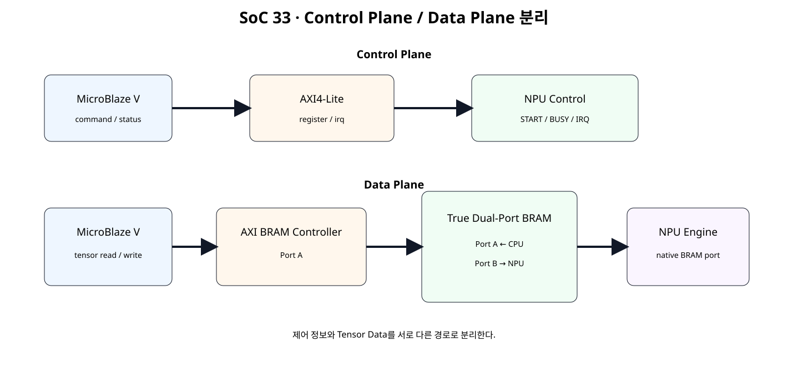
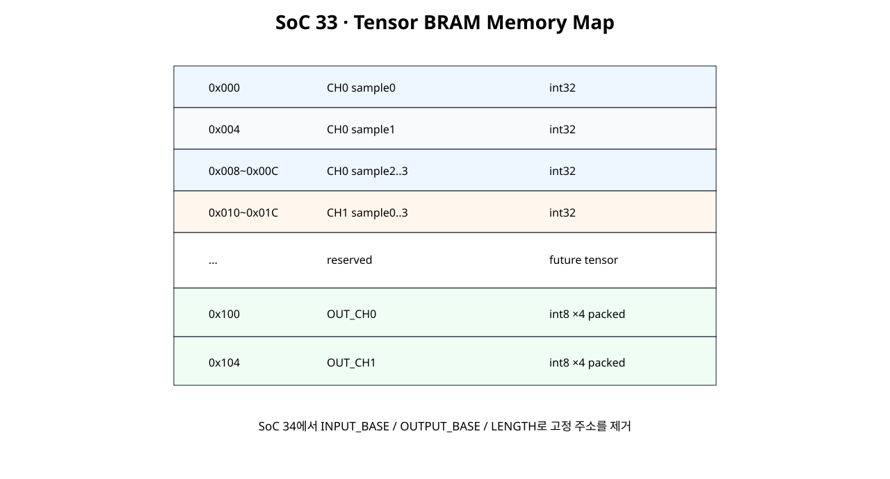
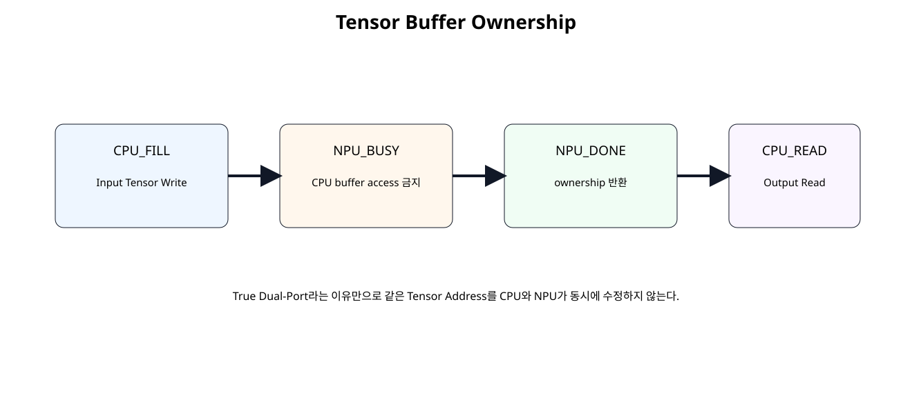
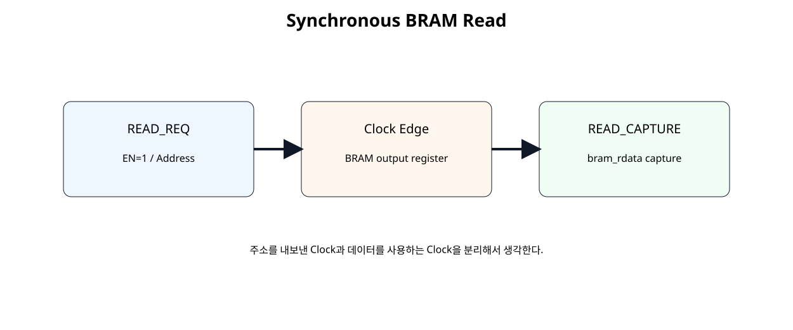

# AXI BRAM Tensor Buffer · Control Plane / Data Plane


## 전체 학습 위치


## 이번 장의 목표


[](../images/soc33/soc33_control_data_plane.svg)

명령·상태는 AXI4-Lite, Tensor 데이터는 BRAM Data Plane으로 분리한다.


## Register 입력의 한계

SoC 31의 ACC_IN0~7 Register 방식은 AXI Register Map을 배우기에는 적합하지만 Tensor 크기가 커지면 Register 수가 선형으로 증가한다. 실제 Accelerator에서는 Tensor Data를 Memory에 두고 Register에는 주소, 길이, 명령 같은 제어 정보만 두는 구조가 일반적이다.


## Control Plane / Data Plane


```text
Control Plane
MicroBlaze V → AXI4-Lite → START / STATUS / IRQ

Data Plane
MicroBlaze V → AXI BRAM Controller → Tensor BRAM ← NPU
```


## 전체 Architecture


[](../images/soc33/soc33_control_data_plane.svg)

Control Traffic과 Tensor Traffic을 서로 다른 경로로 분리한다.


## True Dual-Port BRAM

True Dual-Port BRAM은 하나의 Memory Array를 두 Port가 독립적으로 접근할 수 있게 한다. Vivado 합성은 Single-Port, Simple Dual-Port, True Dual-Port RAM 추론을 지원한다.


## Port A / Port B


| Port | 사용 주체 | 역할 |
| --- | --- | --- |
| A | MicroBlaze V | AXI BRAM Controller를 통한 Tensor Read/Write |
| B | NPU | Native BRAM Interface를 통한 Tensor Read/Output Write |


## 4 KB / 32-bit Memory

이번 실습은 주소 해석을 쉽게 하기 위해 32-bit Word와 12-bit Byte Address를 사용한다.


## Tensor Memory Map


[](../images/soc33/soc33_tensor_memory_map.svg)

입력 8 Word와 결과 2 Word를 하나의 BRAM Address Space에 배치한다.


## Byte Address


```text
0x000 → word 0
0x004 → word 1
0x008 → word 2
...
0x100 → output word 0
0x104 → output word 1
```

RTL Model에서는 Word Index를 addr[11:2]로 계산한다.


## Memory Ownership


[](../images/soc33/soc33_buffer_ownership.svg)

CPU가 Input을 작성한 뒤 NPU BUSY 동안 해당 Buffer 접근을 중지하고 DONE 후 다시 소유권을 가져온다.


## 동시 접근 Collision

Dual-Port라고 해서 동일 주소에 대한 CPU/NPU 동시 Write를 허용하는 것은 아니다. 이번 단계에서는 같은 Tensor Buffer를 동시에 수정하지 않는 Ownership Rule로 충돌을 회피한다.


## Synchronous Read


[](../images/soc33/soc33_bram_read_latency.svg)

BRAM Read는 주소 요청 Clock과 Data Capture Clock을 분리해서 생각한다.


## READ_REQ / READ_CAPTURE

Memory Read Latency를 FSM 상태로 명확히 표현하면 향후 Prefetch/FIFO와 연결할 때도 Timing 관계를 유지하기 쉽다.


## NPU Data Plane Engine


## Input Tensor Read

NPU는 Port B에서 0x000~0x01C를 순서대로 읽어 CH0/CH1 128-bit Batch Register를 구성한다.


## SoC30 Requantization 재사용

requantize_s32_to_s8.v와 requantize_batch2x4_serial.v는 SoC 32 패키지에서 수정 없이 재사용한다. SoC 33의 변경점은 계산식이 아니라 Input/Output Data 이동 방식이다.


## Output Tensor Write


```text
0x100 → OUT_CH0 = 0x20181008
0x104 → OUT_CH1 = 0x7F7F6333
```

CPU는 NPU DONE 이후 같은 BRAM을 다시 소유하고 결과를 읽는다.


## Read / Write Counter

교육용 관찰값으로 NPU가 BRAM에서 읽은 Word 수와 쓴 Word 수를 센다.


## BRAM RTL Model


```verilog
module tensor_bram_tdp_4k_model (
    input  wire         clk,

    // --------------------------------------------------------
    // Port A: CPU / AXI BRAM Controller side
    // --------------------------------------------------------
    input  wire         a_en_i,
    input  wire [3:0]   a_we_i,
    input  wire [11:0]  a_addr_i,
    input  wire [31:0]  a_wdata_i,
    output reg  [31:0]  a_rdata_o,

    // --------------------------------------------------------
    // Port B: NPU native side
    // --------------------------------------------------------
    input  wire         b_en_i,
    input  wire [3:0]   b_we_i,
    input  wire [11:0]  b_addr_i,
    input  wire [31:0]  b_wdata_i,
    output reg  [31:0]  b_rdata_o
);

// ------------------------------------------------------------
// 4 KB, 32-bit, byte-addressed True Dual-Port BRAM model.
//
// Address:
//   0x000 .. 0xFFF byte address
//
// Word index:
//   addr[11:2]
//
// Both ports use the same clock in SoC 33.
// Same-address simultaneous write/write or write/read access is
// intentionally prohibited by the software/hardware ownership rule.
//
// This RTL model is used for simulation/OOC education.
// In the Vivado Block Design, use a True Dual-Port Block Memory
// Generator and connect:
//   Port A -> AXI BRAM Controller / MicroBlaze V
//   Port B -> NPU native port
// ------------------------------------------------------------

(* ram_style = "block" *)
reg [31:0] mem [0:1023];

wire [9:0] a_word_addr_w;
wire [9:0] b_word_addr_w;

assign a_word_addr_w =
    a_addr_i[11:2];

assign b_word_addr_w =
    b_addr_i[11:2];

integer byte_index_a;
integer byte_index_b;

always @(posedge clk) begin
    if (a_en_i) begin
        // Read-first behavior for the simulation model.
        a_rdata_o <=
            mem[a_word_addr_w];

        for (
            byte_index_a = 0;
            byte_index_a < 4;
            byte_index_a = byte_index_a + 1
        ) begin
            if (a_we_i[byte_index_a]) begin
                mem[a_word_addr_w][
                    (byte_index_a * 8) +: 8
                ] <=
                    a_wdata_i[
                        (byte_index_a * 8) +: 8
                    ];
            end
        end
    end
end

always @(posedge clk) begin
    if (b_en_i) begin
        // Read-first behavior for the simulation model.
        b_rdata_o <=
            mem[b_word_addr_w];

        for (
            byte_index_b = 0;
            byte_index_b < 4;
            byte_index_b = byte_index_b + 1
        ) begin
            if (b_we_i[byte_index_b]) begin
                mem[b_word_addr_w][
                    (byte_index_b * 8) +: 8
                ] <=
                    b_wdata_i[
                        (byte_index_b * 8) +: 8
                    ];
            end
        end
    end
end

endmodule
```


## Data Plane RTL


```verilog
module tensor_bram_data_plane_engine (
    input  wire                 clk,
    input  wire                 resetn,

    input  wire                 start_i,

    input  wire signed [31:0]   bias_ch0_i,
    input  wire signed [31:0]   bias_ch1_i,

    input  wire signed [15:0]   mult_ch0_i,
    input  wire signed [15:0]   mult_ch1_i,

    input  wire        [5:0]    shift_ch0_i,
    input  wire        [5:0]    shift_ch1_i,

    input  wire signed [15:0]   zp_ch0_i,
    input  wire signed [15:0]   zp_ch1_i,

    output wire                 busy_o,
    output reg                  done_o,
    output reg                  error_o,

    // Native BRAM Port B.
    output reg                  bram_en_o,
    output reg  [3:0]           bram_we_o,
    output reg  [11:0]          bram_addr_o,
    output reg  [31:0]          bram_wdata_o,
    input  wire [31:0]          bram_rdata_i,

    output reg  [15:0]          read_word_count_o,
    output reg  [15:0]          write_word_count_o
);

// ------------------------------------------------------------
// SoC 33 Data Plane
// ------------------------------------------------------------
//
// Fixed teaching memory map:
//
// Input int32 tensor:
//   0x000 CH0 sample0
//   0x004 CH0 sample1
//   0x008 CH0 sample2
//   0x00C CH0 sample3
//   0x010 CH1 sample0
//   0x014 CH1 sample1
//   0x018 CH1 sample2
//   0x01C CH1 sample3
//
// Output packed int8 tensor:
//   0x100 OUT_CH0 = four signed int8 values
//   0x104 OUT_CH1 = four signed int8 values
//
// SoC 34 will replace these fixed addresses with programmable
// descriptor/base registers.
//
// BRAM read latency:
//   request clock -> synchronous BRAM output update
//   next engine state captures bram_rdata_i
// ------------------------------------------------------------

localparam [11:0] INPUT_BASE_ADDR     = 12'h000;
localparam [11:0] OUTPUT_CH0_ADDR     = 12'h100;
localparam [11:0] OUTPUT_CH1_ADDR     = 12'h104;

localparam [3:0] ST_IDLE          = 4'd0;
localparam [3:0] ST_READ_REQ      = 4'd1;
localparam [3:0] ST_READ_CAPTURE  = 4'd2;
localparam [3:0] ST_START_REQUANT = 4'd3;
localparam [3:0] ST_WAIT_RESULT   = 4'd4;
localparam [3:0] ST_WRITE_CH0     = 4'd5;
localparam [3:0] ST_WRITE_CH1     = 4'd6;
localparam [3:0] ST_DONE          = 4'd7;

reg [3:0] state_q;
reg [3:0] read_index_q;

reg [127:0] acc_ch0_batch_q;
reg [127:0] acc_ch1_batch_q;

reg requant_start_q;

wire requant_busy_w;
wire requant_done_w;
wire requant_result_valid_w;

wire [31:0] q_ch0_batch_w;
wire [31:0] q_ch1_batch_w;

wire [7:0] saturation_count_w;

assign busy_o =
    (state_q != ST_IDLE) &&
    (state_q != ST_DONE);

requantize_batch2x4_serial u_requant_batch (
    .clk(clk),
    .resetn(resetn),

    .start_i(requant_start_q),

    .acc_ch0_batch_i(acc_ch0_batch_q),
    .acc_ch1_batch_i(acc_ch1_batch_q),

    .bias_ch0_i(bias_ch0_i),
    .bias_ch1_i(bias_ch1_i),

    .mult_ch0_i(mult_ch0_i),
    .mult_ch1_i(mult_ch1_i),

    .shift_ch0_i(shift_ch0_i),
    .shift_ch1_i(shift_ch1_i),

    .zp_ch0_i(zp_ch0_i),
    .zp_ch1_i(zp_ch1_i),

    .busy_o(requant_busy_w),
    .done_o(requant_done_w),
    .result_valid_o(requant_result_valid_w),

    .q_ch0_batch_o(q_ch0_batch_w),
    .q_ch1_batch_o(q_ch1_batch_w),

    .saturation_count_o(saturation_count_w)
);

// ------------------------------------------------------------
// Native BRAM Port B output policy.
// ------------------------------------------------------------
always @(*) begin
    bram_en_o    = 1'b0;
    bram_we_o    = 4'b0000;
    bram_addr_o  = 12'h000;
    bram_wdata_o = 32'h0000_0000;

    case (state_q)
        ST_READ_REQ: begin
            bram_en_o = 1'b1;
            bram_we_o = 4'b0000;

            // Each int32 input occupies one 32-bit word.
            bram_addr_o =
                INPUT_BASE_ADDR +
                {read_index_q, 2'b00};
        end

        ST_WRITE_CH0: begin
            bram_en_o    = 1'b1;
            bram_we_o    = 4'b1111;
            bram_addr_o  = OUTPUT_CH0_ADDR;
            bram_wdata_o = q_ch0_batch_w;
        end

        ST_WRITE_CH1: begin
            bram_en_o    = 1'b1;
            bram_we_o    = 4'b1111;
            bram_addr_o  = OUTPUT_CH1_ADDR;
            bram_wdata_o = q_ch1_batch_w;
        end

        default: begin
        end
    endcase
end

// ------------------------------------------------------------
// Data-plane controller.
// ------------------------------------------------------------
always @(posedge clk) begin
    if (!resetn) begin
        state_q <= ST_IDLE;

        read_index_q <= 4'd0;

        acc_ch0_batch_q <= 128'd0;
        acc_ch1_batch_q <= 128'd0;

        requant_start_q <= 1'b0;

        done_o  <= 1'b0;
        error_o <= 1'b0;

        read_word_count_o  <= 16'd0;
        write_word_count_o <= 16'd0;
    end else begin
        requant_start_q <= 1'b0;
        done_o          <= 1'b0;

        case (state_q)
            ST_IDLE: begin
                if (start_i) begin
                    read_index_q <= 4'd0;

                    acc_ch0_batch_q <= 128'd0;
                    acc_ch1_batch_q <= 128'd0;

                    error_o <= 1'b0;

                    read_word_count_o  <= 16'd0;
                    write_word_count_o <= 16'd0;

                    state_q <= ST_READ_REQ;
                end
            end

            ST_READ_REQ: begin
                // Synchronous BRAM read request is issued through
                // the combinational native BRAM port above.
                state_q <= ST_READ_CAPTURE;
            end

            ST_READ_CAPTURE: begin
                read_word_count_o <=
                    read_word_count_o + 16'd1;

                case (read_index_q)
                    4'd0: acc_ch0_batch_q[31:0]    <= bram_rdata_i;
                    4'd1: acc_ch0_batch_q[63:32]   <= bram_rdata_i;
                    4'd2: acc_ch0_batch_q[95:64]   <= bram_rdata_i;
                    4'd3: acc_ch0_batch_q[127:96]  <= bram_rdata_i;

                    4'd4: acc_ch1_batch_q[31:0]    <= bram_rdata_i;
                    4'd5: acc_ch1_batch_q[63:32]   <= bram_rdata_i;
                    4'd6: acc_ch1_batch_q[95:64]   <= bram_rdata_i;

                    default:
                        acc_ch1_batch_q[127:96] <= bram_rdata_i;
                endcase

                if (read_index_q == 4'd7) begin
                    state_q <= ST_START_REQUANT;
                end else begin
                    read_index_q <=
                        read_index_q + 4'd1;

                    state_q <= ST_READ_REQ;
                end
            end

            ST_START_REQUANT: begin
                if (!requant_busy_w) begin
                    requant_start_q <= 1'b1;
                    state_q <= ST_WAIT_RESULT;
                end
            end

            ST_WAIT_RESULT: begin
                if (requant_result_valid_w) begin
                    state_q <= ST_WRITE_CH0;
                end
            end

            ST_WRITE_CH0: begin
                write_word_count_o <=
                    write_word_count_o + 16'd1;

                state_q <= ST_WRITE_CH1;
            end

            ST_WRITE_CH1: begin
                write_word_count_o <=
                    write_word_count_o + 16'd1;

                state_q <= ST_DONE;
            end

            ST_DONE: begin
                done_o <= 1'b1;
                state_q <= ST_IDLE;
            end

            default: begin
                error_o <= 1'b1;
                state_q <= ST_IDLE;
            end
        endcase
    end
end

endmodule
```


## Demo Top


```verilog
module tensor_bram_data_plane_demo_top (
    input  wire                 clk,
    input  wire                 resetn,

    input  wire                 start_i,

    // CPU-side simulation/native access.
    input  wire                 cpu_en_i,
    input  wire [3:0]           cpu_we_i,
    input  wire [11:0]          cpu_addr_i,
    input  wire [31:0]          cpu_wdata_i,
    output wire [31:0]          cpu_rdata_o,

    input  wire signed [31:0]   bias_ch0_i,
    input  wire signed [31:0]   bias_ch1_i,

    input  wire signed [15:0]   mult_ch0_i,
    input  wire signed [15:0]   mult_ch1_i,

    input  wire        [5:0]    shift_ch0_i,
    input  wire        [5:0]    shift_ch1_i,

    input  wire signed [15:0]   zp_ch0_i,
    input  wire signed [15:0]   zp_ch1_i,

    output wire                 busy_o,
    output wire                 done_o,
    output wire                 error_o,

    output wire [15:0]          read_word_count_o,
    output wire [15:0]          write_word_count_o
);

// Pure Shell / Wrapper.
//
// Simulation/OOC:
//   Port A = CPU-side native model access.
//
// Actual Vivado Block Design:
//   replace tensor_bram_tdp_4k_model with a True Dual-Port
//   Block Memory Generator.
//   Port A is accessed through AXI BRAM Controller.
//   Port B is connected to tensor_bram_data_plane_engine.

wire        npu_bram_en;
wire [3:0]  npu_bram_we;
wire [11:0] npu_bram_addr;
wire [31:0] npu_bram_wdata;
wire [31:0] npu_bram_rdata;

tensor_bram_tdp_4k_model u_tensor_bram (
    .clk(clk),

    .a_en_i(cpu_en_i),
    .a_we_i(cpu_we_i),
    .a_addr_i(cpu_addr_i),
    .a_wdata_i(cpu_wdata_i),
    .a_rdata_o(cpu_rdata_o),

    .b_en_i(npu_bram_en),
    .b_we_i(npu_bram_we),
    .b_addr_i(npu_bram_addr),
    .b_wdata_i(npu_bram_wdata),
    .b_rdata_o(npu_bram_rdata)
);

tensor_bram_data_plane_engine u_data_plane (
    .clk(clk),
    .resetn(resetn),

    .start_i(start_i),

    .bias_ch0_i(bias_ch0_i),
    .bias_ch1_i(bias_ch1_i),

    .mult_ch0_i(mult_ch0_i),
    .mult_ch1_i(mult_ch1_i),

    .shift_ch0_i(shift_ch0_i),
    .shift_ch1_i(shift_ch1_i),

    .zp_ch0_i(zp_ch0_i),
    .zp_ch1_i(zp_ch1_i),

    .busy_o(busy_o),
    .done_o(done_o),
    .error_o(error_o),

    .bram_en_o(npu_bram_en),
    .bram_we_o(npu_bram_we),
    .bram_addr_o(npu_bram_addr),
    .bram_wdata_o(npu_bram_wdata),
    .bram_rdata_i(npu_bram_rdata),

    .read_word_count_o(read_word_count_o),
    .write_word_count_o(write_word_count_o)
);

endmodule
```

Top은 Memory Model과 Engine 연결만 담당하는 Shell/Wrapper다.


## MicroBlaze V CPU-side Access

실제 Block Design에서는 Port A를 AXI BRAM Controller에 연결한다. MicroBlaze V는 일반 Memory-Mapped Address처럼 Tensor BRAM을 Read/Write한다.


## Tensor Buffer Driver


```c
#ifndef TENSOR_BUFFER_H
#define TENSOR_BUFFER_H

#include "xil_io.h"
#include "xil_types.h"

// ------------------------------------------------------------
// SoC 33 Tensor BRAM fixed teaching map.
//
// These are offsets inside the Tensor BRAM address range.
// SoC 34 will make base/length information programmable.
// ------------------------------------------------------------

#define TENSOR_INPUT_CH0_S0_OFFSET   0x000U
#define TENSOR_INPUT_CH0_S1_OFFSET   0x004U
#define TENSOR_INPUT_CH0_S2_OFFSET   0x008U
#define TENSOR_INPUT_CH0_S3_OFFSET   0x00CU

#define TENSOR_INPUT_CH1_S0_OFFSET   0x010U
#define TENSOR_INPUT_CH1_S1_OFFSET   0x014U
#define TENSOR_INPUT_CH1_S2_OFFSET   0x018U
#define TENSOR_INPUT_CH1_S3_OFFSET   0x01CU

#define TENSOR_OUTPUT_CH0_OFFSET     0x100U
#define TENSOR_OUTPUT_CH1_OFFSET     0x104U

static inline void Tensor_Write32(
    UINTPTR TensorBase,
    u32 Offset,
    u32 Value
)
{
    Xil_Out32(
        TensorBase + (UINTPTR)Offset,
        Value
    );
}

static inline u32 Tensor_Read32(
    UINTPTR TensorBase,
    u32 Offset
)
{
    return Xil_In32(
        TensorBase + (UINTPTR)Offset
    );
}

#endif
```


## CPU Access Demo


```c
#include "xil_printf.h"
#include "xparameters.h"

#include "tensor_buffer.h"

// The actual Tensor BRAM base address comes from Vivado Address Editor.
// Replace/alias the symbol below with the generated xparameters.h symbol.

#ifndef TENSOR_BRAM_BASEADDR
#error "Define TENSOR_BRAM_BASEADDR from generated xparameters.h."
#endif

int main(void)
{
    const UINTPTR tensor_base =
        (UINTPTR)TENSOR_BRAM_BASEADDR;

    u32 value;

    xil_printf("\r\nSoC33 Tensor BRAM access demo\r\n");

    Tensor_Write32(
        tensor_base,
        TENSOR_INPUT_CH0_S0_OFFSET,
        16U
    );

    Tensor_Write32(
        tensor_base,
        TENSOR_INPUT_CH0_S1_OFFSET,
        32U
    );

    Tensor_Write32(
        tensor_base,
        TENSOR_INPUT_CH0_S2_OFFSET,
        48U
    );

    Tensor_Write32(
        tensor_base,
        TENSOR_INPUT_CH0_S3_OFFSET,
        64U
    );

    Tensor_Write32(
        tensor_base,
        TENSOR_INPUT_CH1_S0_OFFSET,
        32U
    );

    Tensor_Write32(
        tensor_base,
        TENSOR_INPUT_CH1_S1_OFFSET,
        64U
    );

    Tensor_Write32(
        tensor_base,
        TENSOR_INPUT_CH1_S2_OFFSET,
        96U
    );

    Tensor_Write32(
        tensor_base,
        TENSOR_INPUT_CH1_S3_OFFSET,
        128U
    );

    value = Tensor_Read32(
        tensor_base,
        TENSOR_INPUT_CH0_S0_OFFSET
    );

    xil_printf(
        "INPUT[0] = %u\r\n",
        (unsigned int)value
    );

    value = Tensor_Read32(
        tensor_base,
        TENSOR_INPUT_CH1_S3_OFFSET
    );

    xil_printf(
        "INPUT[7] = %u\r\n",
        (unsigned int)value
    );

    // In SoC 33 this program demonstrates the CPU-side Data Plane.
    // The self-checking RTL testbench verifies NPU Port-B access.
    //
    // SoC 34/35 will connect the Control Plane START/IRQ path
    // and this Tensor BRAM Data Plane into one accelerator system.

    xil_printf("SOC33 CPU TENSOR-BRAM ACCESS: PASS\r\n");

    return 0;
}
```

SoC 33 Software는 CPU-side BRAM 접근 자체를 검증한다. Control Plane START/IRQ와 Data Plane의 완전 결합은 SoC 34~35에서 진행한다.


## Vivado AXI BRAM Controller

AXI BRAM Controller는 AXI Master가 Local Block RAM을 Memory-Mapped 방식으로 접근하도록 연결하는 Endpoint Slave IP다.


## Block Memory Generator

실제 Block Design에서는 Simulation용 RTL Model 대신 Block Memory Generator를 사용한다. 이번 단계에서는 True Dual-Port, 32-bit Data, Common Clock 구조를 기준으로 한다.


## Connection Automation

AMD MicroBlaze V 2026.1 가이드는 AXI BRAM Controller의 BRAM Port를 Block Memory Generator에 자동 연결하고 True Dual-Port Memory로 구성하는 흐름을 제공한다. 이번 실습은 Port B를 NPU가 사용하므로 자동화 후 Port B 연결을 반드시 확인한다.


## Address Editor

Tensor BRAM의 CPU-visible Base Address는 Vivado Address Editor가 결정한다. Software는 생성된 xparameters.h Symbol을 사용하며 자료에서 절대 Base Address를 임의로 정하지 않는다.


## Port Width / Address Warning

IP Integrator는 서로 다른 Port Width 연결을 허용할 수 있지만 하위 Bit만 연결되는 Warning이 발생할 수 있다. BRAM Address Width와 Byte/Word Address 의미를 확인한 뒤 의도된 연결인지 판단해야 한다.


## Self-Checking Testbench


```verilog
`timescale 1ns / 1ps

module tb_tensor_bram_data_plane;

logic clk = 1'b0;
logic resetn = 1'b0;
logic start_i = 1'b0;

logic cpu_en_i = 1'b0;
logic [3:0] cpu_we_i = 4'b0000;
logic [11:0] cpu_addr_i = 12'h000;
logic [31:0] cpu_wdata_i = 32'h0000_0000;
wire [31:0] cpu_rdata_o;

logic signed [31:0] bias_ch0_i = 32'sd0;
logic signed [31:0] bias_ch1_i = 32'sd4;

logic signed [15:0] mult_ch0_i = 16'sd1;
logic signed [15:0] mult_ch1_i = 16'sd3;

logic [5:0] shift_ch0_i = 6'd1;
logic [5:0] shift_ch1_i = 6'd1;

logic signed [15:0] zp_ch0_i = 16'sd0;
logic signed [15:0] zp_ch1_i = -16'sd3;

wire busy_o;
wire done_o;
wire error_o;

wire [15:0] read_word_count_o;
wire [15:0] write_word_count_o;

integer check_count = 0;
integer error_count = 0;

always #5 clk = ~clk;

tensor_bram_data_plane_demo_top dut (
    .clk(clk),
    .resetn(resetn),

    .start_i(start_i),

    .cpu_en_i(cpu_en_i),
    .cpu_we_i(cpu_we_i),
    .cpu_addr_i(cpu_addr_i),
    .cpu_wdata_i(cpu_wdata_i),
    .cpu_rdata_o(cpu_rdata_o),

    .bias_ch0_i(bias_ch0_i),
    .bias_ch1_i(bias_ch1_i),

    .mult_ch0_i(mult_ch0_i),
    .mult_ch1_i(mult_ch1_i),

    .shift_ch0_i(shift_ch0_i),
    .shift_ch1_i(shift_ch1_i),

    .zp_ch0_i(zp_ch0_i),
    .zp_ch1_i(zp_ch1_i),

    .busy_o(busy_o),
    .done_o(done_o),
    .error_o(error_o),

    .read_word_count_o(read_word_count_o),
    .write_word_count_o(write_word_count_o)
);

task automatic check_true(
    input string name,
    input bit condition
);
    begin
        check_count = check_count + 1;

        if (!condition) begin
            error_count = error_count + 1;
            $error("CHECK FAIL: %s", name);
        end else begin
            $display("CHECK PASS: %s", name);
        end
    end
endtask

task automatic check_eq32(
    input string name,
    input logic [31:0] actual,
    input logic [31:0] expected
);
    begin
        check_count = check_count + 1;

        if (actual !== expected) begin
            error_count = error_count + 1;

            $error(
                "CHECK FAIL: %s actual=0x%08h expected=0x%08h",
                name,
                actual,
                expected
            );
        end else begin
            $display(
                "CHECK PASS: %s = 0x%08h",
                name,
                actual
            );
        end
    end
endtask

task automatic cpu_write32(
    input [11:0] address,
    input [31:0] data
);
    begin
        @(negedge clk);

        cpu_en_i = 1'b1;
        cpu_we_i = 4'b1111;
        cpu_addr_i = address;
        cpu_wdata_i = data;

        @(posedge clk);
        #1;

        @(negedge clk);

        cpu_en_i = 1'b0;
        cpu_we_i = 4'b0000;
        cpu_addr_i = 12'h000;
        cpu_wdata_i = 32'h0000_0000;
    end
endtask

task automatic cpu_read32(
    input [11:0] address,
    output [31:0] data
);
    begin
        @(negedge clk);

        cpu_en_i = 1'b1;
        cpu_we_i = 4'b0000;
        cpu_addr_i = address;

        // Synchronous BRAM read.
        @(posedge clk);
        #1;

        @(negedge clk);

        cpu_en_i = 1'b0;
        cpu_addr_i = 12'h000;

        // Capture the registered Port-A output.
        data = cpu_rdata_o;
    end
endtask

initial begin
    reg [31:0] rd;
    integer timeout;

    repeat (5) @(posedge clk);
    resetn = 1'b1;

    // --------------------------------------------------------
    // 1. CPU / Port-A writes the input tensor.
    // --------------------------------------------------------
    cpu_write32(12'h000, 32'd16);
    cpu_write32(12'h004, 32'd32);
    cpu_write32(12'h008, 32'd48);
    cpu_write32(12'h00C, 32'd64);

    cpu_write32(12'h010, 32'd32);
    cpu_write32(12'h014, 32'd64);
    cpu_write32(12'h018, 32'd96);
    cpu_write32(12'h01C, 32'd128);

    // Read back representative input locations before NPU ownership.
    cpu_read32(12'h000, rd);
    check_eq32("INPUT word0 readback", rd, 32'd16);

    cpu_read32(12'h01C, rd);
    check_eq32("INPUT word7 readback", rd, 32'd128);

    // --------------------------------------------------------
    // 2. Transfer buffer ownership to NPU and start.
    //    CPU Port A stays idle while BUSY.
    // --------------------------------------------------------
    @(negedge clk);
    start_i = 1'b1;

    @(negedge clk);
    start_i = 1'b0;

    timeout = 0;

    while (busy_o !== 1'b1) begin
        @(posedge clk);
        #1;

        timeout = timeout + 1;

        if (timeout > 20) begin
            $fatal(1, "BUSY did not assert");
        end
    end

    check_true(
        "CPU idle while NPU owns tensor buffer",
        cpu_en_i === 1'b0
    );

    timeout = 0;

    while (done_o !== 1'b1) begin
        @(posedge clk);
        #1;

        check_true(
            "CPU remains idle during NPU BUSY",
            cpu_en_i === 1'b0
        );

        timeout = timeout + 1;

        if (timeout > 200) begin
            $fatal(1, "NPU tensor engine timeout");
        end
    end

    check_true(
        "NPU error low",
        error_o === 1'b0
    );

    check_true(
        "NPU read count = 8",
        read_word_count_o == 16'd8
    );

    check_true(
        "NPU write count = 2",
        write_word_count_o == 16'd2
    );

    // Wait until engine has returned to IDLE before CPU reclaims buffer.
    @(posedge clk);
    #1;

    // --------------------------------------------------------
    // 3. CPU / Port-A reads output tensor.
    // --------------------------------------------------------
    cpu_read32(12'h100, rd);
    check_eq32(
        "OUTPUT CH0 packed int8",
        rd,
        32'h2018_1008
    );

    cpu_read32(12'h104, rd);
    check_eq32(
        "OUTPUT CH1 packed int8",
        rd,
        32'h7F7F_6333
    );

    // Input data must remain intact.
    cpu_read32(12'h000, rd);
    check_eq32(
        "INPUT word0 preserved",
        rd,
        32'd16
    );

    cpu_read32(12'h01C, rd);
    check_eq32(
        "INPUT word7 preserved",
        rd,
        32'd128
    );

    $display("");
    $display("SOC33 CHECK COUNT : %0d", check_count);
    $display("SOC33 ERROR COUNT : %0d", error_count);

    if (error_count == 0) begin
        $display("SOC33 TENSOR BRAM DATA-PLANE TEST: PASS");
    end else begin
        $fatal(
            1,
            "SOC33 TENSOR BRAM DATA-PLANE TEST: FAIL (%0d errors)",
            error_count
        );
    end

    #20;
    $finish;
end

endmodule
```


## Ownership Regression

Testbench는 CPU가 Input을 Write한 뒤 NPU가 BUSY인 동안 Port A를 Idle로 유지한다. DONE 후에만 CPU가 Output Address를 다시 읽는다.


## Expected Output


```text
INPUT words  = 8
NPU reads    = 8
NPU writes   = 2
OUT_CH0      = 0x20181008
OUT_CH1      = 0x7F7F6333
```


## Python Reference


```text
Tensor input addresses:
  0x000 -> 16
  0x004 -> 32
  0x008 -> 48
  0x00C -> 64
  0x010 -> 32
  0x014 -> 64
  0x018 -> 96
  0x01C -> 128

OUTPUT_CH0 address = 0x100
OUTPUT_CH1 address = 0x104
OUT_CH0 = 0x20181008
OUT_CH1 = 0x7F7F6333
NPU BRAM reads = 8 words
NPU BRAM writes = 2 words
CPU/NPU ownership rule: no same-buffer access while NPU BUSY
SOC33 PYTHON TENSOR-BRAM REFERENCE: PASS
Spreadsheet runtime warmup failed during python startup
Traceback (most recent call last):
  File "/tmp/tmp.L2TH2Y5coc/artifact_tool_v2-2.8.22/artifact_tool/patches/warm_spreadsheet_runtime_on_startup.py", line 26, in warm_spreadsheet_runtime_on_startup
  File "/tmp/tmp.L2TH2Y5coc/artifact_tool_v2-2.8.22/artifact_tool/spreadsheet_warmup.py", line 772, in warm_spreadsheet_runtime
  File "/tmp/tmp.L2TH2Y5coc/artifact_tool_v2-2.8.22/artifact_tool/rpc/connection.py", line 37, in get_or_create_client
  File "/tmp/tmp.L2TH2Y5coc/artifact_tool_v2-2.8.22/artifact_tool/rpc/daemon.py", line 124, in start_daemon
TimeoutError: Timed out waiting for artifact tool daemon socket. Set ARTIFACT_TOOL_RPC_DAEMON_STARTUP_TIMEOUT_S=<seconds> to increase the limit.
```


## OOC Synthesis


```text
# SoC 33 · Tensor BRAM Data Plane OOC synthesis

set script_dir [file dirname [file normalize [info script]]]
set root_dir   [file normalize [file join $script_dir ".."]]
set rtl_dir    [file join $root_dir "rtl"]
set out_dir    [file normalize [file join $root_dir "reports" "generic_ooc"]]

file mkdir $out_dir

create_project -in_memory -part xc7a35tcpg236-1

read_verilog [file join $rtl_dir "requantize_s32_to_s8.v"]
read_verilog [file join $rtl_dir "requantize_batch2x4_serial.v"]
read_verilog [file join $rtl_dir "tensor_bram_tdp_4k_model.v"]
read_verilog [file join $rtl_dir "tensor_bram_data_plane_engine.v"]
read_verilog [file join $rtl_dir "tensor_bram_data_plane_demo_top.v"]

synth_design \
    -mode out_of_context \
    -top tensor_bram_data_plane_demo_top \
    -part xc7a35tcpg236-1

create_clock \
    -name clk \
    -period 10.000 \
    [get_ports clk]

report_utilization \
    -hierarchical \
    -file [file join $out_dir "01_utilization_ooc.rpt"]

redirect -file [file join $out_dir "02_ramb_cells_ooc.rpt"] {
    set ramb_cells [get_cells -hier -filter {REF_NAME =~ RAMB*}]
    puts "RAMB primitive count: [llength $ramb_cells]"

    foreach cell $ramb_cells {
        puts "[get_property REF_NAME $cell]  $cell"
    }
}

redirect -file [file join $out_dir "03_dsp48_cells_ooc.rpt"] {
    set dsp_cells [get_cells -hier -filter {REF_NAME =~ DSP48*}]
    puts "DSP48 primitive count: [llength $dsp_cells]"

    foreach cell $dsp_cells {
        puts "[get_property REF_NAME $cell]  $cell"
    }
}

report_timing_summary \
    -delay_type min_max \
    -report_unconstrained \
    -max_paths 20 \
    -file [file join $out_dir "04_timing_summary_ooc.rpt"]

report_design_analysis \
    -max_paths 50 \
    -setup \
    -logic_level_distribution \
    -file [file join $out_dir "05_design_analysis_ooc.rpt"]

report_methodology \
    -file [file join $out_dir "06_methodology_ooc.rpt"]

puts ""
puts "SoC 33 Tensor BRAM Data Plane OOC synthesis complete."
puts "Check actual RAMB/DSP mapping in generated reports."
```


## RAMB / DSP Mapping

RTL에 ram_style="block" 요청을 넣었지만 실제 RAMB Primitive 수와 DSP48 Primitive 수는 합성 Report로 확인한다. 자료에서 실제 Mapping 개수를 미리 확정하지 않는다.


## Control Plane 연결 위치


```text
SoC32 Control Plane
START ───────────────→ tensor_bram_data_plane_engine.start_i
BUSY  ←─────────────── engine.busy_o
DONE  ←─────────────── engine.done_o
ERROR ←─────────────── engine.error_o
IRQ   ← Register/IRQ logic
```

이번 장은 Data Plane을 독립 검증하고, 다음 단계에서 이 경계를 Register/Descriptor에 연결한다.


## SoC 34 연결


## 오류 점검


| 증상 | 원인 | 확인 |
| --- | --- | --- |
| 첫 Read 값이 이전 Address 값 | Synchronous Read Latency 무시 | READ_REQ / READ_CAPTURE |
| Input이 실행 중 변함 | CPU/NPU Ownership 위반 | BUSY 중 CPU Buffer 접근 금지 |
| 0x004 대신 Word1이 안 읽힘 | Byte/Word Address 혼동 | addr[11:2] |
| Output이 Input 영역을 덮음 | Memory Map 충돌 | 0x000~0x01C / 0x100~0x104 |
| BRAM 대신 LUTRAM 사용 | Memory Inference 결과 차이 | RAMB Cell Report |
| Block Design Warning | BRAM Port Width 불일치 | Address/Data Width 확인 |
| CPU에서 BRAM 주소가 다름 | Base Address 하드코딩 | Address Editor / xparameters.h |


## SoC 33 완료 체크리스트

- [ ] Control Plane과 Data Plane을 구분한다.
- [ ] Register Tensor 입력의 확장성 한계를 설명한다.
- [ ] True Dual-Port BRAM의 Port A/B 역할을 구분한다.
- [ ] 4 KB / 32-bit / 1024 Word 관계를 계산한다.
- [ ] Byte Address와 Word Index를 구분한다.
- [ ] CPU/NPU Memory Ownership 규칙을 적용한다.
- [ ] Synchronous BRAM Read Latency를 FSM으로 처리한다.
- [ ] NPU가 8 Word를 읽고 2 Word를 쓴다.
- [ ] SoC30 Requantization RTL을 그대로 재사용한다.
- [ ] MicroBlaze V는 AXI BRAM Controller로 Tensor BRAM에 접근한다.
- [ ] 실제 RAMB/DSP 수는 Synthesis Report로 확인한다.
- [ ] 다음 단계에서 Base/Length를 Descriptor로 바꿀 준비를 한다.

## 공식 문서 및 근거


| 자료 | 확인 항목 |
| --- | --- |
| AMD UG1711 · Run Connection Automation · 2026.1 | AXI BRAM Controller와 Block Memory Generator True Dual-Port 연결 흐름 |
| AMD UG901 · Memory Inference Capabilities · 2026.1 | Single/Simple/True Dual-Port RAM, Byte Write Enable |
| AMD UG953 · BRAM_TDP_MACRO · 2026.1 | 7-Series True Dual-Port BRAM의 독립 Port와 synchronous access |
| AMD UG994 · Connecting Ports with Different Widths · 2026.1 | BRAM Port Width mismatch와 lower-order bit 연결 Warning |
| AMD PG078 · AXI BRAM Controller | AXI Master와 Local BRAM 연결 |

