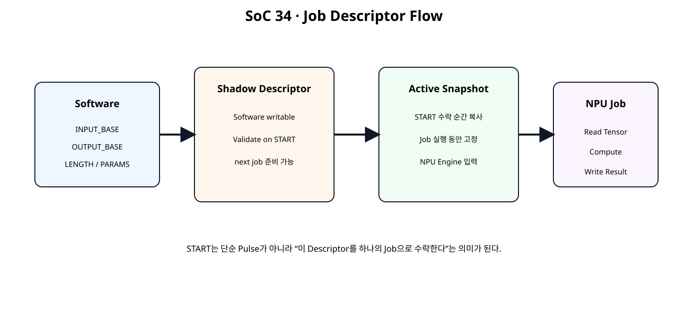
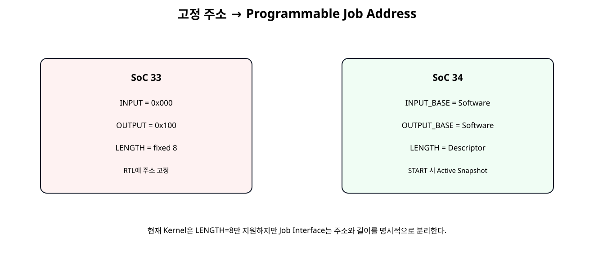
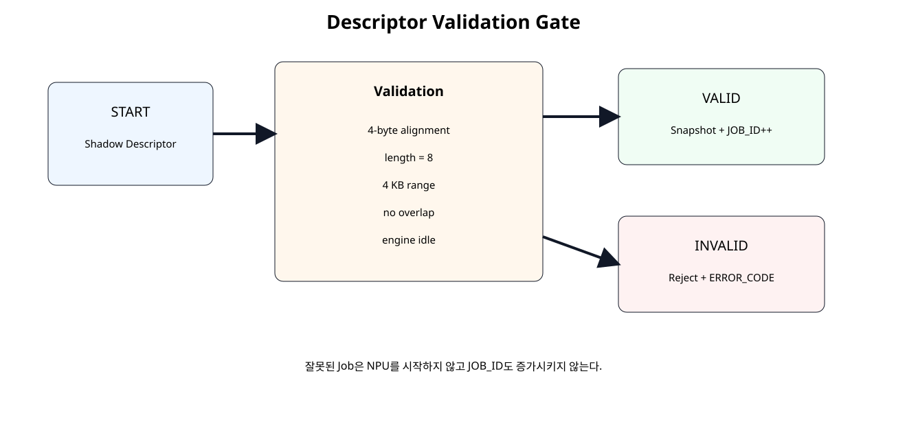

# Command · Descriptor · Job Control


## 전체 학습 위치


## 이번 장의 목표


[](../images/soc34/soc34_descriptor_flow.svg)

Software가 Shadow Descriptor를 작성하고 START가 수락되면 Active Snapshot으로 Job을 실행한다.


## 고정 주소의 한계


[](../images/soc34/soc34_programmable_address.svg)

SoC 33의 RTL 고정 주소를 Software가 지정하는 INPUT_BASE / OUTPUT_BASE로 바꾼다.


## Job Descriptor 개념

Descriptor는 한 번의 Accelerator 작업에 필요한 주소, 길이, Parameter, 상태 정보를 하나의 Job 정의로 묶는 방법이다.


```text
INPUT_BASE
OUTPUT_BASE
LENGTH_WORDS
BIAS / SCALE / ZERO_POINT
CONTROL.START
STATUS
JOB_ID
ERROR_CODE
```


## Direct Job과 Scatter-Gather 구분

이번 장은 AXI DMA의 Scatter-Gather Descriptor를 구현하는 장이 아니다. AXI DMA에서 사용되는 Buffer Address, Length, Control, Status와 같은 개념을 참고해 하나의 Job만 직접 실행하는 교육용 Direct Descriptor를 구성한다.


## 전체 Job Flow


## Register Map


| Offset | Register | Access | 역할 |
| --- | --- | --- | --- |
| 0x00 | CONTROL | W1P | START / CLEAR_DONE / CLEAR_ERROR |
| 0x04 | STATUS | RO | BUSY / DONE / ERROR / DESC_VALID |
| 0x08 | VERSION | RO | 0x00010000 |
| 0x0C | JOB_ID | RO | 수락된 Job 번호 |
| 0x10 | INPUT_BASE | RW | Tensor Input Byte Address |
| 0x14 | OUTPUT_BASE | RW | Tensor Output Byte Address |
| 0x18 | LENGTH_WORDS | RW | Input Length |
| 0x1C | ERROR_CODE | RO | Descriptor/Engine Error |
| 0x20~0x30 | PARAMETERS | RW | Bias / Scale / Zero Point |
| 0x34~0x3C | ACTIVE_DESC | RO | 현재 Job Snapshot |
| 0x40~0x44 | COUNTERS | RO | Read/Write Word Count |


## Shadow Descriptor

Software가 수정하는 작업 준비 영역이다. 다음 Job의 주소와 Parameter를 저장한다.


## Active Snapshot

START가 정상 수락되는 Clock에 Shadow 값을 Active Register로 복사한다. Job Engine은 Active 값만 사용한다.


## 왜 Snapshot이 필요한가

Job 실행 중 Software가 다음 Job을 준비하기 위해 Shadow를 바꾸더라도 현재 NPU의 주소와 Parameter가 변하지 않아야 한다. Shadow/Active 분리는 Software와 Hardware 실행 시점을 분리한다.


## INPUT_BASE

Input Tensor가 시작되는 BRAM Byte Address다. 32-bit Word 접근을 사용하므로 4-byte Alignment가 필요하다.


## OUTPUT_BASE

결과 Tensor의 시작 Byte Address다. 현재 Kernel은 CH0/CH1 Packed Result 두 Word를 기록하므로 8 Byte 공간이 필요하다.


## LENGTH_WORDS


## Kernel Parameter

Bias, Multiplier, Shift, Zero Point도 Descriptor와 같은 시점에 Active Snapshot으로 복사한다.


## Descriptor Validation


[](../images/soc34/soc34_descriptor_validation.svg)

잘못된 Descriptor는 NPU를 시작하지 않고 Error Code를 남긴다.


## Alignment Check


## Range Check


## Buffer Overlap Check

Input 범위와 Output 범위가 겹치면 현재 교육용 Kernel은 Reject한다. In-place 연산을 지원한다고 가정하지 않는다.


## BUSY Check

Engine이 BUSY인 상태에서 다시 START를 쓰면 Job은 수락하지 않고 Error Code 1을 기록한다.


## Error Code


| Code | 원인 |
| --- | --- |
| 0 | None |
| 1 | BUSY |
| 2 | INPUT alignment |
| 3 | OUTPUT alignment |
| 4 | Length unsupported |
| 5 | Input range |
| 6 | Output range |
| 7 | Buffer overlap |
| 8 | Engine error |


## JOB_ID

정상 수락된 START마다 JOB_ID가 1 증가한다. Descriptor 오류나 BUSY 거부 Job은 증가시키지 않는다.


## START 의미의 변화

SoC 31의 START는 단순 Hardware Pulse였다. SoC 34부터 START는 “현재 Shadow Descriptor를 검증하고 하나의 Job으로 수락해 실행한다”는 의미를 가진다.


## Descriptor Controller RTL


```verilog
module npu_job_descriptor_controller (
    input  wire               clk,
    input  wire               resetn,

    // Software-visible register interface.
    input  wire               wr_en_i,
    input  wire [7:0]         wr_addr_i,
    input  wire [31:0]        wr_data_i,
    input  wire [3:0]         wr_strb_i,

    input  wire [7:0]         rd_addr_i,
    output reg  [31:0]        rd_data_o,

    // Job engine handshake/status.
    output reg                job_start_o,

    output reg  [11:0]        active_input_base_o,
    output reg  [11:0]        active_output_base_o,
    output reg  [15:0]        active_length_words_o,

    output reg signed [31:0]  active_bias_ch0_o,
    output reg signed [31:0]  active_bias_ch1_o,

    output reg signed [15:0]  active_mult_ch0_o,
    output reg signed [15:0]  active_mult_ch1_o,

    output reg        [5:0]   active_shift_ch0_o,
    output reg        [5:0]   active_shift_ch1_o,

    output reg signed [15:0]  active_zp_ch0_o,
    output reg signed [15:0]  active_zp_ch1_o,

    input  wire               engine_busy_i,
    input  wire               engine_done_i,
    input  wire               engine_error_i,

    input  wire [15:0]        read_word_count_i,
    input  wire [15:0]        write_word_count_i,

    output wire               busy_o,
    output reg                done_sticky_o,
    output reg                error_sticky_o,
    output reg  [7:0]         error_code_o,
    output reg  [31:0]        job_id_o
);

// ------------------------------------------------------------
// SoC 34 · Job Descriptor / Command Controller
// ------------------------------------------------------------
//
// Register map:
//
// 0x00 CONTROL          W1P
//      bit0 START
//      bit1 CLEAR_DONE
//      bit2 CLEAR_ERROR
//
// 0x04 STATUS           RO
//      bit0 BUSY
//      bit1 DONE_STICKY
//      bit2 ERROR_STICKY
//      bit3 DESCRIPTOR_VALID
//
// 0x08 VERSION          RO = 0x0001_0000
// 0x0C JOB_ID           RO
//
// Shadow descriptor:
// 0x10 INPUT_BASE       RW byte address, 4-byte aligned
// 0x14 OUTPUT_BASE      RW byte address, 4-byte aligned
// 0x18 LENGTH_WORDS     RW
// 0x1C ERROR_CODE       RO
//
// Kernel parameters:
// 0x20 BIAS_CH0         RW
// 0x24 BIAS_CH1         RW
// 0x28 SCALE_CH0        RW [15:0] multiplier, [21:16] shift
// 0x2C SCALE_CH1        RW
// 0x30 ZERO_POINT       RW [15:0] CH0, [31:16] CH1
//
// Active descriptor snapshot:
// 0x34 ACTIVE_INPUT     RO
// 0x38 ACTIVE_OUTPUT    RO
// 0x3C ACTIVE_LENGTH    RO
//
// Engine counters:
// 0x40 READ_WORD_COUNT  RO
// 0x44 WRITE_WORD_COUNT RO
//
// Current teaching kernel still consumes exactly 8 int32 input words
// and produces two packed 32-bit output words.
// LENGTH_WORDS therefore must be 8 in SoC 34.
//
// SoC 35 will integrate this controller with the full accelerator
// system while retaining the descriptor concept.

localparam [31:0] VERSION_VALUE = 32'h0001_0000;

localparam [7:0] ERR_NONE               = 8'd0;
localparam [7:0] ERR_BUSY               = 8'd1;
localparam [7:0] ERR_INPUT_ALIGN        = 8'd2;
localparam [7:0] ERR_OUTPUT_ALIGN       = 8'd3;
localparam [7:0] ERR_LENGTH_UNSUPPORTED = 8'd4;
localparam [7:0] ERR_INPUT_RANGE        = 8'd5;
localparam [7:0] ERR_OUTPUT_RANGE       = 8'd6;
localparam [7:0] ERR_BUFFER_OVERLAP     = 8'd7;
localparam [7:0] ERR_ENGINE             = 8'd8;

function [31:0] apply_wstrb32;
    input [31:0] old_value;
    input [31:0] new_value;
    input [3:0]  strb;

    integer byte_index;

    begin
        apply_wstrb32 = old_value;

        for (
            byte_index = 0;
            byte_index < 4;
            byte_index = byte_index + 1
        ) begin
            if (strb[byte_index]) begin
                apply_wstrb32[
                    (byte_index * 8) +: 8
                ] =
                    new_value[
                        (byte_index * 8) +: 8
                    ];
            end
        end
    end
endfunction

// ------------------------------------------------------------
// Shadow descriptor.
// ------------------------------------------------------------
reg [11:0] shadow_input_base_q;
reg [11:0] shadow_output_base_q;
reg [15:0] shadow_length_words_q;

reg signed [31:0] shadow_bias_ch0_q;
reg signed [31:0] shadow_bias_ch1_q;

reg signed [15:0] shadow_mult_ch0_q;
reg signed [15:0] shadow_mult_ch1_q;

reg [5:0] shadow_shift_ch0_q;
reg [5:0] shadow_shift_ch1_q;

reg signed [15:0] shadow_zp_ch0_q;
reg signed [15:0] shadow_zp_ch1_q;

wire control_write_w;

assign control_write_w =
    wr_en_i &&
    (wr_addr_i[7:2] == 6'h00);

wire start_request_w;
wire clear_done_request_w;
wire clear_error_request_w;

assign start_request_w =
    control_write_w &&
    wr_strb_i[0] &&
    wr_data_i[0];

assign clear_done_request_w =
    control_write_w &&
    wr_strb_i[0] &&
    wr_data_i[1];

assign clear_error_request_w =
    control_write_w &&
    wr_strb_i[0] &&
    wr_data_i[2];

assign busy_o =
    engine_busy_i;

// ------------------------------------------------------------
// Descriptor validation.
//
// BRAM byte-address range: 0x000..0xFFF.
// Current input span: LENGTH_WORDS * 4 bytes.
// Current output span: 8 bytes.
// ------------------------------------------------------------
wire input_aligned_w;
wire output_aligned_w;
wire length_supported_w;

wire [16:0] input_end_exclusive_w;
wire [12:0] output_end_exclusive_w;

wire input_range_ok_w;
wire output_range_ok_w;

wire no_overlap_w;
wire descriptor_valid_w;

assign input_aligned_w =
    (shadow_input_base_q[1:0] == 2'b00);

assign output_aligned_w =
    (shadow_output_base_q[1:0] == 2'b00);

assign length_supported_w =
    (shadow_length_words_q == 16'd8);

assign input_end_exclusive_w =
    {5'd0, shadow_input_base_q} +
    ({1'b0, shadow_length_words_q} << 2);

assign output_end_exclusive_w =
    {1'b0, shadow_output_base_q} +
    13'd8;

assign input_range_ok_w =
    (input_end_exclusive_w <= 17'h01000);

assign output_range_ok_w =
    (output_end_exclusive_w <= 13'h1000);

assign no_overlap_w =
    (
        output_end_exclusive_w <=
        {1'b0, shadow_input_base_q}
    ) ||
    (
        input_end_exclusive_w <=
        {5'd0, shadow_output_base_q}
    );

assign descriptor_valid_w =
    input_aligned_w &&
    output_aligned_w &&
    length_supported_w &&
    input_range_ok_w &&
    output_range_ok_w &&
    no_overlap_w;

function [7:0] descriptor_error_code;
    input dummy;

    begin
        if (!input_aligned_w)
            descriptor_error_code = ERR_INPUT_ALIGN;
        else if (!output_aligned_w)
            descriptor_error_code = ERR_OUTPUT_ALIGN;
        else if (!length_supported_w)
            descriptor_error_code = ERR_LENGTH_UNSUPPORTED;
        else if (!input_range_ok_w)
            descriptor_error_code = ERR_INPUT_RANGE;
        else if (!output_range_ok_w)
            descriptor_error_code = ERR_OUTPUT_RANGE;
        else if (!no_overlap_w)
            descriptor_error_code = ERR_BUFFER_OVERLAP;
        else
            descriptor_error_code = ERR_NONE;
    end
endfunction

reg [31:0] merged_w;

// ------------------------------------------------------------
// Register / command process.
// ------------------------------------------------------------
always @(posedge clk) begin
    if (!resetn) begin
        shadow_input_base_q <= 12'h000;
        shadow_output_base_q <= 12'h100;
        shadow_length_words_q <= 16'd8;

        shadow_bias_ch0_q <= 32'sd0;
        shadow_bias_ch1_q <= 32'sd4;

        shadow_mult_ch0_q <= 16'sd1;
        shadow_mult_ch1_q <= 16'sd3;

        shadow_shift_ch0_q <= 6'd1;
        shadow_shift_ch1_q <= 6'd1;

        shadow_zp_ch0_q <= 16'sd0;
        shadow_zp_ch1_q <= -16'sd3;

        active_input_base_o <= 12'h000;
        active_output_base_o <= 12'h100;
        active_length_words_o <= 16'd8;

        active_bias_ch0_o <= 32'sd0;
        active_bias_ch1_o <= 32'sd4;

        active_mult_ch0_o <= 16'sd1;
        active_mult_ch1_o <= 16'sd3;

        active_shift_ch0_o <= 6'd1;
        active_shift_ch1_o <= 6'd1;

        active_zp_ch0_o <= 16'sd0;
        active_zp_ch1_o <= -16'sd3;

        job_start_o <= 1'b0;

        done_sticky_o <= 1'b0;
        error_sticky_o <= 1'b0;
        error_code_o <= ERR_NONE;

        job_id_o <= 32'd0;
    end else begin
        job_start_o <= 1'b0;

        if (clear_done_request_w) begin
            done_sticky_o <= 1'b0;
        end

        if (clear_error_request_w) begin
            error_sticky_o <= 1'b0;
            error_code_o <= ERR_NONE;
        end

        if (engine_done_i) begin
            done_sticky_o <= 1'b1;
        end

        if (engine_error_i) begin
            error_sticky_o <= 1'b1;
            error_code_o <= ERR_ENGINE;
        end

        // START snapshots the descriptor only when valid and idle.
        if (start_request_w) begin
            if (engine_busy_i) begin
                error_sticky_o <= 1'b1;
                error_code_o <= ERR_BUSY;
            end else if (!descriptor_valid_w) begin
                error_sticky_o <= 1'b1;
                error_code_o <= descriptor_error_code(1'b0);
            end else begin
                active_input_base_o <= shadow_input_base_q;
                active_output_base_o <= shadow_output_base_q;
                active_length_words_o <= shadow_length_words_q;

                active_bias_ch0_o <= shadow_bias_ch0_q;
                active_bias_ch1_o <= shadow_bias_ch1_q;

                active_mult_ch0_o <= shadow_mult_ch0_q;
                active_mult_ch1_o <= shadow_mult_ch1_q;

                active_shift_ch0_o <= shadow_shift_ch0_q;
                active_shift_ch1_o <= shadow_shift_ch1_q;

                active_zp_ch0_o <= shadow_zp_ch0_q;
                active_zp_ch1_o <= shadow_zp_ch1_q;

                job_start_o <= 1'b1;

                done_sticky_o <= 1'b0;
                error_sticky_o <= 1'b0;
                error_code_o <= ERR_NONE;

                job_id_o <= job_id_o + 32'd1;
            end
        end

        // Shadow descriptor/register writes are legal while a job runs.
        // They do not affect the current active snapshot.
        if (wr_en_i) begin
            case (wr_addr_i[7:2])
                6'h04: begin
                    merged_w = apply_wstrb32(
                        {20'd0, shadow_input_base_q},
                        wr_data_i,
                        wr_strb_i
                    );
                    shadow_input_base_q <= merged_w[11:0];
                end

                6'h05: begin
                    merged_w = apply_wstrb32(
                        {20'd0, shadow_output_base_q},
                        wr_data_i,
                        wr_strb_i
                    );
                    shadow_output_base_q <= merged_w[11:0];
                end

                6'h06: begin
                    merged_w = apply_wstrb32(
                        {16'd0, shadow_length_words_q},
                        wr_data_i,
                        wr_strb_i
                    );
                    shadow_length_words_q <= merged_w[15:0];
                end

                6'h08: begin
                    merged_w = apply_wstrb32(
                        shadow_bias_ch0_q,
                        wr_data_i,
                        wr_strb_i
                    );
                    shadow_bias_ch0_q <= $signed(merged_w);
                end

                6'h09: begin
                    merged_w = apply_wstrb32(
                        shadow_bias_ch1_q,
                        wr_data_i,
                        wr_strb_i
                    );
                    shadow_bias_ch1_q <= $signed(merged_w);
                end

                6'h0A: begin
                    merged_w = apply_wstrb32(
                        {
                            10'd0,
                            shadow_shift_ch0_q,
                            shadow_mult_ch0_q
                        },
                        wr_data_i,
                        wr_strb_i
                    );

                    shadow_mult_ch0_q <=
                        $signed(merged_w[15:0]);

                    shadow_shift_ch0_q <=
                        merged_w[21:16];
                end

                6'h0B: begin
                    merged_w = apply_wstrb32(
                        {
                            10'd0,
                            shadow_shift_ch1_q,
                            shadow_mult_ch1_q
                        },
                        wr_data_i,
                        wr_strb_i
                    );

                    shadow_mult_ch1_q <=
                        $signed(merged_w[15:0]);

                    shadow_shift_ch1_q <=
                        merged_w[21:16];
                end

                6'h0C: begin
                    merged_w = apply_wstrb32(
                        {
                            shadow_zp_ch1_q,
                            shadow_zp_ch0_q
                        },
                        wr_data_i,
                        wr_strb_i
                    );

                    shadow_zp_ch0_q <=
                        $signed(merged_w[15:0]);

                    shadow_zp_ch1_q <=
                        $signed(merged_w[31:16]);
                end

                default: begin
                end
            endcase
        end
    end
end

// ------------------------------------------------------------
// Read mux.
// ------------------------------------------------------------
always @(*) begin
    case (rd_addr_i[7:2])
        6'h00: rd_data_o = 32'h0000_0000;

        6'h01: rd_data_o = {
            28'd0,
            descriptor_valid_w,
            error_sticky_o,
            done_sticky_o,
            engine_busy_i
        };

        6'h02: rd_data_o = VERSION_VALUE;
        6'h03: rd_data_o = job_id_o;

        6'h04: rd_data_o = {20'd0, shadow_input_base_q};
        6'h05: rd_data_o = {20'd0, shadow_output_base_q};
        6'h06: rd_data_o = {16'd0, shadow_length_words_q};
        6'h07: rd_data_o = {24'd0, error_code_o};

        6'h08: rd_data_o = shadow_bias_ch0_q;
        6'h09: rd_data_o = shadow_bias_ch1_q;

        6'h0A: rd_data_o = {
            10'd0,
            shadow_shift_ch0_q,
            shadow_mult_ch0_q
        };

        6'h0B: rd_data_o = {
            10'd0,
            shadow_shift_ch1_q,
            shadow_mult_ch1_q
        };

        6'h0C: rd_data_o = {
            shadow_zp_ch1_q,
            shadow_zp_ch0_q
        };

        6'h0D: rd_data_o = {20'd0, active_input_base_o};
        6'h0E: rd_data_o = {20'd0, active_output_base_o};
        6'h0F: rd_data_o = {16'd0, active_length_words_o};

        6'h10: rd_data_o = {16'd0, read_word_count_i};
        6'h11: rd_data_o = {16'd0, write_word_count_i};

        default: rd_data_o = 32'h0000_0000;
    endcase
end

endmodule
```


## Programmable Tensor Engine


```verilog
module tensor_job_engine (
    input  wire                 clk,
    input  wire                 resetn,

    input  wire                 start_i,

    input  wire [11:0]          input_base_i,
    input  wire [11:0]          output_base_i,
    input  wire [15:0]          length_words_i,

    input  wire signed [31:0]   bias_ch0_i,
    input  wire signed [31:0]   bias_ch1_i,

    input  wire signed [15:0]   mult_ch0_i,
    input  wire signed [15:0]   mult_ch1_i,

    input  wire        [5:0]    shift_ch0_i,
    input  wire        [5:0]    shift_ch1_i,

    input  wire signed [15:0]   zp_ch0_i,
    input  wire signed [15:0]   zp_ch1_i,

    output wire                 busy_o,
    output reg                  done_o,
    output reg                  error_o,

    output reg                  bram_en_o,
    output reg  [3:0]           bram_we_o,
    output reg  [11:0]          bram_addr_o,
    output reg  [31:0]          bram_wdata_o,
    input  wire [31:0]          bram_rdata_i,

    output reg  [15:0]          read_word_count_o,
    output reg  [15:0]          write_word_count_o
);

// Current SoC 34 teaching kernel accepts exactly 8 input words.
// Descriptor validation is performed by the controller before START.

localparam [3:0] ST_IDLE          = 4'd0;
localparam [3:0] ST_READ_REQ      = 4'd1;
localparam [3:0] ST_READ_CAPTURE  = 4'd2;
localparam [3:0] ST_START_REQUANT = 4'd3;
localparam [3:0] ST_WAIT_RESULT   = 4'd4;
localparam [3:0] ST_WRITE_CH0     = 4'd5;
localparam [3:0] ST_WRITE_CH1     = 4'd6;
localparam [3:0] ST_DONE          = 4'd7;

reg [3:0] state_q;
reg [3:0] read_index_q;

reg [127:0] acc_ch0_batch_q;
reg [127:0] acc_ch1_batch_q;

reg requant_start_q;

wire requant_busy_w;
wire requant_done_w;
wire requant_result_valid_w;

wire [31:0] q_ch0_batch_w;
wire [31:0] q_ch1_batch_w;

wire [7:0] saturation_count_w;

assign busy_o =
    (state_q != ST_IDLE) &&
    (state_q != ST_DONE);

requantize_batch2x4_serial u_requant_batch (
    .clk(clk),
    .resetn(resetn),

    .start_i(requant_start_q),

    .acc_ch0_batch_i(acc_ch0_batch_q),
    .acc_ch1_batch_i(acc_ch1_batch_q),

    .bias_ch0_i(bias_ch0_i),
    .bias_ch1_i(bias_ch1_i),

    .mult_ch0_i(mult_ch0_i),
    .mult_ch1_i(mult_ch1_i),

    .shift_ch0_i(shift_ch0_i),
    .shift_ch1_i(shift_ch1_i),

    .zp_ch0_i(zp_ch0_i),
    .zp_ch1_i(zp_ch1_i),

    .busy_o(requant_busy_w),
    .done_o(requant_done_w),
    .result_valid_o(requant_result_valid_w),

    .q_ch0_batch_o(q_ch0_batch_w),
    .q_ch1_batch_o(q_ch1_batch_w),

    .saturation_count_o(saturation_count_w)
);

always @(*) begin
    bram_en_o    = 1'b0;
    bram_we_o    = 4'b0000;
    bram_addr_o  = 12'h000;
    bram_wdata_o = 32'h0000_0000;

    case (state_q)
        ST_READ_REQ: begin
            bram_en_o = 1'b1;
            bram_we_o = 4'b0000;

            bram_addr_o =
                input_base_i +
                {read_index_q, 2'b00};
        end

        ST_WRITE_CH0: begin
            bram_en_o    = 1'b1;
            bram_we_o    = 4'b1111;
            bram_addr_o  = output_base_i;
            bram_wdata_o = q_ch0_batch_w;
        end

        ST_WRITE_CH1: begin
            bram_en_o    = 1'b1;
            bram_we_o    = 4'b1111;
            bram_addr_o  = output_base_i + 12'd4;
            bram_wdata_o = q_ch1_batch_w;
        end

        default: begin
        end
    endcase
end

always @(posedge clk) begin
    if (!resetn) begin
        state_q <= ST_IDLE;
        read_index_q <= 4'd0;

        acc_ch0_batch_q <= 128'd0;
        acc_ch1_batch_q <= 128'd0;

        requant_start_q <= 1'b0;

        done_o <= 1'b0;
        error_o <= 1'b0;

        read_word_count_o <= 16'd0;
        write_word_count_o <= 16'd0;
    end else begin
        requant_start_q <= 1'b0;
        done_o <= 1'b0;

        case (state_q)
            ST_IDLE: begin
                if (start_i) begin
                    if (length_words_i != 16'd8) begin
                        error_o <= 1'b1;
                        done_o <= 1'b1;
                    end else begin
                        error_o <= 1'b0;

                        read_index_q <= 4'd0;
                        acc_ch0_batch_q <= 128'd0;
                        acc_ch1_batch_q <= 128'd0;

                        read_word_count_o <= 16'd0;
                        write_word_count_o <= 16'd0;

                        state_q <= ST_READ_REQ;
                    end
                end
            end

            ST_READ_REQ: begin
                state_q <= ST_READ_CAPTURE;
            end

            ST_READ_CAPTURE: begin
                read_word_count_o <=
                    read_word_count_o + 16'd1;

                case (read_index_q)
                    4'd0: acc_ch0_batch_q[31:0]    <= bram_rdata_i;
                    4'd1: acc_ch0_batch_q[63:32]   <= bram_rdata_i;
                    4'd2: acc_ch0_batch_q[95:64]   <= bram_rdata_i;
                    4'd3: acc_ch0_batch_q[127:96]  <= bram_rdata_i;

                    4'd4: acc_ch1_batch_q[31:0]    <= bram_rdata_i;
                    4'd5: acc_ch1_batch_q[63:32]   <= bram_rdata_i;
                    4'd6: acc_ch1_batch_q[95:64]   <= bram_rdata_i;

                    default:
                        acc_ch1_batch_q[127:96] <= bram_rdata_i;
                endcase

                if (read_index_q == 4'd7) begin
                    state_q <= ST_START_REQUANT;
                end else begin
                    read_index_q <=
                        read_index_q + 4'd1;

                    state_q <= ST_READ_REQ;
                end
            end

            ST_START_REQUANT: begin
                if (!requant_busy_w) begin
                    requant_start_q <= 1'b1;
                    state_q <= ST_WAIT_RESULT;
                end
            end

            ST_WAIT_RESULT: begin
                if (requant_result_valid_w) begin
                    state_q <= ST_WRITE_CH0;
                end
            end

            ST_WRITE_CH0: begin
                write_word_count_o <=
                    write_word_count_o + 16'd1;

                state_q <= ST_WRITE_CH1;
            end

            ST_WRITE_CH1: begin
                write_word_count_o <=
                    write_word_count_o + 16'd1;

                state_q <= ST_DONE;
            end

            ST_DONE: begin
                done_o <= 1'b1;
                state_q <= ST_IDLE;
            end

            default: begin
                error_o <= 1'b1;
                state_q <= ST_IDLE;
            end
        endcase
    end
end

endmodule
```


## Demo Top


```verilog
module npu_job_descriptor_demo_top (
    input  wire               clk,
    input  wire               resetn,

    // CPU register interface.
    input  wire               reg_wr_en_i,
    input  wire [7:0]         reg_wr_addr_i,
    input  wire [31:0]        reg_wr_data_i,
    input  wire [3:0]         reg_wr_strb_i,

    input  wire [7:0]         reg_rd_addr_i,
    output wire [31:0]        reg_rd_data_o,

    // CPU tensor-memory interface.
    input  wire               mem_en_i,
    input  wire [3:0]         mem_we_i,
    input  wire [11:0]        mem_addr_i,
    input  wire [31:0]        mem_wdata_i,
    output wire [31:0]        mem_rdata_o,

    output wire               busy_o,
    output wire               done_sticky_o,
    output wire               error_sticky_o,
    output wire [7:0]         error_code_o,
    output wire [31:0]        job_id_o
);

// Pure Shell / Wrapper.
//
// SoC 34 separates:
//   Descriptor/control registers
//   Tensor BRAM data plane
//   Job engine
//
// Actual AXI shells are added around these interfaces in the
// integrated SoC path. This chapter focuses on Job semantics.

wire job_start;

wire [11:0] active_input_base;
wire [11:0] active_output_base;
wire [15:0] active_length_words;

wire signed [31:0] active_bias_ch0;
wire signed [31:0] active_bias_ch1;

wire signed [15:0] active_mult_ch0;
wire signed [15:0] active_mult_ch1;

wire [5:0] active_shift_ch0;
wire [5:0] active_shift_ch1;

wire signed [15:0] active_zp_ch0;
wire signed [15:0] active_zp_ch1;

wire engine_busy;
wire engine_done;
wire engine_error;

wire [15:0] read_word_count;
wire [15:0] write_word_count;

wire        npu_bram_en;
wire [3:0]  npu_bram_we;
wire [11:0] npu_bram_addr;
wire [31:0] npu_bram_wdata;
wire [31:0] npu_bram_rdata;

npu_job_descriptor_controller u_descriptor (
    .clk(clk),
    .resetn(resetn),

    .wr_en_i(reg_wr_en_i),
    .wr_addr_i(reg_wr_addr_i),
    .wr_data_i(reg_wr_data_i),
    .wr_strb_i(reg_wr_strb_i),

    .rd_addr_i(reg_rd_addr_i),
    .rd_data_o(reg_rd_data_o),

    .job_start_o(job_start),

    .active_input_base_o(active_input_base),
    .active_output_base_o(active_output_base),
    .active_length_words_o(active_length_words),

    .active_bias_ch0_o(active_bias_ch0),
    .active_bias_ch1_o(active_bias_ch1),

    .active_mult_ch0_o(active_mult_ch0),
    .active_mult_ch1_o(active_mult_ch1),

    .active_shift_ch0_o(active_shift_ch0),
    .active_shift_ch1_o(active_shift_ch1),

    .active_zp_ch0_o(active_zp_ch0),
    .active_zp_ch1_o(active_zp_ch1),

    .engine_busy_i(engine_busy),
    .engine_done_i(engine_done),
    .engine_error_i(engine_error),

    .read_word_count_i(read_word_count),
    .write_word_count_i(write_word_count),

    .busy_o(busy_o),
    .done_sticky_o(done_sticky_o),
    .error_sticky_o(error_sticky_o),
    .error_code_o(error_code_o),
    .job_id_o(job_id_o)
);

tensor_job_engine u_engine (
    .clk(clk),
    .resetn(resetn),

    .start_i(job_start),

    .input_base_i(active_input_base),
    .output_base_i(active_output_base),
    .length_words_i(active_length_words),

    .bias_ch0_i(active_bias_ch0),
    .bias_ch1_i(active_bias_ch1),

    .mult_ch0_i(active_mult_ch0),
    .mult_ch1_i(active_mult_ch1),

    .shift_ch0_i(active_shift_ch0),
    .shift_ch1_i(active_shift_ch1),

    .zp_ch0_i(active_zp_ch0),
    .zp_ch1_i(active_zp_ch1),

    .busy_o(engine_busy),
    .done_o(engine_done),
    .error_o(engine_error),

    .bram_en_o(npu_bram_en),
    .bram_we_o(npu_bram_we),
    .bram_addr_o(npu_bram_addr),
    .bram_wdata_o(npu_bram_wdata),
    .bram_rdata_i(npu_bram_rdata),

    .read_word_count_o(read_word_count),
    .write_word_count_o(write_word_count)
);

tensor_bram_tdp_4k_model u_tensor_bram (
    .clk(clk),

    .a_en_i(mem_en_i),
    .a_we_i(mem_we_i),
    .a_addr_i(mem_addr_i),
    .a_wdata_i(mem_wdata_i),
    .a_rdata_o(mem_rdata_o),

    .b_en_i(npu_bram_en),
    .b_we_i(npu_bram_we),
    .b_addr_i(npu_bram_addr),
    .b_wdata_i(npu_bram_wdata),
    .b_rdata_o(npu_bram_rdata)
);

endmodule
```

Top은 Descriptor Controller, Job Engine, Tensor BRAM을 연결하는 Shell/Wrapper 역할만 한다.


## Software Descriptor Struct


```c
#ifndef NPU_JOB_H
#define NPU_JOB_H

#include "xil_io.h"
#include "xil_types.h"

#define NPU_JOB_CONTROL_OFFSET          0x00U
#define NPU_JOB_STATUS_OFFSET           0x04U
#define NPU_JOB_VERSION_OFFSET          0x08U
#define NPU_JOB_ID_OFFSET               0x0CU

#define NPU_JOB_INPUT_BASE_OFFSET       0x10U
#define NPU_JOB_OUTPUT_BASE_OFFSET      0x14U
#define NPU_JOB_LENGTH_WORDS_OFFSET     0x18U
#define NPU_JOB_ERROR_CODE_OFFSET       0x1CU

#define NPU_JOB_BIAS_CH0_OFFSET         0x20U
#define NPU_JOB_BIAS_CH1_OFFSET         0x24U
#define NPU_JOB_SCALE_CH0_OFFSET        0x28U
#define NPU_JOB_SCALE_CH1_OFFSET        0x2CU
#define NPU_JOB_ZERO_POINT_OFFSET       0x30U

#define NPU_JOB_ACTIVE_INPUT_OFFSET     0x34U
#define NPU_JOB_ACTIVE_OUTPUT_OFFSET    0x38U
#define NPU_JOB_ACTIVE_LENGTH_OFFSET    0x3CU

#define NPU_JOB_READ_COUNT_OFFSET       0x40U
#define NPU_JOB_WRITE_COUNT_OFFSET      0x44U

#define NPU_JOB_CONTROL_START_MASK      0x00000001U
#define NPU_JOB_CONTROL_CLR_DONE_MASK   0x00000002U
#define NPU_JOB_CONTROL_CLR_ERROR_MASK  0x00000004U

#define NPU_JOB_STATUS_BUSY_MASK        0x00000001U
#define NPU_JOB_STATUS_DONE_MASK        0x00000002U
#define NPU_JOB_STATUS_ERROR_MASK       0x00000004U
#define NPU_JOB_STATUS_DESC_VALID_MASK  0x00000008U

typedef struct {
    u32 InputBase;
    u32 OutputBase;
    u32 LengthWords;
    s32 BiasCh0;
    s32 BiasCh1;
    s16 MultCh0;
    s16 MultCh1;
    u8 ShiftCh0;
    u8 ShiftCh1;
    s16 ZpCh0;
    s16 ZpCh1;
} NpuJobDescriptor;

static inline void NpuJob_WriteReg(
    UINTPTR BaseAddress,
    u32 Offset,
    u32 Value
)
{
    Xil_Out32(BaseAddress + (UINTPTR)Offset, Value);
}

static inline u32 NpuJob_ReadReg(
    UINTPTR BaseAddress,
    u32 Offset
)
{
    return Xil_In32(BaseAddress + (UINTPTR)Offset);
}

static inline u32 NpuJob_PackScale(
    s16 Multiplier,
    u8 Shift
)
{
    return
        ((u32)Multiplier & 0x0000FFFFU) |
        (((u32)Shift & 0x3FU) << 16U);
}

static inline u32 NpuJob_PackZeroPoint(
    s16 ZpCh0,
    s16 ZpCh1
)
{
    return
        ((u32)ZpCh0 & 0x0000FFFFU) |
        (((u32)ZpCh1 & 0x0000FFFFU) << 16U);
}

static inline void NpuJob_Program(
    UINTPTR BaseAddress,
    const NpuJobDescriptor *Job
)
{
    NpuJob_WriteReg(
        BaseAddress,
        NPU_JOB_INPUT_BASE_OFFSET,
        Job->InputBase
    );

    NpuJob_WriteReg(
        BaseAddress,
        NPU_JOB_OUTPUT_BASE_OFFSET,
        Job->OutputBase
    );

    NpuJob_WriteReg(
        BaseAddress,
        NPU_JOB_LENGTH_WORDS_OFFSET,
        Job->LengthWords
    );

    NpuJob_WriteReg(
        BaseAddress,
        NPU_JOB_BIAS_CH0_OFFSET,
        (u32)Job->BiasCh0
    );

    NpuJob_WriteReg(
        BaseAddress,
        NPU_JOB_BIAS_CH1_OFFSET,
        (u32)Job->BiasCh1
    );

    NpuJob_WriteReg(
        BaseAddress,
        NPU_JOB_SCALE_CH0_OFFSET,
        NpuJob_PackScale(
            Job->MultCh0,
            Job->ShiftCh0
        )
    );

    NpuJob_WriteReg(
        BaseAddress,
        NPU_JOB_SCALE_CH1_OFFSET,
        NpuJob_PackScale(
            Job->MultCh1,
            Job->ShiftCh1
        )
    );

    NpuJob_WriteReg(
        BaseAddress,
        NPU_JOB_ZERO_POINT_OFFSET,
        NpuJob_PackZeroPoint(
            Job->ZpCh0,
            Job->ZpCh1
        )
    );
}

static inline void NpuJob_Start(UINTPTR BaseAddress)
{
    NpuJob_WriteReg(
        BaseAddress,
        NPU_JOB_CONTROL_OFFSET,
        NPU_JOB_CONTROL_START_MASK
    );
}

#endif
```


## Descriptor Programming


## Software Demo


```c
#include "xil_printf.h"
#include "xparameters.h"

#include "npu_job.h"

// Actual Base Address comes from Vivado Address Editor / xparameters.h.
#ifndef NPU_JOB_BASEADDR
#error "Define NPU_JOB_BASEADDR from generated xparameters.h."
#endif

int main(void)
{
    const UINTPTR base = (UINTPTR)NPU_JOB_BASEADDR;

    const NpuJobDescriptor job = {
        .InputBase = 0x200U,
        .OutputBase = 0x300U,
        .LengthWords = 8U,

        .BiasCh0 = 0,
        .BiasCh1 = 4,

        .MultCh0 = 1,
        .MultCh1 = 3,

        .ShiftCh0 = 1U,
        .ShiftCh1 = 1U,

        .ZpCh0 = 0,
        .ZpCh1 = -3
    };

    u32 status;
    u32 timeout;
    u32 error_code;
    u32 job_id;

    xil_printf("\r\nSoC34 NPU Job Descriptor demo\r\n");

    NpuJob_Program(base, &job);

    status = NpuJob_ReadReg(
        base,
        NPU_JOB_STATUS_OFFSET
    );

    if (
        (status & NPU_JOB_STATUS_DESC_VALID_MASK) == 0U
    ) {
        xil_printf("ERROR: descriptor invalid before START\r\n");
        return 1;
    }

    NpuJob_Start(base);

    timeout = 1000000U;

    do {
        status = NpuJob_ReadReg(
            base,
            NPU_JOB_STATUS_OFFSET
        );

        timeout--;
    } while (
        ((status & NPU_JOB_STATUS_DONE_MASK) == 0U) &&
        ((status & NPU_JOB_STATUS_ERROR_MASK) == 0U) &&
        (timeout != 0U)
    );

    if (timeout == 0U) {
        xil_printf("ERROR: job timeout\r\n");
        return 1;
    }

    if ((status & NPU_JOB_STATUS_ERROR_MASK) != 0U) {
        error_code = NpuJob_ReadReg(
            base,
            NPU_JOB_ERROR_CODE_OFFSET
        );

        xil_printf(
            "ERROR: descriptor/job error code = %u\r\n",
            (unsigned int)error_code
        );

        return 1;
    }

    job_id = NpuJob_ReadReg(
        base,
        NPU_JOB_ID_OFFSET
    );

    xil_printf(
        "JOB_ID = %u\r\n",
        (unsigned int)job_id
    );

    xil_printf(
        "READ_WORD_COUNT = %u\r\n",
        (unsigned int)NpuJob_ReadReg(
            base,
            NPU_JOB_READ_COUNT_OFFSET
        )
    );

    xil_printf(
        "WRITE_WORD_COUNT = %u\r\n",
        (unsigned int)NpuJob_ReadReg(
            base,
            NPU_JOB_WRITE_COUNT_OFFSET
        )
    );

    xil_printf("SOC34 JOB CONTROL: PASS\r\n");

    return 0;
}
```

실제 Base Address는 Address Editor와 xparameters.h에서 얻으며 자료에서 절대 주소를 임의로 고정하지 않는다.


## Shadow 변경 중 Active 고정


```text
START 시점:
Shadow INPUT 0x200 → Active INPUT 0x200
Shadow OUTPUT 0x300 → Active OUTPUT 0x300

Job 실행 중:
Shadow INPUT → 0x400
Shadow OUTPUT → 0x500

현재 Active:
여전히 0x200 / 0x300
```


## Rejected Job

Descriptor Validation을 통과하지 못하면 Engine START를 발생시키지 않는다. JOB_ID도 증가하지 않으며 ERROR_CODE만 기록한다.


## Self-Checking Testbench


```verilog
`timescale 1ns / 1ps

module tb_npu_job_descriptor;

logic clk = 1'b0;
logic resetn = 1'b0;

logic reg_wr_en_i = 1'b0;
logic [7:0] reg_wr_addr_i = 8'h00;
logic [31:0] reg_wr_data_i = 32'h0000_0000;
logic [3:0] reg_wr_strb_i = 4'h0;

logic [7:0] reg_rd_addr_i = 8'h00;
wire [31:0] reg_rd_data_o;

logic mem_en_i = 1'b0;
logic [3:0] mem_we_i = 4'b0000;
logic [11:0] mem_addr_i = 12'h000;
logic [31:0] mem_wdata_i = 32'h0000_0000;
wire [31:0] mem_rdata_o;

wire busy_o;
wire done_sticky_o;
wire error_sticky_o;
wire [7:0] error_code_o;
wire [31:0] job_id_o;

integer check_count = 0;
integer error_count = 0;

always #5 clk = ~clk;

npu_job_descriptor_demo_top dut (
    .clk(clk),
    .resetn(resetn),

    .reg_wr_en_i(reg_wr_en_i),
    .reg_wr_addr_i(reg_wr_addr_i),
    .reg_wr_data_i(reg_wr_data_i),
    .reg_wr_strb_i(reg_wr_strb_i),

    .reg_rd_addr_i(reg_rd_addr_i),
    .reg_rd_data_o(reg_rd_data_o),

    .mem_en_i(mem_en_i),
    .mem_we_i(mem_we_i),
    .mem_addr_i(mem_addr_i),
    .mem_wdata_i(mem_wdata_i),
    .mem_rdata_o(mem_rdata_o),

    .busy_o(busy_o),
    .done_sticky_o(done_sticky_o),
    .error_sticky_o(error_sticky_o),
    .error_code_o(error_code_o),
    .job_id_o(job_id_o)
);

task automatic check_true(
    input string name,
    input bit condition
);
    begin
        check_count = check_count + 1;

        if (!condition) begin
            error_count = error_count + 1;
            $error("CHECK FAIL: %s", name);
        end else begin
            $display("CHECK PASS: %s", name);
        end
    end
endtask

task automatic check_eq32(
    input string name,
    input logic [31:0] actual,
    input logic [31:0] expected
);
    begin
        check_count = check_count + 1;

        if (actual !== expected) begin
            error_count = error_count + 1;
            $error(
                "CHECK FAIL: %s actual=0x%08h expected=0x%08h",
                name,
                actual,
                expected
            );
        end else begin
            $display(
                "CHECK PASS: %s = 0x%08h",
                name,
                actual
            );
        end
    end
endtask

task automatic reg_write(
    input [7:0] address,
    input [31:0] data
);
    begin
        @(negedge clk);

        reg_wr_en_i = 1'b1;
        reg_wr_addr_i = address;
        reg_wr_data_i = data;
        reg_wr_strb_i = 4'hF;

        @(posedge clk);
        #1;

        @(negedge clk);

        reg_wr_en_i = 1'b0;
        reg_wr_addr_i = 8'h00;
        reg_wr_data_i = 32'h0000_0000;
        reg_wr_strb_i = 4'h0;
    end
endtask

task automatic reg_read(
    input [7:0] address,
    output [31:0] data
);
    begin
        reg_rd_addr_i = address;
        #1;
        data = reg_rd_data_o;
    end
endtask

task automatic mem_write32(
    input [11:0] address,
    input [31:0] data
);
    begin
        @(negedge clk);

        mem_en_i = 1'b1;
        mem_we_i = 4'hF;
        mem_addr_i = address;
        mem_wdata_i = data;

        @(posedge clk);
        #1;

        @(negedge clk);

        mem_en_i = 1'b0;
        mem_we_i = 4'h0;
        mem_addr_i = 12'h000;
        mem_wdata_i = 32'h0000_0000;
    end
endtask

task automatic mem_read32(
    input [11:0] address,
    output [31:0] data
);
    begin
        @(negedge clk);

        mem_en_i = 1'b1;
        mem_we_i = 4'h0;
        mem_addr_i = address;

        @(posedge clk);
        #1;

        @(negedge clk);

        mem_en_i = 1'b0;
        mem_addr_i = 12'h000;

        data = mem_rdata_o;
    end
endtask

task automatic wait_busy;
    integer timeout;
    begin
        timeout = 0;

        while (busy_o !== 1'b1) begin
            @(posedge clk);
            #1;

            timeout = timeout + 1;

            if (timeout > 30) begin
                $fatal(1, "BUSY did not assert");
            end
        end
    end
endtask

task automatic wait_done;
    integer timeout;
    begin
        timeout = 0;

        while (done_sticky_o !== 1'b1) begin
            @(posedge clk);
            #1;

            timeout = timeout + 1;

            if (timeout > 250) begin
                $fatal(1, "DONE did not assert");
            end
        end
    end
endtask

initial begin
    reg [31:0] rd;
    reg [31:0] job_id_before;

    repeat (5) @(posedge clk);
    resetn = 1'b1;

    // --------------------------------------------------------
    // 1. Prepare input tensor at programmable INPUT_BASE=0x200.
    // --------------------------------------------------------
    mem_write32(12'h200, 32'd16);
    mem_write32(12'h204, 32'd32);
    mem_write32(12'h208, 32'd48);
    mem_write32(12'h20C, 32'd64);

    mem_write32(12'h210, 32'd32);
    mem_write32(12'h214, 32'd64);
    mem_write32(12'h218, 32'd96);
    mem_write32(12'h21C, 32'd128);

    // Shadow descriptor.
    reg_write(8'h10, 32'h0000_0200);
    reg_write(8'h14, 32'h0000_0300);
    reg_write(8'h18, 32'd8);

    reg_read(8'h04, rd);
    check_true(
        "descriptor valid before START",
        (rd & 32'h8) != 0
    );

    // --------------------------------------------------------
    // 2. START -> active snapshot.
    // --------------------------------------------------------
    reg_write(8'h00, 32'h0000_0001);
    wait_busy();

    reg_read(8'h0C, rd);
    check_eq32(
        "JOB_ID first accepted job",
        rd,
        32'd1
    );

    reg_read(8'h34, rd);
    check_eq32(
        "ACTIVE_INPUT snapshot",
        rd,
        32'h0000_0200
    );

    reg_read(8'h38, rd);
    check_eq32(
        "ACTIVE_OUTPUT snapshot",
        rd,
        32'h0000_0300
    );

    // Change shadow while current job is running.
    // Current active addresses must remain unchanged.
    reg_write(8'h10, 32'h0000_0400);
    reg_write(8'h14, 32'h0000_0500);

    reg_read(8'h34, rd);
    check_eq32(
        "ACTIVE_INPUT stable while shadow changes",
        rd,
        32'h0000_0200
    );

    reg_read(8'h38, rd);
    check_eq32(
        "ACTIVE_OUTPUT stable while shadow changes",
        rd,
        32'h0000_0300
    );

    wait_done();

    check_true(
        "first job no error",
        error_sticky_o === 1'b0
    );

    reg_read(8'h40, rd);
    check_eq32(
        "READ_WORD_COUNT",
        rd,
        32'd8
    );

    reg_read(8'h44, rd);
    check_eq32(
        "WRITE_WORD_COUNT",
        rd,
        32'd2
    );

    mem_read32(12'h300, rd);
    check_eq32(
        "descriptor output CH0",
        rd,
        32'h2018_1008
    );

    mem_read32(12'h304, rd);
    check_eq32(
        "descriptor output CH1",
        rd,
        32'h7F7F_6333
    );

    // --------------------------------------------------------
    // 3. Invalid descriptor: unaligned INPUT_BASE.
    // --------------------------------------------------------
    reg_write(8'h00, 32'h0000_0006);

    reg_read(8'h0C, job_id_before);

    reg_write(8'h10, 32'h0000_0202);
    reg_write(8'h14, 32'h0000_0600);
    reg_write(8'h18, 32'd8);

    reg_write(8'h00, 32'h0000_0001);

    repeat (2) @(posedge clk);
    #1;

    check_true(
        "unaligned descriptor rejected",
        error_sticky_o === 1'b1
    );

    check_true(
        "unaligned error code = 2",
        error_code_o == 8'd2
    );

    check_eq32(
        "rejected job does not increment JOB_ID",
        job_id_o,
        job_id_before
    );

    // --------------------------------------------------------
    // 4. Invalid descriptor: unsupported length.
    // --------------------------------------------------------
    reg_write(8'h00, 32'h0000_0004);

    reg_write(8'h10, 32'h0000_0200);
    reg_write(8'h14, 32'h0000_0600);
    reg_write(8'h18, 32'd7);

    reg_write(8'h00, 32'h0000_0001);

    repeat (2) @(posedge clk);
    #1;

    check_true(
        "length 7 rejected",
        error_sticky_o === 1'b1
    );

    check_true(
        "length error code = 4",
        error_code_o == 8'd4
    );

    // --------------------------------------------------------
    // 5. Invalid descriptor: input/output overlap.
    // --------------------------------------------------------
    reg_write(8'h00, 32'h0000_0004);

    reg_write(8'h10, 32'h0000_0200);
    reg_write(8'h14, 32'h0000_0210);
    reg_write(8'h18, 32'd8);

    reg_write(8'h00, 32'h0000_0001);

    repeat (2) @(posedge clk);
    #1;

    check_true(
        "overlap descriptor rejected",
        error_sticky_o === 1'b1
    );

    check_true(
        "overlap error code = 7",
        error_code_o == 8'd7
    );

    // --------------------------------------------------------
    // 6. Invalid descriptor: input out of 4KB range.
    // --------------------------------------------------------
    reg_write(8'h00, 32'h0000_0004);

    reg_write(8'h10, 32'h0000_0FF0);
    reg_write(8'h14, 32'h0000_0100);
    reg_write(8'h18, 32'd8);

    reg_write(8'h00, 32'h0000_0001);

    repeat (2) @(posedge clk);
    #1;

    check_true(
        "input range descriptor rejected",
        error_sticky_o === 1'b1
    );

    check_true(
        "input range error code = 5",
        error_code_o == 8'd5
    );

    $display("");
    $display("SOC34 CHECK COUNT : %0d", check_count);
    $display("SOC34 ERROR COUNT : %0d", error_count);

    if (error_count == 0) begin
        $display("SOC34 JOB DESCRIPTOR TEST: PASS");
    end else begin
        $fatal(
            1,
            "SOC34 JOB DESCRIPTOR TEST: FAIL (%0d errors)",
            error_count
        );
    end

    #20;
    $finish;
end

endmodule
```


## Valid Job Test


```text
INPUT_BASE  → 0x200
OUTPUT_BASE → 0x300
LENGTH      → 8

Expected:
0x300 → 0x20181008
0x304 → 0x7F7F6333
JOB_ID → 1
```


## Invalid Alignment Test


## Invalid Length Test


## Overlap / Range Test


```text
INPUT 0x200~0x21F + OUTPUT 0x210~0x217
→ overlap → ERROR_CODE=7

INPUT_BASE=0xFF0, LENGTH=8
→ 4 KB boundary 초과 → ERROR_CODE=5
```


## Python Reference


```text
valid descriptor 0x200 -> 0x300, length=8: PASS
unaligned input -> error 2
unaligned output -> error 3
unsupported length -> error 4
input range -> error 5
output range -> error 6
buffer overlap -> error 7
shadow changes do not modify active snapshot: PASS
accepted job increments JOB_ID; rejected job does not
SOC34 PYTHON JOB-DESCRIPTOR REFERENCE: PASS
Spreadsheet runtime warmup failed during python startup
Traceback (most recent call last):
  File "/tmp/tmp.L2TH2Y5coc/artifact_tool_v2-2.8.22/artifact_tool/patches/warm_spreadsheet_runtime_on_startup.py", line 26, in warm_spreadsheet_runtime_on_startup
  File "/tmp/tmp.L2TH2Y5coc/artifact_tool_v2-2.8.22/artifact_tool/spreadsheet_warmup.py", line 772, in warm_spreadsheet_runtime
  File "/tmp/tmp.L2TH2Y5coc/artifact_tool_v2-2.8.22/artifact_tool/rpc/connection.py", line 37, in get_or_create_client
  File "/tmp/tmp.L2TH2Y5coc/artifact_tool_v2-2.8.22/artifact_tool/rpc/daemon.py", line 124, in start_daemon
TimeoutError: Timed out waiting for artifact tool daemon socket. Set ARTIFACT_TOOL_RPC_DAEMON_STARTUP_TIMEOUT_S=<seconds> to increase the limit.
```


## OOC Synthesis


```text
# SoC 34 · Job Descriptor / Data Plane OOC synthesis

set script_dir [file dirname [file normalize [info script]]]
set root_dir   [file normalize [file join $script_dir ".."]]
set rtl_dir    [file join $root_dir "rtl"]
set out_dir    [file normalize [file join $root_dir "reports" "generic_ooc"]]

file mkdir $out_dir

create_project -in_memory -part xc7a35tcpg236-1

read_verilog [file join $rtl_dir "requantize_s32_to_s8.v"]
read_verilog [file join $rtl_dir "requantize_batch2x4_serial.v"]
read_verilog [file join $rtl_dir "tensor_bram_tdp_4k_model.v"]
read_verilog [file join $rtl_dir "npu_job_descriptor_controller.v"]
read_verilog [file join $rtl_dir "tensor_job_engine.v"]
read_verilog [file join $rtl_dir "npu_job_descriptor_demo_top.v"]

synth_design \
    -mode out_of_context \
    -top npu_job_descriptor_demo_top \
    -part xc7a35tcpg236-1

create_clock \
    -name clk \
    -period 10.000 \
    [get_ports clk]

report_utilization \
    -hierarchical \
    -file [file join $out_dir "01_utilization_ooc.rpt"]

redirect -file [file join $out_dir "02_ramb_cells_ooc.rpt"] {
    set ramb_cells [get_cells -hier -filter {REF_NAME =~ RAMB*}]
    puts "RAMB primitive count: [llength $ramb_cells]"
    foreach cell $ramb_cells {
        puts "[get_property REF_NAME $cell]  $cell"
    }
}

redirect -file [file join $out_dir "03_dsp48_cells_ooc.rpt"] {
    set dsp_cells [get_cells -hier -filter {REF_NAME =~ DSP48*}]
    puts "DSP48 primitive count: [llength $dsp_cells]"
    foreach cell $dsp_cells {
        puts "[get_property REF_NAME $cell]  $cell"
    }
}

report_timing_summary \
    -delay_type min_max \
    -report_unconstrained \
    -max_paths 20 \
    -file [file join $out_dir "04_timing_summary_ooc.rpt"]

report_design_analysis \
    -max_paths 50 \
    -setup \
    -logic_level_distribution \
    -file [file join $out_dir "05_design_analysis_ooc.rpt"]

report_methodology \
    -file [file join $out_dir "06_methodology_ooc.rpt"]

puts ""
puts "SoC 34 OOC synthesis complete."
puts "Check descriptor controller, RAMB, DSP, and timing reports."
```


## RAMB / DSP / Timing

SoC 33과 동일한 BRAM/Requantizer를 재사용하지만 Descriptor Controller와 Address Arithmetic이 추가된다. 실제 RAMB, DSP48, LUT/FF, WNS/TNS 변화는 Vivado Report로 확인한다.


## SoC35 통합 위치


## 오류 점검


| 증상 | 원인 | 확인 |
| --- | --- | --- |
| 실행 중 주소가 바뀜 | Shadow를 직접 Engine에 연결 | Active Snapshot |
| 잘못된 주소로 BRAM 접근 | Alignment 미검증 | BASE[1:0] |
| BRAM 끝을 넘어감 | Range Check 누락 | base + length |
| Output이 Input을 덮음 | Overlap 허용 | Buffer Range 비교 |
| LENGTH=7인데 실행됨 | Kernel Capability와 Descriptor 분리 실패 | Unsupported Length Error |
| Reject된 Job인데 ID 증가 | START와 Accept 구분 안 됨 | JOB_ID는 Accept에서만 증가 |
| BUSY 중 새 Job이 현재 Job을 바꿈 | Active Snapshot 없음 | BUSY Reject + Shadow/Active 분리 |


## SoC 34 완료 체크리스트

- [ ] 고정 Tensor 주소의 한계를 설명한다.
- [ ] Direct Job Descriptor와 Scatter-Gather를 구분한다.
- [ ] INPUT_BASE / OUTPUT_BASE / LENGTH를 Register로 표현한다.
- [ ] Shadow Descriptor와 Active Snapshot을 구분한다.
- [ ] START 수락 시 Snapshot을 만든다.
- [ ] Alignment / Range / Overlap을 검증한다.
- [ ] 현재 Kernel은 LENGTH=8만 지원한다고 구분한다.
- [ ] 잘못된 Descriptor는 Engine을 시작하지 않는다.
- [ ] Error Code로 Reject 원인을 구분한다.
- [ ] JOB_ID는 정상 수락된 Job만 증가한다.
- [ ] 실행 중 Shadow 변경이 현재 Active Job에 영향을 주지 않는다.
- [ ] SoC35에서 IRQ + BRAM + Descriptor를 통합할 준비를 한다.

## 공식 문서 및 근거


| 자료 | 확인 항목 |
| --- | --- |
| AMD PG021 · AXI DMA Direct Register Mode | Address와 Length를 Control Register로 분리하는 구조 참고 |
| AMD PG021 · Scatter Gather Descriptor | Buffer Address / Control / Status Descriptor 개념 참고 |
| AMD UG901 · Memory Inference Capabilities · 2026.1 | True Dual-Port RAM / Byte Write / RAM Enable 지원 |

