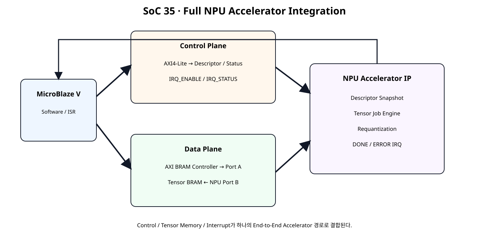
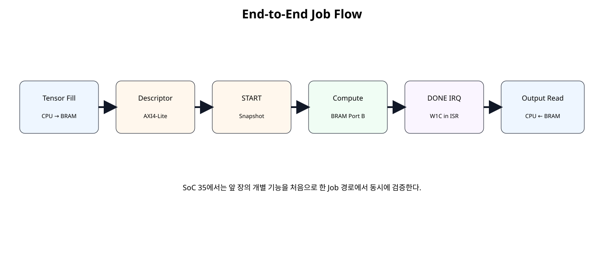

# Full NPU Accelerator Integration


## 전체 학습 위치


## 이번 장의 목표


[](../images/soc35/soc35_full_architecture.svg)

제어·Tensor Memory·Interrupt가 하나의 Accelerator 경로로 결합된다.


## 통합 전 위치


## Full NPU Architecture


[](../images/soc35/soc35_full_architecture.svg)

NPU IP는 S_AXI, BRAM, irq의 세 경계를 가진다.


## Control Plane 유지

Descriptor, START, STATUS, JOB_ID, ERROR_CODE, IRQ Register는 AXI4-Lite 경로에 둔다.


## Data Plane 유지

Tensor 데이터는 Register로 되돌리지 않고 AXI BRAM Controller + True Dual-Port BRAM 구조를 유지한다.


## Interrupt 통합


## 통합 Register Map

SoC 34 Map을 유지하고 0x48 IRQ_ENABLE, 0x4C IRQ_STATUS만 추가한다.


## Descriptor + IRQ

정상 Job 완료는 DONE Pending을, Descriptor Reject 또는 Engine Error는 ERROR Pending을 만든다. IRQ_STATUS는 W1C다.


## Job 실행 순서


[](../images/soc35/soc35_job_flow.svg)

Tensor Fill부터 Output Read까지 하나의 Job 흐름으로 연결한다.


## Buffer Ownership


## Shadow / Active

START 수락 시 Active Snapshot을 만들고 실행 중 Shadow 변경은 현재 Job에 영향을 주지 않는다.


## DONE 경로


## ERROR 경로


## AXI4-Lite Bridge

AW/W 독립 Capture를 유지하며 두 채널을 확보한 Commit Clock에서 Register Write와 BVALID를 생성한다.


## Native BRAM Interface

NPU의 Tensor Job Engine은 AXI Master가 아니라 Native BRAM Port를 사용한다. CPU는 다른 Port를 AXI BRAM Controller를 통해 사용한다.


## Full Accelerator Top


```verilog
module npu_full_accelerator_ip (
    (* X_INTERFACE_INFO = "xilinx.com:signal:clock:1.0 s_axi_aclk CLK" *)
    (* X_INTERFACE_PARAMETER = "XIL_INTERFACENAME s_axi_aclk, ASSOCIATED_BUSIF S_AXI:BRAM, ASSOCIATED_RESET s_axi_aresetn" *)
    input  wire        s_axi_aclk,

    (* X_INTERFACE_INFO = "xilinx.com:signal:reset:1.0 s_axi_aresetn RST" *)
    (* X_INTERFACE_PARAMETER = "XIL_INTERFACENAME s_axi_aresetn, POLARITY ACTIVE_LOW" *)
    input  wire        s_axi_aresetn,

    // --------------------------------------------------------
    // AXI4-Lite Control Plane
    // --------------------------------------------------------
    (* X_INTERFACE_INFO = "xilinx.com:interface:aximm:1.0 S_AXI AWADDR" *)
    input  wire [7:0]  s_axi_awaddr,
    (* X_INTERFACE_INFO = "xilinx.com:interface:aximm:1.0 S_AXI AWVALID" *)
    input  wire        s_axi_awvalid,
    (* X_INTERFACE_INFO = "xilinx.com:interface:aximm:1.0 S_AXI AWREADY" *)
    output wire        s_axi_awready,

    (* X_INTERFACE_INFO = "xilinx.com:interface:aximm:1.0 S_AXI WDATA" *)
    input  wire [31:0] s_axi_wdata,
    (* X_INTERFACE_INFO = "xilinx.com:interface:aximm:1.0 S_AXI WSTRB" *)
    input  wire [3:0]  s_axi_wstrb,
    (* X_INTERFACE_INFO = "xilinx.com:interface:aximm:1.0 S_AXI WVALID" *)
    input  wire        s_axi_wvalid,
    (* X_INTERFACE_INFO = "xilinx.com:interface:aximm:1.0 S_AXI WREADY" *)
    output wire        s_axi_wready,

    (* X_INTERFACE_INFO = "xilinx.com:interface:aximm:1.0 S_AXI BRESP" *)
    output wire [1:0]  s_axi_bresp,
    (* X_INTERFACE_INFO = "xilinx.com:interface:aximm:1.0 S_AXI BVALID" *)
    output wire        s_axi_bvalid,
    (* X_INTERFACE_INFO = "xilinx.com:interface:aximm:1.0 S_AXI BREADY" *)
    input  wire        s_axi_bready,

    (* X_INTERFACE_INFO = "xilinx.com:interface:aximm:1.0 S_AXI ARADDR" *)
    input  wire [7:0]  s_axi_araddr,
    (* X_INTERFACE_INFO = "xilinx.com:interface:aximm:1.0 S_AXI ARVALID" *)
    input  wire        s_axi_arvalid,
    (* X_INTERFACE_INFO = "xilinx.com:interface:aximm:1.0 S_AXI ARREADY" *)
    output wire        s_axi_arready,

    (* X_INTERFACE_INFO = "xilinx.com:interface:aximm:1.0 S_AXI RDATA" *)
    output wire [31:0] s_axi_rdata,
    (* X_INTERFACE_INFO = "xilinx.com:interface:aximm:1.0 S_AXI RRESP" *)
    output wire [1:0]  s_axi_rresp,
    (* X_INTERFACE_INFO = "xilinx.com:interface:aximm:1.0 S_AXI RVALID" *)
    output wire        s_axi_rvalid,
    (* X_INTERFACE_INFO = "xilinx.com:interface:aximm:1.0 S_AXI RREADY" *)
    input  wire        s_axi_rready,

    // --------------------------------------------------------
    // Native BRAM Data Plane
    // --------------------------------------------------------
    (* X_INTERFACE_INFO = "xilinx.com:interface:bram:1.0 BRAM CLK" *)
    output wire        bram_clk_o,
    (* X_INTERFACE_INFO = "xilinx.com:interface:bram:1.0 BRAM RST" *)
    output wire        bram_rst_o,
    (* X_INTERFACE_INFO = "xilinx.com:interface:bram:1.0 BRAM EN" *)
    output wire        bram_en_o,
    (* X_INTERFACE_INFO = "xilinx.com:interface:bram:1.0 BRAM WE" *)
    output wire [3:0]  bram_we_o,
    (* X_INTERFACE_INFO = "xilinx.com:interface:bram:1.0 BRAM ADDR" *)
    output wire [11:0] bram_addr_o,
    (* X_INTERFACE_INFO = "xilinx.com:interface:bram:1.0 BRAM DIN" *)
    output wire [31:0] bram_wdata_o,
    (* X_INTERFACE_INFO = "xilinx.com:interface:bram:1.0 BRAM DOUT" *)
    input  wire [31:0] bram_rdata_i,

    // --------------------------------------------------------
    // Interrupt
    // --------------------------------------------------------
    (* X_INTERFACE_INFO = "xilinx.com:signal:interrupt:1.0 irq INTERRUPT" *)
    (* X_INTERFACE_PARAMETER = "XIL_INTERFACENAME irq, SENSITIVITY LEVEL_HIGH" *)
    output wire        irq
);

// Pure Shell / Wrapper:
// AXI bridge + control/descriptor/IRQ + job engine + BRAM clock/reset adapter.

wire        reg_wr_en;
wire [7:0]  reg_wr_addr;
wire [31:0] reg_wr_data;
wire [3:0]  reg_wr_strb;

wire [7:0]  reg_rd_addr;
wire [31:0] reg_rd_data;

wire job_start;

wire [11:0] active_input_base;
wire [11:0] active_output_base;
wire [15:0] active_length_words;

wire signed [31:0] active_bias_ch0;
wire signed [31:0] active_bias_ch1;

wire signed [15:0] active_mult_ch0;
wire signed [15:0] active_mult_ch1;

wire [5:0] active_shift_ch0;
wire [5:0] active_shift_ch1;

wire signed [15:0] active_zp_ch0;
wire signed [15:0] active_zp_ch1;

wire engine_busy;
wire engine_done;
wire engine_error;

wire [15:0] read_word_count;
wire [15:0] write_word_count;

wire ctrl_busy;
wire done_sticky;
wire error_sticky;
wire [7:0] error_code;
wire [31:0] job_id;
wire [1:0] irq_enable;
wire [1:0] irq_status;

axi4lite_reg_bridge u_axi_bridge (
    .s_axi_aclk(s_axi_aclk),
    .s_axi_aresetn(s_axi_aresetn),

    .s_axi_awaddr(s_axi_awaddr),
    .s_axi_awvalid(s_axi_awvalid),
    .s_axi_awready(s_axi_awready),

    .s_axi_wdata(s_axi_wdata),
    .s_axi_wstrb(s_axi_wstrb),
    .s_axi_wvalid(s_axi_wvalid),
    .s_axi_wready(s_axi_wready),

    .s_axi_bresp(s_axi_bresp),
    .s_axi_bvalid(s_axi_bvalid),
    .s_axi_bready(s_axi_bready),

    .s_axi_araddr(s_axi_araddr),
    .s_axi_arvalid(s_axi_arvalid),
    .s_axi_arready(s_axi_arready),

    .s_axi_rdata(s_axi_rdata),
    .s_axi_rresp(s_axi_rresp),
    .s_axi_rvalid(s_axi_rvalid),
    .s_axi_rready(s_axi_rready),

    .reg_wr_en_o(reg_wr_en),
    .reg_wr_addr_o(reg_wr_addr),
    .reg_wr_data_o(reg_wr_data),
    .reg_wr_strb_o(reg_wr_strb),

    .reg_rd_addr_o(reg_rd_addr),
    .reg_rd_data_i(reg_rd_data)
);

npu_full_control_irq u_control (
    .clk(s_axi_aclk),
    .resetn(s_axi_aresetn),

    .wr_en_i(reg_wr_en),
    .wr_addr_i(reg_wr_addr),
    .wr_data_i(reg_wr_data),
    .wr_strb_i(reg_wr_strb),

    .rd_addr_i(reg_rd_addr),
    .rd_data_o(reg_rd_data),

    .job_start_o(job_start),

    .active_input_base_o(active_input_base),
    .active_output_base_o(active_output_base),
    .active_length_words_o(active_length_words),

    .active_bias_ch0_o(active_bias_ch0),
    .active_bias_ch1_o(active_bias_ch1),

    .active_mult_ch0_o(active_mult_ch0),
    .active_mult_ch1_o(active_mult_ch1),

    .active_shift_ch0_o(active_shift_ch0),
    .active_shift_ch1_o(active_shift_ch1),

    .active_zp_ch0_o(active_zp_ch0),
    .active_zp_ch1_o(active_zp_ch1),

    .engine_busy_i(engine_busy),
    .engine_done_i(engine_done),
    .engine_error_i(engine_error),

    .read_word_count_i(read_word_count),
    .write_word_count_i(write_word_count),

    .busy_o(ctrl_busy),
    .done_sticky_o(done_sticky),
    .error_sticky_o(error_sticky),
    .error_code_o(error_code),
    .job_id_o(job_id),

    .irq_o(irq),
    .irq_enable_o(irq_enable),
    .irq_status_o(irq_status)
);

tensor_job_engine u_engine (
    .clk(s_axi_aclk),
    .resetn(s_axi_aresetn),

    .start_i(job_start),

    .input_base_i(active_input_base),
    .output_base_i(active_output_base),
    .length_words_i(active_length_words),

    .bias_ch0_i(active_bias_ch0),
    .bias_ch1_i(active_bias_ch1),

    .mult_ch0_i(active_mult_ch0),
    .mult_ch1_i(active_mult_ch1),

    .shift_ch0_i(active_shift_ch0),
    .shift_ch1_i(active_shift_ch1),

    .zp_ch0_i(active_zp_ch0),
    .zp_ch1_i(active_zp_ch1),

    .busy_o(engine_busy),
    .done_o(engine_done),
    .error_o(engine_error),

    .bram_en_o(bram_en_o),
    .bram_we_o(bram_we_o),
    .bram_addr_o(bram_addr_o),
    .bram_wdata_o(bram_wdata_o),
    .bram_rdata_i(bram_rdata_i),

    .read_word_count_o(read_word_count),
    .write_word_count_o(write_word_count)
);

bram_clock_reset_adapter u_bram_clock_reset (
    .clk_i(s_axi_aclk),
    .resetn_i(s_axi_aresetn),

    .bram_clk_o(bram_clk_o),
    .bram_rst_o(bram_rst_o)
);

endmodule
```


## Top Shell/Wrapper 원칙

Top에는 기능 FSM, 계산, 정책 판단을 넣지 않고 AXI Bridge, Control, Engine, Clock/Reset Adapter 인스턴스 연결만 둔다.


## Vivado Block Design


```text
MicroBlaze V → SmartConnect → NPU S_AXI
MicroBlaze V → AXI BRAM Controller → BMG Port A
NPU BRAM → BMG Port B
NPU irq → xlconcat → AXI INTC → MicroBlaze V
```


## AXI BRAM Controller

CPU가 사용하는 BRAM Interface를 한 Port로 제한하고 BMG의 다른 Port를 NPU Native Port에 남기는 구성을 확인한다.


## True Dual-Port BMG

Port A는 CPU, Port B는 NPU가 사용한다. 같은 Tensor Buffer의 동시 수정은 Ownership Rule로 금지한다.


## AXI Interrupt Controller

MicroBlaze V에서는 AXI Interrupt Controller를 사용하고 여러 Source는 Concat으로 결합한다.

CPU는 표준 외부 인터럽트 모드로 설정한다. AXI INTC의 irq를 microblaze_riscv_0/Interrupt에 연결하고 입력은 Level-High로 맞춘다. MicroBlaze V의 mtvec 진입과 mepc 저장·MRET 복귀는 생성 BSP가 처리한다. Xil_ExceptionEnable()은 외부 인터럽트 허용과 전역 허용을 설정하며, ISR은 주변장치의 원인을 해제한다.


## Address Editor

NPU Control Base와 Tensor BRAM Base를 각각 할당한다. Descriptor의 INPUT_BASE/OUTPUT_BASE는 Tensor BRAM 내부 Offset이다.

SDT 빌드는 INTC_BASEADDR, 비 SDT 빌드는 INTC_DEVICE_ID를 생성 메타데이터에 연결한다. NPU_INTR_ID는 실제 xlconcat·INTC 입력 번호와 일치시킨다.


## Software Driver


```c
#ifndef NPU_FULL_H
#define NPU_FULL_H

#include "xil_io.h"
#include "xil_types.h"

#define NPU_CONTROL_OFFSET          0x00U
#define NPU_STATUS_OFFSET           0x04U
#define NPU_VERSION_OFFSET          0x08U
#define NPU_JOB_ID_OFFSET           0x0CU

#define NPU_INPUT_BASE_OFFSET       0x10U
#define NPU_OUTPUT_BASE_OFFSET      0x14U
#define NPU_LENGTH_WORDS_OFFSET     0x18U
#define NPU_ERROR_CODE_OFFSET       0x1CU

#define NPU_BIAS_CH0_OFFSET         0x20U
#define NPU_BIAS_CH1_OFFSET         0x24U
#define NPU_SCALE_CH0_OFFSET        0x28U
#define NPU_SCALE_CH1_OFFSET        0x2CU
#define NPU_ZERO_POINT_OFFSET       0x30U

#define NPU_ACTIVE_INPUT_OFFSET     0x34U
#define NPU_ACTIVE_OUTPUT_OFFSET    0x38U
#define NPU_ACTIVE_LENGTH_OFFSET    0x3CU

#define NPU_READ_COUNT_OFFSET       0x40U
#define NPU_WRITE_COUNT_OFFSET      0x44U

#define NPU_IRQ_ENABLE_OFFSET       0x48U
#define NPU_IRQ_STATUS_OFFSET       0x4CU

#define NPU_CONTROL_START_MASK      0x00000001U
#define NPU_CONTROL_CLR_DONE_MASK   0x00000002U
#define NPU_CONTROL_CLR_ERROR_MASK  0x00000004U

#define NPU_STATUS_BUSY_MASK        0x00000001U
#define NPU_STATUS_DONE_MASK        0x00000002U
#define NPU_STATUS_ERROR_MASK       0x00000004U
#define NPU_STATUS_DESC_VALID_MASK  0x00000008U

#define NPU_IRQ_DONE_MASK           0x00000001U
#define NPU_IRQ_ERROR_MASK          0x00000002U
#define NPU_IRQ_ALL_MASK            0x00000003U

typedef struct {
    u32 InputBase;
    u32 OutputBase;
    u32 LengthWords;

    s32 BiasCh0;
    s32 BiasCh1;

    s16 MultCh0;
    s16 MultCh1;

    u8 ShiftCh0;
    u8 ShiftCh1;

    s16 ZpCh0;
    s16 ZpCh1;
} NpuDescriptor;

static inline void Npu_WriteReg(
    UINTPTR Base,
    u32 Offset,
    u32 Value
)
{
    Xil_Out32(Base + (UINTPTR)Offset, Value);
}

static inline u32 Npu_ReadReg(
    UINTPTR Base,
    u32 Offset
)
{
    return Xil_In32(Base + (UINTPTR)Offset);
}

static inline u32 Npu_PackScale(
    s16 Multiplier,
    u8 Shift
)
{
    return
        ((u32)Multiplier & 0xFFFFU) |
        (((u32)Shift & 0x3FU) << 16U);
}

static inline u32 Npu_PackZeroPoint(
    s16 ZpCh0,
    s16 ZpCh1
)
{
    return
        ((u32)ZpCh0 & 0xFFFFU) |
        (((u32)ZpCh1 & 0xFFFFU) << 16U);
}

static inline void Npu_ProgramDescriptor(
    UINTPTR Base,
    const NpuDescriptor *Desc
)
{
    Npu_WriteReg(Base, NPU_INPUT_BASE_OFFSET, Desc->InputBase);
    Npu_WriteReg(Base, NPU_OUTPUT_BASE_OFFSET, Desc->OutputBase);
    Npu_WriteReg(Base, NPU_LENGTH_WORDS_OFFSET, Desc->LengthWords);

    Npu_WriteReg(Base, NPU_BIAS_CH0_OFFSET, (u32)Desc->BiasCh0);
    Npu_WriteReg(Base, NPU_BIAS_CH1_OFFSET, (u32)Desc->BiasCh1);

    Npu_WriteReg(
        Base,
        NPU_SCALE_CH0_OFFSET,
        Npu_PackScale(Desc->MultCh0, Desc->ShiftCh0)
    );

    Npu_WriteReg(
        Base,
        NPU_SCALE_CH1_OFFSET,
        Npu_PackScale(Desc->MultCh1, Desc->ShiftCh1)
    );

    Npu_WriteReg(
        Base,
        NPU_ZERO_POINT_OFFSET,
        Npu_PackZeroPoint(Desc->ZpCh0, Desc->ZpCh1)
    );
}

static inline void Npu_EnableIrq(
    UINTPTR Base,
    u32 Mask
)
{
    Npu_WriteReg(
        Base,
        NPU_IRQ_ENABLE_OFFSET,
        Mask & NPU_IRQ_ALL_MASK
    );
}

static inline u32 Npu_GetIrqStatus(UINTPTR Base)
{
    return Npu_ReadReg(Base, NPU_IRQ_STATUS_OFFSET);
}

static inline void Npu_ClearIrq(
    UINTPTR Base,
    u32 Mask
)
{
    Npu_WriteReg(
        Base,
        NPU_IRQ_STATUS_OFFSET,
        Mask & NPU_IRQ_ALL_MASK
    );
}

static inline void Npu_Start(UINTPTR Base)
{
    Npu_WriteReg(
        Base,
        NPU_CONTROL_OFFSET,
        NPU_CONTROL_START_MASK
    );
}

#endif
```


## End-to-End Software


```c
#include "xil_exception.h"
#include "xil_printf.h"
#include "xintc.h"
#include "xparameters.h"

#include "npu_full.h"

#ifndef NPU_CTRL_BASEADDR
#error "Define NPU_CTRL_BASEADDR from generated xparameters.h."
#endif

#ifndef TENSOR_BRAM_BASEADDR
#error "Define TENSOR_BRAM_BASEADDR from generated xparameters.h."
#endif

// (변경) 생성 BSP 흐름에 맞춰 INTC 식별자를 선택한다.
#ifndef SDT
#ifndef INTC_DEVICE_ID
#error "Define INTC_DEVICE_ID from generated xparameters.h."
#endif
#else
#ifndef INTC_BASEADDR
#if defined(XPAR_XINTC_0_BASEADDR)
#define INTC_BASEADDR XPAR_XINTC_0_BASEADDR
#elif defined(XPAR_INTC_0_BASEADDR)
#define INTC_BASEADDR XPAR_INTC_0_BASEADDR
#else
#error "Define INTC_BASEADDR from generated xparameters.h."
#endif
#endif
#endif

#ifndef NPU_INTR_ID
#error "Define NPU_INTR_ID from generated xparameters.h."
#endif

static XIntc Intc;

static volatile u32 NpuDoneFlag = 0U;
static volatile u32 NpuErrorFlag = 0U;
static volatile u32 NpuLastIrq = 0U;

static void NpuIsr(void *CallbackRef)
{
    const UINTPTR base = (UINTPTR)CallbackRef;
    const u32 pending = Npu_GetIrqStatus(base);

    NpuLastIrq = pending;

    if ((pending & NPU_IRQ_DONE_MASK) != 0U) {
        NpuDoneFlag = 1U;
    }

    if ((pending & NPU_IRQ_ERROR_MASK) != 0U) {
        NpuErrorFlag = 1U;
    }

    Npu_ClearIrq(
        base,
        pending & NPU_IRQ_ALL_MASK
    );
}

static int SetupInterruptSystem(UINTPTR npu_base)
{
    int status;

    // (변경) SDT는 BaseAddress, 비 SDT는 DeviceId를 사용한다.
#ifndef SDT
    status = XIntc_Initialize(&Intc, INTC_DEVICE_ID);
#else
    status = XIntc_Initialize(&Intc, INTC_BASEADDR);
#endif

    if (status != XST_SUCCESS) {
        return XST_FAILURE;
    }

    status = XIntc_Connect(
        &Intc,
        NPU_INTR_ID,
        (XInterruptHandler)NpuIsr,
        (void *)npu_base
    );

    if (status != XST_SUCCESS) {
        return XST_FAILURE;
    }

    status = XIntc_Start(
        &Intc,
        XIN_REAL_MODE
    );

    if (status != XST_SUCCESS) {
        return XST_FAILURE;
    }

    XIntc_Enable(
        &Intc,
        NPU_INTR_ID
    );

    Xil_ExceptionInit();

    Xil_ExceptionRegisterHandler(
        XIL_EXCEPTION_ID_INT,
        (Xil_ExceptionHandler)XIntc_InterruptHandler,
        &Intc
    );

    Xil_ExceptionEnable();

    return XST_SUCCESS;
}

static void TensorWrite(
    UINTPTR TensorBase,
    u32 Offset,
    u32 Value
)
{
    Xil_Out32(
        TensorBase + (UINTPTR)Offset,
        Value
    );
}

static u32 TensorRead(
    UINTPTR TensorBase,
    u32 Offset
)
{
    return Xil_In32(
        TensorBase + (UINTPTR)Offset
    );
}

int main(void)
{
    const UINTPTR npu_base =
        (UINTPTR)NPU_CTRL_BASEADDR;

    const UINTPTR tensor_base =
        (UINTPTR)TENSOR_BRAM_BASEADDR;

    const NpuDescriptor job = {
        .InputBase = 0x200U,
        .OutputBase = 0x300U,
        .LengthWords = 8U,

        .BiasCh0 = 0,
        .BiasCh1 = 4,

        .MultCh0 = 1,
        .MultCh1 = 3,

        .ShiftCh0 = 1U,
        .ShiftCh1 = 1U,

        .ZpCh0 = 0,
        .ZpCh1 = -3
    };

    u32 timeout;
    u32 out0;
    u32 out1;

    xil_printf("\r\nSoC35 Full NPU Accelerator\r\n");

    if (SetupInterruptSystem(npu_base) != XST_SUCCESS) {
        xil_printf("ERROR: interrupt setup\r\n");
        return 1;
    }

    TensorWrite(tensor_base, 0x200U, 16U);
    TensorWrite(tensor_base, 0x204U, 32U);
    TensorWrite(tensor_base, 0x208U, 48U);
    TensorWrite(tensor_base, 0x20CU, 64U);

    TensorWrite(tensor_base, 0x210U, 32U);
    TensorWrite(tensor_base, 0x214U, 64U);
    TensorWrite(tensor_base, 0x218U, 96U);
    TensorWrite(tensor_base, 0x21CU, 128U);

    Npu_ProgramDescriptor(npu_base, &job);

    if (
        (
            Npu_ReadReg(
                npu_base,
                NPU_STATUS_OFFSET
            ) &
            NPU_STATUS_DESC_VALID_MASK
        ) == 0U
    ) {
        xil_printf("ERROR: descriptor invalid\r\n");
        return 1;
    }

    Npu_ClearIrq(npu_base, NPU_IRQ_ALL_MASK);
    Npu_EnableIrq(npu_base, NPU_IRQ_ALL_MASK);

    NpuDoneFlag = 0U;
    NpuErrorFlag = 0U;
    NpuLastIrq = 0U;

    Npu_Start(npu_base);

    timeout = 1000000U;

    while (
        (NpuDoneFlag == 0U) &&
        (NpuErrorFlag == 0U) &&
        (timeout != 0U)
    ) {
        timeout--;
    }

    if (timeout == 0U) {
        xil_printf("ERROR: NPU timeout\r\n");
        return 1;
    }

    if (NpuErrorFlag != 0U) {
        xil_printf(
            "ERROR: IRQ=0x%08x CODE=%u\r\n",
            (unsigned int)NpuLastIrq,
            (unsigned int)Npu_ReadReg(
                npu_base,
                NPU_ERROR_CODE_OFFSET
            )
        );
        return 1;
    }

    out0 = TensorRead(tensor_base, 0x300U);
    out1 = TensorRead(tensor_base, 0x304U);

    xil_printf("OUT_CH0 = 0x%08x\r\n", (unsigned int)out0);
    xil_printf("OUT_CH1 = 0x%08x\r\n", (unsigned int)out1);

    if (
        (out0 != 0x20181008U) ||
        (out1 != 0x7F7F6333U)
    ) {
        xil_printf("SOC35 RESULT: FAIL\r\n");
        return 1;
    }

    xil_printf("SOC35 RESULT: PASS\r\n");

    return 0;
}
```


## ISR

ISR은 IRQ_STATUS를 읽고 Software Flag를 갱신한 뒤 같은 Pending Bit를 W1C하여 Level IRQ를 내린다.


## Tensor Write / Read

Software는 Tensor BRAM 시스템 Base + Descriptor Offset으로 Input을 쓰고 DONE 이후 Output을 읽는다.


## Self-Checking Regression


```verilog
`timescale 1ns / 1ps

module tb_npu_full_accelerator;

logic clk = 1'b0;
logic resetn = 1'b0;

logic [7:0]  awaddr = 8'h00;
logic        awvalid = 1'b0;
wire         awready;

logic [31:0] wdata = 32'h0000_0000;
logic [3:0]  wstrb = 4'h0;
logic        wvalid = 1'b0;
wire         wready;

wire [1:0]   bresp;
wire         bvalid;
logic        bready = 1'b1;

logic [7:0]  araddr = 8'h00;
logic        arvalid = 1'b0;
wire         arready;

wire [31:0]  rdata;
wire [1:0]   rresp;
wire         rvalid;
logic        rready = 1'b1;

logic        cpu_mem_en_i = 1'b0;
logic [3:0]  cpu_mem_we_i = 4'h0;
logic [11:0] cpu_mem_addr_i = 12'h000;
logic [31:0] cpu_mem_wdata_i = 32'h0000_0000;
wire [31:0]  cpu_mem_rdata_o;

wire irq_o;

integer check_count = 0;
integer error_count = 0;

always #5 clk = ~clk;

npu_full_accelerator_sim_top dut (
    .clk(clk),
    .resetn(resetn),

    .s_axi_awaddr(awaddr),
    .s_axi_awvalid(awvalid),
    .s_axi_awready(awready),

    .s_axi_wdata(wdata),
    .s_axi_wstrb(wstrb),
    .s_axi_wvalid(wvalid),
    .s_axi_wready(wready),

    .s_axi_bresp(bresp),
    .s_axi_bvalid(bvalid),
    .s_axi_bready(bready),

    .s_axi_araddr(araddr),
    .s_axi_arvalid(arvalid),
    .s_axi_arready(arready),

    .s_axi_rdata(rdata),
    .s_axi_rresp(rresp),
    .s_axi_rvalid(rvalid),
    .s_axi_rready(rready),

    .cpu_mem_en_i(cpu_mem_en_i),
    .cpu_mem_we_i(cpu_mem_we_i),
    .cpu_mem_addr_i(cpu_mem_addr_i),
    .cpu_mem_wdata_i(cpu_mem_wdata_i),
    .cpu_mem_rdata_o(cpu_mem_rdata_o),

    .irq_o(irq_o)
);

task automatic check_true(
    input string name,
    input bit condition
);
    begin
        check_count = check_count + 1;
        if (!condition) begin
            error_count = error_count + 1;
            $error("CHECK FAIL: %s", name);
        end else begin
            $display("CHECK PASS: %s", name);
        end
    end
endtask

task automatic check_eq32(
    input string name,
    input logic [31:0] actual,
    input logic [31:0] expected
);
    begin
        check_count = check_count + 1;
        if (actual !== expected) begin
            error_count = error_count + 1;
            $error(
                "CHECK FAIL: %s actual=0x%08h expected=0x%08h",
                name,
                actual,
                expected
            );
        end else begin
            $display(
                "CHECK PASS: %s = 0x%08h",
                name,
                actual
            );
        end
    end
endtask

task automatic axi_write(
    input [7:0] address,
    input [31:0] data,
    input integer order
);
    bit aw_done;
    bit w_done;
    integer timeout;

    begin
        aw_done = 0;
        w_done = 0;

        @(negedge clk);

        awaddr = address;
        wdata = data;
        wstrb = 4'hF;

        case (order)
            0: begin
                awvalid = 1'b1;
                wvalid = 1'b1;
            end

            1: begin
                awvalid = 1'b1;
                wvalid = 1'b0;
            end

            default: begin
                awvalid = 1'b0;
                wvalid = 1'b1;
            end
        endcase

        timeout = 0;

        while (!(aw_done && w_done)) begin
            @(posedge clk);
            // (변경) READY가 갱신되기 전 상승 에지의 handshake를 관측한다.

            if (awvalid && awready)
                aw_done = 1;

            if (wvalid && wready)
                w_done = 1;

            @(negedge clk);

            if (aw_done)
                awvalid = 1'b0;

            if (w_done)
                wvalid = 1'b0;

            if (
                (order == 1) &&
                aw_done &&
                !w_done
            )
                wvalid = 1'b1;

            if (
                (order == 2) &&
                w_done &&
                !aw_done
            )
                awvalid = 1'b1;

            timeout = timeout + 1;

            if (timeout > 40)
                $fatal(1, "AXI write timeout");
        end

        timeout = 0;

        while (!bvalid) begin
            @(posedge clk);
            #1;

            timeout = timeout + 1;

            if (timeout > 40)
                $fatal(1, "AXI BVALID timeout");
        end

        check_true(
            "BRESP OKAY",
            bresp == 2'b00
        );

        @(posedge clk);
        #1;
    end
endtask

task automatic axi_read(
    input [7:0] address,
    output [31:0] data
);
    integer timeout;

    begin
        @(negedge clk);

        araddr = address;
        arvalid = 1'b1;

        timeout = 0;

        while (!arready) begin
            @(posedge clk);
            #1;
            timeout = timeout + 1;

            if (timeout > 40)
                $fatal(1, "AXI ARREADY timeout");
        end

        @(posedge clk);
        #1;

        timeout = 0;

        while (!rvalid) begin
            @(posedge clk);
            #1;

            timeout = timeout + 1;

            if (timeout > 40)
                $fatal(1, "AXI RVALID timeout");
        end

        data = rdata;

        check_true(
            "RRESP OKAY",
            rresp == 2'b00
        );

        @(negedge clk);
        arvalid = 1'b0;

        @(posedge clk);
        #1;
    end
endtask

task automatic mem_write32(
    input [11:0] address,
    input [31:0] data
);
    begin
        @(negedge clk);

        cpu_mem_en_i = 1'b1;
        cpu_mem_we_i = 4'hF;
        cpu_mem_addr_i = address;
        cpu_mem_wdata_i = data;

        @(posedge clk);
        #1;

        @(negedge clk);

        cpu_mem_en_i = 1'b0;
        cpu_mem_we_i = 4'h0;
        cpu_mem_addr_i = 12'h000;
        cpu_mem_wdata_i = 32'h0000_0000;
    end
endtask

task automatic mem_read32(
    input [11:0] address,
    output [31:0] data
);
    begin
        @(negedge clk);

        cpu_mem_en_i = 1'b1;
        cpu_mem_we_i = 4'h0;
        cpu_mem_addr_i = address;

        @(posedge clk);
        #1;

        @(negedge clk);

        cpu_mem_en_i = 1'b0;
        cpu_mem_addr_i = 12'h000;

        data = cpu_mem_rdata_o;
    end
endtask

task automatic wait_irq_high;
    integer timeout;
    begin
        timeout = 0;

        while (irq_o !== 1'b1) begin
            @(posedge clk);
            #1;

            timeout = timeout + 1;

            if (timeout > 300)
                $fatal(1, "IRQ did not assert");
        end
    end
endtask

initial begin
    reg [31:0] rd;

    repeat (5) @(posedge clk);
    resetn = 1'b1;

    // --------------------------------------------------------
    // 1. CPU fills Tensor BRAM through Port A.
    // --------------------------------------------------------
    mem_write32(12'h200, 32'd16);
    mem_write32(12'h204, 32'd32);
    mem_write32(12'h208, 32'd48);
    mem_write32(12'h20C, 32'd64);

    mem_write32(12'h210, 32'd32);
    mem_write32(12'h214, 32'd64);
    mem_write32(12'h218, 32'd96);
    mem_write32(12'h21C, 32'd128);

    // --------------------------------------------------------
    // 2. Program descriptor / parameter / IRQ registers.
    //    Exercise all three AXI write channel orders.
    // --------------------------------------------------------
    axi_write(8'h10, 32'h0000_0200, 0);
    axi_write(8'h14, 32'h0000_0300, 1);
    axi_write(8'h18, 32'd8,         2);

    axi_write(8'h20, 32'd0,         0);
    axi_write(8'h24, 32'd4,         1);
    axi_write(8'h28, 32'h0001_0001, 2);
    axi_write(8'h2C, 32'h0001_0003, 0);
    axi_write(8'h30, 32'hFFFD_0000, 1);

    // Clear stale IRQ and status, then enable DONE/ERROR.
    axi_write(8'h4C, 32'h0000_0003, 2);
    axi_write(8'h00, 32'h0000_0006, 0);
    axi_write(8'h48, 32'h0000_0003, 1);

    axi_read(8'h04, rd);

    check_true(
        "descriptor valid",
        (rd & 32'h8) != 0
    );

    // --------------------------------------------------------
    // 3. START and wait for DONE IRQ.
    // --------------------------------------------------------
    axi_write(8'h00, 32'h0000_0001, 0);

    // Wait until BUSY appears.
    do begin
        axi_read(8'h04, rd);
    end while ((rd & 32'h1) == 0);

    // Shadow changes while the active job is running.
    axi_write(8'h10, 32'h0000_0400, 1);
    axi_write(8'h14, 32'h0000_0500, 2);

    axi_read(8'h34, rd);
    check_eq32(
        "ACTIVE_INPUT remains 0x200",
        rd,
        32'h0000_0200
    );

    axi_read(8'h38, rd);
    check_eq32(
        "ACTIVE_OUTPUT remains 0x300",
        rd,
        32'h0000_0300
    );

    wait_irq_high();

    axi_read(8'h4C, rd);

    check_true(
        "DONE IRQ pending",
        (rd & 32'h1) != 0
    );

    check_true(
        "ERROR IRQ clear",
        (rd & 32'h2) == 0
    );

    // CPU reclaims Tensor Buffer after completion.
    mem_read32(12'h300, rd);
    check_eq32(
        "full integration OUT_CH0",
        rd,
        32'h2018_1008
    );

    mem_read32(12'h304, rd);
    check_eq32(
        "full integration OUT_CH1",
        rd,
        32'h7F7F_6333
    );

    axi_read(8'h0C, rd);
    check_eq32(
        "JOB_ID = 1",
        rd,
        32'd1
    );

    axi_read(8'h40, rd);
    check_eq32(
        "READ_WORD_COUNT = 8",
        rd,
        32'd8
    );

    axi_read(8'h44, rd);
    check_eq32(
        "WRITE_WORD_COUNT = 2",
        rd,
        32'd2
    );

    // ISR-equivalent W1C.
    axi_write(8'h4C, 32'h0000_0001, 0);

    repeat (2) @(posedge clk);
    #1;

    check_true(
        "DONE W1C deasserts IRQ",
        irq_o === 1'b0
    );

    // --------------------------------------------------------
    // 4. Integrated descriptor ERROR IRQ.
    // --------------------------------------------------------
    axi_write(8'h00, 32'h0000_0006, 1);
    axi_write(8'h4C, 32'h0000_0003, 2);
    axi_write(8'h48, 32'h0000_0002, 0);

    axi_write(8'h10, 32'h0000_0202, 1);
    axi_write(8'h14, 32'h0000_0600, 2);
    axi_write(8'h18, 32'd8,         0);

    axi_write(8'h00, 32'h0000_0001, 1);

    wait_irq_high();

    axi_read(8'h4C, rd);

    check_true(
        "descriptor ERROR IRQ pending",
        (rd & 32'h2) != 0
    );

    axi_read(8'h1C, rd);

    check_eq32(
        "descriptor ERROR_CODE = 2",
        rd,
        32'd2
    );

    axi_read(8'h0C, rd);

    check_eq32(
        "rejected job keeps JOB_ID = 1",
        rd,
        32'd1
    );

    axi_write(8'h4C, 32'h0000_0002, 2);

    repeat (2) @(posedge clk);
    #1;

    check_true(
        "ERROR W1C deasserts IRQ",
        irq_o === 1'b0
    );

    $display("");
    $display("SOC35 CHECK COUNT : %0d", check_count);
    $display("SOC35 ERROR COUNT : %0d", error_count);

    if (error_count == 0) begin
        $display("SOC35 FULL NPU ACCELERATOR TEST: PASS");
    end else begin
        $fatal(
            1,
            "SOC35 FULL NPU ACCELERATOR TEST: FAIL (%0d errors)",
            error_count
        );
    end

    #20;
    $finish;
end

endmodule
```


## AXI Write Ordering

AW/W 동시, AW 먼저, W 먼저 세 경우를 통합 Testbench에서도 반복 검증한다.


## Snapshot Regression

BUSY 중 Shadow를 0x400/0x500으로 바꿔도 Active INPUT/OUTPUT은 0x200/0x300을 유지하는지 검사한다.


## DONE IRQ Regression


```text
OUT_CH0 = 0x20181008
OUT_CH1 = 0x7F7F6333
READ_WORD_COUNT = 8
WRITE_WORD_COUNT = 2
IRQ_STATUS.DONE = 1
```


## ERROR IRQ Regression


## Python Reference


```text
Control Plane: AXI4-Lite descriptor + IRQ
Data Plane: Tensor BRAM native Port B
active INPUT_BASE = 0x200
active OUTPUT_BASE = 0x300
shadow change during BUSY does not affect active snapshot: PASS
OUT_CH0 = 0x20181008
OUT_CH1 = 0x7F7F6333
DONE pending + enable -> level IRQ: PASS
W1C DONE -> IRQ deassert: PASS
descriptor reject -> ERROR IRQ path: required by RTL/TB
SOC35 PYTHON FULL-INTEGRATION REFERENCE: PASS
Spreadsheet runtime warmup failed during python startup
Traceback (most recent call last):
  File "/tmp/tmp.L2TH2Y5coc/artifact_tool_v2-2.8.22/artifact_tool/patches/warm_spreadsheet_runtime_on_startup.py", line 26, in warm_spreadsheet_runtime_on_startup
  File "/tmp/tmp.L2TH2Y5coc/artifact_tool_v2-2.8.22/artifact_tool/spreadsheet_warmup.py", line 772, in warm_spreadsheet_runtime
  File "/tmp/tmp.L2TH2Y5coc/artifact_tool_v2-2.8.22/artifact_tool/rpc/connection.py", line 37, in get_or_create_client
  File "/tmp/tmp.L2TH2Y5coc/artifact_tool_v2-2.8.22/artifact_tool/rpc/daemon.py", line 124, in start_daemon
TimeoutError: Timed out waiting for artifact tool daemon socket. Set ARTIFACT_TOOL_RPC_DAEMON_STARTUP_TIMEOUT_S=<seconds> to increase the limit.
```


## OOC Synthesis

Full Accelerator IP만 OOC 합성하여 Control/Engine/DSP Timing을 확인하고 실제 Tensor BRAM은 Block Design에서 BMG로 구현한다.


## Timing / Resource

실제 DSP48, LUT/FF, WNS/TNS는 Vivado Report로 확인한다. SoC 35에서는 단일 100 MHz Clock Domain을 유지한다.


## SoC36 연결


## 오류 점검


| 증상 | 원인 | 확인 |
| --- | --- | --- |
| Control은 되지만 Tensor 값 오류 | BRAM Port 연결/Address 의미 오류 | Port A/B, Byte Address |
| IRQ 계속 High | IRQ_STATUS 미Clear | ISR W1C |
| 현재 Job 주소 변경 | Shadow 직접 연결 | Active Snapshot |
| CPU/NPU 데이터 충돌 | Ownership 위반 | BUSY 동안 CPU 접근 금지 |
| Vivado BMG Port 없음 | AXI BRAM Controller가 두 Port 사용 | BRAM Interface 수 확인 |


## SoC 35 완료 체크리스트

- [ ] S_AXI / BRAM / irq 세 인터페이스를 설명한다.
- [ ] Control Plane과 Data Plane을 통합 후에도 분리한다.
- [ ] Descriptor START가 Active Snapshot을 만든다.
- [ ] Tensor BRAM Port A/B 역할을 구분한다.
- [ ] DONE/ERROR가 Level IRQ로 연결된다.
- [ ] ISR에서 W1C한다.
- [ ] AXI Write 순서 3가지를 회귀 검증한다.
- [ ] 정상 결과와 Descriptor Error IRQ를 모두 확인한다.
- [ ] Top을 Shell/Wrapper로 유지한다.
- [ ] SoC36 Software End-to-End 준비를 완료한다.

## 공식 문서 및 근거


| AMD UG994 · Handling Interrupts · 2026.1 | MicroBlaze V AXI INTC / Concat / Level Interrupt |
| --- | --- |
| AMD UG1711 · Run Connection Automation · 2026.1 | AXI BRAM Controller / BMG 연결 |
| AMD UG994 · Port Widths · 2026.1 | BRAM Address Width 경고 확인 |
| AMD AXI INTC · xintc.h | 비 SDT DeviceId / SDT BaseAddr 초기화 함수 원형 |

