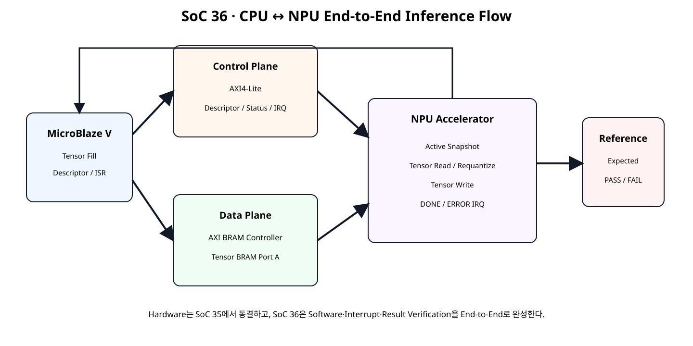
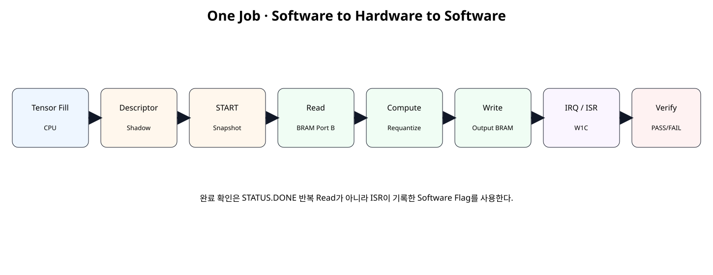
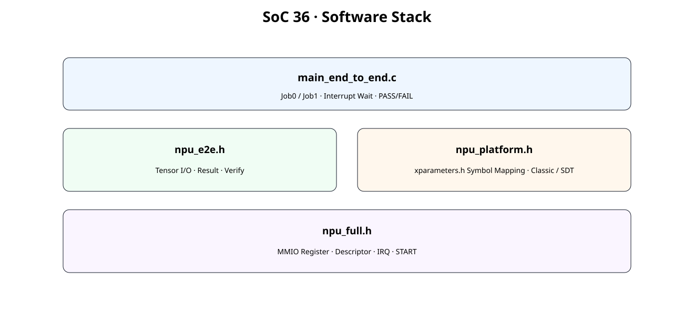
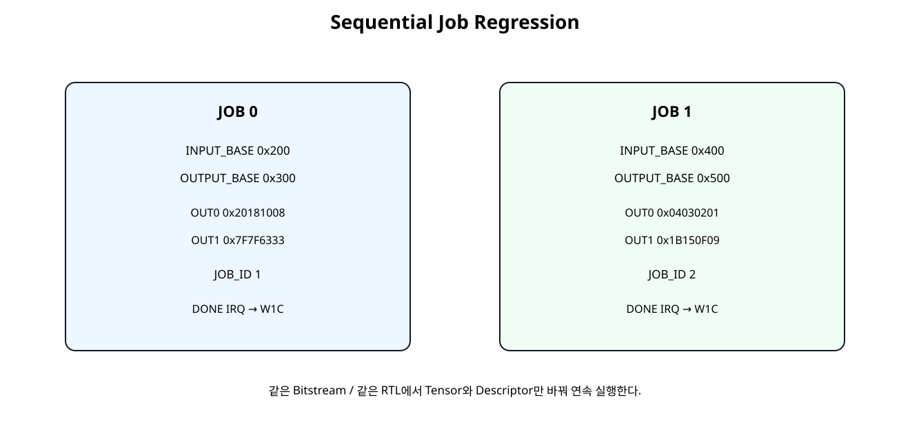

# CPU ↔ NPU End-to-End Software / Inference Flow


## 전체 학습 위치


## 이번 장의 목표


[](../images/soc36/soc36_e2e_architecture.svg)

Hardware를 바꾸는 장이 아니라 Software부터 NPU Result Verification까지 실제 실행 경로를 완성하는 장이다.


## Group 7 마지막 위치


## Hardware Freeze


## End-to-End Architecture


[](../images/soc36/soc36_e2e_architecture.svg)

Control Plane과 Data Plane을 유지하면서 Software Verification Layer를 추가한다.


## 한 Job의 전체 흐름


[](../images/soc36/soc36_one_job_flow.svg)

Tensor Fill부터 Output Verify까지가 한 번의 End-to-End Job이다.


## Software Stack


[](../images/soc36/soc36_software_stack.svg)

Low-level Driver, End-to-End Helper, Platform Mapping, Main Application을 분리한다.


## Platform Symbol Mapping

실제 NPU Control Base, Tensor BRAM Base, Interrupt ID는 Vivado/Vitis가 생성한 Hardware Metadata를 사용한다. 강의자료의 숫자를 실제 시스템 주소로 가정하지 않는다.


```text
NPU_CTRL_BASEADDR
TENSOR_BRAM_BASEADDR
NPU_INTR_ID
Classic → INTC_DEVICE_ID
SDT → INTC_BASEADDR
```


## Classic / SDT XIntc

현재 AMD XIntc 예제는 Classic/non-SDT flow에서는 Device ID를, SDT flow에서는 AXI Interrupt Controller Base Address를 XIntc_Initialize()에 전달한다. SoC 36 Software도 같은 분기 구조를 사용한다.


## Tensor Buffer 주소 계산


```text
CPU Physical Address
→ TENSOR_BRAM_BASEADDR + Descriptor Offset

NPU Native BRAM Address
→ Descriptor INPUT_BASE / OUTPUT_BASE
```

CPU의 시스템 주소와 NPU 내부 BRAM Offset을 혼동하지 않는 것이 핵심이다.


## Descriptor Program


## Descriptor Valid Gate

START 전에 STATUS.DESC_VALID을 확인한다. Alignment, Range, Length, Overlap 조건을 통과하지 못하면 Job을 시작하지 않는다.


## Interrupt Arm

이전 Job의 Pending State가 다음 Job에 섞이지 않도록 상태를 먼저 정리한다.


## START

START가 수락되면 Shadow Descriptor가 Active Snapshot으로 복사되고 NPU가 Tensor BRAM의 해당 Offset을 사용한다.


## ISR


```text
IRQ_STATUS Read
→ NpuDoneFlag / NpuErrorFlag Set
→ IRQ_STATUS W1C
→ ISR Return
```

CPU는 표준 외부 인터럽트 모드로 설정한다. AXI INTC의 irq를 microblaze_riscv_0/Interrupt에 연결하고 입력은 Level-High로 맞춘다. MicroBlaze V의 mtvec 진입과 mepc 저장·MRET 복귀는 생성 BSP가 처리한다. Xil_ExceptionEnable()은 외부 인터럽트 허용과 전역 허용을 설정하며, ISR은 주변장치의 원인을 해제한다.


## 완료 대기

Main Software는 ISR이 바꾸는 Software Flag를 기다린다. Timeout Counter는 Hardware Hang 방지를 위한 안전 장치다.


## 왜 STATUS.DONE Polling이 아닌가

STATUS.DONE Register를 반복 읽는 방식이 아니라, Hardware Interrupt가 ISR을 호출하고 ISR이 Software Flag를 바꾼다. 따라서 SoC 32에서 학습한 Interrupt Completion 구조를 실제 Application Flow에 사용한다.


## Result Read

DONE 후 CPU가 Tensor Buffer Ownership을 회수하고 ACTIVE_OUTPUT을 기준으로 결과 두 Word를 읽는다.


## Result Verify


| 검사 | 기준 |
| --- | --- |
| OUT0 / OUT1 | Reference 값과 일치 |
| READ_WORD_COUNT | 8 |
| WRITE_WORD_COUNT | 2 |
| IRQ_STATUS | DONE=1, ERROR=0 |
| ERROR_CODE | 0 |


## JOB 0


```text
INPUT_BASE  → 0x200
OUTPUT_BASE → 0x300
Input       → 16,32,48,64 / 32,64,96,128
OUT0        → 0x20181008
OUT1        → 0x7F7F6333
JOB_ID      → 1
```


## JOB 1


```text
INPUT_BASE  → 0x400
OUTPUT_BASE → 0x500
Input       → 2,4,6,8 / 4,8,12,16
OUT0        → 0x04030201
OUT1        → 0x1B150F09
JOB_ID      → 2
```


## 연속 Job의 의미


[](../images/soc36/soc36_two_jobs.svg)

Bitstream을 다시 만들지 않고 Tensor와 Descriptor만 바꿔 같은 Accelerator를 재사용한다.


## JOB_ID

정상 수락된 두 Job에서 JOB_ID가 1 → 2로 증가해야 한다. 이후 잘못된 Descriptor를 Reject해도 JOB_ID는 2를 유지해야 한다.


## Read / Write Counter


## Error Path

Self-checking RTL Regression 마지막에는 잘못 정렬된 Descriptor를 다시 넣어 ERROR IRQ가 정상 동작하고 Reject된 Job이 JOB_ID를 증가시키지 않는지 확인한다.


## Low-level Driver


```c
#ifndef NPU_FULL_H
#define NPU_FULL_H

#include "xil_io.h"
#include "xil_types.h"

#define NPU_CONTROL_OFFSET          0x00U
#define NPU_STATUS_OFFSET           0x04U
#define NPU_VERSION_OFFSET          0x08U
#define NPU_JOB_ID_OFFSET           0x0CU

#define NPU_INPUT_BASE_OFFSET       0x10U
#define NPU_OUTPUT_BASE_OFFSET      0x14U
#define NPU_LENGTH_WORDS_OFFSET     0x18U
#define NPU_ERROR_CODE_OFFSET       0x1CU

#define NPU_BIAS_CH0_OFFSET         0x20U
#define NPU_BIAS_CH1_OFFSET         0x24U
#define NPU_SCALE_CH0_OFFSET        0x28U
#define NPU_SCALE_CH1_OFFSET        0x2CU
#define NPU_ZERO_POINT_OFFSET       0x30U

#define NPU_ACTIVE_INPUT_OFFSET     0x34U
#define NPU_ACTIVE_OUTPUT_OFFSET    0x38U
#define NPU_ACTIVE_LENGTH_OFFSET    0x3CU

#define NPU_READ_COUNT_OFFSET       0x40U
#define NPU_WRITE_COUNT_OFFSET      0x44U

#define NPU_IRQ_ENABLE_OFFSET       0x48U
#define NPU_IRQ_STATUS_OFFSET       0x4CU

#define NPU_CONTROL_START_MASK      0x00000001U
#define NPU_CONTROL_CLR_DONE_MASK   0x00000002U
#define NPU_CONTROL_CLR_ERROR_MASK  0x00000004U

#define NPU_STATUS_BUSY_MASK        0x00000001U
#define NPU_STATUS_DONE_MASK        0x00000002U
#define NPU_STATUS_ERROR_MASK       0x00000004U
#define NPU_STATUS_DESC_VALID_MASK  0x00000008U

#define NPU_IRQ_DONE_MASK           0x00000001U
#define NPU_IRQ_ERROR_MASK          0x00000002U
#define NPU_IRQ_ALL_MASK            0x00000003U

typedef struct {
    u32 InputBase;
    u32 OutputBase;
    u32 LengthWords;

    s32 BiasCh0;
    s32 BiasCh1;

    s16 MultCh0;
    s16 MultCh1;

    u8 ShiftCh0;
    u8 ShiftCh1;

    s16 ZpCh0;
    s16 ZpCh1;
} NpuDescriptor;

static inline void Npu_WriteReg(
    UINTPTR Base,
    u32 Offset,
    u32 Value
)
{
    Xil_Out32(Base + (UINTPTR)Offset, Value);
}

static inline u32 Npu_ReadReg(
    UINTPTR Base,
    u32 Offset
)
{
    return Xil_In32(Base + (UINTPTR)Offset);
}

static inline u32 Npu_PackScale(
    s16 Multiplier,
    u8 Shift
)
{
    return
        ((u32)Multiplier & 0xFFFFU) |
        (((u32)Shift & 0x3FU) << 16U);
}

static inline u32 Npu_PackZeroPoint(
    s16 ZpCh0,
    s16 ZpCh1
)
{
    return
        ((u32)ZpCh0 & 0xFFFFU) |
        (((u32)ZpCh1 & 0xFFFFU) << 16U);
}

static inline void Npu_ProgramDescriptor(
    UINTPTR Base,
    const NpuDescriptor *Desc
)
{
    Npu_WriteReg(Base, NPU_INPUT_BASE_OFFSET, Desc->InputBase);
    Npu_WriteReg(Base, NPU_OUTPUT_BASE_OFFSET, Desc->OutputBase);
    Npu_WriteReg(Base, NPU_LENGTH_WORDS_OFFSET, Desc->LengthWords);

    Npu_WriteReg(Base, NPU_BIAS_CH0_OFFSET, (u32)Desc->BiasCh0);
    Npu_WriteReg(Base, NPU_BIAS_CH1_OFFSET, (u32)Desc->BiasCh1);

    Npu_WriteReg(
        Base,
        NPU_SCALE_CH0_OFFSET,
        Npu_PackScale(Desc->MultCh0, Desc->ShiftCh0)
    );

    Npu_WriteReg(
        Base,
        NPU_SCALE_CH1_OFFSET,
        Npu_PackScale(Desc->MultCh1, Desc->ShiftCh1)
    );

    Npu_WriteReg(
        Base,
        NPU_ZERO_POINT_OFFSET,
        Npu_PackZeroPoint(Desc->ZpCh0, Desc->ZpCh1)
    );
}

static inline void Npu_EnableIrq(
    UINTPTR Base,
    u32 Mask
)
{
    Npu_WriteReg(
        Base,
        NPU_IRQ_ENABLE_OFFSET,
        Mask & NPU_IRQ_ALL_MASK
    );
}

static inline u32 Npu_GetIrqStatus(UINTPTR Base)
{
    return Npu_ReadReg(Base, NPU_IRQ_STATUS_OFFSET);
}

static inline void Npu_ClearIrq(
    UINTPTR Base,
    u32 Mask
)
{
    Npu_WriteReg(
        Base,
        NPU_IRQ_STATUS_OFFSET,
        Mask & NPU_IRQ_ALL_MASK
    );
}

static inline void Npu_Start(UINTPTR Base)
{
    Npu_WriteReg(
        Base,
        NPU_CONTROL_OFFSET,
        NPU_CONTROL_START_MASK
    );
}

#endif
```


## End-to-End Helper


```c
#ifndef NPU_E2E_H
#define NPU_E2E_H

#include "xil_io.h"
#include "xil_types.h"

#include "npu_full.h"

#define NPU_E2E_INPUT_WORDS   8U
#define NPU_E2E_OUTPUT_WORDS  2U

typedef struct {
    s32 Input[NPU_E2E_INPUT_WORDS];

    NpuDescriptor Descriptor;

    u32 ExpectedOut0;
    u32 ExpectedOut1;
} NpuE2EJob;

typedef struct {
    u32 Out0;
    u32 Out1;

    u32 JobId;
    u32 ReadWordCount;
    u32 WriteWordCount;

    u32 IrqStatus;
    u32 ErrorCode;
} NpuE2EResult;

static inline void NpuE2E_TensorWrite(
    UINTPTR TensorBase,
    u32 Offset,
    u32 Value
)
{
    Xil_Out32(
        TensorBase + (UINTPTR)Offset,
        Value
    );
}

static inline u32 NpuE2E_TensorRead(
    UINTPTR TensorBase,
    u32 Offset
)
{
    return Xil_In32(
        TensorBase + (UINTPTR)Offset
    );
}

static inline void NpuE2E_LoadInput(
    UINTPTR TensorBase,
    const NpuE2EJob *Job
)
{
    u32 index;

    for (index = 0U; index < NPU_E2E_INPUT_WORDS; ++index) {
        NpuE2E_TensorWrite(
            TensorBase,
            Job->Descriptor.InputBase + (index * 4U),
            (u32)Job->Input[index]
        );
    }
}

static inline void NpuE2E_ReadResult(
    UINTPTR NpuBase,
    UINTPTR TensorBase,
    u32 IrqStatus,
    NpuE2EResult *Result
)
{
    const u32 output_base =
        Npu_ReadReg(
            NpuBase,
            NPU_ACTIVE_OUTPUT_OFFSET
        );

    Result->Out0 =
        NpuE2E_TensorRead(
            TensorBase,
            output_base
        );

    Result->Out1 =
        NpuE2E_TensorRead(
            TensorBase,
            output_base + 4U
        );

    Result->JobId =
        Npu_ReadReg(
            NpuBase,
            NPU_JOB_ID_OFFSET
        );

    Result->ReadWordCount =
        Npu_ReadReg(
            NpuBase,
            NPU_READ_COUNT_OFFSET
        );

    Result->WriteWordCount =
        Npu_ReadReg(
            NpuBase,
            NPU_WRITE_COUNT_OFFSET
        );

    Result->IrqStatus = IrqStatus;

    Result->ErrorCode =
        Npu_ReadReg(
            NpuBase,
            NPU_ERROR_CODE_OFFSET
        );
}

static inline int NpuE2E_Verify(
    const NpuE2EJob *Job,
    const NpuE2EResult *Result
)
{
    if (Result->Out0 != Job->ExpectedOut0) {
        return 0;
    }

    if (Result->Out1 != Job->ExpectedOut1) {
        return 0;
    }

    if (Result->ReadWordCount != 8U) {
        return 0;
    }

    if (Result->WriteWordCount != 2U) {
        return 0;
    }

    if ((Result->IrqStatus & NPU_IRQ_DONE_MASK) == 0U) {
        return 0;
    }

    if ((Result->IrqStatus & NPU_IRQ_ERROR_MASK) != 0U) {
        return 0;
    }

    if (Result->ErrorCode != 0U) {
        return 0;
    }

    return 1;
}

#endif
```


## Platform Header


```c
#ifndef NPU_PLATFORM_H
#define NPU_PLATFORM_H

#include "xparameters.h"

// ------------------------------------------------------------
// Map these four symbols to the names generated by your
// Vivado/Vitis platform.
//
// Do not copy the example numeric addresses from lecture notes.
// Use the generated hardware metadata for the current design.
// ------------------------------------------------------------

#ifndef NPU_CTRL_BASEADDR
#error "Map NPU_CTRL_BASEADDR to the generated NPU control base address."
#endif

#ifndef TENSOR_BRAM_BASEADDR
#error "Map TENSOR_BRAM_BASEADDR to the generated Tensor BRAM base address."
#endif

#ifndef NPU_INTR_ID
#error "Map NPU_INTR_ID to the generated NPU interrupt ID."
#endif

// Classic/non-SDT XIntc initialization uses a Device ID.
// SDT-enabled XIntc initialization uses the controller base address.
#ifndef SDT
#ifndef INTC_DEVICE_ID
#error "Map INTC_DEVICE_ID to the generated AXI INTC device ID."
#endif
#else
#ifndef INTC_BASEADDR
#error "Map INTC_BASEADDR to the generated AXI INTC base address."
#endif
#endif

#endif
```


## Main Software


```c
#include "xil_exception.h"
#include "xil_printf.h"
#include "xintc.h"

#include "npu_e2e.h"
#include "npu_platform.h"

static XIntc Intc;

static volatile u32 NpuDoneFlag = 0U;
static volatile u32 NpuErrorFlag = 0U;
static volatile u32 NpuLastIrqStatus = 0U;

static void NpuIsr(void *CallbackRef)
{
    const UINTPTR npu_base =
        (UINTPTR)CallbackRef;

    const u32 pending =
        Npu_GetIrqStatus(npu_base);

    NpuLastIrqStatus = pending;

    if ((pending & NPU_IRQ_DONE_MASK) != 0U) {
        NpuDoneFlag = 1U;
    }

    if ((pending & NPU_IRQ_ERROR_MASK) != 0U) {
        NpuErrorFlag = 1U;
    }

    // Peripheral source first: W1C the latched pending cause.
    Npu_ClearIrq(
        npu_base,
        pending & NPU_IRQ_ALL_MASK
    );
}

static int SetupInterruptSystem(UINTPTR npu_base)
{
    int status;

#ifndef SDT
    status = XIntc_Initialize(
        &Intc,
        INTC_DEVICE_ID
    );
#else
    status = XIntc_Initialize(
        &Intc,
        INTC_BASEADDR
    );
#endif

    if (status != XST_SUCCESS) {
        return XST_FAILURE;
    }

    status = XIntc_Connect(
        &Intc,
        NPU_INTR_ID,
        (XInterruptHandler)NpuIsr,
        (void *)npu_base
    );

    if (status != XST_SUCCESS) {
        return XST_FAILURE;
    }

    status = XIntc_Start(
        &Intc,
        XIN_REAL_MODE
    );

    if (status != XST_SUCCESS) {
        return XST_FAILURE;
    }

    XIntc_Enable(
        &Intc,
        NPU_INTR_ID
    );

    Xil_ExceptionInit();

    Xil_ExceptionRegisterHandler(
        XIL_EXCEPTION_ID_INT,
        (Xil_ExceptionHandler)XIntc_InterruptHandler,
        &Intc
    );

    Xil_ExceptionEnable();

    return XST_SUCCESS;
}

static int RunOneJob(
    UINTPTR npu_base,
    UINTPTR tensor_base,
    const NpuE2EJob *job,
    NpuE2EResult *result
)
{
    u32 status;
    u32 timeout;

    // --------------------------------------------------------
    // 1. CPU owns the Tensor Buffer and loads input.
    // --------------------------------------------------------
    NpuE2E_LoadInput(
        tensor_base,
        job
    );

    // --------------------------------------------------------
    // 2. Program the shadow descriptor.
    // --------------------------------------------------------
    Npu_ProgramDescriptor(
        npu_base,
        &job->Descriptor
    );

    status = Npu_ReadReg(
        npu_base,
        NPU_STATUS_OFFSET
    );

    if (
        (status & NPU_STATUS_DESC_VALID_MASK) == 0U
    ) {
        result->ErrorCode =
            Npu_ReadReg(
                npu_base,
                NPU_ERROR_CODE_OFFSET
            );

        return 0;
    }

    // --------------------------------------------------------
    // 3. Clear stale state, arm interrupt, launch job.
    // --------------------------------------------------------
    Npu_WriteReg(
        npu_base,
        NPU_CONTROL_OFFSET,
        NPU_CONTROL_CLR_DONE_MASK |
        NPU_CONTROL_CLR_ERROR_MASK
    );

    Npu_ClearIrq(
        npu_base,
        NPU_IRQ_ALL_MASK
    );

    Npu_EnableIrq(
        npu_base,
        NPU_IRQ_ALL_MASK
    );

    NpuDoneFlag = 0U;
    NpuErrorFlag = 0U;
    NpuLastIrqStatus = 0U;

    Npu_Start(npu_base);

    // --------------------------------------------------------
    // 4. Wait on software flags set by ISR.
    //    This is not STATUS.DONE polling.
    // --------------------------------------------------------
    timeout = 1000000U;

    while (
        (NpuDoneFlag == 0U) &&
        (NpuErrorFlag == 0U) &&
        (timeout != 0U)
    ) {
        timeout--;
    }

    if (timeout == 0U) {
        return 0;
    }

    // --------------------------------------------------------
    // 5. CPU reclaims the Tensor Buffer after completion.
    // --------------------------------------------------------
    NpuE2E_ReadResult(
        npu_base,
        tensor_base,
        NpuLastIrqStatus,
        result
    );

    if (NpuErrorFlag != 0U) {
        return 0;
    }

    return NpuE2E_Verify(
        job,
        result
    );
}

int main(void)
{
    const UINTPTR npu_base =
        (UINTPTR)NPU_CTRL_BASEADDR;

    const UINTPTR tensor_base =
        (UINTPTR)TENSOR_BRAM_BASEADDR;

    const NpuE2EJob job0 = {
        .Input = {
            16, 32, 48, 64,
            32, 64, 96, 128
        },

        .Descriptor = {
            .InputBase = 0x200U,
            .OutputBase = 0x300U,
            .LengthWords = 8U,

            .BiasCh0 = 0,
            .BiasCh1 = 4,

            .MultCh0 = 1,
            .MultCh1 = 3,

            .ShiftCh0 = 1U,
            .ShiftCh1 = 1U,

            .ZpCh0 = 0,
            .ZpCh1 = -3
        },

        .ExpectedOut0 = 0x20181008U,
        .ExpectedOut1 = 0x7F7F6333U
    };

    const NpuE2EJob job1 = {
        .Input = {
            2, 4, 6, 8,
            4, 8, 12, 16
        },

        .Descriptor = {
            .InputBase = 0x400U,
            .OutputBase = 0x500U,
            .LengthWords = 8U,

            .BiasCh0 = 0,
            .BiasCh1 = 4,

            .MultCh0 = 1,
            .MultCh1 = 3,

            .ShiftCh0 = 1U,
            .ShiftCh1 = 1U,

            .ZpCh0 = 0,
            .ZpCh1 = -3
        },

        .ExpectedOut0 = 0x04030201U,
        .ExpectedOut1 = 0x1B150F09U
    };

    NpuE2EResult result0 = {0};
    NpuE2EResult result1 = {0};

    xil_printf("\r\nSoC36 CPU-NPU End-to-End\r\n");

    if (
        SetupInterruptSystem(npu_base) !=
        XST_SUCCESS
    ) {
        xil_printf("ERROR: interrupt setup\r\n");
        return 1;
    }

    if (
        !RunOneJob(
            npu_base,
            tensor_base,
            &job0,
            &result0
        )
    ) {
        xil_printf(
            "JOB0 FAIL: IRQ=0x%08x ERR=%u\r\n",
            (unsigned int)result0.IrqStatus,
            (unsigned int)result0.ErrorCode
        );

        return 1;
    }

    xil_printf(
        "JOB0 PASS: id=%u out0=0x%08x out1=0x%08x\r\n",
        (unsigned int)result0.JobId,
        (unsigned int)result0.Out0,
        (unsigned int)result0.Out1
    );

    if (
        !RunOneJob(
            npu_base,
            tensor_base,
            &job1,
            &result1
        )
    ) {
        xil_printf(
            "JOB1 FAIL: IRQ=0x%08x ERR=%u\r\n",
            (unsigned int)result1.IrqStatus,
            (unsigned int)result1.ErrorCode
        );

        return 1;
    }

    xil_printf(
        "JOB1 PASS: id=%u out0=0x%08x out1=0x%08x\r\n",
        (unsigned int)result1.JobId,
        (unsigned int)result1.Out0,
        (unsigned int)result1.Out1
    );

    if (
        (result0.JobId != 1U) ||
        (result1.JobId != 2U)
    ) {
        xil_printf("ERROR: JOB_ID sequence\r\n");
        return 1;
    }

    xil_printf("SOC36 END-TO-END RESULT: PASS\r\n");

    return 0;
}
```


## Python Reference


```text
JOB0: IN=0x200 OUT=0x300 OUT0=0x20181008 OUT1=0x7F7F6333 IRQ/W1C=PASS
JOB1: IN=0x400 OUT=0x500 OUT0=0x04030201 OUT1=0x1B150F09 IRQ/W1C=PASS
JOB_ID sequence: 1 -> 2
Rejected descriptor does not increment JOB_ID: PASS
SOC36 PYTHON END-TO-END REFERENCE: PASS
Spreadsheet runtime warmup failed during python startup
Traceback (most recent call last):
  File "/tmp/tmp.L2TH2Y5coc/artifact_tool_v2-2.8.22/artifact_tool/patches/warm_spreadsheet_runtime_on_startup.py", line 26, in warm_spreadsheet_runtime_on_startup
  File "/tmp/tmp.L2TH2Y5coc/artifact_tool_v2-2.8.22/artifact_tool/spreadsheet_warmup.py", line 772, in warm_spreadsheet_runtime
  File "/tmp/tmp.L2TH2Y5coc/artifact_tool_v2-2.8.22/artifact_tool/rpc/connection.py", line 37, in get_or_create_client
  File "/tmp/tmp.L2TH2Y5coc/artifact_tool_v2-2.8.22/artifact_tool/rpc/daemon.py", line 124, in start_daemon
TimeoutError: Timed out waiting for artifact tool daemon socket. Set ARTIFACT_TOOL_RPC_DAEMON_STARTUP_TIMEOUT_S=<seconds> to increase the limit.
```


## Host C Reference


```text
out0=0x20181008 out1=0x7F7F6333
out0=0x04030201 out1=0x1B150F09
SOC36 HOST CPU REFERENCE: PASS
```

Host C Reference는 GCC로 실제 실행한 산술 기준 검증이다. FPGA Hardware 실행 결과와는 구분한다.


## Self-Checking RTL Regression


```verilog
`timescale 1ns / 1ps

module tb_soc36_cpu_npu_e2e;

logic clk = 1'b0;
logic resetn = 1'b0;

logic [7:0]  awaddr = 8'h00;
logic        awvalid = 1'b0;
wire         awready;

logic [31:0] wdata = 32'h0000_0000;
logic [3:0]  wstrb = 4'h0;
logic        wvalid = 1'b0;
wire         wready;

wire [1:0]   bresp;
wire         bvalid;
logic        bready = 1'b1;

logic [7:0]  araddr = 8'h00;
logic        arvalid = 1'b0;
wire         arready;

wire [31:0]  rdata;
wire [1:0]   rresp;
wire         rvalid;
logic        rready = 1'b1;

logic        cpu_mem_en_i = 1'b0;
logic [3:0]  cpu_mem_we_i = 4'h0;
logic [11:0] cpu_mem_addr_i = 12'h000;
logic [31:0] cpu_mem_wdata_i = 32'h0000_0000;
wire [31:0]  cpu_mem_rdata_o;

wire irq_o;

integer check_count = 0;
integer error_count = 0;

always #5 clk = ~clk;

npu_full_accelerator_sim_top dut (
    .clk(clk),
    .resetn(resetn),

    .s_axi_awaddr(awaddr),
    .s_axi_awvalid(awvalid),
    .s_axi_awready(awready),

    .s_axi_wdata(wdata),
    .s_axi_wstrb(wstrb),
    .s_axi_wvalid(wvalid),
    .s_axi_wready(wready),

    .s_axi_bresp(bresp),
    .s_axi_bvalid(bvalid),
    .s_axi_bready(bready),

    .s_axi_araddr(araddr),
    .s_axi_arvalid(arvalid),
    .s_axi_arready(arready),

    .s_axi_rdata(rdata),
    .s_axi_rresp(rresp),
    .s_axi_rvalid(rvalid),
    .s_axi_rready(rready),

    .cpu_mem_en_i(cpu_mem_en_i),
    .cpu_mem_we_i(cpu_mem_we_i),
    .cpu_mem_addr_i(cpu_mem_addr_i),
    .cpu_mem_wdata_i(cpu_mem_wdata_i),
    .cpu_mem_rdata_o(cpu_mem_rdata_o),

    .irq_o(irq_o)
);

task automatic check_true(
    input string name,
    input bit condition
);
    begin
        check_count = check_count + 1;
        if (!condition) begin
            error_count = error_count + 1;
            $error("CHECK FAIL: %s", name);
        end else begin
            $display("CHECK PASS: %s", name);
        end
    end
endtask

task automatic check_eq32(
    input string name,
    input logic [31:0] actual,
    input logic [31:0] expected
);
    begin
        check_count = check_count + 1;
        if (actual !== expected) begin
            error_count = error_count + 1;
            $error(
                "CHECK FAIL: %s actual=0x%08h expected=0x%08h",
                name,
                actual,
                expected
            );
        end else begin
            $display(
                "CHECK PASS: %s = 0x%08h",
                name,
                actual
            );
        end
    end
endtask

task automatic axi_write(
    input [7:0] address,
    input [31:0] data,
    input integer order
);
    bit aw_done;
    bit w_done;
    integer timeout;

    begin
        aw_done = 0;
        w_done = 0;

        @(negedge clk);

        awaddr = address;
        wdata = data;
        wstrb = 4'hF;

        case (order)
            0: begin
                awvalid = 1'b1;
                wvalid = 1'b1;
            end

            1: begin
                awvalid = 1'b1;
                wvalid = 1'b0;
            end

            default: begin
                awvalid = 1'b0;
                wvalid = 1'b1;
            end
        endcase

        timeout = 0;

        while (!(aw_done && w_done)) begin
            @(posedge clk);
            // (변경) READY가 갱신되기 전 상승 에지의 handshake를 관측한다.

            if (awvalid && awready)
                aw_done = 1;

            if (wvalid && wready)
                w_done = 1;

            @(negedge clk);

            if (aw_done)
                awvalid = 1'b0;

            if (w_done)
                wvalid = 1'b0;

            if (
                (order == 1) &&
                aw_done &&
                !w_done
            )
                wvalid = 1'b1;

            if (
                (order == 2) &&
                w_done &&
                !aw_done
            )
                awvalid = 1'b1;

            timeout = timeout + 1;

            if (timeout > 40)
                $fatal(1, "AXI write timeout");
        end

        timeout = 0;

        while (!bvalid) begin
            @(posedge clk);
            #1;

            timeout = timeout + 1;

            if (timeout > 40)
                $fatal(1, "AXI BVALID timeout");
        end

        check_true(
            "BRESP OKAY",
            bresp == 2'b00
        );

        @(posedge clk);
        #1;
    end
endtask

task automatic axi_read(
    input [7:0] address,
    output [31:0] data
);
    integer timeout;

    begin
        @(negedge clk);

        araddr = address;
        arvalid = 1'b1;

        timeout = 0;

        while (!arready) begin
            @(posedge clk);
            #1;
            timeout = timeout + 1;

            if (timeout > 40)
                $fatal(1, "AXI ARREADY timeout");
        end

        @(posedge clk);
        #1;

        timeout = 0;

        while (!rvalid) begin
            @(posedge clk);
            #1;

            timeout = timeout + 1;

            if (timeout > 40)
                $fatal(1, "AXI RVALID timeout");
        end

        data = rdata;

        check_true(
            "RRESP OKAY",
            rresp == 2'b00
        );

        @(negedge clk);
        arvalid = 1'b0;

        @(posedge clk);
        #1;
    end
endtask

task automatic mem_write32(
    input [11:0] address,
    input [31:0] data
);
    begin
        @(negedge clk);

        cpu_mem_en_i = 1'b1;
        cpu_mem_we_i = 4'hF;
        cpu_mem_addr_i = address;
        cpu_mem_wdata_i = data;

        @(posedge clk);
        #1;

        @(negedge clk);

        cpu_mem_en_i = 1'b0;
        cpu_mem_we_i = 4'h0;
        cpu_mem_addr_i = 12'h000;
        cpu_mem_wdata_i = 32'h0000_0000;
    end
endtask

task automatic mem_read32(
    input [11:0] address,
    output [31:0] data
);
    begin
        @(negedge clk);

        cpu_mem_en_i = 1'b1;
        cpu_mem_we_i = 4'h0;
        cpu_mem_addr_i = address;

        @(posedge clk);
        #1;

        @(negedge clk);

        cpu_mem_en_i = 1'b0;
        cpu_mem_addr_i = 12'h000;

        data = cpu_mem_rdata_o;
    end
endtask

task automatic wait_irq_high;
    integer timeout;
    begin
        timeout = 0;

        while (irq_o !== 1'b1) begin
            @(posedge clk);
            #1;

            timeout = timeout + 1;

            if (timeout > 300)
                $fatal(1, "IRQ did not assert");
        end
    end
endtask

initial begin
    reg [31:0] rd;

    repeat (5) @(posedge clk);
    resetn = 1'b1;

    // --------------------------------------------------------
    // 1. CPU fills Tensor BRAM through Port A.
    // --------------------------------------------------------
    mem_write32(12'h200, 32'd16);
    mem_write32(12'h204, 32'd32);
    mem_write32(12'h208, 32'd48);
    mem_write32(12'h20C, 32'd64);

    mem_write32(12'h210, 32'd32);
    mem_write32(12'h214, 32'd64);
    mem_write32(12'h218, 32'd96);
    mem_write32(12'h21C, 32'd128);

    // --------------------------------------------------------
    // 2. Program descriptor / parameter / IRQ registers.
    //    Exercise all three AXI write channel orders.
    // --------------------------------------------------------
    axi_write(8'h10, 32'h0000_0200, 0);
    axi_write(8'h14, 32'h0000_0300, 1);
    axi_write(8'h18, 32'd8,         2);

    axi_write(8'h20, 32'd0,         0);
    axi_write(8'h24, 32'd4,         1);
    axi_write(8'h28, 32'h0001_0001, 2);
    axi_write(8'h2C, 32'h0001_0003, 0);
    axi_write(8'h30, 32'hFFFD_0000, 1);

    // Clear stale IRQ and status, then enable DONE/ERROR.
    axi_write(8'h4C, 32'h0000_0003, 2);
    axi_write(8'h00, 32'h0000_0006, 0);
    axi_write(8'h48, 32'h0000_0003, 1);

    axi_read(8'h04, rd);

    check_true(
        "descriptor valid",
        (rd & 32'h8) != 0
    );

    // --------------------------------------------------------
    // 3. START and wait for DONE IRQ.
    // --------------------------------------------------------
    axi_write(8'h00, 32'h0000_0001, 0);

    // Wait until BUSY appears.
    do begin
        axi_read(8'h04, rd);
    end while ((rd & 32'h1) == 0);

    // Shadow changes while the active job is running.
    axi_write(8'h10, 32'h0000_0400, 1);
    axi_write(8'h14, 32'h0000_0500, 2);

    axi_read(8'h34, rd);
    check_eq32(
        "ACTIVE_INPUT remains 0x200",
        rd,
        32'h0000_0200
    );

    axi_read(8'h38, rd);
    check_eq32(
        "ACTIVE_OUTPUT remains 0x300",
        rd,
        32'h0000_0300
    );

    wait_irq_high();

    axi_read(8'h4C, rd);

    check_true(
        "DONE IRQ pending",
        (rd & 32'h1) != 0
    );

    check_true(
        "ERROR IRQ clear",
        (rd & 32'h2) == 0
    );

    // CPU reclaims Tensor Buffer after completion.
    mem_read32(12'h300, rd);
    check_eq32(
        "full integration OUT_CH0",
        rd,
        32'h2018_1008
    );

    mem_read32(12'h304, rd);
    check_eq32(
        "full integration OUT_CH1",
        rd,
        32'h7F7F_6333
    );

    axi_read(8'h0C, rd);
    check_eq32(
        "JOB_ID = 1",
        rd,
        32'd1
    );

    axi_read(8'h40, rd);
    check_eq32(
        "READ_WORD_COUNT = 8",
        rd,
        32'd8
    );

    axi_read(8'h44, rd);
    check_eq32(
        "WRITE_WORD_COUNT = 2",
        rd,
        32'd2
    );

    // ISR-equivalent W1C.
    axi_write(8'h4C, 32'h0000_0001, 0);

    repeat (2) @(posedge clk);
    #1;

    check_true(
        "DONE W1C deasserts IRQ",
        irq_o === 1'b0
    );

    // --------------------------------------------------------
    // 4. Second complete job: same hardware, new Tensor buffer.
    // --------------------------------------------------------
    mem_write32(12'h400, 32'd2);
    mem_write32(12'h404, 32'd4);
    mem_write32(12'h408, 32'd6);
    mem_write32(12'h40C, 32'd8);

    mem_write32(12'h410, 32'd4);
    mem_write32(12'h414, 32'd8);
    mem_write32(12'h418, 32'd12);
    mem_write32(12'h41C, 32'd16);

    // Shadow addresses already changed to 0x400 / 0x500
    // during JOB0. Keep LENGTH=8 and parameters unchanged.
    axi_write(8'h18, 32'd8, 2);

    axi_write(8'h00, 32'h0000_0006, 0);
    axi_write(8'h4C, 32'h0000_0003, 1);
    axi_write(8'h48, 32'h0000_0003, 2);

    axi_read(8'h04, rd);

    check_true(
        "JOB1 descriptor valid",
        (rd & 32'h8) != 0
    );

    axi_write(8'h00, 32'h0000_0001, 0);

    wait_irq_high();

    axi_read(8'h4C, rd);

    check_true(
        "JOB1 DONE IRQ pending",
        (rd & 32'h1) != 0
    );

    mem_read32(12'h500, rd);
    check_eq32(
        "JOB1 OUT_CH0",
        rd,
        32'h0403_0201
    );

    mem_read32(12'h504, rd);
    check_eq32(
        "JOB1 OUT_CH1",
        rd,
        32'h1B15_0F09
    );

    axi_read(8'h0C, rd);
    check_eq32(
        "JOB_ID = 2 after second accepted job",
        rd,
        32'd2
    );

    axi_read(8'h40, rd);
    check_eq32(
        "JOB1 READ_WORD_COUNT = 8",
        rd,
        32'd8
    );

    axi_read(8'h44, rd);
    check_eq32(
        "JOB1 WRITE_WORD_COUNT = 2",
        rd,
        32'd2
    );

    axi_write(8'h4C, 32'h0000_0001, 1);

    repeat (2) @(posedge clk);
    #1;

    check_true(
        "JOB1 W1C deasserts IRQ",
        irq_o === 1'b0
    );

    // --------------------------------------------------------
    // 5. Integrated descriptor ERROR IRQ after two good jobs.
    // --------------------------------------------------------
    axi_write(8'h00, 32'h0000_0006, 1);
    axi_write(8'h4C, 32'h0000_0003, 2);
    axi_write(8'h48, 32'h0000_0002, 0);

    axi_write(8'h10, 32'h0000_0202, 1);
    axi_write(8'h14, 32'h0000_0600, 2);
    axi_write(8'h18, 32'd8,         0);

    axi_write(8'h00, 32'h0000_0001, 1);

    wait_irq_high();

    axi_read(8'h4C, rd);

    check_true(
        "descriptor ERROR IRQ pending",
        (rd & 32'h2) != 0
    );

    axi_read(8'h1C, rd);

    check_eq32(
        "descriptor ERROR_CODE = 2",
        rd,
        32'd2
    );

    axi_read(8'h0C, rd);

    check_eq32(
        "rejected job keeps JOB_ID = 2",
        rd,
        32'd2
    );

    axi_write(8'h4C, 32'h0000_0002, 2);

    repeat (2) @(posedge clk);
    #1;

    check_true(
        "ERROR W1C deasserts IRQ",
        irq_o === 1'b0
    );

    $display("");
    $display("SOC36 CHECK COUNT : %0d", check_count);
    $display("SOC36 ERROR COUNT : %0d", error_count);

    if (error_count == 0) begin
        $display("SOC36 CPU-NPU END-TO-END TEST: PASS");
    end else begin
        $fatal(
            1,
            "SOC36 CPU-NPU END-TO-END TEST: FAIL (%0d errors)",
            error_count
        );
    end

    #20;
    $finish;
end

endmodule
```


## AXI / IRQ 회귀

AW/W 동시, AW 먼저, W 먼저 세 Write 순서를 그대로 유지하고 각 Job의 DONE IRQ → W1C 해제 경로를 반복한다.


## 두 번째 Job 회귀

두 번째 Tensor와 Descriptor를 새로운 BRAM Offset으로 옮겨도 같은 Hardware가 재사용되고 JOB_ID, Counter, IRQ가 다시 정상 동작해야 한다.


## Vivado Simulation 준비


```text
# SoC 36 · Prepare CPU↔NPU end-to-end simulation

set script_dir [file dirname [file normalize [info script]]]
set root_dir [file normalize [file join $script_dir ".."]]
set work_dir [file normalize [file join $root_dir "_vivado_soc36_sim"]]

file delete -force $work_dir

create_project -force soc36_sim \
    $work_dir \
    -part xc7a35tcpg236-1

set rtl_dir [file join $root_dir "rtl"]
set tb_dir [file join $root_dir "testbench"]

foreach f {
    requantize_s32_to_s8.v
    requantize_batch2x4_serial.v
    tensor_bram_tdp_4k_model.v
    tensor_job_engine.v
    npu_full_control_irq.v
    axi4lite_reg_bridge.v
    bram_clock_reset_adapter.v
    npu_full_accelerator_ip.v
    npu_full_accelerator_sim_top.v
} {
    add_files -norecurse [file join $rtl_dir $f]
}

add_files -fileset sim_1 -norecurse \
    [file join $tb_dir "tb_soc36_cpu_npu_e2e.sv"]

set_property file_type SystemVerilog \
    [get_files [file join $tb_dir "tb_soc36_cpu_npu_e2e.sv"]]

set_property top tb_soc36_cpu_npu_e2e [get_filesets sim_1]
update_compile_order -fileset sim_1

puts ""
puts "SoC 36 end-to-end simulation project prepared."
puts "Simulation top: tb_soc36_cpu_npu_e2e"
```


## Hardware Freeze OOC


```text
# SoC 36 · Frozen SoC35 hardware regression
# No NPU RTL architecture change is introduced in this chapter.
# Re-run OOC synthesis to verify the frozen accelerator still builds.

set script_dir [file dirname [file normalize [info script]]]
set root_dir [file normalize [file join $script_dir ".."]]
set rtl_dir [file join $root_dir "rtl"]
set out_dir [file normalize [file join $root_dir "reports" "hardware_freeze"]]

file mkdir $out_dir

create_project -in_memory -part xc7a35tcpg236-1

foreach f {
    requantize_s32_to_s8.v
    requantize_batch2x4_serial.v
    tensor_job_engine.v
    npu_full_control_irq.v
    axi4lite_reg_bridge.v
    bram_clock_reset_adapter.v
    npu_full_accelerator_ip.v
} {
    read_verilog [file join $rtl_dir $f]
}

synth_design \
    -mode out_of_context \
    -top npu_full_accelerator_ip \
    -part xc7a35tcpg236-1

create_clock \
    -name s_axi_aclk \
    -period 10.000 \
    [get_ports s_axi_aclk]

report_utilization \
    -hierarchical \
    -file [file join $out_dir "01_utilization_ooc.rpt"]

redirect -file [file join $out_dir "02_dsp48_cells_ooc.rpt"] {
    set cells [get_cells -hier -filter {REF_NAME =~ DSP48*}]
    puts "DSP48 primitive count: [llength $cells]"
}

report_timing_summary \
    -delay_type min_max \
    -report_unconstrained \
    -max_paths 20 \
    -file [file join $out_dir "03_timing_summary_ooc.rpt"]

report_design_analysis \
    -max_paths 50 \
    -setup \
    -logic_level_distribution \
    -file [file join $out_dir "04_design_analysis_ooc.rpt"]

report_methodology \
    -file [file join $out_dir "05_methodology_ooc.rpt"]

puts ""
puts "SoC 36 hardware-freeze OOC regression complete."
puts "No SoC35 NPU RTL behavior was intentionally changed."
```

SoC 35 RTL이 byte-identical한지 먼저 확인하고, 실제 Vivado 환경에서는 OOC 합성 Report까지 다시 생성한다.


## Vitis 실행 절차


```text
Validate Design
→ Generate Bitstream
→ Hardware Platform
→ Vitis Standalone App
→ Platform Symbol Mapping
→ Build
→ FPGA Program
→ UART
→ JOB0
→ JOB1
→ PASS
```

기존 Platform을 갱신할 때도 Processor 종류와 생성 BSP가 MicroBlaze V용인지 확인한다. 새 ELF를 빌드하고 MDM V로 실행하며, Tensor BRAM과 제어 레지스터의 실제 BaseAddress를 다시 대조한다.


## 기대 UART


```text
SoC36 CPU-NPU End-to-End
JOB0 PASS: id=1 out0=0x20181008 out1=0x7F7F6333
JOB1 PASS: id=2 out0=0x04030201 out1=0x1B150F09
SOC36 END-TO-END RESULT: PASS
```


## 실측값과 기대값 구분


## Group 7 완료 의미

이제 NPU Core 단품이 아니라 CPU에서 작업을 제출하고 결과를 회수할 수 있는 하나의 SoC Accelerator 흐름이 완성된다.


## 다음 Group 연결

다음 단계에서는 기능 추가보다 실제 Vivado 결과를 기반으로 Timing, Resource, Power, Throughput, Bottleneck, Sign-off를 수행하고 이후 확장 NPU 구조로 연결한다.


## 오류 점검


| 증상 | 원인 | 확인 |
| --- | --- | --- |
| Build 시 Base Address 미정의 | Platform Symbol Mapping 누락 | xparameters.h / npu_platform.h |
| Classic에서는 되는데 SDT Build 실패 | XIntc Initialize 인자 차이 | Device ID vs Base Address |
| JOB0만 되고 JOB1 실패 | Pending/Sticky 상태 미Clear | CONTROL Clear + IRQ W1C |
| JOB1이 JOB0 주소 사용 | Descriptor Program 누락 | INPUT/OUTPUT Base |
| IRQ가 계속 High | Peripheral Pending 미Clear | ISR W1C |
| CPU가 잘못된 BRAM 위치 접근 | System Base와 Descriptor Offset 혼동 | Base + Offset |
| Reference PASS인데 보드 실패 | Reference를 Hardware 실행으로 오해 | UART / Logic / Vivado Report |


## SoC 36 완료 체크리스트

- [ ] SoC 35 Hardware RTL을 그대로 유지한다.
- [ ] CPU System Address와 NPU BRAM Offset을 구분한다.
- [ ] Tensor 입력을 CPU가 BRAM에 쓴다.
- [ ] Descriptor를 Program하고 Valid를 확인한다.
- [ ] IRQ Pending을 Clear하고 Enable한 뒤 START한다.
- [ ] ISR에서 DONE/ERROR 원인을 읽고 W1C한다.
- [ ] Main은 ISR Software Flag를 기준으로 완료를 판단한다.
- [ ] Output Tensor와 Counter를 검증한다.
- [ ] 같은 Hardware로 Job0과 Job1을 연속 실행한다.
- [ ] JOB_ID가 1 → 2로 증가한다.
- [ ] Reject Job은 JOB_ID를 증가시키지 않는다.
- [ ] Python과 Host C Reference를 별도 기준으로 사용한다.
- [ ] 실제 보드 실행 결과와 Reference 결과를 구분한다.

## 공식 문서 및 근거


| 자료 | 확인 항목 |
| --- | --- |
| AMD UG994 · Handling Interrupts · 2026.1 | MicroBlaze V AXI Interrupt Controller와 Concat 구조 |
| AMD embeddedsw · XIntc Example | Classic Device ID / SDT Base Address 초기화 차이 |
| AMD UG1711 · Run Connection Automation · 2026.1 | AXI BRAM Controller / Block Memory Generator 연결 구조 |
| AMD Standalone RISC-V · xil_exception.h | Machine External Interrupt 등록과 활성화 |

