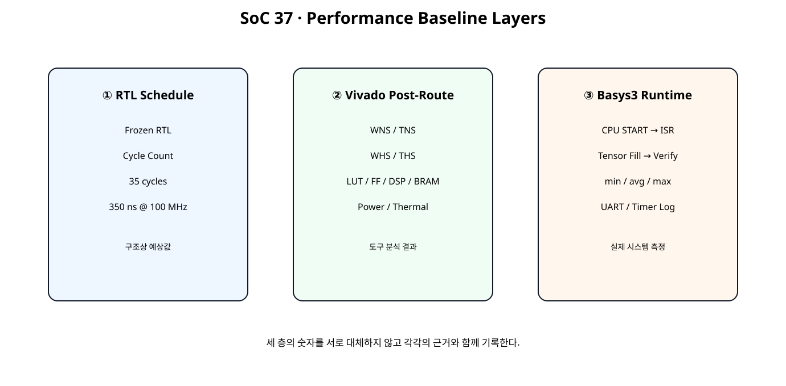
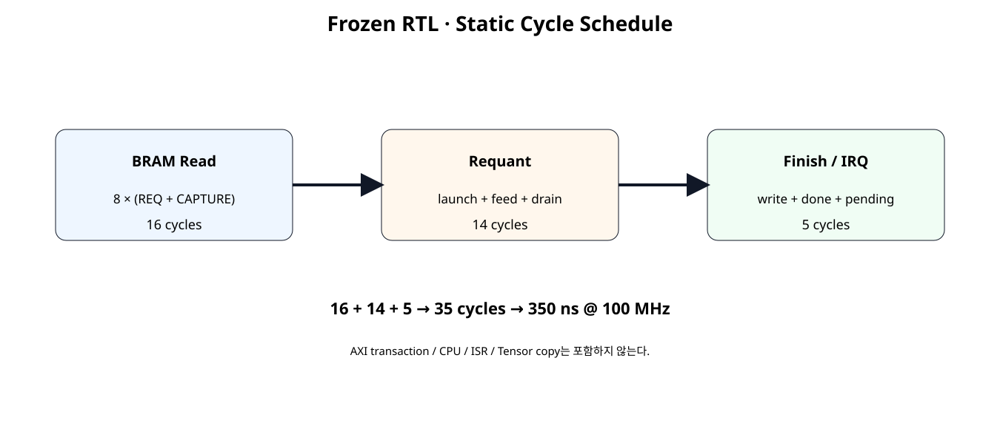
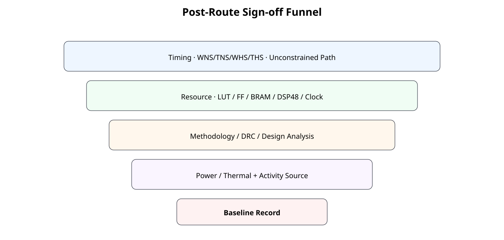

# Performance Baseline · Timing · Resource · Power · Throughput


## 전체 학습 위치


## 이번 장의 목표


[](../images/soc37/soc37_measurement_layers.svg)

정적 RTL 예상값, Vivado 분석값, 실제 보드 측정값을 서로 다른 층으로 관리한다.


## Group 8 시작

Group 7이 “동작하는 NPU SoC”를 만드는 과정이었다면 Group 8은 “얼마나 잘 동작하는가”를 수치로 판단하는 과정이다.


## 측정의 세 층


[](../images/soc37/soc37_measurement_layers.svg)

35 cycle과 WNS와 CPU Latency는 서로 다른 종류의 숫자다.


## Hardware Freeze


## Static Cycle Schedule


[](../images/soc37/soc37_cycle_schedule.svg)

Frozen RTL에서 Engine이 START를 수락한 시점부터 DONE IRQ Pending까지 예상되는 상태 진행을 Clock 단위로 분해한다.


## 35 Cycle 분해


| 구간 | Cycle | 원인 |
| --- | --- | --- |
| BRAM Read | 16 | 8 Word × READ_REQ/READ_CAPTURE |
| Requant | 14 | Launch + 8-item Feed + Pipeline Drain |
| Finish / IRQ | 5 | Result Handoff + 2 Write + DONE + IRQ Latch |
| Total | 35 | Frozen RTL Static Schedule |


## 100 MHz 환산

350 ns는 RTL 상태 진행에서 계산한 예상 시간이며 Routing Delay나 CPU 관측 Latency를 의미하지 않는다.


## Static Upper Bound


```text
SoC37 STATIC RTL SCHEDULE
clock = 100 MHz (10.0 ns)
BRAM read phase = 16 cycles
requant phase = 14 cycles
finish/IRQ phase = 5 cycles
engine START accept -> IRQ pending = 35 cycles
static schedule time = 350.0 ns
upper-bound jobs/s = 2,857,142.857
upper-bound scalar outputs/s = 22,857,142.857

IMPORTANT:
- This excludes AXI START transaction latency.
- This excludes CPU Tensor fill/read.
- This excludes ISR/software overhead.
- This is not WNS/TNS or post-route timing.
- Actual performance must be measured in Vivado/board.
SOC37 STATIC PERFORMANCE REFERENCE: PASS
Spreadsheet runtime warmup failed during python startup
Traceback (most recent call last):
  File "/tmp/tmp.L2TH2Y5coc/artifact_tool_v2-2.8.22/artifact_tool/patches/warm_spreadsheet_runtime_on_startup.py", line 26, in warm_spreadsheet_runtime_on_startup
  File "/tmp/tmp.L2TH2Y5coc/artifact_tool_v2-2.8.22/artifact_tool/spreadsheet_warmup.py", line 772, in warm_spreadsheet_runtime
  File "/tmp/tmp.L2TH2Y5coc/artifact_tool_v2-2.8.22/artifact_tool/rpc/connection.py", line 37, in get_or_create_client
  File "/tmp/tmp.L2TH2Y5coc/artifact_tool_v2-2.8.22/artifact_tool/rpc/daemon.py", line 124, in start_daemon
TimeoutError: Timed out waiting for artifact tool daemon socket. Set ARTIFACT_TOOL_RPC_DAEMON_STARTUP_TIMEOUT_S=<seconds> to increase the limit.
```


## 왜 실측 Throughput이 아닌가

이 계산에는 AXI START Transaction, Tensor Fill/Read, Interrupt Controller, ISR, 다음 Descriptor 준비가 없다. 따라서 실제 CPU↔NPU 처리량보다 높은 구조상 상한값이다.


## Timing Sign-off


[](../images/soc37/soc37_signoff_funnel.svg)

Timing PASS만으로 Sign-off를 끝내지 않고 Resource, Methodology, Power까지 함께 기록한다.


## WNS / TNS

Setup 분석에서는 WNS(Worst Negative Slack, 최악의 음수 여유)와 TNS(Total Negative Slack, 전체 음수 여유)를 확인한다. 목표 Clock을 만족하려면 최종 구현 결과에서 Setup Violation이 없어야 한다.


## WHS / THS

Hold 분석도 별도로 확인한다. Setup이 PASS라도 Hold Violation이 있으면 Timing Sign-off가 아니다.


## Unconstrained Path

Slack 값만 양수라고 끝내지 않는다. Clock/Path Constraint가 빠진 경로가 없는지 함께 확인한다.


## Report Timing Summary

AMD UG906은 Post-Implementation 단계의 Report Timing Summary를 Timing Sign-off 확인에 사용하는 핵심 Report로 설명한다.


## Resource Baseline


## Hierarchical Utilization

report_utilization -hierarchical로 전체 숫자뿐 아니라 NPU 내부 어떤 Hierarchy가 Resource를 소비하는지 확인한다.


## Clock Utilization

Clock Primitive, Clock Net, Load를 확인해 Clock 자체가 Placement/Timing 문제의 원인인지 구분한다.


## DSP / BRAM

DSP와 BRAM은 요청 Attribute가 아니라 실제 구현 Report를 기준으로 기록한다. Isolated NPU에서는 외부 Tensor BRAM이 포함되지 않으므로 Full SoC Resource와 구분한다.


## Design Analysis

report_design_analysis로 Critical Path의 Logic Level과 Interconnect 특성을 확인한다. 다음 장의 구조 개선 후보를 고르는 근거로 사용한다.


## Methodology / DRC

Timing이 우연히 PASS해도 Methodology Warning과 DRC를 그대로 방치하지 않는다. Critical Warning부터 원인을 확인한다.


## Power Baseline

Power는 하나의 숫자만 적지 않고 Total, Dynamic, Static, Junction Temperature, Supply Current를 함께 기록한다.


## Vectorless Power

Activity 정보가 없으면 Vivado의 Vectorless 추정이 사용될 수 있다. 이것은 비교용 초기 Baseline으로 사용할 수 있지만 실제 보드 소비전력으로 표현하지 않는다.


## SAIF / Activity

Simulation Activity 파일이나 사용자 Activity를 제공하면 Power 분석의 근거가 개선된다. Activity Source를 결과표에 반드시 기록한다.


## Thermal / Supply

Ambient, Airflow, Heat Sink, Supply Voltage 같은 환경 조건이 Power/Thermal 추정에 영향을 주므로 Report와 함께 기록한다.


## Isolated NPU Baseline

NPU IP만 OOC Post-Route하여 NPU 자체의 Timing/Resource를 확인한다. MicroBlaze V, AXI BRAM Controller, Tensor BMG는 포함하지 않는다.


## Full SoC Baseline

실제 SoC Project의 impl_1을 Open한 뒤 별도 Collector Script로 전체 시스템 Timing/Resource/Power를 기록한다.


## Cycle Regression

두 Job 모두 같은 Cycle Schedule을 유지하는지 Self-Checking Testbench에서 확인한다.


## JOB0 / JOB1

입력 데이터와 BRAM Offset은 달라도 Hardware State Schedule은 동일해야 한다. 데이터 값과 제어 Latency를 분리해서 보는 연습이다.


## CPU-visible Latency

Software 관점 Latency는 35 cycle보다 크다. AXI Register Write, Interrupt Controller, Exception Entry, ISR, Memory Access 시간이 추가되기 때문이다.


## AXI Timer

실제 보드에서는 기존 SoC 단계에서 다룬 AXI Timer를 사용해 START→ISR 및 Tensor Fill→Verify 구간을 측정할 수 있다.


## 반복 측정


```text
Warm-up
→ 여러 Job 반복
→ min
→ average
→ max
```

UART 출력은 측정 구간 밖으로 빼서 I/O 시간이 성능 수치에 섞이지 않도록 한다.


## Bottleneck 분류


| 분류 | 관찰값 |
| --- | --- |
| Data Movement | BRAM read/write cycle, CPU copy |
| Compute | Requant feed/drain |
| Control | Descriptor/START/IRQ |
| Timing | Critical path / interconnect |
| Resource | DSP/BRAM/LUT 압박 |
| Power | Dynamic/thermal margin |


## 현재 구조의 예상 Bottleneck

정적 구조만 보면 8 Word를 각각 READ_REQ → READ_CAPTURE 두 상태로 읽는 구간이 16 cycle을 사용한다. 다만 실제 최적화 우선순위는 Vivado와 보드 측정 결과를 확인한 뒤 결정한다.


## Measurement Record

doc/MEASUREMENT_RECORD.md에 Timing, Resource, Power, Runtime 성능과 측정 조건을 한 곳에 기록한다.


## Post-Route Tcl


```text
# SoC 37 · Frozen NPU post-route baseline
# Target: Basys3 xc7a35tcpg236-1, 100 MHz.
# This is an isolated NPU-IP baseline, not the full MicroBlaze V system.

set script_dir [file dirname [file normalize [info script]]]
set root_dir [file normalize [file join $script_dir ".."]]
set rtl_dir [file join $root_dir "rtl"]
set out_dir [file normalize [file join $root_dir "reports" "npu_post_route"]]

file mkdir $out_dir

create_project -in_memory -part xc7a35tcpg236-1

foreach f {
    requantize_s32_to_s8.v
    requantize_batch2x4_serial.v
    tensor_job_engine.v
    npu_full_control_irq.v
    axi4lite_reg_bridge.v
    bram_clock_reset_adapter.v
    npu_full_accelerator_ip.v
} {
    read_verilog [file join $rtl_dir $f]
}

synth_design \
    -mode out_of_context \
    -top npu_full_accelerator_ip \
    -part xc7a35tcpg236-1

create_clock \
    -name s_axi_aclk \
    -period 10.000 \
    [get_ports s_axi_aclk]

report_methodology \
    -file [file join $out_dir "01_methodology_post_synth.rpt"]

opt_design
place_design
phys_opt_design
route_design

report_timing_summary \
    -delay_type min_max \
    -report_unconstrained \
    -max_paths 50 \
    -file [file join $out_dir "02_timing_summary_post_route.rpt"]

report_utilization \
    -hierarchical \
    -file [file join $out_dir "03_utilization_post_route.rpt"]

report_clock_utilization \
    -file [file join $out_dir "04_clock_utilization_post_route.rpt"]

report_design_analysis \
    -setup \
    -max_paths 50 \
    -logic_level_distribution \
    -file [file join $out_dir "05_design_analysis_post_route.rpt"]

report_methodology \
    -file [file join $out_dir "06_methodology_post_route.rpt"]

report_drc \
    -file [file join $out_dir "07_drc_post_route.rpt"]

report_power \
    -file [file join $out_dir "08_power_vectorless_post_route.rpt"]

write_checkpoint \
    -force \
    [file join $out_dir "soc37_npu_post_route.dcp"]

puts ""
puts "SoC 37 isolated NPU post-route baseline complete."
puts "Power report uses available/default activity unless you annotate SAIF/activity."
puts "Do not treat vectorless power as board-measured power."
```


## Full System Collector


```text
# SoC 37 · Full SoC implemented report collector
#
# Usage:
#   open_project <your_project.xpr>
#   open_run impl_1
#   source collect_soc37_full_system_reports.tcl
#
# This script does not implement the design. It records the currently
# opened implemented design.

set script_dir [file dirname [file normalize [info script]]]
set root_dir [file normalize [file join $script_dir ".."]]
set out_dir [file normalize [file join $root_dir "reports" "full_system"]]

file mkdir $out_dir

if {[llength [get_cells -quiet]] == 0} {
    error "No implemented design is open. Run open_run impl_1 first."
}

report_timing_summary \
    -delay_type min_max \
    -report_unconstrained \
    -max_paths 100 \
    -file [file join $out_dir "01_timing_summary.rpt"]

report_utilization \
    -hierarchical \
    -file [file join $out_dir "02_utilization_hierarchical.rpt"]

report_clock_utilization \
    -file [file join $out_dir "03_clock_utilization.rpt"]

report_design_analysis \
    -setup \
    -max_paths 100 \
    -logic_level_distribution \
    -file [file join $out_dir "04_design_analysis.rpt"]

report_methodology \
    -file [file join $out_dir "05_methodology.rpt"]

report_drc \
    -file [file join $out_dir "06_drc.rpt"]

report_power \
    -file [file join $out_dir "07_power.rpt"]

puts ""
puts "SoC 37 full-system reports collected."
puts "Record the power activity source and environment together with 07_power.rpt."
```


## Self-Checking Testbench


```verilog
`timescale 1ns / 1ps

module tb_soc37_cycle_baseline;

logic clk = 1'b0;
logic resetn = 1'b0;

logic [7:0]  awaddr = 8'h00;
logic        awvalid = 1'b0;
wire         awready;

logic [31:0] wdata = 32'h0000_0000;
logic [3:0]  wstrb = 4'h0;
logic        wvalid = 1'b0;
wire         wready;

wire [1:0]   bresp;
wire         bvalid;
logic        bready = 1'b1;

logic [7:0]  araddr = 8'h00;
logic        arvalid = 1'b0;
wire         arready;

wire [31:0]  rdata;
wire [1:0]   rresp;
wire         rvalid;
logic        rready = 1'b1;

logic        cpu_mem_en_i = 1'b0;
logic [3:0]  cpu_mem_we_i = 4'h0;
logic [11:0] cpu_mem_addr_i = 12'h000;
logic [31:0] cpu_mem_wdata_i = 32'h0000_0000;
wire [31:0]  cpu_mem_rdata_o;

wire irq_o;

integer check_count = 0;
integer error_count = 0;

integer cycle_counter = 0;
integer engine_start_cycle = -1;
integer irq_cycle = -1;
logic engine_busy_d = 1'b0;

always @(posedge clk) begin
    cycle_counter = cycle_counter + 1;

    // Wait until NBA updates settle before observing DUT pulses.
    #1;

    if (
        dut.u_npu.engine_busy &&
        !engine_busy_d
    ) begin
        engine_start_cycle = cycle_counter;
    end

    engine_busy_d = dut.u_npu.engine_busy;

    if (
        (irq_o === 1'b1) &&
        (irq_cycle < 0)
    ) begin
        irq_cycle = cycle_counter;
    end
end

always #5 clk = ~clk;

npu_full_accelerator_sim_top dut (
    .clk(clk),
    .resetn(resetn),

    .s_axi_awaddr(awaddr),
    .s_axi_awvalid(awvalid),
    .s_axi_awready(awready),

    .s_axi_wdata(wdata),
    .s_axi_wstrb(wstrb),
    .s_axi_wvalid(wvalid),
    .s_axi_wready(wready),

    .s_axi_bresp(bresp),
    .s_axi_bvalid(bvalid),
    .s_axi_bready(bready),

    .s_axi_araddr(araddr),
    .s_axi_arvalid(arvalid),
    .s_axi_arready(arready),

    .s_axi_rdata(rdata),
    .s_axi_rresp(rresp),
    .s_axi_rvalid(rvalid),
    .s_axi_rready(rready),

    .cpu_mem_en_i(cpu_mem_en_i),
    .cpu_mem_we_i(cpu_mem_we_i),
    .cpu_mem_addr_i(cpu_mem_addr_i),
    .cpu_mem_wdata_i(cpu_mem_wdata_i),
    .cpu_mem_rdata_o(cpu_mem_rdata_o),

    .irq_o(irq_o)
);

task automatic check_true(
    input string name,
    input bit condition
);
    begin
        check_count = check_count + 1;
        if (!condition) begin
            error_count = error_count + 1;
            $error("CHECK FAIL: %s", name);
        end else begin
            $display("CHECK PASS: %s", name);
        end
    end
endtask

task automatic check_eq32(
    input string name,
    input logic [31:0] actual,
    input logic [31:0] expected
);
    begin
        check_count = check_count + 1;
        if (actual !== expected) begin
            error_count = error_count + 1;
            $error(
                "CHECK FAIL: %s actual=0x%08h expected=0x%08h",
                name,
                actual,
                expected
            );
        end else begin
            $display(
                "CHECK PASS: %s = 0x%08h",
                name,
                actual
            );
        end
    end
endtask

task automatic axi_write(
    input [7:0] address,
    input [31:0] data,
    input integer order
);
    bit aw_done;
    bit w_done;
    integer timeout;

    begin
        aw_done = 0;
        w_done = 0;

        @(negedge clk);

        awaddr = address;
        wdata = data;
        wstrb = 4'hF;

        case (order)
            0: begin
                awvalid = 1'b1;
                wvalid = 1'b1;
            end

            1: begin
                awvalid = 1'b1;
                wvalid = 1'b0;
            end

            default: begin
                awvalid = 1'b0;
                wvalid = 1'b1;
            end
        endcase

        timeout = 0;

        while (!(aw_done && w_done)) begin
            @(posedge clk);
            // (변경) READY가 갱신되기 전 상승 에지의 handshake를 관측한다.

            if (awvalid && awready)
                aw_done = 1;

            if (wvalid && wready)
                w_done = 1;

            @(negedge clk);

            if (aw_done)
                awvalid = 1'b0;

            if (w_done)
                wvalid = 1'b0;

            if (
                (order == 1) &&
                aw_done &&
                !w_done
            )
                wvalid = 1'b1;

            if (
                (order == 2) &&
                w_done &&
                !aw_done
            )
                awvalid = 1'b1;

            timeout = timeout + 1;

            if (timeout > 40)
                $fatal(1, "AXI write timeout");
        end

        timeout = 0;

        while (!bvalid) begin
            @(posedge clk);
            #1;

            timeout = timeout + 1;

            if (timeout > 40)
                $fatal(1, "AXI BVALID timeout");
        end

        check_true(
            "BRESP OKAY",
            bresp == 2'b00
        );

        @(posedge clk);
        #1;
    end
endtask

task automatic axi_read(
    input [7:0] address,
    output [31:0] data
);
    integer timeout;

    begin
        @(negedge clk);

        araddr = address;
        arvalid = 1'b1;

        timeout = 0;

        while (!arready) begin
            @(posedge clk);
            #1;
            timeout = timeout + 1;

            if (timeout > 40)
                $fatal(1, "AXI ARREADY timeout");
        end

        @(posedge clk);
        #1;

        timeout = 0;

        while (!rvalid) begin
            @(posedge clk);
            #1;

            timeout = timeout + 1;

            if (timeout > 40)
                $fatal(1, "AXI RVALID timeout");
        end

        data = rdata;

        check_true(
            "RRESP OKAY",
            rresp == 2'b00
        );

        @(negedge clk);
        arvalid = 1'b0;

        @(posedge clk);
        #1;
    end
endtask

task automatic mem_write32(
    input [11:0] address,
    input [31:0] data
);
    begin
        @(negedge clk);

        cpu_mem_en_i = 1'b1;
        cpu_mem_we_i = 4'hF;
        cpu_mem_addr_i = address;
        cpu_mem_wdata_i = data;

        @(posedge clk);
        #1;

        @(negedge clk);

        cpu_mem_en_i = 1'b0;
        cpu_mem_we_i = 4'h0;
        cpu_mem_addr_i = 12'h000;
        cpu_mem_wdata_i = 32'h0000_0000;
    end
endtask

task automatic mem_read32(
    input [11:0] address,
    output [31:0] data
);
    begin
        @(negedge clk);

        cpu_mem_en_i = 1'b1;
        cpu_mem_we_i = 4'h0;
        cpu_mem_addr_i = address;

        @(posedge clk);
        #1;

        @(negedge clk);

        cpu_mem_en_i = 1'b0;
        cpu_mem_addr_i = 12'h000;

        data = cpu_mem_rdata_o;
    end
endtask

task automatic wait_irq_high;
    integer timeout;
    begin
        timeout = 0;

        while (irq_o !== 1'b1) begin
            @(posedge clk);
            // (변경) 같은 시각의 #1 성능 모니터보다 뒤에서 IRQ를 관측한다.
            #2;

            timeout = timeout + 1;

            if (timeout > 300)
                $fatal(1, "IRQ did not assert");
        end
    end
endtask

initial begin
    reg [31:0] rd;

    repeat (5) @(posedge clk);
    resetn = 1'b1;

    // --------------------------------------------------------
    // 1. CPU fills Tensor BRAM through Port A.
    // --------------------------------------------------------
    mem_write32(12'h200, 32'd16);
    mem_write32(12'h204, 32'd32);
    mem_write32(12'h208, 32'd48);
    mem_write32(12'h20C, 32'd64);

    mem_write32(12'h210, 32'd32);
    mem_write32(12'h214, 32'd64);
    mem_write32(12'h218, 32'd96);
    mem_write32(12'h21C, 32'd128);

    // --------------------------------------------------------
    // 2. Program descriptor / parameter / IRQ registers.
    //    Exercise all three AXI write channel orders.
    // --------------------------------------------------------
    axi_write(8'h10, 32'h0000_0200, 0);
    axi_write(8'h14, 32'h0000_0300, 1);
    axi_write(8'h18, 32'd8,         2);

    axi_write(8'h20, 32'd0,         0);
    axi_write(8'h24, 32'd4,         1);
    axi_write(8'h28, 32'h0001_0001, 2);
    axi_write(8'h2C, 32'h0001_0003, 0);
    axi_write(8'h30, 32'hFFFD_0000, 1);

    // Clear stale IRQ and status, then enable DONE/ERROR.
    axi_write(8'h4C, 32'h0000_0003, 2);
    axi_write(8'h00, 32'h0000_0006, 0);
    axi_write(8'h48, 32'h0000_0003, 1);

    axi_read(8'h04, rd);

    check_true(
        "descriptor valid",
        (rd & 32'h8) != 0
    );

    // --------------------------------------------------------
    // 3. START and wait for DONE IRQ.
    // --------------------------------------------------------
    axi_write(8'h00, 32'h0000_0001, 0);

    // Wait until BUSY appears.
    do begin
        axi_read(8'h04, rd);
    end while ((rd & 32'h1) == 0);

    // Shadow changes while the active job is running.
    axi_write(8'h10, 32'h0000_0400, 1);
    axi_write(8'h14, 32'h0000_0500, 2);

    axi_read(8'h34, rd);
    check_eq32(
        "ACTIVE_INPUT remains 0x200",
        rd,
        32'h0000_0200
    );

    axi_read(8'h38, rd);
    check_eq32(
        "ACTIVE_OUTPUT remains 0x300",
        rd,
        32'h0000_0300
    );

    wait_irq_high();

    check_true(
        "JOB0 static latency = 35 cycles",
        (irq_cycle - engine_start_cycle) == 35
    );

    axi_read(8'h4C, rd);

    check_true(
        "DONE IRQ pending",
        (rd & 32'h1) != 0
    );

    check_true(
        "ERROR IRQ clear",
        (rd & 32'h2) == 0
    );

    // CPU reclaims Tensor Buffer after completion.
    mem_read32(12'h300, rd);
    check_eq32(
        "full integration OUT_CH0",
        rd,
        32'h2018_1008
    );

    mem_read32(12'h304, rd);
    check_eq32(
        "full integration OUT_CH1",
        rd,
        32'h7F7F_6333
    );

    axi_read(8'h0C, rd);
    check_eq32(
        "JOB_ID = 1",
        rd,
        32'd1
    );

    axi_read(8'h40, rd);
    check_eq32(
        "READ_WORD_COUNT = 8",
        rd,
        32'd8
    );

    axi_read(8'h44, rd);
    check_eq32(
        "WRITE_WORD_COUNT = 2",
        rd,
        32'd2
    );

    // ISR-equivalent W1C.
    axi_write(8'h4C, 32'h0000_0001, 0);

    repeat (2) @(posedge clk);
    #1;

    check_true(
        "DONE W1C deasserts IRQ",
        irq_o === 1'b0
    );

    // --------------------------------------------------------
    // 4. Second complete job: same hardware, new Tensor buffer.
    // --------------------------------------------------------
    mem_write32(12'h400, 32'd2);
    mem_write32(12'h404, 32'd4);
    mem_write32(12'h408, 32'd6);
    mem_write32(12'h40C, 32'd8);

    mem_write32(12'h410, 32'd4);
    mem_write32(12'h414, 32'd8);
    mem_write32(12'h418, 32'd12);
    mem_write32(12'h41C, 32'd16);

    // Shadow addresses already changed to 0x400 / 0x500
    // during JOB0. Keep LENGTH=8 and parameters unchanged.
    axi_write(8'h18, 32'd8, 2);

    axi_write(8'h00, 32'h0000_0006, 0);
    axi_write(8'h4C, 32'h0000_0003, 1);
    axi_write(8'h48, 32'h0000_0003, 2);

    axi_read(8'h04, rd);

    check_true(
        "JOB1 descriptor valid",
        (rd & 32'h8) != 0
    );

    engine_start_cycle = -1;
    irq_cycle = -1;

    axi_write(8'h00, 32'h0000_0001, 0);

    wait_irq_high();

    check_true(
        "JOB1 static latency = 35 cycles",
        (irq_cycle - engine_start_cycle) == 35
    );

    axi_read(8'h4C, rd);

    check_true(
        "JOB1 DONE IRQ pending",
        (rd & 32'h1) != 0
    );

    mem_read32(12'h500, rd);
    check_eq32(
        "JOB1 OUT_CH0",
        rd,
        32'h0403_0201
    );

    mem_read32(12'h504, rd);
    check_eq32(
        "JOB1 OUT_CH1",
        rd,
        32'h1B15_0F09
    );

    axi_read(8'h0C, rd);
    check_eq32(
        "JOB_ID = 2 after second accepted job",
        rd,
        32'd2
    );

    axi_read(8'h40, rd);
    check_eq32(
        "JOB1 READ_WORD_COUNT = 8",
        rd,
        32'd8
    );

    axi_read(8'h44, rd);
    check_eq32(
        "JOB1 WRITE_WORD_COUNT = 2",
        rd,
        32'd2
    );

    axi_write(8'h4C, 32'h0000_0001, 1);

    repeat (2) @(posedge clk);
    #1;

    check_true(
        "JOB1 W1C deasserts IRQ",
        irq_o === 1'b0
    );

    // --------------------------------------------------------
    // 5. Integrated descriptor ERROR IRQ after two good jobs.
    // --------------------------------------------------------
    axi_write(8'h00, 32'h0000_0006, 1);
    axi_write(8'h4C, 32'h0000_0003, 2);
    axi_write(8'h48, 32'h0000_0002, 0);

    axi_write(8'h10, 32'h0000_0202, 1);
    axi_write(8'h14, 32'h0000_0600, 2);
    axi_write(8'h18, 32'd8,         0);

    axi_write(8'h00, 32'h0000_0001, 1);

    wait_irq_high();

    axi_read(8'h4C, rd);

    check_true(
        "descriptor ERROR IRQ pending",
        (rd & 32'h2) != 0
    );

    axi_read(8'h1C, rd);

    check_eq32(
        "descriptor ERROR_CODE = 2",
        rd,
        32'd2
    );

    axi_read(8'h0C, rd);

    check_eq32(
        "rejected job keeps JOB_ID = 2",
        rd,
        32'd2
    );

    axi_write(8'h4C, 32'h0000_0002, 2);

    repeat (2) @(posedge clk);
    #1;

    check_true(
        "ERROR W1C deasserts IRQ",
        irq_o === 1'b0
    );

    $display("");
    $display("SOC37 CHECK COUNT : %0d", check_count);
    $display("SOC37 ERROR COUNT : %0d", error_count);

    if (error_count == 0) begin
        $display("SOC37 PERFORMANCE BASELINE TEST: PASS");
    end else begin
        $fatal(
            1,
            "SOC37 PERFORMANCE BASELINE TEST: FAIL (%0d errors)",
            error_count
        );
    end

    #20;
    $finish;
end

endmodule
```


## 실제 측정 전 주의


## SoC38 연결


## 오류 점검


| 오류 | 문제 | 조치 |
| --- | --- | --- |
| 35 cycle을 WNS로 해석 | Cycle Schedule과 Timing Slack 혼동 | 측정 층 분리 |
| Vectorless Power를 실측전력으로 기록 | Activity 근거 부족 | Activity Source 기록 |
| OOC NPU Resource를 Full SoC 값으로 사용 | MicroBlaze V/BRAM 제외 | Full System Report 별도 |
| WNS만 보고 Sign-off | Hold/Constraint/DRC 누락 | Timing Summary + Methodology |
| UART Print 포함 Latency | I/O 시간이 결과 오염 | 측정 구간 밖으로 이동 |
| 최적화 후 기준값 없음 | 개선 효과 비교 불가 | SoC37 Baseline 보존 |


## SoC 37 완료 체크리스트

- [ ] SoC36 Hardware를 byte-identical하게 유지한다.
- [ ] Static Cycle, Vivado Timing, Runtime Latency를 구분한다.
- [ ] 35-cycle Static Schedule의 구성을 설명한다.
- [ ] WNS/TNS와 WHS/THS를 함께 확인한다.
- [ ] Unconstrained Path를 확인한다.
- [ ] Hierarchical Resource를 기록한다.
- [ ] Power Activity Source와 환경조건을 기록한다.
- [ ] Isolated NPU와 Full SoC 결과를 구분한다.
- [ ] JOB0/JOB1 Cycle Regression을 수행한다.
- [ ] 실제 Runtime은 AXI Timer 등으로 별도 측정한다.
- [ ] Measurement Record를 다음 최적화의 기준선으로 보존한다.

## 공식 문서 및 근거


| 자료 | 확인 항목 |
| --- | --- |
| AMD UG906 · Verifying Timing Signoff · 2026.1 | Post-Implementation Timing Sign-off |
| AMD UG906 · Report Utilization · 2026.1 | LUT/FF/BRAM/DSP 등 Resource 분석 |
| AMD UG906 · Report Design Analysis · 2026.1 | Timing Path / Interconnect / Congestion 분석 |
| AMD UG949 · Report Methodology · 2026.1 | RTL/Netlist/Constraint/Timing Methodology Check |
| AMD UG907 · Power Analysis Setup · 2026.1 | Activity / Environment / Voltage와 Power 정확도 관계 |

