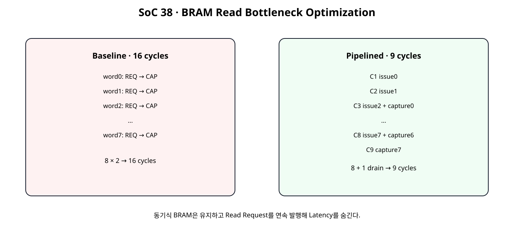
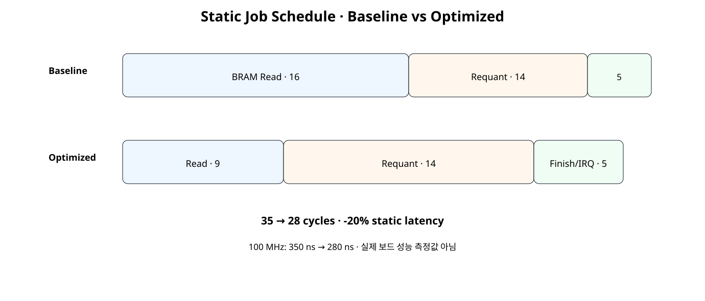
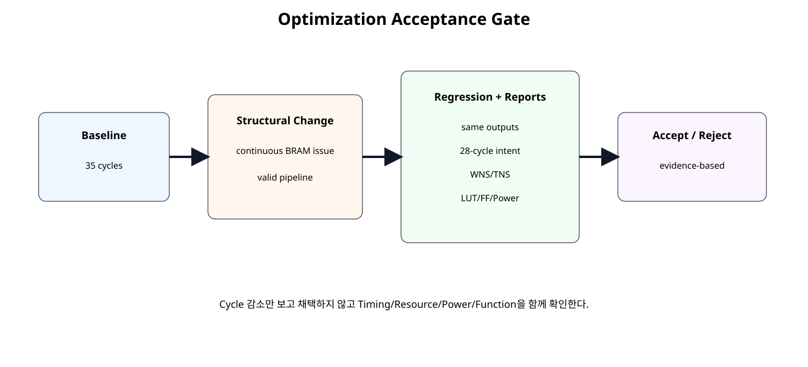

# Bottleneck Analysis · Pipelined BRAM Read Optimization


## 전체 학습 위치


## 이번 장의 목표


[](../images/soc38/soc38_read_pipeline_compare.svg)

BRAM 동기식 Read를 유지한 채 요청 간 Bubble을 제거한다.


## Baseline 보존

SoC 37에서 만든 Baseline RTL과 성능 기준을 수정하지 않는다. Baseline과 Optimized Design을 같은 Device, Clock, Tool 조건으로 따로 구현해 비교한다.


## Bottleneck 후보


| 구간 | Static Cycle | 현재 판단 |
| --- | --- | --- |
| BRAM Read | 16 | 가장 큰 단일 구간 |
| Requant | 14 | 다음 후보 |
| Finish/IRQ | 5 | 작은 구간 |

실측이 없으므로 “실제 최종 Bottleneck”이라고 단정하지 않고 정적 구조상 첫 최적화 후보로 선택한다.


## Baseline Read 구조


[](../images/soc38/soc38_read_pipeline_compare.svg)

Baseline은 한 Word마다 요청 Clock과 Capture Clock을 분리해 Bubble이 반복된다.


## 문제 원인

동기식 BRAM 자체가 문제가 아니라 다음 Address를 미리 넣지 않아 Read Latency 동안 Interface가 쉬는 것이 문제다.


## Optimized Read 구조


## 동기식 BRAM은 유지

Asynchronous Memory로 바꾸지 않는다. FPGA Block RAM의 장점을 유지하고 요청을 Pipeline하여 Latency를 숨긴다.


## Request Pipelining

issue_index_q가 0~7을 매 Clock 진행하면서 새로운 BRAM Address를 연속 발행한다.


## Valid Pipeline

read_valid_pipe_q는 어느 Clock의 Address Request가 현재 bram_rdata_i에 대응하는지 추적한다. Address와 Data의 시간 관계를 상태 추측이 아니라 Valid Pipeline으로 표현한다.


## BRAM_READ_LATENCY


```text
parameter BRAM_READ_LATENCY = 1
```

실제 BMG Port-B Output Latency가 달라지면 Parameter도 맞춰야 한다. 현재 28-cycle 기준은 1-cycle synchronous read 구성이다.


## Cycle Schedule


[](../images/soc38/soc38_schedule_comparison.svg)

Requant와 Finish/IRQ는 그대로 두고 Read 구간만 16 → 9로 줄인다.


## 35 → 28 cycles


## Latency와 Throughput


| Metric | Baseline | Optimized |
| --- | --- | --- |
| Static Job Latency | 350 ns | 280 ns |
| Static Latency 변화 | 기준 | -20.0% |
| Upper jobs/s | 2.857 M | 3.571 M |
| Upper Throughput 변화 | 기준 | +25.0% |

모두 구조상 계산값이며 실제 CPU↔NPU Throughput이 아니다.


## Static Reference


```text
SoC38 STATIC OPTIMIZATION COMPARISON
clock = 100 MHz

baseline read = 16 cycles, total = 35 cycles (350.0 ns)
fast read = 9 cycles, total = 28 cycles (280.0 ns)
saved = 7 cycles
static latency reduction = 20.0%
baseline upper jobs/s = 2,857,142.857
optimized upper jobs/s = 3,571,428.571
static upper throughput gain = 25.0%

ASSUMPTION:
- synchronous BRAM Port-B read latency = 1 clock
- no extra optional BMG output pipeline beyond this model
- same 100 MHz target

NOT MEASURED:
- WNS/TNS
- resource delta
- power delta
- MicroBlaze V/ISR latency
- board throughput
SOC38 STATIC OPTIMIZATION REFERENCE: PASS
Spreadsheet runtime warmup failed during python startup
Traceback (most recent call last):
  File "/tmp/tmp.L2TH2Y5coc/artifact_tool_v2-2.8.22/artifact_tool/patches/warm_spreadsheet_runtime_on_startup.py", line 26, in warm_spreadsheet_runtime_on_startup
  File "/tmp/tmp.L2TH2Y5coc/artifact_tool_v2-2.8.22/artifact_tool/spreadsheet_warmup.py", line 772, in warm_spreadsheet_runtime
  File "/tmp/tmp.L2TH2Y5coc/artifact_tool_v2-2.8.22/artifact_tool/rpc/connection.py", line 37, in get_or_create_client
  File "/tmp/tmp.L2TH2Y5coc/artifact_tool_v2-2.8.22/artifact_tool/rpc/daemon.py", line 124, in start_daemon
TimeoutError: Timed out waiting for artifact tool daemon socket. Set ARTIFACT_TOOL_RPC_DAEMON_STARTUP_TIMEOUT_S=<seconds> to increase the limit.
```


## 변경 범위


```text
변경:
tensor_job_engine_pipelined_read.v
npu_full_accelerator_fastread_ip.v
npu_full_accelerator_fastread_sim_top.v

유지:
Control / Descriptor / IRQ / AXI Bridge / Requant / Register Map
```


## 유지 RTL

SoC 37 Baseline 파일을 그대로 포함해 Optimized RTL과 직접 비교할 수 있게 한다. 기능적으로 관계없는 파일을 함께 수정하지 않는다.


## Baseline Engine


```verilog
module tensor_job_engine (
    input  wire                 clk,
    input  wire                 resetn,

    input  wire                 start_i,

    input  wire [11:0]          input_base_i,
    input  wire [11:0]          output_base_i,
    input  wire [15:0]          length_words_i,

    input  wire signed [31:0]   bias_ch0_i,
    input  wire signed [31:0]   bias_ch1_i,

    input  wire signed [15:0]   mult_ch0_i,
    input  wire signed [15:0]   mult_ch1_i,

    input  wire        [5:0]    shift_ch0_i,
    input  wire        [5:0]    shift_ch1_i,

    input  wire signed [15:0]   zp_ch0_i,
    input  wire signed [15:0]   zp_ch1_i,

    output wire                 busy_o,
    output reg                  done_o,
    output reg                  error_o,

    output reg                  bram_en_o,
    output reg  [3:0]           bram_we_o,
    output reg  [11:0]          bram_addr_o,
    output reg  [31:0]          bram_wdata_o,
    input  wire [31:0]          bram_rdata_i,

    output reg  [15:0]          read_word_count_o,
    output reg  [15:0]          write_word_count_o
);

// Current SoC 34 teaching kernel accepts exactly 8 input words.
// Descriptor validation is performed by the controller before START.

localparam [3:0] ST_IDLE          = 4'd0;
localparam [3:0] ST_READ_REQ      = 4'd1;
localparam [3:0] ST_READ_CAPTURE  = 4'd2;
localparam [3:0] ST_START_REQUANT = 4'd3;
localparam [3:0] ST_WAIT_RESULT   = 4'd4;
localparam [3:0] ST_WRITE_CH0     = 4'd5;
localparam [3:0] ST_WRITE_CH1     = 4'd6;
localparam [3:0] ST_DONE          = 4'd7;

reg [3:0] state_q;
reg [3:0] read_index_q;

reg [127:0] acc_ch0_batch_q;
reg [127:0] acc_ch1_batch_q;

reg requant_start_q;

wire requant_busy_w;
wire requant_done_w;
wire requant_result_valid_w;

wire [31:0] q_ch0_batch_w;
wire [31:0] q_ch1_batch_w;

wire [7:0] saturation_count_w;

assign busy_o =
    (state_q != ST_IDLE) &&
    (state_q != ST_DONE);

requantize_batch2x4_serial u_requant_batch (
    .clk(clk),
    .resetn(resetn),

    .start_i(requant_start_q),

    .acc_ch0_batch_i(acc_ch0_batch_q),
    .acc_ch1_batch_i(acc_ch1_batch_q),

    .bias_ch0_i(bias_ch0_i),
    .bias_ch1_i(bias_ch1_i),

    .mult_ch0_i(mult_ch0_i),
    .mult_ch1_i(mult_ch1_i),

    .shift_ch0_i(shift_ch0_i),
    .shift_ch1_i(shift_ch1_i),

    .zp_ch0_i(zp_ch0_i),
    .zp_ch1_i(zp_ch1_i),

    .busy_o(requant_busy_w),
    .done_o(requant_done_w),
    .result_valid_o(requant_result_valid_w),

    .q_ch0_batch_o(q_ch0_batch_w),
    .q_ch1_batch_o(q_ch1_batch_w),

    .saturation_count_o(saturation_count_w)
);

always @(*) begin
    bram_en_o    = 1'b0;
    bram_we_o    = 4'b0000;
    bram_addr_o  = 12'h000;
    bram_wdata_o = 32'h0000_0000;

    case (state_q)
        ST_READ_REQ: begin
            bram_en_o = 1'b1;
            bram_we_o = 4'b0000;

            bram_addr_o =
                input_base_i +
                {read_index_q, 2'b00};
        end

        ST_WRITE_CH0: begin
            bram_en_o    = 1'b1;
            bram_we_o    = 4'b1111;
            bram_addr_o  = output_base_i;
            bram_wdata_o = q_ch0_batch_w;
        end

        ST_WRITE_CH1: begin
            bram_en_o    = 1'b1;
            bram_we_o    = 4'b1111;
            bram_addr_o  = output_base_i + 12'd4;
            bram_wdata_o = q_ch1_batch_w;
        end

        default: begin
        end
    endcase
end

always @(posedge clk) begin
    if (!resetn) begin
        state_q <= ST_IDLE;
        read_index_q <= 4'd0;

        acc_ch0_batch_q <= 128'd0;
        acc_ch1_batch_q <= 128'd0;

        requant_start_q <= 1'b0;

        done_o <= 1'b0;
        error_o <= 1'b0;

        read_word_count_o <= 16'd0;
        write_word_count_o <= 16'd0;
    end else begin
        requant_start_q <= 1'b0;
        done_o <= 1'b0;

        case (state_q)
            ST_IDLE: begin
                if (start_i) begin
                    if (length_words_i != 16'd8) begin
                        error_o <= 1'b1;
                        done_o <= 1'b1;
                    end else begin
                        error_o <= 1'b0;

                        read_index_q <= 4'd0;
                        acc_ch0_batch_q <= 128'd0;
                        acc_ch1_batch_q <= 128'd0;

                        read_word_count_o <= 16'd0;
                        write_word_count_o <= 16'd0;

                        state_q <= ST_READ_REQ;
                    end
                end
            end

            ST_READ_REQ: begin
                state_q <= ST_READ_CAPTURE;
            end

            ST_READ_CAPTURE: begin
                read_word_count_o <=
                    read_word_count_o + 16'd1;

                case (read_index_q)
                    4'd0: acc_ch0_batch_q[31:0]    <= bram_rdata_i;
                    4'd1: acc_ch0_batch_q[63:32]   <= bram_rdata_i;
                    4'd2: acc_ch0_batch_q[95:64]   <= bram_rdata_i;
                    4'd3: acc_ch0_batch_q[127:96]  <= bram_rdata_i;

                    4'd4: acc_ch1_batch_q[31:0]    <= bram_rdata_i;
                    4'd5: acc_ch1_batch_q[63:32]   <= bram_rdata_i;
                    4'd6: acc_ch1_batch_q[95:64]   <= bram_rdata_i;

                    default:
                        acc_ch1_batch_q[127:96] <= bram_rdata_i;
                endcase

                if (read_index_q == 4'd7) begin
                    state_q <= ST_START_REQUANT;
                end else begin
                    read_index_q <=
                        read_index_q + 4'd1;

                    state_q <= ST_READ_REQ;
                end
            end

            ST_START_REQUANT: begin
                if (!requant_busy_w) begin
                    requant_start_q <= 1'b1;
                    state_q <= ST_WAIT_RESULT;
                end
            end

            ST_WAIT_RESULT: begin
                if (requant_result_valid_w) begin
                    state_q <= ST_WRITE_CH0;
                end
            end

            ST_WRITE_CH0: begin
                write_word_count_o <=
                    write_word_count_o + 16'd1;

                state_q <= ST_WRITE_CH1;
            end

            ST_WRITE_CH1: begin
                write_word_count_o <=
                    write_word_count_o + 16'd1;

                state_q <= ST_DONE;
            end

            ST_DONE: begin
                done_o <= 1'b1;
                state_q <= ST_IDLE;
            end

            default: begin
                error_o <= 1'b1;
                state_q <= ST_IDLE;
            end
        endcase
    end
end

endmodule
```


## Optimized Engine


```verilog
module tensor_job_engine_pipelined_read #(
    parameter integer BRAM_READ_LATENCY = 1
) (
    input  wire                 clk,
    input  wire                 resetn,

    input  wire                 start_i,

    input  wire [11:0]          input_base_i,
    input  wire [11:0]          output_base_i,
    input  wire [15:0]          length_words_i,

    input  wire signed [31:0]   bias_ch0_i,
    input  wire signed [31:0]   bias_ch1_i,

    input  wire signed [15:0]   mult_ch0_i,
    input  wire signed [15:0]   mult_ch1_i,

    input  wire        [5:0]    shift_ch0_i,
    input  wire        [5:0]    shift_ch1_i,

    input  wire signed [15:0]   zp_ch0_i,
    input  wire signed [15:0]   zp_ch1_i,

    output wire                 busy_o,
    output reg                  done_o,
    output reg                  error_o,

    output reg                  bram_en_o,
    output reg  [3:0]           bram_we_o,
    output reg  [11:0]          bram_addr_o,
    output reg  [31:0]          bram_wdata_o,
    input  wire [31:0]          bram_rdata_i,

    output reg  [15:0]          read_word_count_o,
    output reg  [15:0]          write_word_count_o
);

// ------------------------------------------------------------
// SoC 38 · Pipelined BRAM Read Optimization
// ------------------------------------------------------------
//
// Baseline:
//   READ_REQ -> READ_CAPTURE -> READ_REQ -> READ_CAPTURE ...
//   8 words -> 16 cycles
//
// Optimized:
//   issue word0
//   issue word1 + wait/capture pipeline
//   issue word2 + capture word0
//   ...
//   drain final read
//
// With BRAM_READ_LATENCY=1:
//   8 words -> 9 cycles
//
// Important:
// - The BRAM remains synchronous.
// - This design does NOT remove a BRAM output register.
// - It pipelines requests so the read latency is hidden after startup.
// - If the actual BMG Port-B read latency is changed, set
//   BRAM_READ_LATENCY to match the configured synchronous output latency.
// - BRAM_READ_LATENCY must be >= 1.

localparam [2:0] ST_IDLE          = 3'd0;
localparam [2:0] ST_READ_STREAM   = 3'd1;
localparam [2:0] ST_START_REQUANT = 3'd2;
localparam [2:0] ST_WAIT_RESULT   = 3'd3;
localparam [2:0] ST_WRITE_CH0     = 3'd4;
localparam [2:0] ST_WRITE_CH1     = 3'd5;
localparam [2:0] ST_DONE          = 3'd6;

reg [2:0] state_q;

reg [3:0] issue_index_q;
reg [3:0] capture_index_q;
reg       issue_done_q;

reg [127:0] acc_ch0_batch_q;
reg [127:0] acc_ch1_batch_q;

reg requant_start_q;

// One bit per configured BRAM output-latency stage.
// Example BRAM_READ_LATENCY=1:
//   issue_read_w -> read_valid_pipe_q[0] -> capture on next clock
reg [BRAM_READ_LATENCY-1:0] read_valid_pipe_q;

integer valid_stage;

wire issue_read_w;
wire capture_valid_w;

assign issue_read_w =
    (state_q == ST_READ_STREAM) &&
    !issue_done_q;

assign capture_valid_w =
    read_valid_pipe_q[BRAM_READ_LATENCY-1];

wire requant_busy_w;
wire requant_done_w;
wire requant_result_valid_w;

wire [31:0] q_ch0_batch_w;
wire [31:0] q_ch1_batch_w;

wire [7:0] saturation_count_w;

assign busy_o =
    (state_q != ST_IDLE) &&
    (state_q != ST_DONE);

requantize_batch2x4_serial u_requant_batch (
    .clk(clk),
    .resetn(resetn),

    .start_i(requant_start_q),

    .acc_ch0_batch_i(acc_ch0_batch_q),
    .acc_ch1_batch_i(acc_ch1_batch_q),

    .bias_ch0_i(bias_ch0_i),
    .bias_ch1_i(bias_ch1_i),

    .mult_ch0_i(mult_ch0_i),
    .mult_ch1_i(mult_ch1_i),

    .shift_ch0_i(shift_ch0_i),
    .shift_ch1_i(shift_ch1_i),

    .zp_ch0_i(zp_ch0_i),
    .zp_ch1_i(zp_ch1_i),

    .busy_o(requant_busy_w),
    .done_o(requant_done_w),
    .result_valid_o(requant_result_valid_w),

    .q_ch0_batch_o(q_ch0_batch_w),
    .q_ch1_batch_o(q_ch1_batch_w),

    .saturation_count_o(saturation_count_w)
);

// ------------------------------------------------------------
// BRAM interface.
// ------------------------------------------------------------
always @(*) begin
    bram_en_o    = 1'b0;
    bram_we_o    = 4'b0000;
    bram_addr_o  = 12'h000;
    bram_wdata_o = 32'h0000_0000;

    case (state_q)
        ST_READ_STREAM: begin
            if (!issue_done_q) begin
                bram_en_o = 1'b1;
                bram_we_o = 4'b0000;

                bram_addr_o =
                    input_base_i +
                    {issue_index_q, 2'b00};
            end
        end

        ST_WRITE_CH0: begin
            bram_en_o    = 1'b1;
            bram_we_o    = 4'b1111;
            bram_addr_o  = output_base_i;
            bram_wdata_o = q_ch0_batch_w;
        end

        ST_WRITE_CH1: begin
            bram_en_o    = 1'b1;
            bram_we_o    = 4'b1111;
            bram_addr_o  = output_base_i + 12'd4;
            bram_wdata_o = q_ch1_batch_w;
        end

        default: begin
        end
    endcase
end

// ------------------------------------------------------------
// Read-valid pipeline.
//
// This tracks when a previously-issued synchronous BRAM read becomes
// safe to capture into the job-engine batch registers.
// ------------------------------------------------------------
always @(posedge clk) begin
    if (!resetn) begin
        read_valid_pipe_q <=
            {BRAM_READ_LATENCY{1'b0}};
    end else begin
        read_valid_pipe_q[0] <=
            issue_read_w;

        for (
            valid_stage = 1;
            valid_stage < BRAM_READ_LATENCY;
            valid_stage = valid_stage + 1
        ) begin
            read_valid_pipe_q[valid_stage] <=
                read_valid_pipe_q[valid_stage - 1];
        end
    end
end

// ------------------------------------------------------------
// Main state machine.
// ------------------------------------------------------------
always @(posedge clk) begin
    if (!resetn) begin
        state_q <= ST_IDLE;

        issue_index_q <= 4'd0;
        capture_index_q <= 4'd0;
        issue_done_q <= 1'b0;

        acc_ch0_batch_q <= 128'd0;
        acc_ch1_batch_q <= 128'd0;

        requant_start_q <= 1'b0;

        done_o <= 1'b0;
        error_o <= 1'b0;

        read_word_count_o <= 16'd0;
        write_word_count_o <= 16'd0;
    end else begin
        requant_start_q <= 1'b0;
        done_o <= 1'b0;

        case (state_q)
            ST_IDLE: begin
                if (start_i) begin
                    if (length_words_i != 16'd8) begin
                        error_o <= 1'b1;
                        done_o <= 1'b1;
                    end else begin
                        error_o <= 1'b0;

                        issue_index_q <= 4'd0;
                        capture_index_q <= 4'd0;
                        issue_done_q <= 1'b0;

                        acc_ch0_batch_q <= 128'd0;
                        acc_ch1_batch_q <= 128'd0;

                        read_word_count_o <= 16'd0;
                        write_word_count_o <= 16'd0;

                        state_q <= ST_READ_STREAM;
                    end
                end
            end

            ST_READ_STREAM: begin
                // One new address is presented every clock until word 7.
                if (issue_read_w) begin
                    if (issue_index_q == 4'd7) begin
                        issue_done_q <= 1'b1;
                    end else begin
                        issue_index_q <=
                            issue_index_q + 4'd1;
                    end
                end

                // After the initial latency, one word is captured per clock.
                if (capture_valid_w) begin
                    read_word_count_o <=
                        read_word_count_o + 16'd1;

                    case (capture_index_q)
                        4'd0: acc_ch0_batch_q[31:0]   <= bram_rdata_i;
                        4'd1: acc_ch0_batch_q[63:32]  <= bram_rdata_i;
                        4'd2: acc_ch0_batch_q[95:64]  <= bram_rdata_i;
                        4'd3: acc_ch0_batch_q[127:96] <= bram_rdata_i;

                        4'd4: acc_ch1_batch_q[31:0]   <= bram_rdata_i;
                        4'd5: acc_ch1_batch_q[63:32]  <= bram_rdata_i;
                        4'd6: acc_ch1_batch_q[95:64]  <= bram_rdata_i;

                        default:
                            acc_ch1_batch_q[127:96] <= bram_rdata_i;
                    endcase

                    if (capture_index_q == 4'd7) begin
                        state_q <= ST_START_REQUANT;
                    end else begin
                        capture_index_q <=
                            capture_index_q + 4'd1;
                    end
                end
            end

            ST_START_REQUANT: begin
                if (!requant_busy_w) begin
                    requant_start_q <= 1'b1;
                    state_q <= ST_WAIT_RESULT;
                end
            end

            ST_WAIT_RESULT: begin
                if (requant_result_valid_w) begin
                    state_q <= ST_WRITE_CH0;
                end
            end

            ST_WRITE_CH0: begin
                write_word_count_o <=
                    write_word_count_o + 16'd1;

                state_q <= ST_WRITE_CH1;
            end

            ST_WRITE_CH1: begin
                write_word_count_o <=
                    write_word_count_o + 16'd1;

                state_q <= ST_DONE;
            end

            ST_DONE: begin
                done_o <= 1'b1;
                state_q <= ST_IDLE;
            end

            default: begin
                error_o <= 1'b1;
                state_q <= ST_IDLE;
            end
        endcase
    end
end

endmodule
```


## Optimized Top


```verilog
module npu_full_accelerator_fastread_ip (
    (* X_INTERFACE_INFO = "xilinx.com:signal:clock:1.0 s_axi_aclk CLK" *)
    (* X_INTERFACE_PARAMETER = "XIL_INTERFACENAME s_axi_aclk, ASSOCIATED_BUSIF S_AXI:BRAM, ASSOCIATED_RESET s_axi_aresetn" *)
    input  wire        s_axi_aclk,

    (* X_INTERFACE_INFO = "xilinx.com:signal:reset:1.0 s_axi_aresetn RST" *)
    (* X_INTERFACE_PARAMETER = "XIL_INTERFACENAME s_axi_aresetn, POLARITY ACTIVE_LOW" *)
    input  wire        s_axi_aresetn,

    // --------------------------------------------------------
    // AXI4-Lite Control Plane
    // --------------------------------------------------------
    (* X_INTERFACE_INFO = "xilinx.com:interface:aximm:1.0 S_AXI AWADDR" *)
    input  wire [7:0]  s_axi_awaddr,
    (* X_INTERFACE_INFO = "xilinx.com:interface:aximm:1.0 S_AXI AWVALID" *)
    input  wire        s_axi_awvalid,
    (* X_INTERFACE_INFO = "xilinx.com:interface:aximm:1.0 S_AXI AWREADY" *)
    output wire        s_axi_awready,

    (* X_INTERFACE_INFO = "xilinx.com:interface:aximm:1.0 S_AXI WDATA" *)
    input  wire [31:0] s_axi_wdata,
    (* X_INTERFACE_INFO = "xilinx.com:interface:aximm:1.0 S_AXI WSTRB" *)
    input  wire [3:0]  s_axi_wstrb,
    (* X_INTERFACE_INFO = "xilinx.com:interface:aximm:1.0 S_AXI WVALID" *)
    input  wire        s_axi_wvalid,
    (* X_INTERFACE_INFO = "xilinx.com:interface:aximm:1.0 S_AXI WREADY" *)
    output wire        s_axi_wready,

    (* X_INTERFACE_INFO = "xilinx.com:interface:aximm:1.0 S_AXI BRESP" *)
    output wire [1:0]  s_axi_bresp,
    (* X_INTERFACE_INFO = "xilinx.com:interface:aximm:1.0 S_AXI BVALID" *)
    output wire        s_axi_bvalid,
    (* X_INTERFACE_INFO = "xilinx.com:interface:aximm:1.0 S_AXI BREADY" *)
    input  wire        s_axi_bready,

    (* X_INTERFACE_INFO = "xilinx.com:interface:aximm:1.0 S_AXI ARADDR" *)
    input  wire [7:0]  s_axi_araddr,
    (* X_INTERFACE_INFO = "xilinx.com:interface:aximm:1.0 S_AXI ARVALID" *)
    input  wire        s_axi_arvalid,
    (* X_INTERFACE_INFO = "xilinx.com:interface:aximm:1.0 S_AXI ARREADY" *)
    output wire        s_axi_arready,

    (* X_INTERFACE_INFO = "xilinx.com:interface:aximm:1.0 S_AXI RDATA" *)
    output wire [31:0] s_axi_rdata,
    (* X_INTERFACE_INFO = "xilinx.com:interface:aximm:1.0 S_AXI RRESP" *)
    output wire [1:0]  s_axi_rresp,
    (* X_INTERFACE_INFO = "xilinx.com:interface:aximm:1.0 S_AXI RVALID" *)
    output wire        s_axi_rvalid,
    (* X_INTERFACE_INFO = "xilinx.com:interface:aximm:1.0 S_AXI RREADY" *)
    input  wire        s_axi_rready,

    // --------------------------------------------------------
    // Native BRAM Data Plane
    // --------------------------------------------------------
    (* X_INTERFACE_INFO = "xilinx.com:interface:bram:1.0 BRAM CLK" *)
    output wire        bram_clk_o,
    (* X_INTERFACE_INFO = "xilinx.com:interface:bram:1.0 BRAM RST" *)
    output wire        bram_rst_o,
    (* X_INTERFACE_INFO = "xilinx.com:interface:bram:1.0 BRAM EN" *)
    output wire        bram_en_o,
    (* X_INTERFACE_INFO = "xilinx.com:interface:bram:1.0 BRAM WE" *)
    output wire [3:0]  bram_we_o,
    (* X_INTERFACE_INFO = "xilinx.com:interface:bram:1.0 BRAM ADDR" *)
    output wire [11:0] bram_addr_o,
    (* X_INTERFACE_INFO = "xilinx.com:interface:bram:1.0 BRAM DIN" *)
    output wire [31:0] bram_wdata_o,
    (* X_INTERFACE_INFO = "xilinx.com:interface:bram:1.0 BRAM DOUT" *)
    input  wire [31:0] bram_rdata_i,

    // --------------------------------------------------------
    // Interrupt
    // --------------------------------------------------------
    (* X_INTERFACE_INFO = "xilinx.com:signal:interrupt:1.0 irq INTERRUPT" *)
    (* X_INTERFACE_PARAMETER = "XIL_INTERFACENAME irq, SENSITIVITY LEVEL_HIGH" *)
    output wire        irq
);

// Pure Shell / Wrapper:
// AXI bridge + control/descriptor/IRQ + job engine + BRAM clock/reset adapter.

wire        reg_wr_en;
wire [7:0]  reg_wr_addr;
wire [31:0] reg_wr_data;
wire [3:0]  reg_wr_strb;

wire [7:0]  reg_rd_addr;
wire [31:0] reg_rd_data;

wire job_start;

wire [11:0] active_input_base;
wire [11:0] active_output_base;
wire [15:0] active_length_words;

wire signed [31:0] active_bias_ch0;
wire signed [31:0] active_bias_ch1;

wire signed [15:0] active_mult_ch0;
wire signed [15:0] active_mult_ch1;

wire [5:0] active_shift_ch0;
wire [5:0] active_shift_ch1;

wire signed [15:0] active_zp_ch0;
wire signed [15:0] active_zp_ch1;

wire engine_busy;
wire engine_done;
wire engine_error;

wire [15:0] read_word_count;
wire [15:0] write_word_count;

wire ctrl_busy;
wire done_sticky;
wire error_sticky;
wire [7:0] error_code;
wire [31:0] job_id;
wire [1:0] irq_enable;
wire [1:0] irq_status;

axi4lite_reg_bridge u_axi_bridge (
    .s_axi_aclk(s_axi_aclk),
    .s_axi_aresetn(s_axi_aresetn),

    .s_axi_awaddr(s_axi_awaddr),
    .s_axi_awvalid(s_axi_awvalid),
    .s_axi_awready(s_axi_awready),

    .s_axi_wdata(s_axi_wdata),
    .s_axi_wstrb(s_axi_wstrb),
    .s_axi_wvalid(s_axi_wvalid),
    .s_axi_wready(s_axi_wready),

    .s_axi_bresp(s_axi_bresp),
    .s_axi_bvalid(s_axi_bvalid),
    .s_axi_bready(s_axi_bready),

    .s_axi_araddr(s_axi_araddr),
    .s_axi_arvalid(s_axi_arvalid),
    .s_axi_arready(s_axi_arready),

    .s_axi_rdata(s_axi_rdata),
    .s_axi_rresp(s_axi_rresp),
    .s_axi_rvalid(s_axi_rvalid),
    .s_axi_rready(s_axi_rready),

    .reg_wr_en_o(reg_wr_en),
    .reg_wr_addr_o(reg_wr_addr),
    .reg_wr_data_o(reg_wr_data),
    .reg_wr_strb_o(reg_wr_strb),

    .reg_rd_addr_o(reg_rd_addr),
    .reg_rd_data_i(reg_rd_data)
);

npu_full_control_irq u_control (
    .clk(s_axi_aclk),
    .resetn(s_axi_aresetn),

    .wr_en_i(reg_wr_en),
    .wr_addr_i(reg_wr_addr),
    .wr_data_i(reg_wr_data),
    .wr_strb_i(reg_wr_strb),

    .rd_addr_i(reg_rd_addr),
    .rd_data_o(reg_rd_data),

    .job_start_o(job_start),

    .active_input_base_o(active_input_base),
    .active_output_base_o(active_output_base),
    .active_length_words_o(active_length_words),

    .active_bias_ch0_o(active_bias_ch0),
    .active_bias_ch1_o(active_bias_ch1),

    .active_mult_ch0_o(active_mult_ch0),
    .active_mult_ch1_o(active_mult_ch1),

    .active_shift_ch0_o(active_shift_ch0),
    .active_shift_ch1_o(active_shift_ch1),

    .active_zp_ch0_o(active_zp_ch0),
    .active_zp_ch1_o(active_zp_ch1),

    .engine_busy_i(engine_busy),
    .engine_done_i(engine_done),
    .engine_error_i(engine_error),

    .read_word_count_i(read_word_count),
    .write_word_count_i(write_word_count),

    .busy_o(ctrl_busy),
    .done_sticky_o(done_sticky),
    .error_sticky_o(error_sticky),
    .error_code_o(error_code),
    .job_id_o(job_id),

    .irq_o(irq),
    .irq_enable_o(irq_enable),
    .irq_status_o(irq_status)
);

tensor_job_engine_pipelined_read #(
    .BRAM_READ_LATENCY(1)
) u_engine (
    .clk(s_axi_aclk),
    .resetn(s_axi_aresetn),

    .start_i(job_start),

    .input_base_i(active_input_base),
    .output_base_i(active_output_base),
    .length_words_i(active_length_words),

    .bias_ch0_i(active_bias_ch0),
    .bias_ch1_i(active_bias_ch1),

    .mult_ch0_i(active_mult_ch0),
    .mult_ch1_i(active_mult_ch1),

    .shift_ch0_i(active_shift_ch0),
    .shift_ch1_i(active_shift_ch1),

    .zp_ch0_i(active_zp_ch0),
    .zp_ch1_i(active_zp_ch1),

    .busy_o(engine_busy),
    .done_o(engine_done),
    .error_o(engine_error),

    .bram_en_o(bram_en_o),
    .bram_we_o(bram_we_o),
    .bram_addr_o(bram_addr_o),
    .bram_wdata_o(bram_wdata_o),
    .bram_rdata_i(bram_rdata_i),

    .read_word_count_o(read_word_count),
    .write_word_count_o(write_word_count)
);

bram_clock_reset_adapter u_bram_clock_reset (
    .clk_i(s_axi_aclk),
    .resetn_i(s_axi_aresetn),

    .bram_clk_o(bram_clk_o),
    .bram_rst_o(bram_rst_o)
);

endmodule
```


## Top Shell/Wrapper

Optimized Top도 기능 로직을 직접 넣지 않고 기존 Control/Bridge와 새 Engine Instance만 연결한다.


## Functional Regression

Cycle이 줄었다고 기능이 바뀌면 최적화가 아니다. 기존 Job0/Job1 결과, Descriptor Error, IRQ/W1C를 모두 유지해야 한다.


## JOB0


```text
OUT0 → 0x20181008
OUT1 → 0x7F7F6333
Expected optimized internal latency → 28 cycles
```


## JOB1


```text
OUT0 → 0x04030201
OUT1 → 0x1B150F09
Expected optimized internal latency → 28 cycles
```


## Counter / JOB_ID


## DONE / ERROR IRQ

DONE IRQ와 W1C, 잘못된 Descriptor의 ERROR IRQ를 그대로 유지한다. Read Scheduler 변경이 Control Plane 의미를 바꾸지 않아야 한다.


## Cycle Regression


```verilog
`timescale 1ns / 1ps

module tb_soc38_fastread_regression;

logic clk = 1'b0;
logic resetn = 1'b0;

logic [7:0]  awaddr = 8'h00;
logic        awvalid = 1'b0;
wire         awready;

logic [31:0] wdata = 32'h0000_0000;
logic [3:0]  wstrb = 4'h0;
logic        wvalid = 1'b0;
wire         wready;

wire [1:0]   bresp;
wire         bvalid;
logic        bready = 1'b1;

logic [7:0]  araddr = 8'h00;
logic        arvalid = 1'b0;
wire         arready;

wire [31:0]  rdata;
wire [1:0]   rresp;
wire         rvalid;
logic        rready = 1'b1;

logic        cpu_mem_en_i = 1'b0;
logic [3:0]  cpu_mem_we_i = 4'h0;
logic [11:0] cpu_mem_addr_i = 12'h000;
logic [31:0] cpu_mem_wdata_i = 32'h0000_0000;
wire [31:0]  cpu_mem_rdata_o;

wire irq_o;

integer check_count = 0;
integer error_count = 0;

integer cycle_counter = 0;
integer engine_start_cycle = -1;
integer irq_cycle = -1;
logic engine_busy_d = 1'b0;

always @(posedge clk) begin
    cycle_counter = cycle_counter + 1;

    // Wait until NBA updates settle before observing DUT pulses.
    #1;

    if (
        dut.u_npu.engine_busy &&
        !engine_busy_d
    ) begin
        engine_start_cycle = cycle_counter;
    end

    engine_busy_d = dut.u_npu.engine_busy;

    if (
        (irq_o === 1'b1) &&
        (irq_cycle < 0)
    ) begin
        irq_cycle = cycle_counter;
    end
end

always #5 clk = ~clk;

npu_full_accelerator_fastread_sim_top dut (
    .clk(clk),
    .resetn(resetn),

    .s_axi_awaddr(awaddr),
    .s_axi_awvalid(awvalid),
    .s_axi_awready(awready),

    .s_axi_wdata(wdata),
    .s_axi_wstrb(wstrb),
    .s_axi_wvalid(wvalid),
    .s_axi_wready(wready),

    .s_axi_bresp(bresp),
    .s_axi_bvalid(bvalid),
    .s_axi_bready(bready),

    .s_axi_araddr(araddr),
    .s_axi_arvalid(arvalid),
    .s_axi_arready(arready),

    .s_axi_rdata(rdata),
    .s_axi_rresp(rresp),
    .s_axi_rvalid(rvalid),
    .s_axi_rready(rready),

    .cpu_mem_en_i(cpu_mem_en_i),
    .cpu_mem_we_i(cpu_mem_we_i),
    .cpu_mem_addr_i(cpu_mem_addr_i),
    .cpu_mem_wdata_i(cpu_mem_wdata_i),
    .cpu_mem_rdata_o(cpu_mem_rdata_o),

    .irq_o(irq_o)
);

task automatic check_true(
    input string name,
    input bit condition
);
    begin
        check_count = check_count + 1;
        if (!condition) begin
            error_count = error_count + 1;
            $error("CHECK FAIL: %s", name);
        end else begin
            $display("CHECK PASS: %s", name);
        end
    end
endtask

task automatic check_eq32(
    input string name,
    input logic [31:0] actual,
    input logic [31:0] expected
);
    begin
        check_count = check_count + 1;
        if (actual !== expected) begin
            error_count = error_count + 1;
            $error(
                "CHECK FAIL: %s actual=0x%08h expected=0x%08h",
                name,
                actual,
                expected
            );
        end else begin
            $display(
                "CHECK PASS: %s = 0x%08h",
                name,
                actual
            );
        end
    end
endtask

task automatic axi_write(
    input [7:0] address,
    input [31:0] data,
    input integer order
);
    bit aw_done;
    bit w_done;
    integer timeout;

    begin
        aw_done = 0;
        w_done = 0;

        @(negedge clk);

        awaddr = address;
        wdata = data;
        wstrb = 4'hF;

        case (order)
            0: begin
                awvalid = 1'b1;
                wvalid = 1'b1;
            end

            1: begin
                awvalid = 1'b1;
                wvalid = 1'b0;
            end

            default: begin
                awvalid = 1'b0;
                wvalid = 1'b1;
            end
        endcase

        timeout = 0;

        while (!(aw_done && w_done)) begin
            @(posedge clk);
            // (변경) READY가 갱신되기 전 상승 에지의 handshake를 관측한다.

            if (awvalid && awready)
                aw_done = 1;

            if (wvalid && wready)
                w_done = 1;

            @(negedge clk);

            if (aw_done)
                awvalid = 1'b0;

            if (w_done)
                wvalid = 1'b0;

            if (
                (order == 1) &&
                aw_done &&
                !w_done
            )
                wvalid = 1'b1;

            if (
                (order == 2) &&
                w_done &&
                !aw_done
            )
                awvalid = 1'b1;

            timeout = timeout + 1;

            if (timeout > 40)
                $fatal(1, "AXI write timeout");
        end

        timeout = 0;

        while (!bvalid) begin
            @(posedge clk);
            #1;

            timeout = timeout + 1;

            if (timeout > 40)
                $fatal(1, "AXI BVALID timeout");
        end

        check_true(
            "BRESP OKAY",
            bresp == 2'b00
        );

        @(posedge clk);
        #1;
    end
endtask

task automatic axi_read(
    input [7:0] address,
    output [31:0] data
);
    integer timeout;

    begin
        @(negedge clk);

        araddr = address;
        arvalid = 1'b1;

        timeout = 0;

        while (!arready) begin
            @(posedge clk);
            #1;
            timeout = timeout + 1;

            if (timeout > 40)
                $fatal(1, "AXI ARREADY timeout");
        end

        @(posedge clk);
        #1;

        timeout = 0;

        while (!rvalid) begin
            @(posedge clk);
            #1;

            timeout = timeout + 1;

            if (timeout > 40)
                $fatal(1, "AXI RVALID timeout");
        end

        data = rdata;

        check_true(
            "RRESP OKAY",
            rresp == 2'b00
        );

        @(negedge clk);
        arvalid = 1'b0;

        @(posedge clk);
        #1;
    end
endtask

task automatic mem_write32(
    input [11:0] address,
    input [31:0] data
);
    begin
        @(negedge clk);

        cpu_mem_en_i = 1'b1;
        cpu_mem_we_i = 4'hF;
        cpu_mem_addr_i = address;
        cpu_mem_wdata_i = data;

        @(posedge clk);
        #1;

        @(negedge clk);

        cpu_mem_en_i = 1'b0;
        cpu_mem_we_i = 4'h0;
        cpu_mem_addr_i = 12'h000;
        cpu_mem_wdata_i = 32'h0000_0000;
    end
endtask

task automatic mem_read32(
    input [11:0] address,
    output [31:0] data
);
    begin
        @(negedge clk);

        cpu_mem_en_i = 1'b1;
        cpu_mem_we_i = 4'h0;
        cpu_mem_addr_i = address;

        @(posedge clk);
        #1;

        @(negedge clk);

        cpu_mem_en_i = 1'b0;
        cpu_mem_addr_i = 12'h000;

        data = cpu_mem_rdata_o;
    end
endtask

task automatic wait_irq_high;
    integer timeout;
    begin
        timeout = 0;

        while (irq_o !== 1'b1) begin
            @(posedge clk);
            // (변경) 같은 시각의 #1 성능 모니터보다 뒤에서 IRQ를 관측한다.
            #2;

            timeout = timeout + 1;

            if (timeout > 300)
                $fatal(1, "IRQ did not assert");
        end
    end
endtask

initial begin
    reg [31:0] rd;

    repeat (5) @(posedge clk);
    resetn = 1'b1;

    // --------------------------------------------------------
    // 1. CPU fills Tensor BRAM through Port A.
    // --------------------------------------------------------
    mem_write32(12'h200, 32'd16);
    mem_write32(12'h204, 32'd32);
    mem_write32(12'h208, 32'd48);
    mem_write32(12'h20C, 32'd64);

    mem_write32(12'h210, 32'd32);
    mem_write32(12'h214, 32'd64);
    mem_write32(12'h218, 32'd96);
    mem_write32(12'h21C, 32'd128);

    // --------------------------------------------------------
    // 2. Program descriptor / parameter / IRQ registers.
    //    Exercise all three AXI write channel orders.
    // --------------------------------------------------------
    axi_write(8'h10, 32'h0000_0200, 0);
    axi_write(8'h14, 32'h0000_0300, 1);
    axi_write(8'h18, 32'd8,         2);

    axi_write(8'h20, 32'd0,         0);
    axi_write(8'h24, 32'd4,         1);
    axi_write(8'h28, 32'h0001_0001, 2);
    axi_write(8'h2C, 32'h0001_0003, 0);
    axi_write(8'h30, 32'hFFFD_0000, 1);

    // Clear stale IRQ and status, then enable DONE/ERROR.
    axi_write(8'h4C, 32'h0000_0003, 2);
    axi_write(8'h00, 32'h0000_0006, 0);
    axi_write(8'h48, 32'h0000_0003, 1);

    axi_read(8'h04, rd);

    check_true(
        "descriptor valid",
        (rd & 32'h8) != 0
    );

    // --------------------------------------------------------
    // 3. START and wait for DONE IRQ.
    // --------------------------------------------------------
    axi_write(8'h00, 32'h0000_0001, 0);

    // Wait until BUSY appears.
    do begin
        axi_read(8'h04, rd);
    end while ((rd & 32'h1) == 0);

    // Shadow changes while the active job is running.
    axi_write(8'h10, 32'h0000_0400, 1);
    axi_write(8'h14, 32'h0000_0500, 2);

    axi_read(8'h34, rd);
    check_eq32(
        "ACTIVE_INPUT remains 0x200",
        rd,
        32'h0000_0200
    );

    axi_read(8'h38, rd);
    check_eq32(
        "ACTIVE_OUTPUT remains 0x300",
        rd,
        32'h0000_0300
    );

    wait_irq_high();

    check_true(
        "JOB0 optimized latency = 28 cycles",
        (irq_cycle - engine_start_cycle) == 28
    );

    axi_read(8'h4C, rd);

    check_true(
        "DONE IRQ pending",
        (rd & 32'h1) != 0
    );

    check_true(
        "ERROR IRQ clear",
        (rd & 32'h2) == 0
    );

    // CPU reclaims Tensor Buffer after completion.
    mem_read32(12'h300, rd);
    check_eq32(
        "full integration OUT_CH0",
        rd,
        32'h2018_1008
    );

    mem_read32(12'h304, rd);
    check_eq32(
        "full integration OUT_CH1",
        rd,
        32'h7F7F_6333
    );

    axi_read(8'h0C, rd);
    check_eq32(
        "JOB_ID = 1",
        rd,
        32'd1
    );

    axi_read(8'h40, rd);
    check_eq32(
        "READ_WORD_COUNT = 8",
        rd,
        32'd8
    );

    axi_read(8'h44, rd);
    check_eq32(
        "WRITE_WORD_COUNT = 2",
        rd,
        32'd2
    );

    // ISR-equivalent W1C.
    axi_write(8'h4C, 32'h0000_0001, 0);

    repeat (2) @(posedge clk);
    #1;

    check_true(
        "DONE W1C deasserts IRQ",
        irq_o === 1'b0
    );

    // --------------------------------------------------------
    // 4. Second complete job: same hardware, new Tensor buffer.
    // --------------------------------------------------------
    mem_write32(12'h400, 32'd2);
    mem_write32(12'h404, 32'd4);
    mem_write32(12'h408, 32'd6);
    mem_write32(12'h40C, 32'd8);

    mem_write32(12'h410, 32'd4);
    mem_write32(12'h414, 32'd8);
    mem_write32(12'h418, 32'd12);
    mem_write32(12'h41C, 32'd16);

    // Shadow addresses already changed to 0x400 / 0x500
    // during JOB0. Keep LENGTH=8 and parameters unchanged.
    axi_write(8'h18, 32'd8, 2);

    axi_write(8'h00, 32'h0000_0006, 0);
    axi_write(8'h4C, 32'h0000_0003, 1);
    axi_write(8'h48, 32'h0000_0003, 2);

    axi_read(8'h04, rd);

    check_true(
        "JOB1 descriptor valid",
        (rd & 32'h8) != 0
    );

    engine_start_cycle = -1;
    irq_cycle = -1;

    axi_write(8'h00, 32'h0000_0001, 0);

    wait_irq_high();

    check_true(
        "JOB1 optimized latency = 28 cycles",
        (irq_cycle - engine_start_cycle) == 28
    );

    axi_read(8'h4C, rd);

    check_true(
        "JOB1 DONE IRQ pending",
        (rd & 32'h1) != 0
    );

    mem_read32(12'h500, rd);
    check_eq32(
        "JOB1 OUT_CH0",
        rd,
        32'h0403_0201
    );

    mem_read32(12'h504, rd);
    check_eq32(
        "JOB1 OUT_CH1",
        rd,
        32'h1B15_0F09
    );

    axi_read(8'h0C, rd);
    check_eq32(
        "JOB_ID = 2 after second accepted job",
        rd,
        32'd2
    );

    axi_read(8'h40, rd);
    check_eq32(
        "JOB1 READ_WORD_COUNT = 8",
        rd,
        32'd8
    );

    axi_read(8'h44, rd);
    check_eq32(
        "JOB1 WRITE_WORD_COUNT = 2",
        rd,
        32'd2
    );

    axi_write(8'h4C, 32'h0000_0001, 1);

    repeat (2) @(posedge clk);
    #1;

    check_true(
        "JOB1 W1C deasserts IRQ",
        irq_o === 1'b0
    );

    // --------------------------------------------------------
    // 5. Integrated descriptor ERROR IRQ after two good jobs.
    // --------------------------------------------------------
    axi_write(8'h00, 32'h0000_0006, 1);
    axi_write(8'h4C, 32'h0000_0003, 2);
    axi_write(8'h48, 32'h0000_0002, 0);

    axi_write(8'h10, 32'h0000_0202, 1);
    axi_write(8'h14, 32'h0000_0600, 2);
    axi_write(8'h18, 32'd8,         0);

    axi_write(8'h00, 32'h0000_0001, 1);

    wait_irq_high();

    axi_read(8'h4C, rd);

    check_true(
        "descriptor ERROR IRQ pending",
        (rd & 32'h2) != 0
    );

    axi_read(8'h1C, rd);

    check_eq32(
        "descriptor ERROR_CODE = 2",
        rd,
        32'd2
    );

    axi_read(8'h0C, rd);

    check_eq32(
        "rejected job keeps JOB_ID = 2",
        rd,
        32'd2
    );

    axi_write(8'h4C, 32'h0000_0002, 2);

    repeat (2) @(posedge clk);
    #1;

    check_true(
        "ERROR W1C deasserts IRQ",
        irq_o === 1'b0
    );

    $display("");
    $display("SOC38 CHECK COUNT : %0d", check_count);
    $display("SOC38 ERROR COUNT : %0d", error_count);

    if (error_count == 0) begin
        $display("SOC38 FASTREAD OPTIMIZATION TEST: PASS");
    end else begin
        $fatal(
            1,
            "SOC38 FASTREAD OPTIMIZATION TEST: FAIL (%0d errors)",
            error_count
        );
    end

    #20;
    $finish;
end

endmodule
```


## Post-Route 비교 원칙


```text
Same Device
Same 100 MHz Constraint
Same Vivado Version
Same Flow
Same Activity Assumption
```

조건이 다른 Report끼리 비교하지 않는다.


## Baseline Post-Route


```text
# SoC 38 · baseline post-route comparison
# Same device / same 100 MHz constraint / same report set.

set script_dir [file dirname [file normalize [info script]]]
set root_dir [file normalize [file join $script_dir ".."]]
set rtl_dir [file join $root_dir "rtl"]
set out_dir [file normalize [file join $root_dir "reports" "baseline"]]

file mkdir $out_dir

create_project -in_memory -part xc7a35tcpg236-1

foreach f {
    requantize_s32_to_s8.v
    requantize_batch2x4_serial.v
    tensor_job_engine.v
    npu_full_control_irq.v
    axi4lite_reg_bridge.v
    bram_clock_reset_adapter.v
    npu_full_accelerator_ip.v
} {
    read_verilog [file join $rtl_dir $f]
}

synth_design \
    -mode out_of_context \
    -top npu_full_accelerator_ip \
    -part xc7a35tcpg236-1

create_clock \
    -name s_axi_aclk \
    -period 10.000 \
    [get_ports s_axi_aclk]

report_methodology \
    -file [file join $out_dir "01_methodology_post_synth.rpt"]

opt_design
place_design
phys_opt_design
route_design

report_timing_summary \
    -delay_type min_max \
    -report_unconstrained \
    -max_paths 50 \
    -file [file join $out_dir "02_timing_summary_post_route.rpt"]

report_utilization \
    -hierarchical \
    -file [file join $out_dir "03_utilization_post_route.rpt"]

report_clock_utilization \
    -file [file join $out_dir "04_clock_utilization_post_route.rpt"]

report_design_analysis \
    -setup \
    -max_paths 50 \
    -logic_level_distribution \
    -file [file join $out_dir "05_design_analysis_post_route.rpt"]

report_methodology \
    -file [file join $out_dir "06_methodology_post_route.rpt"]

report_drc \
    -file [file join $out_dir "07_drc_post_route.rpt"]

report_power \
    -file [file join $out_dir "08_power_vectorless_post_route.rpt"]

write_checkpoint \
    -force \
    [file join $out_dir "soc38_baseline.dcp"]

puts ""
puts "SoC 38 baseline post-route run complete."
puts "Compare reports only under identical constraints and activity assumptions."
```


## Optimized Post-Route


```text
# SoC 38 · optimized fast-read post-route comparison
# Same device / same 100 MHz constraint / same report set.

set script_dir [file dirname [file normalize [info script]]]
set root_dir [file normalize [file join $script_dir ".."]]
set rtl_dir [file join $root_dir "rtl"]
set out_dir [file normalize [file join $root_dir "reports" "optimized"]]

file mkdir $out_dir

create_project -in_memory -part xc7a35tcpg236-1

foreach f {
    requantize_s32_to_s8.v
    requantize_batch2x4_serial.v
    tensor_job_engine_pipelined_read.v
    npu_full_control_irq.v
    axi4lite_reg_bridge.v
    bram_clock_reset_adapter.v
    npu_full_accelerator_fastread_ip.v
} {
    read_verilog [file join $rtl_dir $f]
}

synth_design \
    -mode out_of_context \
    -top npu_full_accelerator_fastread_ip \
    -part xc7a35tcpg236-1

create_clock \
    -name s_axi_aclk \
    -period 10.000 \
    [get_ports s_axi_aclk]

report_methodology \
    -file [file join $out_dir "01_methodology_post_synth.rpt"]

opt_design
place_design
phys_opt_design
route_design

report_timing_summary \
    -delay_type min_max \
    -report_unconstrained \
    -max_paths 50 \
    -file [file join $out_dir "02_timing_summary_post_route.rpt"]

report_utilization \
    -hierarchical \
    -file [file join $out_dir "03_utilization_post_route.rpt"]

report_clock_utilization \
    -file [file join $out_dir "04_clock_utilization_post_route.rpt"]

report_design_analysis \
    -setup \
    -max_paths 50 \
    -logic_level_distribution \
    -file [file join $out_dir "05_design_analysis_post_route.rpt"]

report_methodology \
    -file [file join $out_dir "06_methodology_post_route.rpt"]

report_drc \
    -file [file join $out_dir "07_drc_post_route.rpt"]

report_power \
    -file [file join $out_dir "08_power_vectorless_post_route.rpt"]

write_checkpoint \
    -force \
    [file join $out_dir "soc38_optimized.dcp"]

puts ""
puts "SoC 38 optimized fast-read post-route run complete."
puts "Compare reports only under identical constraints and activity assumptions."
```


## Timing 비교

Cycle 감소가 WNS 악화를 정당화하지 않는다. Optimized 구조가 100 MHz Timing을 유지하는지 Post-Route WNS/TNS/WHS/THS를 확인한다.


## Resource Trade-off

연속 요청을 위해 Issue/Capture Index와 Valid Pipeline Register가 추가된다. 실제 LUT/FF Delta는 Synthesis/Implementation Report로 기록한다.


## Power Trade-off

더 높은 Switching Activity가 생길 수 있으므로 동일 Activity 조건의 Power Report를 비교한다. Vectorless 값은 Board Power가 아니다.


## AMD RAM Performance Guidance

AMD UG949는 Block RAM의 Output Pipeline Register가 Clock-to-Output Timing을 개선하며 높은 Clock Frequency에서 중요하다고 설명한다. Dedicated Block 주변 경로도 가능한 Pipelining을 권장한다.


## 왜 Output Register를 제거하지 않는가

Read Latency 한 Clock을 없애기 위해 Register를 제거하면 Timing Closure가 오히려 불리해질 수 있다. 이번 구조는 Latency를 제거하는 것이 아니라 연속 요청으로 숨긴다.


## Acceptance Gate


[](../images/soc38/soc38_acceptance_gate.svg)

Function, Cycle, Timing, Resource, Power를 함께 확인한 뒤 구조 변경을 채택한다.


## 비교 기록표

doc/BASELINE_VS_OPTIMIZED.md에서 Static 값과 실제 Vivado/Basys3 측정값을 한 표에 기록한다.


## 실제 BMG 설정 확인


## SoC39 연결

Read 구간 최적화 후 정적 Schedule에서는 Requant 14 cycles가 가장 큰 남은 구간이 된다. SoC 39에서는 Serial Requant Feed의 병렬화 또는 Read/Compute Overlap을 분석한다.


## 오류 점검


| 오류 | 원인 | 확인 |
| --- | --- | --- |
| 첫 Word가 중복됨 | Valid/Data latency 불일치 | read_valid_pipe |
| 마지막 Word 누락 | Pipeline Drain 부족 | capture_index=7 |
| 28 cycle이 안 나옴 | BMG Read Latency 조건 다름 | BRAM_READ_LATENCY |
| Output 값이 바뀜 | Issue/Capture Index 불일치 | JOB0/JOB1 Regression |
| WNS 악화 | Address/Control Fanout 또는 새 경로 | Design Analysis |
| Cycle만 보고 최적화 채택 | Resource/Power/Timing 무시 | Acceptance Gate |


## SoC 38 완료 체크리스트

- [ ] SoC37 Baseline RTL을 보존한다.
- [ ] 16-cycle Read의 Bubble 원인을 설명한다.
- [ ] 동기식 BRAM은 그대로 유지한다.
- [ ] 매 Clock Read Address를 연속 발행한다.
- [ ] Valid Pipeline으로 Data를 정렬한다.
- [ ] BRAM_READ_LATENCY 조건을 명시한다.
- [ ] Static Read 16 → 9 cycles를 계산한다.
- [ ] Static Job 35 → 28 cycles를 계산한다.
- [ ] JOB0/JOB1 결과를 유지한다.
- [ ] IRQ/Descriptor 의미를 유지한다.
- [ ] Baseline/Optimized를 동일 Vivado 조건으로 비교한다.
- [ ] Timing/Resource/Power까지 확인한 뒤 최적화를 채택한다.

## 공식 문서 및 근거


| 자료 | 확인 항목 |
| --- | --- |
| AMD UG949 · Performance Considerations When Implementing RAM · 2026.1 | Block RAM Output Pipeline Register와 Timing Closure |
| AMD UG949 · Pipelining Considerations · 2026.1 | Pipelining의 Throughput/Latency Trade-off |
| AMD UG949 · Dedicated Block Optimization · 2026.1 | BRAM/DSP 주변 Pipelining 권장 |
| AMD UG949 · Inferring RAM and ROM · 2026.1 | RAM Inference 권장 방식 |

