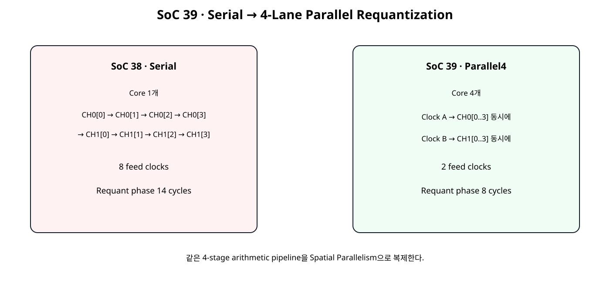
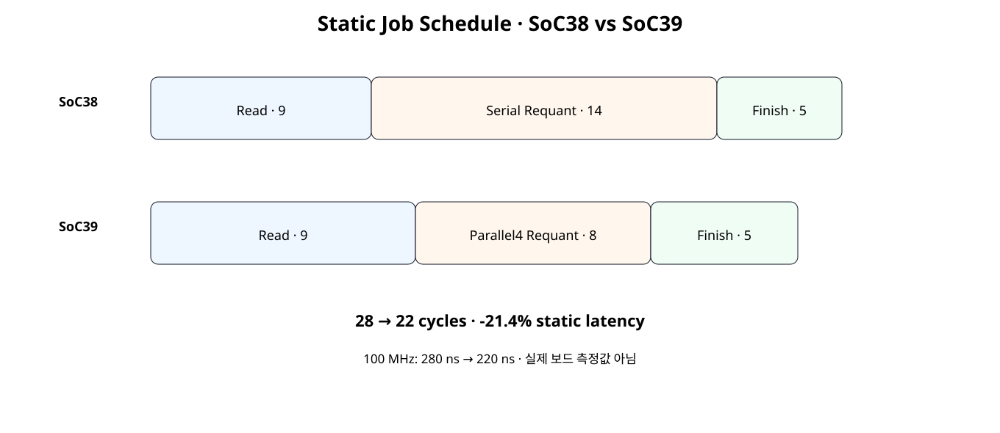
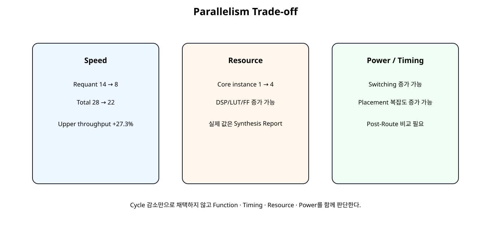

# 4-Lane Parallel Requantization Optimization


## 전체 학습 위치


## 이번 장의 목표


[](../images/soc39/soc39_serial_vs_parallel4.svg)

동일한 Requant Arithmetic Pipeline을 4개 Lane으로 복제해 Feed Clock을 줄인다.


## SoC 38 이후 남은 병목


| 구간 | Cycle |
| --- | --- |
| BRAM Read | 9 |
| Requant | 14 |
| Finish/IRQ | 5 |


## 왜 4-lane인가

8개 Core 전체 병렬보다 Resource 증가를 줄이면서 현재 데이터 구조인 2 channel × 4 sample과 자연스럽게 대응한다.


## Serial Requant 구조

Pipeline Core 자체는 매 Clock 새 값을 받을 수 있지만 Wrapper가 한 개 Core만 사용하므로 8개 값을 8 Clock에 투입한다.


## 4-Lane Parallel 구조


[](../images/soc39/soc39_serial_vs_parallel4.svg)

Clock A에서 CH0 4개, Clock B에서 CH1 4개를 병렬 투입한다.


## Feed 8 → 2 Clock


## Arithmetic Pipeline 유지


```text
Stage 1 → Bias
Stage 2 → Multiply
Stage 3 → Round / Shift
Stage 4 → Zero Point / Saturation
```

Pipeline 깊이를 줄여 Critical Path를 늘리는 방식이 아니라 같은 Pipeline을 Lane 단위로 복제한다.


## Spatial Parallelism

시간을 더 잘게 쪼개는 Pipeline Parallelism과 달리 같은 종류의 연산기를 여러 개 배치해 한 Clock에 여러 데이터를 처리한다.


## CH0 / CH1 Group


## 4개 Lane

Lane0~Lane3는 같은 Bias/Multiplier/Shift/Zero Point를 공유하되 Accumulator 입력만 서로 다르다.


## Tag Pipeline

4-stage Arithmetic Pipeline과 동일한 깊이의 Channel Tag Pipeline을 두어 현재 반환된 4개 결과가 CH0인지 CH1인지 맞춘다.


## Saturation Count

각 Clock에 4개 Lane이 동시에 Saturation될 수 있으므로 네 Lane의 Saturation Event를 합산해 누적한다. JOB0 기준 Expected Saturation Count는 2다.


## Requant 14 → 8


## Total 28 → 22


[](../images/soc39/soc39_schedule_comparison.svg)

Read 9와 Finish 5는 유지하고 Requant만 14 → 8로 줄인다.


## Latency / Throughput


| Metric | SoC38 | SoC39 |
| --- | --- | --- |
| Static Total | 28 cycles | 22 cycles |
| @100 MHz | 280 ns | 220 ns |
| Latency 변화 | 기준 | -21.4% |
| Upper jobs/s | 3.571 M | 4.545 M |
| Upper Throughput 변화 | 기준 | +27.3% |

구조상 계산값이며 실제 Basys3 Runtime이 아니다.


## Static Reference


```text
SoC39 STATIC PARALLEL-REQUANT COMPARISON
clock = 100 MHz

SoC38 read/requant/finish = 9/14/5
SoC39 read/requant/finish = 9/8/5

SoC38 total = 28 cycles (280.0 ns)
SoC39 total = 22 cycles (220.0 ns)
saved = 6 cycles
static latency reduction vs SoC38 = 21.4%
SoC38 upper jobs/s = 3,571,428.571
SoC39 upper jobs/s = 4,545,454.545
static upper throughput gain vs SoC38 = 27.3%

SPATIAL TRADE-OFF:
- requant core instances: 1 -> 4
- actual DSP48 count is NOT assumed
- 33x16 multiply is wider than one 25x18 DSP48E1 multiplier input
- synthesis must report the actual DSP/LUT mapping

NOT MEASURED:
- WNS/TNS/WHS/THS
- DSP48/LUT/FF delta
- power delta
- Basys3 runtime
SOC39 STATIC PARALLEL4 REFERENCE: PASS
Spreadsheet runtime warmup failed during python startup
Traceback (most recent call last):
  File "/tmp/tmp.L2TH2Y5coc/artifact_tool_v2-2.8.22/artifact_tool/patches/warm_spreadsheet_runtime_on_startup.py", line 26, in warm_spreadsheet_runtime_on_startup
  File "/tmp/tmp.L2TH2Y5coc/artifact_tool_v2-2.8.22/artifact_tool/spreadsheet_warmup.py", line 772, in warm_spreadsheet_runtime
  File "/tmp/tmp.L2TH2Y5coc/artifact_tool_v2-2.8.22/artifact_tool/rpc/connection.py", line 37, in get_or_create_client
  File "/tmp/tmp.L2TH2Y5coc/artifact_tool_v2-2.8.22/artifact_tool/rpc/daemon.py", line 124, in start_daemon
TimeoutError: Timed out waiting for artifact tool daemon socket. Set ARTIFACT_TOOL_RPC_DAEMON_STARTUP_TIMEOUT_S=<seconds> to increase the limit.
```


## 변경 범위


```text
신규:
requantize_batch2x4_parallel4.v
tensor_job_engine_parallel4_requant.v
npu_full_accelerator_parallel4_ip.v

유지:
requantize_s32_to_s8.v
BRAM Read Pipeline
Control / Descriptor / IRQ / AXI Bridge
```


## Serial Batch RTL


```verilog
module requantize_batch2x4_serial (
    input  wire                 clk,
    input  wire                 resetn,

    input  wire                 start_i,

    input  wire [127:0]         acc_ch0_batch_i,
    input  wire [127:0]         acc_ch1_batch_i,

    input  wire signed [31:0]   bias_ch0_i,
    input  wire signed [31:0]   bias_ch1_i,

    input  wire signed [15:0]   mult_ch0_i,
    input  wire signed [15:0]   mult_ch1_i,

    input  wire        [5:0]    shift_ch0_i,
    input  wire        [5:0]    shift_ch1_i,

    input  wire signed [15:0]   zp_ch0_i,
    input  wire signed [15:0]   zp_ch1_i,

    output wire                 busy_o,
    output reg                  done_o,
    output reg                  result_valid_o,

    output reg  [31:0]          q_ch0_batch_o,
    output reg  [31:0]          q_ch1_batch_o,

    output reg  [7:0]           saturation_count_o
);

// Serializes the 2-channel x 4-sample int32 result block from SoC 29
// through one pipelined requantization core.
//
// Feed order:
//   index 0..3 -> CH0 sample 0..3
//   index 4..7 -> CH1 sample 0..3
//
// One item is launched per clock while FEED is active.
// The requantizer itself is fully pipelined, so after startup it also
// produces one result per clock.

localparam [1:0] ST_IDLE  = 2'd0;
localparam [1:0] ST_FEED  = 2'd1;
localparam [1:0] ST_DRAIN = 2'd2;

reg [1:0] state_q;
reg [3:0] feed_index_q;
reg [3:0] output_count_q;

assign busy_o =
    (state_q != ST_IDLE);

wire core_valid_i;

assign core_valid_i =
    (state_q == ST_FEED);

wire current_is_ch1_w;
wire [1:0] current_sample_w;

assign current_is_ch1_w =
    feed_index_q[2];

assign current_sample_w =
    feed_index_q[1:0];

reg signed [31:0] selected_acc_w;

always @(*) begin
    case (feed_index_q)
        4'd0: selected_acc_w = $signed(acc_ch0_batch_i[31:0]);
        4'd1: selected_acc_w = $signed(acc_ch0_batch_i[63:32]);
        4'd2: selected_acc_w = $signed(acc_ch0_batch_i[95:64]);
        4'd3: selected_acc_w = $signed(acc_ch0_batch_i[127:96]);

        4'd4: selected_acc_w = $signed(acc_ch1_batch_i[31:0]);
        4'd5: selected_acc_w = $signed(acc_ch1_batch_i[63:32]);
        4'd6: selected_acc_w = $signed(acc_ch1_batch_i[95:64]);

        default:
            selected_acc_w = $signed(acc_ch1_batch_i[127:96]);
    endcase
end

wire signed [31:0] selected_bias_w;
wire signed [15:0] selected_mult_w;
wire        [5:0]  selected_shift_w;
wire signed [15:0] selected_zp_w;

assign selected_bias_w =
    current_is_ch1_w
    ? bias_ch1_i
    : bias_ch0_i;

assign selected_mult_w =
    current_is_ch1_w
    ? mult_ch1_i
    : mult_ch0_i;

assign selected_shift_w =
    current_is_ch1_w
    ? shift_ch1_i
    : shift_ch0_i;

assign selected_zp_w =
    current_is_ch1_w
    ? zp_ch1_i
    : zp_ch0_i;

wire              core_valid_o;
wire signed [7:0] core_q_w;
wire              core_sat_pos_w;
wire              core_sat_neg_w;

requantize_s32_to_s8 u_requantizer (
    .clk(clk),
    .resetn(resetn),

    .valid_i(core_valid_i),

    .acc_i(selected_acc_w),
    .bias_i(selected_bias_w),

    .multiplier_i(selected_mult_w),
    .shift_i(selected_shift_w),
    .zero_point_i(selected_zp_w),

    .valid_o(core_valid_o),
    .q_o(core_q_w),

    .sat_pos_o(core_sat_pos_w),
    .sat_neg_o(core_sat_neg_w)
);

// Tag pipeline matches the 4 registered stages in requantize_s32_to_s8.
reg [3:0] tag_s1_q;
reg [3:0] tag_s2_q;
reg [3:0] tag_s3_q;
reg [3:0] tag_s4_q;

reg valid_tag_s1_q;
reg valid_tag_s2_q;
reg valid_tag_s3_q;
reg valid_tag_s4_q;

always @(posedge clk) begin
    if (!resetn) begin
        tag_s1_q <= 4'd0;
        tag_s2_q <= 4'd0;
        tag_s3_q <= 4'd0;
        tag_s4_q <= 4'd0;

        valid_tag_s1_q <= 1'b0;
        valid_tag_s2_q <= 1'b0;
        valid_tag_s3_q <= 1'b0;
        valid_tag_s4_q <= 1'b0;
    end else begin
        valid_tag_s1_q <= core_valid_i;
        valid_tag_s2_q <= valid_tag_s1_q;
        valid_tag_s3_q <= valid_tag_s2_q;
        valid_tag_s4_q <= valid_tag_s3_q;

        if (core_valid_i) begin
            tag_s1_q <= feed_index_q;
        end

        if (valid_tag_s1_q) begin
            tag_s2_q <= tag_s1_q;
        end

        if (valid_tag_s2_q) begin
            tag_s3_q <= tag_s2_q;
        end

        if (valid_tag_s3_q) begin
            tag_s4_q <= tag_s3_q;
        end
    end
end

always @(posedge clk) begin
    if (!resetn) begin
        state_q             <= ST_IDLE;
        feed_index_q        <= 4'd0;
        output_count_q      <= 4'd0;

        done_o              <= 1'b0;
        result_valid_o      <= 1'b0;

        q_ch0_batch_o       <= 32'h0000_0000;
        q_ch1_batch_o       <= 32'h0000_0000;

        saturation_count_o  <= 8'd0;
    end else begin
        done_o         <= 1'b0;
        result_valid_o <= 1'b0;

        if (core_valid_o) begin
            case (tag_s4_q)
                4'd0: q_ch0_batch_o[7:0]   <= core_q_w;
                4'd1: q_ch0_batch_o[15:8]  <= core_q_w;
                4'd2: q_ch0_batch_o[23:16] <= core_q_w;
                4'd3: q_ch0_batch_o[31:24] <= core_q_w;

                4'd4: q_ch1_batch_o[7:0]   <= core_q_w;
                4'd5: q_ch1_batch_o[15:8]  <= core_q_w;
                4'd6: q_ch1_batch_o[23:16] <= core_q_w;

                default:
                    q_ch1_batch_o[31:24] <= core_q_w;
            endcase

            if (
                core_sat_pos_w ||
                core_sat_neg_w
            ) begin
                saturation_count_o <=
                    saturation_count_o + 8'd1;
            end

            output_count_q <=
                output_count_q + 4'd1;

            if (tag_s4_q == 4'd7) begin
                done_o         <= 1'b1;
                result_valid_o <= 1'b1;
                state_q        <= ST_IDLE;
            end
        end

        case (state_q)
            ST_IDLE: begin
                if (start_i) begin
                    feed_index_q       <= 4'd0;
                    output_count_q     <= 4'd0;

                    q_ch0_batch_o      <= 32'h0000_0000;
                    q_ch1_batch_o      <= 32'h0000_0000;

                    saturation_count_o <= 8'd0;

                    state_q <= ST_FEED;
                end
            end

            ST_FEED: begin
                if (feed_index_q == 4'd7) begin
                    state_q <= ST_DRAIN;
                end else begin
                    feed_index_q <=
                        feed_index_q + 4'd1;
                end
            end

            ST_DRAIN: begin
                // Wait for tag 7 to return from the 4-stage core.
            end

            default: begin
                state_q <= ST_IDLE;
            end
        endcase
    end
end

endmodule
```


## Parallel4 Batch RTL


```verilog
module requantize_batch2x4_parallel4 (
    input  wire                 clk,
    input  wire                 resetn,

    input  wire                 start_i,

    input  wire [127:0]         acc_ch0_batch_i,
    input  wire [127:0]         acc_ch1_batch_i,

    input  wire signed [31:0]   bias_ch0_i,
    input  wire signed [31:0]   bias_ch1_i,

    input  wire signed [15:0]   mult_ch0_i,
    input  wire signed [15:0]   mult_ch1_i,

    input  wire        [5:0]    shift_ch0_i,
    input  wire        [5:0]    shift_ch1_i,

    input  wire signed [15:0]   zp_ch0_i,
    input  wire signed [15:0]   zp_ch1_i,

    output wire                 busy_o,
    output reg                  done_o,
    output reg                  result_valid_o,

    output reg  [31:0]          q_ch0_batch_o,
    output reg  [31:0]          q_ch1_batch_o,

    output reg  [7:0]           saturation_count_o
);

// ------------------------------------------------------------
// SoC 39 · 4-lane Parallel Requantization
// ------------------------------------------------------------
//
// Baseline SoC 38:
//   one requant core
//   CH0[0..3], CH1[0..3] -> 8 serial feed clocks
//
// SoC 39:
//   four identical pipelined requant cores
//   clock A -> CH0 samples 0..3 in parallel
//   clock B -> CH1 samples 0..3 in parallel
//
// The arithmetic core itself is unchanged.
// The optimization changes spatial parallelism, not the formula.
//
// Requant phase reduction:
//   14 cycles -> 8 cycles
//
// Resource trade-off:
//   requant core instances 1 -> 4
//   actual DSP48/LUT/FF mapping must be measured after synthesis.

localparam [1:0] ST_IDLE     = 2'd0;
localparam [1:0] ST_FEED_CH0 = 2'd1;
localparam [1:0] ST_FEED_CH1 = 2'd2;
localparam [1:0] ST_DRAIN    = 2'd3;

reg [1:0] state_q;

assign busy_o =
    (state_q != ST_IDLE);

wire lanes_valid_i;

assign lanes_valid_i =
    (state_q == ST_FEED_CH0) ||
    (state_q == ST_FEED_CH1);

wire current_is_ch1_w;

assign current_is_ch1_w =
    (state_q == ST_FEED_CH1);

// ------------------------------------------------------------
// Four accumulator lanes.
//
// Packed-vector meaning:
// lane0 -> [31:0]
// lane1 -> [63:32]
// lane2 -> [95:64]
// lane3 -> [127:96]
// ------------------------------------------------------------
wire signed [31:0] lane_acc_0_w;
wire signed [31:0] lane_acc_1_w;
wire signed [31:0] lane_acc_2_w;
wire signed [31:0] lane_acc_3_w;

assign lane_acc_0_w =
    current_is_ch1_w
    ? $signed(acc_ch1_batch_i[31:0])
    : $signed(acc_ch0_batch_i[31:0]);

assign lane_acc_1_w =
    current_is_ch1_w
    ? $signed(acc_ch1_batch_i[63:32])
    : $signed(acc_ch0_batch_i[63:32]);

assign lane_acc_2_w =
    current_is_ch1_w
    ? $signed(acc_ch1_batch_i[95:64])
    : $signed(acc_ch0_batch_i[95:64]);

assign lane_acc_3_w =
    current_is_ch1_w
    ? $signed(acc_ch1_batch_i[127:96])
    : $signed(acc_ch0_batch_i[127:96]);

wire signed [31:0] lane_bias_w;
wire signed [15:0] lane_mult_w;
wire        [5:0]  lane_shift_w;
wire signed [15:0] lane_zp_w;

assign lane_bias_w =
    current_is_ch1_w
    ? bias_ch1_i
    : bias_ch0_i;

assign lane_mult_w =
    current_is_ch1_w
    ? mult_ch1_i
    : mult_ch0_i;

assign lane_shift_w =
    current_is_ch1_w
    ? shift_ch1_i
    : shift_ch0_i;

assign lane_zp_w =
    current_is_ch1_w
    ? zp_ch1_i
    : zp_ch0_i;

// ------------------------------------------------------------
// Four identical pipelined requantization lanes.
// ------------------------------------------------------------
wire lane0_valid_o;
wire lane1_valid_o;
wire lane2_valid_o;
wire lane3_valid_o;

wire signed [7:0] lane0_q_w;
wire signed [7:0] lane1_q_w;
wire signed [7:0] lane2_q_w;
wire signed [7:0] lane3_q_w;

wire lane0_sat_pos_w;
wire lane1_sat_pos_w;
wire lane2_sat_pos_w;
wire lane3_sat_pos_w;

wire lane0_sat_neg_w;
wire lane1_sat_neg_w;
wire lane2_sat_neg_w;
wire lane3_sat_neg_w;

requantize_s32_to_s8 u_lane0 (
    .clk(clk),
    .resetn(resetn),
    .valid_i(lanes_valid_i),
    .acc_i(lane_acc_0_w),
    .bias_i(lane_bias_w),
    .multiplier_i(lane_mult_w),
    .shift_i(lane_shift_w),
    .zero_point_i(lane_zp_w),
    .valid_o(lane0_valid_o),
    .q_o(lane0_q_w),
    .sat_pos_o(lane0_sat_pos_w),
    .sat_neg_o(lane0_sat_neg_w)
);

requantize_s32_to_s8 u_lane1 (
    .clk(clk),
    .resetn(resetn),
    .valid_i(lanes_valid_i),
    .acc_i(lane_acc_1_w),
    .bias_i(lane_bias_w),
    .multiplier_i(lane_mult_w),
    .shift_i(lane_shift_w),
    .zero_point_i(lane_zp_w),
    .valid_o(lane1_valid_o),
    .q_o(lane1_q_w),
    .sat_pos_o(lane1_sat_pos_w),
    .sat_neg_o(lane1_sat_neg_w)
);

requantize_s32_to_s8 u_lane2 (
    .clk(clk),
    .resetn(resetn),
    .valid_i(lanes_valid_i),
    .acc_i(lane_acc_2_w),
    .bias_i(lane_bias_w),
    .multiplier_i(lane_mult_w),
    .shift_i(lane_shift_w),
    .zero_point_i(lane_zp_w),
    .valid_o(lane2_valid_o),
    .q_o(lane2_q_w),
    .sat_pos_o(lane2_sat_pos_w),
    .sat_neg_o(lane2_sat_neg_w)
);

requantize_s32_to_s8 u_lane3 (
    .clk(clk),
    .resetn(resetn),
    .valid_i(lanes_valid_i),
    .acc_i(lane_acc_3_w),
    .bias_i(lane_bias_w),
    .multiplier_i(lane_mult_w),
    .shift_i(lane_shift_w),
    .zero_point_i(lane_zp_w),
    .valid_o(lane3_valid_o),
    .q_o(lane3_q_w),
    .sat_pos_o(lane3_sat_pos_w),
    .sat_neg_o(lane3_sat_neg_w)
);

// All four lanes share the same valid schedule.
// Keep an explicit check signal for readability.
wire all_lanes_valid_o;

assign all_lanes_valid_o =
    lane0_valid_o &&
    lane1_valid_o &&
    lane2_valid_o &&
    lane3_valid_o;

// ------------------------------------------------------------
// Channel tag pipeline.
//
// The core has four registered stages.
// tag=0 -> CH0 group
// tag=1 -> CH1 group
// ------------------------------------------------------------
reg group_tag_s1_q;
reg group_tag_s2_q;
reg group_tag_s3_q;
reg group_tag_s4_q;

reg valid_tag_s1_q;
reg valid_tag_s2_q;
reg valid_tag_s3_q;
reg valid_tag_s4_q;

always @(posedge clk) begin
    if (!resetn) begin
        group_tag_s1_q <= 1'b0;
        group_tag_s2_q <= 1'b0;
        group_tag_s3_q <= 1'b0;
        group_tag_s4_q <= 1'b0;

        valid_tag_s1_q <= 1'b0;
        valid_tag_s2_q <= 1'b0;
        valid_tag_s3_q <= 1'b0;
        valid_tag_s4_q <= 1'b0;
    end else begin
        valid_tag_s1_q <= lanes_valid_i;
        valid_tag_s2_q <= valid_tag_s1_q;
        valid_tag_s3_q <= valid_tag_s2_q;
        valid_tag_s4_q <= valid_tag_s3_q;

        if (lanes_valid_i) begin
            group_tag_s1_q <= current_is_ch1_w;
        end

        if (valid_tag_s1_q) begin
            group_tag_s2_q <= group_tag_s1_q;
        end

        if (valid_tag_s2_q) begin
            group_tag_s3_q <= group_tag_s2_q;
        end

        if (valid_tag_s3_q) begin
            group_tag_s4_q <= group_tag_s3_q;
        end
    end
end

// ------------------------------------------------------------
// Saturation count for the four current outputs.
// ------------------------------------------------------------
wire [2:0] lane_sat_count_w;

assign lane_sat_count_w =
    {2'b00, (lane0_sat_pos_w || lane0_sat_neg_w)} +
    {2'b00, (lane1_sat_pos_w || lane1_sat_neg_w)} +
    {2'b00, (lane2_sat_pos_w || lane2_sat_neg_w)} +
    {2'b00, (lane3_sat_pos_w || lane3_sat_neg_w)};

// ------------------------------------------------------------
// Batch control / result collection.
// ------------------------------------------------------------
always @(posedge clk) begin
    if (!resetn) begin
        state_q <= ST_IDLE;

        done_o <= 1'b0;
        result_valid_o <= 1'b0;

        q_ch0_batch_o <= 32'h0000_0000;
        q_ch1_batch_o <= 32'h0000_0000;

        saturation_count_o <= 8'd0;
    end else begin
        done_o <= 1'b0;
        result_valid_o <= 1'b0;

        if (
            all_lanes_valid_o &&
            valid_tag_s4_q
        ) begin
            if (!group_tag_s4_q) begin
                q_ch0_batch_o <= {
                    lane3_q_w,
                    lane2_q_w,
                    lane1_q_w,
                    lane0_q_w
                };
            end else begin
                q_ch1_batch_o <= {
                    lane3_q_w,
                    lane2_q_w,
                    lane1_q_w,
                    lane0_q_w
                };

                done_o <= 1'b1;
                result_valid_o <= 1'b1;
                state_q <= ST_IDLE;
            end

            saturation_count_o <=
                saturation_count_o +
                {5'd0, lane_sat_count_w};
        end

        case (state_q)
            ST_IDLE: begin
                if (start_i) begin
                    q_ch0_batch_o <= 32'h0000_0000;
                    q_ch1_batch_o <= 32'h0000_0000;
                    saturation_count_o <= 8'd0;

                    state_q <= ST_FEED_CH0;
                end
            end

            ST_FEED_CH0: begin
                state_q <= ST_FEED_CH1;
            end

            ST_FEED_CH1: begin
                state_q <= ST_DRAIN;
            end

            ST_DRAIN: begin
                // Wait for CH0 then CH1 to return from the four lanes.
            end

            default: begin
                state_q <= ST_IDLE;
            end
        endcase
    end
end

endmodule
```


## Parallel4 Job Engine


```verilog
module tensor_job_engine_parallel4_requant #(
    parameter integer BRAM_READ_LATENCY = 1
) (
    input  wire                 clk,
    input  wire                 resetn,

    input  wire                 start_i,

    input  wire [11:0]          input_base_i,
    input  wire [11:0]          output_base_i,
    input  wire [15:0]          length_words_i,

    input  wire signed [31:0]   bias_ch0_i,
    input  wire signed [31:0]   bias_ch1_i,

    input  wire signed [15:0]   mult_ch0_i,
    input  wire signed [15:0]   mult_ch1_i,

    input  wire        [5:0]    shift_ch0_i,
    input  wire        [5:0]    shift_ch1_i,

    input  wire signed [15:0]   zp_ch0_i,
    input  wire signed [15:0]   zp_ch1_i,

    output wire                 busy_o,
    output reg                  done_o,
    output reg                  error_o,

    output reg                  bram_en_o,
    output reg  [3:0]           bram_we_o,
    output reg  [11:0]          bram_addr_o,
    output reg  [31:0]          bram_wdata_o,
    input  wire [31:0]          bram_rdata_i,

    output reg  [15:0]          read_word_count_o,
    output reg  [15:0]          write_word_count_o
);

// ------------------------------------------------------------
// SoC 39 · Pipelined BRAM Read + 4-Lane Parallel Requantization
// ------------------------------------------------------------
//
// Baseline:
//   READ_REQ -> READ_CAPTURE -> READ_REQ -> READ_CAPTURE ...
//   8 words -> 16 cycles
//
// Optimized:
//   issue word0
//   issue word1 + wait/capture pipeline
//   issue word2 + capture word0
//   ...
//   drain final read
//
// With BRAM_READ_LATENCY=1:
//   8 words -> 9 cycles
//
// Important:
// - The BRAM remains synchronous.
// - This design does NOT remove a BRAM output register.
// - It pipelines requests so the read latency is hidden after startup.
// - If the actual BMG Port-B read latency is changed, set
//   BRAM_READ_LATENCY to match the configured synchronous output latency.
// - BRAM_READ_LATENCY must be >= 1.

localparam [2:0] ST_IDLE          = 3'd0;
localparam [2:0] ST_READ_STREAM   = 3'd1;
localparam [2:0] ST_START_REQUANT = 3'd2;
localparam [2:0] ST_WAIT_RESULT   = 3'd3;
localparam [2:0] ST_WRITE_CH0     = 3'd4;
localparam [2:0] ST_WRITE_CH1     = 3'd5;
localparam [2:0] ST_DONE          = 3'd6;

reg [2:0] state_q;

reg [3:0] issue_index_q;
reg [3:0] capture_index_q;
reg       issue_done_q;

reg [127:0] acc_ch0_batch_q;
reg [127:0] acc_ch1_batch_q;

reg requant_start_q;

// One bit per configured BRAM output-latency stage.
// Example BRAM_READ_LATENCY=1:
//   issue_read_w -> read_valid_pipe_q[0] -> capture on next clock
reg [BRAM_READ_LATENCY-1:0] read_valid_pipe_q;

integer valid_stage;

wire issue_read_w;
wire capture_valid_w;

assign issue_read_w =
    (state_q == ST_READ_STREAM) &&
    !issue_done_q;

assign capture_valid_w =
    read_valid_pipe_q[BRAM_READ_LATENCY-1];

wire requant_busy_w;
wire requant_done_w;
wire requant_result_valid_w;

wire [31:0] q_ch0_batch_w;
wire [31:0] q_ch1_batch_w;

wire [7:0] saturation_count_w;

assign busy_o =
    (state_q != ST_IDLE) &&
    (state_q != ST_DONE);

requantize_batch2x4_parallel4 u_requant_batch (
    .clk(clk),
    .resetn(resetn),

    .start_i(requant_start_q),

    .acc_ch0_batch_i(acc_ch0_batch_q),
    .acc_ch1_batch_i(acc_ch1_batch_q),

    .bias_ch0_i(bias_ch0_i),
    .bias_ch1_i(bias_ch1_i),

    .mult_ch0_i(mult_ch0_i),
    .mult_ch1_i(mult_ch1_i),

    .shift_ch0_i(shift_ch0_i),
    .shift_ch1_i(shift_ch1_i),

    .zp_ch0_i(zp_ch0_i),
    .zp_ch1_i(zp_ch1_i),

    .busy_o(requant_busy_w),
    .done_o(requant_done_w),
    .result_valid_o(requant_result_valid_w),

    .q_ch0_batch_o(q_ch0_batch_w),
    .q_ch1_batch_o(q_ch1_batch_w),

    .saturation_count_o(saturation_count_w)
);

// ------------------------------------------------------------
// BRAM interface.
// ------------------------------------------------------------
always @(*) begin
    bram_en_o    = 1'b0;
    bram_we_o    = 4'b0000;
    bram_addr_o  = 12'h000;
    bram_wdata_o = 32'h0000_0000;

    case (state_q)
        ST_READ_STREAM: begin
            if (!issue_done_q) begin
                bram_en_o = 1'b1;
                bram_we_o = 4'b0000;

                bram_addr_o =
                    input_base_i +
                    {issue_index_q, 2'b00};
            end
        end

        ST_WRITE_CH0: begin
            bram_en_o    = 1'b1;
            bram_we_o    = 4'b1111;
            bram_addr_o  = output_base_i;
            bram_wdata_o = q_ch0_batch_w;
        end

        ST_WRITE_CH1: begin
            bram_en_o    = 1'b1;
            bram_we_o    = 4'b1111;
            bram_addr_o  = output_base_i + 12'd4;
            bram_wdata_o = q_ch1_batch_w;
        end

        default: begin
        end
    endcase
end

// ------------------------------------------------------------
// Read-valid pipeline.
//
// This tracks when a previously-issued synchronous BRAM read becomes
// safe to capture into the job-engine batch registers.
// ------------------------------------------------------------
always @(posedge clk) begin
    if (!resetn) begin
        read_valid_pipe_q <=
            {BRAM_READ_LATENCY{1'b0}};
    end else begin
        read_valid_pipe_q[0] <=
            issue_read_w;

        for (
            valid_stage = 1;
            valid_stage < BRAM_READ_LATENCY;
            valid_stage = valid_stage + 1
        ) begin
            read_valid_pipe_q[valid_stage] <=
                read_valid_pipe_q[valid_stage - 1];
        end
    end
end

// ------------------------------------------------------------
// Main state machine.
// ------------------------------------------------------------
always @(posedge clk) begin
    if (!resetn) begin
        state_q <= ST_IDLE;

        issue_index_q <= 4'd0;
        capture_index_q <= 4'd0;
        issue_done_q <= 1'b0;

        acc_ch0_batch_q <= 128'd0;
        acc_ch1_batch_q <= 128'd0;

        requant_start_q <= 1'b0;

        done_o <= 1'b0;
        error_o <= 1'b0;

        read_word_count_o <= 16'd0;
        write_word_count_o <= 16'd0;
    end else begin
        requant_start_q <= 1'b0;
        done_o <= 1'b0;

        case (state_q)
            ST_IDLE: begin
                if (start_i) begin
                    if (length_words_i != 16'd8) begin
                        error_o <= 1'b1;
                        done_o <= 1'b1;
                    end else begin
                        error_o <= 1'b0;

                        issue_index_q <= 4'd0;
                        capture_index_q <= 4'd0;
                        issue_done_q <= 1'b0;

                        acc_ch0_batch_q <= 128'd0;
                        acc_ch1_batch_q <= 128'd0;

                        read_word_count_o <= 16'd0;
                        write_word_count_o <= 16'd0;

                        state_q <= ST_READ_STREAM;
                    end
                end
            end

            ST_READ_STREAM: begin
                // One new address is presented every clock until word 7.
                if (issue_read_w) begin
                    if (issue_index_q == 4'd7) begin
                        issue_done_q <= 1'b1;
                    end else begin
                        issue_index_q <=
                            issue_index_q + 4'd1;
                    end
                end

                // After the initial latency, one word is captured per clock.
                if (capture_valid_w) begin
                    read_word_count_o <=
                        read_word_count_o + 16'd1;

                    case (capture_index_q)
                        4'd0: acc_ch0_batch_q[31:0]   <= bram_rdata_i;
                        4'd1: acc_ch0_batch_q[63:32]  <= bram_rdata_i;
                        4'd2: acc_ch0_batch_q[95:64]  <= bram_rdata_i;
                        4'd3: acc_ch0_batch_q[127:96] <= bram_rdata_i;

                        4'd4: acc_ch1_batch_q[31:0]   <= bram_rdata_i;
                        4'd5: acc_ch1_batch_q[63:32]  <= bram_rdata_i;
                        4'd6: acc_ch1_batch_q[95:64]  <= bram_rdata_i;

                        default:
                            acc_ch1_batch_q[127:96] <= bram_rdata_i;
                    endcase

                    if (capture_index_q == 4'd7) begin
                        state_q <= ST_START_REQUANT;
                    end else begin
                        capture_index_q <=
                            capture_index_q + 4'd1;
                    end
                end
            end

            ST_START_REQUANT: begin
                if (!requant_busy_w) begin
                    requant_start_q <= 1'b1;
                    state_q <= ST_WAIT_RESULT;
                end
            end

            ST_WAIT_RESULT: begin
                if (requant_result_valid_w) begin
                    state_q <= ST_WRITE_CH0;
                end
            end

            ST_WRITE_CH0: begin
                write_word_count_o <=
                    write_word_count_o + 16'd1;

                state_q <= ST_WRITE_CH1;
            end

            ST_WRITE_CH1: begin
                write_word_count_o <=
                    write_word_count_o + 16'd1;

                state_q <= ST_DONE;
            end

            ST_DONE: begin
                done_o <= 1'b1;
                state_q <= ST_IDLE;
            end

            default: begin
                error_o <= 1'b1;
                state_q <= ST_IDLE;
            end
        endcase
    end
end

endmodule
```


## Optimized Top


```verilog
module npu_full_accelerator_parallel4_ip (
    (* X_INTERFACE_INFO = "xilinx.com:signal:clock:1.0 s_axi_aclk CLK" *)
    (* X_INTERFACE_PARAMETER = "XIL_INTERFACENAME s_axi_aclk, ASSOCIATED_BUSIF S_AXI:BRAM, ASSOCIATED_RESET s_axi_aresetn" *)
    input  wire        s_axi_aclk,

    (* X_INTERFACE_INFO = "xilinx.com:signal:reset:1.0 s_axi_aresetn RST" *)
    (* X_INTERFACE_PARAMETER = "XIL_INTERFACENAME s_axi_aresetn, POLARITY ACTIVE_LOW" *)
    input  wire        s_axi_aresetn,

    // --------------------------------------------------------
    // AXI4-Lite Control Plane
    // --------------------------------------------------------
    (* X_INTERFACE_INFO = "xilinx.com:interface:aximm:1.0 S_AXI AWADDR" *)
    input  wire [7:0]  s_axi_awaddr,
    (* X_INTERFACE_INFO = "xilinx.com:interface:aximm:1.0 S_AXI AWVALID" *)
    input  wire        s_axi_awvalid,
    (* X_INTERFACE_INFO = "xilinx.com:interface:aximm:1.0 S_AXI AWREADY" *)
    output wire        s_axi_awready,

    (* X_INTERFACE_INFO = "xilinx.com:interface:aximm:1.0 S_AXI WDATA" *)
    input  wire [31:0] s_axi_wdata,
    (* X_INTERFACE_INFO = "xilinx.com:interface:aximm:1.0 S_AXI WSTRB" *)
    input  wire [3:0]  s_axi_wstrb,
    (* X_INTERFACE_INFO = "xilinx.com:interface:aximm:1.0 S_AXI WVALID" *)
    input  wire        s_axi_wvalid,
    (* X_INTERFACE_INFO = "xilinx.com:interface:aximm:1.0 S_AXI WREADY" *)
    output wire        s_axi_wready,

    (* X_INTERFACE_INFO = "xilinx.com:interface:aximm:1.0 S_AXI BRESP" *)
    output wire [1:0]  s_axi_bresp,
    (* X_INTERFACE_INFO = "xilinx.com:interface:aximm:1.0 S_AXI BVALID" *)
    output wire        s_axi_bvalid,
    (* X_INTERFACE_INFO = "xilinx.com:interface:aximm:1.0 S_AXI BREADY" *)
    input  wire        s_axi_bready,

    (* X_INTERFACE_INFO = "xilinx.com:interface:aximm:1.0 S_AXI ARADDR" *)
    input  wire [7:0]  s_axi_araddr,
    (* X_INTERFACE_INFO = "xilinx.com:interface:aximm:1.0 S_AXI ARVALID" *)
    input  wire        s_axi_arvalid,
    (* X_INTERFACE_INFO = "xilinx.com:interface:aximm:1.0 S_AXI ARREADY" *)
    output wire        s_axi_arready,

    (* X_INTERFACE_INFO = "xilinx.com:interface:aximm:1.0 S_AXI RDATA" *)
    output wire [31:0] s_axi_rdata,
    (* X_INTERFACE_INFO = "xilinx.com:interface:aximm:1.0 S_AXI RRESP" *)
    output wire [1:0]  s_axi_rresp,
    (* X_INTERFACE_INFO = "xilinx.com:interface:aximm:1.0 S_AXI RVALID" *)
    output wire        s_axi_rvalid,
    (* X_INTERFACE_INFO = "xilinx.com:interface:aximm:1.0 S_AXI RREADY" *)
    input  wire        s_axi_rready,

    // --------------------------------------------------------
    // Native BRAM Data Plane
    // --------------------------------------------------------
    (* X_INTERFACE_INFO = "xilinx.com:interface:bram:1.0 BRAM CLK" *)
    output wire        bram_clk_o,
    (* X_INTERFACE_INFO = "xilinx.com:interface:bram:1.0 BRAM RST" *)
    output wire        bram_rst_o,
    (* X_INTERFACE_INFO = "xilinx.com:interface:bram:1.0 BRAM EN" *)
    output wire        bram_en_o,
    (* X_INTERFACE_INFO = "xilinx.com:interface:bram:1.0 BRAM WE" *)
    output wire [3:0]  bram_we_o,
    (* X_INTERFACE_INFO = "xilinx.com:interface:bram:1.0 BRAM ADDR" *)
    output wire [11:0] bram_addr_o,
    (* X_INTERFACE_INFO = "xilinx.com:interface:bram:1.0 BRAM DIN" *)
    output wire [31:0] bram_wdata_o,
    (* X_INTERFACE_INFO = "xilinx.com:interface:bram:1.0 BRAM DOUT" *)
    input  wire [31:0] bram_rdata_i,

    // --------------------------------------------------------
    // Interrupt
    // --------------------------------------------------------
    (* X_INTERFACE_INFO = "xilinx.com:signal:interrupt:1.0 irq INTERRUPT" *)
    (* X_INTERFACE_PARAMETER = "XIL_INTERFACENAME irq, SENSITIVITY LEVEL_HIGH" *)
    output wire        irq
);

// Pure Shell / Wrapper:
// AXI bridge + control/descriptor/IRQ + job engine + BRAM clock/reset adapter.

wire        reg_wr_en;
wire [7:0]  reg_wr_addr;
wire [31:0] reg_wr_data;
wire [3:0]  reg_wr_strb;

wire [7:0]  reg_rd_addr;
wire [31:0] reg_rd_data;

wire job_start;

wire [11:0] active_input_base;
wire [11:0] active_output_base;
wire [15:0] active_length_words;

wire signed [31:0] active_bias_ch0;
wire signed [31:0] active_bias_ch1;

wire signed [15:0] active_mult_ch0;
wire signed [15:0] active_mult_ch1;

wire [5:0] active_shift_ch0;
wire [5:0] active_shift_ch1;

wire signed [15:0] active_zp_ch0;
wire signed [15:0] active_zp_ch1;

wire engine_busy;
wire engine_done;
wire engine_error;

wire [15:0] read_word_count;
wire [15:0] write_word_count;

wire ctrl_busy;
wire done_sticky;
wire error_sticky;
wire [7:0] error_code;
wire [31:0] job_id;
wire [1:0] irq_enable;
wire [1:0] irq_status;

axi4lite_reg_bridge u_axi_bridge (
    .s_axi_aclk(s_axi_aclk),
    .s_axi_aresetn(s_axi_aresetn),

    .s_axi_awaddr(s_axi_awaddr),
    .s_axi_awvalid(s_axi_awvalid),
    .s_axi_awready(s_axi_awready),

    .s_axi_wdata(s_axi_wdata),
    .s_axi_wstrb(s_axi_wstrb),
    .s_axi_wvalid(s_axi_wvalid),
    .s_axi_wready(s_axi_wready),

    .s_axi_bresp(s_axi_bresp),
    .s_axi_bvalid(s_axi_bvalid),
    .s_axi_bready(s_axi_bready),

    .s_axi_araddr(s_axi_araddr),
    .s_axi_arvalid(s_axi_arvalid),
    .s_axi_arready(s_axi_arready),

    .s_axi_rdata(s_axi_rdata),
    .s_axi_rresp(s_axi_rresp),
    .s_axi_rvalid(s_axi_rvalid),
    .s_axi_rready(s_axi_rready),

    .reg_wr_en_o(reg_wr_en),
    .reg_wr_addr_o(reg_wr_addr),
    .reg_wr_data_o(reg_wr_data),
    .reg_wr_strb_o(reg_wr_strb),

    .reg_rd_addr_o(reg_rd_addr),
    .reg_rd_data_i(reg_rd_data)
);

npu_full_control_irq u_control (
    .clk(s_axi_aclk),
    .resetn(s_axi_aresetn),

    .wr_en_i(reg_wr_en),
    .wr_addr_i(reg_wr_addr),
    .wr_data_i(reg_wr_data),
    .wr_strb_i(reg_wr_strb),

    .rd_addr_i(reg_rd_addr),
    .rd_data_o(reg_rd_data),

    .job_start_o(job_start),

    .active_input_base_o(active_input_base),
    .active_output_base_o(active_output_base),
    .active_length_words_o(active_length_words),

    .active_bias_ch0_o(active_bias_ch0),
    .active_bias_ch1_o(active_bias_ch1),

    .active_mult_ch0_o(active_mult_ch0),
    .active_mult_ch1_o(active_mult_ch1),

    .active_shift_ch0_o(active_shift_ch0),
    .active_shift_ch1_o(active_shift_ch1),

    .active_zp_ch0_o(active_zp_ch0),
    .active_zp_ch1_o(active_zp_ch1),

    .engine_busy_i(engine_busy),
    .engine_done_i(engine_done),
    .engine_error_i(engine_error),

    .read_word_count_i(read_word_count),
    .write_word_count_i(write_word_count),

    .busy_o(ctrl_busy),
    .done_sticky_o(done_sticky),
    .error_sticky_o(error_sticky),
    .error_code_o(error_code),
    .job_id_o(job_id),

    .irq_o(irq),
    .irq_enable_o(irq_enable),
    .irq_status_o(irq_status)
);

tensor_job_engine_parallel4_requant #(
    .BRAM_READ_LATENCY(1)
) u_engine (
    .clk(s_axi_aclk),
    .resetn(s_axi_aresetn),

    .start_i(job_start),

    .input_base_i(active_input_base),
    .output_base_i(active_output_base),
    .length_words_i(active_length_words),

    .bias_ch0_i(active_bias_ch0),
    .bias_ch1_i(active_bias_ch1),

    .mult_ch0_i(active_mult_ch0),
    .mult_ch1_i(active_mult_ch1),

    .shift_ch0_i(active_shift_ch0),
    .shift_ch1_i(active_shift_ch1),

    .zp_ch0_i(active_zp_ch0),
    .zp_ch1_i(active_zp_ch1),

    .busy_o(engine_busy),
    .done_o(engine_done),
    .error_o(engine_error),

    .bram_en_o(bram_en_o),
    .bram_we_o(bram_we_o),
    .bram_addr_o(bram_addr_o),
    .bram_wdata_o(bram_wdata_o),
    .bram_rdata_i(bram_rdata_i),

    .read_word_count_o(read_word_count),
    .write_word_count_o(write_word_count)
);

bram_clock_reset_adapter u_bram_clock_reset (
    .clk_i(s_axi_aclk),
    .resetn_i(s_axi_aresetn),

    .bram_clk_o(bram_clk_o),
    .bram_rst_o(bram_rst_o)
);

endmodule
```


## Top Shell/Wrapper

기능 로직은 Batch Requantizer와 Job Engine에 두고 Top은 기존 Control/AXI/Engine 연결만 담당한다.


## Standalone Batch Regression


```verilog
`timescale 1ns / 1ps

module tb_requantize_batch2x4_parallel4;

logic clk = 1'b0;
logic resetn = 1'b0;
logic start_i = 1'b0;

logic [127:0] acc_ch0_batch_i;
logic [127:0] acc_ch1_batch_i;

logic signed [31:0] bias_ch0_i;
logic signed [31:0] bias_ch1_i;

logic signed [15:0] mult_ch0_i;
logic signed [15:0] mult_ch1_i;

logic [5:0] shift_ch0_i;
logic [5:0] shift_ch1_i;

logic signed [15:0] zp_ch0_i;
logic signed [15:0] zp_ch1_i;

wire busy_o;
wire done_o;
wire result_valid_o;

wire [31:0] q_ch0_batch_o;
wire [31:0] q_ch1_batch_o;
wire [7:0] saturation_count_o;

integer cycle_count = 0;
integer start_cycle = -1;
integer result_cycle = -1;
integer errors = 0;

always #5 clk = ~clk;

always @(posedge clk) begin
    cycle_count = cycle_count + 1;
    #1;

    if (
        start_i &&
        (start_cycle < 0)
    ) begin
        start_cycle = cycle_count;
    end

    if (
        result_valid_o &&
        (result_cycle < 0)
    ) begin
        result_cycle = cycle_count;
    end
end

requantize_batch2x4_parallel4 dut (
    .clk(clk),
    .resetn(resetn),
    .start_i(start_i),

    .acc_ch0_batch_i(acc_ch0_batch_i),
    .acc_ch1_batch_i(acc_ch1_batch_i),

    .bias_ch0_i(bias_ch0_i),
    .bias_ch1_i(bias_ch1_i),

    .mult_ch0_i(mult_ch0_i),
    .mult_ch1_i(mult_ch1_i),

    .shift_ch0_i(shift_ch0_i),
    .shift_ch1_i(shift_ch1_i),

    .zp_ch0_i(zp_ch0_i),
    .zp_ch1_i(zp_ch1_i),

    .busy_o(busy_o),
    .done_o(done_o),
    .result_valid_o(result_valid_o),

    .q_ch0_batch_o(q_ch0_batch_o),
    .q_ch1_batch_o(q_ch1_batch_o),

    .saturation_count_o(saturation_count_o)
);

task automatic check32(
    input string name,
    input logic [31:0] actual,
    input logic [31:0] expected
);
    begin
        if (actual !== expected) begin
            errors = errors + 1;
            $error(
                "%s actual=0x%08h expected=0x%08h",
                name,
                actual,
                expected
            );
        end else begin
            $display(
                "PASS %s = 0x%08h",
                name,
                actual
            );
        end
    end
endtask

initial begin
    // CH0 raw accumulators: 16, 32, 48, 64
    acc_ch0_batch_i = {
        32'd64,
        32'd48,
        32'd32,
        32'd16
    };

    // CH1 raw accumulators: 32, 64, 96, 128
    acc_ch1_batch_i = {
        32'd128,
        32'd96,
        32'd64,
        32'd32
    };

    bias_ch0_i = 32'sd0;
    bias_ch1_i = 32'sd4;

    mult_ch0_i = 16'sd1;
    mult_ch1_i = 16'sd3;

    shift_ch0_i = 6'd1;
    shift_ch1_i = 6'd1;

    zp_ch0_i = 16'sd0;
    zp_ch1_i = -16'sd3;

    repeat (4) @(posedge clk);
    resetn = 1'b1;

    @(negedge clk);
    start_i = 1'b1;

    @(posedge clk);
    #1;

    @(negedge clk);
    start_i = 1'b0;

    wait (result_valid_o === 1'b1);
    #1;

    check32(
        "CH0",
        q_ch0_batch_o,
        32'h2018_1008
    );

    check32(
        "CH1",
        q_ch1_batch_o,
        32'h7F7F_6333
    );

    if (saturation_count_o !== 8'd2) begin
        errors = errors + 1;
        $error(
            "saturation_count actual=%0d expected=2",
            saturation_count_o
        );
    end

    if (errors == 0) begin
        $display("SOC39 PARALLEL4 BATCH TEST: PASS");
    end else begin
        $fatal(
            1,
            "SOC39 PARALLEL4 BATCH TEST: FAIL"
        );
    end

    #20;
    $finish;
end

endmodule
```


## Integrated Regression


```verilog
`timescale 1ns / 1ps

module tb_soc39_parallel4_regression;

logic clk = 1'b0;
logic resetn = 1'b0;

logic [7:0]  awaddr = 8'h00;
logic        awvalid = 1'b0;
wire         awready;

logic [31:0] wdata = 32'h0000_0000;
logic [3:0]  wstrb = 4'h0;
logic        wvalid = 1'b0;
wire         wready;

wire [1:0]   bresp;
wire         bvalid;
logic        bready = 1'b1;

logic [7:0]  araddr = 8'h00;
logic        arvalid = 1'b0;
wire         arready;

wire [31:0]  rdata;
wire [1:0]   rresp;
wire         rvalid;
logic        rready = 1'b1;

logic        cpu_mem_en_i = 1'b0;
logic [3:0]  cpu_mem_we_i = 4'h0;
logic [11:0] cpu_mem_addr_i = 12'h000;
logic [31:0] cpu_mem_wdata_i = 32'h0000_0000;
wire [31:0]  cpu_mem_rdata_o;

wire irq_o;

integer check_count = 0;
integer error_count = 0;

integer cycle_counter = 0;
integer engine_start_cycle = -1;
integer irq_cycle = -1;
logic engine_busy_d = 1'b0;

always @(posedge clk) begin
    cycle_counter = cycle_counter + 1;

    // Wait until NBA updates settle before observing DUT pulses.
    #1;

    if (
        dut.u_npu.engine_busy &&
        !engine_busy_d
    ) begin
        engine_start_cycle = cycle_counter;
    end

    engine_busy_d = dut.u_npu.engine_busy;

    if (
        (irq_o === 1'b1) &&
        (irq_cycle < 0)
    ) begin
        irq_cycle = cycle_counter;
    end
end

always #5 clk = ~clk;

npu_full_accelerator_parallel4_sim_top dut (
    .clk(clk),
    .resetn(resetn),

    .s_axi_awaddr(awaddr),
    .s_axi_awvalid(awvalid),
    .s_axi_awready(awready),

    .s_axi_wdata(wdata),
    .s_axi_wstrb(wstrb),
    .s_axi_wvalid(wvalid),
    .s_axi_wready(wready),

    .s_axi_bresp(bresp),
    .s_axi_bvalid(bvalid),
    .s_axi_bready(bready),

    .s_axi_araddr(araddr),
    .s_axi_arvalid(arvalid),
    .s_axi_arready(arready),

    .s_axi_rdata(rdata),
    .s_axi_rresp(rresp),
    .s_axi_rvalid(rvalid),
    .s_axi_rready(rready),

    .cpu_mem_en_i(cpu_mem_en_i),
    .cpu_mem_we_i(cpu_mem_we_i),
    .cpu_mem_addr_i(cpu_mem_addr_i),
    .cpu_mem_wdata_i(cpu_mem_wdata_i),
    .cpu_mem_rdata_o(cpu_mem_rdata_o),

    .irq_o(irq_o)
);

task automatic check_true(
    input string name,
    input bit condition
);
    begin
        check_count = check_count + 1;
        if (!condition) begin
            error_count = error_count + 1;
            $error("CHECK FAIL: %s", name);
        end else begin
            $display("CHECK PASS: %s", name);
        end
    end
endtask

task automatic check_eq32(
    input string name,
    input logic [31:0] actual,
    input logic [31:0] expected
);
    begin
        check_count = check_count + 1;
        if (actual !== expected) begin
            error_count = error_count + 1;
            $error(
                "CHECK FAIL: %s actual=0x%08h expected=0x%08h",
                name,
                actual,
                expected
            );
        end else begin
            $display(
                "CHECK PASS: %s = 0x%08h",
                name,
                actual
            );
        end
    end
endtask

task automatic axi_write(
    input [7:0] address,
    input [31:0] data,
    input integer order
);
    bit aw_done;
    bit w_done;
    integer timeout;

    begin
        aw_done = 0;
        w_done = 0;

        @(negedge clk);

        awaddr = address;
        wdata = data;
        wstrb = 4'hF;

        case (order)
            0: begin
                awvalid = 1'b1;
                wvalid = 1'b1;
            end

            1: begin
                awvalid = 1'b1;
                wvalid = 1'b0;
            end

            default: begin
                awvalid = 1'b0;
                wvalid = 1'b1;
            end
        endcase

        timeout = 0;

        while (!(aw_done && w_done)) begin
            @(posedge clk);
            // (변경) READY가 갱신되기 전 상승 에지의 handshake를 관측한다.

            if (awvalid && awready)
                aw_done = 1;

            if (wvalid && wready)
                w_done = 1;

            @(negedge clk);

            if (aw_done)
                awvalid = 1'b0;

            if (w_done)
                wvalid = 1'b0;

            if (
                (order == 1) &&
                aw_done &&
                !w_done
            )
                wvalid = 1'b1;

            if (
                (order == 2) &&
                w_done &&
                !aw_done
            )
                awvalid = 1'b1;

            timeout = timeout + 1;

            if (timeout > 40)
                $fatal(1, "AXI write timeout");
        end

        timeout = 0;

        while (!bvalid) begin
            @(posedge clk);
            #1;

            timeout = timeout + 1;

            if (timeout > 40)
                $fatal(1, "AXI BVALID timeout");
        end

        check_true(
            "BRESP OKAY",
            bresp == 2'b00
        );

        @(posedge clk);
        #1;
    end
endtask

task automatic axi_read(
    input [7:0] address,
    output [31:0] data
);
    integer timeout;

    begin
        @(negedge clk);

        araddr = address;
        arvalid = 1'b1;

        timeout = 0;

        while (!arready) begin
            @(posedge clk);
            #1;
            timeout = timeout + 1;

            if (timeout > 40)
                $fatal(1, "AXI ARREADY timeout");
        end

        @(posedge clk);
        #1;

        timeout = 0;

        while (!rvalid) begin
            @(posedge clk);
            #1;

            timeout = timeout + 1;

            if (timeout > 40)
                $fatal(1, "AXI RVALID timeout");
        end

        data = rdata;

        check_true(
            "RRESP OKAY",
            rresp == 2'b00
        );

        @(negedge clk);
        arvalid = 1'b0;

        @(posedge clk);
        #1;
    end
endtask

task automatic mem_write32(
    input [11:0] address,
    input [31:0] data
);
    begin
        @(negedge clk);

        cpu_mem_en_i = 1'b1;
        cpu_mem_we_i = 4'hF;
        cpu_mem_addr_i = address;
        cpu_mem_wdata_i = data;

        @(posedge clk);
        #1;

        @(negedge clk);

        cpu_mem_en_i = 1'b0;
        cpu_mem_we_i = 4'h0;
        cpu_mem_addr_i = 12'h000;
        cpu_mem_wdata_i = 32'h0000_0000;
    end
endtask

task automatic mem_read32(
    input [11:0] address,
    output [31:0] data
);
    begin
        @(negedge clk);

        cpu_mem_en_i = 1'b1;
        cpu_mem_we_i = 4'h0;
        cpu_mem_addr_i = address;

        @(posedge clk);
        #1;

        @(negedge clk);

        cpu_mem_en_i = 1'b0;
        cpu_mem_addr_i = 12'h000;

        data = cpu_mem_rdata_o;
    end
endtask

task automatic wait_irq_high;
    integer timeout;
    begin
        timeout = 0;

        while (irq_o !== 1'b1) begin
            @(posedge clk);
            // (변경) 같은 시각의 #1 성능 모니터보다 뒤에서 IRQ를 관측한다.
            #2;

            timeout = timeout + 1;

            if (timeout > 300)
                $fatal(1, "IRQ did not assert");
        end
    end
endtask

initial begin
    reg [31:0] rd;

    repeat (5) @(posedge clk);
    resetn = 1'b1;

    // --------------------------------------------------------
    // 1. CPU fills Tensor BRAM through Port A.
    // --------------------------------------------------------
    mem_write32(12'h200, 32'd16);
    mem_write32(12'h204, 32'd32);
    mem_write32(12'h208, 32'd48);
    mem_write32(12'h20C, 32'd64);

    mem_write32(12'h210, 32'd32);
    mem_write32(12'h214, 32'd64);
    mem_write32(12'h218, 32'd96);
    mem_write32(12'h21C, 32'd128);

    // --------------------------------------------------------
    // 2. Program descriptor / parameter / IRQ registers.
    //    Exercise all three AXI write channel orders.
    // --------------------------------------------------------
    axi_write(8'h10, 32'h0000_0200, 0);
    axi_write(8'h14, 32'h0000_0300, 1);
    axi_write(8'h18, 32'd8,         2);

    axi_write(8'h20, 32'd0,         0);
    axi_write(8'h24, 32'd4,         1);
    axi_write(8'h28, 32'h0001_0001, 2);
    axi_write(8'h2C, 32'h0001_0003, 0);
    axi_write(8'h30, 32'hFFFD_0000, 1);

    // Clear stale IRQ and status, then enable DONE/ERROR.
    axi_write(8'h4C, 32'h0000_0003, 2);
    axi_write(8'h00, 32'h0000_0006, 0);
    axi_write(8'h48, 32'h0000_0003, 1);

    axi_read(8'h04, rd);

    check_true(
        "descriptor valid",
        (rd & 32'h8) != 0
    );

    // --------------------------------------------------------
    // 3. START and wait for DONE IRQ.
    // --------------------------------------------------------
    axi_write(8'h00, 32'h0000_0001, 0);

    // Wait until BUSY appears.
    do begin
        axi_read(8'h04, rd);
    end while ((rd & 32'h1) == 0);

    // Shadow changes while the active job is running.
    axi_write(8'h10, 32'h0000_0400, 1);
    axi_write(8'h14, 32'h0000_0500, 2);

    axi_read(8'h34, rd);
    check_eq32(
        "ACTIVE_INPUT remains 0x200",
        rd,
        32'h0000_0200
    );

    axi_read(8'h38, rd);
    check_eq32(
        "ACTIVE_OUTPUT remains 0x300",
        rd,
        32'h0000_0300
    );

    wait_irq_high();

    check_true(
        "JOB0 parallel4 latency = 22 cycles",
        (irq_cycle - engine_start_cycle) == 22
    );

    axi_read(8'h4C, rd);

    check_true(
        "DONE IRQ pending",
        (rd & 32'h1) != 0
    );

    check_true(
        "ERROR IRQ clear",
        (rd & 32'h2) == 0
    );

    // CPU reclaims Tensor Buffer after completion.
    mem_read32(12'h300, rd);
    check_eq32(
        "full integration OUT_CH0",
        rd,
        32'h2018_1008
    );

    mem_read32(12'h304, rd);
    check_eq32(
        "full integration OUT_CH1",
        rd,
        32'h7F7F_6333
    );

    axi_read(8'h0C, rd);
    check_eq32(
        "JOB_ID = 1",
        rd,
        32'd1
    );

    axi_read(8'h40, rd);
    check_eq32(
        "READ_WORD_COUNT = 8",
        rd,
        32'd8
    );

    axi_read(8'h44, rd);
    check_eq32(
        "WRITE_WORD_COUNT = 2",
        rd,
        32'd2
    );

    // ISR-equivalent W1C.
    axi_write(8'h4C, 32'h0000_0001, 0);

    repeat (2) @(posedge clk);
    #1;

    check_true(
        "DONE W1C deasserts IRQ",
        irq_o === 1'b0
    );

    // --------------------------------------------------------
    // 4. Second complete job: same hardware, new Tensor buffer.
    // --------------------------------------------------------
    mem_write32(12'h400, 32'd2);
    mem_write32(12'h404, 32'd4);
    mem_write32(12'h408, 32'd6);
    mem_write32(12'h40C, 32'd8);

    mem_write32(12'h410, 32'd4);
    mem_write32(12'h414, 32'd8);
    mem_write32(12'h418, 32'd12);
    mem_write32(12'h41C, 32'd16);

    // Shadow addresses already changed to 0x400 / 0x500
    // during JOB0. Keep LENGTH=8 and parameters unchanged.
    axi_write(8'h18, 32'd8, 2);

    axi_write(8'h00, 32'h0000_0006, 0);
    axi_write(8'h4C, 32'h0000_0003, 1);
    axi_write(8'h48, 32'h0000_0003, 2);

    axi_read(8'h04, rd);

    check_true(
        "JOB1 descriptor valid",
        (rd & 32'h8) != 0
    );

    engine_start_cycle = -1;
    irq_cycle = -1;

    axi_write(8'h00, 32'h0000_0001, 0);

    wait_irq_high();

    check_true(
        "JOB1 parallel4 latency = 22 cycles",
        (irq_cycle - engine_start_cycle) == 22
    );

    axi_read(8'h4C, rd);

    check_true(
        "JOB1 DONE IRQ pending",
        (rd & 32'h1) != 0
    );

    mem_read32(12'h500, rd);
    check_eq32(
        "JOB1 OUT_CH0",
        rd,
        32'h0403_0201
    );

    mem_read32(12'h504, rd);
    check_eq32(
        "JOB1 OUT_CH1",
        rd,
        32'h1B15_0F09
    );

    axi_read(8'h0C, rd);
    check_eq32(
        "JOB_ID = 2 after second accepted job",
        rd,
        32'd2
    );

    axi_read(8'h40, rd);
    check_eq32(
        "JOB1 READ_WORD_COUNT = 8",
        rd,
        32'd8
    );

    axi_read(8'h44, rd);
    check_eq32(
        "JOB1 WRITE_WORD_COUNT = 2",
        rd,
        32'd2
    );

    axi_write(8'h4C, 32'h0000_0001, 1);

    repeat (2) @(posedge clk);
    #1;

    check_true(
        "JOB1 W1C deasserts IRQ",
        irq_o === 1'b0
    );

    // --------------------------------------------------------
    // 5. Integrated descriptor ERROR IRQ after two good jobs.
    // --------------------------------------------------------
    axi_write(8'h00, 32'h0000_0006, 1);
    axi_write(8'h4C, 32'h0000_0003, 2);
    axi_write(8'h48, 32'h0000_0002, 0);

    axi_write(8'h10, 32'h0000_0202, 1);
    axi_write(8'h14, 32'h0000_0600, 2);
    axi_write(8'h18, 32'd8,         0);

    axi_write(8'h00, 32'h0000_0001, 1);

    wait_irq_high();

    axi_read(8'h4C, rd);

    check_true(
        "descriptor ERROR IRQ pending",
        (rd & 32'h2) != 0
    );

    axi_read(8'h1C, rd);

    check_eq32(
        "descriptor ERROR_CODE = 2",
        rd,
        32'd2
    );

    axi_read(8'h0C, rd);

    check_eq32(
        "rejected job keeps JOB_ID = 2",
        rd,
        32'd2
    );

    axi_write(8'h4C, 32'h0000_0002, 2);

    repeat (2) @(posedge clk);
    #1;

    check_true(
        "ERROR W1C deasserts IRQ",
        irq_o === 1'b0
    );

    $display("");
    $display("SOC39 CHECK COUNT : %0d", check_count);
    $display("SOC39 ERROR COUNT : %0d", error_count);

    if (error_count == 0) begin
        $display("SOC39 PARALLEL4 REQUANT TEST: PASS");
    end else begin
        $fatal(
            1,
            "SOC39 PARALLEL4 REQUANT TEST: FAIL (%0d errors)",
            error_count
        );
    end

    #20;
    $finish;
end

endmodule
```


## JOB0


```text
OUT0 → 0x20181008
OUT1 → 0x7F7F6333
Expected internal latency → 22 cycles
```


## JOB1


```text
OUT0 → 0x04030201
OUT1 → 0x1B150F09
Expected internal latency → 22 cycles
```


## JOB_ID / Counter


## DONE / ERROR IRQ

Compute 병렬화가 Control Plane 계약을 바꾸지 않는다. DONE/W1C와 Descriptor ERROR IRQ를 그대로 회귀 검증한다.


## Resource Trade-off


[](../images/soc39/soc39_parallelism_tradeoff.svg)

Latency 감소와 Resource/Power 증가를 함께 본다.


## DSP48 주의

Source에서는 Requant Core가 1 → 4개이지만 DSP48 Primitive가 정확히 4배가 된다고 가정하지 않는다. 실제 Mapping은 합성 결과로 확인한다.


## 33×16 Multiply

현재 Core의 Bias 결과는 33-bit이고 Multiplier는 16-bit이므로 Multiply는 signed 33×16이다. 7-Series DSP48E1 단일 Multiplier의 기본 폭 25×18보다 한 Operand가 넓으므로 실제 구현은 여러 DSP 또는 DSP+Fabric 조합이 될 수 있다.


## Timing Trade-off

4개 Lane의 배치와 Parameter Fanout으로 Routing이 복잡해질 수 있다. AMD는 DSP 산술을 충분히 Pipeline하고 Dedicated Block 주변 경로를 Pipeline하도록 권장한다.


## Power Trade-off

동시에 동작하는 Multiplier가 늘어 Switching Activity가 증가할 수 있다. 동일한 Activity 조건으로 Power Report를 비교한다.


## 동일 조건 Post-Route


```text
Same xc7a35tcpg236-1
Same 100 MHz
Same Vivado Version
Same Implementation Flow
Same Power Assumption
```


## SoC38 Serial Report


```text
# SoC 39 · SoC38 fast-read + serial requant post-route comparison
# Same device, 100 MHz target, flow, and report set.

set script_dir [file dirname [file normalize [info script]]]
set root_dir [file normalize [file join $script_dir ".."]]
set rtl_dir [file join $root_dir "rtl"]
set out_dir [file normalize [file join $root_dir "reports" "soc38_serial"]]

file mkdir $out_dir

create_project -in_memory -part xc7a35tcpg236-1

foreach f {
    requantize_s32_to_s8.v
    requantize_batch2x4_serial.v
    tensor_job_engine_pipelined_read.v
    npu_full_control_irq.v
    axi4lite_reg_bridge.v
    bram_clock_reset_adapter.v
    npu_full_accelerator_fastread_ip.v
} {
    read_verilog [file join $rtl_dir $f]
}

synth_design \
    -mode out_of_context \
    -top npu_full_accelerator_fastread_ip \
    -part xc7a35tcpg236-1

create_clock \
    -name s_axi_aclk \
    -period 10.000 \
    [get_ports s_axi_aclk]

redirect -file [file join $out_dir "01_requant_instances.rpt"] {
    set cells [get_cells -hier -filter {REF_NAME == requantize_s32_to_s8}]
    puts "requantize_s32_to_s8 instance count: [llength $cells]"
    foreach cell $cells {
        puts $cell
    }
}

redirect -file [file join $out_dir "02_dsp48_cells_post_synth.rpt"] {
    set cells [get_cells -hier -filter {REF_NAME =~ DSP48*}]
    puts "DSP48 primitive count after synthesis: [llength $cells]"
    foreach cell $cells {
        puts "[get_property REF_NAME $cell]  $cell"
    }
}

report_utilization \
    -hierarchical \
    -file [file join $out_dir "03_utilization_post_synth.rpt"]

report_methodology \
    -file [file join $out_dir "04_methodology_post_synth.rpt"]

opt_design
place_design
phys_opt_design
route_design

report_timing_summary \
    -delay_type min_max \
    -report_unconstrained \
    -max_paths 50 \
    -file [file join $out_dir "05_timing_summary_post_route.rpt"]

report_utilization \
    -hierarchical \
    -file [file join $out_dir "06_utilization_post_route.rpt"]

report_design_analysis \
    -setup \
    -max_paths 50 \
    -logic_level_distribution \
    -file [file join $out_dir "07_design_analysis_post_route.rpt"]

report_methodology \
    -file [file join $out_dir "08_methodology_post_route.rpt"]

report_drc \
    -file [file join $out_dir "09_drc_post_route.rpt"]

report_power \
    -file [file join $out_dir "10_power_vectorless_post_route.rpt"]

puts ""
puts "SoC 39 SoC38 fast-read + serial requant post-route run complete."
puts "Do not infer exact DSP cost from source instance count."
```


## SoC39 Parallel4 Report


```text
# SoC 39 · SoC39 fast-read + parallel4 requant post-route comparison
# Same device, 100 MHz target, flow, and report set.

set script_dir [file dirname [file normalize [info script]]]
set root_dir [file normalize [file join $script_dir ".."]]
set rtl_dir [file join $root_dir "rtl"]
set out_dir [file normalize [file join $root_dir "reports" "soc39_parallel4"]]

file mkdir $out_dir

create_project -in_memory -part xc7a35tcpg236-1

foreach f {
    requantize_s32_to_s8.v
    requantize_batch2x4_parallel4.v
    tensor_job_engine_parallel4_requant.v
    npu_full_control_irq.v
    axi4lite_reg_bridge.v
    bram_clock_reset_adapter.v
    npu_full_accelerator_parallel4_ip.v
} {
    read_verilog [file join $rtl_dir $f]
}

synth_design \
    -mode out_of_context \
    -top npu_full_accelerator_parallel4_ip \
    -part xc7a35tcpg236-1

create_clock \
    -name s_axi_aclk \
    -period 10.000 \
    [get_ports s_axi_aclk]

redirect -file [file join $out_dir "01_requant_instances.rpt"] {
    set cells [get_cells -hier -filter {REF_NAME == requantize_s32_to_s8}]
    puts "requantize_s32_to_s8 instance count: [llength $cells]"
    foreach cell $cells {
        puts $cell
    }
}

redirect -file [file join $out_dir "02_dsp48_cells_post_synth.rpt"] {
    set cells [get_cells -hier -filter {REF_NAME =~ DSP48*}]
    puts "DSP48 primitive count after synthesis: [llength $cells]"
    foreach cell $cells {
        puts "[get_property REF_NAME $cell]  $cell"
    }
}

report_utilization \
    -hierarchical \
    -file [file join $out_dir "03_utilization_post_synth.rpt"]

report_methodology \
    -file [file join $out_dir "04_methodology_post_synth.rpt"]

opt_design
place_design
phys_opt_design
route_design

report_timing_summary \
    -delay_type min_max \
    -report_unconstrained \
    -max_paths 50 \
    -file [file join $out_dir "05_timing_summary_post_route.rpt"]

report_utilization \
    -hierarchical \
    -file [file join $out_dir "06_utilization_post_route.rpt"]

report_design_analysis \
    -setup \
    -max_paths 50 \
    -logic_level_distribution \
    -file [file join $out_dir "07_design_analysis_post_route.rpt"]

report_methodology \
    -file [file join $out_dir "08_methodology_post_route.rpt"]

report_drc \
    -file [file join $out_dir "09_drc_post_route.rpt"]

report_power \
    -file [file join $out_dir "10_power_vectorless_post_route.rpt"]

puts ""
puts "SoC 39 SoC39 fast-read + parallel4 requant post-route run complete."
puts "Do not infer exact DSP cost from source instance count."
```


## Acceptance Gate


## 비교 기록표

doc/SERIAL_VS_PARALLEL4.md에 실제 Vivado/Basys3 결과를 채운다. 측정하지 않은 필드는 빈 상태로 유지한다.


## SoC40 연결

SoC39 이후 정적 Schedule은 Read 9, Requant 8, Finish 5가 된다. 다음에는 독립 구간을 더 복제하기보다 Data Read와 Compute를 겹치는 Prefetch/Double Buffer 방향을 분석하는 것이 자연스럽다.


## 오류 점검


| 오류 | 원인 | 확인 |
| --- | --- | --- |
| CH0/CH1 뒤바뀜 | Group Tag 불일치 | tag pipeline |
| Lane 순서 뒤바뀜 | 128-bit slice packing 오류 | lane0~3 mapping |
| Saturation Count 틀림 | 동시 4-lane event 합산 누락 | lane_sat_count |
| 22 cycle이 안 나옴 | Feed/Drain 계측 기준 불일치 | engine busy rising → IRQ |
| DSP가 예상보다 많음 | 33×16 multiply 폭 | DSP48 report |
| WNS 악화 | 4-lane Placement/Fanout | Design Analysis |
| Cycle만 보고 채택 | Power/Resource 무시 | Acceptance Gate |


## SoC 39 완료 체크리스트

- [ ] SoC38 Serial Baseline을 보존한다.
- [ ] Requant 14-cycle 원인을 설명한다.
- [ ] 4-lane Spatial Parallelism을 설명한다.
- [ ] Feed Clock을 8 → 2로 줄인다.
- [ ] 기존 4-stage Arithmetic Pipeline을 유지한다.
- [ ] CH0/CH1 Tag Pipeline을 맞춘다.
- [ ] Saturation Event를 4-lane 합산한다.
- [ ] Requant 14 → 8 cycles를 계산한다.
- [ ] Total 28 → 22 cycles를 계산한다.
- [ ] JOB0/JOB1 결과를 유지한다.
- [ ] 실제 DSP48 수를 Source Instance 수로 단정하지 않는다.
- [ ] 동일 조건 Post-Route Report로 Timing/Resource/Power를 비교한다.

## 공식 문서 및 근거


| 자료 | 확인 항목 |
| --- | --- |
| AMD UG949 · Coding for Optimal DSP and Arithmetic Inference · 2026.1 | DSP48 산술과 충분한 Pipelining 권장 |
| AMD UG949 · Know What You Infer · 2026.1 | 18×25 이하 Multiply의 단일 DSP Mapping과 큰 Multiply의 다중 DSP 가능성 |
| AMD UG949 · Pipelining Considerations · 2026.1 | Pipeline Throughput / Latency Trade-off |
| AMD UG479 · 7 Series DSP48E1 Slice User Guide | DSP48E1 25×18 Multiplier 구조 |

