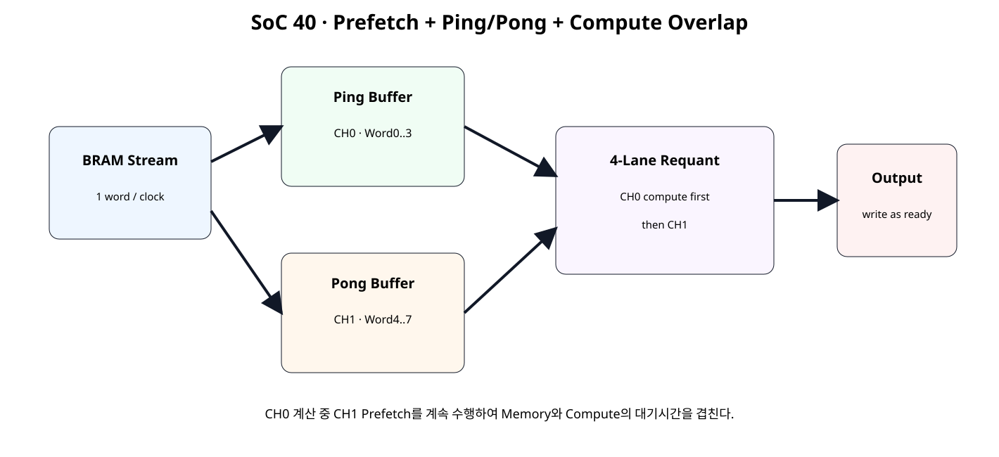
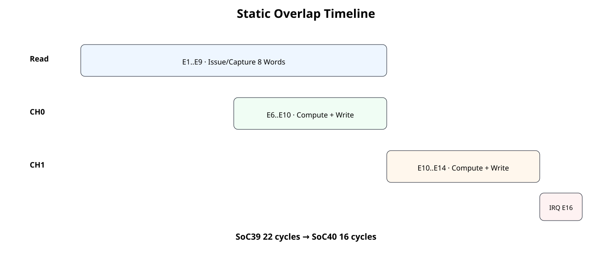
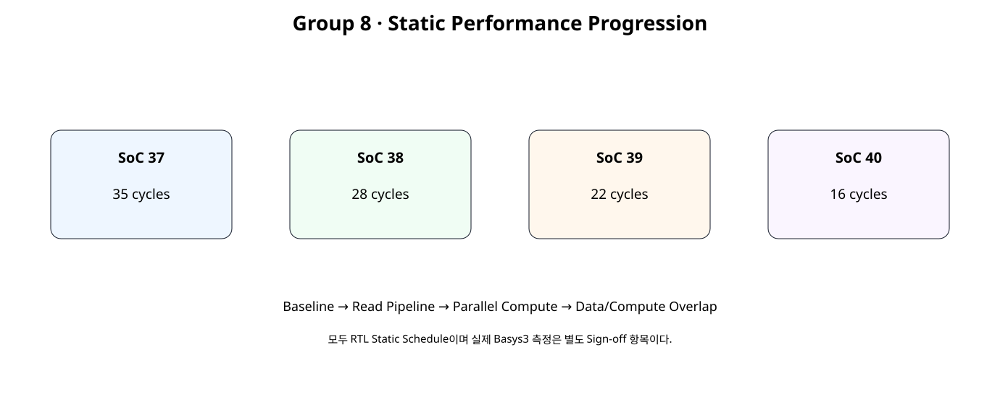

# Prefetch · Ping-Pong Buffer · Data-Compute Overlap


## 전체 학습 위치


## 이번 장의 목표


[](../images/soc40/soc40_overlap.svg)

다음 데이터를 미리 읽는 동안 현재 데이터를 계산한다.


## SoC39 이후 구조


## 왜 Overlap인가

각 구간 자체를 더 줄이는 대신 서로 독립적으로 진행 가능한 Memory와 Compute를 동시에 실행하면 대기시간을 숨길 수 있다.


## Ping/Pong Buffer


```text
Ping → CH0 Word0..3
Pong → CH1 Word4..7
```


## 작은 Double Buffer

이번 구조의 Ping/Pong은 128-bit Group Register 두 개다. Tensor 전체를 두 BRAM Bank에 복제하는 대형 Double Buffer와는 구분한다.


## Prefetch

Ping이 준비되면 CH0 계산을 시작하고 BRAM Read Stream은 멈추지 않고 Pong을 채운다.


## CH0 Compute


## CH1 Prefetch


## Group4 Interface

Batch 전체를 기다리지 않고 하나의 4-word Group을 valid/tag 인터페이스로 Requant Pipeline에 직접 투입한다.


## Tag Pipeline

tag 0은 CH0, tag 1은 CH1이며 Arithmetic Pipeline 깊이에 맞춰 함께 이동한다.


## Shared BRAM Port

Read가 진행 중일 때는 Native Port를 Input Read에 사용하고, 마지막 Read가 끝난 뒤 반환되는 CH0/CH1 결과를 같은 Port로 Write한다.


## Read/Write Scheduling


## Static Timeline


[](../images/soc40/soc40_timeline.svg)

CH0 계산이 CH1 Prefetch와 겹친다.


## 22 → 16 cycles


## Latency / Throughput


| Metric | SoC39 | SoC40 |
| --- | --- | --- |
| Static Total | 22 | 16 cycles |
| @100 MHz | 220 ns | 160 ns |
| Latency 변화 | 기준 | -27.3% |
| Upper jobs/s | 4.545 M | 6.250 M |
| Upper Throughput | 기준 | +37.5% |


## Group 8 누적 변화


[](../images/soc40/soc40_progression.svg)

35 → 28 → 22 → 16 cycles는 각각 다른 구조 개선 단계다.


## Static Reference


```text
SoC40 STATIC DATA-COMPUTE OVERLAP
clock = 100 MHz

key schedule:
E1..E8  : continuous read issue
E2..E9  : continuous read capture
E6       : launch CH0 group after ping buffer ready
E10      : write CH0 + launch CH1
E14      : write CH1
E15      : engine done pulse
E16      : control IRQ pending visible

SoC39 total = 22 cycles (220.0 ns)
SoC40 total = 16 cycles (160.0 ns)
saved = 6 cycles
static latency reduction vs SoC39 = 27.3%
SoC39 upper jobs/s = 4,545,454.545
SoC40 upper jobs/s = 6,250,000.000
static upper throughput gain vs SoC39 = 37.5%

OVERLAP PRINCIPLE:
- ping buffer: CH0 words 0..3
- pong buffer: CH1 words 4..7
- CH0 compute overlaps CH1 prefetch
- BRAM remains synchronous
- no board/runtime measurement is claimed
SOC40 STATIC OVERLAP REFERENCE: PASS
Spreadsheet runtime warmup failed during python startup
Traceback (most recent call last):
  File "/tmp/tmp.L2TH2Y5coc/artifact_tool_v2-2.8.22/artifact_tool/patches/warm_spreadsheet_runtime_on_startup.py", line 26, in warm_spreadsheet_runtime_on_startup
  File "/tmp/tmp.L2TH2Y5coc/artifact_tool_v2-2.8.22/artifact_tool/spreadsheet_warmup.py", line 772, in warm_spreadsheet_runtime
  File "/tmp/tmp.L2TH2Y5coc/artifact_tool_v2-2.8.22/artifact_tool/rpc/connection.py", line 37, in get_or_create_client
  File "/tmp/tmp.L2TH2Y5coc/artifact_tool_v2-2.8.22/artifact_tool/rpc/daemon.py", line 124, in start_daemon
TimeoutError: Timed out waiting for artifact tool daemon socket. Set ARTIFACT_TOOL_RPC_DAEMON_STARTUP_TIMEOUT_S=<seconds> to increase the limit.
```


## 변경 범위


```text
신규:
requantize_group4_parallel.v
tensor_job_engine_overlap.v
npu_full_accelerator_overlap_ip.v

유지:
requantize_s32_to_s8.v
Control / Descriptor / IRQ / AXI Bridge
```


## Group4 RTL


```verilog
module requantize_group4_parallel (
    input  wire                 clk,
    input  wire                 resetn,

    input  wire                 valid_i,
    input  wire                 tag_i,

    input  wire [127:0]         acc_group_i,

    input  wire signed [31:0]   bias_i,
    input  wire signed [15:0]   multiplier_i,
    input  wire        [5:0]    shift_i,
    input  wire signed [15:0]   zero_point_i,

    output wire                 valid_o,
    output wire                 tag_o,
    output wire [31:0]          q_group_o,
    output wire [2:0]           saturation_count_o
);

// Four identical arithmetic lanes.
// The arithmetic core itself is byte-identical to SoC 39.

wire signed [7:0] q0_w;
wire signed [7:0] q1_w;
wire signed [7:0] q2_w;
wire signed [7:0] q3_w;

wire v0_w;
wire v1_w;
wire v2_w;
wire v3_w;

wire sp0_w, sp1_w, sp2_w, sp3_w;
wire sn0_w, sn1_w, sn2_w, sn3_w;

requantize_s32_to_s8 u_lane0 (
    .clk(clk), .resetn(resetn), .valid_i(valid_i),
    .acc_i($signed(acc_group_i[31:0])),
    .bias_i(bias_i), .multiplier_i(multiplier_i),
    .shift_i(shift_i), .zero_point_i(zero_point_i),
    .valid_o(v0_w), .q_o(q0_w),
    .sat_pos_o(sp0_w), .sat_neg_o(sn0_w)
);

requantize_s32_to_s8 u_lane1 (
    .clk(clk), .resetn(resetn), .valid_i(valid_i),
    .acc_i($signed(acc_group_i[63:32])),
    .bias_i(bias_i), .multiplier_i(multiplier_i),
    .shift_i(shift_i), .zero_point_i(zero_point_i),
    .valid_o(v1_w), .q_o(q1_w),
    .sat_pos_o(sp1_w), .sat_neg_o(sn1_w)
);

requantize_s32_to_s8 u_lane2 (
    .clk(clk), .resetn(resetn), .valid_i(valid_i),
    .acc_i($signed(acc_group_i[95:64])),
    .bias_i(bias_i), .multiplier_i(multiplier_i),
    .shift_i(shift_i), .zero_point_i(zero_point_i),
    .valid_o(v2_w), .q_o(q2_w),
    .sat_pos_o(sp2_w), .sat_neg_o(sn2_w)
);

requantize_s32_to_s8 u_lane3 (
    .clk(clk), .resetn(resetn), .valid_i(valid_i),
    .acc_i($signed(acc_group_i[127:96])),
    .bias_i(bias_i), .multiplier_i(multiplier_i),
    .shift_i(shift_i), .zero_point_i(zero_point_i),
    .valid_o(v3_w), .q_o(q3_w),
    .sat_pos_o(sp3_w), .sat_neg_o(sn3_w)
);

// Four arithmetic stages -> matching tag pipeline.
reg tag_s1_q;
reg tag_s2_q;
reg tag_s3_q;
reg tag_s4_q;

always @(posedge clk) begin
    if (!resetn) begin
        tag_s1_q <= 1'b0;
        tag_s2_q <= 1'b0;
        tag_s3_q <= 1'b0;
        tag_s4_q <= 1'b0;
    end else begin
        if (valid_i)
            tag_s1_q <= tag_i;

        tag_s2_q <= tag_s1_q;
        tag_s3_q <= tag_s2_q;
        tag_s4_q <= tag_s3_q;
    end
end

assign valid_o =
    v0_w && v1_w && v2_w && v3_w;

assign tag_o = tag_s4_q;

assign q_group_o = {
    q3_w, q2_w, q1_w, q0_w
};

assign saturation_count_o =
    {2'b00, (sp0_w || sn0_w)} +
    {2'b00, (sp1_w || sn1_w)} +
    {2'b00, (sp2_w || sn2_w)} +
    {2'b00, (sp3_w || sn3_w)};

endmodule
```


## Overlap Engine RTL


```verilog
module tensor_job_engine_overlap #(
    parameter integer BRAM_READ_LATENCY = 1
) (
    input  wire                 clk,
    input  wire                 resetn,
    input  wire                 start_i,

    input  wire [11:0]          input_base_i,
    input  wire [11:0]          output_base_i,
    input  wire [15:0]          length_words_i,

    input  wire signed [31:0]   bias_ch0_i,
    input  wire signed [31:0]   bias_ch1_i,

    input  wire signed [15:0]   mult_ch0_i,
    input  wire signed [15:0]   mult_ch1_i,

    input  wire        [5:0]    shift_ch0_i,
    input  wire        [5:0]    shift_ch1_i,

    input  wire signed [15:0]   zp_ch0_i,
    input  wire signed [15:0]   zp_ch1_i,

    output wire                 busy_o,
    output reg                  done_o,
    output reg                  error_o,

    output reg                  bram_en_o,
    output reg  [3:0]           bram_we_o,
    output reg  [11:0]          bram_addr_o,
    output reg  [31:0]          bram_wdata_o,
    input  wire [31:0]          bram_rdata_i,

    output reg  [15:0]          read_word_count_o,
    output reg  [15:0]          write_word_count_o
);

// SoC 40:
// - keep synchronous BRAM
// - keep one read request per clock
// - split 8 words into two 4-word ping/pong groups
// - launch CH0 compute as soon as word3 is captured
// - continue prefetching CH1 while CH0 computes
// - launch CH1 when word7 is captured
// - write CH0/CH1 results as soon as each result returns

reg job_active_q;
reg finish_pending_q;

reg [3:0] issue_index_q;
reg [3:0] capture_index_q;
reg       issue_done_q;
reg       reads_complete_q;

reg [127:0] ping_group_q;
reg [127:0] pong_group_q;

reg ping_ready_q;
reg pong_ready_q;
reg ping_launched_q;
reg pong_launched_q;

reg ch0_written_q;
reg ch1_written_q;

reg [BRAM_READ_LATENCY-1:0] read_valid_pipe_q;
integer valid_stage;

wire issue_read_w;
wire capture_valid_w;

assign issue_read_w =
    job_active_q &&
    !issue_done_q;

assign capture_valid_w =
    read_valid_pipe_q[BRAM_READ_LATENCY-1];

// ------------------------------------------------------------
// Group launch arbitration.
// Ping = CH0, Pong = CH1.
// ------------------------------------------------------------
wire rq_valid_i_w;
wire rq_tag_i_w;
wire [127:0] rq_acc_group_w;

assign rq_valid_i_w =
    job_active_q &&
    (
        (ping_ready_q && !ping_launched_q) ||
        (pong_ready_q && !pong_launched_q)
    );

assign rq_tag_i_w =
    (ping_ready_q && !ping_launched_q)
    ? 1'b0
    : 1'b1;

assign rq_acc_group_w =
    (rq_tag_i_w == 1'b0)
    ? ping_group_q
    : pong_group_q;

wire signed [31:0] rq_bias_w;
wire signed [15:0] rq_mult_w;
wire        [5:0]  rq_shift_w;
wire signed [15:0] rq_zp_w;

assign rq_bias_w =
    rq_tag_i_w ? bias_ch1_i : bias_ch0_i;

assign rq_mult_w =
    rq_tag_i_w ? mult_ch1_i : mult_ch0_i;

assign rq_shift_w =
    rq_tag_i_w ? shift_ch1_i : shift_ch0_i;

assign rq_zp_w =
    rq_tag_i_w ? zp_ch1_i : zp_ch0_i;

wire        rq_valid_o_w;
wire        rq_tag_o_w;
wire [31:0] rq_q_group_w;
wire [2:0]  rq_sat_count_w;

requantize_group4_parallel u_group4 (
    .clk(clk),
    .resetn(resetn),

    .valid_i(rq_valid_i_w),
    .tag_i(rq_tag_i_w),

    .acc_group_i(rq_acc_group_w),

    .bias_i(rq_bias_w),
    .multiplier_i(rq_mult_w),
    .shift_i(rq_shift_w),
    .zero_point_i(rq_zp_w),

    .valid_o(rq_valid_o_w),
    .tag_o(rq_tag_o_w),
    .q_group_o(rq_q_group_w),
    .saturation_count_o(rq_sat_count_w)
);

// Once all reads finish, a returned group can be written immediately.
wire result_write_w;

assign result_write_w =
    job_active_q &&
    reads_complete_q &&
    rq_valid_o_w;

// ------------------------------------------------------------
// Shared native BRAM port.
//
// Priority after reads complete:
// returned requant result write.
//
// While reads are active, only read requests use the port.
// ------------------------------------------------------------
always @(*) begin
    bram_en_o    = 1'b0;
    bram_we_o    = 4'b0000;
    bram_addr_o  = 12'h000;
    bram_wdata_o = 32'h0000_0000;

    if (result_write_w) begin
        bram_en_o    = 1'b1;
        bram_we_o    = 4'b1111;
        bram_addr_o  =
            rq_tag_o_w
            ? (output_base_i + 12'd4)
            : output_base_i;
        bram_wdata_o = rq_q_group_w;
    end else if (issue_read_w) begin
        bram_en_o    = 1'b1;
        bram_we_o    = 4'b0000;
        bram_addr_o  =
            input_base_i +
            {issue_index_q, 2'b00};
    end
end

// ------------------------------------------------------------
// Read-valid pipeline.
// ------------------------------------------------------------
always @(posedge clk) begin
    if (!resetn) begin
        read_valid_pipe_q <=
            {BRAM_READ_LATENCY{1'b0}};
    end else if (!job_active_q) begin
        read_valid_pipe_q <=
            {BRAM_READ_LATENCY{1'b0}};
    end else begin
        read_valid_pipe_q[0] <= issue_read_w;

        for (
            valid_stage = 1;
            valid_stage < BRAM_READ_LATENCY;
            valid_stage = valid_stage + 1
        ) begin
            read_valid_pipe_q[valid_stage] <=
                read_valid_pipe_q[valid_stage - 1];
        end
    end
end

assign busy_o = job_active_q;

// ------------------------------------------------------------
// Job / prefetch / compute / write control.
// ------------------------------------------------------------
always @(posedge clk) begin
    if (!resetn) begin
        job_active_q <= 1'b0;
        finish_pending_q <= 1'b0;

        issue_index_q <= 4'd0;
        capture_index_q <= 4'd0;
        issue_done_q <= 1'b0;
        reads_complete_q <= 1'b0;

        ping_group_q <= 128'd0;
        pong_group_q <= 128'd0;

        ping_ready_q <= 1'b0;
        pong_ready_q <= 1'b0;
        ping_launched_q <= 1'b0;
        pong_launched_q <= 1'b0;

        ch0_written_q <= 1'b0;
        ch1_written_q <= 1'b0;

        done_o <= 1'b0;
        error_o <= 1'b0;

        read_word_count_o <= 16'd0;
        write_word_count_o <= 16'd0;
    end else begin
        done_o <= 1'b0;

        if (finish_pending_q) begin
            done_o <= 1'b1;
            job_active_q <= 1'b0;
            finish_pending_q <= 1'b0;
        end

        if (!job_active_q) begin
            if (start_i) begin
                if (length_words_i != 16'd8) begin
                    error_o <= 1'b1;
                    done_o <= 1'b1;
                end else begin
                    job_active_q <= 1'b1;
                    error_o <= 1'b0;

                    issue_index_q <= 4'd0;
                    capture_index_q <= 4'd0;
                    issue_done_q <= 1'b0;
                    reads_complete_q <= 1'b0;

                    ping_group_q <= 128'd0;
                    pong_group_q <= 128'd0;

                    ping_ready_q <= 1'b0;
                    pong_ready_q <= 1'b0;
                    ping_launched_q <= 1'b0;
                    pong_launched_q <= 1'b0;

                    ch0_written_q <= 1'b0;
                    ch1_written_q <= 1'b0;

                    read_word_count_o <= 16'd0;
                    write_word_count_o <= 16'd0;
                end
            end
        end else begin
            // One read request per clock until address 7.
            if (issue_read_w) begin
                if (issue_index_q == 4'd7) begin
                    issue_done_q <= 1'b1;
                end else begin
                    issue_index_q <=
                        issue_index_q + 4'd1;
                end
            end

            // Capture synchronous BRAM return stream.
            if (capture_valid_w) begin
                read_word_count_o <=
                    read_word_count_o + 16'd1;

                case (capture_index_q)
                    4'd0: ping_group_q[31:0]   <= bram_rdata_i;
                    4'd1: ping_group_q[63:32]  <= bram_rdata_i;
                    4'd2: ping_group_q[95:64]  <= bram_rdata_i;
                    4'd3: begin
                        ping_group_q[127:96] <= bram_rdata_i;
                        ping_ready_q <= 1'b1;
                    end

                    4'd4: pong_group_q[31:0]   <= bram_rdata_i;
                    4'd5: pong_group_q[63:32]  <= bram_rdata_i;
                    4'd6: pong_group_q[95:64]  <= bram_rdata_i;

                    default: begin
                        pong_group_q[127:96] <= bram_rdata_i;
                        pong_ready_q <= 1'b1;
                        reads_complete_q <= 1'b1;
                    end
                endcase

                if (capture_index_q != 4'd7) begin
                    capture_index_q <=
                        capture_index_q + 4'd1;
                end
            end

            // A ready group enters the four-lane pipeline.
            if (rq_valid_i_w) begin
                if (!rq_tag_i_w) begin
                    ping_launched_q <= 1'b1;
                end else begin
                    pong_launched_q <= 1'b1;
                end
            end

            // Returned result is written through the shared BRAM port.
            if (result_write_w) begin
                write_word_count_o <=
                    write_word_count_o + 16'd1;

                if (!rq_tag_o_w) begin
                    ch0_written_q <= 1'b1;
                end else begin
                    ch1_written_q <= 1'b1;

                    // CH1 is the second/last group.
                    // CH0 must already have returned in program order.
                    finish_pending_q <= 1'b1;
                end
            end
        end
    end
end

endmodule
```


## Optimized Top


```verilog
module npu_full_accelerator_overlap_ip (
    (* X_INTERFACE_INFO = "xilinx.com:signal:clock:1.0 s_axi_aclk CLK" *)
    (* X_INTERFACE_PARAMETER = "XIL_INTERFACENAME s_axi_aclk, ASSOCIATED_BUSIF S_AXI:BRAM, ASSOCIATED_RESET s_axi_aresetn" *)
    input  wire        s_axi_aclk,

    (* X_INTERFACE_INFO = "xilinx.com:signal:reset:1.0 s_axi_aresetn RST" *)
    (* X_INTERFACE_PARAMETER = "XIL_INTERFACENAME s_axi_aresetn, POLARITY ACTIVE_LOW" *)
    input  wire        s_axi_aresetn,

    // --------------------------------------------------------
    // AXI4-Lite Control Plane
    // --------------------------------------------------------
    (* X_INTERFACE_INFO = "xilinx.com:interface:aximm:1.0 S_AXI AWADDR" *)
    input  wire [7:0]  s_axi_awaddr,
    (* X_INTERFACE_INFO = "xilinx.com:interface:aximm:1.0 S_AXI AWVALID" *)
    input  wire        s_axi_awvalid,
    (* X_INTERFACE_INFO = "xilinx.com:interface:aximm:1.0 S_AXI AWREADY" *)
    output wire        s_axi_awready,

    (* X_INTERFACE_INFO = "xilinx.com:interface:aximm:1.0 S_AXI WDATA" *)
    input  wire [31:0] s_axi_wdata,
    (* X_INTERFACE_INFO = "xilinx.com:interface:aximm:1.0 S_AXI WSTRB" *)
    input  wire [3:0]  s_axi_wstrb,
    (* X_INTERFACE_INFO = "xilinx.com:interface:aximm:1.0 S_AXI WVALID" *)
    input  wire        s_axi_wvalid,
    (* X_INTERFACE_INFO = "xilinx.com:interface:aximm:1.0 S_AXI WREADY" *)
    output wire        s_axi_wready,

    (* X_INTERFACE_INFO = "xilinx.com:interface:aximm:1.0 S_AXI BRESP" *)
    output wire [1:0]  s_axi_bresp,
    (* X_INTERFACE_INFO = "xilinx.com:interface:aximm:1.0 S_AXI BVALID" *)
    output wire        s_axi_bvalid,
    (* X_INTERFACE_INFO = "xilinx.com:interface:aximm:1.0 S_AXI BREADY" *)
    input  wire        s_axi_bready,

    (* X_INTERFACE_INFO = "xilinx.com:interface:aximm:1.0 S_AXI ARADDR" *)
    input  wire [7:0]  s_axi_araddr,
    (* X_INTERFACE_INFO = "xilinx.com:interface:aximm:1.0 S_AXI ARVALID" *)
    input  wire        s_axi_arvalid,
    (* X_INTERFACE_INFO = "xilinx.com:interface:aximm:1.0 S_AXI ARREADY" *)
    output wire        s_axi_arready,

    (* X_INTERFACE_INFO = "xilinx.com:interface:aximm:1.0 S_AXI RDATA" *)
    output wire [31:0] s_axi_rdata,
    (* X_INTERFACE_INFO = "xilinx.com:interface:aximm:1.0 S_AXI RRESP" *)
    output wire [1:0]  s_axi_rresp,
    (* X_INTERFACE_INFO = "xilinx.com:interface:aximm:1.0 S_AXI RVALID" *)
    output wire        s_axi_rvalid,
    (* X_INTERFACE_INFO = "xilinx.com:interface:aximm:1.0 S_AXI RREADY" *)
    input  wire        s_axi_rready,

    // --------------------------------------------------------
    // Native BRAM Data Plane
    // --------------------------------------------------------
    (* X_INTERFACE_INFO = "xilinx.com:interface:bram:1.0 BRAM CLK" *)
    output wire        bram_clk_o,
    (* X_INTERFACE_INFO = "xilinx.com:interface:bram:1.0 BRAM RST" *)
    output wire        bram_rst_o,
    (* X_INTERFACE_INFO = "xilinx.com:interface:bram:1.0 BRAM EN" *)
    output wire        bram_en_o,
    (* X_INTERFACE_INFO = "xilinx.com:interface:bram:1.0 BRAM WE" *)
    output wire [3:0]  bram_we_o,
    (* X_INTERFACE_INFO = "xilinx.com:interface:bram:1.0 BRAM ADDR" *)
    output wire [11:0] bram_addr_o,
    (* X_INTERFACE_INFO = "xilinx.com:interface:bram:1.0 BRAM DIN" *)
    output wire [31:0] bram_wdata_o,
    (* X_INTERFACE_INFO = "xilinx.com:interface:bram:1.0 BRAM DOUT" *)
    input  wire [31:0] bram_rdata_i,

    // --------------------------------------------------------
    // Interrupt
    // --------------------------------------------------------
    (* X_INTERFACE_INFO = "xilinx.com:signal:interrupt:1.0 irq INTERRUPT" *)
    (* X_INTERFACE_PARAMETER = "XIL_INTERFACENAME irq, SENSITIVITY LEVEL_HIGH" *)
    output wire        irq
);

// Pure Shell / Wrapper:
// AXI bridge + control/descriptor/IRQ + job engine + BRAM clock/reset adapter.

wire        reg_wr_en;
wire [7:0]  reg_wr_addr;
wire [31:0] reg_wr_data;
wire [3:0]  reg_wr_strb;

wire [7:0]  reg_rd_addr;
wire [31:0] reg_rd_data;

wire job_start;

wire [11:0] active_input_base;
wire [11:0] active_output_base;
wire [15:0] active_length_words;

wire signed [31:0] active_bias_ch0;
wire signed [31:0] active_bias_ch1;

wire signed [15:0] active_mult_ch0;
wire signed [15:0] active_mult_ch1;

wire [5:0] active_shift_ch0;
wire [5:0] active_shift_ch1;

wire signed [15:0] active_zp_ch0;
wire signed [15:0] active_zp_ch1;

wire engine_busy;
wire engine_done;
wire engine_error;

wire [15:0] read_word_count;
wire [15:0] write_word_count;

wire ctrl_busy;
wire done_sticky;
wire error_sticky;
wire [7:0] error_code;
wire [31:0] job_id;
wire [1:0] irq_enable;
wire [1:0] irq_status;

axi4lite_reg_bridge u_axi_bridge (
    .s_axi_aclk(s_axi_aclk),
    .s_axi_aresetn(s_axi_aresetn),

    .s_axi_awaddr(s_axi_awaddr),
    .s_axi_awvalid(s_axi_awvalid),
    .s_axi_awready(s_axi_awready),

    .s_axi_wdata(s_axi_wdata),
    .s_axi_wstrb(s_axi_wstrb),
    .s_axi_wvalid(s_axi_wvalid),
    .s_axi_wready(s_axi_wready),

    .s_axi_bresp(s_axi_bresp),
    .s_axi_bvalid(s_axi_bvalid),
    .s_axi_bready(s_axi_bready),

    .s_axi_araddr(s_axi_araddr),
    .s_axi_arvalid(s_axi_arvalid),
    .s_axi_arready(s_axi_arready),

    .s_axi_rdata(s_axi_rdata),
    .s_axi_rresp(s_axi_rresp),
    .s_axi_rvalid(s_axi_rvalid),
    .s_axi_rready(s_axi_rready),

    .reg_wr_en_o(reg_wr_en),
    .reg_wr_addr_o(reg_wr_addr),
    .reg_wr_data_o(reg_wr_data),
    .reg_wr_strb_o(reg_wr_strb),

    .reg_rd_addr_o(reg_rd_addr),
    .reg_rd_data_i(reg_rd_data)
);

npu_full_control_irq u_control (
    .clk(s_axi_aclk),
    .resetn(s_axi_aresetn),

    .wr_en_i(reg_wr_en),
    .wr_addr_i(reg_wr_addr),
    .wr_data_i(reg_wr_data),
    .wr_strb_i(reg_wr_strb),

    .rd_addr_i(reg_rd_addr),
    .rd_data_o(reg_rd_data),

    .job_start_o(job_start),

    .active_input_base_o(active_input_base),
    .active_output_base_o(active_output_base),
    .active_length_words_o(active_length_words),

    .active_bias_ch0_o(active_bias_ch0),
    .active_bias_ch1_o(active_bias_ch1),

    .active_mult_ch0_o(active_mult_ch0),
    .active_mult_ch1_o(active_mult_ch1),

    .active_shift_ch0_o(active_shift_ch0),
    .active_shift_ch1_o(active_shift_ch1),

    .active_zp_ch0_o(active_zp_ch0),
    .active_zp_ch1_o(active_zp_ch1),

    .engine_busy_i(engine_busy),
    .engine_done_i(engine_done),
    .engine_error_i(engine_error),

    .read_word_count_i(read_word_count),
    .write_word_count_i(write_word_count),

    .busy_o(ctrl_busy),
    .done_sticky_o(done_sticky),
    .error_sticky_o(error_sticky),
    .error_code_o(error_code),
    .job_id_o(job_id),

    .irq_o(irq),
    .irq_enable_o(irq_enable),
    .irq_status_o(irq_status)
);

tensor_job_engine_overlap #(
    .BRAM_READ_LATENCY(1)
) u_engine (
    .clk(s_axi_aclk),
    .resetn(s_axi_aresetn),

    .start_i(job_start),

    .input_base_i(active_input_base),
    .output_base_i(active_output_base),
    .length_words_i(active_length_words),

    .bias_ch0_i(active_bias_ch0),
    .bias_ch1_i(active_bias_ch1),

    .mult_ch0_i(active_mult_ch0),
    .mult_ch1_i(active_mult_ch1),

    .shift_ch0_i(active_shift_ch0),
    .shift_ch1_i(active_shift_ch1),

    .zp_ch0_i(active_zp_ch0),
    .zp_ch1_i(active_zp_ch1),

    .busy_o(engine_busy),
    .done_o(engine_done),
    .error_o(engine_error),

    .bram_en_o(bram_en_o),
    .bram_we_o(bram_we_o),
    .bram_addr_o(bram_addr_o),
    .bram_wdata_o(bram_wdata_o),
    .bram_rdata_i(bram_rdata_i),

    .read_word_count_o(read_word_count),
    .write_word_count_o(write_word_count)
);

bram_clock_reset_adapter u_bram_clock_reset (
    .clk_i(s_axi_aclk),
    .resetn_i(s_axi_aresetn),

    .bram_clk_o(bram_clk_o),
    .bram_rst_o(bram_rst_o)
);

endmodule
```


## Top Shell/Wrapper

Top은 새 Overlap Engine을 연결하는 Shell/Wrapper이며 기능 FSM과 Scheduling은 Engine 내부에 유지한다.


## Standalone Group Regression


```verilog
`timescale 1ns / 1ps

module tb_requantize_group4_parallel;

logic clk = 1'b0;
logic resetn = 1'b0;

logic valid_i = 1'b0;
logic tag_i = 1'b0;
logic [127:0] acc_group_i;

logic signed [31:0] bias_i;
logic signed [15:0] multiplier_i;
logic [5:0] shift_i;
logic signed [15:0] zero_point_i;

wire valid_o;
wire tag_o;
wire [31:0] q_group_o;
wire [2:0] saturation_count_o;

integer errors = 0;

always #5 clk = ~clk;

requantize_group4_parallel dut (
    .clk(clk),
    .resetn(resetn),
    .valid_i(valid_i),
    .tag_i(tag_i),
    .acc_group_i(acc_group_i),
    .bias_i(bias_i),
    .multiplier_i(multiplier_i),
    .shift_i(shift_i),
    .zero_point_i(zero_point_i),
    .valid_o(valid_o),
    .tag_o(tag_o),
    .q_group_o(q_group_o),
    .saturation_count_o(saturation_count_o)
);

task automatic launch_group(
    input logic tag,
    input logic [127:0] acc,
    input logic signed [31:0] bias,
    input logic signed [15:0] mult,
    input logic [5:0] shift,
    input logic signed [15:0] zp
);
    begin
        @(negedge clk);
        tag_i = tag;
        acc_group_i = acc;
        bias_i = bias;
        multiplier_i = mult;
        shift_i = shift;
        zero_point_i = zp;
        valid_i = 1'b1;

        @(negedge clk);
        valid_i = 1'b0;
    end
endtask

initial begin
    repeat (4) @(posedge clk);
    resetn = 1'b1;

    launch_group(
        1'b0,
        {32'd64, 32'd48, 32'd32, 32'd16},
        32'sd0, 16'sd1, 6'd1, 16'sd0
    );

    wait (valid_o === 1'b1);
    #1;

    if (
        (tag_o !== 1'b0) ||
        (q_group_o !== 32'h2018_1008) ||
        (saturation_count_o !== 3'd0)
    ) begin
        errors = errors + 1;
        $error("CH0 group mismatch");
    end

    launch_group(
        1'b1,
        {32'd128, 32'd96, 32'd64, 32'd32},
        32'sd4, 16'sd3, 6'd1, -16'sd3
    );

    wait (valid_o === 1'b1);
    #1;

    if (
        (tag_o !== 1'b1) ||
        (q_group_o !== 32'h7F7F_6333) ||
        (saturation_count_o !== 3'd2)
    ) begin
        errors = errors + 1;
        $error("CH1 group mismatch");
    end

    if (errors == 0)
        $display("SOC40 GROUP4 TEST: PASS");
    else
        $fatal(1, "SOC40 GROUP4 TEST: FAIL");

    #20;
    $finish;
end

endmodule
```


## Integrated Regression


```verilog
`timescale 1ns / 1ps

module tb_soc40_overlap_regression;

logic clk = 1'b0;
logic resetn = 1'b0;

logic [7:0]  awaddr = 8'h00;
logic        awvalid = 1'b0;
wire         awready;

logic [31:0] wdata = 32'h0000_0000;
logic [3:0]  wstrb = 4'h0;
logic        wvalid = 1'b0;
wire         wready;

wire [1:0]   bresp;
wire         bvalid;
logic        bready = 1'b1;

logic [7:0]  araddr = 8'h00;
logic        arvalid = 1'b0;
wire         arready;

wire [31:0]  rdata;
wire [1:0]   rresp;
wire         rvalid;
logic        rready = 1'b1;

logic        cpu_mem_en_i = 1'b0;
logic [3:0]  cpu_mem_we_i = 4'h0;
logic [11:0] cpu_mem_addr_i = 12'h000;
logic [31:0] cpu_mem_wdata_i = 32'h0000_0000;
wire [31:0]  cpu_mem_rdata_o;

wire irq_o;

integer check_count = 0;
integer error_count = 0;

integer cycle_counter = 0;
integer engine_start_cycle = -1;
integer irq_cycle = -1;
logic engine_busy_d = 1'b0;

always @(posedge clk) begin
    cycle_counter = cycle_counter + 1;

    // Wait until NBA updates settle before observing DUT pulses.
    #1;

    if (
        dut.u_npu.engine_busy &&
        !engine_busy_d
    ) begin
        engine_start_cycle = cycle_counter;
    end

    engine_busy_d = dut.u_npu.engine_busy;

    if (
        (irq_o === 1'b1) &&
        (irq_cycle < 0)
    ) begin
        irq_cycle = cycle_counter;
    end
end

always #5 clk = ~clk;

npu_full_accelerator_overlap_sim_top dut (
    .clk(clk),
    .resetn(resetn),

    .s_axi_awaddr(awaddr),
    .s_axi_awvalid(awvalid),
    .s_axi_awready(awready),

    .s_axi_wdata(wdata),
    .s_axi_wstrb(wstrb),
    .s_axi_wvalid(wvalid),
    .s_axi_wready(wready),

    .s_axi_bresp(bresp),
    .s_axi_bvalid(bvalid),
    .s_axi_bready(bready),

    .s_axi_araddr(araddr),
    .s_axi_arvalid(arvalid),
    .s_axi_arready(arready),

    .s_axi_rdata(rdata),
    .s_axi_rresp(rresp),
    .s_axi_rvalid(rvalid),
    .s_axi_rready(rready),

    .cpu_mem_en_i(cpu_mem_en_i),
    .cpu_mem_we_i(cpu_mem_we_i),
    .cpu_mem_addr_i(cpu_mem_addr_i),
    .cpu_mem_wdata_i(cpu_mem_wdata_i),
    .cpu_mem_rdata_o(cpu_mem_rdata_o),

    .irq_o(irq_o)
);

task automatic check_true(
    input string name,
    input bit condition
);
    begin
        check_count = check_count + 1;
        if (!condition) begin
            error_count = error_count + 1;
            $error("CHECK FAIL: %s", name);
        end else begin
            $display("CHECK PASS: %s", name);
        end
    end
endtask

task automatic check_eq32(
    input string name,
    input logic [31:0] actual,
    input logic [31:0] expected
);
    begin
        check_count = check_count + 1;
        if (actual !== expected) begin
            error_count = error_count + 1;
            $error(
                "CHECK FAIL: %s actual=0x%08h expected=0x%08h",
                name,
                actual,
                expected
            );
        end else begin
            $display(
                "CHECK PASS: %s = 0x%08h",
                name,
                actual
            );
        end
    end
endtask

task automatic axi_write(
    input [7:0] address,
    input [31:0] data,
    input integer order
);
    bit aw_done;
    bit w_done;
    integer timeout;

    begin
        aw_done = 0;
        w_done = 0;

        @(negedge clk);

        awaddr = address;
        wdata = data;
        wstrb = 4'hF;

        case (order)
            0: begin
                awvalid = 1'b1;
                wvalid = 1'b1;
            end

            1: begin
                awvalid = 1'b1;
                wvalid = 1'b0;
            end

            default: begin
                awvalid = 1'b0;
                wvalid = 1'b1;
            end
        endcase

        timeout = 0;

        while (!(aw_done && w_done)) begin
            @(posedge clk);
            // (변경) READY가 갱신되기 전 상승 에지의 handshake를 관측한다.

            if (awvalid && awready)
                aw_done = 1;

            if (wvalid && wready)
                w_done = 1;

            @(negedge clk);

            if (aw_done)
                awvalid = 1'b0;

            if (w_done)
                wvalid = 1'b0;

            if (
                (order == 1) &&
                aw_done &&
                !w_done
            )
                wvalid = 1'b1;

            if (
                (order == 2) &&
                w_done &&
                !aw_done
            )
                awvalid = 1'b1;

            timeout = timeout + 1;

            if (timeout > 40)
                $fatal(1, "AXI write timeout");
        end

        timeout = 0;

        while (!bvalid) begin
            @(posedge clk);
            #1;

            timeout = timeout + 1;

            if (timeout > 40)
                $fatal(1, "AXI BVALID timeout");
        end

        check_true(
            "BRESP OKAY",
            bresp == 2'b00
        );

        @(posedge clk);
        #1;
    end
endtask

task automatic axi_read(
    input [7:0] address,
    output [31:0] data
);
    integer timeout;

    begin
        @(negedge clk);

        araddr = address;
        arvalid = 1'b1;

        timeout = 0;

        while (!arready) begin
            @(posedge clk);
            #1;
            timeout = timeout + 1;

            if (timeout > 40)
                $fatal(1, "AXI ARREADY timeout");
        end

        @(posedge clk);
        #1;

        timeout = 0;

        while (!rvalid) begin
            @(posedge clk);
            #1;

            timeout = timeout + 1;

            if (timeout > 40)
                $fatal(1, "AXI RVALID timeout");
        end

        data = rdata;

        check_true(
            "RRESP OKAY",
            rresp == 2'b00
        );

        @(negedge clk);
        arvalid = 1'b0;

        @(posedge clk);
        #1;
    end
endtask

task automatic mem_write32(
    input [11:0] address,
    input [31:0] data
);
    begin
        @(negedge clk);

        cpu_mem_en_i = 1'b1;
        cpu_mem_we_i = 4'hF;
        cpu_mem_addr_i = address;
        cpu_mem_wdata_i = data;

        @(posedge clk);
        #1;

        @(negedge clk);

        cpu_mem_en_i = 1'b0;
        cpu_mem_we_i = 4'h0;
        cpu_mem_addr_i = 12'h000;
        cpu_mem_wdata_i = 32'h0000_0000;
    end
endtask

task automatic mem_read32(
    input [11:0] address,
    output [31:0] data
);
    begin
        @(negedge clk);

        cpu_mem_en_i = 1'b1;
        cpu_mem_we_i = 4'h0;
        cpu_mem_addr_i = address;

        @(posedge clk);
        #1;

        @(negedge clk);

        cpu_mem_en_i = 1'b0;
        cpu_mem_addr_i = 12'h000;

        data = cpu_mem_rdata_o;
    end
endtask

task automatic wait_irq_high;
    integer timeout;
    begin
        timeout = 0;

        while (irq_o !== 1'b1) begin
            @(posedge clk);
            // (변경) 같은 시각의 #1 성능 모니터보다 뒤에서 IRQ를 관측한다.
            #2;

            timeout = timeout + 1;

            if (timeout > 300)
                $fatal(1, "IRQ did not assert");
        end
    end
endtask

initial begin
    reg [31:0] rd;

    repeat (5) @(posedge clk);
    resetn = 1'b1;

    // --------------------------------------------------------
    // 1. CPU fills Tensor BRAM through Port A.
    // --------------------------------------------------------
    mem_write32(12'h200, 32'd16);
    mem_write32(12'h204, 32'd32);
    mem_write32(12'h208, 32'd48);
    mem_write32(12'h20C, 32'd64);

    mem_write32(12'h210, 32'd32);
    mem_write32(12'h214, 32'd64);
    mem_write32(12'h218, 32'd96);
    mem_write32(12'h21C, 32'd128);

    // --------------------------------------------------------
    // 2. Program descriptor / parameter / IRQ registers.
    //    Exercise all three AXI write channel orders.
    // --------------------------------------------------------
    axi_write(8'h10, 32'h0000_0200, 0);
    axi_write(8'h14, 32'h0000_0300, 1);
    axi_write(8'h18, 32'd8,         2);

    axi_write(8'h20, 32'd0,         0);
    axi_write(8'h24, 32'd4,         1);
    axi_write(8'h28, 32'h0001_0001, 2);
    axi_write(8'h2C, 32'h0001_0003, 0);
    axi_write(8'h30, 32'hFFFD_0000, 1);

    // Clear stale IRQ and status, then enable DONE/ERROR.
    axi_write(8'h4C, 32'h0000_0003, 2);
    axi_write(8'h00, 32'h0000_0006, 0);
    axi_write(8'h48, 32'h0000_0003, 1);

    axi_read(8'h04, rd);

    check_true(
        "descriptor valid",
        (rd & 32'h8) != 0
    );

    // --------------------------------------------------------
    // 3. START and wait for DONE IRQ.
    // --------------------------------------------------------
    axi_write(8'h00, 32'h0000_0001, 0);

    // Wait until BUSY appears.
    do begin
        axi_read(8'h04, rd);
    end while ((rd & 32'h1) == 0);

    // Shadow changes while the active job is running.
    axi_write(8'h10, 32'h0000_0400, 1);
    axi_write(8'h14, 32'h0000_0500, 2);

    axi_read(8'h34, rd);
    check_eq32(
        "ACTIVE_INPUT remains 0x200",
        rd,
        32'h0000_0200
    );

    axi_read(8'h38, rd);
    check_eq32(
        "ACTIVE_OUTPUT remains 0x300",
        rd,
        32'h0000_0300
    );

    wait_irq_high();

    check_true(
        "JOB0 overlap latency = 16 cycles",
        (irq_cycle - engine_start_cycle) == 16
    );

    axi_read(8'h4C, rd);

    check_true(
        "DONE IRQ pending",
        (rd & 32'h1) != 0
    );

    check_true(
        "ERROR IRQ clear",
        (rd & 32'h2) == 0
    );

    // CPU reclaims Tensor Buffer after completion.
    mem_read32(12'h300, rd);
    check_eq32(
        "full integration OUT_CH0",
        rd,
        32'h2018_1008
    );

    mem_read32(12'h304, rd);
    check_eq32(
        "full integration OUT_CH1",
        rd,
        32'h7F7F_6333
    );

    axi_read(8'h0C, rd);
    check_eq32(
        "JOB_ID = 1",
        rd,
        32'd1
    );

    axi_read(8'h40, rd);
    check_eq32(
        "READ_WORD_COUNT = 8",
        rd,
        32'd8
    );

    axi_read(8'h44, rd);
    check_eq32(
        "WRITE_WORD_COUNT = 2",
        rd,
        32'd2
    );

    // ISR-equivalent W1C.
    axi_write(8'h4C, 32'h0000_0001, 0);

    repeat (2) @(posedge clk);
    #1;

    check_true(
        "DONE W1C deasserts IRQ",
        irq_o === 1'b0
    );

    // --------------------------------------------------------
    // 4. Second complete job: same hardware, new Tensor buffer.
    // --------------------------------------------------------
    mem_write32(12'h400, 32'd2);
    mem_write32(12'h404, 32'd4);
    mem_write32(12'h408, 32'd6);
    mem_write32(12'h40C, 32'd8);

    mem_write32(12'h410, 32'd4);
    mem_write32(12'h414, 32'd8);
    mem_write32(12'h418, 32'd12);
    mem_write32(12'h41C, 32'd16);

    // Shadow addresses already changed to 0x400 / 0x500
    // during JOB0. Keep LENGTH=8 and parameters unchanged.
    axi_write(8'h18, 32'd8, 2);

    axi_write(8'h00, 32'h0000_0006, 0);
    axi_write(8'h4C, 32'h0000_0003, 1);
    axi_write(8'h48, 32'h0000_0003, 2);

    axi_read(8'h04, rd);

    check_true(
        "JOB1 descriptor valid",
        (rd & 32'h8) != 0
    );

    engine_start_cycle = -1;
    irq_cycle = -1;

    axi_write(8'h00, 32'h0000_0001, 0);

    wait_irq_high();

    check_true(
        "JOB1 overlap latency = 16 cycles",
        (irq_cycle - engine_start_cycle) == 16
    );

    axi_read(8'h4C, rd);

    check_true(
        "JOB1 DONE IRQ pending",
        (rd & 32'h1) != 0
    );

    mem_read32(12'h500, rd);
    check_eq32(
        "JOB1 OUT_CH0",
        rd,
        32'h0403_0201
    );

    mem_read32(12'h504, rd);
    check_eq32(
        "JOB1 OUT_CH1",
        rd,
        32'h1B15_0F09
    );

    axi_read(8'h0C, rd);
    check_eq32(
        "JOB_ID = 2 after second accepted job",
        rd,
        32'd2
    );

    axi_read(8'h40, rd);
    check_eq32(
        "JOB1 READ_WORD_COUNT = 8",
        rd,
        32'd8
    );

    axi_read(8'h44, rd);
    check_eq32(
        "JOB1 WRITE_WORD_COUNT = 2",
        rd,
        32'd2
    );

    axi_write(8'h4C, 32'h0000_0001, 1);

    repeat (2) @(posedge clk);
    #1;

    check_true(
        "JOB1 W1C deasserts IRQ",
        irq_o === 1'b0
    );

    // --------------------------------------------------------
    // 5. Integrated descriptor ERROR IRQ after two good jobs.
    // --------------------------------------------------------
    axi_write(8'h00, 32'h0000_0006, 1);
    axi_write(8'h4C, 32'h0000_0003, 2);
    axi_write(8'h48, 32'h0000_0002, 0);

    axi_write(8'h10, 32'h0000_0202, 1);
    axi_write(8'h14, 32'h0000_0600, 2);
    axi_write(8'h18, 32'd8,         0);

    axi_write(8'h00, 32'h0000_0001, 1);

    wait_irq_high();

    axi_read(8'h4C, rd);

    check_true(
        "descriptor ERROR IRQ pending",
        (rd & 32'h2) != 0
    );

    axi_read(8'h1C, rd);

    check_eq32(
        "descriptor ERROR_CODE = 2",
        rd,
        32'd2
    );

    axi_read(8'h0C, rd);

    check_eq32(
        "rejected job keeps JOB_ID = 2",
        rd,
        32'd2
    );

    axi_write(8'h4C, 32'h0000_0002, 2);

    repeat (2) @(posedge clk);
    #1;

    check_true(
        "ERROR W1C deasserts IRQ",
        irq_o === 1'b0
    );

    $display("");
    $display("SOC40 CHECK COUNT : %0d", check_count);
    $display("SOC40 ERROR COUNT : %0d", error_count);

    if (error_count == 0) begin
        $display("SOC40 DATA-COMPUTE OVERLAP TEST: PASS");
    end else begin
        $fatal(
            1,
            "SOC40 DATA-COMPUTE OVERLAP TEST: FAIL (%0d errors)",
            error_count
        );
    end

    #20;
    $finish;
end

endmodule
```


## JOB0


```text
OUT0 → 0x20181008
OUT1 → 0x7F7F6333
Expected internal latency → 16 cycles
```


## JOB1


```text
OUT0 → 0x04030201
OUT1 → 0x1B150F09
Expected internal latency → 16 cycles
```


## Counter / JOB_ID


## DONE / ERROR IRQ

Dataflow가 바뀌어도 Control Plane 계약은 동일하다. DONE/W1C와 Descriptor ERROR IRQ를 그대로 유지한다.


## BRAM Timing 원칙

AMD UG949는 Block RAM Output Register를 Timing Closure를 쉽게 하기 위해 권장한다. 이번 장은 Register 제거가 아니라 Scheduling 개선이다.


## Dedicated Block Pipelining

BRAM과 DSP는 Placement가 제한된 Dedicated Block이므로 주변 경로의 Pipelining을 충분히 유지한다.


## Resource Trade-off

Ping/Pong 및 ready/launched 제어가 추가되지만 SoC39에도 256-bit Batch Register가 있으므로 실제 FF 증가는 Report로 확인한다.


## Timing Trade-off

BRAM Address/Write Select, Group Ready, Tag 경로가 새 Critical Path가 되지 않는지 Post-Route Design Analysis를 확인한다.


## Power Trade-off

동시에 Read와 Compute가 진행되므로 Switching이 시간적으로 겹친다. 같은 Activity 조건에서 Power Delta를 비교한다.


## 동일 조건 Post-Route


```text
Same Device · Same 100 MHz · Same Vivado · Same Flow · Same Activity
```


## SoC39 Baseline Tcl


```text
# SoC 40 · SoC39 sequential read/compute post-route comparison
set script_dir [file dirname [file normalize [info script]]]
set root_dir [file normalize [file join $script_dir ".."]]
set rtl_dir [file join $root_dir "rtl"]
set out_dir [file normalize [file join $root_dir "reports" "soc39_baseline"]]
file mkdir $out_dir

create_project -in_memory -part xc7a35tcpg236-1

foreach f {
    requantize_s32_to_s8.v
    requantize_batch2x4_parallel4.v
    tensor_job_engine_parallel4_requant.v
    npu_full_control_irq.v
    axi4lite_reg_bridge.v
    bram_clock_reset_adapter.v
    npu_full_accelerator_parallel4_ip.v
} {
    read_verilog [file join $rtl_dir $f]
}

synth_design -mode out_of_context -top npu_full_accelerator_parallel4_ip -part xc7a35tcpg236-1
create_clock -name s_axi_aclk -period 10.000 [get_ports s_axi_aclk]

report_utilization -hierarchical     -file [file join $out_dir "01_utilization_post_synth.rpt"]
report_methodology     -file [file join $out_dir "02_methodology_post_synth.rpt"]

opt_design
place_design
phys_opt_design
route_design

report_timing_summary -delay_type min_max -report_unconstrained -max_paths 50     -file [file join $out_dir "03_timing_summary_post_route.rpt"]
report_utilization -hierarchical     -file [file join $out_dir "04_utilization_post_route.rpt"]
report_design_analysis -setup -max_paths 50 -logic_level_distribution     -file [file join $out_dir "05_design_analysis_post_route.rpt"]
report_methodology     -file [file join $out_dir "06_methodology_post_route.rpt"]
report_drc     -file [file join $out_dir "07_drc_post_route.rpt"]
report_power     -file [file join $out_dir "08_power_vectorless_post_route.rpt"]

puts "SoC 40 SoC39 sequential read/compute post-route run complete."
```


## SoC40 Overlap Tcl


```text
# SoC 40 · SoC40 ping-pong overlap post-route comparison
set script_dir [file dirname [file normalize [info script]]]
set root_dir [file normalize [file join $script_dir ".."]]
set rtl_dir [file join $root_dir "rtl"]
set out_dir [file normalize [file join $root_dir "reports" "soc40_overlap"]]
file mkdir $out_dir

create_project -in_memory -part xc7a35tcpg236-1

foreach f {
    requantize_s32_to_s8.v
    requantize_group4_parallel.v
    tensor_job_engine_overlap.v
    npu_full_control_irq.v
    axi4lite_reg_bridge.v
    bram_clock_reset_adapter.v
    npu_full_accelerator_overlap_ip.v
} {
    read_verilog [file join $rtl_dir $f]
}

synth_design -mode out_of_context -top npu_full_accelerator_overlap_ip -part xc7a35tcpg236-1
create_clock -name s_axi_aclk -period 10.000 [get_ports s_axi_aclk]

report_utilization -hierarchical     -file [file join $out_dir "01_utilization_post_synth.rpt"]
report_methodology     -file [file join $out_dir "02_methodology_post_synth.rpt"]

opt_design
place_design
phys_opt_design
route_design

report_timing_summary -delay_type min_max -report_unconstrained -max_paths 50     -file [file join $out_dir "03_timing_summary_post_route.rpt"]
report_utilization -hierarchical     -file [file join $out_dir "04_utilization_post_route.rpt"]
report_design_analysis -setup -max_paths 50 -logic_level_distribution     -file [file join $out_dir "05_design_analysis_post_route.rpt"]
report_methodology     -file [file join $out_dir "06_methodology_post_route.rpt"]
report_drc     -file [file join $out_dir "07_drc_post_route.rpt"]
report_power     -file [file join $out_dir "08_power_vectorless_post_route.rpt"]

puts "SoC 40 SoC40 ping-pong overlap post-route run complete."
```


## 비교 기록표

doc/SOC39_VS_SOC40.md에 WNS/TNS, LUT/FF/DSP/BRAM, Power, Runtime을 실제 측정 후 기록한다.


## 실측값과 정적값


## SoC41 연결

다음 장은 Group 8의 누적 성능 개선과 실제 Sign-off 항목을 하나의 Matrix로 묶어 최적화가 기능·Timing·Resource·Power 측면에서 채택 가능한지 정리한다.


## 오류 점검


| 오류 | 원인 | 확인 |
| --- | --- | --- |
| CH0가 계산되지 않음 | Ping ready/launch 누락 | capture word3 |
| CH1 값 오류 | Pong lane mapping 오류 | word4..7 slice |
| Tag 뒤바뀜 | Pipeline Tag 정렬 오류 | tag_s1~s4 |
| Read와 Write 충돌 | 공유 BRAM Port scheduling 오류 | reads_complete |
| 16 cycle 불일치 | 계측 기준/latency 조건 차이 | busy rising → IRQ |
| Timing 악화 | 새 MUX/Fanout | Design Analysis |


## SoC 40 완료 체크리스트

- [ ] SoC39 Baseline을 보존한다.
- [ ] Ping/Pong Group Buffer 역할을 구분한다.
- [ ] CH0 Compute와 CH1 Prefetch를 겹친다.
- [ ] BRAM은 동기식으로 유지한다.
- [ ] Group4 valid/tag 인터페이스를 사용한다.
- [ ] Shared BRAM Port의 Read/Write 시점을 분리한다.
- [ ] 22 → 16 cycle Static Schedule을 설명한다.
- [ ] JOB0/JOB1 결과와 IRQ 계약을 유지한다.
- [ ] Timing/Resource/Power를 동일 조건으로 비교한다.
- [ ] 실제 보드 성능과 Static Schedule을 구분한다.

## 공식 문서 및 근거


| AMD UG949 · RAM Performance · 2026.1 | Block RAM Output/Input Pipeline Register와 Timing Closure |
| --- | --- |
| AMD UG949 · Pipelining Considerations · 2026.1 | Pipeline Throughput / Latency / Overhead |
| AMD UG949 · Dedicated Block Optimization · 2026.1 | BRAM/DSP 주변 Pipelining 권장 |
| AMD UG949 · DSP Arithmetic Inference · 2026.1 | DSP 내부 Pipeline 활용 |

