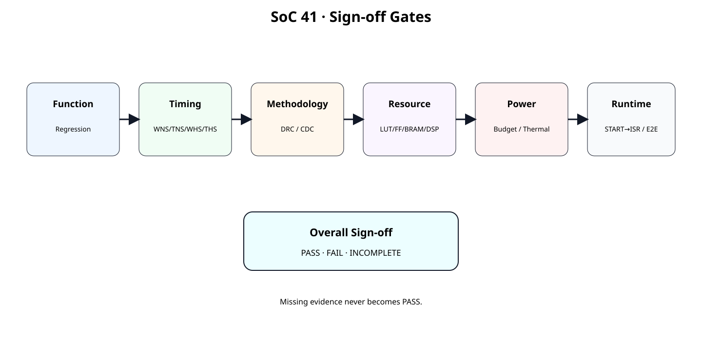
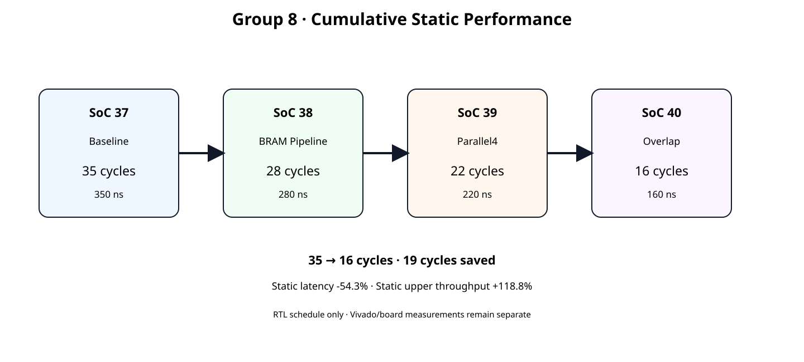
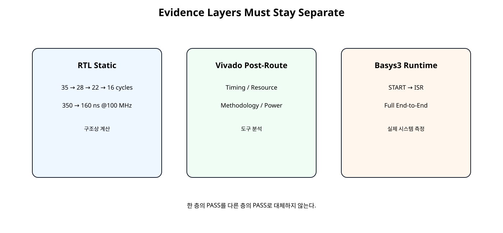

# Group 8 Cumulative Sign-off Matrix


## Group 8


## 이번 장의 목표


[](../images/soc41/soc41_signoff_gates.svg)

성능 향상만 확인하지 않고 실제 Hardware 채택에 필요한 Gate를 모두 통과시킨다.


## Group 8 전체 위치


[](../images/soc41/soc41_group8_progression.svg)

Baseline → Memory → Compute → Dataflow → Sign-off 순서로 진행했다.


## Hardware Freeze


## 정적 성능 누적


| 단계 | 구조 변경 | Cycle | @100 MHz |
| --- | --- | --- | --- |
| SoC37 | Baseline | 35 | 350 ns |
| SoC38 | BRAM Read Pipeline | 28 | 280 ns |
| SoC39 | Parallel4 Requant | 22 | 220 ns |
| SoC40 | Data/Compute Overlap | 16 | 160 ns |


## 35 → 16 cycles


## Baseline 대비 개선


| Metric | SoC37 | SoC40 |
| --- | --- | --- |
| Static Latency | 350 ns | 160 ns |
| Baseline 대비 | 기준 | -54.3% |
| Upper jobs/s | 2.857 M | 6.250 M |
| Upper Throughput | 기준 | +118.8% |

모두 RTL Static Schedule 기준이며 실제 Basys3 성능이 아니다.


## Evidence 3계층


[](../images/soc41/soc41_evidence_layers.svg)

정적 계산, Vivado Post-Route, 실제 Board Runtime을 서로 대체하지 않는다.


## 왜 계층을 분리하는가

16 cycles가 맞아도 100 MHz Timing Closure가 실패할 수 있고, Timing이 PASS해도 Resource/Power Budget을 초과할 수 있다. Vivado Report가 좋아도 실제 CPU→IRQ→Result 경로가 예상보다 느릴 수 있다.


## Sign-off Gate


[](../images/soc41/soc41_signoff_gates.svg)

Missing Evidence는 PASS로 올리지 않는다.


## Functional Gate


```text
RTL Regression
JOB0 / JOB1
JOB_ID 1→2
Read 8 / Write 2
DONE IRQ / W1C
ERROR IRQ
```


## Timing Gate

AMD UG906 2026.1 기준 Timing Sign-off는 Placement/Route 이후 필수 확인 단계다. Post-Implementation Timing Summary를 실제 Sign-off 근거로 사용한다.


## WNS / TNS

Setup Violation이 없는지 확인한다.


## WHS / THS

Setup PASS만으로 Timing Sign-off를 완료하지 않는다.


## Constraint 완전성

AMD UG949는 Timing 결과를 보기 전에 모든 Synchronous Endpoint가 올바르게 Constraint되었는지 확인하고 check_timing과 Timing Summary의 Unconstrained Paths를 확인하도록 안내한다.


## Bus Skew

AMD UG906는 report_timing_summary가 Bus Skew Constraint를 포함하지 않는다고 명시한다. 해당 Constraint를 사용하는 경우 report_bus_skew를 별도로 확인한다.


## Methodology Gate

report_methodology는 RTL, 합성 Netlist/Constraint, 구현 Timing 단계의 Methodology 문제를 검출한다. Critical Warning을 우선 해결한다.


## DRC / CDC

Timing Slack이 양수라도 Clock/CDC/Constraint 문제가 있으면 실제 Hardware 안정성이 보장되지 않는다. CDC가 존재하면 report_cdc도 별도 검토한다.


## Resource Gate

Source 코드의 Instance 개수 대신 실제 Implemented Utilization을 기록한다.


## Power / Thermal Gate

Power는 Total/Dynamic/Static과 Junction Temperature를 확인하고, 사용자가 정의한 Power/Thermal Budget과 비교한다.


## Power Activity

AMD UG907는 Voltage/Environment가 Static Power에, Activity/Voltage가 Dynamic Power에 큰 영향을 준다고 설명한다. Power 값과 함께 Activity Source, Ambient, Airflow, Voltage 조건을 기록한다.


## Runtime Gate


```text
START → ISR
Tensor Fill → Verify
min / average / max
repeat count
```


## AXI Timer / 반복측정

UART Print는 측정구간 밖에 두고, Warm-up 후 여러 Job을 반복하여 평균만이 아니라 min/max도 함께 기록한다.


## Static Reference


```text
SoC41 GROUP-8 STATIC PROGRESSION
clock = 100 MHz

SoC37 Baseline: 35 cycles, 350.0 ns, 2,857,142.857 upper jobs/s
  change = Baseline
  step latency reduction = 0.0%
  cumulative latency reduction = 0.0%
  cumulative upper-throughput gain = 0.0%
SoC38 BRAM Read Pipeline: 28 cycles, 280.0 ns, 3,571,428.571 upper jobs/s
  change = Read bubble removal
  step latency reduction = 20.0%
  cumulative latency reduction = 20.0%
  cumulative upper-throughput gain = 25.0%
SoC39 Parallel4 Requant: 22 cycles, 220.0 ns, 4,545,454.545 upper jobs/s
  change = Spatial parallelism
  step latency reduction = 21.4%
  cumulative latency reduction = 37.1%
  cumulative upper-throughput gain = 59.1%
SoC40 Data/Compute Overlap: 16 cycles, 160.0 ns, 6,250,000.000 upper jobs/s
  change = Prefetch + overlap
  step latency reduction = 27.3%
  cumulative latency reduction = 54.3%
  cumulative upper-throughput gain = 118.8%

GROUP-8 STATIC RESULT
35 -> 16 cycles
350.0 ns -> 160.0 ns @ 100 MHz
19 cycles saved
cumulative static latency reduction = 54.3%
cumulative static upper-throughput gain = 118.8%

IMPORTANT:
- These are RTL schedule values.
- WNS/TNS/WHS/THS are not measured here.
- LUT/FF/DSP/BRAM are not measured here.
- Power/thermal are not measured here.
- Basys3 START->ISR and end-to-end latency are not measured here.
SOC41 GROUP8 STATIC REFERENCE: PASS
Spreadsheet runtime warmup failed during python startup
Traceback (most recent call last):
  File "/tmp/tmp.L2TH2Y5coc/artifact_tool_v2-2.8.22/artifact_tool/patches/warm_spreadsheet_runtime_on_startup.py", line 26, in warm_spreadsheet_runtime_on_startup
  File "/tmp/tmp.L2TH2Y5coc/artifact_tool_v2-2.8.22/artifact_tool/spreadsheet_warmup.py", line 772, in warm_spreadsheet_runtime
  File "/tmp/tmp.L2TH2Y5coc/artifact_tool_v2-2.8.22/artifact_tool/rpc/connection.py", line 37, in get_or_create_client
  File "/tmp/tmp.L2TH2Y5coc/artifact_tool_v2-2.8.22/artifact_tool/rpc/daemon.py", line 124, in start_daemon
TimeoutError: Timed out waiting for artifact tool daemon socket. Set ARTIFACT_TOOL_RPC_DAEMON_STARTUP_TIMEOUT_S=<seconds> to increase the limit.
```


## Sign-off JSON


```text
{
  "design": {
    "chapter": "SoC41",
    "device": "xc7a35tcpg236-1",
    "board": "Basys3",
    "target_clock_mhz": 100.0,
    "vivado_version": null,
    "vitis_version": null,
    "bitstream_id": null
  },
  "functional": {
    "rtl_regression_pass": null,
    "job0_expected_pass": null,
    "job1_expected_pass": null,
    "descriptor_error_irq_pass": null,
    "done_irq_w1c_pass": null,
    "job_id_sequence_pass": null
  },
  "timing": {
    "wns_ns": null,
    "tns_ns": null,
    "whs_ns": null,
    "ths_ns": null,
    "unconstrained_paths": null,
    "pulse_width_violations": null,
    "timing_critical_warnings": null
  },
  "methodology": {
    "critical_warnings": null,
    "drc_errors": null,
    "cdc_critical": null
  },
  "resources": {
    "lut_used": null,
    "lut_available": null,
    "ff_used": null,
    "ff_available": null,
    "bram_used": null,
    "bram_available": null,
    "dsp_used": null,
    "dsp_available": null
  },
  "power": {
    "activity_source": null,
    "total_on_chip_w": null,
    "dynamic_w": null,
    "device_static_w": null,
    "junction_temp_c": null,
    "ambient_c": null,
    "airflow_lfm": null,
    "power_budget_w": null,
    "junction_limit_c": null
  },
  "runtime": {
    "measurement_method": null,
    "repeat_count": null,
    "start_to_isr_avg_us": null,
    "full_e2e_avg_us": null,
    "full_e2e_min_us": null,
    "full_e2e_max_us": null,
    "baseline_full_e2e_avg_us": null
  }
}
```

측정하지 않은 값은 null로 둔다.


## 자동 판정 원칙

도구 버전·Bitstream 식별 정보가 없으면 INCOMPLETE로 남긴다. 음수 자원·전력·실행시간과 NaN/Infinity는 FAIL로 처리한다. 종료 코드는 PASS 0, FAIL 1, INCOMPLETE 2이다.


## INCOMPLETE의 의미


```text
SoC41 SIGN-OFF EVALUATION
functional  : INCOMPLETE
  missing: rtl_regression_pass, job0_expected_pass, job1_expected_pass, descriptor_error_irq_pass, done_irq_w1c_pass, job_id_sequence_pass
timing      : INCOMPLETE
  missing: wns_ns, tns_ns, whs_ns, ths_ns, unconstrained_paths, pulse_width_violations, timing_critical_warnings
methodology : INCOMPLETE
  missing: critical_warnings, drc_errors, cdc_critical
resources   : INCOMPLETE
  missing: lut_used, lut_available, ff_used, ff_available, bram_used, bram_available, dsp_used, dsp_available
power       : INCOMPLETE
  missing: activity_source, total_on_chip_w, dynamic_w, device_static_w, junction_temp_c, ambient_c, power_budget_w, junction_limit_c
runtime     : INCOMPLETE
  missing: measurement_method, repeat_count, start_to_isr_avg_us, full_e2e_avg_us, full_e2e_min_us, full_e2e_max_us
overall     : INCOMPLETE
Spreadsheet runtime warmup failed during python startup
Traceback (most recent call last):
  File "/tmp/tmp.L2TH2Y5coc/artifact_tool_v2-2.8.22/artifact_tool/patches/warm_spreadsheet_runtime_on_startup.py", line 26, in warm_spreadsheet_runtime_on_startup
  File "/tmp/tmp.L2TH2Y5coc/artifact_tool_v2-2.8.22/artifact_tool/spreadsheet_warmup.py", line 772, in warm_spreadsheet_runtime
  File "/tmp/tmp.L2TH2Y5coc/artifact_tool_v2-2.8.22/artifact_tool/rpc/connection.py", line 37, in get_or_create_client
  File "/tmp/tmp.L2TH2Y5coc/artifact_tool_v2-2.8.22/artifact_tool/rpc/daemon.py", line 124, in start_daemon
TimeoutError: Timed out waiting for artifact tool daemon socket. Set ARTIFACT_TOOL_RPC_DAEMON_STARTUP_TIMEOUT_S=<seconds> to increase the limit.
```


## Sign-off Evaluator


```text
#!/usr/bin/env python3
import json
import math
import sys
from pathlib import Path


def missing(section: dict, keys: list[str]) -> list[str]:
    return [
        key for key in keys
        if section.get(key) is None or (
            isinstance(section.get(key), str)
            and not section[key].strip()
        )
    ]


def all_true(section: dict, keys: list[str]) -> bool:
    return all(
        section.get(key) is True
        for key in keys
    )


# (추가) bool·NaN·Infinity를 측정 숫자로 승인하지 않는다.
def finite_number(value) -> bool:
    return type(value) in (int, float) and math.isfinite(value)


def main() -> int:
    if len(sys.argv) != 2:
        print(
            "usage: python3 evaluate_soc41_signoff.py "
            "data/soc41_signoff_input.json"
        )
        return 2

    path = Path(sys.argv[1])
    try:
        data = json.loads(path.read_text(encoding="utf-8"))
    except (OSError, ValueError) as exc:
        print(f"Invalid input: {exc}\noverall     : FAIL")
        return 1

    sections = ("design", "functional", "timing", "methodology",
                "resources", "power", "runtime")
    if not isinstance(data, dict) or any(
        not isinstance(data.get(key), dict) for key in sections
    ):
        print("Invalid input sections\noverall     : FAIL")
        return 1

    results = {}

    # (추가) 측정 결과를 실제 도구 버전·Bitstream에 대응시킨다.
    design = data["design"]
    dkeys = ["device", "board", "target_clock_mhz", "vivado_version",
             "vitis_version", "bitstream_id"]
    dm = missing(design, dkeys)
    design_pass = (
        finite_number(design.get("target_clock_mhz"))
        and design["target_clock_mhz"] > 0
        and all(isinstance(design.get(k), str) and design[k].strip()
                for k in dkeys if k != "target_clock_mhz")
    )
    results["design"] = ("INCOMPLETE" if dm else
                         "PASS" if design_pass else "FAIL", dm)

    functional = data["functional"]
    fkeys = [
        "rtl_regression_pass",
        "job0_expected_pass",
        "job1_expected_pass",
        "descriptor_error_irq_pass",
        "done_irq_w1c_pass",
        "job_id_sequence_pass",
    ]

    fm = missing(functional, fkeys)

    if fm:
        results["functional"] = (
            "INCOMPLETE",
            fm,
        )
    else:
        results["functional"] = (
            "PASS" if all_true(functional, fkeys) else "FAIL",
            [],
        )

    timing = data["timing"]
    tkeys = [
        "wns_ns",
        "tns_ns",
        "whs_ns",
        "ths_ns",
        "unconstrained_paths",
        "pulse_width_violations",
        "timing_critical_warnings",
    ]

    tm = missing(timing, tkeys)

    if tm:
        results["timing"] = (
            "INCOMPLETE",
            tm,
        )
    else:
        timing_pass = (
            all(finite_number(timing[k]) for k in tkeys)
            and timing["wns_ns"] >= 0.0
            and timing["tns_ns"] >= 0.0
            and timing["whs_ns"] >= 0.0
            and timing["ths_ns"] >= 0.0
            and timing["unconstrained_paths"] == 0
            and timing["pulse_width_violations"] == 0
            and timing["timing_critical_warnings"] == 0
        )

        results["timing"] = (
            "PASS" if timing_pass else "FAIL",
            [],
        )

    methodology = data["methodology"]
    mkeys = [
        "critical_warnings",
        "drc_errors",
        "cdc_critical",
    ]

    mm = missing(methodology, mkeys)

    if mm:
        results["methodology"] = (
            "INCOMPLETE",
            mm,
        )
    else:
        method_pass = (
            all(type(methodology[k]) is int for k in mkeys)
            and methodology["critical_warnings"] == 0
            and methodology["drc_errors"] == 0
            and methodology["cdc_critical"] == 0
        )

        results["methodology"] = (
            "PASS" if method_pass else "FAIL",
            [],
        )

    resources = data["resources"]
    pairs = [
        ("lut_used", "lut_available"),
        ("ff_used", "ff_available"),
        ("bram_used", "bram_available"),
        ("dsp_used", "dsp_available"),
    ]

    rm = []

    for used, available in pairs:
        if resources.get(used) is None:
            rm.append(used)

        if resources.get(available) is None:
            rm.append(available)

    if rm:
        results["resources"] = (
            "INCOMPLETE",
            rm,
        )
    else:
        resource_pass = all(
            finite_number(resources[used])
            and finite_number(resources[available])
            and 0 <= resources[used] <= resources[available]
            and resources[available] > 0
            for used, available in pairs
        )

        results["resources"] = (
            "PASS" if resource_pass else "FAIL",
            [],
        )

    power = data["power"]
    pkeys = [
        "activity_source",
        "total_on_chip_w",
        "dynamic_w",
        "device_static_w",
        "junction_temp_c",
        "ambient_c",
        "power_budget_w",
        "junction_limit_c",
    ]

    pm = missing(power, pkeys)

    if pm:
        results["power"] = (
            "INCOMPLETE",
            pm,
        )
    else:
        power_pass = (
            isinstance(power["activity_source"], str)
            and all(finite_number(power[k]) for k in pkeys
                if k != "activity_source")
            and all(power[k] >= 0 for k in
                    ("total_on_chip_w", "dynamic_w", "device_static_w"))
            and power["power_budget_w"] > 0
            and power["total_on_chip_w"]
            <= power["power_budget_w"]
            and power["junction_temp_c"]
            <= power["junction_limit_c"]
        )

        results["power"] = (
            "PASS" if power_pass else "FAIL",
            [],
        )

    runtime = data["runtime"]
    rkeys = [
        "measurement_method",
        "repeat_count",
        "start_to_isr_avg_us",
        "full_e2e_avg_us",
        "full_e2e_min_us",
        "full_e2e_max_us",
    ]

    rtm = missing(runtime, rkeys)

    if rtm:
        results["runtime"] = (
            "INCOMPLETE",
            rtm,
        )
    else:
        sane = (
            isinstance(runtime["measurement_method"], str)
            and type(runtime["repeat_count"]) is int
            and runtime["repeat_count"] > 0
            and all(finite_number(runtime[k]) and runtime[k] >= 0
                    for k in rkeys if k not in
                    ("measurement_method", "repeat_count"))
            and runtime["full_e2e_min_us"]
            <= runtime["full_e2e_avg_us"]
            <= runtime["full_e2e_max_us"]
        )

        results["runtime"] = (
            "RECORDED" if sane else "FAIL",
            [],
        )

    print("SoC41 SIGN-OFF EVALUATION")

    for name, (status, missing_keys) in results.items():
        print(
            f"{name:12s}: {status}"
        )

        if missing_keys:
            print(
                "  missing: "
                + ", ".join(missing_keys)
            )

    hard_gates = [
        "design",
        "functional",
        "timing",
        "methodology",
        "resources",
        "power",
    ]

    if any(
        results[key][0] == "FAIL"
        for key in results
    ):
        overall = "FAIL"
    elif any(
        results[key][0] == "INCOMPLETE"
        for key in hard_gates
    ):
        overall = "INCOMPLETE"
    elif results["runtime"][0] == "INCOMPLETE":
        overall = "INCOMPLETE"
    elif results["runtime"][0] == "FAIL":
        overall = "FAIL"
    else:
        overall = "PASS"

    print(f"overall     : {overall}")

    # (변경) 미완료도 Shell/CI에서 성공으로 오인하지 않게 구분한다.
    return {"PASS": 0, "FAIL": 1, "INCOMPLETE": 2}[overall]


if __name__ == "__main__":
    raise SystemExit(main())
```


## Full Vivado Collector


```text
# SoC 41 · Group-8 full sign-off report collector
#
# Usage:
#   open_project <your_project.xpr>
#   open_run impl_1
#   source collect_soc41_signoff_reports.tcl
#
# The script only reports the currently opened implemented design.
# It does not fabricate PASS/FAIL values.

set script_dir [file dirname [file normalize [info script]]]
set root_dir [file normalize [file join $script_dir ".."]]
set out_dir [file normalize [file join $root_dir "reports" "signoff"]]

file mkdir $out_dir

if {[llength [get_cells -quiet]] == 0} {
    error "No implemented design is open. Run open_run impl_1 first."
}

# ------------------------------------------------------------
# 1. Timing / constraints
# ------------------------------------------------------------
check_timing \
    -verbose \
    -file [file join $out_dir "01_check_timing.rpt"]

report_timing_summary \
    -delay_type min_max \
    -report_unconstrained \
    -max_paths 100 \
    -file [file join $out_dir "02_timing_summary.rpt"]

# report_timing_summary does not cover bus-skew constraints.
# If the design has relevant bus-skew constraints, record them too.
if {[catch {
    report_bus_skew \
        -file [file join $out_dir "03_bus_skew.rpt"]
} bus_skew_error]} {
    set fh [open [file join $out_dir "03_bus_skew_NOT_AVAILABLE.txt"] w]
    puts $fh $bus_skew_error
    close $fh
}

# ------------------------------------------------------------
# 2. Methodology / DRC / CDC
# ------------------------------------------------------------
report_methodology \
    -file [file join $out_dir "04_methodology.rpt"]

report_drc \
    -file [file join $out_dir "05_drc.rpt"]

if {[catch {
    report_cdc \
        -details \
        -file [file join $out_dir "06_cdc.rpt"]
} cdc_error]} {
    set fh [open [file join $out_dir "06_cdc_NOT_AVAILABLE.txt"] w]
    puts $fh $cdc_error
    close $fh
}

# ------------------------------------------------------------
# 3. Resource / clock / QoR
# ------------------------------------------------------------
report_utilization \
    -hierarchical \
    -file [file join $out_dir "07_utilization_hierarchical.rpt"]

report_clock_utilization \
    -file [file join $out_dir "08_clock_utilization.rpt"]

report_design_analysis \
    -setup \
    -max_paths 100 \
    -logic_level_distribution \
    -file [file join $out_dir "09_design_analysis_setup.rpt"]

if {[catch {
    report_qor_assessment \
        -file [file join $out_dir "10_qor_assessment.rpt"]
} qor_error]} {
    set fh [open [file join $out_dir "10_qor_assessment_NOT_AVAILABLE.txt"] w]
    puts $fh $qor_error
    close $fh
}

# ------------------------------------------------------------
# 4. Power / thermal
# ------------------------------------------------------------
# Before using this report for sign-off, record:
# - activity source
# - voltage
# - ambient
# - airflow / thermal environment
#
# Post-route power is the preferred implementation-stage estimate.
report_power \
    -file [file join $out_dir "11_power_post_route.rpt"]

# ------------------------------------------------------------
# 5. Checkpoint
# ------------------------------------------------------------
write_checkpoint \
    -force \
    [file join $out_dir "soc41_signoff_snapshot.dcp"]

puts ""
puts "SoC 41 sign-off reports collected."
puts "Fill data/soc41_signoff_input.json from the actual reports/board run."
puts "Then run:"
puts "  python3 scripts/evaluate_soc41_signoff.py data/soc41_signoff_input.json"
```


## Timing Report Set


```text
check_timing
report_timing_summary
report_bus_skew (해당 시)
```


## Methodology Report Set


```text
report_methodology
report_drc
report_cdc (해당 시)
```


## Resource / QoR Report Set


```text
report_utilization -hierarchical
report_clock_utilization
report_design_analysis
report_qor_assessment
```


## Power Report Set

Post-Route report_power를 사용하고 Activity/Environment/Voltage 조건을 함께 보존한다.


## Post-Route Snapshot

Sign-off 시점의 Implemented Design을 DCP로 저장하여 나중에 Report를 다시 열 수 있게 한다.


## Sign-off Matrix

doc/GROUP8_SIGNOFF_MATRIX.md에서 Static Schedule과 실제 Functional/Timing/Resource/Power/Runtime Evidence를 한 문서에 정리한다.


## 실제 값 입력 절차


## Overall PASS 조건

Function, Timing, Methodology/DRC/CDC, Resource, Power/Thermal Evidence가 모두 존재하고 기준을 만족하며 Runtime 측정도 기록되어야 Overall PASS로 올린다.


## FAIL과 INCOMPLETE 구분


| Status | 의미 |
| --- | --- |
| PASS | 필요 Evidence가 있고 기준 만족 |
| FAIL | 실제 Evidence가 기준 위반 |
| INCOMPLETE | 아직 측정/입력하지 않음 |


## Group 8 종료 조건

정적 16 cycles 달성만으로 종료하지 않는다. 실제 Sign-off Evidence까지 확보한 시점에 Group 8을 닫는다.


## 다음 단계 연결

Group 8 이후에는 검증된 Accelerator를 기준으로 NPU 구조 확장, 더 큰 Tensor/Tile 구조, DMA/Streaming 또는 장기 목표인 RISC-V CPU 결합 단계로 넘어갈 수 있다.


## 오류 점검


| 오류 | 문제 | 조치 |
| --- | --- | --- |
| 16 cycles만 보고 PASS | Vivado/Board Evidence 없음 | Sign-off Gate 수행 |
| WNS만 확인 | Hold/Constraint 누락 | Timing Summary 전체 확인 |
| Unconstrained Path 존재 | Timing 분석 신뢰도 저하 | check_timing/XDC 수정 |
| Vectorless Power만 사용 | 실제 Activity와 차이 | Activity 조건 기록 |
| Missing 값을 0으로 입력 | 가짜 PASS 가능 | null 유지 |
| Static Latency와 E2E 혼동 | CPU/AXI/ISR 미포함 | Evidence 계층 분리 |


## SoC 41 완료 체크리스트

- [ ] SoC40 Hardware를 byte-identical하게 동결한다.
- [ ] Group8 정적 35→16 cycles를 재현한다.
- [ ] Functional Regression Evidence를 기록한다.
- [ ] WNS/TNS/WHS/THS를 Post-Route에서 확인한다.
- [ ] Unconstrained Path와 Pulse Width를 확인한다.
- [ ] Methodology/DRC/CDC를 확인한다.
- [ ] LUT/FF/BRAM/DSP 실제 사용량을 기록한다.
- [ ] Power Activity/Environment/Budget을 기록한다.
- [ ] Basys3 START→ISR 및 Full E2E를 반복 측정한다.
- [ ] 미측정 값은 INCOMPLETE로 유지한다.
- [ ] JSON Evaluator와 Matrix 결과가 일치하는지 확인한다.

## 공식 문서 및 근거


| AMD UG906 · Verifying Timing Signoff · 2026.1 | Post-Implementation Timing Sign-off |
| --- | --- |
| AMD UG949 · Checking That Your Design is Properly Constrained · 2026.1 | check_timing / Unconstrained Path / Methodology |
| AMD UG949 · Running Report Methodology · 2026.1 | RTL/Netlist/Constraint/Timing Methodology Check |
| AMD UG907 · Vivado Power Analysis · 2026.1 | Post-Route Power 분석 |
| AMD UG907 · Setting Up Power Analysis · 2026.1 | Activity / Voltage / Environment 조건 |

